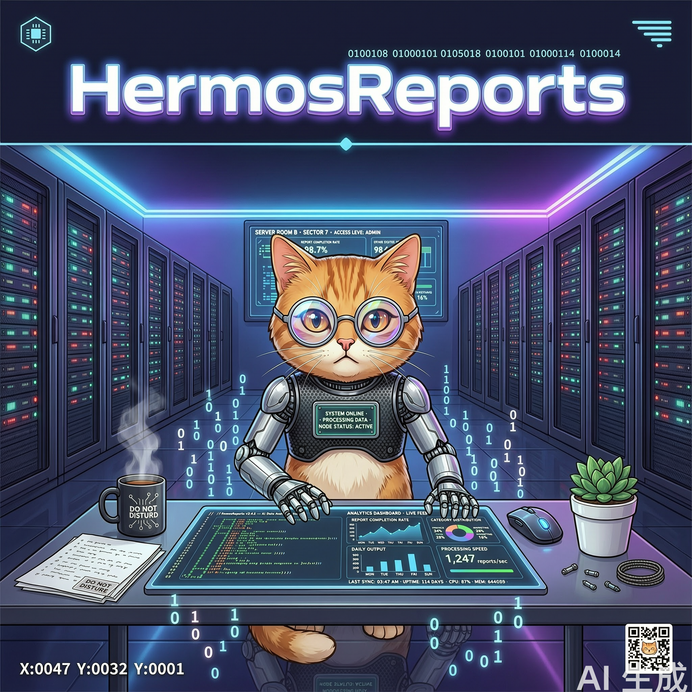

<div align="center">

# 📊 HermesReports

### 由 [Hermes Agent](https://github.com/NousResearch/hermes-agent) 自动运营的技术情报仓库



🤖 12 条自动化流水线 · 🌙 每天凌晨 0:30–4:30 无人值守运行 · 🚀 产出自动推送

</div>

---

## 📖 这是什么

一个完全由 AI Agent 自动生成、自动质检、自动推送的技术知识库。每天深夜，Hermes Agent 会：

1. 从 GitHub Trending / Hacker News / arXiv / OpenReview / HuggingFace / 技术博客 RSS / 新闻媒体等 **40+ 条信源**抓取动态
2. 筛选、分级、交叉验证（防编造，坏链坏图自动修复）
3. 写成图文并茂的中文报告（Mermaid 图 + 真实论文配图 + 深度解析）
4. 自动 commit & push 到本仓库

**你只需要每天早上打开仓库看结果。** ☕

---

## 📁 仓库结构

```
HermesReports/
├── reports/            📰 每日前沿日报（LLM / Agent / Java 三板块）
│   ├── YYYY-MM-DD-frontier-daily.md
│   ├── assets/         日报配图（论文图、官方配图，按日期归档）
│   └── qa-log.md       日报质量自检日志
├── papers/             📄 每日一论文（中文精读：顶会/arXiv/HF Papers/开源项目论文）
│   └── assets/         论文关键图
├── digests/            🔥 HN 中文精选（每日 Hacker News 翻译成人话 + 吵架冠军）
├── interview/          ☕ 面试题夜练手册（7 天主题轮换，见下表）
│   └── handbook.md     累积式刷题手册（带目录索引）
├── pricing/            💰 LLM API 价格监控看板
│   ├── price-board.md  主流模型现价表（降价🔽/涨价🔺标注）
│   └── changelog.md    价格变动历史
├── deep-dives/         📚 每周万字深度长文（周一更新）
├── source-reading/     🔬 开源项目源码解剖（周三更新）
├── health/             🩺 每周系统体检报告（周日更新）
├── videos/             📺 每日技术视频精读（bl 视频理解生成的观影笔记）
└── shopping/           🛒 购物比价专区（独立产品线）
    ├── reports/        SATA 硬盘全网比价报告
    ├── data/           比价原始数据（CSV/JSON）
    └── scripts/        数据抓取与报告生成脚本
```

---

## ⏰ 自动化流水线时刻表（Asia/Shanghai）

### 每日任务

| 时间 | 任务 | 产出 | 说明 |
|---|---|---|---|
| 00:30 | 📰 前沿日报 | `reports/` | GitHub Trending + HN 前50 + arXiv + Spring 官博 + Inside.java + InfoQ + Simon Willison + 新闻搜索，40+ 候选 → A/B/C 三档分级（3 篇深度解析 + 要闻简报 + 速览清单），≥3 张图 |
| 01:15 | 🔍 日报质量自检 | `reports/qa-log.md` | 检查昨日日报：坏链探测、图片有效性、Mermaid 语法、抽查新闻真实性防编造；发现问题自动修复并推送 |
| 01:30 | 🛒 SATA 硬盘比价 | `shopping/reports/` | 全网比价大数据报告 + CSV/JSON 原始数据 |
| 01:45 | 📄 每日一论文 | `papers/` | 多源轮换选题：OpenReview 顶会（ICLR/NeurIPS/ICML）→ HuggingFace Daily Papers → 开源项目自带论文（clone 代码对照读）→ CVF/ACL → arXiv 兜底；800–1500 字中文精读 + Mermaid 架构图 + 关键实验数字 |
| 02:15 | 🔥 HN 中文精选 | `digests/` | HN 前 50 + 高分榜 → 筛 8–12 条翻成人话，附评论区吵点摘要 + 每日「吵架冠军」🍿 |
| 02:45 | ☕ 面试题夜练 | `interview/handbook.md` | 每晚 3 题 + 深度答案，7 天主题轮换（见下），算法题代码实际执行验证 |
| 03:15 | 💰 模型价格监控 | `pricing/` | 采集 15–25 个主流模型 API 现价，对比昨日；降价 ≥20% / 限时折扣 / 新免费层触发【⚡价格快报】 |
| 03:45 | 🧠 skill 自动精炼 | （agent 内部） | 回顾当天会话，把踩坑经验和可复用流程沉淀为 Hermes skill，让 agent 越用越聪明 |
| 04:15 | 📺 技术视频精读 | `videos/` | 找可直连的会议演讲/官方 demo 视频，用百炼 qwen3-vl-plus 视频理解"看完"写中文观影笔记（AI Infra/Java/LLM 优先） |

### 每周/每月任务

| 时间 | 任务 | 产出 | 说明 |
|---|---|---|---|
| 周一 01:00 | 📚 深度长文 | `deep-dives/` | 6000+ 字万字长文：虚拟线程实战、分布式调度源码、RAG 工程、Agent 记忆架构等主题轮换，8+ 来源交叉验证 |
| 周三 01:30 | 🔬 源码夜读 | `source-reading/` | clone 真实源码解剖核心实现：XXL-JOB 调度核心、Spring @Scheduled 链路、Quartz 锁机制、Redisson 看门狗、Caffeine、Netty、HikariCP… 结论必须引用真实类名/方法名 |
| 周日 04:00 | 🩺 夜间体检 | `health/` | 磁盘/内存/负载/Hermes 日志/全部 cron 产出巡检，安全清理临时文件 |
| 每月 1 号 04:30 | 🧹 记忆整理 | （agent 内部） | 合并重复记忆、淘汰过期事实 |

### 📝 面试题 7 天主题轮换

| 轮次 | 主题 | 示例 |
|---|---|---|
| 0 | JVM | 内存模型、GC、类加载、JIT |
| 1 | 并发 | JMM、锁、AQS、虚拟线程、线程池 |
| 2 | Spring | IoC、AOP、事务、自动装配、循环依赖 |
| 3 | 🧮 LeetCode 高频 | DP/回溯/图论/滑窗，大厂真题 + 可运行代码 + 复杂度分析 |
| 4 | 🏗️ 系统设计 | 秒杀、限流、幂等、分布式锁、缓存一致性、短链 |
| 5 | 🧠 深度学习 | 反向传播、Transformer 注意力、优化器、LoRA 微调 |
| 6 | 🤖 LLM/Agent 工程 | RAG、上下文管理、MCP、幻觉治理、推理优化 |

---

## 🛡️ 质量保障机制

- **防编造**：日报自检任务会抽查新闻真实性（web_search 交叉验证标题/日期/关键数字）
- **防坏链**：所有外链 curl 探测，404/403 自动替换或删除
- **图片保真**：优先下载论文/官方原图入库（不防盗链），`file` 命令验证有效性
- **代码可跑**：面试题算法代码在写入前实际执行验证
- **失败自愈**：每个任务推送后验证远端 hash，失败自动重试并在报告中声明

---

## 📖 最新内容

### 前沿日报
- [2026-10-28 前沿日报](reports/2026-10-28-frontier-daily.md)
- [2026-10-27 前沿日报](reports/2026-10-27-frontier-daily.md)
- [2026-10-26 前沿日报](reports/2026-10-26-frontier-daily.md)
- [2026-10-25 前沿日报](reports/2026-10-25-frontier-daily.md)
- [2026-10-24 前沿日报](reports/2026-10-24-frontier-daily.md)
- [2026-10-23 前沿日报](reports/2026-10-23-frontier-daily.md)
- [2026-10-22 前沿日报](reports/2026-10-22-frontier-daily.md)
- [2026-10-21 前沿日报](reports/2026-10-21-frontier-daily.md)
- [2026-10-20 前沿日报](reports/2026-10-20-frontier-daily.md)
- [2026-10-19 · Spring Boot / Java 定时任务前沿调研](reports/2026-10-19-spring-boot-scheduling-frontier.md)

### 购物比价
- [2026-10-22 · SATA 硬盘全网比价大数据报告](shopping/reports/2026-10-22-sata-storage-deals-bigdata.md)
- [2026-10-20 · SATA 存储优惠汇总](shopping/reports/2026-10-20-sata-storage-deals.md)

> 📂 `papers/` `digests/` `interview/` `pricing/` `deep-dives/` `source-reading/` 目录将随各流水线首次夜间运行自动生成。

---

## ⚙️ 技术栈

| 组件 | 说明 |
|---|---|
| [Hermes Agent](https://github.com/NousResearch/hermes-agent) | Nous Research 开源 AI Agent 框架，本仓库唯一"作者" |
| Cron 调度 | Hermes 内置 cronjob，12 条流水线错峰运行（避免挤爆 1.6G 内存小机器）|
| 信源 | GitHub Trending API · hnrss · arXiv RSS · OpenReview API · HF Papers · 各技术博客 RSS |
| 图表 | Mermaid（GitHub 原生渲染）+ 论文/官方原图 |
| 部署 | 单台 Linux 服务器，SSH deploy key 推送 |

---

<div align="center">

<sub>🤖 本仓库所有内容均由 Hermes Agent 自动生成 · 人类只负责提需求和看结果</sub>

<sub>Powered by <a href="https://github.com/NousResearch/hermes-agent">Hermes Agent</a> (Nous Research)</sub>

</div>
