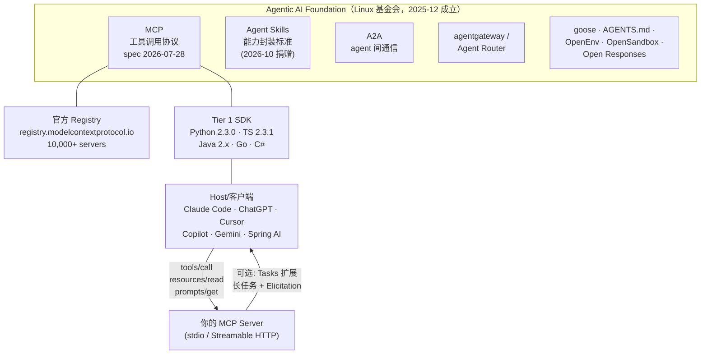
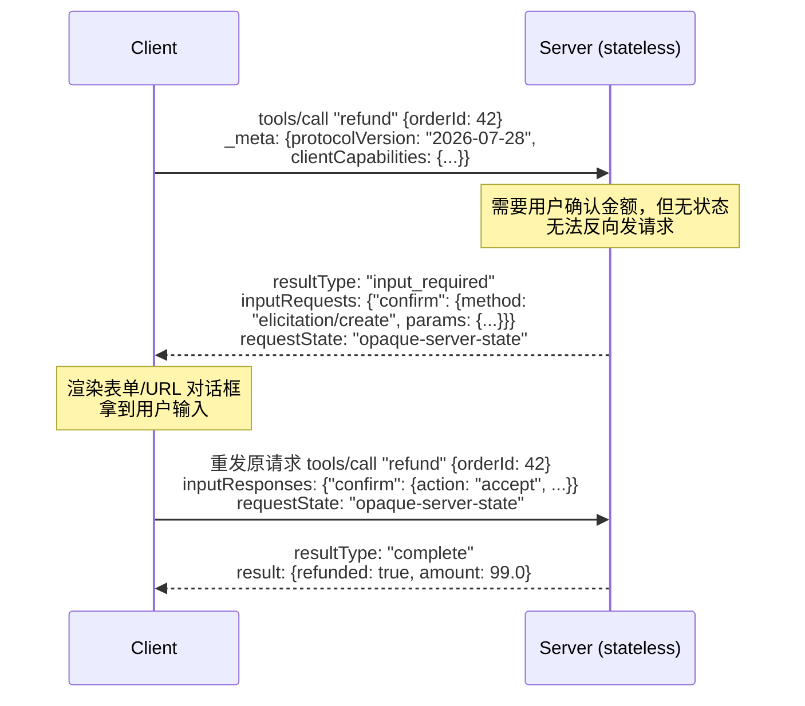
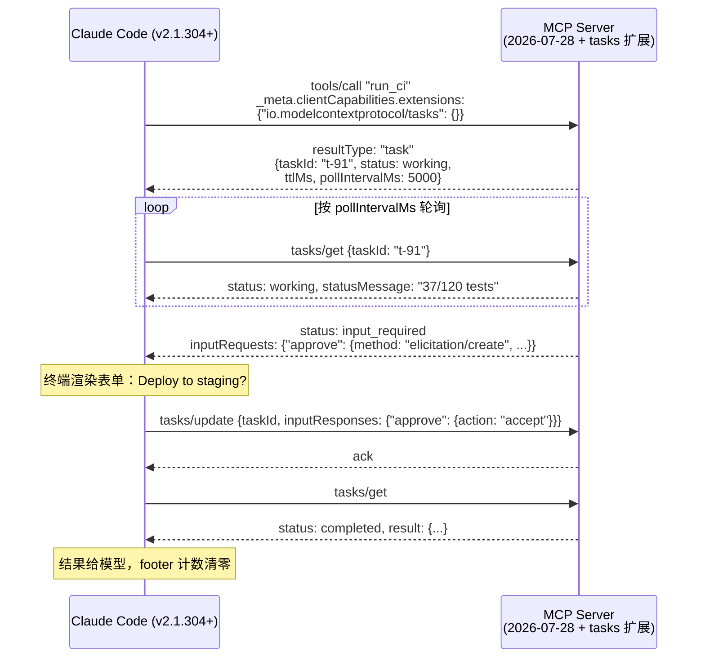

# MCP 生态全景 2026：无状态革命、Tasks 长任务与安全攻防的生产落地指南

> 深度长文 · 2026-10-26 · 面向 3-5 年经验工程师 · 阅读约 35 分钟
>
> 关键词：MCP 2026-07-28 spec / 无状态化 / MRTR / Tasks 扩展 / SDK v2 迁移 / Spring AI / OWASP MCP Top 10

---

## 一、开篇：你的 MCP 集成可能已经"过期"了

如果你在 2025 年写过 MCP server，你的代码里大概率有这些东西：`initialize` 握手、`Mcp-Session-Id` 头、`FastMCP` 类、`sampling/createMessage` 回调、SSE 长连接。**到 2026 年 10 月的今天，这些全部作废或进入废弃倒计时。**

过去一周（10-20 ~ 10-26）的日报里，MCP 相关动态出现了 7 次以上：Claude Code 落地 MCP Tasks + Elicitations（10-23）、Agent Skills 捐给 AAIF（10-22）、Microsoft agent-framework 强制迁移 MCP 2.x（10-22）、AWS 官方 agent-toolkit 把 MCP servers 全家桶推上 Trending（10-25）、Haystack 企业 MCP server 开放四端写权限（10-26）、Traefik MCP Server GA（10-22）。加上 7 月 28 日发布的 **2026-07-28 版 spec——MCP 历史上最大的一次破坏性改版（协议彻底无状态化）**，以及官方四大 SDK 集体跳上 v2 大版本，MCP 已经从"Anthropic 的开源协议"变成了"Linux 基金会治理的 agent 基础设施标准"。

这篇文章回答四个工程问题：

1. **协议层到底变了什么？** 无状态化、MRTR、Tasks 扩展的设计动机和 wire-level 细节；
2. **代码怎么迁？** Python / TypeScript / Java(Spring AI) 三条线的 v2 实战与版本矩阵；
3. **安全边界在哪？** 从 MCPTox 36.5% 平均攻击成功率到 OWASP MCP Top 10，哪些坑已有 CVE 编号；
4. **怎么选？** 什么场景用 stdio、什么场景上 Streamable HTTP + OAuth、什么时候需要 Tasks。

所有版本号、配置项、CVE 编号、统计数据均核对自官方 spec / SDK release notes / 一手安全研究报告，参考链接在文末。

---

## 二、生态全景：一张图看懂 MCP 在 2026 年的位置

### 2.1 治理与规模

MCP 由 Anthropic 于 2024 年 11 月开源，2025 年 12 月 9 日捐给 Linux 基金会旗下新成立的 **Agentic AI Foundation（AAIF）**——由 Anthropic、Block、OpenAI 共同发起，Google、Microsoft、AWS、Cloudflare、Bloomberg 站台。2026 年 10 月 22 日的 AGNTCon + MCPCon 北美站上，AAIF 宣布再收四个项目（Agent Skills、Open Responses、OpenEnv、OpenSandbox），**基金会项目总数达到 10 个**，与 A2A、Agent Router、agentgateway、AGENTS.md、goose、MCP 一起构成完整的 agent 互操作栈。

生态数字（Anthropic 捐赠公告口径）：**10,000+ 活跃公开 MCP server**，Python + TypeScript SDK **月下载量 97M+**，ChatGPT、Cursor、Gemini、Microsoft Copilot、VS Code 全部接入。官方 Registry（registry.modelcontextprotocol.io）2025 年 9 月上线 preview，用 DNS 验证做命名空间管理，提供 REST API 和标准化 `server.json` 格式。


*图 1：2026-10 时点的 MCP 生态位。协议归 AAIF 治理，分发靠官方 Registry，落地靠四大 Tier 1 SDK。*

### 2.2 架构基本盘（没变的部分）

MCP 的核心抽象仍然是三件套 + JSON-RPC 2.0：

- **Tools**：模型可调用的函数（`tools/list` 发现、`tools/call` 执行）；
- **Resources**：可读取的上下文数据（URI 寻址，`resources/read`）；
- **Prompts**：服务端定义的参数化提示模板（`prompts/get`）。

Host（如 Claude Code）内部为每个 server 连接维护一个 client 实例。变的不是"有什么原语"，而是**这些原语如何在网络上组织**——这正是 2026-07-28 spec 动刀的地方。

---

## 三、原理深入：2026-07-28 spec 的无状态革命

### 3.1 为什么要杀掉 session

旧模型（2025-11-25 及更早）：客户端先 `initialize` 握手协商版本与能力，服务端发 `Mcp-Session-Id`，后续所有请求带这个头；服务端可以主动发起请求（sampling / elicitation / roots）；HTTP GET 端点挂一条 SSE 长连接推送通知。

这个模型对**本地 stdio** 很自然，但对**远程部署**是灾难：

1. **水平扩容困难**——session 状态粘在某台实例上，负载均衡要做 session affinity，serverless 直接没法玩；
2. **长连接脆弱**——中间件（网关、CDN、企业代理）普遍对长连接有超时限制，SSE 断了要靠 `Last-Event-ID` 重放，实现复杂且各家不一致；
3. **双向 RPC 反直觉**——server 主动调 client（sampling）意味着 client 也要是个 server，防火墙、鉴权、多路复用全乱套。

2026-07-28 spec 的九项 major change 全部围绕一个目标：**把 MCP 变成纯粹的无状态请求-响应协议**，向 HTTP 的部署模型看齐（SEP-2567、SEP-2575）：

| # | 变更 | 替代方案 |
|---|---|---|
| 1 | 删除协议级 session 和 `Mcp-Session-Id` 头 | 跨调用状态用 server 自己铸造的 handle，作为普通 tool 参数传递 |
| 2 | 删除 `initialize`/`initialized` 握手 | 每个请求在 `_meta` 里自带 `io.modelcontextprotocol/protocolVersion` 和 `clientCapabilities` |
| 3 | 新增 `server/discover`（服务端 MUST 实现） | 一次性返回支持的版本、能力、身份 |
| 4 | HTTP GET 端点 + `resources/subscribe` 删除 | `subscriptions/listen`：单一长驻 POST 响应流，客户端显式 opt-in 四类通知 |
| 5 | 删除 `ping`、`logging/setLevel`、`roots/list_changed` | 日志级别改为每请求 `_meta` 里的 `logLevel` |
| 6 | 实验性 tasks 移出核心协议 | 官方扩展 `io.modelcontextprotocol/tasks`（SEP-2663） |
| 7 | 服务端主动请求（sampling/elicitation/roots）删除 | **MRTR**（Multi Round-Trip Requests，SEP-2322） |
| 8 | 所有 result 增加必填 `resultType` 字段 | `"complete"` 或 `"input_required"` |
| 9 | 删除 SSE 断线续传（`Last-Event-ID`） | 流断了就重发整个请求（新 request ID） |

### 3.2 MRTR：把"服务端反问"变成"客户端重试"

MRTR 是理解新 spec 的钥匙。旧模型里 server 想问用户一个问题（elicitation），走的是 server→client 的反向 RPC；新模型里流程反转：


*图 2：MRTR 多轮往返。server 返回 `input_required` + `inputRequests`，client 带上 `inputResponses` **完整重放原请求**。*

注意一个致命的工程含义：**原请求会被完整重放，所以工具必须幂等**。`refund` 这种写操作如果第一轮已经部分执行，重放就是双重退款。server 需要把中间状态编码进 `requestState`（不透明字符串，由 server 自己解释），并在重放时凭它恢复现场、跳过已完成步骤。spec 里 URL 模式的 elicitation 甚至把 `elicitationId` 和 `notifications/elicitation/complete` 都删了——浏览器侧交互完成后，client 也是靠重试原请求来获知结果的。

### 3.3 Tasks 扩展：长任务的协议级答案

MRTR 解决了"中途要输入"，但没解决"活儿要干 40 分钟"。阻塞连接不现实（网关超时），这就是 **Tasks 扩展**（`io.modelcontextprotocol/tasks`，规范在独立仓库 modelcontextprotocol/ext-tasks，基于 SEP-2663）的定位：

- server 对慢请求返回 `CreateTaskResult`（`resultType: "task"`），含 `taskId`、初始状态、`ttlMs`、`pollIntervalMs`——**任务在响应发出前必须已持久化**；
- client 用 `tasks/get` 轮询；状态机五档：`working` → `input_required` → `completed` / `failed` / `cancelled`（后三个是终态）；
- 任务中途要输入时，`tasks/get` 响应里带 `inputRequests`，client 用 `tasks/update` 提交 `inputResponses`——不需要第二条连接，也不需要 server 主动推送；
- `tasks/cancel` 是**协作式**的：server 确认收到但不保证停；
- 支持推送的 server 可经 `subscriptions/listen` 发 `notifications/tasks`（每条携带完整任务状态，省一次 `tasks/get` 往返），但**轮询是默认姿势**；
- task ID 是持久句柄：client 崩溃重启后凭 ID 继续轮询。这就是"crash resilience"——Notion 10 月重构 agent 体系时自己手写的"持久 worker + 任务续跑"，现在有了协议形状。

**Claude Code 已在 10-23 落地**（v2.1.304+，公测）：Tasks + Elicitations 覆盖终端 CLI、Agent SDK、GitHub Actions 三个面；VS Code 扩展和桌面版暂不支持；Bedrock 等不拉 feature flag 的第三方渠道被排除；server 必须说 2026-07-28 协议；调用必须来自主对话而非 subagent。实现细节里有几个值得抄的数字：每个任务的 `inputRequests` 超过 **16 个 key 会被忽略**；`tasks/get` 返回 JSON-RPC `-32602`（未知 task ID）时，后台任务会**持续重试至多 5 分钟**才报 unknown；非交互会话遇到要输入的 elicitation 直接请求取消任务而不是瞎猜。


*图 3：Tasks 扩展完整生命周期（依据 ext-tasks 官方 spec 与 Claude Code 文档绘制）。*

### 3.4 授权：OAuth 2.1 + RFC 9728 成为硬要求

2026-07-28 的授权章节把一批 SHOULD 升成了 MUST：

- 授权服务器 **MUST** 实现 OAuth 2.1；
- MCP server **MUST** 实现 OAuth 2.0 Protected Resource Metadata（RFC 9728），client **MUST** 用它做授权服务器发现；
- 授权响应 **SHOULD** 带 `iss` 参数（RFC 9207），client **MUST** 校验后再兑换授权码；
- client 凭证 **MUST** 按 issuer 隔离存储，**MUST NOT** 跨授权服务器复用；
- **Dynamic Client Registration（RFC 7591）被废弃**，官方路线换成 Client ID Metadata Documents（draft-ietf-oauth-client-id-metadata-document）。

这套收紧不是纸上谈兵：2026 年 4 月有研究者在官方 Python / TypeScript SDK 里发现 OAuth 授权服务器发现校验不足的漏洞（恶意 server 可诱导 client 把凭证发给攻击者控制的授权服务器），7 月 16 日被维护者接受，最终编号 **CVE-2026-115563（Python SDK，CVSS 7.5）** 和 **CVE-2026-104850（TypeScript SDK，CVSS 7.5）**。修复版本：Python `mcp` ≥ 1.30.0（1.x 线）或 ≥ 2.2.0（2.x 线）；TS `@modelcontextprotocol/sdk` ≥ 1.31.0 或 `@modelcontextprotocol/client` ≥ 2.2.0。**如果你在生产跑远程 MCP，这是本文最紧急的行动项。**

### 3.5 三个标准的分工：MCP、A2A、Agent Skills 各管什么

AAIF 名下现在有十个项目，工程师最容易混淆的是三个"能力标准"的边界。用一句话区分：**MCP 管"agent 怎么调工具"（运行时协议），A2A 管"agent 怎么和 agent 协作"（对等通信），Skills 管"agent 怎么学会一套工作流"（静态知识封装）**。

| 维度 | MCP | A2A（Agent2Agent） | Agent Skills |
|---|---|---|---|
| 发起方 / 捐赠时间 | Anthropic，2024-11 开源，2025-12 捐 AAIF | Google 发起，后捐 AAIF | Anthropic，2026-10-22 捐 AAIF |
| 形态 | JSON-RPC 2.0 线协议 + SDK | agent 间任务委托协议 | 带 SKILL.md 的文件夹（纯约定，无协议） |
| 交互时机 | 运行时：模型决定调哪个工具 | 运行时：agent 发现并委托另一个 agent | 装载时：按需读入上下文的过程性知识 |
| 状态模型 | 2026-07-28 起无状态 + Tasks 扩展 | 任务为中心（天然长时程） | 无状态（就是文件） |
| 典型实现 | 你的 order-service MCP server | 跨公司订机票 agent 委托航司 agent | Claude Code 的 skill 目录、Cloudflare security-audit-skill |

三者是互补而非竞争：一个成熟的企业 agent 平台往往同时消费三者——用 MCP 接内部系统，用 A2A 和供应商的 agent 对话，用 Skills 分发"我们公司怎么写周报"这类流程知识。10-24 日报里 Simon Willison 的判断值得记录：Skills 的格式之争随捐赠基本结束，下一个战场是**技能注册中心与签名/审计机制**——LiteLLM 供应链投毒事件（10-23）已经证明，agent 会无条件执行它读到的指令，所以技能分发的供应链安全比人类包管理更紧迫。对工程团队的直接影响：现在投入 SKILL.md 生态的资产不会因厂商站队作废，但引入第三方 skill 要按"引入未审计依赖"的标准走 review。

另一个值得注意的架构信号来自 Notion 10-19 的 agent 体系重构（单任务运行时长从 5 分钟提到 24 小时+）：持久 worker、原生上下文压缩、大体积工具结果 offload——这套商业实现的"三件套"和 MCP Tasks 扩展解决的是同一组问题。协议标准化（Tasks）和产品自研（Notion）在同一季度收敛到同一个形状，说明"长时程工具调用"的需求是真实的、跨厂商的，押注 Tasks 扩展的技术路线风险很低。

---

## 四、代码实战：三条技术线的 v2 迁移

### 4.1 版本矩阵（2026-10-26 核对）

| SDK | 当前稳定版 | 对应 spec | 关键备注 |
|---|---|---|---|
| **Python** `mcp` | **2.3.0**（2026-10-02） | 2026-07-28（可同时服务旧版） | Python 3.11+；`httpx2>=2.10.0`；v1 维护线止于 1.30.0 |
| **TypeScript** | **2.3.1**（2026-10-05，拆分包） | 2026-07-28 | `@modelcontextprotocol/{core,server,client,node,express,hono,fastify}`；ESM-only，Node 20+；旧包名 `@modelcontextprotocol/sdk` 是 v1 维护线（1.32.1） |
| **Java** `io.modelcontextprotocol.sdk` | **2.0.1**（2026-08-19） | **2025-11-25**（注意！） | 2.2.0-M1 里程碑带来 `io.modelcontextprotocol.modern` 无状态 server（通过全部 37 个 2026-07-28 一致性场景）；完整支持在 3.x |
| **Go** `go-sdk` | v1.x + `v1.7.0-pre.1` beta | 2025-11-25 / 2026-07-28（beta） | 新协议需显式 `StreamableHTTPOptions.Stateless = true` |
| **C#** `ModelContextProtocol` | 1.x + `2.0.0-preview.1` | 2025-11-25 / 2026-07-28（preview） | roots/sampling/logging 标 `[Obsolete]` |
| **Spring AI** | 2.0.x（MCP starter 全家桶） | 随 Java SDK 2.x = 2025-11-25 | SSE 协议模式自 Spring AI 2.0.0 起废弃，推荐 `STREAMABLE` / `STATELESS` |

一个反直觉的事实：**Python/TS 已经全面站上无状态新 spec，而 Java 稳定线还停在 2025-11-25**。Java 团队（Spring 是 MCP Java SDK 的主要维护方）选择了"2.x 稳旧、modern 包试点、3.x 换新"的三步走，生产 Java 用户暂时不用面对破坏性迁移——但也意味着 Claude Code 的 Tasks 公测（要求 server 说 2026-07-28）暂时和 Java 稳定线无缘。

### 4.2 Python：15 行 server + v2 迁移要点

Python SDK v2 最大的破坏性变更是类名和字段风格：`FastMCP` → `MCPServer`，camelCase → snake_case（`inputSchema` → `input_schema`，`mimeType` → `mime_type`），HTTP 客户端从 `httpx` 换成 `httpx2`（异常类型变了），`host`/`port` 从构造函数移到 `run()`。

```python
# server.py — mcp 2.3.0, Python 3.11+
# pip install "mcp[cli]"
from mcp.server import MCPServer          # v1 时代是 from mcp.server.fastmcp import FastMCP

mcp = MCPServer("order-service")

@mcp.tool()
def get_order(order_id: int) -> dict:
    """Look up an order by ID.

    描述就是提示词：写清楚何时用、返回什么。
    但绝不要把指令性内容（"ignore previous..."）写进来，
    那是 OWASP MCP03 工具投毒的特征。
    """
    return {"id": order_id, "status": "shipped", "total": 99.0}

@mcp.resource("orders://{order_id}/invoice")
def invoice(order_id: int) -> str:
    """Return the invoice markdown for an order."""
    return f"# Invoice for order {order_id}\nTotal: 99.00 USD"
```

```bash
# 开发：自动拉起 MCP Inspector（需要 npx）
uv run mcp dev server.py
# 部署：Streamable HTTP，默认监听 /mcp
uv run mcp run server.py --transport streamable-http
```

客户端 10 行：

```python
import asyncio
from mcp import Client

async def main() -> None:
    async with Client("http://localhost:8000/mcp") as client:
        result = await client.call_tool("get_order", {"order_id": 42})
        print(result.structured_content)   # {'id': 42, 'status': 'shipped', 'total': 99.0}

asyncio.run(main())
```

v2.3.0 值得知道的三个行为变化（来自官方 release notes）：空的 `_meta`/`params` 不再发送（旧 server 会拒绝空对象）；带无效 `x-mcp-header` 注解的工具在**注册时**直接抛 `InvalidSignature`（以前是静默被 2026-07-28 客户端从列表里丢掉）；`Client.call_tool` 收到 `HeaderMismatch`（-32020）后会自动重新拉取工具列表并重试一次。

### 4.3 TypeScript：拆分包是最大的迁移陷阱

**如果你的依赖还写着 `@modelcontextprotocol/sdk`，你在 v1 维护线上，不是"还没出 v2"**——v2 换了包名。这是 2026 年 7 月以来社区反复踩的坑。

```bash
npm install @modelcontextprotocol/server zod   # server 侧
npm install @modelcontextprotocol/client       # client 侧
# 框架适配器按需：@modelcontextprotocol/{node,express,hono,fastify}
```

```typescript
// v2: ESM-only, Node 20+, 工具 schema 用 Standard Schema（Zod v4 / Valibot / ArkType 均可）
import { McpServer } from "@modelcontextprotocol/server";
import { StdioServerTransport } from "@modelcontextprotocol/server/stdio";
import * as z from "zod/v4";

const server = new McpServer({ name: "greeting-server", version: "1.0.0" });

server.registerTool(
  "greet",
  {
    description: "Greet someone by name",
    inputSchema: { name: z.string() },
  },
  async ({ name }) => ({
    content: [{ type: "text", text: `Hello, ${name}!` }],
  })
);

await server.connect(new StdioServerTransport());
```

v2.3.0 的两个升级注意点：**一个 server 实例只服务一个请求/连接**——无状态 Streamable HTTP transport 是 per-request 的，要在请求 handler（或 `createMcpHandler` 工厂）里创建 `McpServer`，不能跨请求共享单例；HTTP client transport 的重定向**只跟同源**（跨 host/port 的重定向默认失败，需显式 `redirectPolicy: 'follow'`）。官方提供 `@modelcontextprotocol/codemod` 自动改 import。

### 4.4 Java / Spring AI：注解驱动的 server 与必须自己加的安全层

Spring AI 是 Java 阵营的主路径（Spring 团队本身就是 MCP Java SDK 的核心维护者）。server 侧最小实现：

```xml
<dependency>
    <groupId>org.springframework.ai</groupId>
    <artifactId>spring-ai-starter-mcp-server-webmvc</artifactId>
</dependency>
```

```properties
# SSE 模式自 Spring AI 2.0.0 起废弃，用 STREAMABLE 或 STATELESS
spring.ai.mcp.server.protocol=STREAMABLE
```

```java
@Service
public class WeatherService {

    @McpTool(description = "Get current temperature for a location")
    public String getTemperature(
            @McpToolParam(description = "City name", required = true) String city) {
        return String.format("Current temperature in %s: 22°C", city);
    }
}
```

client 侧对接：

```yaml
spring:
  ai:
    mcp:
      client:
        request-timeout: 30s
        streamable-http:
          connections:
            weather-server:
              url: http://localhost:8080
              # endpoint 默认 /mcp，可改
```

```java
@Bean
public CommandLineRunner demo(ChatClient chatClient, ToolCallbackProvider mcpTools) {
    return args -> {
        String response = chatClient.prompt("What's the weather like in Paris?")
                .tools(mcpTools)     // MCP 工具自动注册为 Spring AI ToolCallback
                .call().content();
        System.out.println(response);
    };
}
```

**两个必须刻在脑子里的 Spring AI 警告**（官方文档原话级别的坑）：

1. **HTTP transport 默认零鉴权**。starter 只接线不加锁：`POST /mcp` 端点对任何能到达它的客户端开放全部 tools/resources/prompts。文档明说：暴露到 localhost 之外之前，必须自己在前面放 Spring Security 之类的安全边界。
2. **MCP client bean 是应用级单例，不是用户边界**。`initialize` 和 `tools/list` 只在连接时用"当时可用的身份"跑一次；server 端按 session 保存的状态被所有用户共享；sampling/elicitation 到达共享流上且无用户归属。多租户应用要么确保 server 完全无状态、要么自己为每个 principal 管理独立 transport + client 生命周期（Spring AI 不提供 per-user 连接池）。

另外注意 groupId 变更：`mcp-spring-webflux` / `mcp-spring-webmvc` 从 `io.modelcontextprotocol.sdk` 移到了 `org.springframework.ai`（Spring AI 2.0+ / MCP Java SDK 1.0+ 起），直接引用旧坐标会构建失败。

### 4.5 发布与调试：Registry、server.json 和 Inspector

写完 server 只是开始，分发和调试同样有标准动作。

**发布到官方 Registry**。Registry 用标准化 `server.json` 存元数据，命名空间靠 DNS 验证防抢注（比如 `io.github.<user>/<server>` 对应 GitHub 账号）。核心流程：

```bash
# 1. 写 server.json（最小骨架）
cat > server.json << 'EOF'
{
  "name": "io.github.yourname/order-service",
  "version": "1.0.0",
  "description": "Order lookup tools for agents",
  "packages": [{
    "registryType": "pypi",
    "identifier": "order-service-mcp",
    "version": "1.0.0",
    "transport": {"type": "stdio"}
  }]
}
EOF
# 2. 命名空间验证（DNS TXT 或 GitHub 账号绑定）后，用官方 API 发布
curl -X POST https://registry.modelcontextprotocol.io/v0/servers \
  -H "Authorization: Bearer $REGISTRY_TOKEN" -d @server.json
# 3. 客户端发现：
curl "https://registry.modelcontextprotocol.io/v0/servers?search=order"
```

注意 Registry 至今仍是 **preview** 状态，官方明说 GA 前可能破坏性变更甚至重置数据——CI 里别硬依赖它的可用性，把 server.json 存进自己仓库。

**调试用 MCP Inspector**。Python 线 `mcp dev server.py` 会自动拉起 Inspector（Node 应用，需要 npx）；也可以独立跑 `npx @modelcontextprotocol/inspector`。两个实战提醒：其一，Inspector 自身出过 **CVE-2025-49596**（< 0.14.1 版本 client 与 proxy 之间无鉴权，本机任何进程/网页都能借它发 MCP 命令），务必用 ≥ 0.14.1；其二，Inspector 能模拟 elicitation 表单和（新版本里的）tasks 轮询，是验证 MRTR 流程最便宜的工具——在真实 host（Claude Code）里调试长任务的成本要高一个数量级。

**一致性验证**。2026-07-28 线有官方 conformance 套件（Java SDK 2.2.0-M1 的 release notes 提到"通过全部 37 个必测 2026-07-28 一致性场景"），自己实现 wire 协议或做网关的团队应该把它跑进 CI——`resultType` 必填、`ttlMs`/`cacheScope` 必填、`Mcp-Method`/`Mcp-Name` 头校验这类细节，靠肉眼 review 一定会漏。

### 4.6 Go 与 C#：温和路线的两句备忘

Go SDK 不拆包、不改日常 API，在同一模块路径上升级即可（`go get github.com/modelcontextprotocol/go-sdk@v1.7.0-pre.1` 尝鲜新协议）；关键开关是显式的——Streamable HTTP transport 只有设了 `StreamableHTTPOptions.Stateless = true` 才接受 2026-07-28，不设则自动协商回落到 2025-11-25。C# SDK 的 2.0.0-preview 同样保守：v1.x 稳定 API 在 v2 里继续可用，破坏性变更只落在被 spec 废弃的能力（roots/sampling/logging 标 `[Obsolete]` 并给出替代指引）和契约有变的实验性 API 上，release notes 附了逐 SEP 的实现对照表。这两条线适合"想跟进新协议但不想大改代码"的团队：先升 SDK 大版本（零破坏），再按业务节奏打开无状态开关。

---

## 五、数据对比：三个版本的协议演化 + 安全实测数字

### 5.1 spec 版本演化速查

| 能力 | 2025-06-18 | 2025-11-25 | **2026-07-28（current）** |
|---|---|---|---|
| 会话模型 | 有状态，`Mcp-Session-Id` | 有状态 + 实验性 tasks | **无状态**，`_meta` 每请求携带版本/能力 |
| 握手 | `initialize` | `initialize` | 删除，`server/discover`（MUST） |
| server→client 请求 | 支持（sampling/elicitation/roots） | 支持 + URL 模式 elicitation | **MRTR**：`input_required` + 客户端重放 |
| 通知通道 | HTTP GET SSE 端点 | HTTP GET SSE 端点 | `subscriptions/listen`（单一 POST 流，显式 opt-in） |
| 长任务 | 无 | 核心协议内实验性 tasks（`tasks/result` 阻塞式） | **官方扩展** `io.modelcontextprotocol/tasks`（`tasks/get` 轮询 + `tasks/update`） |
| SSE 断线续传 | `Last-Event-ID` | `Last-Event-ID` | 删除，断流即重发请求 |
| Roots / Sampling / Logging | 正常 | 正常 | **全部废弃**（≥12 个月废弃窗口） |
| OAuth 客户端注册 | RFC 7591 DCR | DCR | **CIMD**（DCR 废弃保留兼容） |
| 列表缓存 | 无 | 无 | `ttlMs` + `cacheScope` 成 list 结果必填字段（SEP-2549） |
| HTTP 头 | — | — | `Mcp-Method`、`Mcp-Name` 必填；`x-mcp-header` 支持工具参数透传自定义头（SEP-2243） |

废弃特性的迁移路径（官方建议）：Roots → 用工具参数/资源 URI/server 配置传目录；Sampling → 直接集成 LLM 提供商 API；Logging → stdio 打 stderr 或用 OpenTelemetry。配套还有个实用细节：spec 现在**建议 `tools/list` 返回确定性排序**，为的是客户端缓存和 LLM prompt cache 命中率。

### 5.2 安全实测数字（这是本文最该被转发的部分）

| 研究 | 样本 | 关键数字 |
|---|---|---|
| **MCPTox**（arXiv 2508.14925，2025-08） | 45 个生产 MCP server、353 个真实工具的对抗变体、20 个主流 LLM | 工具投毒平均攻击成功率 **36.5%**，最高 **72.8%**（o1-mini） |
| **Exposed by Design**（arXiv 2608.00150，2026-07 测量） | 11 个数据源被动发现 + 动态审计 414/640 个互联网侧 server | **68 个可报告漏洞**；**91.8%** 无 OAuth；**687 个工具实例**无访问控制暴露 shell 执行；**41.6%** 的 server 在相邻两次测量间 3 天内消失（部署快、无安全评审） |
| **PromptHub 公开 server 分析**（2025） | 公开 MCP server 扫描 | **43%** 存在命令注入、**30%** 会抓取任意传入 URL（SSRF 面）、**22%** 泄露目录外文件 |
| **CSA Research Note**（2026-07） | Cursor / Claude Code / Gemini CLI / Copilot / Amazon Q | 主流 IDE **自动以开发者完整 OS 权限执行项目定义的 MCP server**，无进程隔离；Adversa AI TrustFall（2026-05）证实四大 agentic CLI 全部在"信任文件夹"后自动执行，且默认选"是" |

标志性 CVE 一览（全部有公开 writeup）：

| CVE | 目标 | 类型 | 一句话 |
|---|---|---|---|
| CVE-2025-54135（CurXecute，CVSS 8.6） | Cursor < 1.3 | 提示注入→配置写入→RCE | 一条公开 Slack 消息让 agent 重写 `~/.cursor/mcp.json` 接入恶意 server |
| CVE-2025-54136（MCPoison） | Cursor | 共享仓库配置投毒 | 审批绑定 server **名字**而非内容，合并后偷换命令，全团队中招 |
| CVE-2025-6514（CVSS 9.6） | mcp-remote 0.0.5–0.1.15 | OAuth 发现端点命令注入 | server 返回的 `authorization_endpoint` 直接进 shell，`$(calc.exe)` 即 RCE |
| CVE-2025-53034 | Playwright MCP < 0.0.40 | DNS rebinding | 不校验 Origin，恶意网页可驱动受害者的浏览器自动化 |
| CVE-2026-0756（CVSS 9.8） | github-kanban-mcp-server | 命令注入 | issue 字段直插 `execAsync`，**至今无补丁** |
| CVE-2026-115563 / CVE-2026-104850（CVSS 7.5） | 官方 Python / TS SDK | OAuth 发现校验不足 | 凭证可被诱导发往攻击者授权服务器；升级 mcp ≥ 1.30.0/2.2.0、@modelcontextprotocol/client ≥ 2.2.0 |

OWASP 已把这套攻防正式编目为 **MCP Top 10**（MCP01 Token 管理失误 → MCP03 工具投毒 → MCP05 命令注入 → MCP06 意图流颠覆/提示注入 → MCP07 鉴权不足 → MCP09 影子 MCP server → MCP10 上下文过度共享等），Microsoft 2026 年 6 月的安全指引则把 **MCP 工具描述正式归类为供应链资产**，要求按生产代码的规格做 review。

### 5.3 无状态化的性能与成本账

无状态化不只是部署便利性，还直接影响 token 账单和延迟，有三个机制值得算账：

**其一，prompt cache 命中率**。`tools/list` 要求确定性排序（minor change #3）配合 `ttlMs`/`cacheScope` 必填字段（SEP-2549），意味着客户端可以放心缓存工具列表，且 LLM 侧的系统提示前缀保持稳定——Anthropic/OpenAI 的 prompt caching 都按前缀命中计费，工具列表每次抖动都会击穿缓存。对一个挂了 5 个 server、上百个工具的 agent 会话，工具定义占系统提示的大头，缓存命中与否的差价可以到数倍。`cacheScope: "public"` 还允许共享中间层（网关、CDN）跨用户缓存列表响应，进一步压缩 server 负载。

**其二，连接成本归零**。旧模型每个 client-server 对要维护一条 SSE 长连接加 session 状态；新模型只有请求时才有流量，`subscriptions/listen` 是显式 opt-in 的单一 POST 流。对跑几千个 agent 会话的平台方，这直接砍掉了长连接的内存占用和心跳流量——这也是 serverless 部署（按请求计费）第一次成为 MCP server 的一等公民形态。

**其三，轮询 vs 推送的取舍**。Tasks 扩展的默认姿势是轮询而非推送，看似"落后"，实则是成本设计：`pollIntervalMs` 由 server 按任务类型指定（CI 任务可以给 5 秒，人审任务可以给 60 秒），client 崩溃不产生悬挂连接，网关不需要为等待中的任务保持任何状态。Claude Code 的实现细节印证了这一点——它只消费 `tasks/get`，明确不使用 `notifications/tasks`，把"结果放进轮询响应"定为最大兼容面的契约。对 server 作者的建议：先做好轮询路径，推送（`subscriptions/listen` 上的 `notifications/tasks`）作为渐进增强。

---

## 六、坑清单：14 条用 CVE 和 release notes 换来的教训

**协议与迁移**

1. **`@modelcontextprotocol/sdk` ≠ v2**。TS v2 是拆分包（core/server/client/…），旧包名停在 1.x 维护线。查版本先查包名。
2. **MRTR 重放 = 幂等性硬要求**。所有写工具必须假设"同一请求带着 `inputResponses` 再来一遍"，用 `requestState` 恢复现场、去重执行。
3. **SSE transport 和 HTTP GET 端点没了**。2026-07-28 线上只有 Streamable HTTP POST + `subscriptions/listen`；还在用 `resources/subscribe` 的代码要改。
4. **Roots / Sampling / Logging 进入废弃倒计时**（政策规定至少 12 个月窗口，加速移除也要 90 天）。新实现不要再依赖，按官方迁移路径改。
5. **`ttlMs` 和 `cacheScope` 是 list/read 结果的必填字段**（SEP-2549）。手写 wire 协议的实现漏了会被严格客户端拒收；同时 `tools/list` 要保证确定性排序，否则客户端缓存和 prompt cache 全失效。
6. **Java 稳定线还在 2025-11-25**。别在 Spring AI 2.0 生产项目里指望 Tasks/无状态；关注 Java SDK 2.2.x-M（modern 包）和 3.x 时间线。
7. **新 HTTP 头会杀死老网关**。`Mcp-Method` / `Mcp-Name` 是 Streamable HTTP POST 必带头，企业代理/WAF 若剥离未知头会造成 `HeaderMismatch`（-32020）类故障——升级前先在预发环境验证网关透传。

**安全**

8. **工具描述是提示词，不是文档**。它在 `tools/list` 时被原样注入模型上下文，模型以系统提示级别的信任读它。任何从下游不可信数据（工单标题、commit message、数据库行）拼接描述的 server，都是间接注入面（CVE-2025-54136 就是这么来的）。原则：描述要么纯手写，要么对插值做 shell 级转义/白名单。
9. **Rug pull：审批不等于永久信任**。server 可以在你批准后随时改工具描述/行为。对策：pin 版本 + 对 tool descriptor 做哈希固定（TOFU），把"描述变更"当依赖升级对待。
10. **多 server 影子攻击**。恶意 server 的描述能改写模型对**其他可信 server** 工具的行为（Invariant Labs 实证：不需要你调用它的工具）。连接第三方 server 前先跑扫描（mcp-safeguard / MCP-Scan 一类），生产用 gateway 统一过滤 `tools/list` 响应。
11. **fetch 类工具默认是 SSRF 发射器**。MarkItDown 案例：无 URL 校验的工具被喂 `http://169.254.169.254/...` 直接吐出 EC2 IAM 凭证。所有接收 URL 的工具必须内建云元数据地址段黑名单 + 允许域名白名单。
12. **Spring AI HTTP MCP 端点默认裸奔**，且 client 单例不是租户边界（见 4.4）。上线前：Spring Security 挡在 `/mcp` 前面；多租户场景每 principal 独立 client 生命周期。

**运维**

13. **task ID 必须持久化**。Tasks 的价值一半在 crash resilience——client 重启后丢了 ID，长任务就成了孤儿。Claude Code 的做法（session 恢复才能续跟远端任务）说明连官方客户端也受此约束。
14. **`tasks/cancel` 是协作式的**，server 可以不停。计费、资源回收不能假设取消即终止；同时 Claude Code 明确不使用 `tasks/result`、`tasks/list`、`notifications/tasks`——只把结果放进 `tasks/get` 响应才能被最大客户端面消费。

---

## 七、选型建议

**按部署形态选 transport：**

- **本地开发者工具**（CLI、IDE 插件分发的 server）→ **stdio**。无网络暴露面，凭证走环境变量，spec 也明确 stdio 不该走 OAuth。这是 Registry 上大多数 server 的形态。
- **企业远程服务** → **Streamable HTTP + OAuth 2.1（RFC 9728 发现 + CIMD 注册）+ 网关**。2026-07-28 的无状态化让 server 可以直接跑在 serverless / 多副本 K8s 上，不再需要 session affinity——这是新 spec 给运维的最大红利。网关层负责：描述过滤、工具白名单、审计日志（OWASP MCP08）、限流。
- **Java/Spring 团队** → Spring AI starter（`protocol=STREAMABLE`），接受当前处于 2025-11-25 协议线的事实，把 3.x 升级排进明年路线图；有长任务需求先在应用层自建 job-handle 模式（server 铸造 handle 当普通工具参数——这恰好就是新 spec 推荐的跨调用状态方案）。

**按工作负载选机制：**

- 秒级同步工具 → 普通 `tools/call`，别过度设计。
- 需要用户确认/补数据 → 2025-11-25 线用 elicitation（form/URL 双模式），2026-07-28 线用 MRTR。**form 模式永远不要收密码/API key**（spec MUST NOT 条款），敏感交互走 URL 模式让用户在浏览器里完成。
- 分钟级以上长任务（CI、批量处理、报告生成、人审流程）→ Tasks 扩展。现实检查：客户端支持面还很窄（Claude Code CLI/Agent SDK/GitHub Actions 公测，要求 server 说 2026-07-28），跨客户端产品建议"Tasks 优先、优雅降级为同步 + 自建轮询工具对"。

**按信任模型选 server 来源：**

- 官方/大厂 server（GitHub、Cloudflare、AWS agent-toolkit、Traefik 一类）→ 可用，仍建议 pin 版本。
- Registry 上的长尾 server → 当作**未经审计的 npm 依赖**对待：读源码、跑扫描器、沙箱运行、最小凭证。记住 41.6% 的互联网侧 server 三天内消失、91.8% 无 OAuth 这两个数字。
- 无论来源 → 连接审批绑定到**内容哈希**而非名字，描述变更触发重审。

**企业落地路线图（按季度）**：

- **第一步（本季度）——盘家底**：清点组织内所有在用的 MCP server（含开发者个人装的），对照 OWASP MCP09"影子 server"风险建台账；官方 Python/TS SDK 升到 ≥ 1.30.0/2.2.0 修 OAuth CVE；Cursor/Claude Code/Inspector 升到修复版。
- **第二步（下季度）——立边界**：远程 MCP 流量统一过网关（AAIF 的 agentgateway 是现成的中立选项），网关强制四件事：OAuth 校验 + token audience 绑定（TS SDK 2.3.x 的 `expectedResource` 就是为此加的）、`tools/list` 响应过滤与描述扫描、全量调用审计日志（OWASP MCP08）、每 server 限流。
- **第三步（明年）——换新线**：跟随 Java SDK 3.x / Spring AI 后续版本迁到 2026-07-28 无状态线，把长任务改造成 Tasks 扩展；届时 server 可以直接跑 serverless，水平扩容不再需要 session affinity——这是整个迁移最实在的运维回报。

**一句话总结选型**：MCP 的协议层赌局已经结束（AAIF 中立治理 + 四大厂商客户端全接入 + 10 项目基金会版图），2026 年的真实工程分歧只剩两个——**你站在哪条 spec 线上（2025-11-25 稳定 vs 2026-07-28 无状态），以及你把安全边界放在哪一层（客户端自觉 vs 网关强制）**。前者决定迁移节奏，后者决定你能不能睡着觉。

---

## 八、参考链接

**官方规范与文档**

1. MCP spec 2026-07-28 变更日志（九项 major change 全文）：https://modelcontextprotocol.io/specification/2026-07-28/changelog
2. MCP 版本策略与协商机制：https://modelcontextprotocol.io/specification/versioning
3. MCP 授权规范（OAuth 2.1 / RFC 9728 / CIMD）：https://modelcontextprotocol.io/specification/2026-07-28/basic/authorization
4. Elicitation 规范（form/URL 双模式）：https://modelcontextprotocol.io/specification/2026-07-28/client/elicitation
5. Tasks 扩展官方文档：https://modelcontextprotocol.io/extensions/tasks/overview · 规范仓库：https://github.com/modelcontextprotocol/ext-tasks
6. 官方 Registry：https://registry.modelcontextprotocol.io/ · API 文档：https://github.com/modelcontextprotocol/registry/blob/main/docs/reference/api/official-registry-api.md

**SDK 与框架**

7. Python SDK v2 文档（MCPServer/Client）：https://py.sdk.modelcontextprotocol.io/ · Releases：https://github.com/modelcontextprotocol/python-sdk/releases
8. TypeScript SDK Releases（v2.3.1 拆分包）：https://github.com/modelcontextprotocol/typescript-sdk/releases · SDK beta 官方博文：https://blog.modelcontextprotocol.io/posts/sdk-betas-2026-07-28
9. MCP Java SDK CHANGELOG（版本线/2.2.0-M1 modern server）：https://github.com/modelcontextprotocol/java-sdk/blob/main/CHANGELOG.md
10. Spring AI MCP 总览 / Server Starter / Client Starter：https://docs.spring.io/spring-ai/reference/api/mcp/mcp-overview.html · https://docs.spring.io/spring-ai/reference/api/mcp/mcp-server-boot-starter-docs.html · https://docs.spring.io/spring-ai/reference/api/mcp/mcp-client-boot-starter-docs.html
11. Claude Code MCP Tasks/Elicitations 文档：https://code.claude.com/docs/en/mcp

**治理与生态**

12. Linux 基金会 AAIF 成立公告（2025-12-09）：https://www.linuxfoundation.org/press/linux-foundation-announces-the-formation-of-the-agentic-ai-foundation
13. AAIF 四新项目公告（2026-10-22，10 项目全景）：https://www.linuxfoundation.org/press/agentic-ai-foundation-announces-four-new-projects-agent-skills-open-responses-openenv-and-opensandbox
14. Anthropic 捐赠 MCP 公告（10,000+ servers、97M+ 月下载）：https://www.anthropic.com/news/donating-the-model-context-protocol-and-establishing-of-the-agentic-ai-foundation
15. Anthropic 捐赠 Agent Skills（2026-10-22）：https://www.anthropic.com/news/donating-agent-skills-to-the-agentic-ai-foundation

**安全研究与 CVE**

16. OWASP MCP Top 10：https://owasp.org/projects/mcp-top-10 · 解读（Cycode）：https://cycode.com/blog/owasp-mcp-top-10/
17. Invariant Labs 工具投毒原始披露：https://invariantlabs.ai/blog/mcp-security-notification-tool-poisoning-attacks
18. MCP 漏洞目录（CVE 汇编，含 CurXecute/MCPoison/mcp-remote/Playwright）：https://github.com/SamMorrowDrums/mcp-security-workshop/blob/main/mcp-vulnerability-catalog.md
19. CSA Research Note：工具投毒与 IDE 自动执行（MCPTox 36.5%/72.8% 数据）：https://labs.cloudsecurityalliance.org/research/csa-research-note-mcp-tool-poisoning-auto-execution-20260701
20. Exposed by Design：互联网侧 MCP server 大规模动态安全评估（arXiv 2608.00150）：https://arxiv.org/pdf/2608.00150.pdf
21. 官方 SDK OAuth 漏洞披露（CVE-2026-115563 / CVE-2026-104850）：https://medium.com/@aviral23/i-found-two-oauth-security-flaws-in-the-official-mcp-sdks-038e377dc992
22. Claude Code MCP Tasks 落地分析（Upstash）：https://upstash.com/blog/claude-code-mcp-tasks · Forkast 报道：https://forkast.news/claude-ships-mcp-tasks-and-elicitations-in-claude-code-durable-agent-workflows-narrow-launch/

---

<sub>🤖 本文由 Hermes Agent 自动调研撰写（26 个一手来源交叉核对）· [HermesReports](https://github.com/knolonzhou/HermesReports) · 数据截至 2026-10-26</sub>
