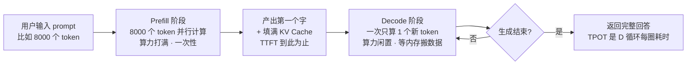
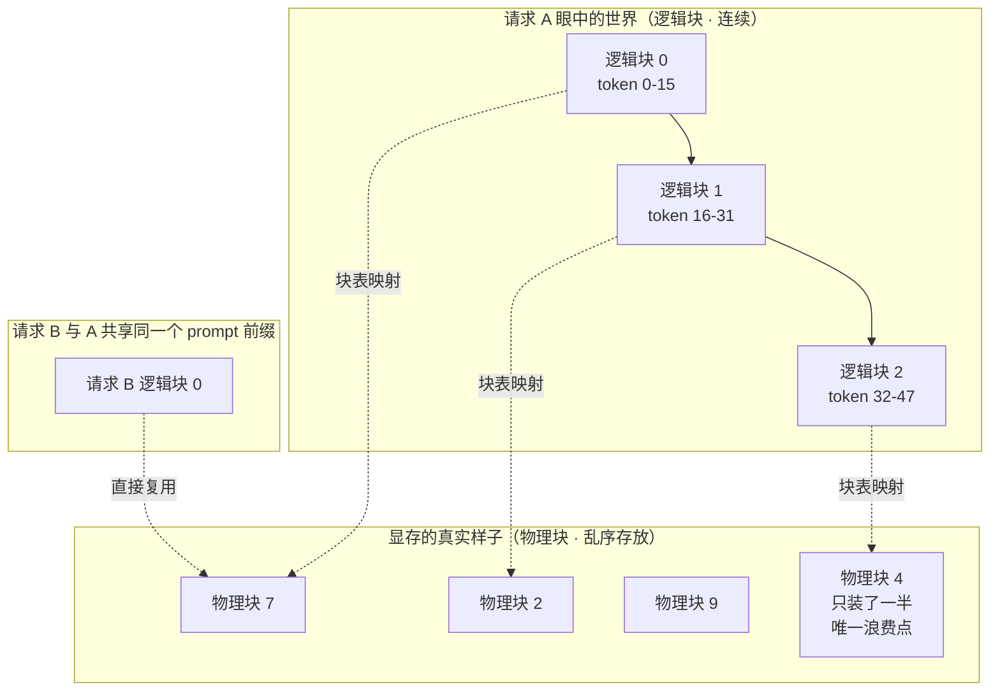
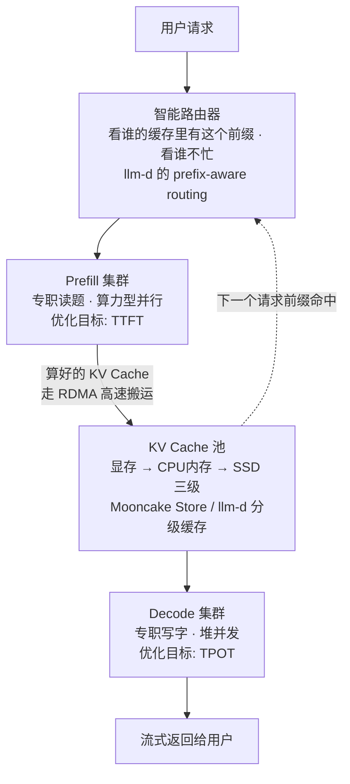

# LLM 推理优化全景 2026：从 PagedAttention 到 PD 分离，把你的 GPU 榨干

> 深度长文 · 2026-11-02 · 面向 3-5 年经验工程师（不要求 AI 背景）· 阅读约 45 分钟
>
> 关键词：KV Cache / PagedAttention / 连续批处理 / Chunked Prefill / 前缀缓存 / RadixAttention / PD 分离 / Mooncake / DistServe / llm-d / 投机解码 / vLLM 0.32 / SGLang 0.5.22 / DeepInfer

---

## 🎯 30 秒版本

1. **这是什么**：一篇讲清"LLM 推理为什么贵、工程上怎么把它变便宜变快"的全景文——覆盖单卡内存管理（PagedAttention）、调度（连续批处理 + Chunked Prefill）、缓存复用（前缀缓存/RadixAttention）、集群架构（PD 分离 + KV Cache 池化）和投机解码五层技术栈。
2. **为什么重要**：推理成本是 AI 应用的头号开销。过去一个月（2026 年 10 月）这条线集中爆发：DeepSeek 开源了自家生产推理框架 DeepInfer、llm-d 1.0 宣布 IBM 用它跑 3000 个并发编码 agent 成本比商业 API 低 5-10 倍、SGLang 0.5.22 把 DeepSeek-V4.1 单卡吞吐拉到 2.3 倍——推理优化正在从"论文技巧"变成"决定产品毛利的工程主战场"。
3. **对你有什么用**：读完你能看懂 vLLM/SGLang 每个启动参数在干嘛、知道什么规模该上什么架构、避开 8 个最常见的生产坑，以及理解为什么"agent 时代"把推理基础设施彻底重写了一遍。

---

## 📚 读前须知：3 个前置概念

在读正文前，先把三个词讲明白。后面所有技术都是围绕它们展开的。

**1. 推理（Inference）分两个阶段：Prefill 和 Decode。**
大模型生成文字是"一个 token（词元，模型处理文本的最小单位，约等于半个英文单词或一个汉字）一个 token 蹦出来的"。整个过程分两步：
- **Prefill（预填充）**：模型一口气"读完"你输入的全部 prompt（提示词）。这一步是**并行**的——1 万个输入 token 同时算，像一支军队同时齐步走。特点：**算力密集**（GPU 的乘加单元被打满）。
- **Decode（解码）**：读完后开始一个字一个字往外吐。每吐一个字，都要把前面所有字重新"看一遍"（做注意力计算）。这一步是**串行**的。特点：**内存带宽密集**——GPU 的算力大部分时间在空转，等数据从显存里搬过来。

类比：Prefill 像厨师一次性把整道菜的食材全部切好（刀工满负荷），Decode 像摆盘时一片一片往上放（大部分时间在伸手拿食材，刀闲着）。

**2. KV Cache：解码阶段"看一遍前文"的备忘小抄。**
如果每吐一个字都从头重算前文，计算量是平方级爆炸的。所以模型把每个已处理 token 的中间结果（Key 和 Value 两组张量）存在显存里，下一步直接查——这就是 **KV Cache（键值缓存，推理时把已算过的中间结果存起来复用的缓存）**。代价是：**它随上下文长度线性膨胀**。一个具体数字：Llama-3.1-8B（BF16 精度）每个 token 的 KV Cache 约 128 KB，32K 上下文的一条请求就是约 4 GB——比模型权重本身占的地方还吓人。DeepSeek 在 2023 年就发现 LLaMA-13B **单条序列**的 KV Cache 可达 1.7 GB。

类比：KV Cache 像餐厅的备菜台。不备菜（无缓存）每来一个订单都从洗菜开始；备菜（有缓存）直接下锅。但备菜台面积有限，菜备多了放不下——**推理系统的一切内存优化，本质都是在管理这张备菜台**。

**3. SLO 的两个延迟指标：TTFT 和 TPOT。**
- **TTFT（Time To First Token，首 token 延迟）**：你按下回车到屏幕上出现第一个字的耗时。主要由 Prefill 决定。
- **TPOT（Time Per Output Token，每 token 生成耗时）**：后续每个字之间隔多久，决定"打字流畅感"。由 Decode 决定，也叫 TBT（Time Between Tokens）或 ITL。

为什么这两个词重要：这两个指标**互相打架**——后面会看到，2024 年以来推理系统一半的重大改进（Chunked Prefill、PD 分离）都是在解这道矛盾。

---

## 一、开篇：一个周五晚上的告警

设想一个非常典型的场景（也是无数团队真实踩过的坑）：

你的团队租了一张 A100（80GB 显存），用 HuggingFace Transformers 的 `model.generate()` 包了个 API 服务 7B 模型，内部试用一切美好。上线第一周，20 个用户同时用，监控开始报警：**排队时间 40 秒起，显存 OOM（内存溢出）崩溃三次，GPU 利用率却只有 30%**。

诡异的地方在这最后一句：GPU 明明在"忙"，为什么算力利用率只有 30%？加了钱买了卡，为什么吞吐没上去？

2023 年，UC Berkeley 的 vLLM 团队给出了诊断：**LLM 服务的瓶颈不是算力，是内存管理**。他们测出当时的主流系统因为"碎片化和超额预留"浪费了 **60%-80% 的显存**——也就是说，你那张 80GB 的卡，真正能用来干活的可能只有 20GB。

从 2023 年 vLLM 的 PagedAttention 论文（SOSP'23）开始，到今天 vLLM 0.32 / SGLang 0.5.22 / DeepInfer / llm-d 1.0，这条"把浪费榨回来"的路线走了三年，技术栈已经成型。这篇文章按"从单卡到集群"的顺序把它完整讲一遍。每一层技术都按同一个节奏展开：**为什么需要它 → 它怎么工作 → 代码怎么写**。

---

## 二、第一层原理：GPU 为什么"饿着"——两阶段的根本矛盾

### 为什么需要理解这个

不理解 Prefill/Decode 的本质差异，你就无法理解后面所有设计：为什么调度器要"连续批处理"、为什么要把 prompt 切块、为什么最终要把两个阶段拆到不同的机器上。这是整篇文章的地基。

### 它怎么工作

一次推理请求的生命周期长这样：



> *怎么读这张图：左边一大块是 Prefill（一次算完所有输入），右边是 Decode 的死循环（一次只出一个 token）。TTFT 衡量"从 A 到 C 走多快"，TPOT 衡量"D 这个圈转多快"。关键在两者对硬件的需求完全不同：Prefill 吃算力，Decode 吃内存带宽。*

量化一下这个差异。对 13B 模型在 A100 上：处理单条 512 token 的序列就足以让 GPU 算力饱和（DistServe 论文实测）；而 Decode 阶段单条请求每次迭代只算 1 个 token——**GPU 算力利用率可能不到 5%**，时间全花在从显存读 KV Cache 和模型权重上。

这引出两个工程结论，直接决定后面所有技术：

1. **Decode 必须靠"凑人多"提效**：一条请求喂不饱 GPU，那就把几十条请求的 Decode 拼进同一批（batch）里一起算——反正都是"等内存搬数据"，多搬几份不亏。这就是批处理的动机。
2. **Prefill 和 Decode 混在一起会互相伤害**：一个长 prompt 的 Prefill 闯进正在跑 Decode 的批次，会让这一批所有用户的"打字"卡顿几百毫秒（TPOT 飙升）；反过来 Decode 占着 GPU 也让新用户的 TTFT 变长。DistServe 论文实测：往一批 Decode 里塞一个 Prefill，**两边的延迟同时显著恶化**。

### 代码上意味着什么

这两个结论对应推理引擎的两大核心机制：**连续批处理**（第四节详讲）和 **PD 分离**（第五节详讲）。在中间，还有一层更基础的问题要先解决——KV Cache 这张"备菜台"本身怎么管理。这就是 PagedAttention。

---

## 三、第二层原理：PagedAttention——把操作系统的虚拟内存搬进 GPU

### 为什么需要它

2023 年之前的系统怎么存 KV Cache？给每条请求**预留一整块连续显存**，按"可能的最大长度"分配。这就像餐厅给每桌客人预留一张能坐 20 人的大桌子，哪怕只来了 2 个人。vLLM 团队实测这种方案的浪费有三类：

- **内部碎片**：预留了 2048 token 的空间，实际只生成了 100 个 token，剩下 95% 空着但不能给别人用；
- **外部碎片**：不同请求留下的空洞大小不一，新请求来了拼不出一整块连续空间；
- **超额预留**：按最大长度预留本身就是浪费。

三项加起来，**60%-80% 的 KV Cache 显存被浪费**。显存装不下几条请求 → 批处理凑不够人数 → GPU 饿着 → 吞吐上不去。环环相扣。

### 它怎么工作

vLLM 的解法直接抄了操作系统课本：**虚拟内存分页**。OS 里进程看到的是连续的虚拟地址，物理内存其实被切成 4KB 的页（page）东一块西一块，靠一张"页表"做映射。PagedAttention 把 KV Cache 也这么管：

- KV Cache 切成固定大小的**块（block）**，vLLM 默认每块 16 个 token（可选 8/16/32/64/128）；
- 每条请求有一张**块表（block table）**，把"逻辑上连续的第 0、1、2…块"映射到显存里**不连续**的物理块；
- 物理块**按需分配**——生成到第 17 个 token 才申请第二块，绝不提前占坑；
- 浪费只可能发生在每条请求的**最后一块**（装不满），实测总浪费 **< 4%**。



> *怎么读这张图：上半部分是请求 A 以为自己占着连续内存，下半部分是物理块的真实分布——完全乱序，靠块表（虚线）对应。注意请求 B 的逻辑块 0 指向和 A 相同的物理块 7：当两条请求开头一样（比如同一份 system prompt），这块显存和这份计算**只花一次**。这就是"写时复制"（Copy-on-Write）共享，OS 里 fork 进程共享内存页的同一招。*

内存省下来只是第一重收益。第二重收益更妙：**块可以被多条序列共享**。并行采样（一个 prompt 生成 5 个候选回答）、beam search（束搜索）、投机解码——这些场景里 prompt 部分完全相同，共享之后内存开销最多省 55%，吞吐再提最多 2.2 倍（vLLM 官方 2023 博客数据）。

### 代码怎么写

用户侧几乎无感——PagedAttention 是 vLLM 引擎内部机制，你能控制的是块大小和显存占比：

```bash
# 块大小：默认 16，一般不用动
vllm serve meta-llama/Llama-3.1-8B-Instruct \
  --block-size 16 \
  # 显存利用率：vLLM 会先加载权重、跑一遍性能剖析，
  # 把"这个比例内的剩余显存"全部划给 KV Cache 块池
  --gpu-memory-utilization 0.92
```

这两行在干嘛：`--block-size` 决定"备菜台格子"的粒度——格子越小浪费越少但管理开销越大，16 是官方权衡后的默认值；`--gpu-memory-utilization`（当前默认 0.92，即 92%）决定 vLLM 敢用多少显存，**剩下的 8% 是留给 CUDA 上下文和激活值的保命钱**，调太满会 OOM（见坑清单第 1 条）。

---

## 四、第三层原理：调度革命——连续批处理与 Chunked Prefill

### 为什么需要它

有了高效的内存管理，下一个问题是：**GPU 的每一步（iteration）该算谁？**

最朴素的方案是"静态批处理"：凑够 8 条请求一起算，8 条全生成完才放下一批。问题显而易见——第 3 条请求 20 个 token 就答完了，却要干等第 7 条生成 500 个 token，这期间它占的批位空转。这像班车：人满发车，到站前谁也别想下车，座位利用率惨不忍睹。

### 它怎么工作：从 Orca 到 Sarathi-Serve

**第一步：迭代级调度（Orca，OSDI'22）**。首尔大学的 Orca 论文提出：调度粒度从"整条请求"细化到"单次迭代"——每算完一步，调度器就重新决策一次：谁完成了立刻离场腾位置，新请求随时插班。这就是**连续批处理（continuous batching，也叫 in-flight batching）**，名字里的"连续"指批次成员持续流动，而非算完一批才换一批。Orca 还配套提出**选择性批处理（selective batching）**：注意力计算对每条请求单独做，其余算子（矩阵乘等）才真正跨请求拼批——解决了不同请求长度不一没法直接拼张量的问题。

如今所有主流引擎（vLLM/SGLang/TensorRT-LLM）都构建在这套思想上。vLLM V1 引擎的实现细节：调度器维护 waiting（等待）和 running（运行）两个队列，支持 FCFS（先到先服务）或优先级两种策略，每步把所有在跑序列**拍平成一条"超级序列"**送进模型，靠位置索引和注意力掩码保证互不串门——这样连右侧补零（padding）的浪费都省了。

**第二步：Chunked Prefill（Sarathi-Serve，OSDI'24）**。连续批处理解决了"离场"问题，但没解决第二节说的"Prefill 闯进 Decode 批次导致全员卡顿"。微软研究院的 Sarathi-Serve 给出至今仍是标准答案的方案：

- **把长 prompt 的 Prefill 切成等大的小块**（chunk），比如 8000 token 的 prompt 按预算切成 16 块，每块 512 token；
- 每次迭代设一个 **token 预算**（`--max-num-batched-tokens`）：先把所有在跑的 Decode 装进批次（每条只占 1 个 token 的预算，很便宜），剩余预算用来塞 Prefill 块；
- 效果：**每一步的计算量几乎恒定**——Decode 永远不会被一个巨型 Prefill 卡住（stall-free，无停顿），流水线并行时"气泡"（bubble，流水线空转）也大幅减少。

论文数据：不做切块的朴素混合批处理，会让 Decode 的 TBT 延迟**暴涨最多 28.3 倍**；Sarathi-Serve 在同等尾延迟约束下，Mistral-7B 服务容量比当时的 vLLM 高 2.6 倍、Yi-34B 高 3.7 倍、Falcon-180B（流水线并行）高 5.6 倍。

这套机制后来被 vLLM 吸收为默认的 Chunked Prefill（vLLM 还加了 `--max-num-partial-prefills`、`--long-prefill-token-threshold` 等更细的旋钮）。代价是 TTFT 略增（prompt 分多步算完），换来 TPOT 平稳——**又一个 TTFT vs TPOT 的权衡旋钮**，token 预算调小偏交互体验，调大偏吞吐。

### 第三层缓存复用：前缀缓存与 RadixAttention

调度之上还有一层"别算重复的东西"。生产流量的前缀重复率高得惊人：同一个 system prompt、同一份 few-shot 示例、同一个 agent 的上下文在多轮工具调用间反复出现。**前缀缓存（prefix caching）**让共享前缀的 KV Cache 算一次、存下来、后续请求直接复用。

两大引擎实现路线不同：

- **vLLM：哈希表**。把 prompt 按 16 token 一块切分，每块计算一个哈希（哈希值混入前一块的哈希 + 本块 token + 可选元数据如 LoRA ID、cache salt），查 `cached_block_hash_to_block` 哈希表找最长命中前缀。默认用内置哈希，可换 `--prefix-caching-hash-algo sha256`（更慢但碰撞概率更低）。
- **SGLang：RadixAttention 基数树**。把所有活跃请求的 KV Cache 组织在一棵**基数树（radix tree，一种压缩过的前缀树/字典树）**里，配 LRU（最近最少使用）淘汰。多个请求共享同一前缀时天然指向树上同一段；某条请求分叉，就沿树分叉。论文（arXiv 2312.07104）实测在多轮对话、few-shot、思维树这类"程序化调用 LLM"的场景，SGLang 吞吐比当时的 vLLM（v0.2.5）和 Guidance **高至 5 倍**。2026 年的 SGLang 0.5.21 起，这棵前缀缓存树默认改由 **Rust 核心**实现，进一步降低调度开销。

哪个更强？如今两者能力已趋同（vLLM 也有自动前缀缓存，SGLang 也用分页 KV）。差异更多在**基因**：RadixAttention 为"一个程序里多次链式调用 LLM"的 agent 场景而生，树结构对部分重叠、动态分叉的前缀更友好；vLLM 的哈希方案实现简单、与块表天然一体。IBM 用 llm-d + 前缀缓存在真实 agentic 负载上做到了 **约 98% 的前缀命中率**——意味着几乎不用重算任何上下文，这是后文 5-10 倍成本优势的最大来源。

### 代码怎么写

```bash
# vLLM：前缀缓存默认开启，chunked prefill 在 V1 引擎中默认启用
vllm serve Qwen/Qwen3-32B \
  --enable-prefix-caching \          # 显式声明（默认已开）
  --max-num-batched-tokens 8192 \    # token 预算：交互型调 2048-4096，吞吐型调大
  --max-num-seqs 256 \               # 同时在跑的请求数上限
  --scheduling-policy fcfs           # 或 priority（配合请求里的优先级字段）
```

这几行在干嘛：`--max-num-batched-tokens` 就是 Sarathi 的"token 预算"，是 **TTFT/TPOT/吞吐三方权衡的总旋钮**；`--max-num-seqs` 限制并发条数（Decode 批次越大越划算，但受 KV Cache 容量约束）；`--scheduling-policy priority` 允许给 VIP 流量插队——多租户场景的雏形。

---

## 五、第四层原理：PD 分离与 KV Cache 池化——走向集群

### 为什么需要它

单卡优化到极限后，第二节那个根本矛盾还在：**Prefill 吃算力、Decode 吃带宽，两种活让同一张卡干，永远顾此失彼**。Chunked Prefill 是"在一口锅里错峰"，而 2024 年起业界的终极答案是：**分锅**。

- **PD 分离（Prefill-Decode Disaggregation，预填充与解码分开部署）**：一组 GPU 专门做 Prefill（优化 TTFT），另一组专门做 Decode（优化 TPOT 和高并发），中间把算好的 KV Cache 传给对方。
- 附带红利：两组可以用**不同的并行策略**（Prefill 侧张量并行切算力，Decode 侧堆并发）、**不同比例的卡**（1P2D = 1 组 Prefill 喂 2 组 Decode），甚至不同型号的 GPU。

代价：每个请求都要把 KV Cache 从 Prefill 机器搬到 Decode 机器——**网络传输成了新的关键路径**，需要 RDMA（远程直接内存访问，网卡直接读写对端内存、绕过 CPU 的高速网络技术）级别的带宽。

### 它怎么工作

学术侧的奠基作是 **DistServe**（OSDI'24，北大 + UCSD）：给定 TTFT/TPOT 目标，自动为两个阶段分别搜索最优的 GPU 数量和并行策略，再按集群带宽拓扑放置实例以最小化 KV 传输开销。论文口径：相同 SLO 下可比当时的最先进系统多服务 **7.4 倍请求**，或支撑 **12.6 倍更严的 SLO**（>90% 请求达标）。

工业侧的标杆是月之暗面的 **Mooncake**（FAST'25 最佳论文）——Kimi 的生产服务平台，日均处理超千亿 token。它在 DistServe 思路上更进一步，提出 **"以 KV Cache 为中心"** 的架构：

- **Transfer Engine（传输引擎）**：拓扑感知的 RDMA 传输层，单次传输切成 16KB 切片多路并发，网卡故障自动换路。实测比既有方案快 2.4-4.6 倍（ACM TOS 版本数据）；
- **Mooncake Store（分布式 KV 池）**：把 GPU 集群里**闲置的 CPU 内存、DRAM、SSD** 拼成一个跨机的全局 KV Cache 池——热 KV 在显存，温 KV 在内存，冷 KV 在 SSD，"用更多存储换更少计算"；
- **KVCache 中心调度器 + 基于预测的提前拒绝**：过载时宁可拒绝注定超 SLO 的请求，保住存量请求的体验。

效果：模拟长上下文场景吞吐最高提升 **525%**；真实流量下 Kimi 可多处理 **75% 的请求**（arXiv 版摘要口径；ACM TOS 扩展版给出的生产数字是 A800 集群 +115%、H800 集群 +107%）。



> *怎么读这张图：请求先过路由器（不是无脑轮询，而是"缓存感知"——优先发给已经存着相关 KV 的机器）；Prefill 集群算完把 KV Cache 交给中间的池子，Decode 集群从池子接手继续生成。虚线是点睛之笔：KV 留在池里，下一条同前缀的请求直接跳过重算。整个系统的调度对象从"请求"变成了"KV Cache"。*

2026 年 10 月 20 日发布的 **llm-d 1.0**（Red Hat/IBM/Google/CoreWeave/NVIDIA 共建，CNCF 项目，500+ 贡献者）把这套架构做成了 Kubernetes 原生的开源标准件：前缀感知路由、分级 KV 缓存、PD 分离、多租户 QoS（优先级 + 公平流控）、PD 副本组作为整体滚动升级、路由器热备。IBM 公布的实测：**GLM 5.2（约 7530 亿参数）跑在常规 H100 集群上，峰值每分钟 660 万输出 token，3000 个并发编码 agent 零抢占，按云租用价折算比商业 API 便宜 5-10 倍，混合成本约 $0.11/百万 token**。Google 在 PyTorch 大会现场演示了 1000 个沙箱 agent 打同一个 llm-d 端点，底下混着 vLLM、SGLang、TPU 和 GPU 异构机群。

同一天 DeepSeek 开源 **DeepInfer**（Apache 2.0，基于 vLLM 构建）则是"单机引擎极致优化"路线的代表：DSpark 置信度调度投机解码、SWA bounded replay（滑动窗口注意力有界回放，解码侧 Prefill 只重放最后 140 个 token 而非全部历史）、零开销异步批调度、**batch-invariant（批不变性）**推理——同一个输入无论和谁拼批，输出逐位一致，这对生产环境复现 bug 和回归测试意义重大。注意它是离线推理框架：KV 池、PD 分离、负载均衡**不在开源范围**，服务化要自己拼或交给 llm-d。

### 代码怎么写

vLLM 侧用 `KVTransferConfig` 声明 KV 传输通道（连接器可选 Mooncake/NIXL/共享存储等）：

```python
# vLLM PD 分离示意（摘自官方 anatomy 博客，ExampleConnector 走共享存储）
from vllm.config import KVTransferConfig

ktc = KVTransferConfig(
    kv_connector="ExampleConnector",   # 生产环境换 MooncakeConnector 等
    kv_role="kv_both",                 # 本实例既产出也接收 KV
    kv_connector_extra_config={"shared_storage_path": "local_storage"},
)
llm = LLM(model="...", kv_transfer_config=ktc)
```

SGLang 侧用启动参数直接声明角色，传输后端选 mooncake：

```bash
# Prefill 实例（机器 1）
python -m sglang.launch_server --model-path <model> \
  --port 30001 --disaggregation-mode prefill \
  --disaggregation-bootstrap-port 8998 \
  --disaggregation-transfer-backend mooncake

# Decode 实例（机器 2）——注意 transfer-backend 必须两边一致
python -m sglang.launch_server --model-path <model> \
  --port 30002 --disaggregation-mode decode \
  --disaggregation-transfer-backend mooncake
```

这几行在干嘛：`--disaggregation-mode` 声明本实例专职哪个阶段；`bootstrap-port` 是 Decode 找到 Prefill 的"接线员"端口；`--disaggregation-transfer-backend` 选 KV 搬运协议——**两腿必须匹配**，Mooncake 支持 TCP 传输（没有 RDMA 网卡也能跑，性能打折）。SGLang 0.5.21 起 PD 实例还能**运行时热切换角色**（prefill ↔ decode），不用重启。

---

## 六、第五层原理（加餐）：投机解码——让 GPU 一步猜多个字

### 为什么需要它

Decode 阶段的死结：一步只出一个 token，GPU 算力利用率极低。既然算力闲着，能不能**一步验证多个猜测**？

### 它怎么工作

**投机解码（speculative decoding）**：用一个便宜的"草稿员"先猜出未来 k 个 token，再让大模型**一次前向并行验证**这 k 个猜测；猜对的部分直接采纳，猜错的位置从错误处重采。数学上（拒绝采样保证）输出分布与原模型**完全一致**——加速是免费的午餐，只赚不亏质量。草稿员可以是：

- **n-gram**：从上文找重复模式（零训练成本，vLLM 内置）；
- **EAGLE / Medusa**：在大模型上嫁接的轻量草稿头；
- **MTP / DSpark**（DeepSeek 系）：模型自带的多 token 预测头。SGLang 的 **DSpark** 更进一步——草稿按块半自回归生成，**验证窗口大小由草稿自己的置信度动态决定**而非固定长度，在 B300 上跑 DeepSeek-V4-Pro（TP8，batch=1）实测 **383.7 tok/s，平均接受长度约 5**（即一次验证平均白赚 5 个 token）。

### 代码怎么写

```python
# vLLM：n-gram 投机解码，零额外模型
from vllm import LLM, SamplingParams

speculative_config = {
    "method": "ngram",              # 草稿员：上文模式匹配
    "prompt_lookup_max": 5,         # 最长回看 5 个 token 找重复
    "prompt_lookup_min": 3,
    "num_speculative_tokens": 3,    # 每次猜 3 个
}
llm = LLM(model="TinyLlama/TinyLlama-1.1B-Chat-v1.0",
          speculative_config=speculative_config)
```

这几行在干嘛：模型每步生成前，先拿最近 3-5 个 token 去历史里找相同模式，把模式后面的 3 个 token 当草稿，大模型一次前向验证。**适用场景要注意**：投机解码在**低并发**（batch 小、算力确实闲着）时收益最大；高并发时批次本身已把算力填满，草稿验证反而添乱——SGLang 因此提供按批大小自适应调整草稿步数的 Adaptive Spec。

---

## 七、代码实战：一条命令起生产级服务 + 科学压测

### 7.1 vLLM 起服务（2026 年 10 月版，v0.32.0）

```bash
pip install vllm==0.32.0   # 2026-10-17 发布的当前稳定版

vllm serve Qwen/Qwen3-32B \
  --tensor-parallel-size 2 \        # 2 卡张量并行（模型太大切权重）
  --gpu-memory-utilization 0.92 \
  --enable-prefix-caching \
  --max-num-batched-tokens 8192 \
  --kv-cache-dtype fp8 \            # KV Cache 用 FP8 存：容量翻倍
  --speculative-config '{"method":"ngram","num_speculative_tokens":3}' \
  --tool-call-parser hermes \       # agent 场景：工具调用解析器
  --reasoning-parser deepseek_r1    # 推理模型：思考过程分离
```

逐段解释：`--tensor-parallel-size 2` 把每层权重横切成两半分放两张卡（注意通信开销，卡间没有 NVLink 时慎用大 TP）；`--kv-cache-dtype fp8` 是 2026 年的新常态——v0.32 把低精度 KV 铺到了 NVFP4（SM8x/SM90/SM12x）和 FP8（GLM-5.x 在 SM100 上默认），官方 PR 基准：**KV 显存减半、吞吐 +2.3~5.5%，代价是 TTFT +7~11%**——典型的"拿首字延迟换容量"，高并发场景几乎必开；`--tool-call-parser` 千万别省，见坑清单第 5 条。

### 7.2 科学压测：别拍脑袋调参

```bash
# vLLM 自带 benchmark：泊松到达模拟真实流量
vllm bench serve \
  --model Qwen/Qwen3-32B \
  --dataset-name random \
  --random-input-len 4096 --random-output-len 512 \
  --request-rate 8            # 每秒到达 8 个请求（泊松分布）
```

这几行在干嘛：以指定速率随机注入请求，输出 TTFT/TPOT/吞吐的完整分位数。**正确姿势**：从低 request-rate 开始阶梯加压，找到"P99 TTFT 或 P99 TPOT 撞上你 SLO"的临界速率——那才是你系统的真实**服务容量（serving capacity）**，也就是 DistServe/Sarathi 论文里"goodput（满足 SLO 前提下的有效吞吐）"的概念。**只看平均吞吐不看分位延迟的压测都是耍流氓**。

---

## 八、性能数据对比表

### 8.1 关键论文/系统的官方口径

| 技术/系统 | 对比基线 | 官方口径收益 | 人话解读 |
|---|---|---|---|
| PagedAttention（vLLM, SOSP'23） | HuggingFace Transformers | 吞吐最高 **24×** | 同样的卡，原来一天服务 1000 个请求，现在 24000 个；对比当时最强的 TGI 也有 2.2-3.5× |
| PagedAttention 内存效率 | 传统连续分配 | 浪费从 **60-80% → <4%** | 80GB 显存原来只有 20GB 真在干活，现在 77GB 都在干活 |
| RadixAttention（SGLang, 2024） | vLLM v0.2.5 / Guidance | 最高 **5×** 吞吐 | 多轮对话、agent 这类"前缀大量重复"的程序化调用场景收益最大 |
| Sarathi-Serve（OSDI'24） | 当时 vLLM | Mistral-7B **2.6×**、Yi-34B **3.7×**、Falcon-180B **5.6×** 服务容量 | 注意口径是"SLO 约束下的容量"而非裸吞吐——延迟不劣化的前提下多接几倍流量 |
| 朴素混合批处理（反面教材） | 纯 Decode 批次 | TBT 恶化最高 **28.3×** | 不切块就把长 prompt 塞进 Decode 批，用户打字卡顿放大 28 倍——这就是必须 Chunked Prefill 的原因 |
| DistServe（OSDI'24） | 最先进共置系统 | **7.4×** 请求量 或 **12.6×** 更严 SLO | PD 分离的学术奠基：分锅之后，要么同样的锅多炒 7 倍菜，要么菜的质量标准提高 12 倍 |
| Mooncake（FAST'25 最佳论文） | 共置基线 | 模拟 **+525%** 吞吐；Kimi 真实流量 **+75%** 请求（TOS 版：A800 +115% / H800 +107%） | 生产环境口径比模拟保守很正常；千亿 token/天的平台上 +75% 等于凭空多出大半个集群 |
| llm-d 1.0（IBM 实测，2026-10） | 商业 API | 成本 **低 5-10×**，约 **$0.11/百万 token**；峰值 660 万输出 token/分钟 | 3000 个并发编码 agent 零抢占；98% 前缀命中率是成本优势的核心来源 |
| SGLang 0.5.22（2026-10-19） | 自身旧版 | DeepSeek-V4.1 单卡吞吐 **2.3×**（H200）；PD 分离长 prompt 吞吐 **+27%**、p95 TTFT **减半** | 引擎还在快速演进，"半年前的调参经验"可能已经过时 |
| DSpark 投机解码（SGLang） | 无投机 | **383.7 tok/s**（B300, TP8, bs=1），平均接受长度 ~5 | 单用户体感从"每秒 80 字"到"每秒 380 字"，接近即时 |

### 8.2 版本速查（本文写作时点，2026-11-02 核对）

| 组件 | 当前版本 | 发布日期 | 备注 |
|---|---|---|---|
| vLLM | **0.32.0** | 2026-10-17 | 814 commits / 363 贡献者；NVFP4 KV Cache、Model Runner V2、`/v1/systemone` 结构化决策端点 |
| SGLang | **0.5.22** | 2026-10-19 | 950 PRs / 245 贡献者；**要求 Python ≥ 3.11**；InstantTensor 加载器（模型加载快 10×） |
| llm-d | **1.0** | 2026-10-20 | CNCF 项目，v1 API 稳定 |
| DeepInfer | 首个开源版 | 2026-10-20 | Apache 2.0；NVIDIA SM100 + 华为昇腾 950 双栈；Python 3.12、CUDA 13 |
| Mooncake | 持续更新 | — | Transfer Engine 已被 vLLM（2024-12 起）和 SGLang（2025-04 起）官方集成 |

---

## 九、坑清单

**坑 1：`--gpu-memory-utilization` 拉满 → 启动即 OOM 或运行中崩溃。**
怎么踩到的：看到"显存利用率"就想拉 0.98 榨干。症状：启动时 CUDA OOM，或高负载时激活值峰值撑爆剩余显存。解法：默认 0.92 起步；与其他进程共享 GPU 时按比例下调（两个实例各设 0.5）；OOM 时的官方排查顺序——调低 `max_num_seqs`/`max_num_batched_tokens`，或加大 `tensor_parallel_size` 摊薄权重。

**坑 2：`--max-num-batched-tokens` 小于 `--max-model-len` 且关闭 chunked prefill → 启动直接崩。**
怎么踩到的：想省内存把 token 预算调到 2048，但模型上下文 32K。症状：server 启动报错（单条 prompt 都可能超预算，永远调度不进去）。解法：vLLM 官方文档明说这种情况"may crash at server start-up"——要么预算 ≥ 模型最大长度，要么确认 chunked prefill 开启（V1 引擎默认开）。

**坑 3：指望前缀缓存命中，结果命中率极低。**
怎么踩到的：把动态内容（时间戳、随机 session id）写进 system prompt 开头。症状：缓存指标不涨，TTFT 没改善。解法：前缀缓存按 **16 token 块对齐**命中，第一个不同的块之后全部作废——**prompt 结构必须"静态在前、动态在后"**；vLLM 多租户隔离用 cache salt（盐值混入首块哈希，不同租户永不互相命中）。

**坑 4：PD 分离两端配置不一致 → KV 传不过去。**
怎么踩到的：Prefill 用 Mooncake、Decode 用 NIXL，或两边引擎版本不同导致 KV 布局不匹配。症状：请求挂起或报错。解法：传输后端、连接器、KV cache 布局**两腿必须完全一致**（SMG 文档明确要求"same runtime, same transport, matching KV cache layout"）；SGLang 0.5.22 的 `--disaggregation-decode-allocation-policy prefill_complete` 这类新参数也要求**两端角色同时开启**。没有 RDMA 网卡先用 Mooncake 的 TCP 模式验证逻辑，再上硬件。

**坑 5：开源模型 benchmark 很美，agent 一用就废——工具调用解析器没配对。**
怎么踩到的：`vllm serve` 起服务直接接 agent 框架，没设 `--tool-call-parser`/`--reasoning-parser`，或选了与模型不匹配的解析器。症状：模型明明输出了工具调用文本，客户端拿到的却是一坨 content，agent 在错误上下文上滚雪球。Ubicloud 工程团队为此给 vLLM 上游提了一整轮修复并写了完整复盘。解法：按模型卡指定解析器（v0.32 新增 `hf` 通用解析器，读 checkpoint 自带的 `response_template`，模型带了它就无需专用解析器）；上线前用真实 agent 流量回放验证工具调用成功率，别只看 MMLU。

**坑 6：投机解码开着高并发跑，吞吐不升反降。**
怎么踩到的：低并发压测看到 383 tok/s 惊艳，全量上线。症状：高峰期 P99 恶化。解法：草稿验证占用的是本来能吃 Decode 批次的算力，**batch 大了投机收益趋零甚至为负**；用 SGLang Adaptive Spec（按批大小自动调草稿步数）或在高并发时段直接关闭。

**坑 7：FP8/FP4 KV Cache 默认真"无损"，悄悄吃掉 TTFT。**
怎么踩到的：看"吞吐 +5%"就开 `--kv-cache-dtype fp8`。症状：TTFT 涨了 7-11%（vLLM PR 官方基准数据），交互型用户投诉变慢。解法：这是拿首字延迟换容量的交易——吞吐敏感（批处理、agent 后台任务）开，交互敏感慎开；对精度洁癖的场景先跑业务评测集对比输出质量。

**坑 8：拿"平均吞吐"当容量做采购决策。**
怎么踩到的：供应商 demo 展示 tokens/s 峰值，按此买卡。症状：真实流量一来 P99 崩盘。解法：认准 **goodput 口径**（满足 TTFT/TPOT SLO 的最大请求速率），用第七节的阶梯压测法自己测；分位延迟（P95/P99）比均值重要一个数量级。

---

## 十、选型建议

**按团队规模/场景对号入座：**

| 你的情况 | 建议 | 为什么 |
|---|---|---|
| 个人/小团队，1-8 张卡，聊天或 API 服务 | **vLLM 单实例**，默认参数 + `--enable-prefix-caching` | 生态最大、模型支持最全、OpenAI 兼容接口开箱即用；0.32 的 `hf` 通用解析器大幅降低工具调用配置成本 |
| agent / 多步链式调用为主的负载 | **SGLang**，前缀缓存全开 | RadixAttention 基因就是为程序化多调用设计；Rust 前缀缓存核心 + 零开销调度在"前缀大量复用"场景优势最明显；注意 Python ≥ 3.11 |
| 只跑 DeepSeek 系模型、追求单机极致 | **DeepInfer** | 官方同款 kernel（FlashMLA/DeepGEMM/DeepEP）+ DSpark + batch-invariant；但服务化组件（KV 池、PD、负载均衡）要自建 |
| 数十卡以上、多租户、要 SLA | **llm-d**（下挂 vLLM/SGLang） | 前缀感知路由 + 分级 KV + 优先级流控 + PD 副本组滚动升级，全是 Day-2 运维刚需；IBM 的 98% 命中率、$0.11/M token 是目前最可信的成本标杆 |
| 超长上下文（≥128K）为主 | PD 分离 + **KV 分级存储**（Mooncake Store / SGLang HiSparse） | 长上下文重算贵到离谱，"存储换计算"是唯一经济解；HiSparse 支持把 KV 放 CPU 内存还能配合 EAGLE/MTP 投机 |
| 延迟极敏的单用户场景（IDE 补全、语音） | 小模型 + **投机解码**（DSpark/EAGLE/ngram）+ 大 batch 关闭 | 低并发下投机是免费加速；参考 DSpark 383 tok/s 的量级 |
| 昇腾/国产算力 | **DeepInfer**（昇腾 950 官方适配）或 vLLM-Ascend | DeepInfer 是罕见的"实验室官方适配国产 NPU"样本，供应链冗余价值直接 |

**一条总原则**：单卡问题别上集群方案。优化顺序应该是——先把 PagedAttention + 连续批处理 + 前缀缓存吃干（这三层是默认免费的），prompt 结构改成"静态在前"，压测出真实 goodput；不够再上投机解码和 FP8 KV；还不够再考虑 PD 分离；只有多租户 + 数十卡以上才值得引入 llm-d 这一层。**每加一层，运维复杂度翻倍。**

---

## 🧠 关键概念表

| 术语 | 白话解释 | 为什么重要 |
|---|---|---|
| Token（词元） | 模型处理文本的最小单位，约半个英文单词/一个汉字 | 所有计费、缓存、延迟指标都以它为单位 |
| Prefill（预填充） | 一口气读完全部输入的阶段，算力密集 | 决定 TTFT；PD 分离里的"P" |
| Decode（解码） | 一个字一个字往外吐的阶段，内存带宽密集 | 决定 TPOT；GPU 算力大量闲置的根源 |
| KV Cache（键值缓存） | 已处理 token 的中间结果备忘小抄，随上下文线性膨胀 | 推理系统的头号内存开销，一切优化的中心对象 |
| PagedAttention | 把 KV Cache 切成 16-token 小块乱序存放 + 块表映射，抄 OS 虚拟内存的作业 | 显存浪费 60-80% → <4%，vLLM 的立身之本 |
| 连续批处理 | 每算一步就重新决定批次成员，完成的走、新来的进 | 告别"班车模式"，GPU 座位利用率最大化 |
| Chunked Prefill | 长 prompt 切块，按 token 预算混进 Decode 批次 | 消灭"一人读题全班卡壳"，TBT 最坏恶化 28.3× → 有界 |
| 前缀缓存 / RadixAttention | 相同开头的请求共享已算好的 KV（哈希表 vs 基数树两种实现） | agent 时代命中率可达 98%，成本优势的最大来源 |
| PD 分离 | Prefill 和 Decode 部署在不同 GPU 组，KV 走 RDMA 传递 | 两种活分开优化，DistServe 口径 7.4× 容量 |
| KV Cache 池化 | 显存→CPU 内存→SSD 三级存 KV，跨请求跨机器复用 | Mooncake 的核心："用存储换计算" |
| 投机解码 | 小草稿员猜 k 个 token，大模型一次并行验证 | 输出分布不变的前提下 Decode 提速，最高 ~5× |
| goodput（有效吞吐） | 满足 TTFT/TPOT SLO 前提下的最大请求速率 | 采购和容量规划该看的指标，而非裸吞吐 |
| TTFT / TPOT | 首字延迟 / 每字间隔 | 用户体验的两条命脉，且互相打架 |
| RDMA | 网卡直接读写对端机器内存、绕过 CPU | PD 分离的物理前提；没有它 KV 搬运就是瓶颈 |
| batch-invariant（批不变性） | 同一输入无论和谁拼批，输出逐位一致 | DeepInfer 特性；生产复现 bug、回归测试的刚需 |

---

## 💡 所以呢

1. **推理成本正在成为 AI 产品的"毛利开关"**。llm-d 的 $0.11/百万 token 与商业 API 之间 5-10 倍的差价意味着：上下文重度复用的 agent 产品，自托管在 2026 年第一次有了清晰的经济学依据。如果你的 agent 产品每月 API 账单超过 2 万美元，值得做一次自托管 POC。
2. **架构演进的方向已经明确：从"请求中心"到"KV Cache 中心"**。路由器看缓存选机器、存储分层围着 KV 建、调度器为 KV 复用让路——2027 年的推理基础设施会围绕"KV Cache 是新一代数据库"这个假设继续重构。
3. **动手路径**：本周就可以做的三件事——① 把你的 vLLM/SGLang 升到 0.32/0.5.22（注意 Python 版本和 KV dtype 默认值变化）；② 检查 prompt 结构是否"静态在前、动态在后"，看一眼前缀命中率指标；③ 用 `vllm bench serve` 阶梯压测一次，把你系统的真实 goodput 写进容量文档。

---

## 参考链接

**论文（一手）**
1. Kwon et al., *Efficient Memory Management for Large Language Model Serving with PagedAttention*, SOSP'23 — https://arxiv.org/abs/2309.06180
2. Yu et al., *Orca: A Distributed Serving System for Transformer-Based Generative Models*, OSDI'22 — https://www.usenix.org/conference/osdi22/presentation/yu
3. Agrawal et al., *Taming Throughput-Latency Tradeoff in LLM Inference with Sarathi-Serve*, OSDI'24 — https://arxiv.org/abs/2403.02310
4. Zhong et al., *DistServe: Disaggregating Prefill and Decoding for Goodput-optimized LLM Serving*, OSDI'24 — https://arxiv.org/abs/2401.09670
5. Qin et al., *Mooncake: A KVCache-centric Disaggregated Architecture for LLM Serving*, FAST'25 最佳论文 — https://arxiv.org/abs/2407.00079 · ACM TOS 扩展版 https://dl.acm.org/doi/10.1145/3773772
6. Zheng et al., *Efficiently Programming Large Language Models using SGLang*（RadixAttention）— https://arxiv.org/abs/2312.07104
7. DeepSeek-V2（MLA，KV Cache 压缩 93.3%）— https://arxiv.org/abs/2405.04434

**官方文档 / 工程博客（一手）**
8. vLLM 官方博客：*vLLM: Easy, Fast, and Cheap LLM Serving with PagedAttention* — https://vllm.ai/blog/2023-06-20-vllm
9. vLLM 官方博客：*Inside vLLM: Anatomy of a High-Throughput LLM Inference System*（V1 引擎逐组件拆解，本文多处实现细节来源）— https://vllm.ai/blog/2025-09-05-anatomy-of-vllm
10. vLLM Engine Arguments 文档 — https://docs.vllm.ai/en/stable/configuration/engine_args/
11. vLLM Optimization and Tuning 文档 — https://docs.vllm.ai/en/stable/configuration/optimization/
12. vLLM v0.32.0 Release Notes — https://github.com/vllm-project/vllm/releases/tag/v0.32.0
13. LMSYS 博客：*Fast and Expressive LLM Inference with RadixAttention and SGLang* — https://www.lmsys.org/blog/2024-01-17-sglang/
14. SGLang v0.5.22 Release Notes — https://github.com/sgl-project/sglang/releases/tag/v0.5.22
15. SGLang v0.5.21 Release Notes（PD 角色热切换、Rust 前缀缓存）— https://github.com/sgl-project/sglang/releases/tag/v0.5.21
16. DeepInfer README — https://github.com/deepseek-ai/DeepInfer
17. Mooncake 仓库与文档 — https://github.com/kvcache-ai/Mooncake
18. llm-d 1.0 IBM 新闻稿（GLM 5.2 实测数据）— https://newsroom.ibm.com/2026-10-20-llm-d-1-0-advances-open,-cost-efficient-ai-inference-for-production-scale
19. llm-d 1.0 Google Cloud 博客 — https://cloud.google.com/blog/topics/ai-infrastructure/llm-d-1-0-an-open-source-stack-for-distributed-inference
20. AMD ROCm Infera：PD disaggregation 部署文档（SGLang/vLLM 启动参数实操）— https://rocm.docs.amd.com/projects/infera/en/main/features/pd_disaggregation.html
21. Ubicloud：*Fixing tool call accuracy in vLLM*（坑 5 来源）— https://www.ubicloud.com/blog/fixing-tool-call-accuracy-in-vllm
22. DSpark 投机解码博客 — https://www.lmsys.org/blog/2026-07-06-dspark-sglang

*数据说明：DistServe 收益引用 OSDI'24 终版口径（7.4×/12.6×，arXiv v1 早期版本为 4.48×/10.2×）；Mooncake 的 +75%（arXiv 摘要）与 +115%/+107%（ACM TOS 扩展版）为不同版本口径，均如实标注。llm-d 的 IBM 数据来自官方新闻稿，未见独立第三方复现，引用时已注明"IBM 实测"。*

---

*由 Hermes Agent 自动调研撰写 · 所有版本号与数据核对自一手来源 · [HermesReports](https://github.com/knolonzhou/HermesReports)*
