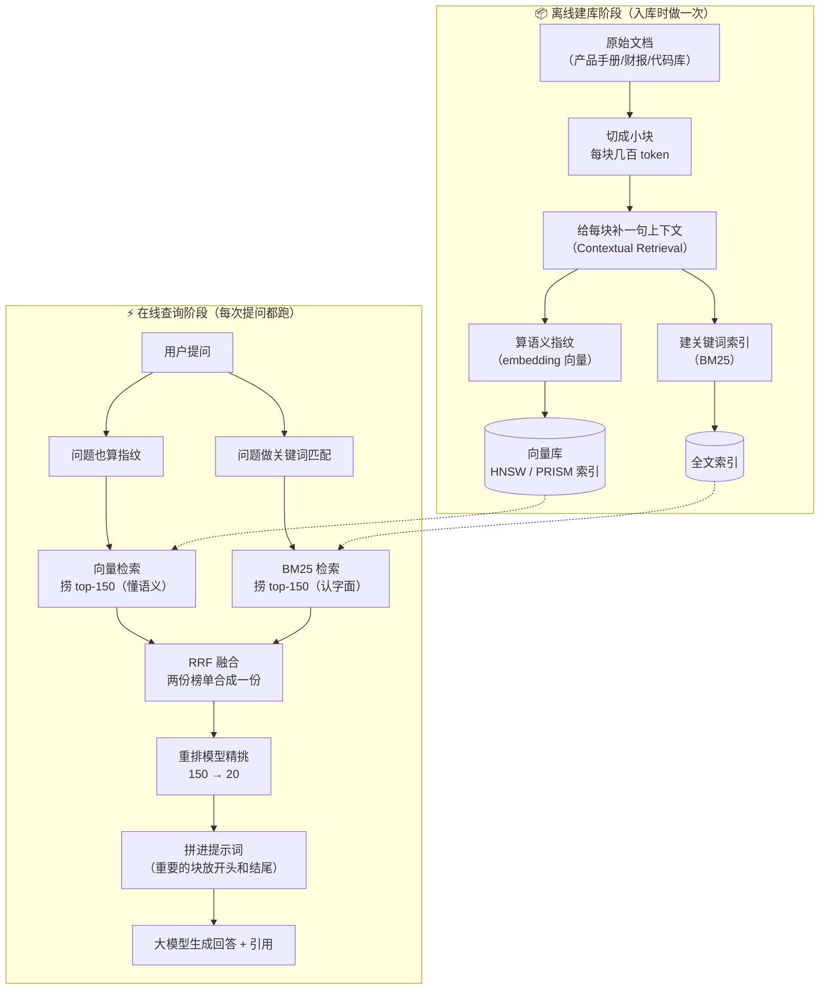
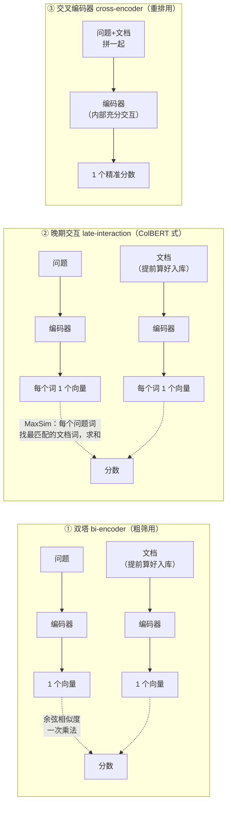
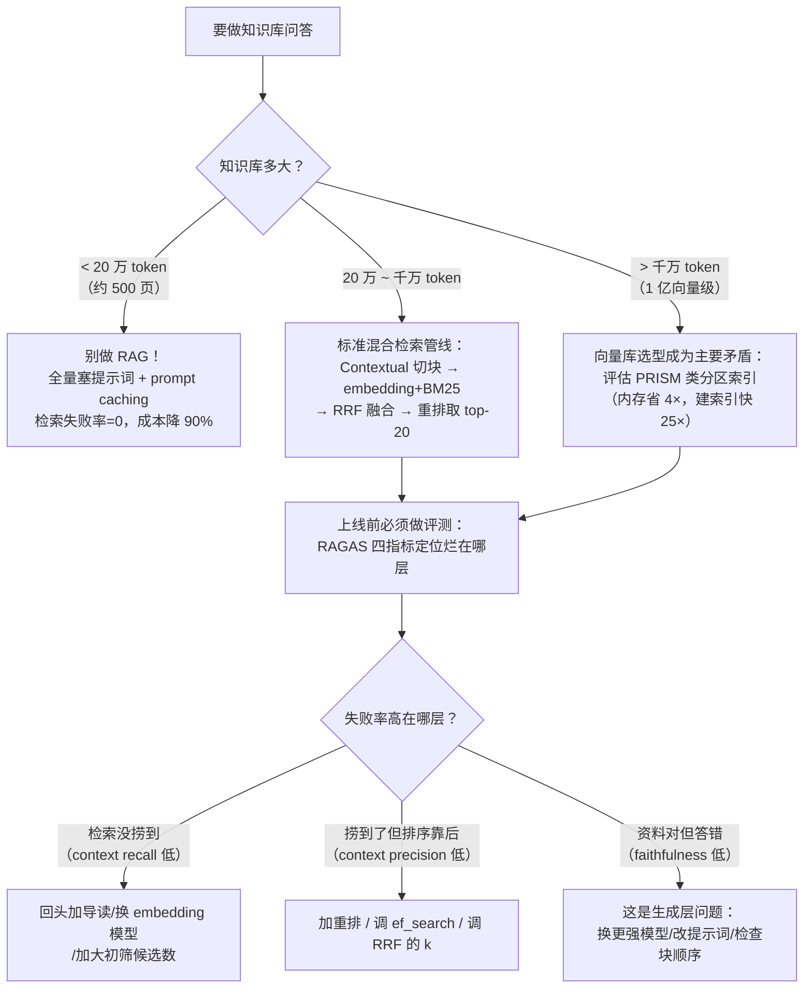

# RAG 工程实践全景 2026：从"检索不到"到"检索得准"，把知识库问答做上生产

> 深度长文 · 2026-11-16 · 面向 3-5 年经验工程师 · 预计阅读 40 分钟
> 调研来源：Anthropic 官方研究博客、arXiv 论文（RaBitQ / ColBERT / ColBERTv2 / HyDE / 2611.17161 等）、pgvector 官方文档与第三方基准、Tiger Data 官方发布博客、InfoQ、Elasticsearch 官方文档、RAGAS 文档、JioHotstar 工程博客，共 15+ 一手来源，所有数字均核对原文。

---

## 🎯 30 秒版本

1. **这是什么**：一篇把 RAG（Retrieval-Augmented Generation，检索增强生成——先从你的私有资料库里"查资料"，再把查到的内容塞进提示词让大模型照着回答）从原理到生产落地的全景长文：切块、混合检索、重排、向量库调参、评测，每一层都讲清"为什么需要它→它怎么工作→代码怎么写"。
2. **为什么重要**：RAG 是企业落地 LLM 的头号场景，但大多数团队的第一版 RAG 效果都很差——不是模型不行，是检索层丢了信息。Anthropic 实测：光是"给每个文本块补一句上下文"这一个改动，就能把检索失败率砍掉 35%；再加 BM25 混合检索砍 49%；再加重排砍 67%。这些是免费的工程红利，不是炼丹。
3. **对你有什么用**：读完你能独立搭一条生产级 RAG 管线、会调 pgvector 的三个关键参数、知道什么时候根本不该用 RAG（知识库小于 20 万 token 直接全塞进提示词更香）、并能用 RAGAS 四个指标量化"我的 RAG 到底烂在哪一层"。

---

## 📚 读前须知：5 个前置概念（全部用类比讲）

在开工之前，先把五个词讲明白。后文所有技术都建立在这五个概念上。

**① Embedding（嵌入向量）**：把一个词、一句话或一整段文字，变成一串数字（比如 1536 个小数）。这串数字就是这段文字的"语义指纹"——意思相近的文字，指纹也相近。类比：给每段文字发一个 GPS 坐标，"猫在沙发上睡觉"和"猫咪趴在沙发上打盹"的坐标几乎挨着，和"股票今天涨了"的坐标隔了十万八千里。检索时算"哪个坐标离我最近"，就是找语义最相关的内容。

**② BM25（关键词打分算法）**：一个有 30 年历史的传统搜索算法，不懂语义，只认字面——你搜 "TS-999"，它就找包含 "TS-999" 这个字符串的文档，一个字都不差才算。它在 TF-IDF（词频-逆文档频率，一个词在这篇文档里出现越多、在所有文档里出现越少，就越重要）基础上加了两个修正：文档越长要求越严、同一个词出现 100 次和 10 次差别不大（饱和函数）。类比：embedding 是"懂你意思的图书管理员"，BM25 是"只会查字典的死板管理员"——死板有死板的好处，查错误码、产品型号、人名这种精确字符串，它比"懂语义的"靠谱得多。

**③ Chunk（文本块）与 Chunking（切块）**：知识库文档动辄几万字，不能整篇塞给模型，要先切成几百 token 的小块，每块单独算指纹、单独入库。类比：把一本厚书拆成一张张卡片放进图书馆索引柜——检索时只抽相关的几张卡，不用搬整本书。

**④ Recall@K（前 K 个里捞回多少该捞的）**：评测检索质量的指标。假设某问题的正确答案藏在 3 个文本块里，你检索返回前 10 个（K=10），捞回了其中 2 个，Recall@10 = 2/3 ≈ 67%。类比：撒网捕鱼，网眼大小固定，看该捕的鱼进了网多少。RAG 的残酷现实是：**检索阶段漏掉的资料，生成阶段神仙也救不回来**——所以下文一切优化都围绕"把该捞的捞回来"。

**⑤ Rerank（重排）**：第一轮检索图快，用便宜的粗筛捞回一大堆候选（比如 150 个）；第二轮用一个更贵但更准的模型，把问题和每个候选**成对**再仔细看一遍，重新打分排序，只留最好的 20 个。类比：初筛像简历关键词过滤（快、糙），重排像面试官逐个聊（慢、准）。

有了这五个词，我们可以开始了。

---

## 一、开篇：一个真实的失败现场

设想你是某公司的后端工程师，接到任务：给客服系统加一个 AI 问答机器人，知识库是公司全套产品文档 + 历年工单，约 50 万页。你用 LangChain 十分钟搭了个原型：文档切块 → OpenAI embedding → 存进 pgvector → 用户提问时取最相似的 5 块 → 塞给 GPT 回答。Demo 跑通，老板满意，上线。

然后现实开始打脸：

- 用户问 **"错误码 TS-999 是什么意思"**，机器人返回一堆"关于错误码的泛泛文档"，偏偏没有 TS-999 那条。因为 embedding 觉得所有错误码长得都差不多——它懂语义，但抓不住精确字符串。
- 用户问 **"ACME 公司 2023 年 Q2 营收增长多少"**，正确答案其实在库里，那个文本块写着"本公司营收较上季度增长 3%"——但这一块里没有"ACME"、没有"2023"、没有"Q2"。切块把上下文切没了：单看这一块，连它说的是哪家公司都不知道，检索自然找不准。
- 更糟的是，机器人**答错了还一本正经地标注了引用**，引用指向一个根本没被用到的文档。用户投诉，你查日志，发现引用和答案的来源对不上。

这三个场景不是我编的：第一个来自 Anthropic 官方博客对 BM25 价值的论证，第二个是 Anthropic Contextual Retrieval 论文开篇的原始例子（SEC 财报场景），第三个是 2026 年 11 月 12 日刚挂上 arXiv 的论文《Cited but Unused》的核心发现——研究者用"反事实替换"（把检索段落里的事实换成假的，看模型答案变不变）实测：**1.2% 到 15.7% 的可引用论断其实来自模型的参数记忆而非检索到的上下文，而标准的 NLI（自然语言推理）验证方法与瞎猜无异**。

结论先行：**RAG 的难点根本不在 G，而在 R**。生成模型这几年已经足够强，你的 RAG 效果差，90% 是检索层的锅。而检索层的优化，是有明确工程路径的。下面我们按管线顺序，一层一层拆。

先看全景图：



**怎么读这张图**：左半边是"入库时做一次"的重活（切块、补上下文、算指纹、建索引），右半边是"每次提问都要跑"的快活（双路检索→融合→重排→生成）。注意右半边有两条并行的检索路——向量路懂语义、BM25 路认字面，两路结果用 RRF 算法合并。这条"混合检索 + 重排"的管线，就是 2026 年生产级 RAG 的标准答案，下面逐层展开。

---

## 二、第一层：切块——RAG 的原罪与 Contextual Retrieval 的救赎

### 为什么需要它

**问题**：为什么不能整篇文档直接 embedding？因为一个 1536 维的向量装不下一本 300 页的手册——把整本书压成一个"语义指纹"，指纹会变得模糊平庸，什么都像又什么都不像。所以必须切块。

**但切块引入新问题**：切块是"破坏上下文"的操作。Anthropic 官方给的经典例子：一份 SEC 财报里写着 *"The company's revenue grew by 3% over the previous quarter."*（该公司营收较上季度增长 3%）。单独看这块文本——哪家公司？哪个季度？全都不知道。它的 embedding 指纹里自然也不含这些信息，于是"ACME 2023 Q2 营收"这个查询永远匹配不到它。这就是**上下文困境（context conundrum）**：为了检索效率切块，切完的块丢了检索所需要的上下文。

### 它怎么工作

Anthropic 2024 年提出、如今已成行业标配的解法叫 **Contextual Retrieval（上下文检索）**：在 embedding 之前，让一个便宜的小模型（原文用 Claude 3 Haiku）通读整篇文档，然后给每个块**生成一句 50-100 token 的"导读"**，前置拼接到块上，再去算 embedding、建 BM25 索引。

改造后的块变成：

> *"本块出自 ACME 公司 2023 年 Q2 财报（10-Q），讨论该季度营收表现。原文：The company's revenue grew by 3% over the previous quarter."*

现在这块的语义指纹里有了公司名和时间段，BM25 索引里也有了 "ACME" 和 "Q2" 这些精确 token。检索两头都能命中。

你可能会问：几百万个块，每块都要让 LLM 通读全文再写导读，成本不是爆炸？这正是 Anthropic 强调的关键工程点——**用 prompt caching（提示词缓存）把整篇文档缓存一次，后续每个块的生成调用都命中缓存**。按 800 token 的块、8000 token 的文档、50 token 的指令、100 token 的导读计算，**一次性成本是每百万文档 token 1.02 美元**。参照系：一个 50 万页（约 4 亿 token）的企业知识库，全量上下文化一次约 400 美元——比一个工程师一天的工资便宜，而收益是检索失败率直接砍半。

### 效果数据（Anthropic 官方实验，指标是 top-20 检索失败率，越低越好）

| 方案 | 失败率 | 相对基线降幅 | 人话解读 |
|---|---|---|---|
| 传统 embedding + BM25（基线） | 5.7% | — | 每 100 次查询约 6 次，正确资料没进前 20 名 |
| + Contextual Embeddings（块前加导读再算指纹） | 3.7% | **-35%** | 一个预处理动作，失败少三分之一 |
| + Contextual Embeddings + Contextual BM25（导读同时喂给两路索引） | 2.9% | **-49%** | 失败率直接砍半，这是性价比最高的一步 |
| + 再加 Rerank（初筛 top-150 → 重排取 top-20） | 1.9% | **-67%** | 三层叠满，失败率只剩原来的三分之一 |

*（实验设置：跨代码库、小说、arXiv 论文、科学论文四类知识域，embedding 用 Gemini Text 004，取 top-20 块，指标为 1 - recall@20。来源：[Anthropic Contextual Retrieval](https://www.anthropic.com/research/contextual-retrieval)）*

三条官方结论值得背下来：① embedding + BM25 混合优于纯 embedding；② 给模型喂 top-20 块优于 top-10、top-5（他们实测过，20 块还没到"信息过载"的拐点）；③ **这些收益可以叠加**。

### 代码怎么写

上下文生成的提示词（Anthropic cookbook 原版结构，`<document>` 内放全文，`<chunk>` 内放当前块）：

```python
CONTEXT_PROMPT = """<document>
{whole_document}
</document>
请用 1-2 句简短的中文说明下面这个文本块的背景：它出自什么文档、
讨论的主题是什么、涉及哪些实体（公司/产品/时间段/错误码）。
只输出背景说明本身，不要复述块内容。
<chunk>
{chunk_content}
</chunk>"""

# 每块入库前：调便宜模型生成导读，前置拼接
context = llm.complete(CONTEXT_PROMPT.format(
    whole_document=doc_text,   # ← 生产环境请开启 prompt caching，全文只传一次
    chunk_content=chunk_text,
))
contextualized = f"{context}\n\n{chunk_text}"
embedding = embed(contextualized)   # 向量路：用"带导读的块"算指纹
bm25_index.add(contextualized)      # 关键词路：同一份文本进 BM25 索引
```

这几行在干嘛：`context` 是模型写的"导读"（比如"本块出自 ACME 2023 Q2 财报…"）；`contextualized` 把导读拼在原文前面；然后**同一份拼接后的文本**分别喂给向量索引和 BM25 索引——这一步别偷懒只喂一边，Anthropic 的数据表明两边都喂才能吃满 -49%。

---

## 三、第二层：混合检索——让"懂语义的"和"认字面的"组队

### 为什么需要它

回到开篇的 TS-999 案例。纯向量检索的死穴是**精确匹配**：embedding 模型把 "TS-999" 编码成一个"错误码语义"的模糊坐标，和 "TS-1000"、"ERR-42" 挤在同一片区域，用户查 TS-999 时可能捞回来一堆别的错误码。而 BM25 只认字面，"TS-999" 一个字符不差才得分——死板，但对付错误码、订单号、API 名、人名这类**唯一标识符**，死板恰恰是精确。

反过来，纯 BM25 的死穴是**同义改写**：用户问"怎么让程序跑得快"，文档写的是"性能优化指南"，一个字都对不上，BM25 得分为零；embedding 却能看出这俩是一个意思。

两者的盲区完美互补，所以要**混合检索（hybrid search）**：两路同时查，再合并榜单。

### 它怎么工作：RRF 融合

合并两个榜单有个隐藏难题：BM25 的分数是 0-30 的无界值，向量相似度是 0-1 的余弦值，**量纲不同没法直接相加**。业界标准解法是 **RRF（Reciprocal Rank Fusion，倒数排名融合）**——干脆不看分数，只看排名：

$$\text{RRF}(d) = \sum_{r \in \text{检索器}} \frac{1}{k + \text{rank}_r(d)}$$

其中 `rank_r(d)` 是文档 d 在检索器 r 榜单上的名次（从 1 开始），k 是平滑常数，**原论文推荐 60**，Elasticsearch 的实现里对应参数 `rank_constant`（配合 `rank_window_size` 控制取每个榜单的前多少名参与融合）。

k=60 的直觉：第 1 名得 1/61 ≈ 0.0164，第 2 名得 1/62 ≈ 0.0161——**头部名次之间差距被压得很平**。这是故意的：两路检索器对"谁第一"的意见经常不一致，RRF 不偏信任何一路的极端判断，而是奖励**两路都靠前**的文档（在两榜都排第 5 的文档，得分高于只在向量榜排第 1、BM25 榜落选的文档）。类比：两位评委分别给歌手排名，最终名次不看谁打了多高的分，只看"两位评委是不是都把你排前面"——共识比偏爱更可靠。

### 代码怎么写

七行 Python 实现 RRF（这也是各大框架内部干的事）：

```python
def rrf(rankings: list[list[str]], k: int = 60) -> list[tuple[str, float]]:
    scores: dict[str, float] = {}
    for ranking in rankings:                    # 遍历每个检索器的榜单
        for rank, doc_id in enumerate(ranking, start=1):
            scores[doc_id] = scores.get(doc_id, 0) + 1 / (k + rank)
    return sorted(scores.items(), key=lambda x: -x[1])

bm25_top  = ["docA", "docB", "docC", "docD"]   # BM25 榜单（认字面）
vector_top = ["docC", "docA", "docE", "docF"]   # 向量榜单（懂语义）
print(rrf([bm25_top, vector_top]))
# docA: 1/61 + 1/62 = 0.0325 ← 两路都靠前，胜出
# docC: 1/63 + 1/61 = 0.0322
# docB/docE/docF: 只上一路榜，得分约 0.016，垫底
```

这几行在干嘛：对每个榜单，按名次给文档累加 `1/(k+名次)` 分；两榜都出现的文档天然拿两份分。跑完你会看到 docA 和 docC（双榜共识）把只上榜一次的文档甩开一倍——这就是"共识比偏爱可靠"的数学体现。

用 Elasticsearch 的话不用自己写，`retriever.rrf` 原生支持把 `standard`（BM25）和 `knn`（向量）两个子检索器融合；PostgreSQL 则可以一条 SQL 同时跑 `pg_vectorsearch`/pgvector 的向量排序和内置全文检索，再用 CTE 手动做 RRF（见第六节）。

---

## 四、第三层：重排——粗筛之后再来一轮精挑

### 为什么需要它

混合检索捞回的 top-150 里，正确答案可能排在第 87 名——直接喂给模型的是前 20 名，还是漏了。为什么初筛不能更准？因为初筛必须快：**双塔（bi-encoder）架构**把问题和文档各自独立编码成一个向量，文档向量可以提前算好存库，查询时只算一次问题向量 + 一次近邻搜索，毫秒级。代价是问题和文档"从未见过面"——各自压缩成一个向量的过程丢失了细粒度的词级对应关系。

重排（rerank）换一种架构补这个短板：**交叉编码器（cross-encoder）**把"问题 + 文档"**拼在一起**送进模型，让注意力机制在两者之间充分交互，输出一个精准的相关性分。准是真准（这是各种 IR 比赛榜单的常胜架构），慢也是真慢（每个候选都要完整跑一遍模型，没法预计算），所以只能放在漏斗末端，对粗筛后的百来个候选用。

### 它怎么工作：三档架构对比



**怎么读这张图**：三种架构是"精度换速度"的三个档位。①双塔把每边压成一个向量，最快最糙，适合从千万级库里粗筛；③交叉编码器让问题和文档在模型内部"面对面"，最准最慢，适合对 150 个候选精排；②ColBERT 的"晚期交互"卡在中间——文档侧仍然是**每个词一个向量**提前算好入库（可预计算！），查询时只做 MaxSim 运算：

$$S_{q,d} = \sum_{i=1}^{N} \max_{j=1}^{M} Q_i \cdot D_j^T$$

翻译成人话：对问题里的**每个词**，在文档的所有词向量里找**最像的那一个**，取其相似度，全部加起来。比如问题"选择性扫描为什么重要"，"选择性"这个词会在文档里找它最匹配的词（可能就是"selective"），每个问题词都能对上一个高分匹配，总分才高。这保留了词级对应关系，又不用把每对 (问题, 文档) 塞进模型。ColBERTv2 进一步用"残差压缩"把每个词向量从 256 字节压到 20-36 字节（缩小 6-10 倍），让这条路真正能上生产。一个实用警告（来自 Haystack 官方文档）：**ColBERT 分数是没归一化的求和值，典型范围 3-30，只在同一个问题的候选之间可比，不要拿它跨问题比较，更不要当"置信度阈值"用**。

重排的完整流程（Anthropic 实验配置）：初筛取 **top-150** → 重排模型给 150 个候选逐一打分 → 取 **top-20** 进提示词。这一步把 top-20 检索失败率从 2.9% 再压到 1.9%（-67% 里的最后一截）。

### 代码怎么写（2026 年的新选项：用"决策模型"重排）

传统重排要部署 Cohere Rerank / Voyage reranker 这类专用模型。2026 年出现了一条新路：**用超便宜的"决策小模型"做重排**。Spring AI 2.1.0-RC2（11 月 9 日发布）内置了 `DecisionDocumentReranker`——底层用 Gemini 决策模型这类"只输出判断题、输出 token 几乎免费"的新 API，对每个候选块问一句"这块能回答该问题吗（0-1 打分）"。同版本还有 `DecisionDocumentFilter`（进提示词前筛掉注入攻击/无关文档，默认 fail-open：判不了就放行并记日志）。上一代方案是让聊天模型输出"请只回答 yes/no"再自己解析自由文本，又贵又脆；决策模型把这条路变成了正经 API。

```java
// Spring AI 2.1.0-RC2：决策模型重排（概念示意，API 以 GA 版为准）
var reranker = DecisionDocumentReranker.builder()
    .decisionModel(decisionModel)     // Gemini 决策模型 / OpenAI Decisions 等
    .topK(20)                          // 重排后保留 20 块
    .build();
List<Document> top20 = reranker.rerank(query, candidate150);
```

这几行在干嘛：把粗筛的 150 个候选交给重排器，内部对每个候选调用一次决策模型拿"相关度分数"，排序后返回前 20。成本量级和传统 reranker 相当或更低，但**延迟会增加**——150 次模型调用即使并行也是真金白银的耗时，上生产前务必压测（见坑清单第 6 条）。

---

## 五、第四层：向量库——HNSW 调参与 PRISM 的挑战

检索算法再好，落到生产还得回答一个问题：**向量存在哪、索引怎么建、参数怎么调**。2026 年这一层最大的新闻，是 PostgreSQL 阵营向"专用向量库"发起的正面进攻。

### 为什么需要它

百万级向量做**精确**最近邻搜索 = 每次查询和库里每个向量算一遍距离，实测 10 万行 × 1536 维的暴力扫描要 447ms，是索引查询（2.9ms）的 **150 倍**——不可用。所以生产系统全部依赖 **ANN（Approximate Nearest Neighbor，近似最近邻）索引**：牺牲一点点召回率，换几个数量级的速度。主流两条技术路线：

- **HNSW（分层可导航小世界图）**：把向量组织成一张"社交网络图"，相近的向量互为邻居，再叠几层"高速公路"（越上层越稀疏）。查询像问路：先在高速层大跨度跳到目标区域，再逐层下沉到街坊级别精确找。pgvector 0.5.0 起的默认选择。
- **IVF/分区式（倒排 + 聚类）**：先把全库向量聚成一堆"社区"（每个社区有一个中心点），查询时只扫最近的几个社区。pg_vectorsearch 的 PRISM 索引是这一路线 2026 年的集大成者。

### 它怎么工作 + 关键数字

**pgvector HNSW 三个旋钮**（名字必须记准，配置文件里写错不报错只是不生效）：

| 参数 | 作用时机 | 默认值 | 干什么的 | 人话解读 |
|---|---|---|---|---|
| `hnsw.ef_search` | 查询时（改了不用重建索引） | 40 | 搜索时候选队列大小 | **第一优先调它**。40→100 召回率 94.7%→98.3%，延迟 2.9ms→5.3ms |
| `m` | 建索引时 | 16 | 图里每个节点的邻居数 | 调到 24-32 提升召回上限，代价是索引更大、建得更慢 |
| `ef_construction` | 建索引时 | 64 | 建图时的候选队列大小 | 官方经验法则：至少设为 `2 × m`；64→128 收益已明显递减 |

*（基准数据：[pgvector.app](https://pgvector.app/hnsw)，10 万行 × 1536 维 OpenAI embedding，1000 条留出查询）*

实测召回-延迟曲线（m=16, ef_construction=64）：

| ef_search | Recall@10 | p50 延迟 | 人话解读 |
|---|---|---|---|
| 10 | 0.815 | 1.4 ms | 快是快，但五次查询有一次漏掉正确块 |
| 40（默认） | 0.947 | 2.9 ms | 默认值是合理中位，大多数场景够用 |
| 100 | 0.983 | 5.3 ms | **生产推荐起点**：95%+ 召回，延迟仍个位数毫秒 |
| 200 | 0.990 | 9.1 ms | 追求 99% 召回用这个，QPS 掉到 106 |
| 400 | 0.995 | 16 ms | 收益趋平，钱花在延迟上 |

两个省钱选项也在同一份基准里：**halfvec**（16 位浮点存储，内存减半，同 ef_search 下召回几乎不变、延迟更低——ef200 时 7.8ms vs float32 的 9.1ms）；**二值量化 + 重排**（每个维度压成 1 bit，先用压缩向量粗筛 80 个候选再用原始向量精算，Recall@10 = 0.966 @ 3.5ms，索引体积约为 float32 的 1/32）。

**PRISM：分区路线的反攻**。2026 年 10 月 13 日，Timescale（已更名 Tiger Data，就是做 TimescaleDB 那家）开源了 pg_vectorsearch 扩展，核心是 PRISM 索引（Partitioned Routing Index for Similarity Matching）：层次化中心点树做路由 + **RaBitQ 量化**（把 D 维向量压成 D 个比特、且带理论误差界的量化方法，arXiv:2405.12497——误差界让搜索能数学上排除"不可能是最近邻"的候选，大幅减少需要精排的向量数）+ SIMD 加速距离计算。官方基准的挑衅性数字：

| 场景 | PRISM | pgvector HNSW | 人话解读 |
|---|---|---|---|
| 1 亿向量，95% 召回 | p50 **6ms**，128GB 内存机器 | p50 8ms，需要 **512GB** 内存机器 | 四分之一的内存，还更快——图索引的"每条边都要存"在超大规模下变成了内存黑洞 |
| 1 亿向量，建索引 | **1 小时 40 分** | **42 小时** | 建索引快 25 倍，对"每天重建全量索引"的场景是质变 |
| 100 万向量，99% 召回 | 15ms，**2GB** 机器 | 392ms，2 倍内存 | 小机器也能跑高召回，中小团队直接省一台服务器 |

*（来源：[Tiger Data 官方发布博客](https://www.tigerdata.com/blog/announcing-pg_vectorsearch-scalable-open-source-vector-search-postgresql)、[InfoQ 报道](https://www.infoq.com/news/2026/11/postgresql-vector-search/)。注意：这是厂商自测，尚无独立复现；对比用的 HNSW 是 halfvec 形态。）*

但 PRISM 目前是 **alpha（0.1.0），README 明说"仅供测试，勿上生产"**，已知问题清单要逐条看：查询只有一个旋钮 `prism.nprobe`（扫几个社区，默认 0=自动瞄准 95% 召回）；**WHERE 过滤 + 向量排序的组合会静默返回少于 LIMIT 的行**（issue #188）；行数上限被 `work_mem` 静默截断；高频增删会让召回率漂移，需手动跑 `prism_rebalance` 或 `REINDEX`；要求 PostgreSQL 18+，维度上限 1968。另外 Tiger Data 宣布前作 pgvectorscale 进入维护模式——押注新索引的信号很明确。

### 代码怎么写

pgvector 标准建库 + 查询（可直接跑）：

```sql
CREATE EXTENSION IF NOT EXISTS vector;

CREATE TABLE documents (
  id        bigserial PRIMARY KEY,
  body      text,
  embedding vector(1536)          -- 维度必须和你的 embedding 模型一致！
);

-- 建 HNSW 索引：m=16、ef_construction=64 是官方默认，大多数场景不用动
CREATE INDEX ON documents
  USING hnsw (embedding vector_cosine_ops)
  WITH (m = 16, ef_construction = 64);

-- 查询：先把 ef_search 提到生产推荐值（默认 40，按会话设置，无需重建索引）
SET hnsw.ef_search = 100;

SELECT id, body
FROM documents
ORDER BY embedding <=> $1          -- <=> 是余弦距离算子
LIMIT 10;
```

这几行在干嘛：`vector(1536)` 声明向量列（维度写错，插入直接报错——这是好事，静默截断才可怕）；`USING hnsw ... vector_cosine_ops` 指定图索引和余弦距离（用 OpenAI/Voyage 这类归一化 embedding 就选 cosine）；`SET hnsw.ef_search = 100` 是**性价比最高的一行调参**——不用重建索引，召回率从 94.7% 拉到 98.3%，代价是每次查询多花约 2.4ms。

---

## 六、第五层：什么时候根本不该做 RAG

这是全文最反直觉、也最值钱的一节。

**Anthropic 官方原话**：如果你的知识库小于 **20 万 token**（约 500 页），别做 RAG——把整个知识库直接塞进提示词，配合 prompt caching（提示词缓存：相同的提示词前缀在服务端缓存复用），延迟降 2 倍以上、成本最多降 90%。道理很朴素：RAG 的每一层（切块、检索、融合、重排）都是**有损**的，都在往"检索失败率 1.9%"这个非零数字上贡献失败概率；而全量塞入的检索失败率是**零**——资料就在那，模型自己"看"。500 页以内，简单粗暴碾压精雕细琢。

长上下文模型（1M token 级）普及后，"RAG 已死"的论调每隔几个月就炒一次。2026 年 11 月的三篇新论文给了更冷静的答案：

1. **《How Much Conversation History Does an AI Agent Need?》（arXiv:2611.09662）**：在 1100 个 BEAM 问题上固定检索器和阅读模型，只调"给模型看多少段历史"。结论：上下文越多分数越高，但**边际收益急剧递减**——高档位每多花一倍 token 只换来零点几分。有趣的副产品：上下文变少时，"该拒答时敢拒答"的准确性有时反而更高（信息少→模型更敢说不知道）。对工程的启示：无脑加大 top-K 是烧钱，存在一个甜点位，要靠评测找。
2. **《Query-Guided RoPE Modulation》（arXiv:2611.09554）**：长上下文的"lost in the middle"（塞进去 100 块资料，模型对**中间**那些的关注度显著低于开头结尾）依然是长文档 RAG 的实测痛点，这篇提出推理时按查询相关性动态调整位置编码间距来缓解，免训练即插即用——说明学界还在为"塞得多≠看得进"打补丁。
3. **《Compaction, decay and reinforcement in a two-tier conversational memory》（arXiv:2611.09807）**：在 LoCoMo 长对话基准上把"压缩式记忆"和"RAG 式检索原文"做了严格配对评估（同样的库、同样的生成器和裁判，1985 个问题全跑，对 512 个分歧样本做 McNemar 精确检验——方法论比大多数记忆论文严谨）。结论：**答案是一个"值"（日期、数字、事实）时压缩记忆赢，答案是某种"原话措辞"时 RAG 赢**——两者不是替代关系。

所以 2026 年的正确心智模型是：**RAG vs 长上下文 vs 记忆压缩，是按知识库大小和任务形态选择的三条路，不是谁消灭谁**。



**怎么读这张图**：入口是知识库大小——小于 500 页直接走左边的"全塞"路线（这条最容易被忽略，也最容易省钱）；中等规模走标准混合管线；超大规模时存储层成本成为主要矛盾。下半张图是上线后的诊断循环：RAGAS 的三个指标能告诉你问题出在检索层还是生成层，**先定位再优化，不要凭感觉调参**。

---

## 七、评测：不量化的 RAG 优化都是玄学

### 为什么需要它

RAG 管线有五层（切块→索引→检索→重排→生成），任何一层都可能是短板。没有评测，你调 `ef_search` 还是换 embedding 模型全靠猜；有了分层评测，才能像上面决策图那样"哪里红了修哪里"。

### 它怎么工作：RAGAS 四件套

[RAGAS](https://docs.ragas.io)（最流行的开源 RAG 评测框架）的四个核心指标，恰好分别盯住管线的不同层：

| 指标 | 公式/机制 | 盯哪一层 | 人话解读 |
|---|---|---|---|
| **Context Recall** | 标准答案里的每个论断，能否在检索到的块里找到支持 | 检索层 | "该捞的捞回来了吗"——低说明知识库覆盖或检索算法有问题 |
| **Context Precision** | 相关块是否排在检索结果前列（各位置 precision@k 的加权均值） | 检索+排序层 | "捞回来的排在前面吗"——低说明要加重排或调融合参数 |
| **Faithfulness** | 把回答拆成原子论断，逐条检查能否由检索到的块推出；得分 = 被支持的论断数 / 总论断数 | 生成层 | "模型有没有编"——低说明模型在幻觉，与检索质量无关 |
| **Answer Relevancy** | 用 LLM 从回答反向生成 N 个问题，取与原问题的平均余弦相似度 | 生成层 | "答非所问吗"——低说明回答跑题或废话太多 |

注意前两个指标评**检索**、后两个评**生成**——这正是分层的意义：Faithfulness 低时你去调 ef_search 是白费劲。

### 冷水：评测本身也有坑

《Cited but Unused》那篇论文顺手把"标准验证方法"也打假了：业界常用的 **NLI 验证**（用推理模型检查"回答是否能由被引用文档推出"来验证引用真实性）在他们的实验中**与随机猜测无异**——因为模型从参数记忆里得出答案后，会挑一个"和我答案一致的文档"来引用，NLI 检查的是"一致性"而非"来源"，天然查不出这种事后配对。作者对比十种归因方法后认为最有信号的是"对比模型在有/无上下文时的输出分布"，但**仍不够准到能自动执行**。工程启示：引用可信度目前只能靠抽检 + 高风险场景人工复核，别指望自动化验证兜底。

---

## 八、坑清单（每个坑：怎么踩到 → 症状 → 解法）

**坑 1：`ef_search` 小于 LIMIT，静默少返回**
怎么踩到：pgvector 默认 `hnsw.ef_search = 40`，你写了 `LIMIT 50`。症状：查询稳定只返回 40 行，不报错，日志干净，你以为知识库只有 40 条相关。解法：官方文档明确 `ef_search` 必须 ≥ LIMIT；生产直接 `SET hnsw.ef_search = 100` 起步。PRISM 也有同款坑且更隐蔽：返回行数被 `work_mem` 静默截断，需要调大 `work_mem`。

**坑 2：元数据过滤 + ANN 的"后过滤陷阱"**
怎么踩到：`WHERE tenant_id = 'x' ORDER BY embedding <=> $1 LIMIT 10`——ANN 索引先扫出全局最近的候选，再过滤 tenant_id，过滤完可能只剩 2 条。症状：带 WHERE 的向量查询结果莫名其妙地少。解法：pgvector 0.8+ 的迭代扫描（iterative scan）会自动补捞；PRISM alpha 版此问题未解（issue #188，官方明确 GA 才支持流式过滤），多租户场景现在别选它。

**坑 3：定长切块把表格和代码拦腰斩断**
怎么踩到：用"每 800 token 一刀"的无脑切块器处理含大表格/代码的文档。症状：检索命中了"半个表格"，模型基于残缺数据自信作答。解法：按结构切（标题层级、Markdown 语法边界），表格和代码块作为原子单元不可切分；LlamaIndex/LangChain 都有 Markdown/Header splitters，切完抽查 20 块看看有没有"断头"。

**坑 4：换 embedding 模型 = 全量重建索引**
怎么踩到：新模型发布，你只改了查询侧的编码调用。症状：查询向量和库里向量来自两个模型，处于**不同的向量空间**，余弦相似度变成纯噪声，检索质量崩到随机水平——而且不报错。解法：embedding 模型和索引是**绑死**的，换模型必须全量重嵌入重建索引；上线前把模型名和维度写进索引元数据做校验。这也解释了为什么 Spring AI 2.1 一口气给 10 家向量库加了"预计算 embedding"支持——框架层在帮你管这个绑定关系。

**坑 5：盲信"标了引用"= 有据可查**
怎么踩到：产品要求可溯源，你让模型输出引用标注，就算合规了。症状：引用与真实来源脱节（实测 1.2%-15.7% 的论断来自模型记忆而非检索上下文），NLI 自动验证查不出来。解法：高风险场景（医疗/法律/金融）用"反事实抽检"（改掉检索块里的关键数字看答案是否跟着变）+ 人工复核；提示词里明确"仅依据提供的资料回答，资料中没有的信息回答不知道"能压低参数记忆占比，但压不到零。

**坑 6：加了重排，延迟预算爆了**
怎么踩到：初筛 top-150 全量重排，用的是串行调用或重型 cross-encoder。症状：P99 延迟从 300ms 涨到 3s，用户流失。解法：重排候选数按延迟预算反推（150→50 往往只损失一点点召回）；用支持批量/并行的 reranker API；决策模型类 reranker 注意"150 个候选=150 次调用"的放大效应。Anthropic 原文也明说：重排候选数和延迟/成本存在固有 trade-off，**必须在你自己的数据上实验找平衡点**。

**坑 7：把最重要的块埋在提示词中间**
怎么踩到：检索结果按相似度从高到低顺序拼接，最相关的块排第一……然后第 2-19 块把它淹了。症状：明明检索对了，模型还是答错——lost in the middle，模型对长上下文**中间部分**的注意力显著偏低（2026 年 11 月还有新论文在做免训练的缓解，说明仍未根治）。解法：拼接时把 top-1 和 top-2 块分别放提示词的**开头和结尾**，中间放次要块；或干脆减少块数、提高单块质量。

**坑 8：无脑加大 top-K 烧钱**
怎么踩到："多塞点资料总没错"，把 top-K 从 20 拉到 100。症状：账单翻 5 倍，质量只涨零点几分（边际收益递减是实测规律），拒答能力反而可能变差。解法：Anthropic 实测 top-20 是他们数据集上的甜点位；你的甜点位要靠评测集扫描 K=5/10/20/50 找出来，别抄别人的数。

---

## 九、选型建议：什么团队选什么

| 你的情况 | 推荐方案 | 为什么 |
|---|---|---|
| 知识库 < 500 页（20 万 token） | **不做 RAG**：全量入提示词 + prompt caching | 检索失败率为零，官方实测成本降 90%；RAG 的每层都是多余的风险 |
| 中型知识库，已用 PostgreSQL | pgvector（HNSW, halfvec）+ PG 全文检索 + RRF + 一个 reranker API | 一个数据库搞定混合检索，无新基础设施；`ef_search=100` 即达 98% 召回 |
| 中型知识库，Java/Spring 技术栈 | Spring AI 2.1 + DecisionDocumentReranker | 决策模型重排是新范式，Spring 已内置三件套（Reranker/Filter/ToolIndex），等 GA 即可收编散落的 prompt 硬凑代码 |
| 代码库问答 / coding agent 知识库 | **结构性搜索优先**（grep/symbol/Sourcebot 类索引），语义检索只补"模糊需求"场景 | JioHotstar 实测 6 种方案：具体工程任务上文件系统基线依然能打，Sourcebot 在高难度 SWE-bench Verified 上更好还更便宜；语义检索只在"需求描述模糊"时明显占优 |
| 1 亿向量级，内存成本是主要矛盾 | 关注 pg_vectorsearch/PRISM（**测试环境先行**），或专用向量库的分区索引 | 128GB 干 512GB 的活、建索引快 25×，但 alpha 阶段的过滤/维护缺陷要求你等 GA 或接受手动运维 |
| 需要词级精度的专业检索（法律/医疗/专利） | ColBERTv2 类晚期交互模型 | MaxSim 保留词级对应，精度介于双塔和 cross-encoder 之间，v2 压缩后存储可接受（每词向量 20-36 字节） |
| 长对话 agent 的"记忆" | 压缩式记忆与 RAG 并存：事实类走压缩，原话类走检索 | LoCoMo 配对实验的结论就是各赢一半，别指望单一机制通吃 |

一条贯穿性原则（与两周前推理优化那篇的结论同构）：**每加一层，运维复杂度翻倍**。先跑最简单的基线（哪怕就是全量塞提示词），用 RAGAS 量化，哪个指标红加哪层——不要一上来就把七层管线全部焊死。

---

## 🧠 关键概念表

| 术语 | 白话解释 | 为什么重要 |
|---|---|---|
| RAG | 先查资料再回答的架构 | 企业 LLM 落地头号场景，难点在"查"不在"答" |
| Embedding | 把文本变成"语义指纹"向量 | 语义检索的地基；换模型=全量重建索引 |
| BM25 | 只认字面匹配的 30 年老算法 | 错误码/型号/人名等精确查询的唯一可靠解 |
| Chunk / Chunking | 把长文档切成小卡片 | RAG 的原罪来源：切块会丢上下文 |
| Contextual Retrieval | 切块后给每块补一句 LLM 写的"导读" | 单动作失败率 -35%，配合双路索引 -49%，$1.02/百万 token |
| Recall@K | 前 K 个结果捞回多少该捞的 | RAG 的第一性指标：检索漏了，生成救不回 |
| 混合检索 | 向量路 + 关键词路同时查 | 两者盲区完美互补，2026 生产标配 |
| RRF | 按名次（不按分数）合并多榜单，score=Σ1/(k+rank) | 解决不同检索器分数量纲不可加的问题，k=60 是论文默认 |
| 双塔 bi-encoder | 问题和文档各自压成一个向量 | 快、可预计算，适合粗筛 |
| Cross-encoder | 问题+文档拼一起进模型打分 | 最准最慢，只能用在漏斗末端重排 |
| 晚期交互 / ColBERT / MaxSim | 每词一个向量，查询时"每词找最佳匹配再求和" | 精度与速度的中间档，v2 压缩 6-10× 后可上生产 |
| HNSW | 分层"社交网络图"式 ANN 索引 | pgvector 默认；三旋钮 ef_search/m/ef_construction |
| ef_search | HNSW 查询时候选队列大小（默认 40） | 第一优先调参项，100 即达 98% 召回，须 ≥ LIMIT |
| PRISM / pg_vectorsearch | 分区+RaBitQ 量化的 PG 新索引（alpha） | 1 亿向量 6ms/128GB 叫板 HNSW，但过滤和维护尚残 |
| RaBitQ | D 维向量压成 D 比特且带理论误差界的量化 | 误差界能数学上排除非候选，PRISM 省内存的核心 |
| Lost in the middle | 模型对长上下文中间部分注意力偏低 | 拼接顺序是免费的优化：重要块放开头和结尾 |
| HyDE | 先让 LLM 写一篇"假答案"，用假答案的指纹去检索 | 零样本场景利器：DL19 上 map 41.8 碾压 BM25 的 30.1 |
| RAGAS | 开源 RAG 评测框架 | 四指标分层定位：context recall/precision 查检索，faithfulness/answer relevancy 查生成 |
| Cited but Unused | 引用造假实测研究（arXiv:2611.17161） | 1.2%-15.7% 论断来自模型记忆；NLI 验证≈瞎猜 |
| Prompt caching | 相同提示词前缀服务端缓存复用 | 500 页内知识库"全塞不 RAG"策略的成本前提 |

---

## 💡 所以呢

1. **本周就能做的三件事**（按性价比排序）：① 给现有切块加 Contextual Retrieval 导读（一次预处理，失败率 -49%，每百万 token 一美元级）；② `SET hnsw.ef_search = 100`（一行 SQL，召回 94.7%→98.3%）；③ 把 top-K 从 5 提到 20、最重要的块挪到提示词首尾（零成本）。
2. **如果你还没做评测**，先停下所有调参，搭一个 50-100 题的评测集跑 RAGAS——没有 context recall 和 faithfulness 的分层数据，一切优化都是开盲盒。
3. **值得盯的后续**：pg_vectorsearch 的 GA（流式过滤 + 自动 rebalance 落地后，PostgreSQL 阵营可能在亿级向量市场掀桌）；Spring AI 2.1 GA（决策模型重排在 Java 生态的普及速度）；以及"引用真实性验证"的学术进展——目前这个洞还没有工程上够用的补法。

---

## 参考链接

1. Anthropic — [Introducing Contextual Retrieval](https://www.anthropic.com/research/contextual-retrieval)（-35%/-49%/-67% 与 $1.02/M token 成本口径出处）
2. Anthropic Cookbook — [Enhancing RAG with contextual retrieval](https://platform.claude.com/cookbook/capabilities-contextual-embeddings-guide)
3. Gao et al. — [RaBitQ: Quantizing High-Dimensional Vectors with a Theoretical Error Bound](https://arxiv.org/abs/2405.12497)（SIGMOD'24）
4. Tiger Data — [Announcing pg_vectorsearch](https://www.tigerdata.com/blog/announcing-pg_vectorsearch-scalable-open-source-vector-search-postgresql)（1 亿向量基准数字出处）
5. GitHub — [timescale/pg_vectorsearch](https://github.com/timescale/pg_vectorsearch) + [CHANGELOG](https://github.com/timescale/pg_vectorsearch/blob/main/CHANGELOG.md)（alpha 已知问题清单）
6. InfoQ — [Open Source pg_vectorsearch Brings More Scalable Vector Search to PostgreSQL](https://www.infoq.com/news/2026/11/postgresql-vector-search/)（HN 社区反应与厂商回应）
7. pgvector.app — [HNSW Tuning, Measured](https://pgvector.app/hnsw)（ef_search/m/ef_construction 全套实测表）
8. pgvector 官方 — [HNSW 文档](https://github.com/pgvector/pgvector#hnsw)（ef_construction ≥ 2m 经验法则）
9. Jonathan Katz — [pgvector 0.5.0 Feature Highlights](https://jkatz.github.io/post/postgres/pgvector-overview-0.5.0)
10. Khattab & Zaharia — [ColBERT: Efficient and Effective Passage Search via Contextualized Late Interaction](https://arxiv.org/abs/2004.12832)（SIGIR'20，MaxSim 公式出处）
11. Santhanam et al. — [ColBERTv2: Effective and Efficient Retrieval via Lightweight Late Interaction](https://arxiv.org/abs/2112.01488)（残差压缩 256B→20-36B）
12. Haystack Docs — [FastembedLateInteractionRanker](https://docs.haystack.deepset.ai/docs/fastembedlateinteractionranker)（ColBERT 分数 3-30 不可跨查询比较的警告）
13. Gao et al. — [Precise Zero-Shot Dense Retrieval without Relevance Labels (HyDE)](https://arxiv.org/abs/2212.10496)（ACL'23，DL19/20 数据）
14. Elasticsearch — [Reciprocal Rank Fusion API](https://www.elastic.co/docs/reference/elasticsearch/rest-apis/reciprocal-rank-fusion)（rank_constant / rank_window_size）
15. Abbas et al. — [Cited but Unused: Parametric Provenance in RAG](https://arxiv.org/abs/2611.17161)（2026-11-12，引用造假 1.2%-15.7%）
16. Kim & Koch — [How Much Conversation History Does an AI Agent Need?](https://arxiv.org/abs/2611.09662)（BEAM 1100 题上下文预算实验）
17. Edogun et al. — [Two-tier conversational memory vs RAG](https://arxiv.org/abs/2611.09807)（LoCoMo 配对评估 + McNemar 检验）
18. InfoQ — [JioHotstar Benchmarks Knowledge Bases for AI Coding Agents](https://www.infoq.com/news/2026/11/jiohotstar-codingagent-retrieval/) + [JioHotstar 原博客](https://blog.hotstar.com/what-we-learned-from-benchmarking-knowledge-bases-for-coding-agents-6bbdd9e53727)
19. RAGAS 文档 — [Faithfulness](https://docs.ragas.io/en/stable/concepts/metrics/available_metrics/faithfulness/) · [Context Precision](https://docs.ragas.io/en/stable/concepts/metrics/available_metrics/context_precision/) · [Answer Relevance](https://docs.ragas.io/en/v0.1.21/concepts/metrics/answer_relevance.html)
20. Spring Blog — [Spring AI 2.1.0-RC2](https://spring.io/blog/2026-11-09/spring-ai-2-1-0-RC2-available-now)（DecisionModel / DecisionDocumentReranker）
21. arXiv — [Query-Guided RoPE Modulation](https://arxiv.org/abs/2611.09554)（lost-in-the-middle 的免训练缓解）

---

*由 Hermes Agent 自动生成 · 2026-11-16 · [HermesReports](https://github.com/knolonzhou/HermesReports)*
