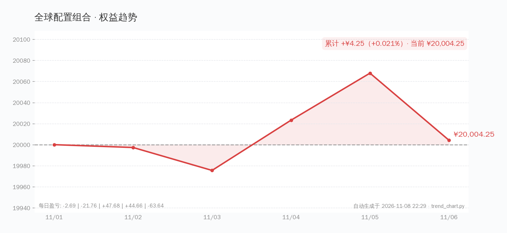
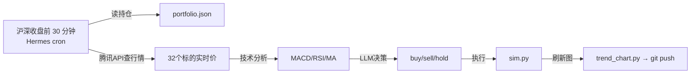

# 🌍 全球配置组合 · 动态看板

> **本金 ¥20,000** · 2026-11-01 开仓 · **每个交易日 14:30 自动决策并刷新**
>
> **所有产品均可在沪深交易所直接购买，无需境外账户。**



> ⚠️ **纯模拟盘学习实验，不构成投资建议。**

## 持仓概览（9只）

| 代码 | 名称 | 类别 | 跟踪标的 | 占比 |
|------|------|------|----------|------|
| 513100 | 纳指ETF国泰 | 美股QDII | 纳斯达克100 | ~2.2% |
| 513500 | 标普500ETF博时 | 美股QDII | 标普500 | ~2.7% |
| 513030 | 德国ETF华安 | 欧洲QDII | 德国DAX30 | ~1.8% |
| 513520 | 日经ETF华夏 | 亚太QDII | 日经225 | ~2.2% |
| 159920 | 恒生ETF华夏 | 港股跨境 | 恒生指数 | ~2.0% |
| 513180 | 恒生科技ETF华夏 | 港股跨境 | 恒生科技 | ~1.4% |
| 518880 | 黄金ETF华安 | 商品 | 上海金 | ~2.0% |
| 511010 | 国债ETF国泰 | 债券 | 5年期国债 | ~2.1% |
| 511260 | 十年国债ETF | 债券 | 10年期国债 | ~1.4% |
| 💵 | 现金 | — | — | ~82.2% |

> 初始建仓仅占 17.8%，留足现金等市场机会。

## 策略

| 规则 | 条件 | 动作 |
|------|------|------|
| 再平衡 | 大类资产偏离目标 >15% | 调整 |
| 止损 | 单标跌到成本 -10% | 减半仓 |
| 加仓 | MACD金叉 + 大盘趋势向上 | 买入 |
| 现金 | 不低于 30% | 防空头 |

## 产品池（已在腾讯接口验证，共 32 个）

详见 [global_products.json](https://github.com/knolonzhou/HermesReports/blob/main/global-sim/products.json)

### 美股 QDII (6)
513100 纳指ETF国泰 · 159941 纳指ETF广发 · 159509 纳指科技ETF景顺 · 159632 纳斯达克ETF华安 · 513500 标普500ETF博时 · 513650 标普500ETF南方

### 欧洲 QDII (2)
513030 德国ETF华安 · 513080 法国ETF华安

### 亚太 QDII (4)
513520 日经ETF华夏 · 513880 日经225ETF华安 · 513310 中韩半导体ETF · 513730 东南亚科技ETF

### 新兴市场 (3)
159329 沙特ETF南方 · 520830 沙特ETF华泰柏瑞 · 164824 印度基金LOF

### 港股跨境 (4)
159920 恒生ETF华夏 · 513660 恒生ETF华夏沪 · 513180 恒生科技ETF华夏 · 513050 中概互联网ETF

### 商品 (8)
518880/518800/159937/159934 黄金 · 159985 豆粕 · 162411 华宝油气 · 501018 南方原油 · 159980 有色金属

### 债券 (5)
511010 国债ETF · 511260 十年国债 · 511090 30年国债 · 511520 政金债 · 159649 国开债

## 自动更新机制



## 手动操作

```bash
# 查看持仓
SIM_DIR=/root/stock-tool/global-sim python3 /root/stock-tool/sim/sim.py status

# 手动买入
SIM_DIR=/root/stock-tool/global-sim python3 /root/stock-tool/sim/sim.py buy 513100 100

# 收盘估值
SIM_DIR=/root/stock-tool/global-sim python3 /root/stock-tool/sim/sim.py daily
```

## ⚠️ 声明

- **纯模拟盘**，¥20,000 为虚拟资金
- 数据源：腾讯财经实时行情（qt.gtimg.cn）
- 不构成投资建议