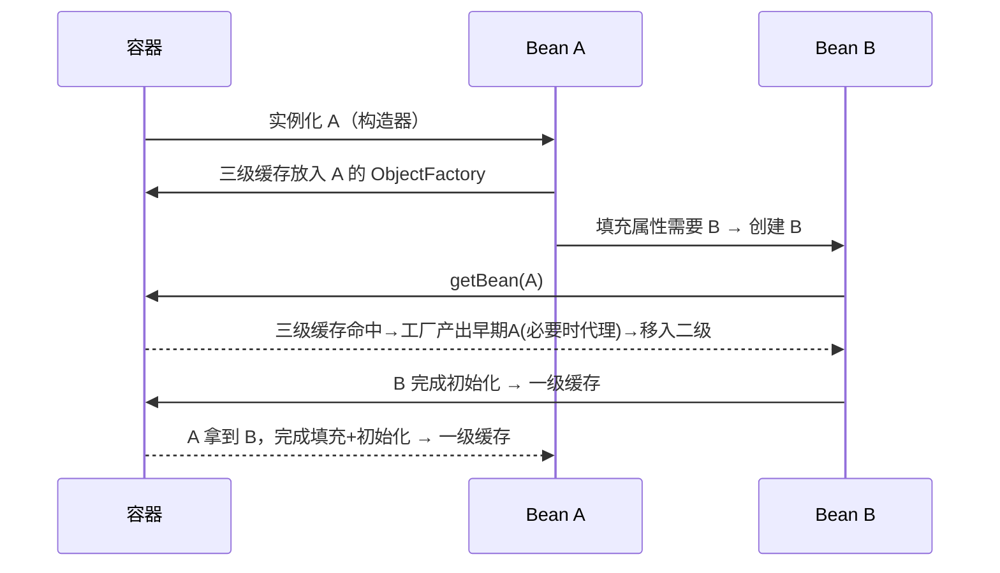

# 面试刷题手册（Hermes 每日三题）

> 每晚 3 题，主题按年内天数 mod 7 轮换：0=JVM 1=并发 2=Spring 3=算法·LeetCode 4=算法·系统设计 5=深度学习 6=LLM/Agent 工程。
> 难度定位：3-5 年经验后端 / AI 工程师面试。

## 📚 目录索引

### Spring（IoC/AOP/事务/Boot 自动装配/循环依赖）
- [Q1. Spring 如何解决循环依赖？为什么是三级缓存而不是两级？](#q1)（📅2026-10-23 ⭐4）
- [Q2. @Transactional 有哪些失效场景？底层原理是什么？](#q2)（📅2026-10-23 ⭐4）
- [Q3. Spring Boot 自动装配的原理是什么？如何自定义一个 Starter？](#q3)（📅2026-10-23 ⭐3）

---

<a id="q1"></a>

### Q1. Spring 如何解决循环依赖？为什么是三级缓存而不是两级？（🏷Spring 📅2026-10-23 ⭐难度4）

**「考察点」** Bean 生命周期与三级缓存机制的理解深度，以及 AOP 代理提前暴露的关键细节。

**「参考答案」**

**基础答案：** Spring 对 **单例（singleton）+ setter/字段注入** 的循环依赖，通过三级缓存解决：

| 缓存 | 名称 | 存什么 |
|---|---|---|
| 一级 | `singletonObjects` | 完整的成品 Bean |
| 二级 | `earlySingletonObjects` | 提前暴露的半成品 Bean（已实例化、未填充属性） |
| 三级 | `singletonFactories` | `ObjectFactory` lambda，调用时才决定返回原始对象还是代理对象 |

流程：A 实例化后（构造完成、属性未填充），先把一个 `ObjectFactory` 放入三级缓存 → 填充属性发现依赖 B → 创建 B → B 填充属性需要 A → 从缓存查 A：三级缓存命中，调用工厂拿到 A 的早期引用（移入二级缓存）→ B 完成创建进入一级缓存 → A 拿到 B 完成填充 → A 进入一级缓存。

**深入原理：为什么必须三级，两级不行吗？**

核心原因是 **AOP 代理的创建时机**。正常流程中代理对象是在 `initializeBean`（初始化之后）由 `AbstractAutoProxyCreator` 创建的；但循环依赖下，B 注入的 A 必须和最终容器里的 A 是**同一个对象**——如果 A 需要被代理，B 拿到的就得是代理对象。

- 如果只有两级缓存，想解决就必须**在实例化后立刻创建代理**，这破坏了 Spring "代理在初始化后创建" 的设计原则（大量无循环依赖的 Bean 也被迫提前代理，且与 `BeanPostProcessor` 体系的时序耦合）。
- 三级缓存存的是**工厂（lambda）**：`getEarlyBeanReference()` 只在**真的发生循环依赖、有人来取早期引用时**才被调用，此时才判断是否需要提前生成代理（`SmartInstantiationAwareBeanPostProcessor#getEarlyBeanReference`）。没有循环依赖时工厂永远不会执行——**延迟决策**，这就是三级的意义。

```java
// DefaultSingletonBeanRegistry#getSingleton 核心逻辑（简化）
singletonObject = singletonFactory.getObject(); // 调三级缓存工厂
this.earlySingletonObjects.put(beanName, singletonObject); // 升级到二级
this.registeredSingletons.remove(beanName);
```

**哪些循环依赖解决不了？**
1. **构造器注入**的循环依赖：实例化都完不成，没有"半成品"可暴露 → 直接抛 `BeanCurrentlyInCreationException`（可用 `@Lazy` 缓解，注入的是代理，首次使用时才解析目标）。
2. **prototype 作用域**：不缓存，无法提前暴露。
3. Spring Boot 2.6+ 默认**禁止循环依赖**（`spring.main.allow-circular-references=false`），出现即启动失败——官方态度是循环依赖本身是设计坏味道，应重构（抽第三方类、事件解耦、`@Lazy`）。

**Mermaid 流程图：**



**「追问陷阱」**
1. *"二级缓存到底有没有用？能不能三级直接升一级？"* —— 不能省。二级缓存保证**多次 getEarlyBeanReference 只执行一次工厂**：若 B 和 C 都循环依赖 A，两次取到的早期引用必须是同一个对象（否则 B、C 注入的 A 不是同一个）。第一次从三级工厂产出后放二级，后续直接从二级取，工厂不再执行。
2. *"A 最终生成的代理和早期暴露的代理会不会是两个对象？"* —— 不会。`AbstractAutoProxyCreator` 在 `postProcessAfterInitialization` 里会检查 `earlyProxyReferences`，如果该 Bean 已经通过三级缓存提前代理过，初始化后就不再重复创建代理，保证单例一致性。

---

<a id="q2"></a>

### Q2. @Transactional 有哪些失效场景？底层原理是什么？（🏷Spring 📅2026-10-23 ⭐难度4）

**「考察点」** 声明式事务的 AOP 代理本质，以及工程中最常见的事务踩坑清单。

**「参考答案」**

**基础答案（失效场景清单）：**
1. **同类内部方法调用（this 调用）**：`this.methodB()` 不走代理，事务注解无效 —— 最高频。
2. **方法不是 public**：Spring 事务默认只对 public 方法生效（CGLIB 无法代理 private/final/static）。
3. **异常被 catch 吞掉**或抛的是**受检异常**：默认只回滚 `RuntimeException` 和 `Error`，抛 `Exception` 需显式 `rollbackFor = Exception.class`。
4. **抛出异常类型不匹配 rollbackFor 配置**。
5. **数据库/引擎不支持事务**：MyISAM 表、或某些 NoSQL。
6. **Bean 未被 Spring 管理**（自己 new 出来的对象）。
7. **传播行为设置错误**：如 `NOT_SUPPORTED` 挂起事务、`REQUIRES_NEW` 内外事务独立（内层回滚不影响外层，常被误认为"失效"）。
8. **多线程调用**：事务上下文绑定在 ThreadLocal（`TransactionSynchronizationManager`），子线程拿不到连接。
9. **@Transactional 注解在接口上 + CGLIB 代理**：CGLIB 基于类，接口上的注解不会被继承。

**深入原理：** 声明式事务 = AOP 代理 + `TransactionInterceptor`。

- 开启 `@EnableTransactionManagement` 后，`AutoProxyCreator` 为标注了 `@Transactional` 的 Bean 生成代理（JDK 动态代理或 CGLIB，Boot 2.x 默认 `proxyTargetClass=true` 即 CGLIB）。
- 调用链：代理方法 → `TransactionInterceptor.invoke()` → `PlatformTransactionManager.getTransaction()`（从 DataSource 拿 Connection，`setAutoCommit(false)`，把连接包成 `ConnectionHolder` 绑定到 `TransactionSynchronizationManager` 的 **ThreadLocal**）→ 执行目标方法 → 正常则 `commit()`，匹配回滚规则则 `rollback()`。
- 之所以"this 调用失效"：代理只拦截**从外部进入代理对象**的调用；类内部 `this.xxx()` 中的 this 是原始对象，不经过拦截器链。这也是"同类中一个无事务方法调用事务方法，事务不生效"的根因。

**内部调用的三种解法（追问常考）：**
```java
// 方案1：注入自身代理（Spring 4.3+ 支持自注入，需走代理）
@Resource private MyService self;
public void a() { self.b(); } // b 上的 @Transactional 生效

// 方案2：AopContext 获取当前代理（需 exposeProxy = true）
((MyService) AopContext.currentProxy()).b();

// 方案3：拆到另一个 Bean（最推荐，符合职责划分）
```

**传播行为 7 种一句话版：** REQUIRED（默认，有就加入没有就新建）、SUPPORTS（有就加入没有就非事务）、MANDATORY（必须有否则抛异常）、REQUIRES_NEW（永远新建，挂起当前）、NOT_SUPPORTED（非事务执行，挂起当前）、NEVER（有事务就抛异常）、NESTED（savepoint 嵌套，外层回滚则内层必回滚，内层回滚不影响外层）。

**「追问陷阱」**
1. *"REQUIRES_NEW 和 NESTED 的区别？"* —— REQUIRES_NEW 是**物理上两个独立事务、两个连接**（外层被挂起，内层提交后外层回滚也救不回内层）；NESTED 是**同一连接上的 savepoint**，内层回滚只是回到保存点，外层最终回滚会连带内层一起回滚。追问点：NESTED 依赖 JDBC savepoint，JTA 分布式事务下不可用。
2. *"事务方法里发 MQ / 调 RPC，消费方读不到数据怎么办？"* —— 事务未提交时消息已发出，下游查库读到旧数据。正解：`TransactionSynchronizationManager.registerSynchronization` 的 `afterCommit` 回调里再发消息，或用事务消息（RocketMQ half message）/ 本地消息表。这考察的是"事务边界与副作用时序"，比背失效清单更能区分候选人。

---

<a id="q3"></a>

### Q3. Spring Boot 自动装配的原理是什么？如何自定义一个 Starter？（🏷Spring 📅2026-10-23 ⭐难度3）

**「考察点」** @SpringBootApplication 组合注解的拆解能力 + 条件装配机制 + 动手写 Starter 的工程经验。

**「参考答案」**

**基础答案：** 自动装配的入口是 `@SpringBootApplication`，它是三个注解的组合：
- `@SpringBootConfiguration`（本质是 @Configuration）
- `@ComponentScan`（扫描当前包及子包）
- **`@EnableAutoConfiguration`** ← 自动装配核心

`@EnableAutoConfiguration` 通过 `@Import(AutoConfigurationImportSelector.class)` 导入选择器，它在启动时读取 classpath 下所有 jar 的 **`META-INF/spring/org.springframework.boot.autoconfigure.AutoConfiguration.imports`** 文件（Boot 2.7 之前是 `META-INF/spring.factories`），拿到候选自动配置类全限定名列表，经过**去重 → 排除（exclude）→ 条件过滤**后，把通过筛选的配置类注册为 Bean 定义。

**深入原理：条件装配 @Conditional 家族**

自动配置类"生效与否"由条件注解裁决，全部基于 `Condition` 接口的 `matches()`：

| 注解 | 条件 |
|---|---|
| `@ConditionalOnClass` | classpath 存在某类（**在 Bean 定义解析阶段用 ASM 读元数据判断，不会触发类加载 NoClassDefFoundError**）|
| `@ConditionalOnMissingBean` | 容器中不存在该 Bean —— Starter "用户配置优先"的关键 |
| `@ConditionalOnProperty` | 配置项匹配（如 `havingValue="true"`）|
| `@ConditionalOnWebApplication` | 是 Web 环境 |

典型模式（几乎所有官方 Starter 都长这样）：

```java
@AutoConfiguration
@ConditionalOnClass(DataSource.class)
@EnableConfigurationProperties(MyDbProperties.class) // 绑定 application.yml 前缀配置
public class MyDbAutoConfiguration {
    @Bean
    @ConditionalOnMissingBean // 用户自己定义了就用用户的，这就是"约定优于配置"的退让机制
    public MyDbClient myDbClient(MyDbProperties props) {
        return new MyDbClient(props.getUrl());
    }
}
```

**加载时序细节（加分点）：** 自动配置类的解析发生在**用户配置类之后**（`AutoConfigurationImportSelector` 是 `DeferredImportSelector`，延迟处理），所以 `@ConditionalOnMissingBean` 判断时用户自定义的 Bean 已经注册——顺序保证了"用户优先"。

**自定义 Starter 步骤（官方规范）：**
1. 建 `xxx-spring-boot-autoconfigure` 模块：写 `XxxAutoConfiguration` + `XxxProperties`（`@ConfigurationProperties(prefix="xxx")`）。
2. 在 `src/main/resources/META-INF/spring/org.springframework.boot.autoconfigure.AutoConfiguration.imports` 中每行写一个配置类全限定名。
3. 建 `xxx-spring-boot-starter` 空壳模块，只做依赖聚合（pom 引 autoconfigure + 必要三方库）。官方 Starter 命名 `spring-boot-starter-xxx`，第三方规范是 `xxx-spring-boot-starter`。
4. （可选）用 `spring-boot-configuration-processor` 生成 `spring-configuration-metadata.json`，让 IDE 有配置提示。

**「追问陷阱」**
1. *"Boot 2.7/3.x 为什么废弃 spring.factories 改用 .imports 文件？"* —— spring.factories 是通用 SPI 机制，一个文件混杂多种扩展点（监听器、初始化器、自动配置…），解析开销大且无法针对自动配置做去重排序优化；独立的 `.imports` 文件格式简单（一行一个类名），启动更快，语义更清晰。Boot 2.7 两者兼容，3.0 起只认 `.imports`。
2. *"@ComponentScan 和自动装配有什么区别？为什么 Starter 里的 Bean 不靠包扫描？"* —— 扫描是**基于包路径**（用户工程不可能扫到 Starter 的包），自动装配是**基于 imports 清单 + 条件注解**，与包结构解耦；且扫描无条件注册，自动装配可按 classpath/配置动态生效。能答出"Starter 的 jar 不在用户扫描路径下，必须走 imports 注册"即为过关。
