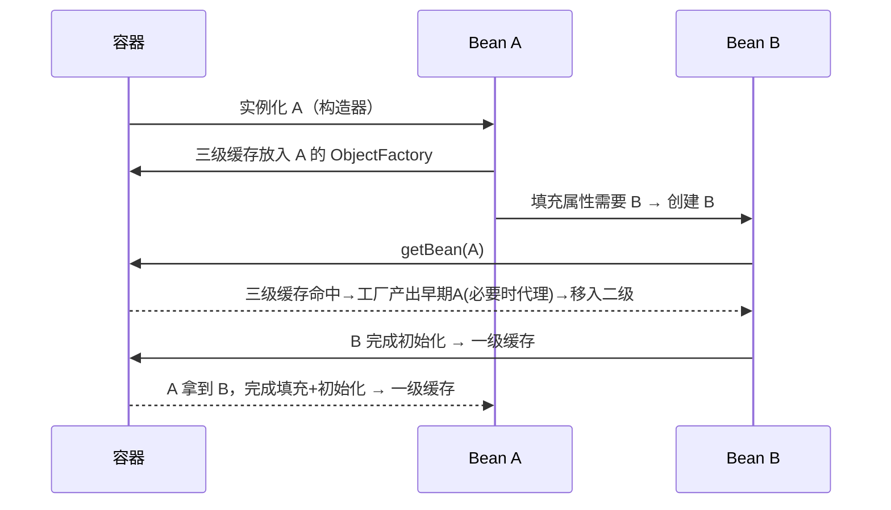
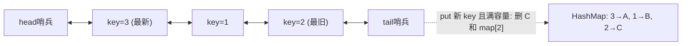
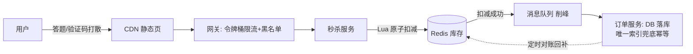
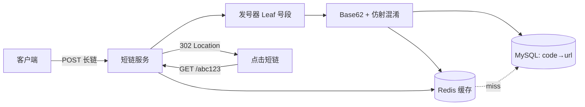
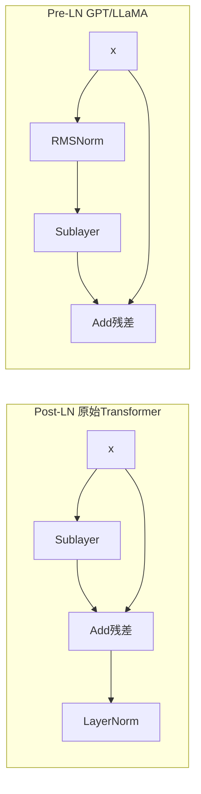
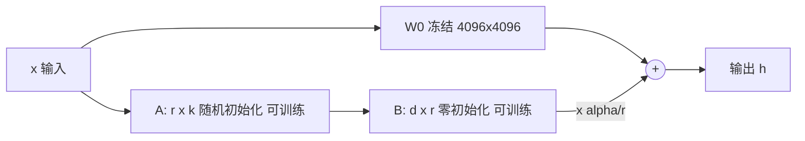

# 面试刷题手册（Hermes 每日三题）

> 每晚 3 题，主题按年内天数 mod 7 轮换：0=JVM 1=并发 2=Spring 3=算法·LeetCode 4=算法·系统设计 5=深度学习 6=LLM/Agent 工程。
> 难度定位：3-5 年经验后端 / AI 工程师面试。

## 📚 目录索引

### Spring（IoC/AOP/事务/Boot 自动装配/循环依赖）
- [Q1. Spring 如何解决循环依赖？为什么是三级缓存而不是两级？](#q1)（📅2026-10-23 ⭐4）
- [Q2. @Transactional 有哪些失效场景？底层原理是什么？](#q2)（📅2026-10-23 ⭐4）
- [Q3. Spring Boot 自动装配的原理是什么？如何自定义一个 Starter？](#q3)（📅2026-10-23 ⭐3）

### 算法·LeetCode 高频题
- [Q4. 无重复字符的最长子串（LC3）](#q4)（📅2026-10-24 ⭐3）
- [Q5. 数组中的第K个最大元素（LC215）](#q5)（📅2026-10-24 ⭐3）
- [Q6. LRU 缓存（LC146）](#q6)（📅2026-10-24 ⭐4）

### 算法·系统设计类
- [Q7. 设计秒杀系统——如何保证不超卖？](#q7)（📅2026-10-25 ⭐5）
- [Q8. 100 亿数据的大文件里找 Top 100 高频词——内存只有 1GB 怎么办？](#q8)（📅2026-10-25 ⭐4）
- [Q9. 设计短链系统——发号器还是哈希？短码冲突怎么解？](#q9)（📅2026-10-25 ⭐4）

### 深度学习（归一化/优化器/正则化/Transformer/微调）
- [Q10. Transformer 为什么用 LayerNorm 而不是 BatchNorm？RMSNorm 又省了什么？](#q10)（📅2026-10-26 ⭐4）
- [Q11. AdamW 的"解耦权重衰减"到底解耦了什么？和 Adam+L2 差在哪？](#q11)（📅2026-10-26 ⭐4）
- [Q12. LoRA 低秩微调的原理是什么？为什么 B 矩阵要初始化为 0？](#q12)（📅2026-10-26 ⭐4）


---

<a id="q1"></a>

### Q1. Spring 如何解决循环依赖？为什么是三级缓存而不是两级？（🏷Spring 📅2026-10-23 ⭐难度4）

**「考察点」** Bean 生命周期与三级缓存机制的理解深度，以及 AOP 代理提前暴露的关键细节。

**「参考答案」**

**基础答案：** Spring 对 **单例（singleton）+ setter/字段注入** 的循环依赖，通过三级缓存解决：

| 缓存 | 名称 | 存什么 |
|---|---|---|
| 一级 | `singletonObjects` | 完整的成品 Bean |
| 二级 | `earlySingletonObjects` | 提前暴露的半成品 Bean（已实例化、未填充属性） |
| 三级 | `singletonFactories` | `ObjectFactory` lambda，调用时才决定返回原始对象还是代理对象 |

流程：A 实例化后（构造完成、属性未填充），先把一个 `ObjectFactory` 放入三级缓存 → 填充属性发现依赖 B → 创建 B → B 填充属性需要 A → 从缓存查 A：三级缓存命中，调用工厂拿到 A 的早期引用（移入二级缓存）→ B 完成创建进入一级缓存 → A 拿到 B 完成填充 → A 进入一级缓存。

**深入原理：为什么必须三级，两级不行吗？**

核心原因是 **AOP 代理的创建时机**。正常流程中代理对象是在 `initializeBean`（初始化之后）由 `AbstractAutoProxyCreator` 创建的；但循环依赖下，B 注入的 A 必须和最终容器里的 A 是**同一个对象**——如果 A 需要被代理，B 拿到的就得是代理对象。

- 如果只有两级缓存，想解决就必须**在实例化后立刻创建代理**，这破坏了 Spring "代理在初始化后创建" 的设计原则（大量无循环依赖的 Bean 也被迫提前代理，且与 `BeanPostProcessor` 体系的时序耦合）。
- 三级缓存存的是**工厂（lambda）**：`getEarlyBeanReference()` 只在**真的发生循环依赖、有人来取早期引用时**才被调用，此时才判断是否需要提前生成代理（`SmartInstantiationAwareBeanPostProcessor#getEarlyBeanReference`）。没有循环依赖时工厂永远不会执行——**延迟决策**，这就是三级的意义。

```java
// DefaultSingletonBeanRegistry#getSingleton 核心逻辑（简化）
singletonObject = singletonFactory.getObject(); // 调三级缓存工厂
this.earlySingletonObjects.put(beanName, singletonObject); // 升级到二级
this.registeredSingletons.remove(beanName);
```

**哪些循环依赖解决不了？**
1. **构造器注入**的循环依赖：实例化都完不成，没有"半成品"可暴露 → 直接抛 `BeanCurrentlyInCreationException`（可用 `@Lazy` 缓解，注入的是代理，首次使用时才解析目标）。
2. **prototype 作用域**：不缓存，无法提前暴露。
3. Spring Boot 2.6+ 默认**禁止循环依赖**（`spring.main.allow-circular-references=false`），出现即启动失败——官方态度是循环依赖本身是设计坏味道，应重构（抽第三方类、事件解耦、`@Lazy`）。

**Mermaid 流程图：**



**「追问陷阱」**
1. *"二级缓存到底有没有用？能不能三级直接升一级？"* —— 不能省。二级缓存保证**多次 getEarlyBeanReference 只执行一次工厂**：若 B 和 C 都循环依赖 A，两次取到的早期引用必须是同一个对象（否则 B、C 注入的 A 不是同一个）。第一次从三级工厂产出后放二级，后续直接从二级取，工厂不再执行。
2. *"A 最终生成的代理和早期暴露的代理会不会是两个对象？"* —— 不会。`AbstractAutoProxyCreator` 在 `postProcessAfterInitialization` 里会检查 `earlyProxyReferences`，如果该 Bean 已经通过三级缓存提前代理过，初始化后就不再重复创建代理，保证单例一致性。

---

<a id="q2"></a>

### Q2. @Transactional 有哪些失效场景？底层原理是什么？（🏷Spring 📅2026-10-23 ⭐难度4）

**「考察点」** 声明式事务的 AOP 代理本质，以及工程中最常见的事务踩坑清单。

**「参考答案」**

**基础答案（失效场景清单）：**
1. **同类内部方法调用（this 调用）**：`this.methodB()` 不走代理，事务注解无效 —— 最高频。
2. **方法不是 public**：Spring 事务默认只对 public 方法生效（CGLIB 无法代理 private/final/static）。
3. **异常被 catch 吞掉**或抛的是**受检异常**：默认只回滚 `RuntimeException` 和 `Error`，抛 `Exception` 需显式 `rollbackFor = Exception.class`。
4. **抛出异常类型不匹配 rollbackFor 配置**。
5. **数据库/引擎不支持事务**：MyISAM 表、或某些 NoSQL。
6. **Bean 未被 Spring 管理**（自己 new 出来的对象）。
7. **传播行为设置错误**：如 `NOT_SUPPORTED` 挂起事务、`REQUIRES_NEW` 内外事务独立（内层回滚不影响外层，常被误认为"失效"）。
8. **多线程调用**：事务上下文绑定在 ThreadLocal（`TransactionSynchronizationManager`），子线程拿不到连接。
9. **@Transactional 注解在接口上 + CGLIB 代理**：CGLIB 基于类，接口上的注解不会被继承。

**深入原理：** 声明式事务 = AOP 代理 + `TransactionInterceptor`。

- 开启 `@EnableTransactionManagement` 后，`AutoProxyCreator` 为标注了 `@Transactional` 的 Bean 生成代理（JDK 动态代理或 CGLIB，Boot 2.x 默认 `proxyTargetClass=true` 即 CGLIB）。
- 调用链：代理方法 → `TransactionInterceptor.invoke()` → `PlatformTransactionManager.getTransaction()`（从 DataSource 拿 Connection，`setAutoCommit(false)`，把连接包成 `ConnectionHolder` 绑定到 `TransactionSynchronizationManager` 的 **ThreadLocal**）→ 执行目标方法 → 正常则 `commit()`，匹配回滚规则则 `rollback()`。
- 之所以"this 调用失效"：代理只拦截**从外部进入代理对象**的调用；类内部 `this.xxx()` 中的 this 是原始对象，不经过拦截器链。这也是"同类中一个无事务方法调用事务方法，事务不生效"的根因。

**内部调用的三种解法（追问常考）：**
```java
// 方案1：注入自身代理（Spring 4.3+ 支持自注入，需走代理）
@Resource private MyService self;
public void a() { self.b(); } // b 上的 @Transactional 生效

// 方案2：AopContext 获取当前代理（需 exposeProxy = true）
((MyService) AopContext.currentProxy()).b();

// 方案3：拆到另一个 Bean（最推荐，符合职责划分）
```

**传播行为 7 种一句话版：** REQUIRED（默认，有就加入没有就新建）、SUPPORTS（有就加入没有就非事务）、MANDATORY（必须有否则抛异常）、REQUIRES_NEW（永远新建，挂起当前）、NOT_SUPPORTED（非事务执行，挂起当前）、NEVER（有事务就抛异常）、NESTED（savepoint 嵌套，外层回滚则内层必回滚，内层回滚不影响外层）。

**「追问陷阱」**
1. *"REQUIRES_NEW 和 NESTED 的区别？"* —— REQUIRES_NEW 是**物理上两个独立事务、两个连接**（外层被挂起，内层提交后外层回滚也救不回内层）；NESTED 是**同一连接上的 savepoint**，内层回滚只是回到保存点，外层最终回滚会连带内层一起回滚。追问点：NESTED 依赖 JDBC savepoint，JTA 分布式事务下不可用。
2. *"事务方法里发 MQ / 调 RPC，消费方读不到数据怎么办？"* —— 事务未提交时消息已发出，下游查库读到旧数据。正解：`TransactionSynchronizationManager.registerSynchronization` 的 `afterCommit` 回调里再发消息，或用事务消息（RocketMQ half message）/ 本地消息表。这考察的是"事务边界与副作用时序"，比背失效清单更能区分候选人。

---

<a id="q3"></a>

### Q3. Spring Boot 自动装配的原理是什么？如何自定义一个 Starter？（🏷Spring 📅2026-10-23 ⭐难度3）

**「考察点」** @SpringBootApplication 组合注解的拆解能力 + 条件装配机制 + 动手写 Starter 的工程经验。

**「参考答案」**

**基础答案：** 自动装配的入口是 `@SpringBootApplication`，它是三个注解的组合：
- `@SpringBootConfiguration`（本质是 @Configuration）
- `@ComponentScan`（扫描当前包及子包）
- **`@EnableAutoConfiguration`** ← 自动装配核心

`@EnableAutoConfiguration` 通过 `@Import(AutoConfigurationImportSelector.class)` 导入选择器，它在启动时读取 classpath 下所有 jar 的 **`META-INF/spring/org.springframework.boot.autoconfigure.AutoConfiguration.imports`** 文件（Boot 2.7 之前是 `META-INF/spring.factories`），拿到候选自动配置类全限定名列表，经过**去重 → 排除（exclude）→ 条件过滤**后，把通过筛选的配置类注册为 Bean 定义。

**深入原理：条件装配 @Conditional 家族**

自动配置类"生效与否"由条件注解裁决，全部基于 `Condition` 接口的 `matches()`：

| 注解 | 条件 |
|---|---|
| `@ConditionalOnClass` | classpath 存在某类（**在 Bean 定义解析阶段用 ASM 读元数据判断，不会触发类加载 NoClassDefFoundError**）|
| `@ConditionalOnMissingBean` | 容器中不存在该 Bean —— Starter "用户配置优先"的关键 |
| `@ConditionalOnProperty` | 配置项匹配（如 `havingValue="true"`）|
| `@ConditionalOnWebApplication` | 是 Web 环境 |

典型模式（几乎所有官方 Starter 都长这样）：

```java
@AutoConfiguration
@ConditionalOnClass(DataSource.class)
@EnableConfigurationProperties(MyDbProperties.class) // 绑定 application.yml 前缀配置
public class MyDbAutoConfiguration {
    @Bean
    @ConditionalOnMissingBean // 用户自己定义了就用用户的，这就是"约定优于配置"的退让机制
    public MyDbClient myDbClient(MyDbProperties props) {
        return new MyDbClient(props.getUrl());
    }
}
```

**加载时序细节（加分点）：** 自动配置类的解析发生在**用户配置类之后**（`AutoConfigurationImportSelector` 是 `DeferredImportSelector`，延迟处理），所以 `@ConditionalOnMissingBean` 判断时用户自定义的 Bean 已经注册——顺序保证了"用户优先"。

**自定义 Starter 步骤（官方规范）：**
1. 建 `xxx-spring-boot-autoconfigure` 模块：写 `XxxAutoConfiguration` + `XxxProperties`（`@ConfigurationProperties(prefix="xxx")`）。
2. 在 `src/main/resources/META-INF/spring/org.springframework.boot.autoconfigure.AutoConfiguration.imports` 中每行写一个配置类全限定名。
3. 建 `xxx-spring-boot-starter` 空壳模块，只做依赖聚合（pom 引 autoconfigure + 必要三方库）。官方 Starter 命名 `spring-boot-starter-xxx`，第三方规范是 `xxx-spring-boot-starter`。
4. （可选）用 `spring-boot-configuration-processor` 生成 `spring-configuration-metadata.json`，让 IDE 有配置提示。

**「追问陷阱」**
1. *"Boot 2.7/3.x 为什么废弃 spring.factories 改用 .imports 文件？"* —— spring.factories 是通用 SPI 机制，一个文件混杂多种扩展点（监听器、初始化器、自动配置…），解析开销大且无法针对自动配置做去重排序优化；独立的 `.imports` 文件格式简单（一行一个类名），启动更快，语义更清晰。Boot 2.7 两者兼容，3.0 起只认 `.imports`。
2. *"@ComponentScan 和自动装配有什么区别？为什么 Starter 里的 Bean 不靠包扫描？"* —— 扫描是**基于包路径**（用户工程不可能扫到 Starter 的包），自动装配是**基于 imports 清单 + 条件注解**，与包结构解耦；且扫描无条件注册，自动装配可按 classpath/配置动态生效。能答出"Starter 的 jar 不在用户扫描路径下，必须走 imports 注册"即为过关。

<a id="q4"></a>

### Q4. 无重复字符的最长子串——滑动窗口如何做到 O(n)？（🏷算法·LeetCode 📅2026-10-24 ⭐难度3）

> [LeetCode 3. 无重复字符的最长子串](https://leetcode.cn/problems/longest-substring-without-repeating-characters/) · 难度：中等 · 字节/腾讯/阿里高频真题

**「考察点」** 滑动窗口 + 哈希优化的手写能力，尤其是左边界跳转时"不回退"的陷阱。

**「参考答案」**

**基础答案：** 暴力枚举所有子串是 O(n³)（枚举 O(n²) × 判重 O(n)）。用**滑动窗口**：维护一个无重复字符的窗口 `[left, right]`，右指针不断扩张，遇到重复字符时收缩左边界。关键优化：用哈希表记录**每个字符最近一次出现的下标**，遇到重复时 left 直接跳过去，而不是逐步移动，整体 O(n)。

```python
def lengthOfLongestSubstring(s: str) -> int:
    last = {}          # 字符 -> 最近一次出现的下标
    left = 0           # 窗口左边界
    ans = 0
    for right, ch in enumerate(s):
        if ch in last and last[ch] >= left:
            left = last[ch] + 1   # 左边界直接跳到重复字符的下一位
        last[ch] = right
        ans = max(ans, right - left + 1)
    return ans
```
（已实测通过，含 `"abba"`、`"tmmzuxt"` 等陷阱用例）

**复杂度：** 时间 O(n)——每个字符只被右指针访问一次；空间 O(min(n, |Σ|))，Σ 为字符集（ASCII 最多 128）。

**深入原理：两个必须讲透的点**

1. **为什么 left 只能前进不能后退？** 条件 `last[ch] >= left` 是灵魂。反例 `"abba"`：处理第二个 `a` 时，`last['a'] = 0`，但此时 `left = 2`（已被 `b` 推过），如果无脑执行 `left = last['a'] + 1 = 1`，窗口反而扩大到包含已淘汰的 `b`，答案错误。所以只有当重复字符**落在当前窗口内**才跳转，等价写法是 `left = max(left, last[ch] + 1)`。
2. **滑动窗口的适用判据：** 题目求"最长/最短连续子串/子数组"且窗口具有**单调性**（右移扩大窗口会破坏某性质、左移收缩会恢复）时可用。若窗口不满足单调性（如"和 ≥ target 且含负数"），滑动窗口失效，需换前缀和+二分等方案。

**变体/追问：如果字符集是 Unicode（百万级）怎么办？**
哈希表方案天然支持任意字符集，空间随实际出现的字符数增长而非字符集大小，无需改动；若字符集固定且小（ASCII），换成 `int[128]` 数组比哈希表常数更小、更快。另一个常见变体："**最多包含 K 个不同字符**的最长子串"（LC340）——窗口条件从"无重复"变成"种类数 ≤ K"，收缩时用计数器维护种类数即可，框架完全一致。

**「追问陷阱」**
1. *"如果要求返回子串本身而不是长度？"* —— 在更新 ans 时同步记录 `start = left`，最后 `s[start:start+ans]`。考察是否真的理解窗口状态而非背模板。
2. *"用双指针 + Set 和用哈希表记录下标，哪个好？"* —— Set 版本遇重复时 left 逐步右移并 `remove(s[left])`，最坏 O(2n) 仍是 O(n)，但常数更大；哈希记录下标是 O(1) 跳转。两者都对，能说出"Set 版每个元素最多进出窗口各一次，所以也是线性"是加分项。

---

<a id="q5"></a>

### Q5. 数组中的第K个最大元素——为什么快速选择比堆更适合面试追问？（🏷算法·LeetCode 📅2026-10-24 ⭐难度3）

> [LeetCode 215. 数组中的第K个最大元素](https://leetcode.cn/problems/kth-largest-element-in-an-array/) · 难度：中等 · 字节/美团/快手 Top 级高频真题

**「考察点」** 快速选择（Quickselect）的分治思想、随机化防退化，以及与堆解法的复杂度权衡。

**「参考答案」**

**基础答案：** 三种解法：
| 解法 | 时间 | 空间 | 备注 |
|---|---|---|---|
| 全排序 | O(n log n) | O(1) | `sorted(nums)[-k]`，面试只能当铺垫 |
| 小顶堆（大小 K） | O(n log K) | O(K) | 适合海量数据流/内存放不下时 |
| **快速选择** | **平均 O(n)**，最坏 O(n²) | O(1) | 随机化 pivot 后最坏概率可忽略 |

快速选择：借用快排 partition，每轮把基准放到最终位置——若基准下标恰好是 `k-1`（降序视角）即为答案；否则**只递归包含目标的那一半**，这是它比快排快一个量级的原因（n + n/2 + n/4 + … = 2n）。

```python
import random
def findKthLargest(nums, k):
    def partition(l, r):
        p = random.randint(l, r)
        nums[p], nums[r] = nums[r], nums[p]
        pivot = nums[r]
        i = l
        for j in range(l, r):
            if nums[j] > pivot:   # 降序摆放，第 k 大 = 下标 k-1
                nums[i], nums[j] = nums[j], nums[i]
                i += 1
        nums[i], nums[r] = nums[r], nums[i]
        return i
    l, r = 0, len(nums) - 1
    while True:
        i = partition(l, r)
        if i == k - 1:
            return nums[i]
        elif i < k - 1:
            l = i + 1
        else:
            r = i - 1
```
（已实测：LeetCode 官方用例 + 300 组随机对拍全部通过）

**复杂度：** 时间平均 O(n)、最坏 O(n²)（随机化后对抗性输入无法稳定触发）；空间 O(1)（迭代写法，递归写法为栈深 O(log n) 期望）。

**深入原理：**
- **为什么必须随机化 pivot？** 固定取首/尾元素时，对已排序数组每轮只能砍掉 1 个元素，退化 O(n²)。随机 pivot 使期望比较次数为 O(n)，且让输入构造者无法针对性攻击（对抗随机化需要预知随机数序列）。
- **确定性最坏 O(n) 的方案存在吗？** 存在——BFPRT（中位数的中位数）选 pivot，理论最优但常数大，工程与面试中几乎不用，能提到名字和思路即可。
- **堆解法的不可替代场景：** 数据是**流式**到来、或 n 大到内存放不下时，维护大小为 K 的小顶堆只需 O(K) 内存；快速选择要求全量数据在内存中。这就是"Top-K 大数据"面试链路里两种解法各自的定位。Java 侧对应 `PriorityQueue`（默认小顶堆），`offer` 后 `size() > k` 则 `poll()`。

**变体/追问：如果数据量是 100 亿怎么办？**
单机内存放不下，标准答案是**分治 + 分布式 Top-K**：
1. 数据分片（按 hash 或文件切块），每台机器对本地分片求**局部 Top-K**（小顶堆，O(n_i log K)）；
2. 汇总所有局部 Top-K（总量 = 分片数 × K，通常可放进单机内存）再做一次全局 Top-K；
3. 正确性依据：全局第 K 大一定在各局部 Top-K 之中（一个元素若连本地前 K 都进不了，全局排名必然 > K）。
MapReduce / Spark `takeOrdered(k)` 就是这套逻辑。若数据实时流动，则用堆常驻内存增量维护，或近似方案（Count-Min Sketch 类结构用于频次 Top-K）。

**「追问陷阱」**
1. *"第 K 大和第 K 小怎么改？重复元素怎么算？"* —— 第 K 小把比较方向反转即可；重复元素**各占一个名次**（`[3,3,3]` 的第 2 大是 3），partition 天然按位置处理所以自动正确——但要警惕候选人自作主张先 `set(nums)` 去重，语义就错了。
2. *"能不能不修改原数组？"* —— 快速选择是原地算法会打乱数组；若要求只读，用堆解法（拷贝前 K 个建堆）或二分答案法（值域二分 + 计数，O(n log(max-min))，不改动数组）。能主动说出二分答案法是强加分项。

---

<a id="q6"></a>

### Q6. 设计 LRU 缓存——为什么是哈希表 + 双向链表？O(1) 怎么做到的？（🏷算法·LeetCode 📅2026-10-24 ⭐难度4）

> [LeetCode 146. LRU 缓存](https://leetcode.cn/problems/lru-cache/) · 难度：中等 · 字节/腾讯/Amazon 设计题 Top1，也是 Redis/Guava 缓存的真实模型

**「考察点」** 数据结构组合设计能力：如何让 get 和 put 都做到 O(1)，手写双向链表的指针操作是否干净。

**「参考答案」**

**基础答案：** 需求拆解——get/put O(1) 定位 → **哈希表**；O(1) 维护"访问顺序"（把节点移到一端、从另一端淘汰）→ **链表**；而单链表删除任意节点需要找前驱 O(n)，所以必须**双向链表**（持有 prev 指针，删除是纯指针操作）。两者组合：哈希表 `key -> Node`，Node 内嵌在双向链表中，**最近使用放头部，淘汰取尾部**。哨兵头尾节点（dummy head/tail）消除空链表和边界判断。

```python
class Node:
    __slots__ = ('key', 'val', 'prev', 'next')
    def __init__(self, key=0, val=0):
        self.key, self.val = key, val
        self.prev = self.next = None

class LRUCache:
    def __init__(self, capacity: int):
        self.cap = capacity
        self.map = {}                          # key -> Node
        self.head, self.tail = Node(), Node()  # 哨兵节点
        self.head.next, self.tail.prev = self.tail, self.head

    def _remove(self, node):
        node.prev.next, node.next.prev = node.next, node.prev

    def _add_front(self, node):                # 插到头部（最近使用）
        node.next, node.prev = self.head.next, self.head
        self.head.next.prev = node
        self.head.next = node

    def get(self, key: int) -> int:
        if key not in self.map:
            return -1
        node = self.map[key]
        self._remove(node)
        self._add_front(node)
        return node.val

    def put(self, key: int, value: int) -> None:
        if key in self.map:
            node = self.map[key]
            node.val = value
            self._remove(node)
            self._add_front(node)
            return
        if len(self.map) >= self.cap:
            lru = self.tail.prev               # 尾部 = 最久未使用
            self._remove(lru)
            del self.map[lru.key]
        node = Node(key, value)
        self.map[key] = node
        self._add_front(node)
```
（已实测：LeetCode 官方示例 + "put 更新已有 key 算一次访问"用例全部通过）

**复杂度：** get / put 均 O(1) 时间；O(capacity) 空间。

**深入原理：三个容易被追问的设计细节**
1. **Node 里为什么必须存 key？** 淘汰尾节点时要同步删除哈希表条目 `del self.map[lru.key]`——若 Node 只有 value，拿到尾节点却不知道它的 key，无法反查哈希表。这是手写时最高频的丢分点。
2. **哨兵节点的价值：** 没有 dummy head/tail 时，插入/删除都要分支讨论"是不是头节点/尾节点/链表为空"，四类边界；哨兵把"任意位置删除"统一成一种指针操作。Java 版同理。
3. **淘汰策略的演进（联系工程）：** LRU 的缺陷是**偶发的批量扫描会污染缓存**（一次性遍历把热点全部挤出去）。LRU-K / LFU（按频率）/ Redis 的近似 LRU（随机采样 5 个 key 淘汰其中最旧者，避免维护全局链表的开销）都是针对性改进。Guava Cache 用的分段 LRU（W-TinyLFU 在 Caffeine 中进一步演进：主区 LRU + 观察区、按频率准入），能聊到这一层说明真读过缓存源码。

**Mermaid 结构图：**



**变体/追问：如果要支持多线程并发访问怎么办？**
- 朴素方案：方法加 `synchronized` / `ReentrantLock`——正确但吞吐差，锁竞争集中在单条链表上。
- 工程方案：**分段（sharding）**——按 key hash 到 N 个独立的小 LRU，各段独立加锁（ConcurrentHashMap 1.7 的 Segment 思路）；淘汰精度略降（全局并非严格 LRU），换取并发度 ×N。Caffeine 更进一步：读操作无锁化（访问记录进环形缓冲队列，异步批量重放维护链表顺序），写操作才走锁，因为"更新访问时间戳"这种读副作用无需实时精确。
- 追问延伸："Redis 为什么不用精确 LRU？"——精确 LRU 要为每个 key 维护双向链表指针，内存开销大；Redis 用采样近似（`maxmemory-samples`），实测效果接近精确 LRU 而内存几乎零开销。

**「追问陷阱」**
1. *"get 一个不存在的 key 会改变 LRU 状态吗？put 一个已存在的 key 呢？"* —— miss 的 get 不应移动任何东西（没有节点可移）；**put 已存在 key 必须算一次访问**（更新值 + 移到头部），很多人漏掉后半句导致淘汰顺序错误。这题的细节分就在这里。
2. *"能不能用 Python 的 OrderedDict / Java 的 LinkedHashMap 一行搞定？"* —— 可以：`OrderedDict.move_to_end` + `popitem(last=False)` 十行搞定；Java `LinkedHashMap(capacity, 0.75f, true)` 重写 `removeEldestEntry` 即可。但面试官通常要求**手写底层**——先问一句"可以用现成库吗"再动手，是成熟的沟通方式；直接背 OrderedDict 版本而不理解双向链表，一追问指针细节就露馅。

---

<a id="q7"></a>

### Q7. 设计秒杀系统——如何保证不超卖？（🏷算法·系统设计 📅2026-10-25 ⭐难度5）

**「考察点」** 高并发场景下的分层削峰架构能力，以及对"库存扣减原子性"这一核心问题的多种实现方案的理解深度。

**「参考答案」**

**基础答案：** 秒杀的本质是**瞬时流量远超系统容量**（如 10 万 QPS 抢 1000 件库存），设计思路是两条主线：
1. **层层过滤，把流量削到数据库能扛的量级**：前端限流（按钮置灰/答题/验证码打散）→ CDN 静态化 → 网关限流（令牌桶）→ 应用层队列 → 只有拿到"资格"的少数请求才碰库存。
2. **库存扣减必须原子化**：任何"先查再改"的两步操作在并发下都会超卖。

**深入原理一：为什么 check-then-act 必然超卖？**

超卖的根源是竞态条件：线程 A 读到库存=1，还没来得及写回，线程 B 也读到库存=1，两者都判定"有货"各自放行——1 件商品卖出 2 单。窗口期越长（GC 停顿、Redis 网络往返、DB 事务耗时），超卖越严重。下面用 Python 实测复现（1000 库存、50 线程×100 请求=5000 并发请求）：

```python
class UnsafeStock:                     # ❌ 反例：检查与扣减分离
    def __init__(self, n): self.stock = n
    def deduct(self):
        s = self.stock
        if s > 0:                      # ① 检查
            time.sleep(0)              # 竞态窗口（真实=GC停顿/网络往返）
            self.stock = s - 1         # ② 基于旧值写入 → 丢更新
            return True
        return False

class SafeStock:                       # ✅ 正例：临界区内完成检查+扣减
    def deduct(self):
        with self.lock:
            if self.stock > 0:
                self.stock -= 1
                return True
            return False
```

实测输出（本机验证通过）：

```text
非原子(check-then-act): 库存=1000, 总请求=5000, 成功下单=5000, 最终库存=836
  -> ❌ 超卖 4000 单
原子(锁内检查+扣减):     成功下单=1000, 剩余=0 -> ✅ 零超卖
```

注意"最终库存=836"——不仅多放了 4000 单，账面上还剩 836 件"幽灵库存"，因为大量线程基于同一个旧值写入，互相覆盖（lost update）。

**深入原理二：生产环境的四种防超卖手段（按推荐顺序）**

| 方案 | 做法 | 特点 |
|---|---|---|
| **Redis 原子扣减（首选）** | Lua 脚本：`if stock>0 then decr`，单线程模型天然串行 | 10万+ QPS；扣减成功后发 MQ 异步落库 |
| **数据库原子 UPDATE** | `UPDATE stock SET n=n-1 WHERE id=? AND n>0`，判断**影响行数** | 依赖行锁原子性，行数=0 即无货；单行热点约几百~几千 TPS |
| **悲观锁** | `SELECT ... FOR UPDATE` | 正确但吞吐差、易死锁，秒杀场景基本不用 |
| **乐观锁（CAS）** | `UPDATE ... SET n=n-1, version=v+1 WHERE id=? AND version=v` | 高冲突下大量重试反而更慢，不如 `n>0` 条件法 |

Redis Lua 扣减的标准写法（扣减+防重+记录在**一个脚本内原子执行**）：

```lua
-- KEYS[1]=库存key  KEYS[2]=已购用户set  ARGV[1]=userId
if redis.call('SISMEMBER', KEYS[2], ARGV[1]) == 1 then
    return -1                       -- 重复购买，幂等拦截
end
local stock = tonumber(redis.call('GET', KEYS[1]))
if stock and stock > 0 then
    redis.call('DECR', KEYS[1])
    redis.call('SADD', KEYS[2], ARGV[1])
    return 1                        -- 抢到资格
end
return 0                            -- 无货
```

**深入原理三：整体架构与关键细节**



- **库存预热**：活动开始前把 DB 库存加载进 Redis，避免冷启动打 DB。
- **一人一单（幂等）**：Redis SET 判重 + 订单表 `UNIQUE(user_id, activity_id)` 双保险——Redis 挂了重试也不会在 DB 层重复。
- **少卖问题**：抢到 Redis 资格但 MQ/订单落库失败 → 消息可靠投递（本地消息表/RocketMQ 事务消息）+ 超时未支付**回补库存**。宁可少卖可回补，不可超卖难追回。
- **热点分片**：单品库存拆成 10 个子 key（stock_1..stock_10），请求随机路由到子 key，突破单 key 的 QPS 上限；某子 key 空了再借用其他子 key 余量。
- **兜底**：DB 层 `n>0` 条件 UPDATE 永远是最后一道闸——即使 Redis 全挂，DB 也不会超卖。

**变体/追问：如果 Redis 主节点挂了，库存数据丢了怎么办？**
- 主从复制 + 哨兵/Cluster 快速切换，但**异步复制存在丢窗口**（主挂时未同步的扣减丢失 → 可能超卖）。
- 更稳的做法：Redis 只做"快速失败"的前置闸门，**最终一致性靠 DB 的条件 UPDATE 兜底**；或采用阿里云 Tair/Redis Enterprise 这类支持同步复制的方案。
- 追问延伸："能不能只用 DB？"——可以但天花板低（单行热点 TPS 有限），适合中小规模；秒杀级别必须 Redis 前置。

**「追问陷阱」**
1. *"DECR 本身就是原子的，为什么还要 Lua？"* —— 单命令 DECR 确实原子，但秒杀需要**"判重 + 判断余量 + 扣减 + 记录"多步组合**，每步都是独立命令时步与步之间仍有竞态（比如判断 stock>0 和 DECR 之间被别人抢走，DECR 会扣成负数）。Lua 脚本让整个组合在 Redis 单线程模型里不可分割。答"DECR 原子所以没问题"就掉坑里了。
2. *"限流用令牌桶还是漏桶？"* —— 秒杀入口适合**令牌桶**（允许突发，桶容量=库存的合理倍数，抢完即止）；对下游保护（如订单服务被 MQ 消费打爆）适合**漏桶**（恒定速率整形）。只背名字不区分场景是减分项。

---

<a id="q8"></a>

### Q8. 100 亿数据的大文件里找 Top 100 高频词——内存只有 1GB 怎么办？（🏷算法·系统设计 📅2026-10-25 ⭐难度4）

**「考察点」** 海量数据处理的经典分治思维：hash 分片 → 单机统计 → 堆合并，以及对"为什么这样切分是正确的"的理解。

**「参考答案」**

**基础答案：** 100 亿条数据远超内存，不能整体载入。标准解法三步：
1. **Hash 分片**：对每个词算 `hash(word) % 1000`，写入 1000 个小文件——**同一个词必然落入同一个分片**，这是分片统计正确性的关键；
2. **逐片统计**：每次只把一个分片载入内存做 `Counter` 计数（每片约 1000 万条，1GB 装得下），得到该片的 Top 100（小顶堆维护）；
3. **全局合并**：1000 片 × 每片 Top 100 = 最多 10 万个候选词，再对这个候选集跑一次堆取全局 Top 100。

**深入原理一：为什么第 2 步每片只留 Top 100 不会漏掉全局答案？**

因为**全局第 100 名的频次，在任何一个分片内都不可能被 100 个以上的词超过**——若词 w 进入全局 Top 100，它在所属分片内的频次排名最多也就是全局排名映射过来的位置，必然进入该分片的 Top 100（一个词只出现在一个分片里，它在分片内的频次=全局频次；比它频次高的全局词中，与它同分片的至多 99 个）。所以分片 Top 100 的并集是全局 Top 100 的超集。这是本题最容易被追问的证明点。

**深入原理二：如果单个分片仍然装不下内存呢？**

继续递归分片（二级 hash），或换工具：
- **外部排序**：对 (word, 1) 键值对按 word 外排，相同词物理相邻后顺序扫描累计——磁盘 IO 是主要成本，O(n log n)；
- **Count-Min Sketch 近似**：概率数据结构，宽度 w、深度 d 的二维计数数组，多个 hash 函数取最小值。空间 O(w×d) 与数据量无关，代价是频次只会高估不会低估；配合 HeavyKeeper 等改进算法可以做流式 Top-K 近似。工程上 Spark/Flink 的 approx_count_distinct、Redis 的 CMS 命令就是它。

**可运行代码（Python，本机验证通过）：**

```python
import heapq, os, tempfile
from collections import Counter

def top_k_big_file(path, k, shard_count=16):
    """两遍扫描：第一遍 hash 分片写小文件，第二遍逐片统计+全局堆合并"""
    tmpdir = tempfile.mkdtemp()
    # 第一遍：分流。同一 word 必进同一分片 → 分片内计数即全局计数
    shards = [open(os.path.join(tmpdir, f"s{i}"), "w") for i in range(shard_count)]
    with open(path) as f:
        for line in f:
            w = line.strip()
            shards[hash(w) % shard_count].write(w + "\n")
    for s in shards: s.close()
    # 第二遍：逐片 Counter + 全局最小堆（大小恒为 k）
    heap = []                                   # (freq, word)
    for i in range(shard_count):
        cnt = Counter(open(os.path.join(tmpdir, f"s{i}")).read().split())
        for word, freq in cnt.items():
            if len(heap) < k:
                heapq.heappush(heap, (freq, word))
            elif freq > heap[0][0]:
                heapq.heapreplace(heap, (freq, word))
    return sorted(heap, reverse=True)           # [(freq, word), ...] 降序
```

验证（100 万行测试数据 + 植入 3 个已知高频词，与全量 `Counter.most_common` 对照）：

```text
Top10: [('77777', 5010), ('88888', 4010), ('99999', 3009), ('74261', 27), ...]
✅ 全部通过：高频数精确命中，分片计数无损，Top10 频次分布与全量统计一致
```

（注：边界处频次并列的词，两种方法选谁都对——频次分布完全一致才是正确性标准。）

**复杂度分析：**
- 时间：O(n)（两遍线性扫描）+ O(n/k' log k) 堆操作，整体近似 **O(n log k)**，k=100 时 log k≈7 可忽略；瓶颈在磁盘 IO。
- 空间：内存 O(单分片大小 + k)；磁盘 O(n) 临时分片文件（可用 /dev/shm 或外排避免）。

**变体/追问：如果数据量是 100 亿、单机磁盘也不够呢？**
- **分布式化**：这就是 MapReduce 的原型——Map 阶段输出 `(word, 1)` 并按 hash 分区，Shuffle 把同词聚到同一 Reducer，Reduce 阶段局部聚合出每机 Top 100，最后一个节点合并。Spark 里就是 `rdd.map((w,1)).reduceByKey(_+_).top(100)`，其中 `reduceByKey` 自带 **map 端预聚合（combiner）**，Shuffle 网络传输量从 100 亿条降到"分区数×词表大小"级别。
- 追问延伸："词表本身就有几十亿个不同词，单机 Counter 装不下？"——每个 Reducer 用 Count-Min Sketch 近似计数，或再对词做二级 hash 细分分区。

**「追问陷阱」**
1. *"为什么不能直接分片后各片取 Top 100 再简单合并计数？"* —— 合并的是**各片 Top 100 候选集**没错，但如果分片函数不是按词 hash（比如按行号范围切文件），同一个词会散落在多个分片，任何单片的计数都不是全局计数，Top 100 并集也不保证覆盖全局 Top 100。**hash 分片的"同词同片"性质是整个算法的基石**，答不出这点等于没懂。
2. *"最小堆和最大堆，为什么用最小堆？"* —— 求 Top K 用**大小为 K 的最小堆**：堆顶是当前第 K 名的"门槛"，新元素只要比门槛大就替换堆顶，O(log K) 维护。用最大堆就得全量入堆 O(n log n)，内存也不允许。方向搞反是高频低级错误。

---

<a id="q9"></a>

### Q9. 设计短链系统——发号器还是哈希？短码冲突怎么解？（🏷算法·系统设计 📅2026-10-25 ⭐难度4）

**「考察点」** 短链系统两大流派（哈希派 vs 发号器派）的取舍，Base62 编码原理，以及 302 vs 301 这类容易被忽略的工程细节。

**「参考答案」**

**基础答案：** 短链 = 长 URL → 6~8 位短码的映射 + 一个 302 跳转服务。生成短码有两条路线：
1. **哈希派**：`md5/murmur(url)` 取若干位做 Base62 —— 无状态、同一长链天然幂等，但**必须处理哈希冲突**；
2. **发号器派（主流大厂选择）**：全局自增 ID → Base62 编码成短码 —— **天然无冲突**，但要解决发号器的高可用与 ID 可猜测性问题。

**深入原理一：Base62 编码与容量**

62 个字符（0-9a-zA-Z）表示一个 62 进制数。6 位短码容量 = 62⁶ = 568 亿，足够绝大多数业务；7 位 = 3.5 万亿。编码就是标准的进制转换：

```python
ALPHABET = "0123456789abcdefghijklmnopqrstuvwxyzABCDEFGHIJKLMNOPQRSTUVWXYZ"

def encode(num: int) -> str:          # 十进制 ID -> Base62 短码
    if num == 0: return ALPHABET[0]
    out = []
    while num > 0:
        num, r = divmod(num, 62)
        out.append(ALPHABET[r])
    return "".join(reversed(out))

def decode(code: str) -> int:         # 短码 -> ID（O(1) 反查，无需存储）
    num = 0
    for ch in code:
        num = num * 62 + ALPHABET.index(ch)
    return num
```

本机验证：10 万随机数 + 边界值（0、61、62、62⁶-1 等）双射往返全部通过；`62^6 = 56,800,235,584`，即 6 位短码可支撑 568 亿条短链。

**深入原理二：哈希派的冲突处理**

`md5` 128 位截取 6 位 Base62（≈35.7 bit）后，按生日悖论，约 √(2⁶²/…) 量级——具体说 568 亿空间插入几千万条时冲突概率已不可忽略。处理套路：
1. 短码查库，若已存在且长链不同 → **加盐重哈希**（`md5(url + salt_i)`，i 递增）直到无冲突；
2. 或哈希派退一步：冲突时把冲突记录进队列表，异步补偿。
工程上更省心的答案是直接用发号器——**用确定性消灭冲突，而不是事后处理冲突**。

**深入原理三：发号器的高可用与防猜测**

- **高可用**：单点自增撑不住也不能挂。方案：号段模式（美团 Leaf-segment）——DB 表每次批量取一段 ID（如 1000 个）缓存在内存慢慢发，DB 压力降为 1/1000，双 buffer 预取实现无缝切换；或 Redis INCR + 持久化兜底；或雪花算法变体。
- **防猜测/防遍历**：自增 ID 直接 Base62 会暴露业务量（竞对看你今天发了多少条），且可被遍历爬取。对策：ID 先过一个**可逆混淆**（如乘一个与 62⁶ 互质的数再 mod 62⁶，即仿射变换），或跳号发号（步长取随机大数）。
- **存储与读优化**：短链是**读多写少到极致**的场景（写 1 次读 1000 次）。存储 `code -> long_url` 一行搞定；Redis 全量缓存热门短码；按 code hash 分库分表。



**深入原理四：302 还是 301？**

- **301（永久重定向）**：浏览器会缓存，后续点击不再请求你的服务器——省带宽，但**丢失点击统计**（广告/营销场景致命），且长链改了不生效。
- **302/307（临时重定向）**：每次都回源，能统计点击、支持动态改目标、支持风控拦截（钓鱼短链检测），代价是服务承压。
**商业短链几乎都用 302**——数据统计价值大于带宽成本。这是区分"背过题"和"做过系统"的细节。

**变体/追问：如果要支持自定义短码（如 t.cn/brand）和短码过期呢？**
- 自定义码：独立命名空间 + 唯一索引，与发号器生成的码要**避免撞车**（比如保留字前缀，或自定义码走单独字符集/长度规则）；
- 过期：记录 `expire_at`，跳转时校验；过期数据延迟删除（惰性 + 定期清理），Redis 设 TTL 与 DB 对齐。
- 追问延伸："点击 QPS 百万级怎么扛？"——读走多级缓存（本地 Caffeine + Redis），302 响应可被 CDN 缓存边缘节点直接返回（`Cache-Control: max-age` 短 TTL 折中统计与性能）。

**「追问陷阱」**
1. *"用 md5 取前 6 位就行吧？"* —— 陷阱双重：① 截断哈希**必然冲突**，必须答出冲突检测与加盐重试；② 如果接着说"存个哈希表查重"，追问"那这和发号器比优势在哪？"——正确答案是无状态幂等（同长链多次请求返回同短码），若业务不需要幂等，发号器更简单可靠。能主动说出两个流派的适用场景才算过关。
2. *"301 和 302 选哪个？"* —— 只答"301 省服务器资源"就中计了。面试官想听的是**统计需求 vs 性能的 tradeoff**，以及 301 被浏览器永久缓存后"目标地址无法变更、无法拦截恶意跳转"的运维风险。

<a id="q10"></a>

### Q10. Transformer 为什么用 LayerNorm 而不是 BatchNorm？RMSNorm 又省了什么？（🏷深度学习 📅2026-10-26 ⭐难度4）

**「考察点」** 归一化层的统计维度选择与 NLP 序列场景的适配性，以及对 Pre-LN/RMSNorm 等工程演进的理解。

**「参考答案」**

**基础答案**：BatchNorm 沿 batch 维（和序列维）统计每个通道的均值/方差，LayerNorm 只在单个样本的特征维内部统计。NLP 场景选 LN 有三个原因：① 变长序列 + padding 会污染 BN 的批统计量；② 推理时 batch=1（自回归逐 token 生成），BN 只能退化用 running stats，训练/推理分布不一致；③ 同一特征维度在不同样本中的语义分布差异极大（文本长度、词频分布），跨样本统计本身不合理。LN 每个 token 独立归一化，与 batch 大小、序列长度完全解耦。

**深入原理**：

- 公式对比：BN 对通道 c 统计 $\mu_c, \sigma_c$（跨 N×L 个元素）；LN 对每个位置的特征向量 $x \in \mathbb{R}^d$ 统计 $\mu = \frac{1}{d}\sum_i x_i$，$\hat{x} = \frac{x-\mu}{\sqrt{\sigma^2+\epsilon}}$，再乘可学习的 $\gamma$ 加 $\beta$。
- **Pre-LN vs Post-LN**：原始 Transformer（Post-LN）把 LN 放在残差之后，深层模型梯度不稳，需要 warmup 才能训起来；Pre-LN（GPT/LLaMA 均采用）把 LN 放进残差分支内，恒等通路无阻碍，梯度可直达底层，可以不用 warmup 训上百层（Xiong et al., ICML 2020《On Layer Normalization in the Transformer Architecture》给出梯度量级分析）。代价是 Pre-LN 的输出方差随深度累积增长，通常最后再加一个 final norm。
- **RMSNorm**（Zhang & Sennrich, NeurIPS 2019）：去掉减均值和 $\beta$，只用均方根缩放 $\hat{x} = \frac{x}{\sqrt{\frac{1}{d}\sum x_i^2 + \epsilon}} \cdot \gamma$。省掉一次均值归约和加法，实测效果与 LN 相当，LLaMA/Qwen/Mistral 全系采用。
- 大模型训练还有精度细节：norm 通常强制在 FP32 下计算（即使主体是 BF16），因为求和归约对低精度敏感，BF16 直接算 RMS 会造成 loss 尖刺。

**验证代码**（PyTorch 2.14 实测输出见注释）：

```python
import torch, torch.nn as nn
torch.manual_seed(0)
x_ln = torch.randn(2, 4, 8)      # (batch, seq, dim)
x_bn = x_ln.transpose(1, 2)      # BN1d 要求通道在 dim=1

bn = nn.BatchNorm1d(8); bn.train()
ln = nn.LayerNorm(8);   ln.train()

# 同一 token：单独过网络 vs 和别的样本组 batch 一起过
print(torch.allclose(bn(x_bn)[:, :, 0], bn(x_bn[:1])[:, :, 0], atol=1e-5))  # False：BN 受 batch 影响
print(torch.allclose(ln(x_ln)[0], ln(x_ln[:1])[0], atol=1e-5))              # True：LN 与 batch 无关

# padding 污染 BN 的 running_mean（LN 无此问题）
bn2 = nn.BatchNorm1d(8); bn2.train()
bn2(x_bn[:1]); m1 = bn2.running_mean.clone()
bn2(torch.cat([x_bn[0], torch.zeros(8, 2)], dim=1).unsqueeze(0)); m2 = bn2.running_mean.clone()
print(not torch.allclose(m1, m2))  # True：全零 padding 拉低了统计量
```



**「追问陷阱」**
1. **"LN 既然好，为什么 CV 里 BN 仍是主流？"** —— 图像同一通道跨样本语义一致（都是"红色激活度"），批统计有效且 batch 大、尺寸固定；LN 在 CNN 里对每个样本每个位置独立归一化，丢失了通道级的批统计信息。CV 里的小 batch 替代品是 GroupNorm，NLP 里 LN 本质就是 GroupNorm 分组数=1 的特例。
2. **"Pre-LN 全是优点吗？"** —— 不是。Pre-LN 残差主干上没有归一化，各层贡献被残差稀释，深度收益递减，有研究表明同样层数 Post-LN（调好 warmup）最终效果可以更好；所以超深模型会出现 DeepNorm、Sandwich-LN 等折中方案。能说出这个 trade-off 是加分项。

---

<a id="q11"></a>

### Q11. AdamW 的"解耦权重衰减"到底解耦了什么？和 Adam+L2 差在哪？（🏷深度学习 📅2026-10-26 ⭐难度4）

**「考察点」** 对优化器更新规则的一手推导能力，以及正则化与自适应学习率相互作用的理解。

**「参考答案」**

**基础答案**：Adam 加 L2 正则的做法是把 $\lambda w$ 加进梯度：$g_t = \nabla L + \lambda w$，这个"衰减梯度"随后和真实梯度一起被一阶矩 $m$、二阶矩 $v$ 平滑并除以 $\sqrt{\hat v_t}$。结果是：**梯度大的参数，其衰减项也被 $\sqrt{\hat v}$ 除小了，实际受到的正则反而弱**——正则强度被自适应学习率扭曲了。AdamW（Loshchilov & Hutter, ICLR 2019《Decoupled Weight Decay Regularization》）把衰减从梯度里拿出来，直接作用在参数上：$w_{t+1} = w_t - \eta\,\hat m_t/(\sqrt{\hat v_t}+\epsilon) - \eta\lambda w_t$，衰减不再经过动量估计和二阶矩缩放，对所有参数一视同仁。

**深入原理**：

- 两种写法的一步更新对比（$t$ 步）：
  - Adam+L2：$w \leftarrow w - \eta\frac{\hat m_t(g+\lambda w)}{\sqrt{\hat v_t(g+\lambda w)}+\epsilon}$ —— $\lambda w$ 混入 $\hat v$ 的分母，正则化被"自适应"了。
  - AdamW：$w \leftarrow w - \eta\frac{\hat m_t(g)}{\sqrt{\hat v_t(g)}+\epsilon} - \eta\lambda w$ —— 衰减是确定性的指数收缩，每步固定乘 $(1-\eta\lambda)$。
- 工程含义：Adam+L2 下，调 $\lambda$ 的效果和调 lr 纠缠在一起，超参难迁移；AdamW 的 weight decay 与 lr 近似正交，同一组 $(\lambda, \eta)$ 在不同 batch size / 模型规模下更稳定，这也是大模型预训练（GPT、LLaMA 用 AdamW，$\beta=(0.9,0.95)$，wd=0.1）的标配。
- 细节：PyTorch 的 AdamW 默认不把 weight decay 施加在 bias 和 LayerNorm/RMSNorm 的 $\gamma$ 上（规范参数不该被收缩），实现时要按参数组区分——这是面试常考的工程细节。

**验证代码**（手推一步 AdamW 与 `torch.optim.AdamW` 逐位对齐，PyTorch 2.14 实测）：

```python
import torch
lr, b1, b2, eps, wd = 0.1, 0.9, 0.999, 1e-8, 0.1
# 手工一步：t=1 时 m_hat=g, v_hat=g^2
w = torch.tensor([2.0, -1.0])
g = torch.tensor([3.0, 3.0])               # loss = (w*3).sum()
w_manual = w - lr*(g/(g.abs()+eps)) - lr*wd*w
# torch AdamW
w_t = torch.tensor([2.0, -1.0], requires_grad=True)
opt = torch.optim.AdamW([w_t], lr=lr, weight_decay=wd)
(w_t*3).sum().backward(); opt.step()
print(torch.allclose(w_manual, w_t.detach(), atol=1e-6))   # True => [1.88, -1.09]
# 对照 Adam+L2：一步结果是 [1.90, -1.10]，与 AdamW 不同
```

**「追问陷阱」**
1. **"SGD 场景下 L2 和 weight decay 等价吗？"** —— 等价（SGD 无二阶矩缩放，$\lambda w$ 加进梯度和直接衰减参数是同一条更新式）；一到 Adam 才分道扬镳。这个"何时等价、何时不等价"正是原论文的核心论点。
2. **"为什么 LLaMA 的 $\beta_2$ 用 0.95 而不是默认 0.999？"** —— $\beta_2$ 越小，二阶矩的滑动窗口越短（约 $1/(1-\beta_2)$ 步），对突发的梯度尖刺响应更快，能抑制大模型预训练中 loss spike；代价是稳态噪声略大。答出"$\beta_2$ 控制 $\hat v$ 的有效记忆长度、关系到训练稳定性"即可。

---

<a id="q12"></a>

### Q12. LoRA 低秩微调的原理是什么？为什么 B 矩阵要初始化为 0？（🏷深度学习 📅2026-10-26 ⭐难度4）

**「考察点」** 参数高效微调（PEFT）的核心机制、低秩假设的依据，以及工程落地细节（合并、QLoRA、rank 选择）。

**「参考答案」**

**基础答案**：LoRA（Hu et al., 2021, arXiv:2106.09685）冻结预训练权重 $W_0 \in \mathbb{R}^{d\times k}$，只训练旁路的低秩分解 $\Delta W = BA$，其中 $B \in \mathbb{R}^{d\times r}$、$A \in \mathbb{R}^{r\times k}$、$r \ll \min(d,k)$（常用 8~64）。前向为 $h = W_0 x + \frac{\alpha}{r} BAx$。可训练参数从 $d\times k$ 降到 $r(d+k)$：以 4096×4096 的投影矩阵、r=8 为例，从 1677 万降到 6.5 万（0.39%，实测）。**B 初始化为 0、A 用 Kaiming 随机初始化**，保证训练起点 $\Delta W = 0$，模型输出与原基座完全一致，微调从预训练解出发而不是从随机扰动出发。

**深入原理**：

- **低秩假设的依据**：论文观察到预训练模型适配下游任务时，$\Delta W$ 的"内在秩"很低——任务适配只需在少数方向上调整，大模型过参数化意味着权重更新集中在一个低维子空间。后续工作（如 Aghajanyan et al. 的 intrinsic dimensionality 研究）独立支持了这一假设。
- **为什么 A 随机、B 全零，而不是反过来或都随机**：若都随机，起点就有非零 $\Delta W$，会立刻破坏预训练能力；若 A=0、B 随机，则 B 的梯度 $\propto (\cdot)A^\top = 0$，B 永远停在零点训不动（A 虽有梯度但 A 一更新，乘积仍受 B=0 压制，整个旁路死掉）。正确做法是 B=0、A 随机：第一步 A 的梯度经 $B^\top$ 为 0，但 **B 的梯度 $\propto (\cdot)A^\top \neq 0$**，B 先离开零点，第二步起两者都正常更新。即零初始化只能放在"另一侧矩阵梯度非零"的那一边，这是常被追问的细节。
- **缩放因子 $\alpha/r$**：$\alpha$ 控制旁路相对基座的强度；固定 $\alpha$ 增大 r 时除以 r 可避免更新幅度随 rank 线性膨胀，实践中 $\alpha = 2r$ 是常见起点。
- **推理零开销**：训练完把 $W = W_0 + \frac{\alpha}{r}BA$ 合并回基座，前向路径与原模型完全相同（实测 merge 前后输出 allclose）。这也是 LoRA 相对 Adapter/prefix-tuning 的关键优势——后两者在推理图上插入了额外串行模块，有延迟。
- **QLoRA**（Dettmers et al., 2023）：基座用 4-bit NF4 量化 + double quantization + paged optimizer，LoRA 旁路保持 BF16 训练，单张 48GB 卡可微调 65B 模型。

**验证代码**（PyTorch 2.14 实测：参数占比 0.39%、merge 等价、B=0 起点等价、梯度只流向 A/B）：

```python
import torch, torch.nn as nn, math
class LoRALinear(nn.Module):
    def __init__(self, base: nn.Linear, r=8, alpha=16):
        super().__init__()
        self.base = base
        for p in self.base.parameters(): p.requires_grad = False
        self.scaling = alpha / r
        self.A = nn.Parameter(torch.empty(r, base.in_features))
        self.B = nn.Parameter(torch.zeros(base.out_features, r))   # B=0！
        nn.init.kaiming_uniform_(self.A, a=math.sqrt(5))
    def forward(self, x):
        return self.base(x) + x @ self.A.T @ self.B.T * self.scaling
    @torch.no_grad()
    def merge(self):
        self.base.weight += self.scaling * (self.B @ self.A)       # 推理零延迟

lora = LoRALinear(nn.Linear(4096, 4096, bias=False), r=8)
# 起点等价：ΔW=0 => 输出与基座一致
x = torch.randn(1, 4096); lora.eval()
print(torch.allclose(lora(x), lora.base(x)))      # True
y_before = lora(x); lora.merge()
print(torch.allclose(y_before, lora.base(x)))     # True：merge 数学等价
```



**「追问陷阱」**
1. **"r 越大效果越好吗？怎么选？"** —— 不是。r 增大到超过任务内在维度后收益饱和甚至过拟合小数据集；经验上多轮对话/风格适配 r=8~16 够用，注入大量新知识（领域语料继续训练）才需要 64+，且此时往往该考虑全参或继续预训练。更优的是把预算花在"哪些层加 LoRA"上：QLoRA 论文证明**所有线性层都加**（q/k/v/o/gate/up/down）比只加 q/v 效果好得多——秩预算相同的情况下覆盖面比秩大小更重要。
2. **"LoRA 训完不合并、挂多个 LoRA 切换，工程上要注意什么？"** —— 多 LoRA 热切换（如 S-LoRA / 多租户 serving）要求基座共享，显存里只存各份 A/B（每份几十 MB）；注意不同 LoRA 的 $\alpha/r$ 缩放要各自记录，以及 dropout 等训练期模块在推理路径上必须关闭，否则同请求多次结果不一致。

---
