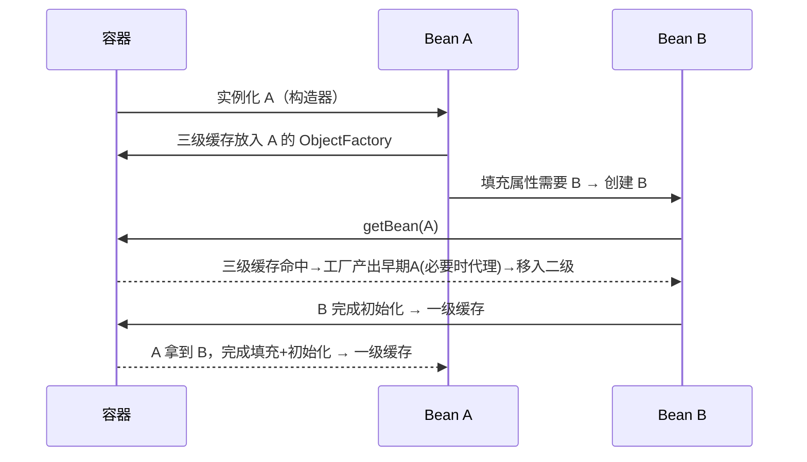
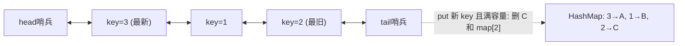

# 面试刷题手册（Hermes 每日三题）

> 每晚 3 题，主题按年内天数 mod 7 轮换：0=JVM 1=并发 2=Spring 3=算法·LeetCode 4=算法·系统设计 5=深度学习 6=LLM/Agent 工程。
> 难度定位：3-5 年经验后端 / AI 工程师面试。

## 📚 目录索引

### Spring（IoC/AOP/事务/Boot 自动装配/循环依赖）
- [Q1. Spring 如何解决循环依赖？为什么是三级缓存而不是两级？](#q1)（📅2026-10-23 ⭐4）
- [Q2. @Transactional 有哪些失效场景？底层原理是什么？](#q2)（📅2026-10-23 ⭐4）
- [Q3. Spring Boot 自动装配的原理是什么？如何自定义一个 Starter？](#q3)（📅2026-10-23 ⭐3）

### 算法·LeetCode 高频题
- [Q4. 无重复字符的最长子串（LC3）](#q4)（📅2026-10-24 ⭐3）
- [Q5. 数组中的第K个最大元素（LC215）](#q5)（📅2026-10-24 ⭐3）
- [Q6. LRU 缓存（LC146）](#q6)（📅2026-10-24 ⭐4）

---

<a id="q1"></a>

### Q1. Spring 如何解决循环依赖？为什么是三级缓存而不是两级？（🏷Spring 📅2026-10-23 ⭐难度4）

**「考察点」** Bean 生命周期与三级缓存机制的理解深度，以及 AOP 代理提前暴露的关键细节。

**「参考答案」**

**基础答案：** Spring 对 **单例（singleton）+ setter/字段注入** 的循环依赖，通过三级缓存解决：

| 缓存 | 名称 | 存什么 |
|---|---|---|
| 一级 | `singletonObjects` | 完整的成品 Bean |
| 二级 | `earlySingletonObjects` | 提前暴露的半成品 Bean（已实例化、未填充属性） |
| 三级 | `singletonFactories` | `ObjectFactory` lambda，调用时才决定返回原始对象还是代理对象 |

流程：A 实例化后（构造完成、属性未填充），先把一个 `ObjectFactory` 放入三级缓存 → 填充属性发现依赖 B → 创建 B → B 填充属性需要 A → 从缓存查 A：三级缓存命中，调用工厂拿到 A 的早期引用（移入二级缓存）→ B 完成创建进入一级缓存 → A 拿到 B 完成填充 → A 进入一级缓存。

**深入原理：为什么必须三级，两级不行吗？**

核心原因是 **AOP 代理的创建时机**。正常流程中代理对象是在 `initializeBean`（初始化之后）由 `AbstractAutoProxyCreator` 创建的；但循环依赖下，B 注入的 A 必须和最终容器里的 A 是**同一个对象**——如果 A 需要被代理，B 拿到的就得是代理对象。

- 如果只有两级缓存，想解决就必须**在实例化后立刻创建代理**，这破坏了 Spring "代理在初始化后创建" 的设计原则（大量无循环依赖的 Bean 也被迫提前代理，且与 `BeanPostProcessor` 体系的时序耦合）。
- 三级缓存存的是**工厂（lambda）**：`getEarlyBeanReference()` 只在**真的发生循环依赖、有人来取早期引用时**才被调用，此时才判断是否需要提前生成代理（`SmartInstantiationAwareBeanPostProcessor#getEarlyBeanReference`）。没有循环依赖时工厂永远不会执行——**延迟决策**，这就是三级的意义。

```java
// DefaultSingletonBeanRegistry#getSingleton 核心逻辑（简化）
singletonObject = singletonFactory.getObject(); // 调三级缓存工厂
this.earlySingletonObjects.put(beanName, singletonObject); // 升级到二级
this.registeredSingletons.remove(beanName);
```

**哪些循环依赖解决不了？**
1. **构造器注入**的循环依赖：实例化都完不成，没有"半成品"可暴露 → 直接抛 `BeanCurrentlyInCreationException`（可用 `@Lazy` 缓解，注入的是代理，首次使用时才解析目标）。
2. **prototype 作用域**：不缓存，无法提前暴露。
3. Spring Boot 2.6+ 默认**禁止循环依赖**（`spring.main.allow-circular-references=false`），出现即启动失败——官方态度是循环依赖本身是设计坏味道，应重构（抽第三方类、事件解耦、`@Lazy`）。

**Mermaid 流程图：**



**「追问陷阱」**
1. *"二级缓存到底有没有用？能不能三级直接升一级？"* —— 不能省。二级缓存保证**多次 getEarlyBeanReference 只执行一次工厂**：若 B 和 C 都循环依赖 A，两次取到的早期引用必须是同一个对象（否则 B、C 注入的 A 不是同一个）。第一次从三级工厂产出后放二级，后续直接从二级取，工厂不再执行。
2. *"A 最终生成的代理和早期暴露的代理会不会是两个对象？"* —— 不会。`AbstractAutoProxyCreator` 在 `postProcessAfterInitialization` 里会检查 `earlyProxyReferences`，如果该 Bean 已经通过三级缓存提前代理过，初始化后就不再重复创建代理，保证单例一致性。

---

<a id="q2"></a>

### Q2. @Transactional 有哪些失效场景？底层原理是什么？（🏷Spring 📅2026-10-23 ⭐难度4）

**「考察点」** 声明式事务的 AOP 代理本质，以及工程中最常见的事务踩坑清单。

**「参考答案」**

**基础答案（失效场景清单）：**
1. **同类内部方法调用（this 调用）**：`this.methodB()` 不走代理，事务注解无效 —— 最高频。
2. **方法不是 public**：Spring 事务默认只对 public 方法生效（CGLIB 无法代理 private/final/static）。
3. **异常被 catch 吞掉**或抛的是**受检异常**：默认只回滚 `RuntimeException` 和 `Error`，抛 `Exception` 需显式 `rollbackFor = Exception.class`。
4. **抛出异常类型不匹配 rollbackFor 配置**。
5. **数据库/引擎不支持事务**：MyISAM 表、或某些 NoSQL。
6. **Bean 未被 Spring 管理**（自己 new 出来的对象）。
7. **传播行为设置错误**：如 `NOT_SUPPORTED` 挂起事务、`REQUIRES_NEW` 内外事务独立（内层回滚不影响外层，常被误认为"失效"）。
8. **多线程调用**：事务上下文绑定在 ThreadLocal（`TransactionSynchronizationManager`），子线程拿不到连接。
9. **@Transactional 注解在接口上 + CGLIB 代理**：CGLIB 基于类，接口上的注解不会被继承。

**深入原理：** 声明式事务 = AOP 代理 + `TransactionInterceptor`。

- 开启 `@EnableTransactionManagement` 后，`AutoProxyCreator` 为标注了 `@Transactional` 的 Bean 生成代理（JDK 动态代理或 CGLIB，Boot 2.x 默认 `proxyTargetClass=true` 即 CGLIB）。
- 调用链：代理方法 → `TransactionInterceptor.invoke()` → `PlatformTransactionManager.getTransaction()`（从 DataSource 拿 Connection，`setAutoCommit(false)`，把连接包成 `ConnectionHolder` 绑定到 `TransactionSynchronizationManager` 的 **ThreadLocal**）→ 执行目标方法 → 正常则 `commit()`，匹配回滚规则则 `rollback()`。
- 之所以"this 调用失效"：代理只拦截**从外部进入代理对象**的调用；类内部 `this.xxx()` 中的 this 是原始对象，不经过拦截器链。这也是"同类中一个无事务方法调用事务方法，事务不生效"的根因。

**内部调用的三种解法（追问常考）：**
```java
// 方案1：注入自身代理（Spring 4.3+ 支持自注入，需走代理）
@Resource private MyService self;
public void a() { self.b(); } // b 上的 @Transactional 生效

// 方案2：AopContext 获取当前代理（需 exposeProxy = true）
((MyService) AopContext.currentProxy()).b();

// 方案3：拆到另一个 Bean（最推荐，符合职责划分）
```

**传播行为 7 种一句话版：** REQUIRED（默认，有就加入没有就新建）、SUPPORTS（有就加入没有就非事务）、MANDATORY（必须有否则抛异常）、REQUIRES_NEW（永远新建，挂起当前）、NOT_SUPPORTED（非事务执行，挂起当前）、NEVER（有事务就抛异常）、NESTED（savepoint 嵌套，外层回滚则内层必回滚，内层回滚不影响外层）。

**「追问陷阱」**
1. *"REQUIRES_NEW 和 NESTED 的区别？"* —— REQUIRES_NEW 是**物理上两个独立事务、两个连接**（外层被挂起，内层提交后外层回滚也救不回内层）；NESTED 是**同一连接上的 savepoint**，内层回滚只是回到保存点，外层最终回滚会连带内层一起回滚。追问点：NESTED 依赖 JDBC savepoint，JTA 分布式事务下不可用。
2. *"事务方法里发 MQ / 调 RPC，消费方读不到数据怎么办？"* —— 事务未提交时消息已发出，下游查库读到旧数据。正解：`TransactionSynchronizationManager.registerSynchronization` 的 `afterCommit` 回调里再发消息，或用事务消息（RocketMQ half message）/ 本地消息表。这考察的是"事务边界与副作用时序"，比背失效清单更能区分候选人。

---

<a id="q3"></a>

### Q3. Spring Boot 自动装配的原理是什么？如何自定义一个 Starter？（🏷Spring 📅2026-10-23 ⭐难度3）

**「考察点」** @SpringBootApplication 组合注解的拆解能力 + 条件装配机制 + 动手写 Starter 的工程经验。

**「参考答案」**

**基础答案：** 自动装配的入口是 `@SpringBootApplication`，它是三个注解的组合：
- `@SpringBootConfiguration`（本质是 @Configuration）
- `@ComponentScan`（扫描当前包及子包）
- **`@EnableAutoConfiguration`** ← 自动装配核心

`@EnableAutoConfiguration` 通过 `@Import(AutoConfigurationImportSelector.class)` 导入选择器，它在启动时读取 classpath 下所有 jar 的 **`META-INF/spring/org.springframework.boot.autoconfigure.AutoConfiguration.imports`** 文件（Boot 2.7 之前是 `META-INF/spring.factories`），拿到候选自动配置类全限定名列表，经过**去重 → 排除（exclude）→ 条件过滤**后，把通过筛选的配置类注册为 Bean 定义。

**深入原理：条件装配 @Conditional 家族**

自动配置类"生效与否"由条件注解裁决，全部基于 `Condition` 接口的 `matches()`：

| 注解 | 条件 |
|---|---|
| `@ConditionalOnClass` | classpath 存在某类（**在 Bean 定义解析阶段用 ASM 读元数据判断，不会触发类加载 NoClassDefFoundError**）|
| `@ConditionalOnMissingBean` | 容器中不存在该 Bean —— Starter "用户配置优先"的关键 |
| `@ConditionalOnProperty` | 配置项匹配（如 `havingValue="true"`）|
| `@ConditionalOnWebApplication` | 是 Web 环境 |

典型模式（几乎所有官方 Starter 都长这样）：

```java
@AutoConfiguration
@ConditionalOnClass(DataSource.class)
@EnableConfigurationProperties(MyDbProperties.class) // 绑定 application.yml 前缀配置
public class MyDbAutoConfiguration {
    @Bean
    @ConditionalOnMissingBean // 用户自己定义了就用用户的，这就是"约定优于配置"的退让机制
    public MyDbClient myDbClient(MyDbProperties props) {
        return new MyDbClient(props.getUrl());
    }
}
```

**加载时序细节（加分点）：** 自动配置类的解析发生在**用户配置类之后**（`AutoConfigurationImportSelector` 是 `DeferredImportSelector`，延迟处理），所以 `@ConditionalOnMissingBean` 判断时用户自定义的 Bean 已经注册——顺序保证了"用户优先"。

**自定义 Starter 步骤（官方规范）：**
1. 建 `xxx-spring-boot-autoconfigure` 模块：写 `XxxAutoConfiguration` + `XxxProperties`（`@ConfigurationProperties(prefix="xxx")`）。
2. 在 `src/main/resources/META-INF/spring/org.springframework.boot.autoconfigure.AutoConfiguration.imports` 中每行写一个配置类全限定名。
3. 建 `xxx-spring-boot-starter` 空壳模块，只做依赖聚合（pom 引 autoconfigure + 必要三方库）。官方 Starter 命名 `spring-boot-starter-xxx`，第三方规范是 `xxx-spring-boot-starter`。
4. （可选）用 `spring-boot-configuration-processor` 生成 `spring-configuration-metadata.json`，让 IDE 有配置提示。

**「追问陷阱」**
1. *"Boot 2.7/3.x 为什么废弃 spring.factories 改用 .imports 文件？"* —— spring.factories 是通用 SPI 机制，一个文件混杂多种扩展点（监听器、初始化器、自动配置…），解析开销大且无法针对自动配置做去重排序优化；独立的 `.imports` 文件格式简单（一行一个类名），启动更快，语义更清晰。Boot 2.7 两者兼容，3.0 起只认 `.imports`。
2. *"@ComponentScan 和自动装配有什么区别？为什么 Starter 里的 Bean 不靠包扫描？"* —— 扫描是**基于包路径**（用户工程不可能扫到 Starter 的包），自动装配是**基于 imports 清单 + 条件注解**，与包结构解耦；且扫描无条件注册，自动装配可按 classpath/配置动态生效。能答出"Starter 的 jar 不在用户扫描路径下，必须走 imports 注册"即为过关。

<a id="q4"></a>

### Q4. 无重复字符的最长子串——滑动窗口如何做到 O(n)？（🏷算法·LeetCode 📅2026-10-24 ⭐难度3）

> [LeetCode 3. 无重复字符的最长子串](https://leetcode.cn/problems/longest-substring-without-repeating-characters/) · 难度：中等 · 字节/腾讯/阿里高频真题

**「考察点」** 滑动窗口 + 哈希优化的手写能力，尤其是左边界跳转时"不回退"的陷阱。

**「参考答案」**

**基础答案：** 暴力枚举所有子串是 O(n³)（枚举 O(n²) × 判重 O(n)）。用**滑动窗口**：维护一个无重复字符的窗口 `[left, right]`，右指针不断扩张，遇到重复字符时收缩左边界。关键优化：用哈希表记录**每个字符最近一次出现的下标**，遇到重复时 left 直接跳过去，而不是逐步移动，整体 O(n)。

```python
def lengthOfLongestSubstring(s: str) -> int:
    last = {}          # 字符 -> 最近一次出现的下标
    left = 0           # 窗口左边界
    ans = 0
    for right, ch in enumerate(s):
        if ch in last and last[ch] >= left:
            left = last[ch] + 1   # 左边界直接跳到重复字符的下一位
        last[ch] = right
        ans = max(ans, right - left + 1)
    return ans
```
（已实测通过，含 `"abba"`、`"tmmzuxt"` 等陷阱用例）

**复杂度：** 时间 O(n)——每个字符只被右指针访问一次；空间 O(min(n, |Σ|))，Σ 为字符集（ASCII 最多 128）。

**深入原理：两个必须讲透的点**

1. **为什么 left 只能前进不能后退？** 条件 `last[ch] >= left` 是灵魂。反例 `"abba"`：处理第二个 `a` 时，`last['a'] = 0`，但此时 `left = 2`（已被 `b` 推过），如果无脑执行 `left = last['a'] + 1 = 1`，窗口反而扩大到包含已淘汰的 `b`，答案错误。所以只有当重复字符**落在当前窗口内**才跳转，等价写法是 `left = max(left, last[ch] + 1)`。
2. **滑动窗口的适用判据：** 题目求"最长/最短连续子串/子数组"且窗口具有**单调性**（右移扩大窗口会破坏某性质、左移收缩会恢复）时可用。若窗口不满足单调性（如"和 ≥ target 且含负数"），滑动窗口失效，需换前缀和+二分等方案。

**变体/追问：如果字符集是 Unicode（百万级）怎么办？**
哈希表方案天然支持任意字符集，空间随实际出现的字符数增长而非字符集大小，无需改动；若字符集固定且小（ASCII），换成 `int[128]` 数组比哈希表常数更小、更快。另一个常见变体："**最多包含 K 个不同字符**的最长子串"（LC340）——窗口条件从"无重复"变成"种类数 ≤ K"，收缩时用计数器维护种类数即可，框架完全一致。

**「追问陷阱」**
1. *"如果要求返回子串本身而不是长度？"* —— 在更新 ans 时同步记录 `start = left`，最后 `s[start:start+ans]`。考察是否真的理解窗口状态而非背模板。
2. *"用双指针 + Set 和用哈希表记录下标，哪个好？"* —— Set 版本遇重复时 left 逐步右移并 `remove(s[left])`，最坏 O(2n) 仍是 O(n)，但常数更大；哈希记录下标是 O(1) 跳转。两者都对，能说出"Set 版每个元素最多进出窗口各一次，所以也是线性"是加分项。

---

<a id="q5"></a>

### Q5. 数组中的第K个最大元素——为什么快速选择比堆更适合面试追问？（🏷算法·LeetCode 📅2026-10-24 ⭐难度3）

> [LeetCode 215. 数组中的第K个最大元素](https://leetcode.cn/problems/kth-largest-element-in-an-array/) · 难度：中等 · 字节/美团/快手 Top 级高频真题

**「考察点」** 快速选择（Quickselect）的分治思想、随机化防退化，以及与堆解法的复杂度权衡。

**「参考答案」**

**基础答案：** 三种解法：
| 解法 | 时间 | 空间 | 备注 |
|---|---|---|---|
| 全排序 | O(n log n) | O(1) | `sorted(nums)[-k]`，面试只能当铺垫 |
| 小顶堆（大小 K） | O(n log K) | O(K) | 适合海量数据流/内存放不下时 |
| **快速选择** | **平均 O(n)**，最坏 O(n²) | O(1) | 随机化 pivot 后最坏概率可忽略 |

快速选择：借用快排 partition，每轮把基准放到最终位置——若基准下标恰好是 `k-1`（降序视角）即为答案；否则**只递归包含目标的那一半**，这是它比快排快一个量级的原因（n + n/2 + n/4 + … = 2n）。

```python
import random
def findKthLargest(nums, k):
    def partition(l, r):
        p = random.randint(l, r)
        nums[p], nums[r] = nums[r], nums[p]
        pivot = nums[r]
        i = l
        for j in range(l, r):
            if nums[j] > pivot:   # 降序摆放，第 k 大 = 下标 k-1
                nums[i], nums[j] = nums[j], nums[i]
                i += 1
        nums[i], nums[r] = nums[r], nums[i]
        return i
    l, r = 0, len(nums) - 1
    while True:
        i = partition(l, r)
        if i == k - 1:
            return nums[i]
        elif i < k - 1:
            l = i + 1
        else:
            r = i - 1
```
（已实测：LeetCode 官方用例 + 300 组随机对拍全部通过）

**复杂度：** 时间平均 O(n)、最坏 O(n²)（随机化后对抗性输入无法稳定触发）；空间 O(1)（迭代写法，递归写法为栈深 O(log n) 期望）。

**深入原理：**
- **为什么必须随机化 pivot？** 固定取首/尾元素时，对已排序数组每轮只能砍掉 1 个元素，退化 O(n²)。随机 pivot 使期望比较次数为 O(n)，且让输入构造者无法针对性攻击（对抗随机化需要预知随机数序列）。
- **确定性最坏 O(n) 的方案存在吗？** 存在——BFPRT（中位数的中位数）选 pivot，理论最优但常数大，工程与面试中几乎不用，能提到名字和思路即可。
- **堆解法的不可替代场景：** 数据是**流式**到来、或 n 大到内存放不下时，维护大小为 K 的小顶堆只需 O(K) 内存；快速选择要求全量数据在内存中。这就是"Top-K 大数据"面试链路里两种解法各自的定位。Java 侧对应 `PriorityQueue`（默认小顶堆），`offer` 后 `size() > k` 则 `poll()`。

**变体/追问：如果数据量是 100 亿怎么办？**
单机内存放不下，标准答案是**分治 + 分布式 Top-K**：
1. 数据分片（按 hash 或文件切块），每台机器对本地分片求**局部 Top-K**（小顶堆，O(n_i log K)）；
2. 汇总所有局部 Top-K（总量 = 分片数 × K，通常可放进单机内存）再做一次全局 Top-K；
3. 正确性依据：全局第 K 大一定在各局部 Top-K 之中（一个元素若连本地前 K 都进不了，全局排名必然 > K）。
MapReduce / Spark `takeOrdered(k)` 就是这套逻辑。若数据实时流动，则用堆常驻内存增量维护，或近似方案（Count-Min Sketch 类结构用于频次 Top-K）。

**「追问陷阱」**
1. *"第 K 大和第 K 小怎么改？重复元素怎么算？"* —— 第 K 小把比较方向反转即可；重复元素**各占一个名次**（`[3,3,3]` 的第 2 大是 3），partition 天然按位置处理所以自动正确——但要警惕候选人自作主张先 `set(nums)` 去重，语义就错了。
2. *"能不能不修改原数组？"* —— 快速选择是原地算法会打乱数组；若要求只读，用堆解法（拷贝前 K 个建堆）或二分答案法（值域二分 + 计数，O(n log(max-min))，不改动数组）。能主动说出二分答案法是强加分项。

---

<a id="q6"></a>

### Q6. 设计 LRU 缓存——为什么是哈希表 + 双向链表？O(1) 怎么做到的？（🏷算法·LeetCode 📅2026-10-24 ⭐难度4）

> [LeetCode 146. LRU 缓存](https://leetcode.cn/problems/lru-cache/) · 难度：中等 · 字节/腾讯/Amazon 设计题 Top1，也是 Redis/Guava 缓存的真实模型

**「考察点」** 数据结构组合设计能力：如何让 get 和 put 都做到 O(1)，手写双向链表的指针操作是否干净。

**「参考答案」**

**基础答案：** 需求拆解——get/put O(1) 定位 → **哈希表**；O(1) 维护"访问顺序"（把节点移到一端、从另一端淘汰）→ **链表**；而单链表删除任意节点需要找前驱 O(n)，所以必须**双向链表**（持有 prev 指针，删除是纯指针操作）。两者组合：哈希表 `key -> Node`，Node 内嵌在双向链表中，**最近使用放头部，淘汰取尾部**。哨兵头尾节点（dummy head/tail）消除空链表和边界判断。

```python
class Node:
    __slots__ = ('key', 'val', 'prev', 'next')
    def __init__(self, key=0, val=0):
        self.key, self.val = key, val
        self.prev = self.next = None

class LRUCache:
    def __init__(self, capacity: int):
        self.cap = capacity
        self.map = {}                          # key -> Node
        self.head, self.tail = Node(), Node()  # 哨兵节点
        self.head.next, self.tail.prev = self.tail, self.head

    def _remove(self, node):
        node.prev.next, node.next.prev = node.next, node.prev

    def _add_front(self, node):                # 插到头部（最近使用）
        node.next, node.prev = self.head.next, self.head
        self.head.next.prev = node
        self.head.next = node

    def get(self, key: int) -> int:
        if key not in self.map:
            return -1
        node = self.map[key]
        self._remove(node)
        self._add_front(node)
        return node.val

    def put(self, key: int, value: int) -> None:
        if key in self.map:
            node = self.map[key]
            node.val = value
            self._remove(node)
            self._add_front(node)
            return
        if len(self.map) >= self.cap:
            lru = self.tail.prev               # 尾部 = 最久未使用
            self._remove(lru)
            del self.map[lru.key]
        node = Node(key, value)
        self.map[key] = node
        self._add_front(node)
```
（已实测：LeetCode 官方示例 + "put 更新已有 key 算一次访问"用例全部通过）

**复杂度：** get / put 均 O(1) 时间；O(capacity) 空间。

**深入原理：三个容易被追问的设计细节**
1. **Node 里为什么必须存 key？** 淘汰尾节点时要同步删除哈希表条目 `del self.map[lru.key]`——若 Node 只有 value，拿到尾节点却不知道它的 key，无法反查哈希表。这是手写时最高频的丢分点。
2. **哨兵节点的价值：** 没有 dummy head/tail 时，插入/删除都要分支讨论"是不是头节点/尾节点/链表为空"，四类边界；哨兵把"任意位置删除"统一成一种指针操作。Java 版同理。
3. **淘汰策略的演进（联系工程）：** LRU 的缺陷是**偶发的批量扫描会污染缓存**（一次性遍历把热点全部挤出去）。LRU-K / LFU（按频率）/ Redis 的近似 LRU（随机采样 5 个 key 淘汰其中最旧者，避免维护全局链表的开销）都是针对性改进。Guava Cache 用的分段 LRU（W-TinyLFU 在 Caffeine 中进一步演进：主区 LRU + 观察区、按频率准入），能聊到这一层说明真读过缓存源码。

**Mermaid 结构图：**



**变体/追问：如果要支持多线程并发访问怎么办？**
- 朴素方案：方法加 `synchronized` / `ReentrantLock`——正确但吞吐差，锁竞争集中在单条链表上。
- 工程方案：**分段（sharding）**——按 key hash 到 N 个独立的小 LRU，各段独立加锁（ConcurrentHashMap 1.7 的 Segment 思路）；淘汰精度略降（全局并非严格 LRU），换取并发度 ×N。Caffeine 更进一步：读操作无锁化（访问记录进环形缓冲队列，异步批量重放维护链表顺序），写操作才走锁，因为"更新访问时间戳"这种读副作用无需实时精确。
- 追问延伸："Redis 为什么不用精确 LRU？"——精确 LRU 要为每个 key 维护双向链表指针，内存开销大；Redis 用采样近似（`maxmemory-samples`），实测效果接近精确 LRU 而内存几乎零开销。

**「追问陷阱」**
1. *"get 一个不存在的 key 会改变 LRU 状态吗？put 一个已存在的 key 呢？"* —— miss 的 get 不应移动任何东西（没有节点可移）；**put 已存在 key 必须算一次访问**（更新值 + 移到头部），很多人漏掉后半句导致淘汰顺序错误。这题的细节分就在这里。
2. *"能不能用 Python 的 OrderedDict / Java 的 LinkedHashMap 一行搞定？"* —— 可以：`OrderedDict.move_to_end` + `popitem(last=False)` 十行搞定；Java `LinkedHashMap(capacity, 0.75f, true)` 重写 `removeEldestEntry` 即可。但面试官通常要求**手写底层**——先问一句"可以用现成库吗"再动手，是成熟的沟通方式；直接背 OrderedDict 版本而不理解双向链表，一追问指针细节就露馅。
