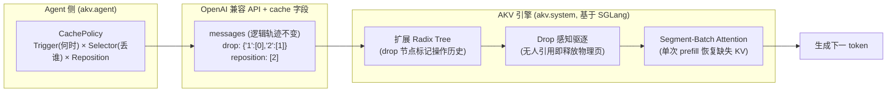
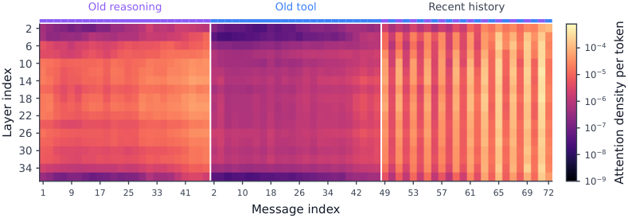

# Cache Engineering for Agents：让 Agent 直接管理自己的 KV Cache（AKV 系统）

- **论文**: [arXiv:2610.28577](https://arxiv.org/abs/2610.28577)（2026-10-20 提交，cs.CL）
- **代码**: [github.com/thu-nics/AKV](https://github.com/thu-nics/AKV)（MIT，基于 SGLang v0.5.20）
- **Venue**: arXiv 预印本；HuggingFace Daily Papers 当日榜首（105+ 票）
- **作者机构**: 清华大学 NICS-EFC 实验室（Tianyu Fu, Ruoxi Wang, Zihan Min 等 9 人，通讯 Yu Wang）
- **一句话总结**: 不再靠「裁剪/摘要上下文」省 token，而是让 Agent 直接对 KV cache 执行 drop（丢弃）和 repos（重排位置编码）操作，配合专门设计的 AKV 推理引擎，任务准确率 +1.7 分的同时成本降 27.7%。

## 🎯 解决什么问题

长程 Agent（Deep Research、SWE 类任务）跑上百轮后，KV cache 的存储和 I/O 成为主要开销——论文实测 **KV cache 读取占 API 总成本的 82.4%**；轨迹还可能超出模型上下文上限。

现有做法是「上下文工程」：到阈值后裁剪或摘要历史消息。但这有个死结——**改动了前缀文本，后面所有已缓存的 KV 状态全部失效，必须重新 prefill**。为了少重算，各家 harness（Claude Code、Codex、pi 等）只能一次性激进摘要、只留最近几轮，结果丢失中间轮次的有用信息，准确率反而掉。省 re-prefill 成本 vs 保信息量，二者不可兼得。

## 🔬 核心方法

**Cache Engineering**：逻辑轨迹（messages 文本）一个字不改，直接操作 active KV cache。定义三个操作：

- `append`：标准推理，追加新 token 的 KV；
- `drop(P)`：把指定位置的 KV 从后续注意力中排除，保留项的状态和位置编码不变，**零重算**；
- `repos`：把保留的 r 条 KV 的位置编码重排为 0..r-1（RoPE 下用 K←R(q)R(p)⁻¹K 旋转 key 即可，不用重新前向），解决「cache 很小但位置索引撞到上限」的问题。

关键难点是**历史依赖性**：相同 token 前缀在不同 drop 时序下 KV 状态不同，传统 prefix caching 会错误复用。AKV 的解法是在 radix tree 路径上插入 drop 节点记录操作历史，匹配时同时比对 token 与操作序列；被驱逐的 cache 用 segment-batch attention 在一次前向里分段恢复（每段只看自己当时可见的 KV），避免重放多次 forward。

## 📊 关键数字

3 个模型（GPT-OSS-120B / MiniMax-M2.7 / MiroThinker-1.7-Mini）× 4 个长程基准（BrowseComp-Plus、GAIA-Text、SWE-Verified、xbench-DS），对比两种摘要式基线：

| 指标 | 结果 |
|---|---|
| 平均成本（vs 标准摘要） | **-27.7%**（GPT-OSS 上 11.2→7.3 美分/任务） |
| 平均得分 | **+1.7 分**（GPT-OSS：53.1 vs 51.0/48.3） |
| 服务吞吐（8×A800, PD 分离） | 输入 1.53×、输出 **1.18×** |
| P95 请求延迟 | **1.51× 加速**（并发越高优势越大） |
| RSI 自动搜索缓存策略 | 再降成本 7.1%（held-out 任务） |
| 消融：tool drop + repos | BCP 55%→**62%**；drop 推理 cache 反而掉分 |
| 缓存管理做成 Agent 工具 | BCP 最高 64%（MiniMax） |

## 🛠 对工程实践的启发

1. **默认策略简单可抄**：论文主力策略就是「滚动丢弃旧工具响应，保留全部推理和最近 12 轮工具结果」（rolling-drop, K=12）。如果你用 OpenAI 兼容 API 做长程 Agent，`examples/chat_example.py` 展示了接口形态：请求体加 `drop_message` 和 `reposition` 两个字段即可，无状态、与现有 API 兼容。
2. **代码分层清晰可复用**：`akv/agent/policies/` 把策略拆成 Trigger（何时丢）×Selector（丢谁）×Reposition 三个正交组件（见 `triggers.py`/`selectors.py`/`reposition.py`），纯 Python、可独立于系统侧使用；系统侧核心在 `akv/system/sglang/srt/context_system/`（planner/provenance/recovery）和 Triton kernel `kernels/ops/attention/context_reposition.py`（RoPE 旋转重定位）。
3. **别丢推理轨迹**：消融显示 drop assistant 推理 cache 会明显掉分（SWE 41→34.5），工具返回的原始观测才是最该丢的——这与「attention 对旧 tool response 权重低」的实测一致（见下图）。

## ⚠️ 局限与争议

- 作者自认的三点：缓存策略空间还远未探索完、未在此范式下训练 Agent（策略靠启发式+RSI 搜索）、不支持线性注意力模型（Mamba 类本身无 KV cache 问题，等于绕开了竞品场景）。
- repos 的 RoPE 旋转在有限精度下有舍入误差，与完整重算不保证 bitwise 一致（论文附录承认，认为不影响正确性论证）。
- 收益依赖自建推理栈：1.18×/1.51× 的系统增益跑在 8×A800 的 SGLang 魔改上，直接用 Groq/官方 API 的用户拿不到这部分，只能拿成本与准确率收益。
- 「drop 掉的 KV 仍隐式保留在后续状态里」是双刃剑：好处是信息不完全丢失，但也意味着 drop 语义不等于真正遗忘，安全性/隐私角度删除并不彻底。
