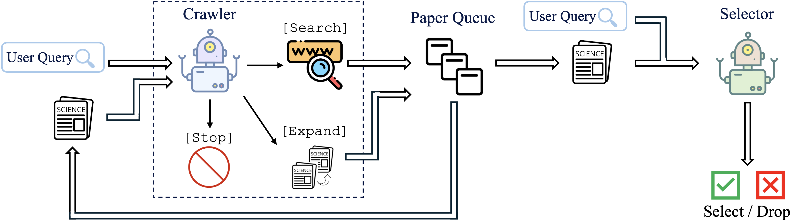
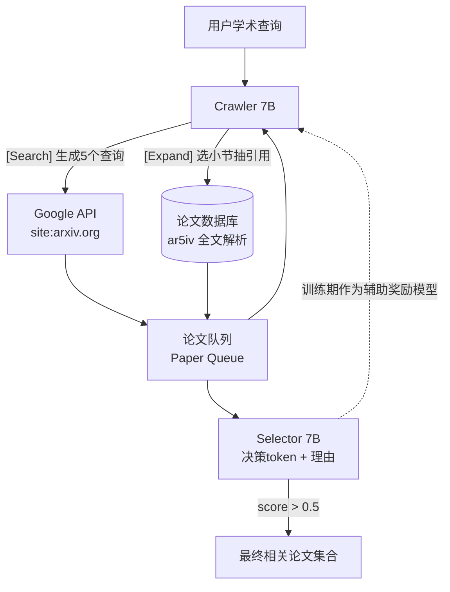

# PaSa：用 RL 训练的论文搜索 Agent，7B 模型召回率碾压 GPT-4o + Google

- **论文**：[PaSa: An LLM Agent for Comprehensive Academic Paper Search](https://aclanthology.org/2025.acl-long.572/)（[arXiv:2501.10120](https://arxiv.org/abs/2501.10120)）
- **代码**：https://github.com/bytedance/pasa （模型/数据集全开源：HF `bytedance-research/pasa-7b-crawler` / `pasa-7b-selector`）
- **Venue**：ACL 2025 Main（pp. 11663–11679）
- **作者机构**：ByteDance Seed + 北京大学（何亦琛、黄冠华、鄂维南等）
- **一句话总结**：两个 7B 小模型（Crawler 爬引文网络 + Selector 判相关性）经 session-level PPO 强化学习训练后，在真实学术搜索任务上召回率大幅超越 GPT-4o、ChatGPT 搜索和 Google+GPT-4o 组合。

## 🎯 解决什么问题

细粒度学术查询（如"哪些工作研究了基于 UCB 的非平稳强化学习？"）用 Google Scholar 搜不全，研究者做文献综述要花大量时间。已有 LLM 方案要么只改写查询词（Google with GPT-4o），要么纯 prompt 驱动 agent（PaSa-GPT-4o），召回率都不够。PaSa 模仿人类研究者行为：**多轮搜索 → 读论文 → 顺藤摸瓜爬引文网络**，并证明这条路径用 RL 训练小模型比 prompt 大模型更有效。

## 🔬 核心方法

*图 1：PaSa 架构（来自项目仓库 src/architecture.png）。Crawler 负责扩大召回，Selector 负责精度过滤。*

系统由两个基于 Qwen2.5-7B 的 agent 组成：

- **Crawler**（RL 训练）：三个动作——`[Search]` 生成搜索词调 Google API、`[Expand]` 抽取当前论文某小节的引用加入队列、`[Stop]` 重置上下文处理队列中下一篇论文。整个过程形成一棵"论文树"，实践中限制探索深度为 3 层。
- **Selector**（模仿学习 SFT）：读 query + 标题摘要，先输出一个 True/False 决策 token，再生成理由（rationale）。决策 token 在前是关键设计：既可作为**单 token 奖励模型**给 Crawler 提供密集信号，也可用 token 概率对结果排序。

训练侧两个创新：
1. **AutoScholarQuery 合成数据集**：从 ICLR/ICML/NeurIPS 2023、ACL/CVPR 2024 论文的 Related Work 出发，让 GPT-4o 反向生成学术查询，被引论文即答案。3.35 万训练对，人工抽检 94% 查询合格。
2. **Session-level PPO**：完整轨迹涉及数百篇论文，塞不进上下文。解法是以 `[Stop]` 为界切分 session，session 内用蒙特卡洛回报，跨 session 用价值函数 V 估计新入队论文的未来回报，再加对 SFT 策略的逐 token KL 惩罚。奖励稀疏问题则用 Selector 当辅助奖励模型缓解（数据集只覆盖真实合格论文的子集）。

## 📊 关键数字

真实查询基准 RealScholarQuery（50 条研究者真实查询，教授级人工标注，平均每查询 15.8 篇答案、标注成本 $304/条）：

| 方法 | Crawler Recall | Precision | Recall |
|---|---|---|---|
| Google | – | – | 0.2535 |
| Google Scholar | – | – | 0.2809 |
| Google + GPT-4o 改写 | – | – | 0.2946 |
| ChatGPT（GPT-4o 搜索） | – | 0.2280 | 0.2007 |
| PaSa-GPT-4o（同框架 prompt 版） | 0.5494 | 0.4721 | 0.3075 |
| **PaSa-7b** | **0.7071** | **0.5146** | **0.6111** |
| PaSa-7b-ensemble（跑两遍） | 0.7503 | 0.4938 | 0.6488 |

- 比最强 Google 系基线 Recall@20 高 **37.78%**、Recall@50 高 **39.90%**；比同框架 prompt GPT-4o 版召回高 **30.36%**——差距主要来自 RL 训练。
- 消融：去掉 `[Expand]`（引文爬取）召回暴跌 32.21%；去掉 RL 掉 19.96%；去掉 Selector 辅助奖励掉 9.63%。
- Selector 判相关性 F1 = 0.85，超过 GPT-4o（0.80）；精确率 0.95。
- 奖励系数 α 从 0.5 → 2.0，Crawler 动作数从 176 → 786，召回 0.46 → 0.49：**用奖励直接调节 agent 的搜索预算**。

## 🛠 对工程实践的启发

1. **"小模型 + RL"打"大模型 + prompt"在垂直 agent 上成立**。仓库总共才 ~1000 行 Python（`paper_agent.py` 221 行是全部编排逻辑，`models.py` 封装 vLLM 推理，`utils.py` 管 Google/arXiv/ar5iv API），无重型框架依赖，是做领域搜索 agent 的极佳起手模板。核心可复用模块：`PaperAgent.run()` 的 search → 多层 expand 流水线（20 线程并行）和 `agent_prompt.json` 里 4 个精简 prompt。
2. **决策 token 前置的判别式小模型是廉价奖励器**。Selector 先输出 True/False 再输出理由，一次前向同时拿到奖励信号 + 排序分数 + 可解释理由，这个模式可推广到任何需要密集奖励的长程 agent RL。
3. **长轨迹 RL 的 session 切分**值得抄：以显式的"重置上下文"动作（`[Stop]`）为 session 边界，边界处用 value function 接续未来回报，绕开了"轨迹长于上下文窗口"的死结——对 Deep Research / 多跳检索类 agent 训练通用。

## ⚠️ 局限与争议

- **只在 ML 领域验证**：训练数据全部来自 AI 顶会论文，跨学科（生物医学、社科）效果未知；查询也依赖 arXiv 可检索（非 arXiv 论文直接漏掉）。
- **Precision 偏低**（真实场景 0.51）：策略偏向高召回，最终交给 Selector 过滤，但 AutoScholarQuery 上 precision 仅 0.14——评测口径是"整个论文队列"，实际使用只看过滤后集合，数字观感差异大。
- **依赖付费 Google API**（serper.dev/serpapi），复现全流程有外部成本；Crawler ensemble 等于双倍推理开销。
- 数据集答案来自 Related Work 引用，本身就是有偏子集，"召回率天花板"的评估在合成集上可能被低估或高估，论文用 RealScholarQuery 部分回应了这一点。
