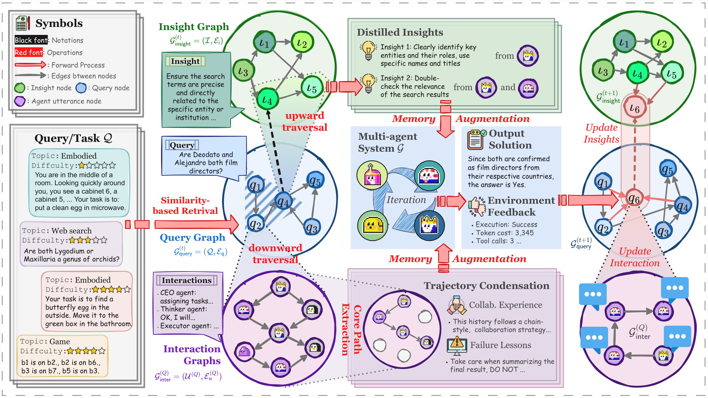
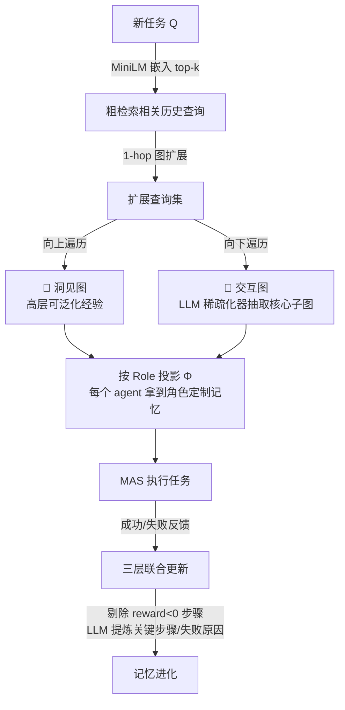

# G-Memory：给多智能体系统装一个会自我进化的三层图记忆

- **论文**：[G-Memory: Tracing Hierarchical Memory for Multi-Agent Systems](https://arxiv.org/abs/2506.07398)（[OpenReview](https://openreview.net/forum?id=mmIAp3cVS0)）
- **代码**：https://github.com/bingreeky/GMemory （核心实现 `mas/memory/mas_memory/GMemory.py`，891 行）
- **Venue**：NeurIPS 2025 **Spotlight**
- **作者机构**：NTU（Guibin Zhang、Kun Wang 通讯）+ UCLA + A*STAR + NUS（Shuicheng Yan）等
- **一句话总结**：借鉴组织记忆理论，用「洞见图 / 查询图 / 交互图」三层图结构存储多智能体协作轨迹，检索时双向遍历、写入时逐层进化，不改任何 MAS 框架代码即可把具身任务成功率最高提升 20.89%、知识问答提升 10.12%。

## 🎯 解决什么问题

多智能体系统（MAS）能力比单 agent 强，但几乎没有「跨任务学习」能力：MetaGPT/ChatDev 这类框架的记忆要么只在单次任务内有效（inside-trial），要么只存一个最终结果产物（cross-trial 极度粗糙），**agent 之间的协作过程——谁说了什么、怎么分工、在哪一步翻车——全被丢掉**。而 MAS 轨迹 token 量是单 agent 的 10 倍（论文 Figure 1 实测 ALFWorld），直接把长轨迹塞回上下文做检索既贵又没用。把单 agent 记忆（MemoryBank、Voyager 等）硬搬到 MAS 上，实验证明经常负优化（MemoryBank 在 MacNet+PDDL 上 -3.54%）。

## 🔬 核心方法

*图 1：G-Memory 总览（论文 Figure 2）。左：新任务到来时的双向检索；右：任务结束后的三层记忆更新。*

三层图各管一个抽象层级：

- **交互图**（最底层）：每条 utterance 是节点 `(说话agent, 内容)`，边表示「激发」关系，完整保留协作轨迹；
- **查询图**（中间层）：每个历史任务一个节点，存 `(原始query, 成功/失败状态, 对应交互图)`，边是任务间语义关联；
- **洞见图**（最顶层）：从成败对比轨迹中蒸馏的可泛化经验条目，节点带「支持它的查询集合」，边是三元超连接（洞见A 通过查询q 语境化 洞见B）。

**检索**：先用 all-MiniLM-L6-v2 做嵌入相似度 top-k，再沿查询图做 1-hop 邻居扩展（实验证明 2/3-hop 反而引入噪声）；然后向上取洞见、向下用 LLM 稀疏化器把长交互图压缩成核心子图，最后按每个 agent 的 Role 做个性化投影——**不同角色的 agent 拿到不同的记忆切片**。

**写入**（代码里最能落地的部分）：任务结束后 `_extract_mas_message` 先做轨迹稀疏化——**直接弹掉 reward<0 的失败状态**，再让 LLM 提炼「关键步骤」（成功轨迹）或「失败原因」（失败轨迹）；随后 `finetune_insights` 采样新旧成败轨迹对比，LLM 生成新洞见并给用过的旧洞见做 reward 加权回传（成功 +1，失败 **-2**，惩罚错误经验的复用）；洞见积累多了用 FINCH 无参聚类 + LLM 合并去重（`merge_insights`），防止记忆无限膨胀。

## 📊 关键数字

| 设置（backbone） | 基准 | 无记忆 | 最强基线 | G-Memory |
|---|---|---|---|---|
| MacNet + Qwen2.5-14b | ALFWorld | 58.21 | — | **79.10（+20.89）** |
| AutoGen + GPT-4o-mini | 五基准平均 | 48.27 | 53.52 (Voyager) | **57.18（+8.91）** |
| MacNet + GPT-4o-mini | PDDL | 12.18 | 16.03 (MetaGPT-M) | **24.33（+12.15）** |
| AutoGen + GPT-4o-mini | FEVER | 57.13 | 63.27 (Voyager) | **66.24（+9.11）** |

- 消融：去掉交互图层平均 -4.47%，去掉洞见层 -3.95%——**细粒度轨迹比高层洞见贡献略大**；
- 成本：PDDL+AutoGen 上性能 +10.32% 只多花 1.4M token，MetaGPT-M 花 2.2M token 只换来 +4.07%。

## 🛠 对工程实践的启发

1. **失败经验要重罚**：`backward()` 里成功 +1 / 失败 -2 的不对称权重是个可直接抄的设计——检索到的旧洞见如果导致任务失败，说明它是错误经验，该快速衰减而不是平等对待。
2. **入库前先稀疏化，别存原始长轨迹**：写记忆的成本远低于将来每次检索后喂给 LLM 的成本。`_extract_mas_message` 的「弹掉负奖励步骤 + LLM 提炼 key_steps / fail_reason」三步流水线（`GMemory.py` L244-282）对任何 agent 记忆系统都适用，单 agent 也能用。
3. **即插即用验证成本低**：仓库 `tasks/run.py` 一行命令就能在自己的任务上跑对照（`--mas_memory g-memory --mas_type autogen`），记忆基线（voyager/memorybank/metagpt/chatdev）也都实现好了，适合做内部 benchmark。

## ⚠️ 局限与争议

- **依赖二值成败信号**：整套更新机制建立在任务有明确 Failed/Resolved 标签上（ALFWorld、FEVER 这类基准天然有）。开放域任务（写代码、做调研）成败难判定，reward 从哪来是落地最大障碍。
- **LLM 调用开销转移而非消失**：稀疏化、洞见提炼、角色投影、合并全是 LLM 调用，论文只报了推理侧 token，记忆维护侧的成本没有完整核算。
- **洞见漂移风险**：洞见由 LLM 反复蒸馏-合并产生，长期运行可能逐渐偏离原始轨迹证据（论文未做长期漂移实验）；图存储用 pickle 全量落盘，规模上去后是工程隐患。
- 超参敏感：k>2 或 hop>1 都会明显掉分（ALFWorld -7.71%），「检索宁少勿多」这条经验值得记住。
