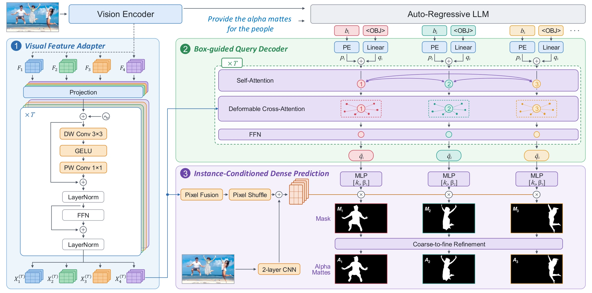
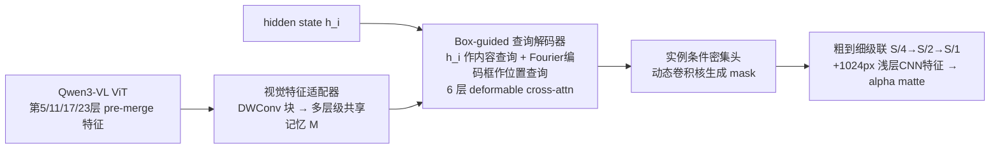

# WeVisOne-VL：一个 VLM 从检测框一路管到像素级抠图，目标不存在时敢说 None

- **论文**：[WeVisOne-VL: Unified Visual Perception from Objects to Pixels](https://arxiv.org/abs/2610.31329)（[项目页](https://tencent.github.io/WeVisOne-VL/)）
- **代码**：https://github.com/Tencent/WeVisOne-VL （Apache 2.0，权重 2B/4B 已上 HF，附 vLLM 推理与评测管线）
- **Venue**：arXiv 技术报告（2026-10-22），HuggingFace Daily Papers 10 月 23 日**榜首**（242 赞）
- **作者机构**：腾讯微信视觉团队（WeChat Vision, Tencent Inc.），Liang/Pan/Li 三人共一
- **一句话总结**：把检测、指点、计数、OCR、分割、alpha 抠图全部统一成「结构化 next-token prediction」，靠一个仅 9.6M 参数的像素解码器挂在 Qwen3-VL 上，30+ 基准全面领先同规模 VLM，且目标不存在时可靠输出 `None` 而不是幻觉一个框。

## 🎯 解决什么问题

现有 VLM 做细粒度视觉感知不可靠，三大痛点：**幻觉**（图里没有的东西硬指一个框）、**意图误判**（陌生描述下找错目标）、**漏检**（不显著的小目标直接忽略）。而传统管线要拼 Grounding-DINO + SAM + 专用抠图模型三四个模型，部署重、接口不统一。WeVisOne-VL 的目标是一个模型、一套自然语言接口，覆盖从点、框到二值 mask 再到连续 alpha matte 的**任意粒度定位**，并且把「拒绝回答」当成一等公民能力来训练和评测。

## 🔬 核心方法


*图：整体架构（项目页官方配图）。左侧 Qwen3-VL 主干输出结构化 token，右侧 9.6M 像素解码器由 `<OBJ>` token 唤醒。*

**1）任务格式化**：新增 1001 个坐标 token `<0>`…`<1000>` 表示归一化坐标，一个框恰好 4 个 token、一个点 2 个 token，比输出数字字符串省得多。需要像素级输出时，在框后追加特殊 token `<OBJ>`，形如：

```
<ref>dog</ref><box><13><274><399><949><OBJ></box>
```

**2）轻量像素解码器**（不依赖 SAM，直接复用 VLM 自己的 ViT 特征），三段式：



关键设计：查询不用可学习 embedding，而是**由 VLM 的 `<OBJ>` hidden state 直接初始化**——语义和空间信息都来自语言模型本身，框先验经 Fourier 编码后作为 deformable attention 的参考区域。

**3）训练**：三阶段课程 SFT + 混合任务 RL，约 1 亿张图的数据引擎（专家模型提议 → Qwen3-VL 验证 → SAM2 扩展成 mask → 自研 Mask2Alpha 标注器产连续 alpha，已单独开源在 `mask2alpha` 分支）。
- S1 任务对齐（90.2M 样本，冻结视觉编码器，只学格式和 `None` 拒答）
- S2 高分辨率+密集（40.5M，解冻全模型，视觉 token 提到 1960，单响应最多 500 框）
- S3 token-像素交替训练（41.8M，NTP 与分割损失 1:1 交替，防止定位能力退化）
- RL 阶段用 GRPO，奖励是 Hungarian 匹配后的 **IoU³ 立方**（高 IoU 区间更敏感，逼出更准的框）；训练样本按不确定性分数 `U(x)=4μ(1−μ)σ` 筛选，专挑「有时对有时错」的中等难度样本。

## 📊 关键数字

WeVisOne-VL-4B vs 各任务最强开源基线（F1 为 IoU 0.5:0.95 均值）：

| 任务 | 基准 | 指标 | 最佳基线 | **4B (ours)** |
|---|---|---|---|---|
| 检测 | LVIS | F1 Mean ↑ | 50.7 | **55.3** |
| 密集检测 | Dense200 | F1 Mean ↑ | 58.7 | **71.3** |
| 指代定位 | RefCOCOg test | F1 Mean ↑ | 77.6 | **81.8** |
| **拒答** | WeRef-Bench | Rej. Rate ↑ | 73.0 | **96.4** |
| 计数 | PixMo-Count | Acc ↑ | 82.8 | **89.6** |
| 指代分割 | ReasonSeg val | gIoU ↑ | 65.0 | **71.2** |
| 框提示抠图 | P3M-500-NP | MAD ↓ | 15.4 | **7.3** |
| 文本抠图 | WeRefMat | MAD ↓ | 22.4 | **9.8** |

最扎眼的是拒答率：Ref-ZOM 上通用分割模型（UniPixel、LaSagnA 等）目标缺失时拒答率接近 0——**它们永远会吐一个 mask**；WeVisOne-VL-4B 达 86.0。COCO 零样本 F1 Mean 57.1 也超过 GroundingDINO-T 的 56.6。

## 🛠 对工程实践的启发

1. **`<OBJ>` 唤醒模式值得抄**：自回归生成负责「找到谁、在哪」，一个特殊 token 把 hidden state 交给外挂小解码器负责像素输出。看 `wevisone_vl/engine.py`：`parse_seg_boxes()` 用正则抽 `<box>` 里紧跟 `<OBJ>` 的坐标，`decode_masks()` 对响应做 teacher-forcing 再取 `<OBJ>` 位置的 hidden state——整个 VLM↔解码器桥接不到 100 行，无需改主干结构。
2. **特征钩子零侵入**：`feature_bridge.py` 的 `VisualFeatureCapture` 用 forward hook 在 ViT 第 5/11/17/23 层截获 pre-merge 特征，任何 HF Transformers 模型都能这么挂多尺度特征，不用 fork 模型代码。
3. **把拒答当指标训练**：数据引擎刻意混入 absent-target 负样本，S1 阶段就教模型写 `None`，RL 的 IoU³ 奖励同时惩罚漏检和重复框。做 GUI agent、审核、机器人抓取等下游的，这套「宁可 None 不可幻觉」的配方（含 WeRef-Bench 这类自建拒答基准）可直接借鉴；`evaluation/` 目录有现成推理评测脚本，`tutorials/` 有三个 pipeline notebook 可跑。

## ⚠️ 局限与争议

- 论文自认：感知专精训练可能**牺牲基座通用能力**；为推理效率**不做 CoT**，复杂推理任务受限；仅支持**单轮**预测，未接 agent 多轮工具链。
- 技术报告非同行评审，WeRef-Bench、WeRefMat 两个关键拒答/抠图基准是**自建 in-house 数据**，未开源，96.4% 拒答率这类头条数字缺乏第三方复现。
- 检测指标用 F1 而非 AP（生成式 VLM 没有校准置信度，属领域惯例），与传统检测器排行榜不可直接对比；微调代码尚未放出（TODO 中）。
