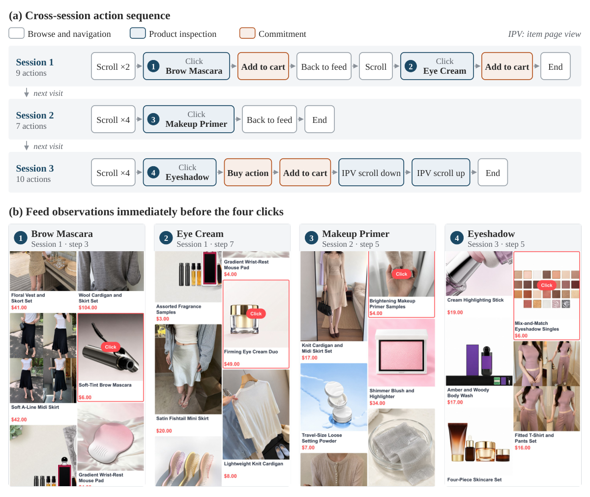

# UserArena：拿真实淘宝 A/B 实验校验「LLM 模拟用户」到底像不像，再用 OPTD 把保真度拉满

- **论文**：[UserArena: Benchmarking Interactive User Simulation for Long-Horizon Shopping Agents](https://arxiv.org/abs/2610.30932)（[项目页](https://recgpt-team.github.io/UserArena-Page/)）
- **代码**：https://github.com/RecGPT-Team/UserArena （非商业研究许可，环境+评测+OPTD 训练全套开源，含 535 条留出评测 session）
- **Venue**：arXiv 2610.30932（2026-10-22），HuggingFace Daily Papers 10 月 26 日**榜首**
- **作者机构**：阿里巴巴集团 RecGPT 团队（淘宝真实数据与生产 A/B 支持）+ 莱顿大学（Zhaochun Ren、Suzan Verberne）等
- **一句话总结**：一个基于真实电商数据的 GUI 级购物用户模拟基准（64,729 条 session、13 种动作、五级评测、可对拍生产 A/B 结果），配套 On-Policy Trajectory Distillation（OPTD）训练法，让小模型模拟器在长程购物行为保真度上全面超过 SFT/GRPO 甚至 GPT 级模型。

## 🎯 解决什么问题

做「购物 Agent / 推荐 Agent」最大的痛点不是模型不会决策，而是**没法便宜地评估决策**：真上线 A/B 一次要几周和真金白银的流量。于是大家想用 LLM 模拟用户来离线评测推荐策略——但现有模拟器有两个硬伤：

1. **不真实**：RecAgent、Agent4Rec 这类模拟器基于合成或评分数据，没有细粒度真实轨迹（滚动、点击、进详情页、加购、下单的完整 GUI 动作序列），更没有跨 session 的长期行为。
2. **没法验证「像不像」**：以往评测只算 next-action 准确率，模拟器每一步猜对了不代表整条轨迹分布对，更不代表用它做离线 A/B 会得出和线上一致的结论。

UserArena 的回答：把真实生产环境「冻结」成可交互基准——预渲染完整信息流长图，模拟器滚动时按视口裁图、点击任意商品（包括真实用户没点过的）都能打开重建的详情页；再用一次**受控生产 A/B 实验**作为终极标尺，检验模拟器能否离线复现策略效果。

## 🔬 核心方法


*图：论文 Figure 4——跨 session 的用户轨迹案例，包含历史点击/购买、信息流长图、逐步截图与 13 类动作标注。*

**基准侧**：64,729 条 session 轨迹、11,010 名用户、566,102 个商品、13 种动作类型；五级评测协议：

- **L0 环境合规**（RVA/OVA：输出能否被环境解析执行）
- **L1 局部决策**（单步动作 F1/Acc，replay 模式）
- **L2 序列行为**（决策分布 DM-JSD、轨迹编辑距离 TE、路径保真 PF）
- **L3 个性化**（按历史深度分层的 cohort 对比）
- **L4 结果保真**（ΔCTR/ΔACR：模拟出的策略效果差 vs 真实 A/B 差）

**训练侧 OPTD**，解决「模拟到第 20 步就崩」的长程保真问题：

```mermaid
flowchart LR
    A[完整真实轨迹 τ] -->|LLM 抽取+校验<br/>剔除具体动作/商品/价格| B[轨迹级意图 z_u<br/>（特权上下文）]
    C[学生模型 πθ<br/>on-policy 采样自己的响应 y_t] --> D[冻结教师<br/>看到 x_t + z_u]
    C --> E[冻结基线教师<br/>只看到 x_t]
    D --> F[信任域插值<br/>z = z_base + s·(z_priv − z_base)<br/>逐 token 二分搜索 s，KL ≤ 0.02]
    E --> F
    F -->|全词表稠密目标| G[广义 JSD 蒸馏损失]
    H[真实响应 y_t<br/>GT 项，系数 0.1] --> G
    G --> C
```

三个关键设计：① **on-policy**——教师给学生的**自生成前缀**逐 token 打分，消除 SFT teacher-forcing 的训练-推理错配；② **轨迹级意图作特权信息**——教师知道「这个用户这趟是想比价买鞋」但不泄露具体动作，使监督信号全局一致而非短视；③ **逐 token 信任域**——把特权教师 KL 约束在基线教师附近（budget=0.02），防止教师把「答案」直接灌给学生造成推理时（无意图可看）分布崩塌。

## 📊 关键数字

**主结果（Table 2，单 session / GUI 类方法）**：

| 方法 | 动作 F1 ↑ | Acc ↑ | DM-JSD ↓ | TE ↓ | PF ↑ | ΔCTR ↓ | ΔACR ↓ |
|---|---|---|---|---|---|---|---|
| RecAgent (文本) | 0.142 | 0.151 | 0.293 | 3.63 | 0.694 | 0.616 | 1.064 |
| Customer-R1 (文本) | 0.411 | 0.311 | 0.195 | 2.86 | 0.738 | 0.023 | 0.400 |
| STA (GUI) | 0.403 | 0.290 | 0.025 | 1.77 | 0.796 | 0.108 | 0.188 |
| **OPTD (本文)** | **0.418** | **0.320** | **0.016** | **1.72** | **0.869** | **0.003** | **0.043** |

**生产 A/B 复现（Table 3）**——同一对排序策略，线上真实 ΔPV-CTR 已知，看各模拟器离线复现的比值（1.0× 为完美）：

| 模拟器 | ΔPV-CTR ratio | 效果误差 ↓ |
|---|---|---|
| AlignUSER | 0.020× | 0.980 |
| STA | 0.297× | 0.703 |
| **OPTD** | **0.713×** | **0.287** |
| GPT-6-Sol（未微调大模型） | 1.576× | 0.576 |
| GPT-6-Luna | 2.154× | 1.154 |

最有说服力的结论：**未经微调的通用大模型在结果级评测上全面跑输小模型 OPTD**——模拟用户不是「模型越大越像」，而是必须对齐真实行为分布。

## 🛠 对工程实践的启发

1. **`optd/objective.py`（仅 167 行）可直接复用**：`trust_region_teacher()` 的逐 token KL 二分插值 + `action_class_weights()` 的逆频率 GT 加权（均值 1、上限 2）是通用组件，任何「有特权上下文的教师 → 无特权学生」蒸馏场景（比如用完整日志教在线模型）都能套用。
2. **评测要分 replay 和 rollout 两种模式**：仓库 `python -m evaluation replay`（对真实前缀算单步指标）和 `rollout`（自由生成整条轨迹算分布指标）分开实现——只做 teacher-forcing 式单步评测会严重高估模拟器，这是所有 Agent 评测都该抄的教训。
3. **特权信息要做「答案泄露过滤」**：OPTD 抽轨迹意图时刻意剔除具体动作、商品 ID、价格、结局，防止教师退化成答案机。用 LLM 造监督信号时，这个排除清单思路值得借鉴。

## ⚠️ 局限与争议

- **单平台单域**：数据来自淘宝信息流购物场景，13 种动作绑定该 UI；迁移到别的电商/别的 App 需要重建预渲染环境，成本不低。
- **A/B 校验只有一次**：Table 3 只验证了一对排序策略的一次受控 A/B，样本量 n=1，「离线模拟可替代线上实验」的强结论还需更多策略对验证。
- **静态环境**：商品目录和信息流是录制快照，模拟的策略无法真正改变供给侧（价格、库存、新品），长期动态效应测不了。
- **非商业许可**：数据和代码仅限非商业研究，工业界直接落地有法务门槛。
