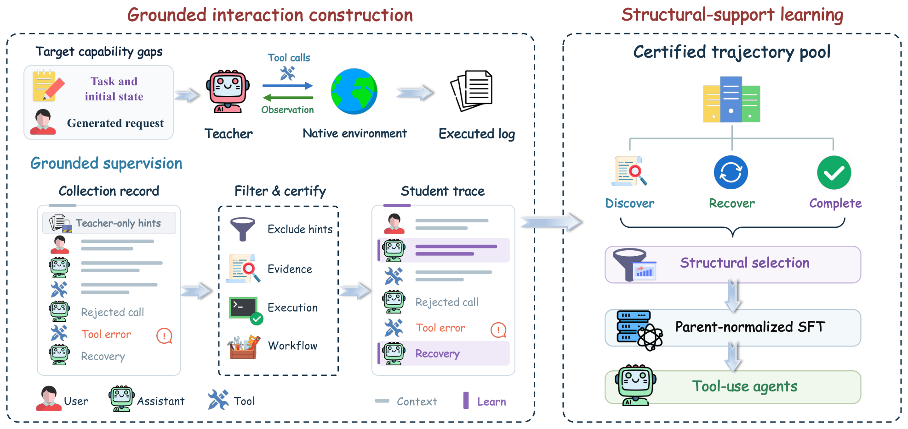
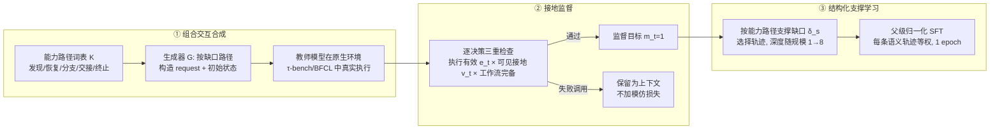

# Trajectory2Gym：成功轨迹≠好老师，工具调用 Agent 的监督信号要"决策级"重建

- **论文**：[arXiv:2610.33568](https://arxiv.org/abs/2610.33568) · [项目主页](https://yihaohu0118.github.io/Trajectory2Gym-page/)
- **代码**：[github.com/yihaohu0118/Trajectory2Gym](https://github.com/yihaohu0118/Trajectory2Gym) · [数据集（34,772 条交互）](https://huggingface.co/datasets/mis2/Trajectory2gym)
- **Venue**：arXiv 2026-10-24（cs.CL），HuggingFace Daily Papers 当日第 2 名
- **作者**：Yihao Hu, Zhihao Wen, Yitong Lin, Tao Lin 等 8 人（Tao Lin 组，上海交通大学）
- **一句话总结**：不按"任务是否成功"筛选轨迹，而是逐决策检查"这个动作能否由 Agent 当时可见的信息推出"，只用可被证明的决策做 SFT，让 Qwen3 全系 1.7B→30B 在 τ-bench/BFCL 上平均提升 16.9–29.8 个点，4B 训练后反超未训练的 30B。

## 🎯 解决什么问题

工具调用 Agent 的 SFT 数据普遍靠"跑成功了就拿来训"。作者指出这条路有两个致命伤：

1. **组合覆盖不足**：在 34,772 条"认证成功"的候选轨迹里，40.9% 只含 ≤2 个被监督的决策点，仅 10% 包含"真实报错后成功恢复"的决策。而现实任务（取消订单+改地址+换商品）恰恰是长依赖链。
2. **决策未接地（grounding）**：采集器可能用了 Agent 根本看不到的私有信息（比如后台数据库里的 ID）。API 执行成功 ≠ 该动作合法——论文图 1 的例子：用户先要求换大瓶+暗灯，随后改口只换灯，但两个 exchange 调用 API 都会照单全收。用执行成功做过滤器，会把"违背用户最新确认"的动作也当正样本训进去。

结论：**轨迹教什么，不由结果决定，而由它实现的依赖结构和可见历史能证明的决策决定。**

## 🔬 核心方法

三阶段流水线（对应代码三大模块）：

*图：论文 Figure 2——组合交互合成 → 接地监督认证 → 结构化支撑选择与父级归一化 SFT*

**关键设计**：
- **决策级掩码** `m_t = R_τ · 1[q_τ ⪯ A_τ] · g_t`：终端成功 × 必需操作按序出现 × 单决策接地，三者同时满足才产生 loss。失败调用及其真实报错**留在上下文里**，紧随其后的"接地恢复"才是监督目标——这是教模型从错误中恢复的廉价方式。
- **父级归一化 SFT**：一条长多轮轨迹会渲染成多条训练样本，按行平均会让长对话垄断梯度。改为每条语义轨迹（parent）内部先平均 token loss，再对轨迹平均。消融显示这是**单项收益最大的组件（+8.04 分）**，代码里就是 `train_trajectory2gym_sft_view.py --loss_normalization global_batch_parent_mean` 加一个 `transport_parent_loss_weight` 字段。
- **支撑深度随模型规模递增**（1.7B 每路径 1 条 → 30B 每条路径 8 条）：小模型学结构，大模型需要重复支撑。

## 📊 关键数字

τ1/τ2 Pass@1（%），配对增益为 Trajectory2Gym 减去同规模初始化：

| 模型 | τ1 Avg | τ2 Avg | 两基准均值 | Δ |
|---|---|---|---|---|
| Qwen3-4B 初始 | 24.22 | 19.17 | 21.70 | — |
| **+T2G (4B)** | 44.22 | **69.17** | 56.70 | **+35.0** |
| Qwen3-8B 初始 | 27.87 | 25.00 | 26.44 | — |
| **+T2G (8B)** | 51.13 | **74.17** | 62.65 | **+36.2** |
| Qwen3-30B-A3B 初始 | 44.39 | 28.33 | 36.36 | — |
| **+T2G (30B)** | 66.78 | **84.17** | 75.47 | **+39.1** |
| 参照：MUA-RL-32B（RL 训练） | 54.04 | 45.00 | 49.52 | — |
| 参照：Claude-4.5-Opus | 73.45 | 85.31 | 79.38 | — |

- **训练后 4B（τ2 69.17）> 未训练 30B-A3B（28.33）**；8B 在 τ2 上超过所有公开 agent 训练 checkpoint 至少 28 分，包括 32B 的 RL 模型。
- 收益集中在**有状态多轮**：τ2 Telecom 从 12.5 → 95.0（30B）；BFCL Multi-turn Base +7~41 分，单轮类目基本持平。
- 全程**无 RL**，仅 1 epoch 全参 SFT，训练量 11.6k–19.9k 条轨迹。

## 🛠 对工程实践的启发

1. **给自家 Agent 造 SFT 数据时，别只用"任务成功"过滤**。加一个决策级检查：每个工具调用的 ID/参数是否出现在此前的可见观察里？仓库的 `trajectory2gym/training/policy_view.py`（97 行）就是可直接抄的"策略可见投影"实现——把日志里用户侧私有工具调用剔除，保留收据（receipt）可审计。
2. **失败调用别删，降级为上下文**。保留真实报错 + 监督其后的恢复动作，比只用完美轨迹更能教会 Agent 重试/澄清/换参数。`trajectory/` 下的 `evidence_dag.py`、`oracle_verification.py` 展示了如何建"证据依赖图"来机械判定接地。
3. **多轮长对话 SFT 必须做父级归一化**，否则一条渲染成 5 个样本的长轨迹拿到 5 倍梯度权重。实现只是给每行乘 `1/子样本数` 的权重，成本极低、收益（+8 分）却是全流水线最大的单项。

## ⚠️ 局限与争议

- **消融都是单次运行**：作者自己承认一个 τ2 Airline 任务就能移动均值 0.56 分，几个点的增益只能算方向性结论；各阶段增益不可加。
- **支撑深度不单调**：敏感性实验中 depth=2 反而最好（72.28 vs depth=4 的 69.44），说明"更多重复支撑"并非免费午餐，且深度和数据量耦合，未完全隔离。
- **Live Simple 掉分**（4/5 规模下降 6–13 分）：训练让模型偏向"先收集信息再动手"，在期待一次性直接调用的查询上反而变慢变错——这是行为迁移的代价。
- τ1 Airline 是 seen-task 转导设置；与 Simia/MUA-RL 等 checkpoint 的对比是"参考"而非等算力对照，跨方法组件级归因不成立。

---
*来源：HuggingFace Daily Papers 2026-10-27 热榜第 2；论文正文 + GitHub 仓库代码对照精读。*
