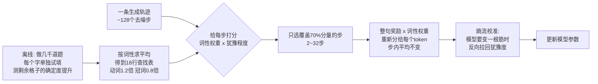
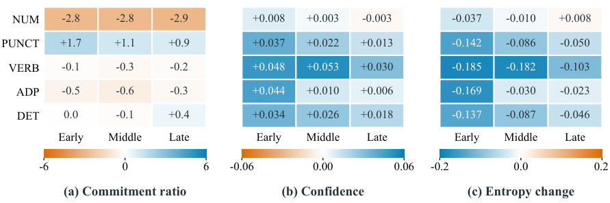

# DTCA：教扩散语言模型"论功行赏"——按词性给每个 token 发学习信号

- **论文**：DTCA: Denoising Token Credit Assignment for Reinforcement Learning in Diffusion Language Models
- **链接**：https://arxiv.org/abs/2610.35201 （2026-10-26 提交，20 页含附录）
- **代码**：https://github.com/ZJU-OmniAI/DTCA （Apache-2.0，核心算法只有 ~290 行 Python）
- **项目页**：https://zju-omniai.github.io/DTCA/
- **Venue / 来源**：arXiv 预印本 · HuggingFace Daily Papers 10-29 榜首（256 票）
- **作者机构**：浙江大学 OmniAI/ACES Lab + 新加坡国立大学 + SAP（一作 Hongze Chen）

## 🎯 30 秒版本

1. **这是什么**：一种针对"扩散语言模型"（一种不像 GPT 那样逐字往外蹦、而是像拼图一样从一堆空格子里同时往外填字的新型 LLM）的强化学习训练技巧——按词性（名词/动词/冠词…）给每个字的"学习力度"分三六九等。
2. **为什么重要**：扩散 LLM 被视为自回归模型（GPT 式逐字生成）的头号挑战者（Google 的 Gemini Diffusion、Inception 的 Mercury 都是这条路线），但它们的 RL 训练有个老大难：只有"最终答案对/错"一个总分，不知道中间几百个填字动作里谁有功谁有过。DTCA 用一套便宜的离线统计解决了这个问题。
3. **对你有什么用**：8B 参数的开源模型 LLaDA 数学能力从 36.4% 提到 43.2%（MATH500，256 预算），全程不需要人工标注；核心思想"哪些位置的决策更重要就重点训练哪些位置"对任何做 Agent/推理训练的人都可借鉴。

## 📚 读前须知

**1. 自回归 vs 扩散，两种"写字方式"**
GPT 这类自回归（Autoregressive，简称 AR）模型像打字员：从左到右一个字一个字敲，敲完不能改。扩散语言模型（Diffusion Language Model，简称 DLM）像玩填字游戏：一开始整句话全是空格（被"[MASK]"占位符盖住），每一轮同时猜出几个最有把握的格子填上，反复几十上百轮直到填满。好处是可以"先看两头再填中间"（双向上下文），且每轮能并行填多个字，理论上生成更快。

**2. 信用分配（Credit Assignment）**
强化学习（RL，让模型自己试错、做对了给奖励的训练方法）的经典难题：团队干成一件事，奖金怎么分？AR 模型的 RL 已经很难——整句话答对只有一个"1"的奖励，却要摊给几百个 token。扩散模型更难：它没有"先后顺序"，每轮同时提交好几个字，最后只知道总分，中间每一步、每个字的贡献完全是黑箱。

**3. 词性（POS, Part-of-Speech）**
就是小学语文的"名词、动词、形容词"分类。英语世界有通用标准 Universal Dependencies，共 17 类，用 spaCy 这类工具可以自动标。本文的核心洞察就藏在词性里（下面细讲）。

---

## 🎯 解决什么问题

现有扩散 LLM 的 RL 方法（如 d1、GRPO 系）拿到"答案对了，奖励+1"之后，通常把这个分数**均匀撒给整条生成的所有位置**。这相当于公司项目成功了，给全员发一样的奖金——问题很具体：

- **有的字是"关键决策"，有的字是"顺手填充"**。论文用 GSM8K（小学数学题数据集）实测发现：动词（VERB）被提交后，剩余空格子的预测置信度平均提升 1.91，是最大的"信息增量"；而定冠词（DET，比如 "the"）、介词（ADP，比如 "of"）只有 1.61-1.62——它们基本只是语法胶水。均匀撒奖励等于让"the"和推导关键步骤的动词享受同等待遇。
- **几百个去噪步里，大部分步是"垃圾时间"**。每轮提交的字置信度有高有低：高置信度的提交（模型本来就笃定）几乎不含学习信号，低置信度的提交（模型纠结半天才决定）才是真正值得复盘的决策点。全部步都训练，既浪费算力又稀释信号。
- **训练后期容易"熵坍缩"**。RL 训着训着模型会变得过度自信、输出多样性骤降（entropy collapse，熵=模型犹豫程度的度量，坍缩=模型变成一根筋），一旦坍缩很难再学新东西，甚至开始胡说。

前人的补救（如 Apple 的 DACA-GRPO）要么在训练时实时估计每个 token 的贡献——太贵；要么用启发式规则——太糙。DTCA 的思路是：**贡献统计不需要在线算，离线跑一遍、按词性聚合成一张 18 行的查找表就够了**。

## 🔬 核心方法：四步走

*图：DTCA 官方框架图（来自项目仓库）。从左到右：先离线测出各词性的"贡献值"，再用它挑出值得训练的去噪步，把整句奖励按词性重新分配到 token，最后用熵流校准防止训练跑偏。*

### 第 0 步（离线，只做一次）：测量"每类词的贡献"

**在干嘛**：训练开始前，拿 MATH+GSM8K 训练集的题目让模型做去噪生成。每轮只提交 2 个字，然后对每个字单独做一次"干预实验"：把这个字填进格子，重新跑一遍前向计算，看**剩余所有空格子的最大预测概率之和**涨了多少。涨幅 ΔP 就是这个字的"贡献"——好比往拼图里放下一块后，看剩下拼图的"确定程度"提高了多少。

**为什么这么干**：单个字的贡献噪声很大（不同题目、不同采样结果波动剧烈），直接在线算还得为每个字多跑一次前向（成本翻倍）。但把几万个字的 ΔP **按词性分组求平均**，噪声就抵消了，得到一张稳定的"词性→贡献"表。再把表归一化到 [0.8, 1.2] 区间——动词拿 1.2 倍权重，冠词拿 0.8 倍，刻意压小差距，避免过度干预原始 RL 目标。

**代码对应**：`dtca/contrib.py` 的 `reveal()` 函数实现干预实验（每步 commit 2 个 token、逐个 probe）；`dtca/pos.py` 用 spaCy 把模型 token 对齐到 18 类词性（处理了 retokenization 错位，对不上的标为 X 类）；`dtca/table.py` 的 `Table` 类生成查找表 `artifacts/pos.json`，加载时还会校验权重与统计量一致。

### 第 1 步：挑出"值得训练的去噪步"

**在干嘛**：一条生成轨迹可能有 128 个去噪步，DTCA 只训练其中一部分。给每步打分：q_t = Σ w_词性 × (1 − p_置信度)——即"这步提交的字的词性权重 × 它们的犹豫程度"之和。按分数从高到低选，选到累计覆盖 70% 总分量为止（上限 32 步、下限 2 步）。

**为什么**：低置信度 + 高贡献词性的步 = 模型在关键字上做了艰难决策，这些步最值得"复盘"。附录 D.1 实测：同样选 ~32% 的步，DTCA 挑出来的步覆盖了 62.8% 的"低置信度 token 总质量"，而基线 RLDF 随机/top-k 选法只覆盖 36.5%——用更少的训练步数抓住了更多的关键决策。

**代码对应**：`dtca/select.py` 全文只有 44 行，`select()` 里的 `searchsorted(cumsum, total*0.7)` 就是"累计到 70%"的实现。

### 第 2 步：把整句奖励按词性重新分给每个 token

**在干嘛**：GRPO（组相对策略优化，同一题采样多个答案、按组内相对好坏给优势值 A 的 RL 算法）给整条答案一个优势值 A_t。DTCA 在选中的每个去噪步内，把 A_t 乘上每个 token 的词性权重再归一化：动词多的位置分到 >1 倍的信号，"the"们分到 <1 倍。**归一化保证每个步的平均信用不变**——只改分配比例，不改总量，相当于奖金池不变、只调分配系数。

**为什么**：让梯度集中打在真正影响后续推理的位置上。消融实验显示这一步贡献最大（去掉后 MATH500@256 掉 3.8 分）。

**代码对应**：`dtca/credit.py`，`credit()` 函数 5 行就实现了"权重除以步内均值 × 优势"。

### 第 3 步：熵流校准，防止训歪

**在干嘛**：借用 OPEFO（一种防熵坍缩的 AR 模型 RL 技巧）并适配到扩散场景。对每个 token 用一阶近似估算"这次更新会让它的预测熵（犹豫度）升还是降"，把一条答案内的更新分成"升熵组"和"降熵组"，算一个平衡系数 λ_b（截断在 ±0.95），给两组反向缩放信用：如果整体在降熵（模型在变一根筋），就放大升熵方向的更新、压制降熵方向的，把熵往回拉。

**为什么**：实测去掉这个模块，训练到 500 步时 KL 散度（模型偏离原始策略的程度）涨到 0.48，而完整版只有 0.41（对 RLDF 基线则是 1.55 vs 0.43）；数字 token 的熵在无校准版里失控上涨 0.208 nats，校准版压到 0.063。效果：训得更久更稳，后期奖励不掉。

### 流程总览

**怎么读这张图**：上半条线（A→B）是训练前只做一次的"摸底统计"，产出一张静态查找表；下半条线（C→H）是每次 RL 迭代的流水线，查找表在第 1、2 步各用一次（挑步 + 分钱），最后加一道"熵保险"。整个过程不需要额外的人工标注或奖励模型。

## 📊 关键数字

基座模型 LLaDA-8B-Instruct（80 亿参数开源扩散 LLM，人大高瓴出品），训练数据只用 MATH 训练集，评测看最终答案准确率。"生成预算 128/256/512"指最多生成多少 token——预算越小越考验模型"用少量填字步骤把题做对"的能力。

| 方法 | MATH500 @128 | @256 | @512 | GSM8K @128 | @256 | @512 |
|---|---|---|---|---|---|---|
| LLaDA-8B-Instruct（基座） | 30.8 | 36.4 | 39.2 | 75.3 | 83.2 | 82.9 |
| d1（早期扩散 RL） | 33.6 | 37.6 | 37.2 | 75.8 | 82.4 | 81.8 |
| RLDF（强基线） | 36.2 | 41.2 | 42.6 | 77.2 | 83.4 | 82.7 |
| DTCA 去掉贡献分配 | 36.2 | 39.4 | 41.2 | 77.1 | 82.9 | 82.3 |
| DTCA 去掉熵校准 | 37.4 | 41.8 | 39.8 | 78.3 | 83.9 | 81.9 |
| **DTCA 完整版** | **39.8** | **43.2** | **44.0** | **80.6** | **85.3** | **85.4** |

**人话解读**：
- MATH500@128 从 30.8 → 39.8（+9.0 分）：原来 100 道竞赛级数学题只答对 31 道，现在对 40 道，**相对提升 29%**——而且是在"只许写 128 个字"的最紧约束下，说明模型学会了更少步数内直击要害。
- 对比最强基线 RLDF：43.2 vs 41.2（@256），领先 2 分；且 DTCA 训练末期 KL 只有 RLDF 的 1/3.6（0.43 vs 1.55）——**提升的同时对原模型的"破坏"小得多**，不容易训崩。
- 两个消融都掉分，其中贡献分配是主力（-3.8），熵校准在长预算下更重要（@512 时 -4.2）：短训靠"分对钱"，长训靠"防坍缩"。
- 有趣的副作用（图 4）：训练后模型提交数字（NUM）的比例下降、标点（PUNCT）上升，动词提交时置信度明显更高——RL 真的改变了模型的"填字策略"，而不只是背了更多题。

*图：论文 Figure 4，DTCA 相对基座模型在去噪早/中/晚三阶段的提交行为差异。每格是"DTCA 减基座"：数字类提交占比全程下降约 2.8-2.9 个百分点，标点上升，说明模型学到了不同的填字节奏。*

## 🛠 对工程实践的启发

1. **"离线统计 + 查找表"是个通用省钱模式**：任何"每个 token/每步的重要性"类信号，如果在线算太贵、单样本噪声大，都可以考虑离线聚合到一个低维离散表（这里是 18 个词性）再在线查表。DTCA 的表构建脚本 `scripts/build_table.py` 支持断点续跑（records 逐条落盘），工程上很干净。
2. **信用重分配时保持"步内均值不变"值得学**：`credit.py` 里那个归一化让改动严格等价于"重新切蛋糕"而非"改蛋糕大小"，训练超参基本不用重调——这是给已有 RL 管线加插件时控制风险的好习惯（对比 DACA-GRPO 也主打 plug-and-play，说明这是社区共识方向）。
3. **熵流校准可移植**：`entropy.py` 21 行实现了一个 response 级的熵平衡器，做 RLVR（可验证奖励强化学习）遇到后期熵坍缩/KL 飙升的团队可以直接抄思路，不限于扩散模型。

## ⚠️ 局限与争议

**论文自己承认的**（附录 E）：① 依赖 spaCy 词性标注质量，token 对不齐时只能标 X 类（代码里 X 类占比不小，SPACE 类 token 数高达 90 万）；② "置信度提升=贡献"只是启发式，缺理论保证；③ 只在 LLaDA-8B + 数学任务上验证，代码生成等任务的词性分布不同，查找表可能要重做。

**社区争议**：① 一个尴尬的插曲——论文在 HF Daily Papers 短时间内冲到 256 票榜首后，**一作亲自下场声明"我们没有买票、没有刷票，不知道票从哪来的，已向 HF 官方举报"**（HF 评论区可见）。这给"榜首"光环打了折扣，读数字时宜保持平常心。② 更根本的质疑来自扩散 LLM 赛道本身：HN 上关于扩散语言模型的讨论（如 "Continuous Diffusion Language Models" 135 分、"How to build a diffusion language model" 184 分）中反复出现的观点是——扩散模型生成虽快，但在同等规模下推理质量仍落后头部 AR 模型，LLaDA-8B 的 MATH500 训完也只有 44%，而同期 8B 级 AR 模型（如 DeepSeek-R1-Distill-Qwen-7B）能到 55%+。DTCA 是"给追赶者提速"，不是"反超"。③ 方法层面，与 Apple 的 DACA-GRPO（2605.16342）、DISPO（2602.06462）同期竞争，三家都宣称解决扩散 RL 信用分配，但互相没有同表对比，谁更强还说不清。

## 🧠 关键概念表

| 术语 | 白话解释 | 为什么重要 |
|---|---|---|
| 扩散语言模型（DLM） | 像填字游戏一样从全空格逐轮填字的 LLM，非逐字生成 | 被视为 AR 模型的替代路线，推理可并行 |
| 去噪步（denoising step） | 填字游戏的一轮，每轮提交若干个字 | 一条轨迹上百步，是信用分配的粒度 |
| token 提交（commitment） | 某个格子从 [MASK] 变成确定的字，之后不再改 | 提交即决策，决策才有功过 |
| 信用分配 | 团队立功后奖金怎么分到个人 | 扩散 RL 的核心难题：只有总分没有过程分 |
| 词性（POS） | 名词/动词/冠词等 18 类语法标签，spaCy 自动标 | DTCA 的分组依据：动词贡献大、冠词贡献小 |
| GRPO | 同一题采样多个答案、按组内相对好坏给优势的 RL 算法 | DeepSeek 系标配，DTCA 建在其上 |
| 优势值 A（advantage） | 这条答案比同组平均好多少（可正可负） | RL 更新的方向和力度来源 |
| 熵（entropy） | 模型在某个位置的犹豫程度；低熵=笃定，高熵=拿不准 | 熵坍缩=模型变一根筋，是 RL 训崩的前兆 |
| 熵流校准 | 估算每次更新让熵升还是降，反向调节保持平衡 | 让长训练稳定，KL 只有基线的 1/3.6 |
| KL 散度 | 训练后模型偏离原始模型的程度 | 偏离太大=训崩/灾难性遗忘 |
| LLaDA-8B-Instruct | 人大高瓴开源的 80 亿参数扩散 LLM | 本文的基座模型，可本地部署 |
| MATH500 / GSM8K | 竞赛数学 500 题 / 小学数学应用题库 | 推理能力标准考卷 |
| 生成预算 | 最多允许生成多少 token（128/256/512） | 预算越小越难，DTCA 在小预算下优势最大 |
| RLDF | 从去噪反馈做 RL 的强基线方法 | DTCA 的选步框架继承自它并改进 |

## 💡 所以呢

- 如果你在跟进**扩散 LLM 这条非主流但有产业背书（Google/字节/Inception）的路线**，DTCA 是当前开源里完成度较高的 RL 配方：代码小而全（核心 290 行 + 完整训练脚本 + DeepSpeed 配置），8 卡即可复现。
- 如果你做的是 **AR 模型或 Agent 的 RL**，可迁移的是方法论：①"重要性信号离线聚合 + 在线查表"；②"重分配不改总量"的安全插件设计；③ 熵流校准防坍缩。
- 值得盯的后续：这套词性表能否推广到代码生成（代码 token 的词性分布完全不同）？以及 DACA-GRPO / DISPO / DTCA 三家何时在同一张表上见真章。
