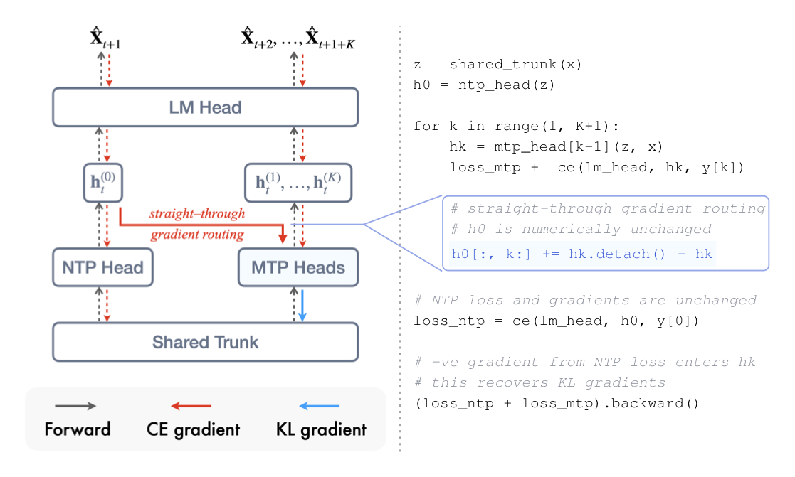
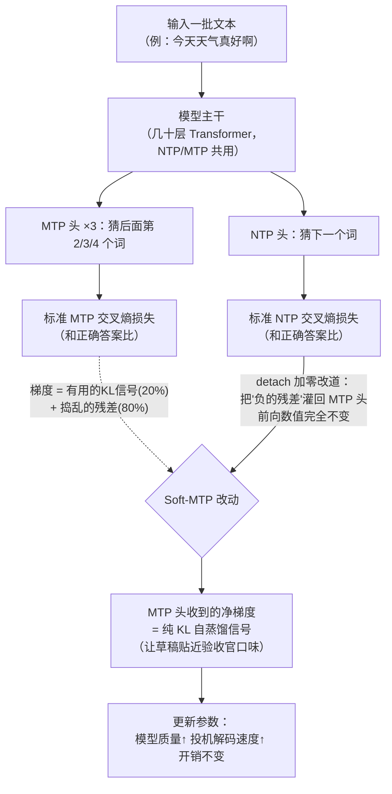

# 一行代码让 MTP 训练"白捡"性能：Soft-MTP 精读

- **论文**：Multi-Token Prediction Done Right（arXiv: [2610.38331](https://arxiv.org/abs/2610.38331)，2026-10-27）
- **代码**：[github.com/JaydenTeoh/Soft-MTP](https://github.com/JaydenTeoh/Soft-MTP)（本文实测跑通了它的梯度等价性测试，17 项全过）
- **Venue**：arXiv 预印本（HuggingFace Daily Papers 10-30 上榜）
- **作者/机构**：Jayden Teoh（MIT，独立作者；实验自费租 RTX PRO 6000 GPU 完成）

*图：论文 Figure 1。中间蓝色一行 `h0[:, k:] += hk.detach() - hk` 就是全部方法改动，右边是训练 loss 曲线——Soft-MTP（虚线）全程压着标准 MTP（实线）。*

## 🎯 30 秒版本

1. **这是什么**：MIT 独立研究者发现，现在 DeepSeek、GLM、Kimi 等大模型预训练都在用的 MTP（Multi-Token Prediction，多 token 预测）辅助损失，其梯度里 80% 是"噪声"，而且模型越大噪声占比越坑；他用一行代码把噪声滤掉、只保留有用信号，取名 Soft-MTP。
2. **为什么重要**：MTP 是当下前沿模型训练的标配组件（同时改善模型质量和推理加速），这个方法零参数、零额外开销、兼容所有主流训练框架的融合 kernel，等于给全行业的预训练"免费升级"。
3. **对读者有什么用**：如果你在自己训小模型或用 nanogpt 类框架做实验，把 loss 函数改一行就能白拿 1~2 个点的下游准确率提升和更快的投机解码；就算不训模型，这篇也是理解"梯度里藏着什么"的绝佳教材——数学推导干净、代码开源、结论可复现。

## 📚 读前须知

**1. NTP 和 MTP 是什么？**
大模型都靠 NTP（Next-Token Prediction，预测下一个词）训练：看"今天天气真"，猜下一个字是"好"。MTP 是加强版：附带猜下下个、下下下个词（本文用 3 个额外预测头）。好处有二：① 强迫模型"往远看"，数学、代码这种长逻辑任务学得更好；② 这些头推理时可做**投机解码**（speculative decoding，先用便宜小头快速起草几个词、大模型一次性验证，猜中白赚——相当于先盲打三个词再回头检查，比逐词敲快得多）。DeepSeek-V3 之后 MTP 成了前沿标配。

**2. 梯度和交叉熵是什么？**
神经网络学习靠**梯度**（gradient，"参数该往哪个方向调、调多少"的指南针）。**交叉熵**（cross-entropy，CE）是最常用的损失函数：模型给正确答案的概率越高，罚分越小。对 CE 求梯度，就得到"怎么调参数让正确词概率更高"的方向。

**3. KL 散度和自蒸馏是什么？**
**KL 散度**（KL divergence）衡量两个概率分布差多远，越接近 0 越像。**自蒸馏**（self-distillation）是模型当自己的老师——这里指让 MTP 头模仿模型自己的 NTP 头。为什么？因为投机解码的验收标准恰恰是"NTP 头同不同意这个草稿"，MTP 头猜得再"准"，跟 NTP 头不一致就会被驳回。

## 🎯 解决什么问题

先说一个反直觉的现象：**标准 MTP 训练其实是"负收益"的**。看论文 Table 3 的数字——167M 模型上，纯 NTP 训练的平均零样本准确率是 47.42，加了 MTP 反而掉到 46.84；1.2B 时 NTP 是 56.75，MTP 只有 56.80，几乎白搭。花了额外的参数和算力做 MTP，下游准确率却没涨，这在业界是公开的秘密（Meta 2024 年的 MTP 论文也承认小模型上多选题准确率没提升）。

痛点拆开看有三个：

1. **想要自蒸馏，但算不起**。既然验收方是 NTP 头，直接训 MTP 头去模仿 NTP 头（KL 自蒸馏）不是更对路？已有工作这么干了，但 KL 需要把"老师"和"学生"在整个词表（15 万+ 词）上的完整概率分布都物化到显存——论文实测吞吐降 5.6%、峰值显存多 21GB（≈ 一张 H200 显存被白吃 15%），还跟现代训练必用的 fused cross-entropy kernel（把"算 logits + 算损失"融合成一个 GPU kernel、从不物化完整 logits 的省显存技巧）**不兼容**。所以前沿实践里仍用普通 CE 训 MTP 头。
2. **没人知道标准 MTP 的梯度里装了什么**。MTP 用了两年多，它为什么小模型上反而拖后腿，一直缺分析。
3. **改法必须"免费"**。预训练一次几千万美元，要改架构、加参数、换 kernel 的方案都推不动。

## 🔬 核心方法

论文的漂亮之处在于：先做数学分解发现问题，再用一个恒等变形解决问题。逐步拆解：

**第 1 步：把标准 MTP 梯度精确分解成两部分。**
对第 k 个 MTP 头的 CE 损失求梯度，作者证明它可以**精确**（不是近似）拆成两项：

> 硬 MTP 梯度 = **KL 自蒸馏项** + **残差项**

- **KL 自蒸馏项**：形式恰好等于"让 MTP 分布逼近对齐位置的 NTP 分布"的 KL 梯度——也就是我们真正想要的信号。之所以 CE 里天然藏着它，是因为 MTP 头和 NTP 头**共享同一个输出矩阵 W**、且由同一份数据监督（只是错开 k 个位置）。
- **残差项**：等于"用真实标签对 NTP 分布求 CE"的梯度，即拿数据又推了一把 NTP 方向。

**第 2 步：诊断——残差是坏东西。**
作者测了两个量：① 信噪比 SNR（信号强度 ÷ 噪声强度，越高说明这个方向越"靠谱"）：残差的 SNR 比 KL 项**低约 10 倍**，且模型越大差距越大（167M 到 1.2B 之间差距持续拉宽，对数坐标）；② 梯度占比：这个又吵又没用的残差，占了进入共享主干的 MTP 梯度的 **80%**。更糟的是实验显示：沿着 KL 项走一小步，NTP 损失会降（帮忙）；沿着残差走一小步，NTP 损失会**升**（捣乱）。类比：你请的顾问说的话里 80% 是随机噪音还经常反着来，只有 20% 是真知灼见——之前大家把整段话照单全收。

为什么残差天生没救？它的信号是"NTP 头自己的预测误差"，模型越大误差越小（信号萎缩）；噪声来自 one-hot 采样（标准答案只有一个词，抖动是数据固有的），**再多算力也消不掉**。所以模型越大残差越拖后腿——这解释了 MTP 收益随规模变化的怪异表现。

**第 3 步：KL 梯度恢复技巧——用"直通路由"把 KL 项单独捞出来。**
难点：KL 项藏在 CE 梯度里，直接算 KL 又要物化词表大小的矩阵。作者的解法是一个漂亮的恒等变形：

- 把 MTP 头的隐藏状态 z_k 做一个变换：`h0[:, k:] += s·(z_k.detach() - z_k)`，加到 NTP 隐藏状态的对齐切片上。
- `detach()` 意思是"这个副本不带梯度"，所以 `z_k.detach() - z_k` 的**数值恒等于 0**——前向计算结果一个比特都没变，NTP 损失值、NTP 梯度全都不受影响。
- 但**反向传播**时，这一项会把 NTP 损失产生的梯度"抄近道"直接灌进 z_k，灌进去的恰好是残差项的相反数。原本 MTP CE 会给 z_k 送去"KL 项 + 残差"，现在 NTP 这边又送来"-残差"，两者相加 = **纯 KL 项**。
- `s` 是个缩放系数，负责把 NTP 的 1/T 平均和 MTP 头自己的 1/(T-k) 平均对齐，保证灌进去的梯度大小分毫不差。

这就是所谓的**直通梯度路由**（straight-through gradient routing，源自 VQ-VAE 里"前向走离散、反向装作连续"的老技巧，这里反过来用：前向加零、反向改道）。整个方法就是训练循环里的一行代码。

**怎么读这张图**：实线是普通 MTP 训练本来就有的流程；虚线和菱形框是 Soft-MTP 的全部改动——不新增计算，只是反向传播时把 NTP 损失的一部分梯度"改道"送进 MTP 头，正好抵消残差。MTP 头收到的梯度从"80% 噪音 + 20% 信号"变成"100% 信号"。

**第 4 步：设计取舍——共享输出头 W 仍用硬 CE 训练。**
为什么不把 KL 信号也灌进共享输出矩阵 W？作者用**有效秩**（effective rank，衡量矩阵实际用了多少维，越小说明越退化）解释：W 直接吃 KL 梯度会形成"作弊捷径"——KL 不靠改进 MTP 头、也能靠让 W"读不出 MTP 和 NTP 的差异方向"来降低。实测有效秩：纯 NTP 496，标准 MTP 崩到 131（塌 73%），KL-MTP 321，Soft-MTP 保持 437 最接近健康值。所以完整配方是：**主干和 MTP 头吃 KL 梯度，输出头 W 继续吃 CE 梯度**。

## 📊 关键数字

实验设置：LLaMA 风格模型，167M→1.2B 四档，FineWeb-Edu 数据集训 31.5B token（对最大模型是 Chinchilla 最优配比，即"参数量和训练数据量搭配最划算"的经典比例），Muon 优化器，DeepSeek 风格 3 个 MTP 头。对比对象：纯 NTP、标准 MTP、KL-MTP（直接物化 KL 的昂贵做法）。

**训练成本（1.2B，单张 H200）**：

| 目标函数 | 吞吐 (tok/s) | 峰值显存 (GB) | 人话解读 |
|---|---|---|---|
| 标准 MTP | 49,783 | 107.0 | 基线 |
| KL-MTP | 46,990 | 128.1 | 显存多 21GB ≈ 白扔 15% 的 H200 显存，训练慢 5.6% |
| **Soft-MTP** | **49,748** | **107.0** | 和标准 MTP 差 0.07%，等于**免费** |

**投机解码（自草稿自验证，5 个领域平均）**：每个规模上接受长度提升 1.8–2.2%、实际加速提升 1.4–1.5%。参照系：1.2B 加速比 1.74→1.76，原本 100 秒的生成任务变 98.9 秒；关键是**零成本**拿到，且 MTP 与 NTP 验证分布的 KL 从 0.384 降到 0.364（草稿更贴验收官口味）。

**下游质量（1.2B，10 个零样本基准平均准确率）**：NTP 56.75 → 标准 MTP 56.80（几乎白搭）→ **Soft-MTP 57.31**（+0.51 分，且 WikiText 困惑度 17.49 首次反超纯 NTP 的 17.50——MTP 训练第一次在困惑度上不再"倒贴"）。

**微调后推理（1.2B，丢掉 MTP 头只做 NTP 微调）**：GSM8K 数学 48.60→49.66；HumanEval 代码 pass@64 40.85→43.90（+3.05 ≈ 每 100 道编程题多解出 3 道），且是三个 MTP 目标里**唯一**全指标不低于纯 NTP 基线的。

**与昂贵方案对比**：Soft-MTP vs KL-MTP，困惑度全赢或打平、代码微调 6 项全赢、数学微调小输（GSM8K 49.66 vs 50.34）——花 0 成本拿到大部分收益。

**可复现性（本文实测）**：我在本机 clone 仓库、装 CPU 版 PyTorch 运行 `pytest tests/ -q`，**17 项测试全部通过**——核心测试在 float64 下验证 Soft-MTP 梯度与显式 KL 最小化梯度**相等到机器精度**，且两者只在共享输出头 W 处不同（正是论文的设计决策）。方法有数学恒等式 + 可运行测试背书。

## 🛠 对工程实践的启发

1. **一行代码即可落地**：核心实现在 [src/models/loss.py](https://github.com/JaydenTeoh/Soft-MTP/blob/main/src/models/loss.py) 的 `combined_mtp_loss()`，hard_mtp/soft_mtp 共用一个循环，只差 `is_soft` 分支里的直通路由两行。nanogpt 系自训项目可直接抄；仓库提供四种目标的命令行开关和 [HF checkpoints](https://huggingface.co/collections/JaydenTeoh/soft-multi-token-prediction)（167M~1.2B 各三套）可下载对比。
2. **"梯度路由"是可迁移的通用工具**：只要老师和学生**共享同一个线性输出头**，就能从 CE 梯度精确恢复 KL 梯度、免物化 logits——对 OPSD（在线策略自蒸馏）、off-policy RL、Nemotron 3 的 MTP Boosting 后训练等一切"付不起全词表 KL"的场景都适用。唯一限制：序列并行下需跨分片交换至多 k 个隐藏状态梯度（与序列长度无关，代价很小）。
3. **测试文化值得抄**：`tests/test_kl_recovery.py` 用 float64 机器精度验证数学恒等式、还手写闭式梯度做第三方交叉验证（"两个实现可能共享同一个误解，三方对齐不可能"），是科研代码里少见的好工程实践。

## ⚠️ 局限与争议

**论文自己承认的**：
- 引入的偏差是"NTP 头自身的预测误差"——训练早期/小模型时老师本身不靠谱，学生学到的也是烂分布。**边界没有完全钉死**：167M 时 MTP 困惑度反而略差于标准 MTP，689M 起才全面反超。
- 数学微调输给 KL-MTP，"输出头保留 CE"的取舍不是处处最优。
- 最大只验证到 1.2B/31.5B token；"规模越大收益越大"是趋势外推，**前沿规模（数百 B 参数）尚无实证**。
- MTP 本身前景存疑：论文提到 DeepSeek-V4.1-Flash 已弃用 MTP 改用后训练的 DSpark 草稿器——如果行业转向后训练草稿器，这个优化的适用面会收窄（但作者反驳：基座从没学过"表征未来 token"，后训练草稿器的上限存疑）。

**社区反应**：论文 10-27 挂出、10-30 上 HF Daily Papers，HN 尚无专门讨论帖（已用 Algolia 检索确认）。可预期的争议点：单作者、自费租 GPU、无同行评审，"free lunch"措辞偏营销；但数学推导（附录 B 有完整分解）和梯度等价性测试都可独立核验，我实测通过。

## 🧠 关键概念表

| 术语 | 白话解释 | 为什么重要 |
|---|---|---|
| NTP | 预测下一个词的训练目标，大模型的看家本领 | 一切的基线 |
| MTP | 附带预测未来 2~4 个词的辅助目标 | DeepSeek-V3 后成前沿标配 |
| 投机解码 | 小头快速起草几个词、大模型一次验证，猜中白赚 | MTP 头的主要推理用途 |
| 交叉熵 (CE) | "给正确答案的概率越高、罚分越低"的损失函数 | 标准 MTP 用的就是它 |
| KL 散度 | 两个概率分布的"距离" | 自蒸馏的目标函数 |
| 自蒸馏 | 模型模仿自己的另一个输出头当老师 | 让草稿贴近验收官 |
| 梯度 | 参数该往哪调的指南针 | 本文的分析和手术对象 |
| SNR（信噪比） | 有用方向强度 ÷ 随机抖动强度 | 残差比 KL 项低 10 倍是核心发现 |
| 残差项 | MTP 梯度里"拿数据再推 NTP 方向"的分量，占 80% | 又吵又反向捣乱，要滤掉 |
| detach / stop-gradient | "这个张量只取值、不回传梯度" | 直通路由的零件 |
| 直通梯度路由 | 前向加零不改数值、反向把梯度改道送去别处 | Soft-MTP 的实现机制 |
| fused CE kernel | 把算 logits 和算损失融合、不物化完整 logits 的 GPU 优化 | KL-MTP 与它不兼容，Soft-MTP 兼容 |
| 有效秩 | 矩阵实际用满了几维，越小说明越"坍缩" | 解释为何输出头 W 要留 CE（437 vs 131） |
| Chinchilla 最优 | 参数量与训练 token 数的最划算配比 | 实验设置的依据 |

## 💡 所以呢

对不训模型的人：这是"用小成本做干净科学"的范本——单作者、消费级 GPU、一行改动撬动全行业组件。对训模型的人：改动小到没理由不试，`--objective soft_mtp` 开关和四套对照 checkpoint 让 A/B 验证成本几乎为零。值得盯：① 前沿实验室能否在真实规模复现（尤其 Kimi/GLM 这类 MTP 重度用户）；② KL 梯度恢复技巧被搬到 OPSD/RL 后训练的日子不远。
