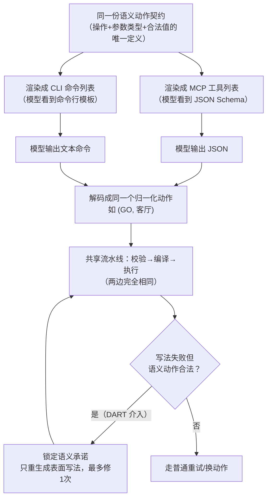

# 同样的工具，换个"说法"，Agent 就变笨了？——MICA：MCP vs CLI 接口对照实验

> **🎯 30 秒版本**
> 1. 这是港理工 + 中科院计算所的一篇受控实验论文：让 AI Agent 用 **MCP**（结构化工具调用协议）和 **CLI**（命令行文本指令）两种方式操作**完全相同的工具**，看行为差多少——结果差异巨大，同一个模型换个接口成绩能从 56.7 分掉到 20.1 分。
> 2. 为什么重要：它用严格对照实验证明了"接口的写法本身就是 Agent 决策环境的一部分"，而不是无关紧要的皮——这直接影响你给 Agent 配工具时该选 MCP 还是终端命令。
> 3. 对你有什么用：作者顺手提出的修复方案 DART（保留已验证的语义决策、只修表面写法）在全部 6 个测试设置里都提分、最高省 27.1k token/任务，思路可以直接抄进自己的 Agent 框架。

## 📚 读前须知

**1. MCP 是什么？** MCP（Model Context Protocol，模型上下文协议）是 Anthropic 2024 年底推出的标准：把工具包装成"带 JSON Schema 的命名函数"，模型输出结构化 JSON 来调用。类比：像**填表格**办事——每个格子有名字、有类型，填错格式直接被拒收。

**2. CLI 是什么？** 命令行接口，就是让模型输出 `go --destination "living room"` 这样的**文本命令**。类比：像**口头报单**——自由度高，但没有表格帮你校验，写错一个词就没人听得懂。

**3. 为什么这个对比有意义？** 2025 年以来 Agent 圈分裂成两派：Claude Code / OpenAI Codex 等主流编码 Agent 走终端路线，而企业工具生态大量押注 MCP。两派吵"哪个更好"，但以前的对比都不干净——换接口时往往连工具粒度、提示词、校验逻辑都一起换了，赢了说不清赢在哪。这篇论文就是来"控制变量"的。

---

- **论文**：[Matched Capabilities, Different Behaviors: A Controlled Study of MCP and CLI Interfaces for Language Agents](https://arxiv.org/abs/2610.34298)（arXiv 2610.34298，2026-10-25 提交）
- **代码**：[github.com/ModalityDance/MICA](https://github.com/ModalityDance/MICA)（MIT 协议，含完整实验配置）· [项目主页](https://modalitydance.github.io/MICA/)
- **Venue / 来源**：arXiv cs.AI · HF Daily Papers 10-31 上榜 · 开源项目+论文对照
- **作者机构**：Zhenning Shi、Yongqi Li（香港理工大学），Liang Pang（中科院计算所）

*图 1：MICA 框架总览（论文 Figure 1，从官方仓库下载）。上半部分：同一份"语义动作契约"渲染成 MCP 和 CLI 两种表面，解码后进入**同一条**校验→编译→执行流水线；中间：2×2×2 探针实验 + 配对轨迹分析；下半部分：DART 的"承诺保留式修复"流程。（图注：2400×1067 PNG，594KB）*

## 🎯 解决什么问题

举个具体例子。你给 Agent 配了一个"导航"工具，语义上就是 `GO(房间名)` 这一个动作：

- **MCP 版**看到的提示是：`工具 go，参数 destination，类型 string`，它要输出 `{"tool":"go","destination":"living room"}`；
- **CLI 版**看到的是：`go --destination "living room"` 这样的命令模板，它要输出一行文本。

两者背后执行的是**同一段代码**，能力完全一样。但作者跑了 6 个模型 × 3 个环境后发现：Qwen3-14B 在 ALFWorld（文本版"过家家"游戏：去客厅、拿苹果、加热）上，CLI 得 56.7 分，MCP 只有 **20.1 分**——差 36.6 分，相当于同一个学生，卷子换个排版就从及格线掉到不及格。更怪的是方向还会反转：同一个模型在 WebShop（模拟网购）上 MCP 反而**高** 4.9 分，token 消耗一边多 54.9k、另一边少 35.0k。

问题的本质：以前没人能回答"这到底是接口表示的锅，还是工具本身不一样"，因为对照不干净。MICA 把两种接口从**同一份语义契约**渲染出来、走**同一条**校验/编译/执行路径，唯一变量就是"模型看到的样子"。

## 🔬 核心方法：MICA 三板斧 + DART

**第一步：契约匹配的接口构造（控制变量）**。给每个基准测试写一份"语义动作契约"——所有操作、参数类型、合法取值、执行绑定的唯一权威定义。然后两个渲染器分别把它变成 MCP 工具列表和 CLI 命令列表。模型输出后，两个解码器把 JSON / argv 都还原成同一个归一化语义动作 `(操作, 参数)`，再进入共享的校验→编译→执行。这样任何成绩差异只能来自"模型-facing 的表示"。

**第二步：2×2×2 探针实验（定位差异从哪来）**。作者把接口拆成三个组件：**呈现 Φ**（工具/命令怎么列给模型看）、**实现 R**（模型输出用什么格式）、**反馈 Ψ**（执行结果怎么回显）。在冻结的同一决策点上，8 种组件组合各跑一遍，看哪个组件对行为影响最大。结论：**实现（R）是重灾区**——单是换输出格式，ALFWorld/Qwen3-32B 的实现失败率效应高达 **84.4 个百分点**。而且组件间有强交互：WebShop/Qwen3-14B 的三阶交互项能把准入率改变 37.8 个点，说明"格式问题"不能孤立修。

**第三步：配对轨迹分析（差异如何滚雪球）**。让 MCP 和 CLI 从同一初始状态各跑一遍，找"第一次实质性分歧"的时刻 t*。结果：**2004 对轨迹里 94.3% 出现结构化分歧**，且大多发生在交互早期——一步走岔，后面的历史、状态、成本全部不同。

**第四步：DART（对症下药）**。既然分歧主要在"实现"层，那修复就别动"决策"层。DART 把一次动作拆成两阶段：先让模型选语义动作（"我要 GO 去客厅"），验证通过后**锁死为承诺**；再让模型把它写成 MCP JSON 或 CLI 命令。如果写法失败但承诺仍合法，就只重试"写法"，最多修 1 次，修不好才放行回普通策略。类比：**你点菜时服务员已经确认"宫保鸡丁"进了后厨单，端不上来只是盘子摔了——换个盘子重端，而不是让厨师换道菜**。

*怎么读这张图：上半部分是全篇的"控制变量"精髓——两条支路只在"模型看到什么、输出什么格式"上不同，汇合点之后完全共享，所以成绩差异只能归因于接口表示。下半部分是 DART：失败时先问"决策本身还合法吗"，合法就只修表达不修决策。*

**论文↔代码对应**（仓库已 clone 实测）：语义承诺在 `src/mcp_cli/dart.py` 的 `Commitment` 类——`create()` 里把候选动作规范化、绑定契约指纹后立即过一遍 `_validate_and_compile`，**验证通过才允许成为承诺**；修复控制器在 `src/mcp_cli/controllers.py` 的 `RepairSession.run()`，`DARTSettings` 硬性限制 `max_repair_calls ≤ 3`（选择 1 次 + 实现 1 次 + 修正 1 次），并且有 `deterministic`（用参考编码器替代模型写格式）和 `reselection`（允许换语义动作）两个对照策略——消融设计直接做进了 CLI 参数。双接口渲染在 `interfaces/surfaces.py` 的 `render_surface()`，探针在 `probes.py`。

## 📊 关键数字

实验设置：3 个文本交互环境（ALFWorld 家务、WebShop 网购、ScienceWorld 科学实验）× 6 个模型（Qwen3-4B/8B/14B/32B、DeepSeek-v4-Flash、Gemini-2.5-Flash），指标是基准得分和每任务 token 消耗。

| 发现 | 数字 | 人话参照系 |
|---|---|---|
| 同能力不同接口，成绩天差地别 | Qwen3-14B 在 ALFWorld：CLI 56.7 vs MCP **20.1** | 同一司机开同一条路，换个仪表盘从 85 分掉到 30 分 |
| 方向会反转 | 同模型 WebShop：MCP 反而 +4.9 分、省 35.0k token | "MCP 全面优于 CLI"或反之都是错的，得看模型×任务组合 |
| 分歧普遍且早发 | 2004 对轨迹中 **94.3%** 出现结构化分歧 | 几乎每局都在开头几步就走上不同岔路 |
| 实现层是最大敏感源 | 换输出格式，失败率效应最高 **84.4 个百分点**（ALFWorld/Qwen3-32B） | 光"换个填表方式"就能让成功率天翻地覆 |
| 恢复行为也被重塑 | WebShop/Qwen3-4B 重试接受率：CLI 50% vs MCP 77%，后续成功率 18% vs 34% | 犯错后"救回来"的能力也随接口变化，接近翻倍 |
| DART 全面有效 | 6/6 设置提分，最高 **+9.0 分**（ALFWorld/MCP）；MCP 下省 token 最高 **27.1k/任务**（ALFWorld） | 相当于 100k token 的账单变 73k，且分数还涨了 |
| DART 修复效率 | 触发的干预 71–100% 首次实现即被接受 | 只修写法不换决策，绝大多数一次就修好 |

另注：所有接口版本的 token 消耗几乎都比"原生接口"高（ALFWorld 上 +7%~+68%），说明 MICA 的统一契约渲染本身有额外开销，这是为了公平付出的代价。

## 🛠 对工程实践的启发

1. **给 Agent 换接口 = 换模型行为，要重新评测**。如果你正把内部 CLI 工具迁到 MCP（或反过来），别默认"能力等价所以效果等价"——本文证明连 94% 的轨迹都会变。迁移后至少要在真实任务集上重跑成功率。
2. **"决策-表达"两段式 + 承诺保留重试，值得抄**。DART 的核心思想（语义动作验证通过后锁死，格式失败只修格式）实现成本很低：仓库里 `dart.py` 全文才 27 行 + `controllers.py` 的 `RepairSession` 约 200 行。做任何 tool-calling Agent 都可以在重试逻辑里加这个门：**重试时禁止换意图，只许换写法**。
3. **接口三组件（呈现/实现/反馈）可以单独调优**。探针方法告诉你不必整体推翻接口——如果失败集中在"实现"层，优先上约束解码（constrained decoding）或给模型更严格的输出模板，比改工具描述见效快。

## ⚠️ 局限与争议

- **论文自认**：只覆盖 3 个纯文本学术环境，没有真实 MCP server 和真实 shell——CLI 侧是"解析为 argv、不执行 shell"的受控模拟（代码注释原话：`no shell is executed`），MCP 侧也是渲染出的工具而非网络协议实体。真实世界 MCP 的 schema 混乱、工具过多等问题会叠加进来。
- **DART 全量评测只用了 Gemini-2.5-Flash**（RQ4 的六个设置），其他模型上 DART 的表现论文没有全跑。
- **成本盲点**：DART 两阶段（先选语义再写格式）意味着每步动作至少两次模型调用，论文报告了净 token 变化但小模型上是否划算存疑。
- **社区讨论**：HN 上没有找到这篇论文本身的讨论帖（截至发稿仅 4 个 HF 赞，关注度还低）。但"MCP vs CLI"话题本身在 HN 吵得很热（如 ["MCP is dead?" 帖](https://news.ycombinator.com/item?id=48330436)）：挺 MCP 一方强调安全边界——MCP server 可以硬编码白名单、Agent 摸不到凭证和公网；挺 CLI 一方（含 Anthropic 自己的 Claude Code 团队）认为文本命令+管道组合表达力更强、生态现成。本文恰好给两边都提供了弹药：**没有全场景赢家，接口选择是模型×任务相关的工程决策**。
- **我的理解偏差提示**：附录 B/C 的统计估计细节（bootstrap、一致性检验）我只读了目录级信息，正文数字以主文 Table 1 和 Figure 2-4 为准。

## 🧠 关键概念表

| 术语 | 白话解释 | 为什么重要 |
|---|---|---|
| MCP（Model Context Protocol） | Anthropic 定的工具调用标准：工具=带 JSON Schema 的命名函数，像填表格 | 企业 Agent 工具生态的主流押注方向 |
| CLI 接口 | 让模型输出 `cmd --flag value` 文本命令，像口头报单 | Claude Code/Codex 等编码 Agent 的主流路线 |
| 语义动作契约 | 一份操作+参数类型+合法值的权威定义，两种接口都从它渲染 | 控制变量的关键：保证"能力完全相同" |
| 接口三组件 Φ/R/Ψ | 呈现（怎么列工具）、实现（输出什么格式）、反馈（结果怎么回显） | 探针实验定位出"实现"是最大敏感源 |
| 实质性分歧 t* | 配对轨迹第一次在语义动作/失败/结果上分道扬镳的时刻 | 94.3% 的局都有，且多在早期——一步岔步步岔 |
| DART | 语义决策验证后锁死为"承诺"，格式失败只修格式不换决策 | 6/6 设置提分，最高 +9.0 分、省 27.1k token |
| 承诺保留修复 | "菜已确认后厨，只是盘子摔了——换盘重端，不换菜" | 把重试从"重新想"降级为"重新写"，又快又稳 |
| ALFWorld / WebShop / ScienceWorld | 文本家务 / 模拟网购 / 文本科学实验三个经典 Agent 环境 | 学术界标准测试床，覆盖三类交互模式 |

## 💡 所以呢

如果你正在搭 Agent：(1) 把"接口写法"当成和提示词同级的调优对象，而不是管道细节；(2) 在重试逻辑里加 DART 式承诺门——代码量不到 300 行，收益论文已验证；(3) 关注这个方向，HF 上同批还有姊妹论文《[Action-Space Shaping for LLM Agents](https://huggingface.co/papers/2609.34971)》（工具 Schema 偏见）和《[The devil is in the interface](https://arxiv.org/abs/2608.11386)》，"接口工程"正在成为一个新的小领域。

---
*精读日期：2026-11-01 · 来源：HF Daily Papers + arXiv + GitHub 仓库对照（已 clone 实测关键文件）*
