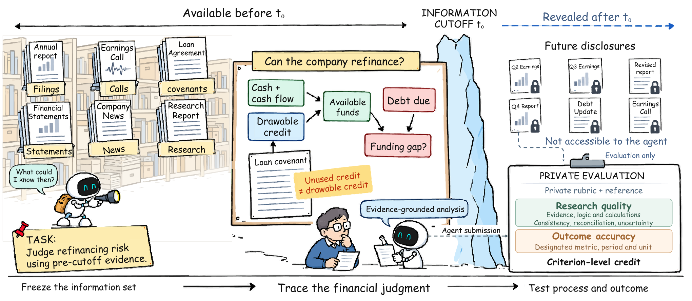
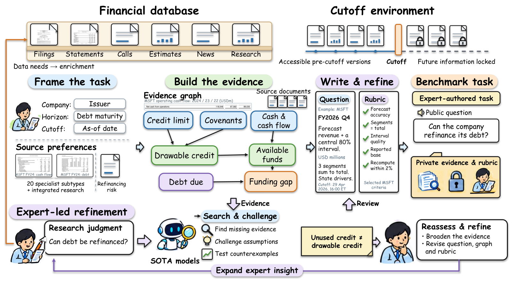
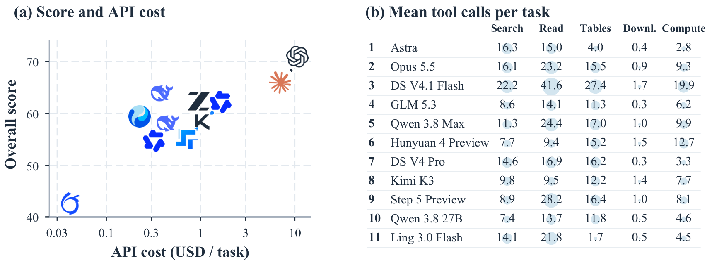

# Investor's Last Exam：把 AI 关进"时间胶囊"考炒股研究，最强模型也只拿了 52.5 分

- **论文**：[Investor's Last Exam: Can AI Agents Do Equity Investment Without Seeing the Future?](https://arxiv.org/abs/2610.38342)（arXiv 2610.38342，2026-10-28）
- **代码**：[github.com/Prophetlab/Investor-Last-Exam](https://github.com/Prophetlab/Investor-Last-Exam)（128 star，Docker 沙箱可复跑）｜**题集**：[HF HenryJ12/InvestorLastExam](https://huggingface.co/datasets/HenryJ12/InvestorLastExam)｜**项目主页**：[prophet-lab.cn](https://prophet-lab.cn/benchmarks/investor-last-exam-v1)
- **Venue/来源**：arXiv cs.AI · HuggingFace Daily Papers 当日最高票（86 赞）
- **作者机构**：Prophetlab + 上交 RethinkLab（严骏驰组）+ 上交安泰经管学院 + 中科大 + 睿远基金 + 常春藤资产——注意后两家是**真金白银的买方机构**（buy-side，用自己的钱做投资的基金，区别于卖方券商研究所），出题人是职业基金经理

## 🎯 30 秒版本

1. **这是什么**：一个让 AI Agent 当"股票研究员"的考试——把时间倒回历史某天（比如 2026-04-29），AI 只能用当天之前真实存在过的资料做研究、建预测、下投资判断，然后用后来实际发生的结果打分。
2. **为什么重要**：它戳破了一个幻觉——AI 写研究报告已经很漂亮了，但**预测未来的能力完全没跟上**。最强的 GPT-6 Astra 总分 68.1，"找证据"拿 78.9，一到"做预测"只剩 52.5，勉强及格。
3. **对你有什么用**：如果你在用 AI 辅助投资（或者好奇 AI 能不能替你炒股），这篇给出了目前最严格的答案：能帮你查资料、算账、写报告，但"预测下个季度业绩"这件事，AI 还不如便宜 22 倍的小模型靠谱。

## 📚 读前须知

**1. 什么是"前视偏差"（look-ahead bias）？**
想象让你预测 2026 年第二季度特斯拉卖了多少车，但你的搜索引擎没有装时间机器——它会顺手把 7 月份发布的真实交付数据也翻出来给你。你"预测"得再准也是作弊。以前评测 AI 炒股的论文大多栽在这：嘴上说"只用 X 日之前的信息"，实际检索到的网页里混着未来数据。这篇论文的核心工程贡献就是把时间机器做实。

**2. 什么是 Agent 评测的"rubric"（评分细则）？**
不是简单的对错，而是像高考作文评分表：证据充分给几分、计算正确给几分、结论和分析一致给几分。ILE 的 86 道题拆成了 1472 个计分点，每个计分点都挂着"必须引用哪个文件、算哪个数"。

**3. 什么是"买方研究"？**
卖方分析师写报告是为了让客户交易（赚佣金），买方研究员做研究是为了自己决定买不买（赚差价）。买方研究的标准更高：不光要说"这公司好"，还要给出可验证的数字预测和"什么情况下我会认错"的条件。ILE 考的就是买方标准。

## 🎯 解决什么问题

现有金融 AI 评测的通病，论文用了一个抓包现场：特斯拉任务 O74 要求 AI 在 2026-03-24 之前的信息范围内预测 Q2 交付量。GPT-6 Astra 的搜索查询里明明写了 `before:2026-03-24`，结果搜索引擎返回了一篇 **7 月 2 日**的报道，里面直接写着 Q2 实际交付量。为什么？因为网页的"发布日期"元数据可以是旧的，内容却是后来更新的——日期过滤只是过滤了查询词，管不住返回的信息本身。

统计下来，Astra 走公网做研究的轨迹里 **57% 混入了截止时间之后的信息**，包括微软当季的真实营收（约 900 亿美元，正是题目要它预测的东西）。也就是说，之前一堆"AI 预测股价准确率 XX%"的论文，分数里有多少是真本事、多少是偷看答案，根本说不清。

ILE 的方案：不靠提示词自觉，靠**环境强制**。建了一个 343 万个文档版本、1.52TB 的"版本化"金融数据库（相当于给每份财报、新闻、电话会记录都拍了带时间戳的历史快照，旧版本永不覆盖），AI 的搜索、阅读、下载、SQL 查询每一个动作都被卡在同一个时间闸门后面。

*图：论文 Figure 2。左边是 Agent 视角——只能看到 t₀ 之前的资料快照（同一份贷款协议的 2023 版、2024 版……都独立存档）；右边是评分视角——参考答案、评分细则和 t₀ 之后才披露的真实结果只对考官可见。这个"信息隔离墙"是整个基准的地基。*

## 🔬 核心方法

ILE 由三块拼成，一块块拆：

**第一块：时间冻结的数据环境。**
输入是九个类别的金融数据（财报、结构化报表、业绩电话会、投资者材料、公司事件、分析师预期、研报、机构持仓、新闻），覆盖美股、A 股、港股。关键设计：每个文档版本在**采集当时**就记录可用时间（含时区、精度），时间戳存疑的先让多个大模型交叉推断，实在确认不了就整条剔除——宁可少数据，不要脏时间。代码层面（`src/prophet_bench_env/adapters/table_tools.py`）能看到每次 SQL 查询都带 `requested_as_of=cutoff` 参数，返回结果还要校验 `effective_as_of` 是否严格等于任务截止时间，不等就报 `scope_mismatch` 直接拒绝；查询结果冻结成不可变快照，后续数据修订也污染不了已取的结果。AI 的计算环境是断网的 Docker 沙箱，只有 pandas/NumPy/DuckDB 这些库——想上网偷看？没门。

**第二块：按"分析师交付物"出题的 86 道题。**
不是零散的知识点问答，而是七大类真实工作：发现机会（10 题）、研究取证（13）、**预测建模（13）**、评估决策（14）、跟踪更新（17）、综合研究报告（11）、市场交易（8）。难度不在算术，在金融依赖关系——比如微软 O58 题：预测三大部门收入时，"Microsoft Cloud"横跨三个部门，直接把它当第四个部门加总就是重复计数的陷阱。

**第三块：专家+AI 共建的"金融依赖图"评分。**
每道题被拆成一张图：源文档事实 → 金融假设 → 中间计算 → 投资判断，每条边是明确的金融规则（会计恒等式、收入桥、同业传导）。评分时数值类计分点用确定性程序判，语义类用 GPT-6 Astra 当裁判（附录里换了开源裁判 GPT-OSS-120B 做敏感性测试，排名会变但头部不动）。

*怎么读这张图：从左到右就是 ILE 的流水线。最特别的是最后的"诊断"环节——它不只给分数，还能告诉你 AI 是在哪一环断掉的（找不到证据？假设拍脑袋？计算对但结论不跟着计算走？），这是普通排行榜做不到的。*

*图：论文 Figure 3。专家定题 → AI 辅助搜证据、找反例 → 多个模型交叉审草稿 → 专家终裁。中间的"再融资依赖图"是实例：现金+经营现金流+未用授信看起来够还债，但专家加了一条关键依赖——贷款契约（covenant）是否允许提款，这一条直接改变答案。*

## 📊 关键数字

11 个系统同场竞技，每题 7200 秒、最多 3 次提交。核心结果（满分 100）：

| 系统 | 总分 | 研究取证 | **预测建模** | 评估决策 | 每题 API 成本 | 人话解读 |
|---|---|---|---|---|---|---|
| GPT-6 Astra | **68.1** | 78.9 | **52.5** | 77.6 | $9.11 | 全能冠军，但预测刚及格 |
| Claude Opus 5.5 | 66.9 | 75.7 | 52.6 | 77.2 | $7.96 | 和 Astra 一个梯队 |
| DeepSeek V4.1 Flash | 63.0 | 70.8 | 45.8 | 77.4 | **$0.36** | 1/22 的价格拿 95% 的分数 |
| Qwen 3.8 Max | 62.1 | 74.4 | 49.9 | 66.0 | $1.63 | 找证据第一（81.1），判断偏弱 |
| Kimi K3 | 58.2 | 67.0 | 41.0 | 66.8 | $1.06 | 研究分低但模拟收益反超 Opus |

**参照系时间**：
- Astra 研究取证 78.9 vs 预测建模 52.5 = 相当于一个实习生查资料写报告能打 79 分，让他预测下季度销量只有 52 分——**会做功课 ≠ 会算命**，这 26 分的落差是全文最重要的数字。
- DeepSeek Flash 每题 $0.36 拿 63.0 分，Opus 每题 $7.96 拿 66.9 分：多花 22 倍的钱只多 3.9 分，好比打车比地铁贵 22 倍但只快 5 分钟。
- **模拟炒股收益**（用预测值 vs 分析师预期生成多空信号，2026 年 3–8 月回测 20 个机会）：混元 4 Preview +8.50% 第一，Flash +7.98% 第二，Astra 只有 +7.18%，**Qwen 3.8 Max 垫底 +1.67%**——而无脑做多的对照组是 +1.18%。研究总分第一梯队的模型，炒股收益排名完全洗牌。
- **提交纪律**：严格模式（必须通过格式校验才算分）下 Step 5 Preview 从 55.1 暴跌到 34.5（-20.7 分），混元有 17 条轨迹直接放弃提交——分析做得再好，交不上卷等于零分。
- 用例深度：AEP N27 题（判断现金流改善是可持续的还是暂时的），11 个系统全部找齐 8 项输入、全部对平现金流恒等式，但只有 5 个算出融资缺口、3 个分清燃料成本的净额与毛额、5 个得出正确结论——**会算不等于懂**。

*图：论文 Figure 5(a)。横轴每题 API 成本（美元），纵轴总分。Flash 在左下角（便宜且分不低），Astra/Opus 在右上角——但曲线明显边际递减。*

## 🛠 对工程实践的启发

1. **"时间闸门"必须做在系统层，不是提示层。** 57% 的公网轨迹泄漏未来信息这个数据值得所有做 Agent 评测/回测的人警醒：`before:` 查询参数、prompt 里写"别用未来信息"都是纸糊的。可复用的做法见仓库 `src/prophet_bench_env/`——数据访问层每次请求强制带 `as_of` 时间戳、返回时校验、结果冻结成不可变快照，三道锁。这套模式对任何"历史回放"类系统（回测、合规审查、事故复盘）都通用。
2. **Rubric 挂在依赖图上，错误才能归因。** `tasks/O58.json` 里 16 条 rubric 每条都带 `pass_condition`（可执行的判分公式）、`primary_output_path`（JSON 输出里的哪个字段）、`weight`。做 Agent 评测别只打总分——把"证据→假设→结论"拆成链，你才知道模型断在哪一环。
3. **贵模型 ≠ 好决策，按任务分层选型。** 证据检索类任务用便宜模型（Flash 的 Evidence 76.2 vs Astra 79.0，差 2.8 分省 25 倍钱），只在需要复杂金融推理的环节上强模型——和我们日报里 MICA 论文（接口研究）的结论互相印证：模型行为差异比能力差异更影响选型。

## ⚠️ 局限与争议

**论文自己承认的**：① 时间冻结只管检索，管不住**预训练记忆**——微软 2026 Q2 营收这种数字可能已经在模型的参数里了，作者说需要"反事实/冷启动"实验（篡改真实报表数字、造虚拟公司）才能剥离，这是下一步工作；② 部分任务用真实市场结果结算，但市场有外生噪声，推理正确的预测也可能数值打偏，纯看结果会低估研究质量。

**外部质疑**（HN 上暂无针对本文的专门讨论帖，以下是社区对同类金融 Agent 评测的常见质疑，结合本文情况标注）：
- **"裁判也是考生"**：语义评分用 GPT-6 Astra，而 Astra 自己也在被评——自我偏好（self-enhancement bias）是老问题。论文的应对是附录 I.3 换开源裁判重评，Flash 从第三升到第二、Opus 掉到第三，说明裁判选择确实影响排名，但头名 Astra 稳。这个诚实的披露值得点赞，但也等于承认**具体名次别太当真**。
- **模拟炒股样本太小**：20 个交易机会、11 家公司、5 个月窗口，收益排名很可能是噪声主导——论文自己也只把它当"研究分≠收益"的证据，不是"谁最能赚钱"的排名。
- **数据湖不开放**：题库和 rubric 公开在 HF，但 1.52TB 的语料是需申请的远程服务（datalake.prophet-lab.cn），复现门槛高；Prophetlab 是商业公司，基准长期中立性有待观察。

## 🧠 关键概念表

| 术语 | 白话解释 | 为什么重要 |
|---|---|---|
| 前视偏差（look-ahead bias） | 回测/评测时不小心用了"当时还不知道"的未来信息 | 金融 AI 评测最大的坑，让分数虚高 |
| 版本化数据库（versioned corpus） | 每个文档的每次修订都单独存档、带时间戳，旧版永不覆盖 | 时间冻结的物理基础，343 万版本 |
| 信息截止（cutoff, t₀） | 每道题规定"只能用这个时刻之前的信息" | ILE 由环境强制执行，不靠模型自觉 |
| 买方（buy-side） | 用自己/客户的钱做投资的机构（基金），区别于写报告赚佣金的卖方 | 出题人标准：结论必须能落到买卖决策 |
| rubric（评分细则） | 把答案拆成带权重的计分点逐条打分 | 86 题拆出 1472 个计分点 |
| 金融依赖图（dependency graph） | 证据→假设→计算→判断连成的链条，每条边是金融规则 | 让"错在哪一环"可诊断 |
| covenant（贷款契约条款） | 借款合同里的限制性条款，违反就借不到钱 | 专家加的一条依赖就能反转答案 |
| LLM-as-judge | 用大模型给另一个模型的开放式回答打分 | 便宜可扩展，但有自我偏好等偏差 |
| point-in-time（定点时刻） | 还原历史上某一瞬间"当时能看到什么"的视图 | 金融数据工程的通用难题 |
| MDD（最大回撤） | 从最高点到最低点的最大跌幅 | 收益表里衡量"坐过山车"程度 |

## 💡 所以呢

这篇对咱们的模拟盘（us-sim）是个冷静的提醒：**别指望换个更强的模型就能提高预测胜率**——ILE 的数据说预测能力和研究能力根本不是一个维度的东西，便宜模型的多空信号反而可能更好。更值得抄的是它的工程姿势：如果你想严肃回测任何"AI 用历史数据做判断"的系统，先问一句——我的时间闸门是焊死在数据访问层，还是只在 prompt 里写了句"请别偷看未来"？

（完。全文约 3300 字。数据均出自论文正文与公开仓库，2026-11-02 核对。）
