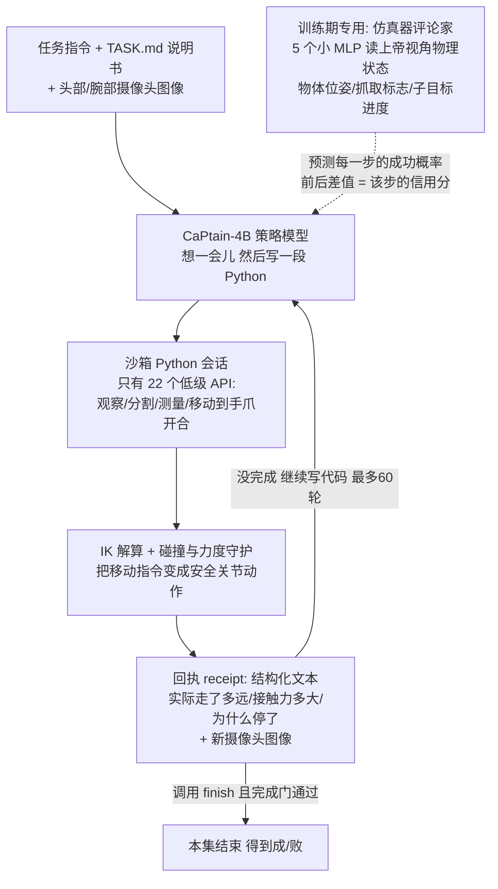
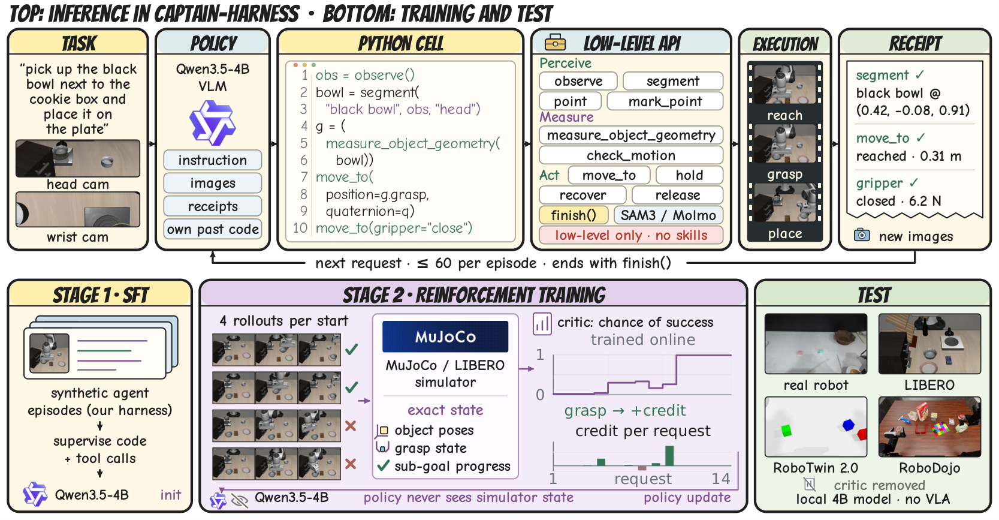
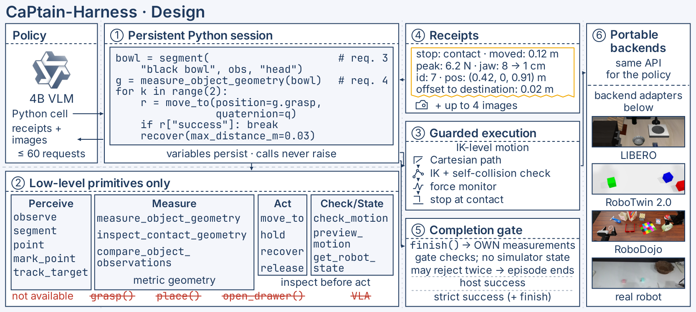

# CaPtain：把 4B 小模型练成会写代码开机器人的"机长"

- **论文**：CaPtain: A Pipeline for Post-Training Code-as-Policy Robot Agents（[arXiv 2610.40799](https://arxiv.org/abs/2610.40799)）
- **代码**：训练管线 [github.com/waltstephen/CaPtain](https://github.com/waltstephen/CaPtain) + 执行环境 [CaPtain-Harness](https://github.com/waltstephen/CaPtain-Harness) + 模型/数据全开源（Apache-2.0）
- **Venue / 来源**：arXiv 2026-10-29 · HF Daily Papers 11-02 当日高票（50 票）· 项目页 [waltstephen.github.io/captain](https://waltstephen.github.io/captain/)
- **作者机构**：港中文 MMLab（岳翔宇组）+ NovaXBot

## 🎯 30 秒版本

1. **这是什么**：一套完全开源的"后训练配方"，把一个 4B 参数的小型开源视觉语言模型（Qwen3.5-4B）从零训练成能自己写 Python 代码控制机械臂的机器人 Agent——不用闭源大模型、不用预训练好的抓取技能。
2. **为什么重要**：它证明了机器人操作可以像训练编程/网页 Agent 一样，用「SFT 学接口 → 多轮 RL 练本事」这套标准配方来练，且 4B 小模型（推理成本约为前沿模型 Agent 的 1/6~1/100）在 LIBERO-PRO 基准上打赢了多个调用 Gemini/GPT 的前沿模型系统。
3. **对你有什么用**：核心创新"仿真器评论家"（用仿真器里的上帝视角物理状态给每一步动作打分）是一个通用的 RL 信用分配方案，任何"长流程、只有最后知道成败"的 Agent 训练都能借鉴；代码、数据、权重全开，可直接上手。

## 📚 读前须知

**1. Code-as-Policy（CaP，代码即策略）**：让机器人大脑不直接输出"关节转几度"这种连续数值，而是像程序员一样写代码调 API——`robot.move_to(x,y,z)`、`robot.segment("黑碗")`。类比：传统 VLA 模型像"肌肉记忆型司机"（看到路况直接踩油门打方向），CaP 像"写脚本的司机"（先观察、再写一段程序、执行、看结果、改代码）。好处是可解释、可组合；坏处是模型得真的会写对代码。

**2. VLA（Vision-Language-Action model，视觉-语言-动作模型）**：端到端的机器人模型，输入图像+指令，直接输出动作。代表作 π0.5 在标准 LIBERO 上有 97% 成功率，但换个物体摆放位置（LIBERO-PRO 扰动版）暴跌到 12.8%——像背题库的学生，题目稍微变形就不会了。

**3. RL 信用分配（credit assignment）**：强化学习（试错学习）的老大难。机器人完成一次"抓碗放盘子"要 30 多步请求，但只有最后一刻才知道成没成功。这个"成功"该记在哪一步头上？全撒到每一步则信号太稀，好比公司年底盈利了，但不知道是哪个员工哪件事做对了。

## 🎯 解决什么问题

现有 CaP 机器人 Agent 有两条路，都不理想：

- **调用闭源前沿模型**（GPT-6、Gemini 当大脑）：不能本地部署、不能继续训练、每集成本 $0.18–22，贵且不可控。
- **把操作外包给预训练技能**：代码只决定"调用哪个技能"（如 `grasp()`），技能内部怎么伸手、从哪个角度抓，是训练技能时定死的——RL 最多学会排技能顺序，能力被技能数据的天花板锁死。
- **小开源模型直接上**：完全不行。本文实测 Qwen3.5-4B 在 CaPtain-Harness 里零样本成功率 0%——连 API 都不会用，60 次请求预算全浪费在乱调接口上。

缺的是一份完整配方：**怎么把小开源 VLM 练成一个自己决定"从哪抓、怎么接近、何时合爪"的独立 CaP Agent**。

## 🔬 核心方法：三步走

**怎么读这张图**：实线是机器人干活的主循环（写代码→执行→读回执→再写），虚线部分只在训练时存在——评论家偷看仿真器的真实物理状态，给每一步单独打分，测试时撤掉，策略只靠摄像头和回执。

**第 0 步：CaPtain-Harness 执行环境**。设计哲学是"只给低级积木，不给高级技能"：22 个 API 分五类——感知（`observe` 拿 RGB-D 图、`segment` 调 SAM 3 出掩码、`mark_point` 反投影自己点的像素）、测量（物体几何中心/朝向/到目标偏移）、运动（`move_to` 到指定末端位姿、`hold`、`recover` 有限回退）、规划检查、`finish()`。**没有 grasp()、没有 place()**——从哪个方向接近、何时合爪，全由模型自己写代码决定。每个调用不抛异常，而是返回结构化"回执"（成功标志、失败类别、实际位移、峰值接触力、爪开合前后读数），让模型能写 if/循环/重试。这套 API 在 LIBERO、RoboTwin 2.0、RoboDojo、SimplerEnv、CaP-Bench 和真机上**完全不变**，只换底层适配器——这是零样本迁移的根基。

**第 1 步：SFT 冷启动**。小模型零样本 0 分，先教格式。用 GPT-6 Astra 等前沿模型在同一个 Harness 里跑出的合成轨迹做监督微调。两个工程细节值得抄：① 原始轨迹里有 226 种各写各法的"先预览再移动"辅助函数，作者把它们全部重写统一成 4 个标准函数（`val/need/downq/go`）并逐调用点验证等价——训练数据先做"代码风格归一化"，小模型才学得动；② 以 20% 概率把历史里的像素坐标遮成 `<masked>`，逼模型看图而不是抄上一步的坐标。1.5 个 epoch、2435 步，成功率 0% → 55.4%。

**第 2 步：多轮 RL + 仿真器评论家（核心创新）**。一集 30+ 请求只有末尾一个成败信号，GRPO 类方法只能把结果均摊。CaPtain 的办法：训练本来就在仿真器里跑，仿真器有**上帝视角**（物体真实位姿、是否被抓住、子目标进度等 36 维特权特征）——策略永远看不到，但评论家可以看。评论家是 5 个小 MLP 的集成，预测"当前状态下本集最终成功的概率 V(s)"；**每步请求的信用 = V(下一步状态) − V(当前状态)**，且在同一时间索引下求差（时间流逝本身不产生信用）。效果：成功抓取那一步中位信用 +0.058，失败抓取 −0.0075，纯感知请求约 −0.0002；整条轨迹 65% 的信用质量落在运动、14% 抓取、14% 释放，感知步只占 1.3%——信用精准砸在物理决策上。评论家随策略在线共训，测试时整个删掉。终端奖励也讲究：带 `finish()` 的成功 1 分，忘调 finish 的成功只有 0.25 分，**谎报完成（状态没成功却 finish）扣 0.3 分**——防 Agent 学会"嘴硬交差"。

## 📊 关键数字

| 指标 | 基座 Qwen3.5-4B | +SFT | +RL（CaPtain-4B） | 人话解读 |
|---|---|---|---|---|
| LIBERO 留出集成功率 | 0.0% | 55.4% | **73.8%** | 100 次任务从 0 次成功到 74 次；RL 净赚 55 集、只丢 11 集 |
| LIBERO-PRO（3 套件） | 0.3% | 59.5% | **78.5%** | 扰动版基准，超过用前沿模型的 K1（77.2）、WAA（75.6）、ASPIRE（71.7）|
| 谎报完成率 | — | 7.1% | 2.1% | RL 后更少"没干完就说干完了" |
| 单集推理成本 | — | — | **$0.03–0.06** | 已发表代码 Agent 是 $0.18–0.24（SPARK/WAA）到 $8–22（OpenRUA）；相当于别人一顿饭钱它一瓶矿泉水 |
| CaP-Bench（零样本） | 5.0 | 55.0 | **75.0** | 高于 Gemini-3-Pro（73.5）、GPT-5.2（55.5）、Claude Opus 4.5（54.0）——4B 打爆闭源旗舰 |
| SimplerEnv WidowX（零样本） | — | — | 83.3% | 换个没训过的机器人形态也能用 |
| 扰动鲁棒性 | — | — | +17.6~+21.2 点 | 对比：π0.5 从标准版 97% 跌到扰动版 12.8%；CaPtain 的 RL 收益在 3 个扰动套件全部保留 |

对照组参照：在 LIBERO-PRO 上，端到端 VLA 的 RL 微调版 RIPT-VLA（68.4）没超过其基座（69.6）——说明在低级原语上做 RL 比在冻结技能上做 RL 天花板高得多（本文 +19.4 点 vs AgenticRoboRL 的 +5.9 点，起点不同仅供参考）。训练总成本：RL 约 1290 H100 小时 + SFT 120 H100 小时。

*图：CaPtain 全景（论文 Figure 1）。上半：推理时每个请求写一个 Python cell，收回执和新图，最多 60 轮；下半：训练时评论家把特权物理状态换算成每请求信用，测试时评论家被移除。*

*图：Harness 六件套（论文 Figure 6）——① 持久沙箱 Python 会话 ② 只暴露低级原语 ③ IK+接触力守护执行 ④ 每次调用返回回执 ⑤ finish() 前有"完成门"用 Agent 自己的测量数据复核（最多拒绝两次）⑥ 换环境只换 API 下面的后端。*

## 🛠 对工程实践的启发

1. **"上帝视角评论家"可直接搬到你的长流程 Agent RL**。只要训练环境能拿到策略看不到的真实状态（数据库最终状态、测试通过与否、订单是否成交），就能训一个小 MLP 预测成功概率，用前后差值做每步信用。代码对照：`rl/critic_features.py` 定义了 36 维特权特征和请求类型分类器（`classify_request` 按调用的 API 名字判定这一步是抓取/移动/感知），`rl/physics_critic.py` 开头 20 行注释就是完整的 ΔV-GAE 数学——不到 600 行，实现相当克制。论文还有个反直觉发现：**别把策略自己的计数器或 LM 隐状态喂给评论家**，否则它学会用"过了多久"当捷径，35% 的信用会错误漏到感知步上。
2. **回执（receipt）设计比 API 功能更重要**。机器人调用永不抛异常，永远返回 {success, failure_category, message, value} 结构——这对所有工具型 Agent 都适用：工具失败时给模型"为什么失败+当前物理量"，而不是一个堆栈。仓库里 `src/captain_harness/server/robot.py` 的 `_note()` 会把每个调用压缩成 ≤300 字符的回执文本。
3. **奖励表里给"谎报完成"单独设负分**（-0.3，比预算耗尽的 -0.1 还重），配合"完成门"用模型自己的测量数据复核 finish()。任何生产 Agent 都该防这一手：模型学会说"我做完了"比学会做对更省事。

## ⚠️ 局限与争议

**论文自己承认的**：① RL 只在 LIBERO 的 40 个单臂任务上训，跨基准仍低于域内精度，双臂协同（RoboTwin 2.0 只有 22.6%）和陌生 6 自由度臂（RoboDojo 惨到 0.8%）基本没戏；② 评论家依赖精确仿真状态——离线实验显示物体位姿加 2cm 噪声信用相关性从满值掉到 0.49，5cm 掉到 0.36，用策略自己的感知只有 0.21，意味着想在真机上直接跑这套 RL 得先解决状态估计；③ 22 个原语表达不了持续力控（比如 CaP-Bench 的擦桌子任务要一直下压）。另有一个诚实披露的 RL 后期漂移：策略会"过度验证"——任务已解决还在反复测量不肯 finish，作者因此选了第 300 轮而非 400 轮的 checkpoint。

**社区视角**：HN 上暂无讨论帖（截至本文写作），X 上作者推文热度尚可。可预期的质疑点：SFT 轨迹由 GPT-6 Astra 蒸馏，"开源管线"的冷启动仍依赖闭源前沿模型；78.5% 的对比表中各家评测协议不完全一致（本文在留出初始状态 11–16 上跑 240 集，基线多为 500 集/套件），论文在附录 K 有逐条协议说明，算是处理得体面。

## 🧠 关键概念表

| 术语 | 白话解释 | 为什么重要 |
|---|---|---|
| Code-as-Policy (CaP) | 机器人大脑靠写代码调 API 干活，不直接输出关节角度 | 可解释、可组合，能把 LLM Agent 的训练配方搬进机器人 |
| VLA | 端到端"看图+听指令→出动作"的机器人模型 | CaP 的对照路线；强在域内、弱在扰动 |
| SFT | 监督微调：拿标准答案（示范轨迹）教模型模仿 | 冷启动，教会格式和接口用法（0%→55.4%）|
| 多轮 RL | 试错学习，一集内模型与环境来回交互几十轮 | 学会"看回执→改代码"的闭环纠错 |
| GRPO | 一种无需价值网络的 RL 算法，组内比较分好坏 | 只有末尾奖励时信号太稀，本文要解决的痛点 |
| 特权状态 | 仿真器里的上帝视角数据（物体真实位姿等），策略看不到 | 训练时可以"作弊"，部署时不需要 |
| 仿真器评论家 | 5 个小 MLP，读特权状态预测最终成功概率 | 把 1 个末尾信号拆成每步信用分 |
| ΔV 信用 | 某步的分数 = 该步前后成功概率之差 | 抓对了加分、抓空了扣分、光看不做不加分 |
| GAE | 广义优势估计：把多步 ΔV 用 λ 加权求和，平衡偏差与方差 | 本文 λ=0.9，把梯度噪声从 9k 集降到 6.7k 集 |
| 回执 receipt | 每次机器人调用返回的结构化"发生了什么"文本 | 替代异常，让模型能写重试逻辑 |
| 完成门 | finish() 前用 Agent 自己的测量数据复核，可拒绝两次 | 防谎报完成 |
| LIBERO / LIBERO-PRO / Plus / MAX | 机器人操作基准家族：标准版/位置与任务扰动版/七维扰动版/长程动态版 | 本文全部主要结果的考场 |
| IK（逆运动学） | 给定手要去的位置，反解各关节角度 | Harness 把它包进 move_to，模型只管"去哪"不管"怎么转关节" |
| McNemar 检验 | 配对二分类结果的显著性检验（同一批任务 SFT vs RL 谁赢） | 本文所有主套件 p<10⁻⁵，提升不是抽样运气 |

## 💡 所以呢

- 如果你在做**工具型/长流程 Agent 的 RL**（不限于机器人），"特权状态评论家 + ΔV 每步信用"是当下最干净的稠密奖励方案之一，代码量小到可以周末读完。
- 如果你想**本地跑一个机器人代码 Agent**：CaPtain-4B 权重（HF: YijiaFan/CaPtain-4B）+ Harness 即可复现，Q4 量化后 8GB 显存的卡就能装下；但没有真机也可以先在 LIBERO 仿真里玩。
- 值得追踪的后续：作者点名的方向是把评论家扩展到双臂协同和终止决策（过度验证问题），以及真机上的状态估计——这两个哪个先解决，CaP 路线就真正威胁到 VLA 了。
