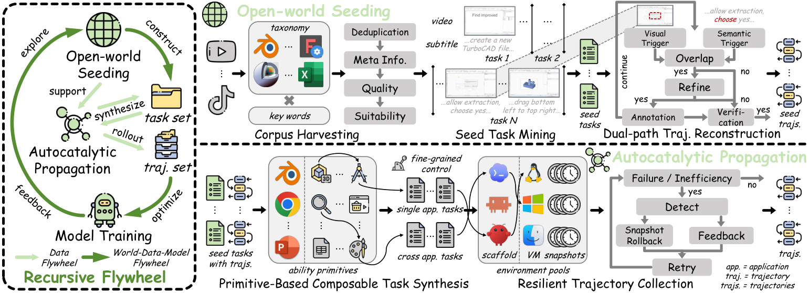
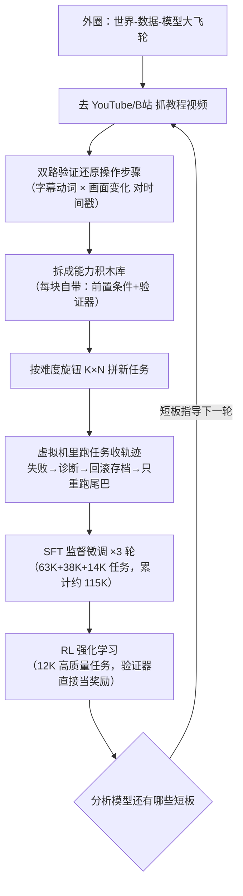

# CUA-Master：让"电脑操作 AI"自己滚雪球变强——27B 小模型硬刚 GPT-5.6 和 Claude Opus 5

> **每日论文精读 · 2026-11-04**
> 📄 论文：[CUA-Master: Scaling Computer-use Agents through Open-World Recursive Improvements](https://arxiv.org/abs/2611.03126)（arXiv:2611.03126）
> 💻 代码：[github.com/xlyu0106/CUA-Master](https://github.com/xlyu0106/CUA-Master) ｜ 🤗 模型：[CUAMaster-27B](https://huggingface.co/yxl66666/CUAMaster-27B)
> 🏛 Venue：arXiv 技术报告（HF Daily Papers 当日第 3 名，75 票）｜ 机构：港中文 MMLab + 清华 + 港科大（广州）+ 京东探索研究院

## 🎯 30 秒版本

1. **这是什么**：一套训练"电脑操作智能体"（CUA，Computer-Use Agent，即像人一样看屏幕、动鼠标键盘干活的 AI）的数据飞轮系统——从 YouTube/B站/TikTok 教程视频里挖真实操作当"种子"，拆成可复用积木再组合成新任务，模型练完变强后又反过来指导下一轮挖什么数据，如此循环。
2. **为什么重要**：只用 27B 参数（相当于 GPT 级大模型的零头），就在最难的电脑操作基准上逼近 GPT-5.6-Sol 和 Claude-Opus-5，证明**数据工程可以部分替代参数规模**。
3. **对你有什么用**：如果你在做任何 Agent（不限于电脑操作），文中的"快照回滚重试"和"能力积木化组合"两招可以直接抄——它们解决的是所有 Agent 训练都头疼的"轨迹数据又贵又脏"问题。

## 📚 读前须知

**① 什么是 CUA（电脑操作智能体）？**
想象你雇了个远程实习生，你只能通过屏幕共享看他操作：他看截图（观察），然后说"我要点这里/输入这个"（动作），你帮他执行，再把新截图发给他。CUA 就是这个实习生的 AI 版——输入是屏幕截图+任务指令，输出是鼠标点击坐标、键盘输入、或 shell 命令。

**② 什么是"轨迹"（trajectory）？**
就是实习生从接到任务到干完活的完整操作录像带：第 1 步看了什么屏幕、点了哪里，第 2 步……每一步都记下来。训练 CUA 需要几万条这样的"标准操作录像"，但人工标注一条要几十分钟，贵到离谱——这就是全文要解决的核心痛点。

**③ 什么是"飞轮"（flywheel）？**
亚马逊的经典比喻：一开始推动很费劲，但转起来后每一圈都给下一圈加速。这里指"数据造得越多→模型越强→越强越会造数据→数据更多"的正循环。

## 🎯 解决什么问题

现有 CUA 训练卡在数据上，具体三个痛点：

- **多样性差**：让大模型自己编合成任务，编出来的都是"重命名三个文件""表格求个和"这种玩具题，缺少真实软件的摩擦感——嵌套菜单、弹窗、卡顿的网页。练玩具题练不出真本事。
- **不可控**：想要"跨 3 个应用、20 步以上的长任务"，直接改写指令根本控制不了复杂度和依赖关系。
- **不可靠**：真实虚拟机里跑任务收集轨迹，一步点错整条报废。比如智能体前 13 步都对，第 14 步误点了一个下拉菜单，环境状态被污染，后面全乱——传统做法是整台虚拟机扔掉重来，13 步有效计算全部作废。
- **更深层的问题**：已有的"自我改进"方案（如 Re-ReST、Agent-R）是**闭门造车**——模型用自己生成的数据练自己，知识边界不扩张，几轮之后收益递减，还会强化自己的固有偏见。

## 🔬 核心方法：嵌套双循环飞轮

CUA-Master 的核心是一个**大圈套小圈**的结构。我逐步拆解：

**内圈（数据飞轮）= 播种 + 繁殖**

**Step 1｜语料收割**：按一张"8 大类 / 36 子域 / 650+ 应用"的分类表（从办公套件到开发工具），拼搜索词去 YouTube、TikTok、B站抓教程视频。用 Whisper（语音转文字模型）把音频转成带时间戳的字幕，再用一个更强的"标注模型"给每条视频打 0-5 分的"CUA 适配度"（画面清晰吗？操作可复现吗？），过滤掉广告、闲聊、纯 PPT 讲解。

**Step 2｜种子任务挖掘**：一条 10 分钟的教程视频往往包含好几个独立操作，还夹着开场白和恰饭广告。这一步把视频切成若干"任务片段"（多模态时序片段发现），每段配一句自动总结的目标，比如"在 Excel 中用数据透视表汇总销售数据"。

**Step 3｜双路轨迹重建**（本文关键创新之一）：怎么把视频还原成"第 1 步点了哪里"的操作序列？单靠字幕不行（解说员可能说"然后我们看这里"但不说具体坐标），单靠画面也不行（画面变化未必对应操作）。所以**两路信号交叉验证**：
- 语义路：从字幕里找"点击/输入/滚动"这类动词触发的时间点；
- 视觉路：用 FFmpeg 算相邻帧的画面变化分数，超过阈值说明界面真的变了（菜单弹出、页面跳转）。
两路时间点对得上（窗口内重叠）才算一次真实操作，再由标注模型看操作前后的截图，补全具体坐标和输入内容。类比：警察破案，口供（字幕）和监控录像（画面）对上了才算实锤。

**Step 4｜积木化（primitivization）**：把每条种子轨迹拆成"能力积木"（primitive）——最小可复用的操作单元，每块积木是个五元组：属于哪个应用、什么能力、前置条件、环境需求、验证方法。例如"在 GIMP 里给图片加文字水印"就是一块积木。语义重复的积木去重合并，存入按应用索引的积木库。（代码里这步的提示词全文就在 `prompts/primitive_extraction.txt`，工程实现极透明。）

**Step 5｜组合出新任务**：想要多难的任务，就取多少块积木（K）、跨多少个应用（N）来拼。K=5、N=1 是简单题，K=40、N=3 就接近 Agents' Last Exam 的平均难度——**复杂度第一次变成了可精确调节的旋钮**。每块积木自带验证器，拼起来就是"可自动判分"的新任务。

**Step 6｜快照回滚重试**（另一关键创新）：收集轨迹时虚拟机在稳定边界处不断打快照（存档）。任务失败后，一个"侦探模型"对比验证器输出、轨迹、环境状态，找出**最早出错的那一步**，生成诊断反馈（只描述"哪里错了"，故意不泄露"正确答案该怎么点"，避免训练分布失真）。然后环境回滚到出错前最近的存档，保留前面成功的部分，只重跑出错的尾巴。像打游戏存档：Boss 战死了从最近存档点复活，而不是从第一关重打。

*图：论文 Figure 2 数据管线。左→右读：真实视频（开放世界）先变成种子任务与轨迹，再拆成积木组合出可控难度的新任务，最后在大规模虚拟机集群里带快照回滚地收集可验证轨迹。*

*怎么读这张图：内圈是 B→F 的数据生产线（视频进、干净轨迹出）；外圈是整个 B→H→I→B 的大循环——练完的模型做"体检"，发现的弱点决定下一轮去挖什么视频、造什么任务。这就是"递归改进"：每一圈的产出是下一圈的输入。*

**外圈（世界-数据-模型飞轮）**：每轮 SFT 都从**同一个基座**（Qwen-3.5-27B）重新训（避免多轮连训的优化漂移），数据逐轮累加。三轮 SFT 收益饱和后，最后一轮换 RL（强化学习，用任务验证器的通过/失败直接当奖励信号，无需人工打分），专攻长程探索难题。

## 📊 关键数字

四个基准：OSWorld Verified / OSWorld 2.0（纯图形界面操作真机考卷）、WeaveBench / Agents' Last Exam（ALE，混合"图形界面+命令行"的长程难题）。所有对手都在同一套环境、同一动作接口下重测。

| 模型 | OSWorld Verified | OSWorld 2.0 | WeaveBench | ALE | 人话解读 |
|---|---|---|---|---|---|
| **CUA-Master-27B（本文）** | **80.2** | **36.9** | **43.9** | **25.0** | 100 道桌面操作题做对 80 道 |
| UI-Mate-27B（同为 27B 的专用对手） | 77.6 | 24.0 | 18.3 | 13.2 | 同尺寸下 WeaveBench 领先 25.6 分——差距≈从"及格线不到"到"接近一半" |
| Qwen-3.5-27B（它的基座，未经 CUA 训练） | 54.6 | 0.8 | 13.5 | 1.3 | 原始基座在 OSWorld 2.0 上 100 题只对不到 1 题，飞轮把它拉到 37 题 |
| GPT-5.6-Sol（闭源旗舰） | 83.6 | 59.0 | 50.6 | 26.3 | 27B 开源模型追到旗舰的 ~85-95% 水平 |
| Claude-Opus-5（闭源最强） | 86.3 | 64.2 | 55.7 | 28.3 | ALE 上本文只落后它和 GPT-5.6-Sol，超过其余所有对手 |
| Qwen-CUA-397B-A17B（14.7 倍参数的专用模型） | 84.0 | 43.6 | 35.1 | 21.1 | 27B 在混合基准上反超 397B——数据工程打赢了参数规模 |

**效率也是成绩**：WeaveBench 上 43.9 分只用 34 分钟、1.7M token；GPT-5.6-Luna 拿 44.0 分要 47 分钟、3.7M token——**同样的分，时间省 28%，token 省一半多**（token 直接对应 API 账单）。混合动作空间（该点鼠标点鼠标、该敲命令敲命令）是效率来源：WeaveBench 上纯 GUI 模式只有 6.6 分，纯命令行 11.5 分，混合 43.9 分——单独用哪条腿都走不动路。

**回滚重试的价值**：最难配置（K=50 块积木 × 8 个应用）下，传统"失败就从头重跑"成功率 **0.0%**，本文方法 **18.7%**——从"完全造不出这种数据"到"每 5 次能成 1 次"。中等难度（K=40/N=3）从 14.6% → 49.8%。

## 🛠 对工程实践的启发

1. **存档点思维适合一切长程 Agent**：`cuamaster/collection/` 里的快照回滚（episode.py 中 snapshot 状态管理 + judge.py 失败诊断）思路可直接搬到你的 Agent 系统——失败时定位"最早偏离步骤"、只重跑尾巴、给重试注入诊断提示但不泄露答案。这比"整单重来"省钱，比"让模型自己硬恢复"干净（避免学到围绕坏状态的胡言乱语）。
2. **把能力做成带验证器的积木**：`prompts/primitive_extraction.txt` 是现成模板——每个操作单元强制携带前置条件、环境需求、验证方法。你的工具库/技能库如果按这个五元组规范化，就能自动组合出新工作流并自动判分，难度还可用 K×N 精确控制。
3. **代码开源诚意足**：整个 seeding（收割→转录→打分→重建）、propagation（积木化→任务合成）、collection（回滚收集）流水线都有 CLI，沙箱后端做成 provider 接口可插自己的 VM 编排；115K SFT 数据的转换脚本（`scripts/prepare_*_sft.py`）也在。想做同类系统的团队等于拿到了全套蓝图。

## ⚠️ 局限与争议

- **训练成本≠小**：模型只有 27B，但训练用了 16 节点 × 8 张 H200（128 张顶级 GPU），数据管线依赖更强的闭源标注模型（论文消融显示：标注模型越强收益越大，用模型自己标注自己收益有限）——"小模型"是 inference 侧的，训练侧一点都不平民。论文自己也承认基础设施开销大。
- **成绩未经第三方复现**：所有基准都是作者自己搭环境重测的，论文未说明各基线用的是官方 API 还是本地推理、提示词工程是否对齐——这几分差异在 CUA 评测里足以改变排名（emergent.sh 的评论指出此点）。
- **HN 社区的老质疑同样适用**：混合动作空间的智能体在基准上常"绕过 UI 走捷径"（HN 讨论 OSWorld 时提到有模型用 JS 注入 hack 任务、500 步乱试）。允许 shell.exec 意味着高分未必等于"会用人类界面"，想测纯 UI 能力得看 GUI-only 列。
- **递归≠自主进化**：外圈每一轮仍需人工体检模型、人工决定挖什么数据，是"结构化的训练方法"，不是模型脱离人类自我改写。

## 🧠 关键概念表

| 术语 | 白话解释 | 为什么重要 |
|---|---|---|
| CUA（Computer-Use Agent） | 看屏幕截图、输出鼠标键盘操作的 AI | 本文主角范式，自动化真实办公流程 |
| 轨迹（trajectory） | 从接任务到完成的逐步操作录像带 | CUA 的训练粮食，又贵又难造 |
| GUI / CLI | 图形界面（点鼠标）/ 命令行（敲命令） | 混合使用是效率与成功率双升的关键 |
| SFT（监督微调） | 拿"标准答案录像"教模型模仿 | 三轮 SFT 打基础 |
| RL（强化学习） | 模型自己试，验证器判分给奖励 | 突破 SFT 收益天花板，专攻难题 |
| 飞轮（flywheel） | 数据→模型→更好数据的正循环 | 本文的顶层架构隐喻 |
| 能力积木（primitive） | 最小可复用操作单元，自带前置条件和验证器 | 让任务复杂度变成可调旋钮 |
| 快照回滚（snapshot-rollback） | 虚拟机存档，失败回到最近存档只重跑尾巴 | 把轨迹收集成功率从 0% 拉到 18.7% |
| 双路重建（dual-path） | 字幕动词时间点 × 画面突变时间点交叉验证 | 从教程视频高保真还原操作序列 |
| OSWorld / WeaveBench / ALE | 在真虚拟机里考 AI 操作电脑的三套考卷 | CUA 领域公认硬基准 |
| 验证器（verifier） | 自动检查任务是否真完成的脚本 | 免人工判分，也是 RL 的奖励来源 |
| t-SNE | 把高维数据压到平面看分布的可视化法 | 证明合成任务覆盖面超过现有数据集 |

## 💡 所以呢

这篇的真正信号不是"又一个 80 分"，而是**Agent 竞争的重心正从模型规模转向数据工厂**：谁能低成本、可控、可验证地批量生产真实世界任务轨迹，谁就能用 27B 打出 400B 的效果。对工程团队，快照回滚重试和积木化验证器这两招门槛不高、今天就能抄；对吃瓜群众，值得盯的后续是官方 115K 数据集会不会放出、以及第三方能否复现 80.2。

---
*来源：HF Daily Papers（2026-11-03 当日第 3）；代码仓库已 clone 对照阅读（/tmp 临时目录，已清理）。*
