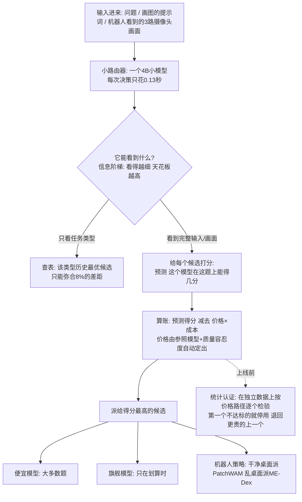
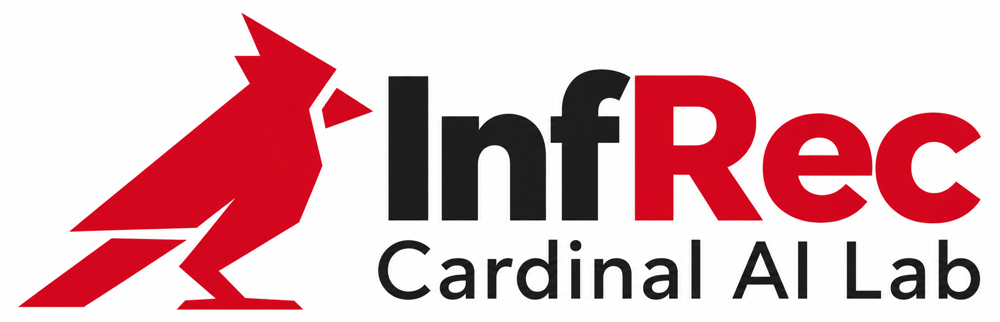

# Route Anything：给 AI 系统装一个"分诊台"——路由能省多少钱、能涨多少分，这篇论文算清楚了

- **论文**：[Route Anything: A Study of Model and Policy Routing for General-Purpose AI Systems](https://arxiv.org/abs/2611.05275)（arXiv:2611.05275，2026-11-03 提交）
- **代码**：[github.com/InfRec-Cardinal/route-anything](https://github.com/InfRec-Cardinal/route-anything)（MIT，含论文-代码对照表 docs/paper-map.md）· [项目页](https://mikeeeeeeeeeeeeee.github.io/RouteAnything/)
- **Venue/来源**：arXiv 预印本 · HuggingFace Daily Papers 11-04 当日第 1（94 票）
- **作者机构**：Pengfei Zhou 等 7 人，新加坡国立大学 HPC-AI Lab（尤洋组）+ InfRec/Cardinal AI Lab + UC Berkeley + 港科大

---

## 🎯 30 秒版本

1. **这是什么**：一篇系统研究"模型路由"（Model Routing，来一个任务，先判断派给哪个模型/工具/机器人策略）的论文——在 25 个基准、452 种候选配置上跑了 37.4 万次打分实验，横跨文本、图像、视频、语音、代码 Agent 和机器人，附一套"质量-成本"路由理论。
2. **为什么重要**：第一次量化回答三个问题——路由天花板多高（比最强单一模型平均高 5.4 分）、可学的路由器吃到多少（+0.3 分，机器人 +1.1 分还省 24% 时间）、最稳的收益在哪（省钱：同质量下效率平均 8.82 倍，代码任务最高 25.5 倍）。
3. **对你有什么用**：如果你的应用同时接了贵模型和便宜模型，这三条工程规则可以直接抄：训路由器学"每个模型的得分"而非"谁赢了"、比模型必须在同一批输入上比、便宜路线上线前用独立数据做统计认证。

## 📚 读前须知

**① 什么是"路由"？** 想象医院分诊台：护士看一眼症状，决定挂普通号还是专家号。模型路由就是 AI 系统的分诊台：路由器（一个小模型或规则）先判断"这题简单派便宜模型，难派旗舰模型"。旗舰模型像专家号：贵，不是每道题都值。

**② 什么是"oracle"（先知）？** 一个**作弊的上帝视角路由器**：事先知道每个模型在每道题上的真实得分，永远挑最高的。现实中不存在，但给出"路由最多能赚多少"的天花板。与之相对的"最强固定模型"（不管什么题都用全场最强的那个）是大多数公司现在的默认做法。

**③ 什么是"效率"？** 本文定义 η = 平均质量 ÷ 平均成本（每美元买多少分）。"效率提升 25.5 倍"= 同样质量，账单变成 1/25.5——100 块的 API 账单变 4 块。

---

## 🎯 解决什么问题

现在的 AI 系统越来越像"专科医院"：问答有 Claude/GPT，画图有 FLUX/Seedream，视频有 MiniMax/Seedance，机器人有一堆 VLA 策略（看摄像头画面直接输出机械臂动作的模型）。每个领域都有一批候选，**没有一个在所有输入上都最好**。

痛点有多具体？看实例：

- **视频生成**：VBench-2.0 上最强固定生成器 62.43 分，逐题挑最优能到 81.36——**差 18.93 分**。三个视频模型各有擅长，固定用一个等于白扔近 19 分。
- **机器人**：RoboTwin 2.0 上最强的 ME-Dex 成功率 70.45%，oracle 88.85%——**差 18.4 个点**。且谁最好取决于场景：干净桌面 PatchWAM 强，随机化桌面 ME-Dex 强。
- **成本失衡更夸张**：代码基准 CodeRouterBench 上，旗舰模型 Opus 4.6 每题花 11.655 毫美元，而一个"零质量损失"路由方案可以**一次都不调用 Opus**，全派便宜模型，质量只掉 0.44 分（满分 100），效率是 Opus 的 25.5 倍。

但此前路由研究几乎只盯语言模型（FrugalGPT、RouteLLM 一脉），**跨模态能不能路由、能学到多少、便宜路线何时算"够好"，没人系统回答过**。本文用统一理论 + 37.4 万条记录的全模态轨迹矩阵量化了这三个问题。

## 🔬 核心方法

论文分三块：理论、数据矩阵、路由器实验：

**第 0 步：统一建模。** 模型、生成器、机器人策略、甚至"先试便宜模型、失败再升级"的执行计划，统称**候选（candidate）**。每个候选产出价值 V（得分归一化到 0-1）、消耗资源 D（美元或秒）。核心规则一句话：**在价格 λ 下，派给"期望价值 − λ×期望成本"最大的候选**。

**第 1 步：价格从哪来？（Theorem 2）** 不用手工拍 λ。论文证明：给定**参照策略**（如"永远调 Opus"）和**质量容忍度** ε（如"最多掉 0.5 分"），最优价格就被数学唯一确定。人话：**"参照物 + 容忍度"自动替你算出'质量该按多少钱一分定价'**。

**第 2 步：信息阶梯（Proposition 3）。** 路由器上限取决于看到什么："哪个基准" ≤ "任务类型" ≤ 完整输入 ≤ oracle；最顶格到 oracle 之间是**纯随机噪声**，谁也吃不到。这解释了实验：按类型查表（哪怕上帝视角事后挑最优）只弥合 8% 差距——**收益藏在类型内部的逐题差异里，必须看输入本身**。

**第 3 步：学什么目标？（Proposition 4）** 两种标签：(a) 每个候选的**得分**（outcome）；(b) 这题**谁赢了**（winner label）。论文证明 (b) 可能损失近一半价值：模型 A 每题稳定 0.9 分，模型 B 六成概率满分四成 0 分——B 期望只有 0.6 却可能"赢"更多次。学"谁赢"会让路由器爱上**波动大或速度快（平局判给快的）的模型**。机器人血证：winner label 成功率 42.8% vs outcome 71.6%——94% 标签由延迟平局决定，分类器学成"挑最快的"，而快的常失败。

**第 4 步：便宜路线怎么不翻车？（Proposition 5，认证）** 拟合数据上挑的"零损失"路线，换测试集可能破底（实测：200 次随机对半分里**只有 12.5%** 守住底线！）。解法：把不同 λ 下的最优路由器排成**价格路径**（越贵质量越高），在独立数据上**按序检验**——从最便宜开始，第一个不合格就停、退回上一个；全不合格就用参照策略。这个"固定序列检验"无需多重比较校正，最终 **200 次划分全部守住**，中位效率 19.4 倍。

**第 5 步：数据矩阵 + 训路由器。** 25 个基准分七组，每池 3-7 候选，**所有候选跑同一批输入**，共 374,401 条打分记录；按来源 70/10/20 切分（同源数据不跨集）。路由器用 Qwen3.5-4B 微调：文本任务读题面，机器人任务加读 3 路摄像头帧 + 机械臂状态。

**怎么读这张图**：主线是"输入 → 小路由器打分 → 按分数减成本派活"。左边分支说明为什么必须看输入本身；虚线"认证"是上线前的保险丝——不改路由决策，只决定这条便宜路线敢不敢用。

## 📊 关键数字

**表 1：路由天花板（19,814 测试输入，0-100 分）**

| 组 | 固定最强 | 事后最优固定 | Oracle 逐题最优 | 差距 | 人话解读 |
|---|---|---|---|---|---|
| 文本 QA（7 基准） | 83.27 | 83.27 | 87.56 | 4.28 | 换模型没用，得逐题挑 |
| 视频生成 | 62.43 | 62.43 | 81.36 | **18.93** | 三个视频模型互补性极强，固定用一个亏 19 分 |
| 机器人操作 | 70.45 | 70.45 | 88.85 | **18.40** | 七个策略各擅场景 |
| 语音生成 | 98.62 | 98.63 | 99.30 | 0.68 | 大家都接近满分，没得路由 |
| 全部 24 基准 | 82.60 | 82.62 | 87.98 | **5.38** | 天花板平均高 5.4 分 |

"事后挑最优固定"只高 0.02 分——**收益几乎全在逐题层面**。

**表 2：学到的路由器实际吃到多少 + 省钱效果**

| 设置 | 数字 | 参照系 |
|---|---|---|
| 能力树路由器 vs 固定（16 基准） | 79.98 vs 79.68（+0.3） | 天花板差距 5.1 分里只吃到 6%；视频组 +2.1 |
| 机器人 outcome 路由器 | 71.55% vs 70.45%（+1.1），策略时间省 24% | 每场景 11.05 秒 vs 14.51 秒，成功率还更高 |
| outcome vs winner-label（机器人） | 71.6% vs 42.8% | 训练目标选错，成功率直接从"优于最强单模型"跌到"垫底" |
| 代码任务效率（CodeRouterBench） | **25.5×**（质量 −0.44 分） | 100 块账单变 3.9 块；认证版 19.4×，200/200 守住底线 |
| 文本 QA 效率（RouterBench） | 7.1× | 没有便宜模型能替代 GPT-4，改用"便宜模型+失败回退"级联 |
| 图像生成 | 1.35×（−0.47 分），容忍 2 分则 2.03× | GPT Image 2.5 每张 $0.21 是别家 3.5-5.4 倍，两个基准换便宜生成器后成本降 26% |
| 四个测试台平均 | **8.82×** | (25.5+7.1+1.35+1.33)/4 |
| 路由器自身开销 | 0.13 秒/次决策（H20 GPU，4B 模型） | 对比生成一张图 27-158 秒、视频 211-314 秒，分诊成本可忽略 |
| 任务内加验证器 | 免费编译器门禁 4.09× vs 牌价 LLM 评审 0.30× | 验证器太贵会把省的钱吃回去（0.30× = 比不路由还亏 70%） |
| 失败后重试 | 第一个模型失败后，第二个成功率**减半**（42 个模型对中位数 0.49） | 失败的题是真难，重试不是免费午餐 |

*图注（论文 Figure 1）：(a) 路由规则——按"价值 − 价格×成本"给候选排序派活；(b) 逐题 oracle 比最强固定候选平均高 5.4 分；(c) 质量损失小于 0.5 分时，效率平均拉到参照模型的 8.82 倍。*

## 🛠 对工程实践的启发

1. **训练路由器：学每个模型的得分，别学"谁赢了"。** 全文最可直接复用的结论。winner label 被平局规则（更快/更便宜者胜）严重污染——机器人实验 94% 的标签由延迟平局决定，24,556 个成功样本被标成错误目标。可复用：`experiments/omnimodal/outcome/loss.py`（BCE + 4 倍权重的两两分差 MSE）、`robot/model.py`（共享编码器 + 每候选一个独立 sigmoid 头）。
2. **比较模型必须在同一批输入上比（matched comparison）。** 踩坑实录：固定基线若要求"每个训练输入都有分"，Opus 5.5 因在 HLE 上缺 11/1122 条分数被整个踢出，基线从 68.30 虚降到 65.52，把 −0.40 的路由器"变成" +2.38 的赢家。`matched_evaluate.py` 是正确姿势：缺失分数走 fallback，所有策略共享同一评测面板 + 分组 bootstrap 置信区间。
3. **便宜路线上线前做统计认证，别信拟合数据。** 拟合的"零损失"路线测试集只有 12.5% 划分守得住，认证后 100%。可复用：`experiments/quality_floor/certification.py`（φ(λ) 二分求根 + Charnes-Cooper 线性规划，纯 NumPy/SciPy，CPU 可跑）。成本哲学：**免费验证器（编译器）能用，牌价 LLM 评审把效率打成 0.30×**；TF-IDF 路由器成本仅一次调用的 0.06%，大模型预测路由信号却要 2.4 次调用的钱——信号别比它省的还贵。

## ⚠️ 局限与争议

- **最核心的数据不开放**：37.4 万条轨迹矩阵是私有财产，仓库 README 明说矩阵、checkpoint、拟合表都不发布，Table 1-4 **外界无法复现**；公开的只有代码/文本部分（CodeRouterBench + RouterBench 可离线回放）。这类"不可复现"在 HN 上一向是重灾区（本文太新，HN 尚无讨论帖；HF 评论区 90+ 赞基本是作者自推，无实质质疑）。
- **学习路由器的质量收益其实很小**：+0.3 分只吃到天花板的 6%，16 个基准里 10 个与固定候选差距在 0.01 分内；图像生成 124 种配置**没有一个**显著跑赢固定生成器（44 个还显著更差）。诚实的结论：现阶段路由主要价值在**省钱**不在涨分。
- **理论假设状态分布固定**：不覆盖"路由器的选择影响后续输入"的场景（如 SciCode 里下一步含模型自己上一步的代码）；步骤级长程 Agent 路由论文自认没做。
- **认证有代价有边界**：需参照模型在每条认证输入上有结果（每题 $0.0158）；且认证是聚合意义的——21 个测试单元里中位数仍有 8 个掉分，"零损失"指总体均值非处处无损。
- 细节：回放实验里的 oracle 用"已发布分数当验证器"，论文明说这是回放假设，部署时并没有这个验证器。

## 🧠 关键概念表

| 术语 | 白话解释 | 为什么重要 |
|---|---|---|
| 模型路由（Model Routing） | AI 系统的分诊台：按任务把请求派给不同模型 | 单模型包打天下又贵又不最优 |
| 候选（Candidate） | 任何可派活的对象：模型、生成器、机器人策略、执行计划 | 统一抽象，让文本和机器人用同一套理论 |
| Oracle（先知路由） | 上帝视角：每题都挑实际得分最高的候选 | 路由收益的天花板（比最强固定高 5.4 分） |
| 最强固定候选（Fixed） | 不管什么题都用全场最强的模型 | 大多数系统的默认做法，路由要打败的基线 |
| 信息阶梯（Information Ladder） | 看到的信息越细（基准→类型→完整输入），上限越高 | 解释"按类型查表"为何只弥合 8% 差距 |
| 价格 λ | 成本换算率：1 美元折合多少分质量 | 候选按"价值−λ×成本"排序，一个数统一质量与成本 |
| 参照策略 + 容忍度 | "永远调旗舰模型"当对照；"最多掉 ε 分"当底线 | 两者数学上唯一确定 λ，不用手工拍 |
| Outcome 学习 | 训路由器预测"每个候选在这题得几分" | 比学"谁赢"稳得多：机器人 71.6% vs 42.8% |
| Winner label（赢家标签） | 只记"这题谁第一"，平局按快/便宜判 | 被平局规则污染（94% 标签由延迟决定），教出爱挑快模型的路由器 |
| 价格路径（Price Path） | λ 从 0 升到最优对应的一串路由器（从最贵到最便宜） | 认证的检验顺序：从便宜往贵测，第一个不合格就停 |
| 认证底线（Certified Floor） | 独立数据统计检验，保证"掉分不超 ε"高概率成立 | 拟合的底线只有 12.5% 靠谱，认证后 200/200 |
| 级联（Cascade） | 先用便宜模型，验证不过再升级贵模型 | 文本 QA 7.1× 效率的实现方式 |
| VLA 策略 | Vision-Language-Action：看画面直接输出机器人动作的模型 | 机器人路由的对象，7 个策略互补性强 |
| 能力树（Capability Tree） | 任务按"模态→任务→能力"分成 157 叶的分类树 | 类型路由器骨架：分类到叶子再查表派模型 |
| 效率 η | 平均质量 ÷ 平均成本 | 全文的省钱度量：平均 8.82×、代码 25.5× |

## 💡 所以呢

- 运维多模型应用的话，**先做省钱路由再做涨分路由**：容忍 0.5 分质量损失 + 参照旗舰模型 + 本文认证流程，代码任务账单有 20 倍级压缩空间；门禁用免费验证器（编译器、单测、格式检查）。
- 训练自己的路由器记住两条铁律：**学 outcome、同一批输入做 matched 比较**——分别决定几十分的成功率和结论的正负号。
- 后续看点：作者开放少量 4B 路由器 API key 申请（项目页），并称这是"从 Agent、模型到扩散去噪步各级粒度路由"研究线的第一篇；私有矩阵何时开放值得关注。
