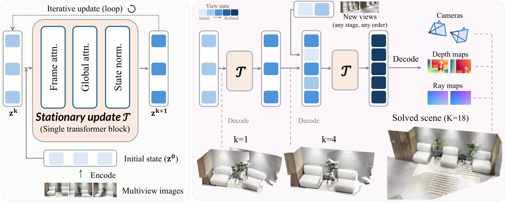
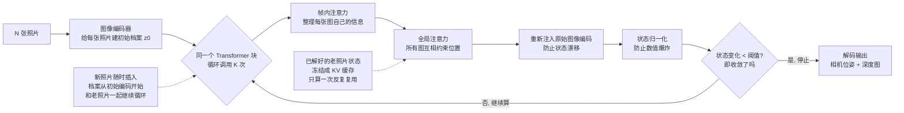

# Solv3R：把 3D 重建模型改造成一个"可以接着算"的求解器——117M 小模型干翻十亿参数大块的活儿

- **论文**：[Solv3R: 3D Looped Transformer as a Multi-view Solver](https://arxiv.org/abs/2611.02857)（arXiv:2611.02857，2026-11-02 提交）
- **代码**：[github.com/ubc-vision/solv3r](https://github.com/ubc-vision/solv3r)（截至发文只有 README，作者承诺一周内放代码和模型）· [项目页](https://ubc-vision.github.io/solv3r/)
- **Venue/来源**：arXiv 预印本（cs.CV）· HuggingFace Daily Papers 11-05 当日第 2（111 票）
- **作者机构**：Jeong-gi Kwak、Kwang Moo Yi（UBC 英属哥伦比亚大学）+ Andrea Tagliasacchi（Wayve Labs / SFU / 多伦多大学，3D 视觉圈知名学者，Google 3D 生成出身）+ Sony 半导体与索尼公司的两位合作者

---

## 🎯 30 秒版本

1. **这是什么**：一篇把"多视图 3D 重建"（一堆照片 → 算出每张照片的相机位置 + 场景的深度/几何）从"一次性预测"改造成"迭代求解器"的论文——用一个只有 1.17 亿参数、反复循环的 Transformer 块，让模型学会像经典 SfM 算法那样"接着上次的结果继续算"。
2. **为什么重要**：现有几何基础模型要么一次前向算完（新加照片就得全部重算），要么只能按视频顺序逐帧更新（不能回头修正）。Solv3R 一个模型同时搞定离线重建、增量扩建、重定位、流式重建四种任务，还因为"算过的可以缓存"拿到 16 倍吞吐和 16–34 倍更小的缓存。
3. **对你有什么用**：它演示了一个通用架构思想——**让神经网络的迭代步骤"与步数无关"（stationary），模型就从"函数"变成了"求解器"**：结果可以缓存、可以增量更新、可以随时叫停。这个思路对任何"状态需要持续修正"的系统（Agent 记忆、世界模型、机器人）都有借鉴意义，论文结尾自己也点名了这三个方向。

## 📚 读前须知

**① 什么是多视图 3D 重建 / SfM？** 你用手机围着房间拍 30 张照片，软件要回答两个问题：每张照片是在哪个位置、朝哪个方向拍的（相机位姿），以及房间里每个点离相机多远（深度图）。经典做法叫 SfM（Structure-from-Motion，运动恢复结构，COLMAP 是代表）：先在不同照片间找"同一个点"（特征匹配），再反复迭代优化，像解一个巨大的方程组——**算得越久越准，随时可以加新照片接着算**。新一代做法叫几何基础模型（GFM，如 VGGT）：训练一个大神经网络，照片进去，位姿和深度直接出来，**一次前向、不迭代**，快得多但"死板"。

**② 什么是循环 Transformer（looped transformer）？** 普通 Transformer 像 24 道工序各不相同的流水线，每层有自己的参数。循环 Transformer 是"同一道工序重复做 N 遍"——只有一个（或少数几个）Transformer 块，把输出再喂回输入循环多次。类比：不是 24 位不同专家依次看诊，而是同一位专家反复复诊，每复诊一次，诊断修正一点。好处是参数省（层数×参数 → 1×参数），且天然适合"迭代到满意为止"。

**③ 什么是 KV 缓存？** Transformer 注意力机制里，每个 token 会算出 Key 和 Value 两个向量供其他 token 查询。如果某些内容固定不变（比如已经解好的地图），它们的 K/V 可以算一次存起来反复用，不用每次重算——这就是 LLM 推理省钱的 KV Cache，本文把它搬到了 3D 重建上。

---

## 🎯 解决什么问题

现在的几何基础模型有个共同的"死穴"：**它们把重建当成一次性函数，而不是一个过程**。举三个具体场景：

- **场景 1：照片太多塞不下**。你拍了 5000 张照片想重建一栋楼，但 Transformer 一次只能吃几十张（显存和注意力复杂度是平方级的）。一次性模型只能切成小块分别算再想办法拼接；经典 SfM 则是增量式地一张张加进去。
- **场景 2：重建完了又来了新照片**。昨天建好的地图，今天同事补拍了 20 张。VGGT 这类前馈模型的做法：把新旧照片合在一起**从头再算一遍**——已算过的部分白算。流式模型（CUT3R、TTT3R）能逐帧更新，但只接受"按顺序到达的视频帧"，不支持"往已建好的地图里任意插入一张照片"。
- **场景 3：手机重定位**。AR 应用要回答"我现在建的这张地图里，我在哪？"。这需要拿新照片对着已冻结的地图算位姿——一次性模型没有"冻结的地图"这个概念，每次都全量重算。

前作 DéjàView（NVIDIA，NeurIPS'26）已经引入了循环 Transformer 做重建，但它的更新**依赖当前迭代步数**（第 1 次循环和第 16 次循环行为不同，像一个"按剧本走 16 步"的演员）。这导致：超过训练时的 16 步就精度崩坏；新旧视图必须"同步"在同一步数上，没法混着更新；每一步的 KV 缓存都不一样，没法复用。

Solv3R 的回答：把"步数"这个概念从模型里彻底删掉，让每次循环都是**同一个**更新操作，再专门训练它具备求解器的三个性质——

- **P1 稳定**：已经算准的结果，再迭代也不会变坏（收敛了就是不动点）；
- **P2 纠错**：给状态加噪声扰动，模型能自己修回来；
- **P3 续算**：加新视图时，旧视图从已解状态出发、新视图从初始猜测出发，一起继续迭代到收敛，且比从头算更快。

这三条正是经典迭代法（如解线性方程组的 Jacobi 迭代）的数学性质。论文的核心洞察：**与其发明新架构，不如让神经网络老老实实学会当一个求解器**。

## 🔬 核心方法

*图：Solv3R 方法总览（论文 Figure 4）。左：唯一的更新算子——一个共享 Transformer 块；右：循环求解过程，新视图可在任意迭代次数处"插队"加入，和已解视图一起继续更新。任何一次循环后都能解码出当前的相机位姿和深度图。*

逐步拆解，输入 → 每一步处理 → 输出：

**第 0 步（编码）**：输入 N 张照片，过一个图像编码器，得到每张照片的初始状态向量 z⁰。这相当于给每张视图建一个"档案卡"，初始内容就是图像特征。

**第 1~K 步（循环求解）**：反复应用**同一个** Transformer 块 T_θ，每次循环（论文叫一次"solver call"）做四件事：
1. **帧内注意力**：每张视图自己内部的信息整理（我的档案卡内部逻辑理顺）；
2. **全局注意力**：所有视图互相看（照片 A 里的沙发角和照片 B 里的沙发角是同一个点 → 约束彼此的位置）；
3. **初始编码注入**：每次循环都把 z⁰ 重新喂进去。为什么？因为循环中状态会漂移，z⁰ 是"原始证据"——类比解方程时每一步都要回头核对原始方程组，防止误差越滚越大；
4. **状态归一化**：把状态数值拉回标准范围，防止长循环后数值爆炸（消融实验显示去掉它，1024 次循环后精度直接归零）。

**关键设计：更新不看步数**。DéjàView 的更新是 F(zᵏ, τₖ)——依赖步数 τₖ；Solv3R 是 T_θ(zᵏ; z⁰)——只有当前状态和原始图像。后果是窗口里可以同时存在"已迭代 16 次的老视图"和"刚进来的新视图"，一次循环把它们一起更新。

**训练怎么做**：从 DéjàView 预训练权重出发微调（把它的"步数条件门控"替换成可学习的常数门控）。训练时故意**折腾**模型：先无梯度地跑 16–40 次循环，随机扰动状态、随机插入新视图、用"随机深度预循环"制造各种奇怪初始状态，再有梯度地跑 8 次并在最终步监督。等于让模型在"各种烂摊子"下都学会把状态修回正确答案——这是 P2 纠错能力的来源。另外用 DéjàView 的 16 步预测做蒸馏（老师模型），保证基础精度不掉。

**输出**：任何一次循环后，把状态解码成相机位姿 + 深度图 + 射线图。**什么时候停**？监控状态的相对变化量，低于阈值 γ=0.02 就认为收敛，自适应停止（平均只比固定 16 次多跑 3–4 次，精度全面更好）。

**怎么读这张图**：主线是"编码 → 循环 → 收敛即停 → 解码"；和一次性前馈模型最大的区别全在两条虚线上——新照片可以**中途插队**（不必全部重算），已解好的照片可以**冻结成缓存**（算一次用 N 次）。循环体内部四件事每次都一模一样，模型不知道也不关心"现在是第几次"。

## 📊 关键数字

**① 离线重建（论文 Table 1）**：五个标准数据集（DTU、ETH3D、7-Scenes、ScanNet++、nuScenes），和 VGGT、π³、DA3、DéjàView 等 8 个 SOTA 比，指标是相机位姿 AUC@30（位姿误差小于 30° 的比例，越高越好）和几何误差 L2（越低越好）：

| 方法 | 参数量 | 计算量 TFLOPs | ETH3D AUC@30 | 7-Scenes AUC@30 | ScanNet++ AUC@30 |
|---|---|---|---|---|---|
| VGGT (CVPR'25) | 12.6 亿（10.8 倍大） | 190 | 82.8 | 74.7 | 83.8 |
| DA3-G (ICLR'26) | 13.2 亿（11.3 倍大） | 178.7 | 83.2 | 80.1 | 82.3 |
| DéjàView (NeurIPS'26) | 1.17 亿 | 75.9 | 95.4 | 98.0 | 85.3 |
| **Solv3R (adaptive)** | **1.17 亿** | **91.3** | **99.1** | **98.2** | **85.3** |

**人话解读**：Solv3R 用**十分之一**的参数量，在 ETH3D 上把位姿准确率做到 99.1%——比 12.6 亿参数的 VGGT（82.8%）高 16 个点，参照系就是"100 张照片里位姿基本全对 vs 错 17 张"。注意它不是靠堆算力：TFLOPs（万亿次浮点运算，衡量一次推理的计算量）91.3 只有 VGGT 的一半。

**② 求解器性质（消融，论文 Table 4）**：这是全文最有说服力的表——

| 变体 | 16 次循环 AUC@5 | 128 次 | **1024 次** | 扰动后误差 | 缓存复用误差 |
|---|---|---|---|---|---|
| DéjàView 原版 | 76.5 | 0.0 | 0.0 | 8.37° | 55.5° |
| Solv3R（微调 3k 步） | 72.5 | 70.8 | 65.4 | 1.26° | 0.76° |
| Solv3R 最终版 | 77.2 | 79.1 | **78.8** | **0.22°** | 0.72° |

**人话解读**：DéjàView 迭代超过训练时的 16 步就彻底崩坏（1024 次时精度归零，缓存复用误差 55.5° ≈ 方向完全乱指）；Solv3R 迭代 **1024 次**（训练时长的 64 倍）精度不降反升（76.5→78.8）。这就是"求解器"和"按剧本走的演员"的区别。去掉"初始编码注入"或"随机深度预循环"任何一项，1024 次循环也会崩到 0——长程稳定需要多个部件配合。

**③ 重定位（论文 Table 2，7-Scenes 室内数据集）**：对着冻结地图定位新照片，指标是定位成功率（误差 <5cm 且 <5° 的比例）和每张地图视图的缓存大小：

| 方法 | 缓存/视图 | 查询延迟 | 定位成功率 |
|---|---|---|---|
| DéjàView（存所有步的缓存） | 45.8 MB | 88 ms | 28.3% |
| DéjàView（只存一份缓存） | 2.86 MB | 50 ms | **0.0%（完全失败）** |
| **Solv3R（一份缓存）** | **2.86 MB** | **51 ms** | **72.8%** |

**人话解读**：DéjàView 因为每步表示都不同，要么存 16 份缓存（贵 16 倍）要么直接失败；Solv3R 一份缓存就够，成功率 72.8% vs 28.3%——参照系：AR 应用里每 10 次定位，从"成功不到 3 次"变成"成功 7 次多"。这就是"表示与迭代步数解耦"的工程红利。

**④ 流式重建与吞吐**：视频逐帧进来，Solv3R 在相机轨迹误差（ATE）、视频深度、3D 重建三个维度全面领先或持平 CUT3R、TTT3R 等专用流式模型——**但它根本没有为流式做过专门训练**。效率上：因为窗口内各帧步数可以错开（流水线化，最新帧刚算 1 次、最老帧已算满 16 次），每帧到达只需 1 次循环即可释放——**吞吐 16 倍**（端到端 10 倍），延迟不变；每帧 95ms（H100），小配置 51ms、显存 2.1GB（对手的一半以下）。KV 缓存比逐层/逐步缓存方案小 **16–34 倍**。参照系：原来 1 秒处理 2 帧的视频流，现在 1 秒 20 帧，能实时跑了。

## 🛠 对工程实践的启发

1. **"步数无关"是让神经网络可缓存、可增量的通用配方**。任何迭代式神经计算（Agent 的多轮规划、世界模型的状态更新、扩散模型的去噪循环），如果更新操作依赖"现在是第几步"，状态就不可复用、不可中途加入新信息。把步数条件去掉 + 显式训练稳定性（P1）和纠错性（P2），就能换来缓存复用和增量更新——Solv3R 用重定位实验证明了这笔交易的收益是"从完全失败到 72.8%"。
2. **训练时故意制造烂摊子**。Solv3R 的鲁棒性来自训练管线里的随机扰动、随机步数插入、随机深度预循环——等价于软件工程里的混沌工程（chaos engineering）：不只在"正常路径"上训练/测试，而是主动注入各种中间状态。想做"能接着算"的系统，训练数据的多样性要覆盖**状态空间的中间点**，而不只是输入输出的端点。
3. **流水线化白拿吞吐**。窗口内允许各元素处于不同处理阶段（新帧 1 次循环、老帧 16 次），每拍出一帧就释放一帧——和 CPU 指令流水线、以及 LLM 服务的 PD 分离是同一个思想：**打破"全体同步"假设，吞吐立刻乘上窗口大小**。

## ⚠️ 局限与争议

- **代码还没放**：GitHub 仓库目前只有 README 和一张 teaser 动图，模型和评测代码承诺"一周内"发布（论文 11 月 2 日挂出）。所有数字暂时只能信论文，无法复现验证——这在 CV 圈是常见的"抢首发"节奏，但读者应保持一分警惕。
- **站在 DéjàView 肩膀上**：Solv3R 从 DéjàView 预训练权重初始化、架构沿用其共享块、还用 DéjàView 的 16 步预测做蒸馏。可以争论"创新主要是训练配方 + 去掉步数条件"，而非全新架构。不过消融表（DéjàView 用同样训练也远达不到 Solv3R）说明配方本身就是核心贡献。
- **精度并非全面第一**：nuScenes（自动驾驶户外场景）上 Solv3R AUC@30 为 60.4，低于 VGGT-Ω 的 62.3；DTU 几何 L2 上也没赢过所有对手。它的卖点是"一个模型四种任务 + 效率"，不是单点刷榜。
- **论文自己承认的失败案例**（附录 C.5）：当新加入的视图和已有视图**几乎没有共同内容**（视图 5–8 和 1–4 拍的不是同一块区域）时，模型会把它们放到错误的位置，且迭代 64 次也修不回来——纠错能力依赖"新证据和旧状态之间有足够的重叠约束"，纯靠全局注意力硬猜不行。
- **社区反应**：截至发文 HN 上还没有专门讨论帖；X 上 3D 视觉大牛 Frank Dellaert 转发点赞（"Wow!"），第一作者 Kwang Moo Yi 的推文强调流水线 16 倍吞吐是最喜欢的点。HF Daily Papers 111 票、当日第 2，热度属实但独立质疑声还不多——毕竟代码未出。

## 🧠 关键概念表

| 术语 | 白话解释 | 为什么重要 |
|---|---|---|
| SfM（Structure-from-Motion） | 从多张照片反推相机位置和场景 3D 结构的经典方法（COLMAP 为代表），靠特征匹配+迭代优化 | 它是"可以接着算"的黄金标准，本文就是要让神经网络学到它的求解器性质 |
| GFM（几何基础模型） | 用大神经网络一次性从照片直接预测相机位姿和深度的模型，如 VGGT | 快但死板：加新照片就得重算，本文要解决的痛点 |
| 循环 Transformer（looped transformer） | 同一个 Transformer 块反复循环 N 次，而不是 N 个不同的层 | 参数省 N 倍，且天然表达"迭代到收敛"，是 Solv3R 的骨架 |
| Stationary（平稳/步数无关） | 更新操作不依赖"现在是第几次迭代"，每次循环规则完全相同 | 全文最核心概念：有了它，状态才能混步数更新、才能缓存复用 |
| Solver call（求解调用） | 循环体跑一遍 = 一次迭代 | 论文的计量单位：16 次、1024 次调用下的表现是主要实验轴 |
| P1 稳定 / P2 纠错 / P3 续算 | 收敛了不乱动 / 被扰动了自己修回来 / 加新未知量能热启动继续解 | 经典迭代求解器的三条数学性质，本文把它们变成了训练目标 |
| KV 缓存（key-value cache） | 把固定不变内容的注意力 K/V 向量算一次存起来反复用 | 已解好的地图冻结成一份缓存，重定位和流式场景省 16–34 倍存储 |
| 流水线化（pipelining） | 窗口内各帧处于不同迭代阶段，每循环一次就产出一帧 | 吞吐 ×16 而延迟不变，实时视频重建的关键 |
| 自适应停止（adaptive stopping） | 监控状态相对变化量，小于阈值 γ=0.02 就停 | 不用人为定"跑几次"，平均多跑 3–4 次换来全指标提升 |
| 重定位（relocalization） | 在已建好的地图里确定新照片的相机位置 | AR/机器人的基础能力，本文最惊艳的实验（0% → 72.8%） |
| AUC@30 / ATE / AbsRel | 位姿误差<30°的样本比例↑ / 相机轨迹平均平移误差(米)↓ / 深度相对误差↓ | 3D 重建三大标准指标，分别量"方向对不对、轨迹准不准、深度准不准" |
| DéjàView | NVIDIA 的前作（NeurIPS'26），首个用循环 Transformer 做重建，但更新依赖步数 | Solv3R 的起点和主要对照组：证明"光共享权重不够，还得去掉步数条件+专门训练" |

## 💡 所以呢

- **短期**：如果你在做 3D 重建相关的工程（AR、扫描、无人机建图、机器人导航），等一周代码放出后值得实测——117M 参数 + 5GB 显存 + 每帧 95ms 意味着单张消费级显卡就能跑流式重建，部署门槛远低于 VGGT 级别的模型。
- **中期**：留意"stationary 更新 + 稳定性训练"这个配方往外扩散。论文结尾自己点了方向：视觉语言模型、机器人、世界模型都需要"维护和修正一个演化中的状态"。LLM Agent 的长程记忆如果也做成"步数无关的可续算状态"，或许能解决"加一条新记忆就要重压缩全部历史"的老问题。
- **一句话**：这篇论文的真正贡献不是一个更强的 3D 模型，而是证明了一件事——**神经网络可以被训练成真正的求解器：收敛、可缓存、可增量、可纠错**。这个性质值得被抄进每一个需要"持续维护状态"的 AI 系统里。

---

*精读日期：2026-11-06 · 来源：HuggingFace Daily Papers（11-05 当日第 2，111 票）· 配图来自论文原文与项目仓库*
