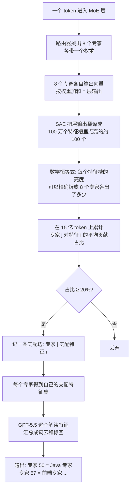
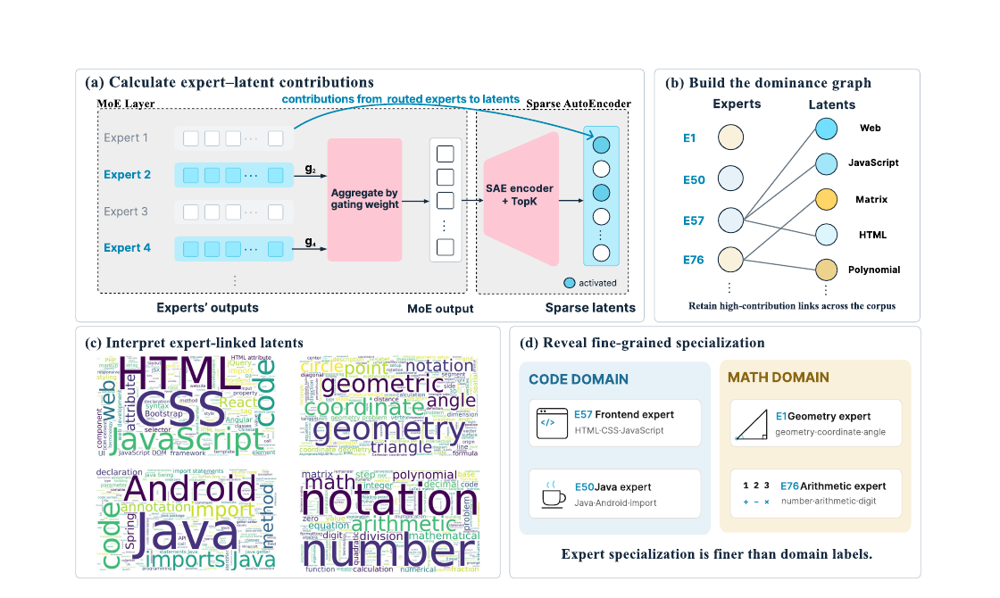

# SAE Interprets MoE：字节跳动用稀疏自编码器给 MoE 专家"验明正身"，发现模型内部藏着 Java 专家和前端专家

## 🎯 30 秒版本

这是一篇模型可解释性论文：字节跳动 Seed 团队用 SAE（稀疏自编码器，一种把模型内部活动"翻译"成人类可读特征的探针工具）去解剖 Qwen3-30B 的 MoE（混合专家）层，第一次给出了每个专家"具体负责什么"的精确答案——不是笼统的"代码专家"，而是细到"Java/Android 专家"和"前端 Web 专家"是两个不同的专家。为什么重要：MoE 是当下主流大模型的架构（Qwen3、DeepSeek-V3、GPT 系据传都是），但"每个专家到底干嘛的"一直是个悬案，这篇论文给了一个不需要预设分类、数学上精确可分解的新工具。对你有什么用：如果你做 MoE 推理部署、专家剪枝、或者只是好奇大模型内部如何分工，这套方法（代码+SAE 权重全部开源）可以直接拿来用。

- **论文**：[arXiv:2611.08089](https://arxiv.org/abs/2611.08089)（2026-11-05 提交，cs.LG）
- **代码**：[github.com/Bytedance-Seed/SAE-Interprets-MoE](https://github.com/Bytedance-Seed/SAE-Interprets-MoE) · [SAE 权重](https://huggingface.co/ByteDance-Seed/Qwen3-30B-A3B-MoE-SAE) · [交互式浏览器（项目主页）](https://bytedance-seed.github.io/SAE-interprets-MoE/)
- **Venue / 来源**：arXiv preprint · HuggingFace Daily Papers 11-06 上榜 · 开源项目+论文对照
- **作者机构**：Anyuan Zhuo、Shaohua Zhang、Yuan Lin（字节跳动 Seed）+ Pinyan Lu（上海财经大学）

## 📚 读前须知

**1. MoE（Mixture-of-Experts，混合专家）**：普通大模型每一层只有一个 FFN（前馈网络，可以理解为"加工厂"）；MoE 把这一个加工厂换成 128 个小加工厂（专家），每个 token 进来时由一个"路由器"（router，相当于车间调度员）挑出 8 个专家干活，产出按权重加和。好处：总参数量 300 亿（存的知识多），但每个 token 只激活 30 亿（推理便宜）。Qwen3-30B-A3B 的"A3B"就是 Activated 3B 的意思。

**2. SAE（Sparse AutoEncoder，稀疏自编码器）**：模型内部的 2048 维向量人看不懂，而且一个维度往往同时编码好几个概念（"多义性"）。SAE 是一个训练出来的"翻译器"：把 2048 维向量展开成 2^20 ≈ 100 万个"特征槽"（latent，潜在特征），每个 token 只点亮其中约 100 个。类比：模型内部像一杯混合果汁（每个维度都是多种味道混在一起），SAE 把它分解回一张成分表（每个 latent 对应一种单一味道，比如"Java import 语句"）。Anthropic 靠这个工具在 Claude 3 里找到了"金门大桥特征"而出圈。

**3. 为什么以前说不清专家分工**：以前的研究方法是"数票"——把标了领域标签的语料（GitHub=代码、arXiv=学术）喂给模型，统计每个专家在各类数据上被路由到的频率。论文指出这有四个毛病：①分类是人预设的，不是模型自己学出来的；②标签太粗（就"代码/数学"几类，可一层有 128 个专家）；③标签贴在整个文档上，但路由是逐 token 决策的（一道数学题里大段的故事叙述 token 也被算成"数学"）；④"被选中"≠"有贡献"——专家可能被路由到却几乎没出力。

## 🎯 解决什么问题

一句话：**给 MoE 的每个专家写一份基于模型自身特征空间的"岗位说明书"，而不是拿人类的粗分类去套。**

举个具体的痛点实例：DeepSeek-V3 技术报告曾说观察到"代码专家和数学专家"，但那是基于领域语料计数的粗结论。实际上模型内部分工比这细得多——这篇论文在 Qwen3-30B 第 30 层发现：专家 50 管 Java/Android（主导的特征包括"Java import 语句""JDBC generated keys"），专家 57 管前端 Web（HTML/CSS/JavaScript、React/Bootstrap/jQuery、DOM 事件）；数学领域里，专家 1 管几何（坐标、三角形、角度），专家 76 管算术与多项式（多项式长除法、任意精度整数）。用旧方法这两对专家都只会被标成"代码专家""数学专家"，颗粒度差了一个数量级。

## 🔬 核心方法：一个"恰好可分解"的数学巧合

方法的美妙之处在于它不是近似归因，而是**代数上精确的分解**。逐步拆解：

**第 0 步（输入）**：把 Qwen3-30B-A3B 的第 4、30、46 层（浅、中、深各取一个代表，共 48 层）的 MoE 块输出接上一个 SAE。SAE 规格：2^20 个 latent，TopK 激活 k=100，训练在 Olmo 3 语料的 32 亿 token 激活上。

**第 1 步（关键观察）**：MoE 层的输出 y 是 8 个被激活专家输出的加权和：y = Σ gⱼ·uⱼ（gⱼ 是路由权重，uⱼ 是专家输出）。而 SAE 编码器是仿射的（affine，即"乘个矩阵加个偏置"的线性变换）：第 i 个 latent 的激活 fᵢ = Wᵢ·y + bᵢ。把 y 代入，得到 **fᵢ = Σⱼ gⱼ·(Wᵢ·uⱼ) + bᵢ**——每个专家的贡献项可以单独拆出来，一分不差。类比：一杯果汁的总糖分 = 各成分糖分之和，这是恒等式不是估计；以前的归因方法（如 attribution graph）都是近似的，这里是精确的。

**第 2 步（贡献份额）**：对每个（专家 j，latent i，token t）三元组，取贡献的正部 c = ReLU(gⱼ·Wᵢ·uⱼ)，再在 8 个激活专家间归一化，得到该专家对这个 latent 激活的份额 C(j,i,t)。（只保留正贡献：负贡献会把 latent 压到不激活，根本观测不到，统计它会有系统性偏差。）

**第 3 步（聚合 + 支配图）**：在 15 亿 token 的验证集上求期望，再跨专家归一化，得到 s(j,i)——专家 j 对 latent i 的平均贡献占比。若 s(j,i) ≥ τ=0.2（远高于均匀分摊的 1/128≈0.008），就说 j "支配" i。全部支配关系构成一张二部图（左边 128 个专家，右边 100 万个 latent），叫**支配图（dominance graph）**。每个专家的"支配集"就是它的岗位说明书素材。

**第 4 步（自动解读）**：从每个专家的支配集采样 2000 个 latent，用 GPT-5.5 根据激活上下文 + logit 效应给每个 latent 写自然语言解释，再汇总成词云、起标签、分组出领域——全程不需要人预设分类。

怎么读这张图：核心是中间那条"数学恒等式"（第 E 步）——它让"这个特征是谁点亮的"从猜测变成精确记账；后面全是把账本聚合、过滤、再交给 LLM 翻译成人话。整条流水线只需要专家输出和一个 SAE，任何"输出=专家加权和"的 MoE 模型都适用。

*图注（论文 Figure 1）：左，MoE 层输出是路由加权的专家和；中，因为 SAE 编码器是仿射的，每个 latent 的激活可精确分解到各专家；右，对贡献份额设阈值得到支配图，解读专家支配的 latent 即得其角色——如第 30 层的 Java 专家 E50 和前端专家 E57。*

## 📊 关键数字

实验对象：Qwen3-30B-A3B（48 层，每个 MoE 层 128 专家、每 token 激活 8 个）的第 4/30/46 层；统计语料 15 亿 token（与 SAE 训练集同分布但不重叠）。这是分析型论文，没有"跑分对比"，核心数字都是结构性发现：

| 发现 | 数字 | 人话解读 |
|---|---|---|
| 贡献比路由更集中 | 第 30 层：路由权重前三名 0.231/0.169/0.137（平缓衰减），贡献份额前三名 **0.512**/0.185/0.115 | 第一名专家独占过半贡献——路由器虽然"雨露均沾"地选了 8 个专家，实际干活的往往只有 1-2 个。像 8 人被叫去开会，真正发言的只有 1 个 |
| 每个 latent 的支配者数量 | 57-62% 的 latent 只有 **1 个**支配者；≤2 个支配者的占 85-93%；无支配者的仅 3.7-13.6% | 100 万个特征里，六成是"单人负责制" |
| 专家间重叠 | 8128 对专家中 37.5-40.5% 完全零共享；Jaccard 中位数约 10⁻⁴；重叠总量的 ~80% 集中在前 10% 的专家对上 | 专家各管各的，"合作"只发生在极少数搭档对之间（如两个标点专家、两个 JavaScript 专家） |
| 私有特征比例 | 每个专家支配集的 46-59% 只被它自己支配 | 一半岗位内容是全公司独一份 |
| 主题纯度（表 2） | Java 专家 50 的支配集解释中 **86.7%** 与 Java 相关；随机对照仅 **1.9%** | 信噪比 45 倍——这不是碰巧，是真分工 |
| 领域分配（第 30 层） | 128 个专家分成 11 个领域：计算 28 个、数学推理 20 个（合计 37.5%）；"文本形式"（标点/分隔符/乱码）21 个；"语言""实体标识符"共 36 个（28.1%）；艺术只在 1/128 个标签里出现 | 专家编制严重不均，跟训练数据配比吻合（Llama 3 披露代码 17%+数学 25%）；更意外的是近三成专家根本不按"学科"分工，而是管排版、编码这类形式特征——这是人预设的分类学永远发现不了的 |
| SAE 重建误差 FVU | 第 4/30/46 层分别为 12.6%/25.1%/7.6% | FVU=未被解释的方差比例，中间层最难重建（与 OpenAI 的发现一致），25% 意味着第 30 层结论要打个折扣 |

**代码-论文对应**（clone 下来验证过）：Eq.6-7 的贡献分解在 `contribution/trace.py` 的 `update_chunk()`——一行 `c_bxexk = relu(bmm(expert_out, W_enc[latent_idx].T) * gating)` 就是论文的 c(j,i,t)，用 `index_put_(accumulate=True)` 在线累加到 [128, 2^20] 的稀疏账本；`routing()`/`expert_outputs()` 精确复刻了 `Qwen3MoeSparseMoeBlock` 的前向（包括权重 cast 回 bf16 的细节）以保证数字对得上；Eq.9 的跨专家归一化在 `contribution/aggregate.py`。阈值 τ、Jaccard、GPT-5.5 标注 prompt 分别对应 `experiments/` 下六个子目录，每个都有 `run.sh` 一键复现。复现成本不低：模型 bf16 占 61GB + 每层 fp32 SAE 编码器 8GB，一次 trace 三层需要两张 80GB GPU。

## 🛠 对工程实践的启发

1. **专家剪枝/合并有了路线图**。论文明确提出可检验假设：删掉或编辑一个专家，主要影响它支配的那些 latent。做 MoE 压缩（如把 128 专家剪到 64）时，可以先看支配集的重叠——Jaccard 高的专家对（第 30 层那 20 对）是合并首选，几乎零共享的专家动了就是净损失。仓库里 `experiments/dominance_overlap/` 可直接算任意层的重叠矩阵。
2. **"被路由到"≠"有用"，监控指标要换**。如果你在 MoE 推理服务里做专家级负载监控或 KV/专家缓存调度，按路由频率统计会高估尾部专家的重要性——按贡献份额（第一名独占 51%）来看，热点集中度远比路由表显示的严重，缓存策略可以更激进。
3. **SAE 探针的工程模板可复用**。`trace.py` 的写法值得抄：hook 住 MoE 块、前向途中在线算贡献、不落盘 per-token 数据、跑完最深的 hooked 层就抛异常截断前向（`_StopForward`）、支持按行范围切分到多 GPU 再聚合。这是一套通用的"大模型激活统计"脚手架，换成你自己的探针指标也能用。

## ⚠️ 局限与争议

论文自己在附录 A 承认的：①**结论受限于 SAE 质量**——第 30 层 FVU 高达 25.1%，且 latent 不干净（一个特征可能分裂到多个 latent，或被别的特征"吸收"）；②**测的是"在我们数据上的路由"**——Qwen3 训练配比未公开，15 亿 token 是作者自选的 Olmo 3 语料，"专家配比反映训练数据配比"只是猜想；③**只测了一个模型的三层**，普适性待验证。

社区侧：HN 上暂无该论文的讨论帖（截至撰写时），HF 论文页下作者在评论区做了 AMA 式补充说明。我另外指出两点论文未明说的：④自动解读全链路依赖 GPT-5.5（解释 latent、判主题、起名、分组），"人类可解释"其实是"LLM 觉得可解释"，主题纯度 86.7% 这个数字是 GPT-5.5 自己判的，存在裁判即运动员的循环风险（虽然 prompt 全部公开可审计）；⑤τ=0.2 的阈值是拍脑袋定的，支配集大小对阈值敏感（论文给了 τ 敏感性分析在附录，但主结论基于单一阈值）。

## 🧠 关键概念表

| 术语 | 白话解释 | 为什么重要 |
|---|---|---|
| MoE（混合专家） | 一层里放 128 个小 FFN，每个 token 由路由器挑 8 个干活 | 主流大模型架构，30B 总参数只花 3B 的推理钱 |
| 路由器 / gating（门控权重） | 决定每个 token 派给哪 8 个专家、各占多少权重的调度员 | 以前研究专家分工只看它，本文证明它测不准贡献 |
| SAE（稀疏自编码器） | 把模型内部向量翻译成 100 万个稀疏"特征槽"的探针 | 可解释性领域的核心工具，Anthropic/OpenAI 都在用 |
| latent（潜在特征） | SAE 的一个特征槽，通常对应一个人类可读概念 | 本文的分析单元，取代了人预设的领域标签 |
| TopK 激活 | 每个 token 只点亮 k=100 个 latent，其余强制为 0 | 保证稀疏，让"谁点亮了它"可以被追问 |
| 仿射变换 | 乘矩阵加偏置的线性运算 | 正因 SAE 编码器是仿射的，专家贡献才能精确分解 |
| 贡献份额 s(j,i) | 专家 j 平均占 latent i 激活的百分之几 | 本文的核心统计量，取代"被选中次数" |
| 支配图 | 专家-latent 二部图，s≥0.2 连一条边 | 每个专家的支配集 = 它的岗位说明书 |
| Jaccard 相似度 | 两个集合的交集除以并集 | 用来量专家之间的重叠，中位数仅 10⁻⁴ |
| FVU（未解释方差比例） | SAE 重建层输出时丢掉了多少信息 | SAE 质量的生命线，第 30 层 25.1% 偏高 |
| 自动解读（auto-interpretation） | 用 LLM 看 latent 的激活上下文+logit 效应，写一句人话解释 | 把 100 万个特征槽变成可读的"成分表" |
| Qwen3-30B-A3B | 阿里开源 MoE 模型，300 亿总参、30 亿激活参数 | 本文的解剖对象，本地可跑，社区关注度高 |

## 💡 所以呢

这篇论文最大的价值不是"发现了 Java 专家"这个趣闻，而是提供了一个**精确、无监督、可复现**的 MoE 内部审计工具，且代码、SAE 权重（每层 17GB，fp32）、交互浏览器全部开源。三个值得跟进的方向：①把同样的流水线跑在 DeepSeek-V3/Qwen3-235B 等更大模型上验证普适性（论文自己列为 future work）；②用支配集指导专家剪枝/合并，看能不能在压缩率上打败按路由频率的方案；③"文本形式/语言/实体标识符"这三类非学科领域占了 28% 的专家——这对理解模型如何处理乱码、多语言、格式转换很有启发，也是人预设分类学的盲区。对普通工程师，最低成本的玩法是打开[交互式浏览器](https://bytedance-seed.github.io/SAE-interprets-MoE/)逛逛第 30 层全部 128 个专家的词云——比读任何一篇"大模型黑盒"科普都直观。
