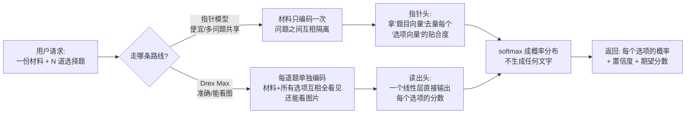
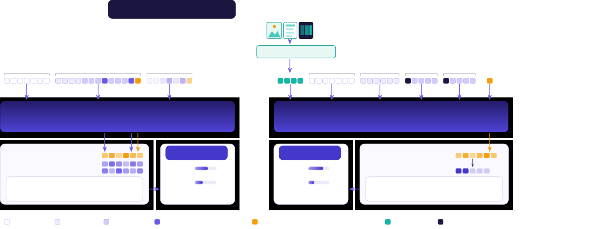

# Drex：不写一个字的"决策模型"，如何用 183ms 追平 GPT-6？

> **论文**：Towards Foundation Decision Models: Drex（[arXiv:2611.07854](https://arxiv.org/abs/2611.07854)）
> **代码**：[github.com/nace-ai/drex-decision-models](https://github.com/nace-ai/drex-decision-models)（代码 Apache-2.0，权重开放）
> **Venue**：arXiv 技术报告（2026-11-05）· HuggingFace Daily Papers 11-07 当日最高票（111 票）
> **机构**：Nace.AI（Palo Alto 创业公司，9 人署名）

---

## 🎯 30 秒版本

1. **这是什么**：Drex 是一族"决策模型"——给它一份材料 + 若干选择题/判断题/打分题，它**一次前向传播**直接返回每个选项的概率，全程不生成文字。
2. **为什么重要**：生产环境里 Agent 的大量 LLM 调用其实是"选一个"（路由、分类、审核），用会写作文的大模型干选择题又慢又贵还可能答非所问。Drex Max（27B）在 Decision Bench v4 拿到 94.0% 准确率，与 GPT-6 Sol（94.7%）统计打平，但延迟 183ms vs 约 2 秒，每千次决策 0.06 美元 vs 3.33 美元——**便宜约 55 倍**。
3. **对你有什么用**：应用里的"结构化选择题"可以整批换成这类模型；权重开源 + 兼容 Jev 的 System One API，自部署门槛低。

## 📚 读前须知

- **自回归解码**：GPT 类模型一个 token 一个 token 往外蹦，每蹦一个跑一遍网络。**类比**：像用发短信的方式做选择题——哪怕答案只是字母"C"，也要先打"答案是"再打"C"。Drex 相当于把卷子塞进阅卷机直接读分数：一次通电，不"说话"。
- **校准（Calibration）**：模型说"90% 把握"时，答对比例是不是真约 90%。像天气预报说降水概率 70%、长期验证真有七成都下雨。校准好的概率能直接当业务规则（"低于 0.8 转人工"），校准差的概率是自欺欺人。
- **指针头（Pointer Head）**："从输入里指答案"的输出装置：拿题目的向量当"查询"，去和每个选项末尾的"键"向量做点积打分。**类比**：老师不问学生"你觉得哪个对"，而是拿尺子挨个量每个选项和题目的贴合度，量完直接给分布。

---

## 🎯 解决什么问题

现在用 LLM 做"选择题"的四条路都有坑：① 提示大模型再解析文本——同一题两次答案可能不同，输出还常是没法规则解析的"我认为选 B，但如果……"；② 受限解码——模型没被训练来输出选项分布，选项长短不一时逐 token 连乘的概率系统性偏向短选项；③ 每个选项单独前向再归一化——结果对但 150 个选项要 150 倍成本；④ 传统分类头——标签在训练时焊死，而现实需求是**选项由用户在请求时临时给出**，今天 3 类明天 150 类。

Drex 要解决第 ④ 条的核心矛盾：**做一个"选项集合在推理时才确定"的分类器**，同时保证概率校准、选项乱序不翻车、延迟达生产标准。这不是 Nace 一家的事——Jev（TypeSafe）一个月前开创 System One 接口，OpenAI 也发了 Decisions API，"判别式推理回潮"已是行业趋势；Drex 是**第一个把权重、训练配方、推理栈全摊开**的重量级玩家。

## 🔬 核心方法

四个模型走两条路线，这是读懂全文的钥匙。

### 路线一：指针模型（DLM 8B / v1.5 9B / v2.0 35B-A3B）

**输入**：state（文档/工单/Agent 上下文，可达 128k token）+ Q 个问题；问题分三类：`choice`（多选一，≤255 项）、`noul`（yes/no）、`score`（有序打分）。

1. **打包**：state 和所有问题拼成一条序列，每个选项用 `<opt>...</opt>` 包住，每题末尾放 `<decide>` 标记。
2. **块状因果注意力编码**：一次前向编码整条序列，但掩码规定**每个问题块只能看 state 和自己，看不到别的问题**。这从架构上保证"问题独立性"，且 state 编码一次全题共享——114k token 文档缓存后，每追加一问只要 21.6ms。
3. **指针头打分**：`<decide>` 位置的隐藏状态过矩阵 W_q 得"查询"，每个 `</opt>` 位置过 W_k 得"键"，点积、softmax 成概率。整个头仅 100-200 万参数（不到骨干 0.03%），却支持任意数量、任意内容的选项——选项的表示来自它自己的隐藏状态，不是焊死的标签行。

### 路线二：读出模型（Drex Max 27B，多模态）

指针模型的代价：选项之间**互相看不见**，比较全靠各自与 state 的贴合度。Max 反其道而行：

1. **每题独立成一条序列**：`[图像token; state; 指令; A: 选项1; B: 选项2; …; <ans>]`，图像由 ViT（视觉编码器）转 token 排最前。
2. **拆因果掩码**：骨干 Qwen3.8-27B 共 64 层（48 层 Gated DeltaNet 线性注意力 + 16 层全注意力）。训练时把 16 个全注意力层的因果掩码去掉，让选项 A 能"瞟见"选项 B 再决定自己强不强；DeltaNet 层保持从左到右。
3. **读出头**：`<ans>` 位置的隐藏状态过一个无偏置线性层，直接映射成 255 个 logit（对应选项代码 A、B、…），取前 K 个 softmax。约 130 万参数。
4. **代价**：state 编码依赖当前问题、**无法跨问题缓存**，每题都要重读全文。换来准确率：Decision Index 公开榜 67.52 vs v2.0 的 61.25。

**怎么读这张图**：分岔点是"材料要不要每道题重读一遍"。指针模型像一份材料复印给 16 个评委同时看（省）；Max 像每道题都请评委把材料和所有选项重新通读、允许互相讨论（准但贵）。共同点：最后都不"说话"，只交打分表。

### 训练配方：SFT + RLAF

- **数据**：115 万条"已验证"决策记录，覆盖 11 个领域，多从更强教师蒸馏，每条标签对照过黄金答案/程序执行结果/游戏引擎输出；评测集严格排除。
- **SFT**：常规交叉熵之外加两个**一致性正则**——① 选项随机洗牌，要求输出分布同步跟着洗（治"顺序敏感"）；② state 的句子/字段打乱，要求输出不变。打分题另用 Cramér 距离（比较累积分布：真值 5 分你答 4 分，罚得比答 1 分轻）。
- **RLAF（调整后反馈强化学习）**：本文最有意思的部分。one-hot 标签（对=1 错=0）会把模型训得过度自信；RLAF 让一个**裁判模型**（Qwen3.8-27B 自己的生成版、开高强度推理）先输出软分布，再用已验证真值修正成目标分布 q̃，用**真得分规则**（诚实报概率才能拿满分的计分函数）训练模型逼近 q̃，加 KL 惩罚不许偏离 SFT 模型太远。**类比**：不再给学生打"对/错"，而是给一份"专家的不确定度"——专家说 A 八成对、B 两成可能，学生学这个把握程度。妙处：裁判不是更强的模型，只是"能慢慢想"的同一模型，补上单次前向的短板。
- **视觉阶段**（仅 Max）：SFT 图像编码器 + 投影层，消融显示文本能力不掉。

### 论文-代码对应

- 指针头：[`kev/model.py` 的 `PointerHead`](https://github.com/nace-ai/drex-decision-models/blob/main/kev/model.py)——仅 14 行：两个 `nn.Linear(d, 256)`，点积乘 1/√256，推理时除以温度；打包/掩码在同文件 `encode()`、`branch_mask()`。
- Max 拆掩码：[`drex_max/model.py` 的 `_bidirectional_full_attention()`](https://github.com/nace-ai/drex-decision-models/blob/main/drex_max/model.py)——用 forward pre-hook 把全注意力层 mask 换成"全可见"；读出头就是一行 `nn.Linear(hidden, 255, bias=False)`。
- 请求样例 [`examples/request.json`](https://github.com/nace-ai/drex-decision-models/blob/main/examples/request.json)：一张客服工单同时问三题（分组 choice / 退款 noul / 紧急度 score）。`serve.py` 起兼容 Jev 的 `POST /v1/systemone` 服务，也支持 llama.cpp/Ollama/Apple silicon（MLX、Kapitsa）。

*图注：论文 Figure 2 原图（从 arXiv HTML 提取）。左半：`<decide>` 的 query 和各 `</opt>` 的 key 做点积；右半：`<ans>` 位置隐藏状态直接过线性层出 255 个 logit。两种头的输出都是纯概率条，没有任何生成文本。*

## 📊 关键数字

**Decision Index 0.4.1**（37 个公开决策基准；分数为"机会校正技能分"：0=瞎猜、100=全对，二选一和 150 选一的题可公平平均）：

| 模型 | 公开榜 | 含私有测试 | 人话解读 |
|---|---|---|---|
| **Drex Max (27B)** | **67.52** | **66.60** | 私有题只掉 0.9 分 → 不是刷榜 |
| Jev 1.14.0（闭源先行者） | 60.70 | 60.24 | Max 领先 6.8 分 |
| Drex v2.0 (35B-A3B) | 61.25 | 52.76 | 开源小杯公开分已超 Jev |
| GPT-6 Luna Decisions | 47.78 | — | OpenAI 决策 API 反而垫底 |

**Decision Bench v4**（1,071 道真实业务决策题，取自 36 个公开数据集）：

| 模型 | 准确率 | 纯图像题 | ECE | 中位延迟 | 每千次成本 |
|---|---|---|---|---|---|
| Claude Opus 5.5 | 95.6% | 100% | — | 4.33s | $10.17 |
| GPT-6 Sol | 94.7% | 100% | — | 2.05s | $3.33 |
| **Drex Max** | **94.0%** | **98.3%** | **1.40%** | **0.66s** | **$0.06** |
| Jev 1.14（纯文本） | 92.3% | 66.7%* | 1.60% | 0.51s | $0.042 |

*Jev 只能读图像的文字转述；Max 走图像编码器，同一批纯图像题从 63.3%（只给文字描述）跳到 98.3%（给真图）——证明它在"看"图而非靠 OCR 蒙。参照系：与 GPT-6 Sol 差 0.7pp（置信区间重叠=统计打平），延迟快 3 倍、成本低 55 倍——同品质快递，别人 100 元次日达，它 2 元当日达。

**消融（训练配方各值几分）**：

| Max 变体 | Index | 乱序翻转率 | 解读 |
|---|---|---|---|
| 只有 SFT | 64.9 | 5.3% | 基线 |
| +RLAF（无一致性损失） | 66.4 | 6.3% | RLAF 加 2 分，但乱序更不稳 |
| +RLAF 完整版 | 66.9 | **4.2%** | 一致性损失专治翻转 |
| +视觉 SFT（发布版） | 66.8 | 4.3% | 学看图**没**牺牲文本 |

RLAF 同时提升准确率（+1.5pp）和校准（ECE 4.4%→3.5%），统计显著——"又准又诚实"不矛盾。

**校准与稳定性**：v2.0 的 ECE 低至 1.37%（说 87% 把握时实际对 86%，几乎完美）；Max 在最自信的 50% 决策上准确率 99.3%——这是"低置信转人工"路由策略的量化依据。乱序翻转率 4.3%（≥6 个选项时升至 13.3%），三种选项排列下准确率差 ≤1.2pp。

## 🛠 对工程实践的启发

1. **把 Agent 里的"选择题"从通用 LLM 迁出**：HN 上已有生产案例——视频编辑器用 Jev 从 100+ 工具里挑子集；有人拿它替换 Agent 的上下文排序子代理，"每轮省 5-10 秒、精度无损、账单还降了"。Drex 兼容同一 API（改 base URL 即切换），v2.0 的 Q4 GGUF 在 Apple silicon 就能跑，验证成本极低。`kev/` 目录整个是 Apache-2.0 运行时（打包、掩码、指针头、服务），拿任何 Qwen 系骨干都能仿制自己的指针模型。
2. **用置信度做路由**：论文建议高于阈值自动执行、低于阈值转人工/转大模型。Max 在 top-50% 置信区间准确率 99.3%，一半决策可放心自动化。
3. **RLAF 的"自家生成版当裁判"可白嫖**：不需要更强教师，让同一模型"会思考的形态"给"快答形态"提供软标签 + KL 防跑偏。任何"单次前向 vs 长思维链"的蒸馏场景（分类器、路由器、打分器）都适用。

## ⚠️ 局限与争议

**论文自己承认的**：
- **闭卷知识题明显偏弱**：HLE-MultiChoice 上 Max 仅 16.0% vs Claude Opus 5.5 的 70.2%——输出头只能用骨干里的知识排序，单次前向替代不了长思维链和工具调用。Drex 适合"材料都在上下文里"的决策，不适合"靠脑子库存+多步推理"的难题。
- **多选项时过度自信且不稳**：6-20 选项的题 ECE 升至 8.4%，K≥6 乱序翻转率 13.3%；好在翻转集中在低置信决策，置信度路由能兜住。
- **组件贡献没拆开**：Max 同时改了读出头、双向掩码、27B 骨干、数据四样，论文承认无法归因哪个带来提升。

**社区质疑**（Reddit / HN / systemonemodels.org）：
- **训练数据含公开基准的训练 split**（评测在 held-out 上），"在熟悉题型上最强"是合理怀疑；私有测试掉分 <1 分算部分回应。
- **蒸馏链污染挡不住改写**：过滤只挡精确匹配和 8 词连续重叠，教师模型若见过基准，污染会间接渗入。
- **许可证不是纯开源**：权重为 Nace.AI Open RAIL-M（带使用限制），仅代码 Apache-2.0；且最强的 Max 1.1 和金融版闭源——"开源版是展示品"的套路值得留意。

## 🧠 关键概念表

| 术语 | 白话解释 | 为什么重要 |
|---|---|---|
| 决策模型 | 输入材料+选项，输出各选项概率，不生成文字 | "选择题专用阅卷机"，快 10 倍便宜 50 倍 |
| System One 接口 | Jev 定义的请求格式（state + choice/noul/score 问题），已成事实标准 | Drex/OpenAI 都兼容，生态互通 |
| 指针头 | 题目向量与选项向量点积打分的输出装置 | 选项可推理时任意给出，打破"标签焊死" |
| 读出头 | 隐藏状态过线性层直出 255 个选项代码分数 | Max 方案，选项间可双向互看，更准但无法缓存 |
| 块状因果掩码 | 问题块只能看 state 和自己 | 架构级保证问题独立 + state 编码一次共享 |
| RLAF | 裁判软分布+验证真值构造目标，真得分规则训练 | 准确率与校准同升，治 one-hot 的过度自信 |
| 真得分规则 | 诚实报概率才能拿最高期望分的计分函数 | 模型没动机虚报置信度 |
| ECE | 自报把握与实际正确率的平均偏差 | 1.4% ≈ 说 90% 把握时实际对 88.6-91.4% |
| 翻转率 | 选项乱序后最优答案改变的比例 | 4.3% = 100 题约 4 题受"摆放位置"影响 |
| Gated DeltaNet | 计算量随长度线性增长的注意力层 | 骨干 3/4 的层用它，长上下文省钱的基础 |
| 机会校正技能分 | 瞎猜归零、全对归 100 的分数变换 | 不同选项数的题可公平平均 |

## 💡 所以呢

"判别式推理回潮"是近期 Agent 基建最清晰的信号：Jev 开创、OpenAI 跟进、Drex 开源摊牌，一个月内三家。行动建议：**盘点系统里所有"让 LLM 做选择题"的调用点**（意图分类、工具路由、内容审核、抽取校验），这些是决策模型的完美猎物——迁移只需改 API 端点；先在 v2.0 上用自己的业务数据测校准曲线和乱序翻转率，再决定替换生产流量。知识密集、多步推理的题继续留给大模型——不是谁取代谁，是"快思考"和"慢思考"各归其位。

---
*本文由 Hermes 论文精读 agent 生成 · 2026-11-08 · 基于 arXiv HTML 全文 + GitHub 仓库源码对照 + HN/Reddit 社区讨论交叉验证*
