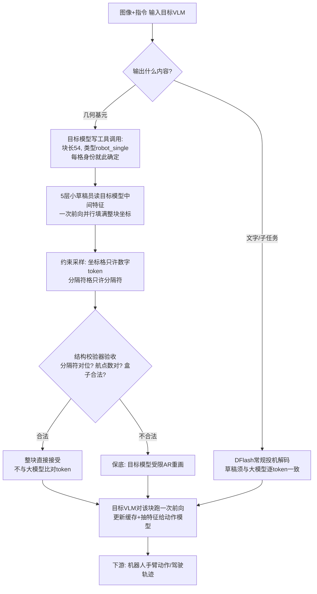
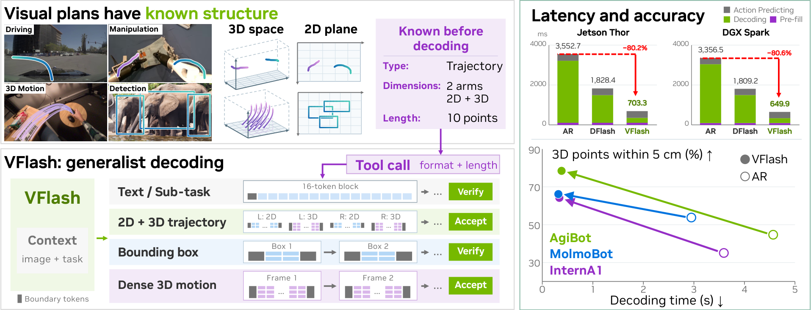

# VFlash：让机器人"画草图"不再一笔一划——NVIDIA 的并行视觉规划解码

## 🎯 30 秒版本

1. **这是什么**：NVIDIA 提出的 VFlash，一种让视觉语言模型（VLM）在机器人/自动驾驶场景里**一次性并行生成完整"视觉计划"**（边界框、2D/3D 轨迹、密集点运动）的解码方法，替代原来一个坐标 token 一个坐标 token 往外蹦的慢方式。
2. **为什么重要**：它证明了一个反直觉的结论——小模型打的"草稿"不必和大模型逐 token 一致，只要几何结构合法就直接整块采纳，结果**速度提升 3.6~25 倍的同时精度反而更高**（3D 轨迹误差最高降 61%）。
3. **对你有什么用**：如果你在做任何"LLM 输出结构化数据"的系统（JSON、坐标、表格），这篇的"按 schema 整块并行草稿 + 结构校验直接接受"思路可以直接借鉴；代码已在 NVlabs/Eagle 开源，本文附论文-代码对照。

## 📚 读前须知

**1. 自回归解码（AR，Autoregressive decoding）＝ 抄写员一次只写一个字**
现在的大模型生成内容都是"自回归"的：每次只吐一个 token（词元，模型处理文本的最小单位），下一个 token 要等上一个算完才能开始。类比：抄写员每次只能写一个字，写完才能写下一个。写 10 个字要 10 轮。对机器人来说，一条 10 个航点的 3D 轨迹 = 30 个坐标数字 = 30 多轮串行计算，每轮在嵌入式芯片上要 35~39 毫秒——光画一条轨迹就要 1 秒多，机器人反应就"迟钝"了。

**2. 投机解码（Speculative Decoding）＝ 实习生先打草稿，老师傅逐字校对**
为了加速，业界通行做法是让一个小模型（drafter，"草稿员"）一口气猜出多个 token，再让大模型（target，"目标模型"）一次并行验证。经典规则很严格：**草稿必须和大模型自己会写的一模一样才被接受**，错一个字就从错的地方回退重来。好处是输出分布完全不变（"无损"），坏处是遇到坐标这种"差一格也算错"的内容，接受率很低，加速大打折扣。

**3. 视觉基元（Visual Primitive）＝ 格式固定的表格**
视觉基元指点、框、轨迹这类几何输出。它们和自由文本有个本质区别——**结构事先完全已知**：一个边界框永远是"左上x 左上y 右下x 右下y"4 个数；一条 P 个航点的 3D 轨迹永远是 3P 个坐标。就像一张格式固定的表格，只是格子里的数字待填。这是本文全部魔法的来源。

---

**论文**：[VFlash: Fast, Accurate Visual Planning via Flash Primitive Decoding](https://arxiv.org/abs/2611.08449)（arXiv 2611.08449，2026-11-05 提交）
**代码**：[github.com/NVlabs/Eagle（Embodied 目录）](https://github.com/NVlabs/Eagle/tree/main/Embodied)（Apache 2.0，模型权重 README 注明"稍后放出"）
**项目页**：[research.nvidia.com/labs/lpr/vflash](https://research.nvidia.com/labs/lpr/vflash/)
**Venue / 来源**：arXiv 技术报告 · HuggingFace Daily Papers 当日 104 票（当日第 2 热门）
**作者机构**：NVIDIA + 约翰霍普金斯大学 + 港理工，一作 Yu-Cheng Chou（周禹成），通讯含 Linxi "Jim" Fan、Jan Kautz、Zhiding Yu 等 NVIDIA 具身智能核心班底

## 🎯 解决什么问题

具身智能（机器人、自动驾驶）的 VLM 越来越流行"先画视觉计划再行动"的两段式：模型先输出一条轨迹或几个框，明确"手要移到哪、车要怎么拐"，下游动作模型再照着执行。但画计划这一步被 AR 解码卡死了脖子：

- **痛点 1：越精细越慢**。AR 下每个坐标 token 都要跑一次完整的 4B 模型前向。在车载/机器人常用的 Jetson Thor 嵌入式芯片上，一个 token 要 35~39ms；一条 36~84 token 的驾驶轨迹要花 1.3~3 秒。而机器人需要每几百毫秒更新一次计划——**画图的工夫，世界早变了**。
- **痛点 2：投机解码救不了坐标**。同组前作 DFlash（用块扩散草稿员做投机解码）在子任务文本上每轮平均能提交 5.5 个 token，但**在轨迹块里只有 2.2 个**——因为"无损验证"要求逐 token 一致，坐标差一个量化格（量程的 1/1000）就算"不一致"，哪怕几何误差小到可以忽略。加速效果直接腰斩。
- **痛点 3：延迟预算锁死计划质量**。想画更密的轨迹、同时输出 2D 图像坐标 + 3D 真实坐标、预测更多物体的运动？每加一项都线性加时间，工程上只能砍精度保速度。

VFlash 的回答：**既然视觉基元的格式是已知的，就整块并行画完，验收时只看"结构合不合法、几何准不准"，不看"和大模型像不像"**。

## 🔬 核心方法：Flash Primitive Decoding（FPD，基元闪存解码）

### 逐步拆解（输入 → 每一步在干嘛 → 输出）

**第 0 步：文本照常走严格投机解码**。模型先自回归生成思考和子任务文本（如"把杯子拿起来"），这部分保留 DFlash 的逐 token 验证——文本没有"结构合法就算对"的说法，VFlash 不在这冒险。

**第 1 步：工具调用声明块结构（在干嘛：先报表格有几行几列）**。目标模型要输出几何内容时，先写一个普通文本形式的工具调用：`{"name":"atomic_decoding","arguments":{"block_size":54}}`，声明"接下来这块有 54 个 token"；紧跟的起始 token（如 `<robot_single>`）声明类型。两者一组合，**块内每个位置的"身份"就全部确定了**：第 1 格是 x₁、第 2 格是 y₁……长度对不上任何合法布局的块直接拒绝。为什么这么干：并行预测的前提是每个格子干什么必须事先已知，不能像自由文本那样写着写着才知道。

**第 2 步：轻量草稿员一次前向画完整块（在干嘛：整张表格一笔填满）**。一个 5 层 Transformer 的小草稿员（537M 参数，约为 4B 目标模型的 1/8）读取目标模型第 1/9/17/25/33 层的内部特征（hidden states，模型算到一半的中间表示），把整块坐标**一次并行**全部填出来。它不是自回归的，而是"掩码填空"式：所有待预测位置先填 MASK 占位符，一遍前向同时揭开全部答案。为什么可行：坐标之间没有自由文本那种"前一个词决定后一个词"的强依赖，一条平滑轨迹的 30 个数字本质上是一个整体。

**第 3 步：逐位置约束采样（在干嘛：把非法选项从源头掐掉）**。草稿员输出时，每个位置只允许它合法词表里的 token：坐标位只能是数字 token（`<0>`~`<1000>` 共 1001 个特殊 token，一格一个坐标，天然对齐），分隔符位只能是分隔符，盒子的"投影出画面"坐标必须成对出现。这些约束直接作用在已算好的 logits（每个候选 token 的原始得分）上，**零额外神经网络开销**。

**第 4 步：结构验收，合法就整块接受（在干嘛：验表格格式，不验笔迹）**。校验器检查：每个分隔符在声明的位置、每个坐标位是数字 token、航点数和工具调用一致、盒子满足左上<右下。全部通过 → **整块直接提交，不和大模型比对一个 token**（论文公式 5 的 τ_dir = B(s)）。不通过 → 只回退到"目标模型受限 AR 重新生成"这条慢速保底路。对比经典投机解码的"错一格全回退"，这里验收标准从"像不像大模型"换成了"是不是合法几何"。盒子任务额外加一道"空间置信度守卫"（借自 LocateAnything：数字 token 概率分布太散就用 AR 重画），因为框的语义容错更低。

**第 5 步：目标模型补一次前向（在干嘛：老师傅看一眼成品并盖章）**。接受整块后，目标 VLM 对整个块跑**一次**前向——不是验证，而是更新 KV Cache（模型缓存的上下文，供后续生成用）并抽取隐藏特征喂给下游动作模型。于是无论轨迹是 36 还是 84 个 token，**每个基元固定只花"1 次草稿 + 1 次目标"两遍前向**：计划加密几乎不加时间（Thor 上 36→84 token，解码只从 72ms 涨到 78ms）。

**训练侧的第二个关键改动**：草稿员**不是**学着模仿目标模型的输出，而是直接用人工标注的真实坐标训练（加权交叉熵，几何位置统一权重）。这就是"草稿可以比老师傅画得准"的来源——老师傅（AR 目标）自己也是逐个 token 采样、会积累误差；草稿员整块联合预测、直接对标注学习，反而更稳。

### 流程图

**怎么读这张图**：关键分岔在中部——文字走老路（逐字校对），几何走新路（整块验收）。右下角的"一次前向"是省钱的关键：块再长，目标模型也只过一遍。左下角的"保底路"保证系统永远不会输出非法几何，最坏情况退化为原来的 AR。

*图：VFlash 官方总览图（论文 Figure 1）。左侧输入相机画面与指令，中间按基元类型走并行草稿解码，右侧输出驱动机械臂（MolmoSpaces/LIBERO）与自动驾驶（NAVSIM/Waymo）等下游任务；在 Jetson Thor、DGX Spark、H100 三种硬件上实测。*

## 📊 关键数字

底座模型：Qwen3-4B + MoonViT 视觉编码器（4B 参数的多模态模型，"小钢炮"级别）；草稿员 537M。对比对象主要是**同一个目标模型换成 AR 解码**（控制变量，最公平），以及各任务的公开 SOTA。

### ① 3D 机器人轨迹（表 4，InternA1/AgiBot/MolmoBot 三数据集）

| 指标 | AR 解码 | VFlash | 变化 | 人话解读 |
|---|---|---|---|---|
| ADE（平均位移误差，米，↓越低越好）AgiBot | 0.083 | 0.042 | **↓50%** | 轨迹每个点平均偏差从 8.3cm 降到 4.2cm，约从"一个拳头"缩到"半个拳头" |
| SR@5（5cm 内航点比例，↑）AgiBot | 50.3% | 73.1% | **+23pp** | 原来一半的航点误差超 5cm，现在四分之三都压进 5cm |
| ADE（2D+3D 联合输出）InternA1 | 0.153 | 0.062 | **↓60%** | AR 同时要画 2D 投影+3D 坐标时精度崩得厉害（比只画 3D 差 51%），VFlash 一次并行画两段几乎不掉精度 |

参照系总结：**同一个大脑，换了支笔，画线精度翻倍**。这不是"快但糙"，是"又快又准"——因为草稿员直接对标注学习 + 整块联合预测消除了 AR 的逐 token 误差累积。

### ② 速度与端到端延迟（3.3 节，batch=1 实测）

| 场景 | 数字 | 人话解读 |
|---|---|---|
| 3D 密集点运动预测（PointMotionBench） | 单次生成 **约 25×加速** | 原来 25 秒的预测现在 1 秒 |
| 纯解码环节（Thor 芯片） | **12~42× 加速** | AR 解码占机器人单步耗时的 75~87%，这一刀砍在大动脉上 |
| MolmoSpaces 抓取单步端到端（Thor/Spark） | **5.1~5.2× 加速**，延迟降约 80% | 原来 5 秒才能反应一次，现在 1 秒 |
| 轨迹从 36 token 加密到 84 token（Thor） | 72ms → 78ms | 计划详细一倍多，时间几乎不变——AR 下这要翻倍 |

### ③ 下游任务成功率（画得快又准，最终干活行不行？）

| 任务 | 基线 | VFlash | 人话解读 |
|---|---|---|---|
| MolmoSpaces 四套件操作平均成功率 | 62.6% | **70.2%** | 100 次抓取任务多成功约 8 次，超过公开最强 PrimeR0（60.3%）近 10 个百分点 |
| 同上：用 AR 画的计划替代 VFlash 计划 | 70.2% → 61.0% | | **计划的"准"直接决定动作的"成"**——消融实验证明不是解码快就行，几何质量才是关键 |
| LIBERO-PRO（扰动版机器人基准） | — | 比基线 **+6.8pp** | 环境被刻意扰乱时收益更大（空间扰动子项 +11.1pp）：视觉计划给了动作模型更抗噪的"锚" |
| NAVSIM 驾驶（RL 后）PDMS | 87.1（SFT） | **90.7** | 追平 Qwen-Drive-1.0-RL（90.7），但 VLM 全程冻结不训练 |
| 2D 框生成（COCO，带 AR 保底） | F1 48.68 | 47.79 | 框任务只打平（-0.9），换来 **2.8× 加速**——精度敏感的密集场景（Dense200）反而 F1 更高（61.78 vs 60.10） |

### ④ 诚实的负面数字

密集点运动（表 5）上并非全胜：HOT3D 的 ADE 比 AR 差 12%（0.122 vs 0.109），WorldTrack 的 FDE 差 15%。论文自己的解释空间：这些目标模型用文本 token 记坐标（一个数字占多个 token），对齐不如特殊 token 干净。

## 🛠 对工程实践的启发（含代码对照）

**1. "结构合法即接受"是投机解码的松绑范式，可迁移到一切 schema 化输出**。经典投机解码追求无损（分布不变），代价是接受率低。VFlash 证明：当下游只关心**语义/几何正确性**而非 token 复现时，把验收标准换成 schema 校验器，速度和精度可以双赢。代码对照：`eaglevl/model/vflash/generation.py` 的 `validate_atomic_decoding_block()`（约 415 行起）就是那个校验器——逐段检查起始 token、数字位、`<oof>` 成对、结束 token，纯 Python 无神经网络调用；`dflash_generate()` 的 `verify_atoms: bool = False` 参数一键切换"验/不验"两条路。做 JSON 抽取、函数调用、报表生成的团队可以直接抄这个"草稿-校验-保底"三段式。

**2. 特殊 token 对齐是并行解码的地基**。`physical_atoms.py`（781 行）定义了整套 schema：每个坐标 = 恰好 1 个特殊 token（`<0>`~`<1000>`），块长 = 类型 + 工具调用参数唯一确定。反观文本记坐标（"123" 可能切成 2~3 个 token，长度不定），并行填充就无从下手——这也是密集运动实验（目标用文本 token）效果打折的原因。**工程教训：想让 LLM 输出可并行、可校验的结构化数据，先给词表加数字/分隔符特殊 token，别用自由文本凑。**

**3. 草稿员学标注、不学老师，是小模型反超大模型的正路**。训练代码在 `eaglevl/train/vflash/`：`loss_weighting.py` 实现几何位置统一权重、`<oof>`（出界点）降权 0.1；`drafter_packing.py` 把不同 schema、不同长度的块打包进同一 batch 且互不泄漏注意力。537M 草稿员在冻结的 4B 目标特征上训 3 遍数据即可上岗——**改造成本远小于重训目标模型**，这套"冻结大脑 + 训练快手"的模式适合一切已部署 VLM 的加速改造。

## ⚠️ 局限与争议

**论文自己承认的**：① 25× 加速是"初步的单次 rollout 测量"（preliminary single-rollout measurements），且是纯解码环节对比，端到端只有 3.6~5.2×；② 密集运动任务上部分指标输给 AR（HOT3D ADE +12%、WorldTrack FDE +15%）；③ 框任务不带 AR 保底时 F1 掉约 20 个点（Dense200），说明"结构合法"不等于"语义正确"，低容错输出仍需置信度守卫。

**社区视角的质疑**（HN 上该帖热度尚低，仅 3 分 0 评论，以下主要来自技术博客评论区的代表性观点）：① 放弃无损性后，**输出分布不再等于目标模型**——对需要可复现性、可审计性的场景（安全关键的自动驾驶规控）这是原则性让步，"草稿员比老师准"依赖训练数据标注质量，换了域可能反过来；② 每个基元类型都要手写 schema + 特殊 token + 校验器，泛化到新几何类型（如网格、姿态角）是持续工程负担，博客 e-cogni 的总结很到位："没有高质量标注数据和扎实的 schema 校验，额外的速度只会生产**快速的错误计划**"；③ 评测的 MolmoSpaces/LIBERO 均为仿真基准，真机长时程表现待验证。

**我的补充观察**：论文把这套东西定位为 VLM 的 "System-1 模式"（卡尼曼《思考，快与慢》里"快而直觉"的思维系统）——几何直觉不需要慢思考，这个 framing 比"投机解码改进"更有野心，也预示 NVIDIA 后续可能把"快系统/慢系统"显式做进机器人模型架构。

## 🧠 关键概念表

| 术语 | 白话解释 | 为什么重要 |
|---|---|---|
| 自回归解码（AR） | 模型一次吐一个 token，串行等待 | 一切延迟问题的根源 |
| 投机解码 | 小模型打草稿，大模型并行验证 | 通用加速方案，但逐 token 验证对坐标失效 |
| DFlash | 同组前作：块扩散草稿员+严格验证 | VFlash 的直接底座，文本路径仍沿用它 |
| 视觉基元（Primitive） | 点/框/轨迹等格式固定的几何输出 | 结构已知 → 才能整块并行预测 |
| 草稿员（Drafter） | 537M 的 5 层小模型，一次前向填完整块 | 加速的执行者；对标注训练使其可超越目标模型 |
| 目标模型（Target） | 冻结的 4B VLM，提供上下文特征并盖章 | 保证草稿"看着当前场景画"，且其缓存供后续生成 |
| Flash Primitive Decoding | 按基元边界对齐草稿块 + 结构合法即接受 | 本文核心贡献 |
| Schema 校验器 | 检查分隔符对位/数字合法/航点数一致的纯规则代码 | 替代逐 token 验证的新验收标准，零算力开销 |
| `<oof>` token | "出界"标记：轨迹点投影到画面外时成对写入 | 让变长现实世界能塞进定长块 |
| 坐标量化 | 把连续坐标映射到 0~1000 的整数格 | 1cm 分辨率（机器人 5m 量程）；一格之差曾是 AR 验证的死穴 |
| KV Cache | 模型缓存的已算上下文，避免重复计算 | 接受整块后目标模型跑一次前向就是为了更新它 |
| WAM（World Action Model） | 看视觉计划+相机画面输出机械臂动作的下游模型 | 证明"计划质量→动作成功率"的传导链 |
| ADE / FDE | 轨迹平均/终点位移误差（米） | 轨迹预测的标准尺子 |
| PDMS / RFS | 驾驶规划综合评分/无碰撞率评分 | NAVSIM 与 Waymo 的官方成绩单 |
| System-1 | 快而直觉的思维模式（对比 System-2 慢思考） | 论文对自身的定位：给 VLM 装上几何直觉快系统 |

## 💡 所以呢

- **做 Agent/结构化输出的工程师**：下次设计"LLM 生成 JSON/坐标/表格"时，问自己——验收标准真的需要逐 token 复现吗？还是 schema 合法 + 语义正确就够？VFlash 给出了后者的完整工程模板（工具调用声明块长 → 并行草稿 → 规则校验 → AR 保底），代码可直接参考 `NVlabs/Eagle/Embodied/eaglevl/model/vflash/`。
- **关注具身智能的读者**：留意 NVIDIA 的 "System-1 VLM" 叙事——冻结大模型 + 轻量并行草稿员的组合，可能成为机器人端侧推理（Jetson Thor 级别硬件）的标配架构。权重放出后值得实测复现。
- **下一篇值得追**：论文引用的 LocateAnything（并行框解码的前身）和 DFlash（块扩散草稿的原始论文），是理解这条技术线的两块前置拼图。

---
*本文基于 arXiv HTML 全文 + NVlabs/Eagle 仓库源码（Embodied 目录，已 clone 核对关键实现）+ NVIDIA 项目页交叉验证写成；表 2/3/4/5/6/7/8 数字均摘自论文原文。*
