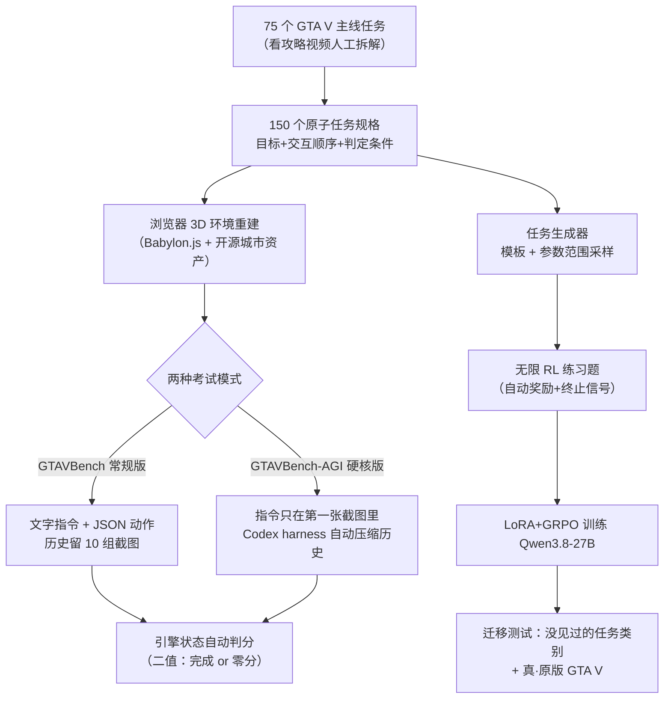
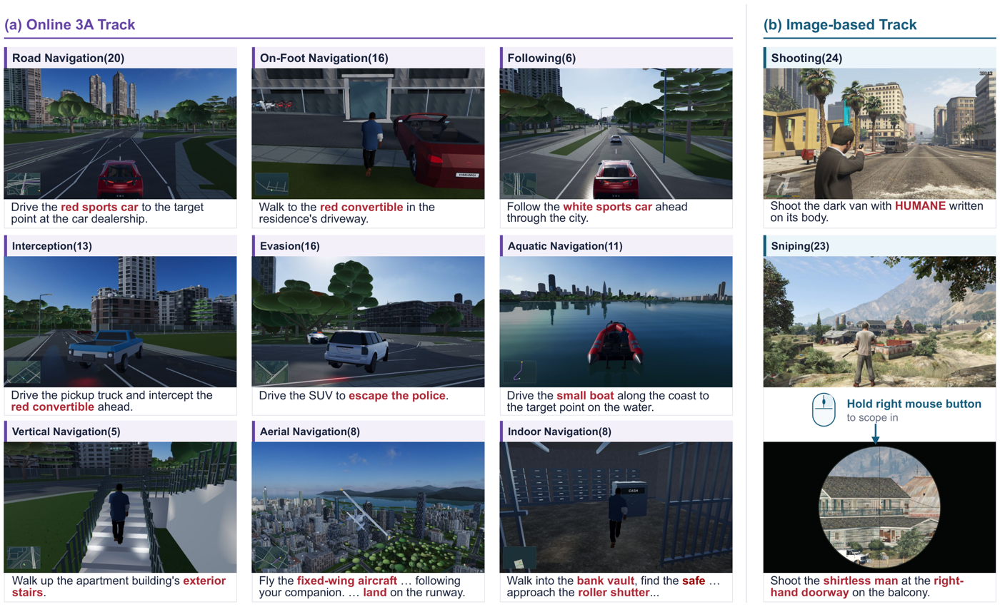
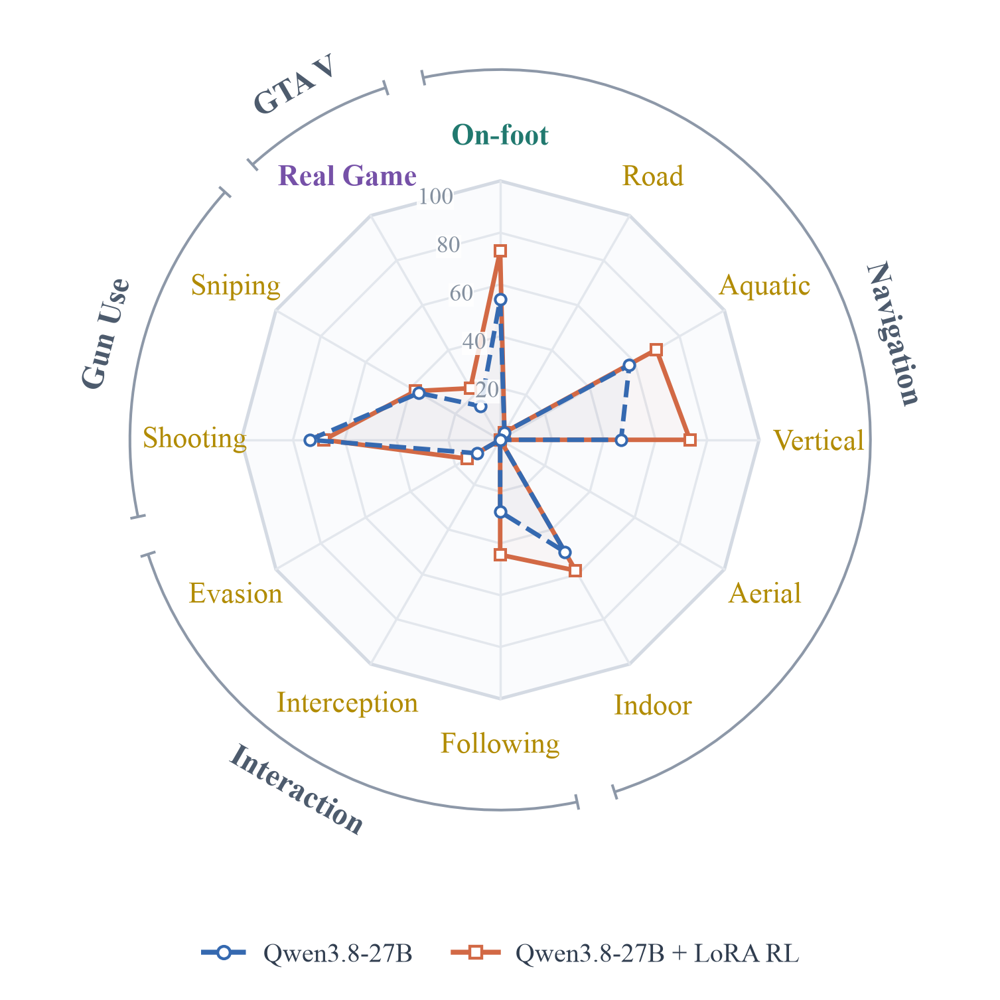

# GTAGym：把 GTA V 主线任务搬进浏览器，让 AI 智能体"真的玩一遍"还能自动判分

## 🎯 30 秒版本

这是复旦 OpenMOSS 团队和上海创智学院刚发布的一套评测环境：他们把《侠盗猎车手 5》（GTA V）主线剧情里的任务拆解重建成 150 个可在浏览器里运行的 3D 关卡，让大模型智能体用"看截图 → 输出键盘鼠标操作"的方式真刀真枪玩一遍，且成功失败由游戏引擎内部状态自动判定，不需要人来打分。为什么重要：这是第一个同时做到"真 AAA 大作任务 + 引擎级自动判分 + 网页并行运行 + 可批量生成 RL 训练环境"四件事的基准，测出的结果很扎心——最强模型 GPT-6-Astra 也只有 70.9%，比人类玩家低 18.9 个百分点，开飞机降落、追车拦截、躲警察三类任务几乎全军覆没。对你有什么用：它揭示了当前视觉智能体的真正短板不是"看不懂"，而是"手不稳"（连续控制校准），并且展示了一条用生成式任务 + LoRA 强化学习把 27B 小模型从 15% 拉到 23% 的可行路径。

## 📚 读前须知

**1. 什么是"游戏智能体"（Game Agent）？** 想象你雇了一个代练：它只能看你的屏幕截图，只能按键盘和动鼠标，你要它"把车开进停车场再开出来"。游戏智能体就是干这个的 AI——每一步它收到一张游戏画面（1280×720 的截图），吐出一个动作（比如"按住 W 键 1 秒同时把鼠标向右移 120 像素"），环境执行后再截一张图给它，如此循环，直到任务完成或超出步数预算。它和聊天机器人的区别是"闭环"：做错了会有后果，后果又出现在下一张截图里，逼着它自己纠错。

**2. 什么叫"引擎状态判分"？** GTA V 这类游戏跑在一个"游戏引擎"（负责物理模拟、渲染画面的底层程序）里，引擎内部记着所有精确数据：车在哪、速度多少、目标 NPC 距离几米。传统游戏评测要么靠人看录像打分（贵且慢），要么靠另一个视觉模型判断"看起来完成了没"（会误判）。引擎状态判分相当于不看考生的表情、直接调监控录像和 GPS 轨迹——"车是否以≤1.5 m/s 的速度在跑道上停稳 2 秒"这种判定是精确到小数点的，零人工成本，还能给强化学习当自动奖励信号。

**3. 什么是 LoRA + GRPO 强化学习？** LoRA（低秩适配）是给大模型"外挂小补丁"的微调方式：冻结原模型 270 亿参数不动，只训练旁边几千万个新增参数，好比不重新装修房子、只贴墙纸。GRPO（组相对策略优化）是一种强化学习算法：同一个任务让模型试 8 次，谁的成功轨迹得分高就朝那个方向调参数——不需要额外训练一个"裁判模型"，用组内相对好坏当信号，省资源。两者组合就是本文训练智能体的配方。

---

**论文**：GTAGym: Real AAA Game Tasks Environment for Evaluation and Reinforcement Learning
**链接**：[arXiv:2611.13028](https://arxiv.org/abs/2611.13028) · [代码仓库 ljbro/GTAGym](https://github.com/ljbro/GTAGym)（TypeScript，2026-11-12 刚开源，含全部 150 任务环境 + 评测代码 + 任务生成器，可在浏览器直接试玩）· [数据集 OpenMOSS-Team/GTAVBench](https://huggingface.co/datasets/OpenMOSS-Team/GTAVBench)
**Venue / 来源**：arXiv 预印本（cs.CV）· HuggingFace Daily Papers 11-12 当日第 2 · 开源项目+论文对照精读
**作者机构**：Jiajun Chen, Shicheng Fang, Jiahao Lu, Yuxin Wang, Xipeng Qiu —— 复旦 OpenMOSS 团队（邱锡鹏组）+ 上海创智学院（SII）

## 🎯 解决什么问题

想考一考 AI 会不会"玩游戏"，现有的路都堵着：

- ** Minecraft 系（MineDojo 等）**：能自动判分、能生成训练任务，但画面方块感强、任务偏简单，跟真实商业大作的复杂度差一个量级——相当于用驾校模拟器考 F1 车手。
- **商业 3D 游戏智能体（Cradle、SIMA、Lumine 等）**：在真游戏（荒野大镖客 2、GTA V）里能跑，但"任务完成没有"要么靠人看录像标注，要么靠另一个视觉模型猜测，Lumine 的基准干脆全人工评测。人评一轮几百个任务，成本以万美元计，更别提强化学习需要成千上万次自动判分——没有自动裁判就没法发奖励。
- **离线基准（VideoGameBench、GameHorizon-Bench 等）**：让模型看游戏录像答题或预测下一步操作，不用真跑游戏，但"答题对"和"真能玩通"是两码事——就像考驾照只考科目一，不上路。

论文里那张对比表说得很直白：3D 交互、AAA 开放世界任务、引擎状态判分、浏览器并行运行、RL 任务生成这五项，之前的基准最多占三项，GTAGym 是第一个五项全占的。

还有一个隐藏痛点：**推理延迟 vs 实时性**。评测时如果模型思考 10 秒、游戏也跟着暂停 10 秒（"暂停模式"），那测的是纯策略；如果不暂停，追车目标早跑没影了。GTAGym 把两种模式都做进协议并做了消融实验，这是之前游戏基准都没碰过的评测公平性问题。

## 🔬 核心方法

GTAGym 整体是一条"拆任务 → 建环境 → 自动评 → 批量造训练题"的流水线。逐步拆：

**第 1 步：把 75 个主线任务拆成 150 个"原子任务"。** 作者人工看 GTA V 主线剧情攻略视频，把每个任务切成一个个有独立目标、交互顺序、完成约束的子任务。比如"开车穿过停车场"是导航类，"撞停目标车辆"是拦截类。每个子任务写成一份规格说明（起点、终点、载具、NPC 行为、成功/失败判定条件）。为什么这么干：直接搬整个主线任务太长太杂（一个任务半小时、十几个阶段），拆成 3-5 分钟的原子任务才能规模化评测和训练。

**第 2 步：在浏览器里重建这些任务。** 3D 环境用 Babylon.js（一个开源网页 3D 引擎，相当于"网页版 Unity"）搭建，基于开源社区项目 GTA_SZ 的城市资产——所以整个游戏跑在浏览器里，评测端用 Playwright 无头浏览器（程序控制的 Chrome）并行开多个实例，一台服务器就能同时考好几个模型。关键是每个任务都写了"任务控制器"，从引擎内部暴露状态给判分器。代码对照：`native-city/src/native-task-arrival.ts` 里的到达判定用了"扫掠检测"（swept arrival）——不光看车当前帧在不在目标圈内，还看上一帧到这一帧的线段有没有穿过目标圈，防止高速车"瞬移穿过检查点却没触发"的物理引擎经典 bug。

**第 3 步：统一的"截图→动作"接口 + 两种考试模式。** 智能体每回合收到一张 1280×720 截图，输出一个 JSON 动作：哪些键按多久（最长 1 秒）、鼠标移多少像素。两种评测协议：**GTAVBench** 常规版，任务指令以文字给出，历史最多留 10 组截图；**GTAVBench-AGI** 硬核版，指令只出现在第一张截图的游戏画面左上角（模拟真实玩家看游戏内任务提示），智能体得自己"读图识字"，之后靠 Codex harness（OpenAI 的编码智能体框架，这里借用其自动上下文压缩能力）管理长历史。AGI 版只暴露一个 MCP 工具 `game_step`（代码在 `scripts/game-mcp/tools.mjs`），游戏规则写在 `harness/codex/AGENTS.md` 里——这份文件本身就是一份很棒的"游戏说明书 prompt"，讲清了小地图上绿点是自己、红扇形是警察抓捕区、飞行姿态只能用数字键盘控制等。

**第 4 步：引擎状态自动判分。** 成功/失败全由谓词函数判定，且是二值的——路线走完 99% 也得 0 分。举例：降落要求"触地时速度≤1.5 m/s、油门<5%、停稳 2 秒、直升机还要在指定点 12 米内"；狙击任务给 K 个目标就只发 K 发子弹，打空一发、打重复目标立刻判负。评测器还会把静态回放的结果和页面实时结果交叉验证（`scripts/server-eval/episode.mjs` 里若两者不一致直接抛异常），保证判分可复现。

**第 5 步：模板化任务生成器，批量造 RL 训练环境。** 每个模板固定场景和规则，暴露可采样参数：路线长度（如 200-500 米）、转弯数（如 2-5 个）、NPC 速度、移动方式等。生成器在用户给定的范围里采样，不可行的组合自动拒绝，种子存档可复现。这就是给 RL 用的"无限题库"——考卷（150 个基准任务）冻结不动，练习题想要多少造多少。代码在 `native-city/src/training-task-generator.ts`，`TEMPLATE_CAPABILITIES` 表清楚列出 10 类模板各自支持哪些移动方式和参数。

**第 6 步：用生成的题目做 LoRA+GRPO 训练，看能不能迁移。** 拿 Qwen3.8-27B 在 50 个生成的步行导航任务上训练（奖励=成功 1 分 + 距离进步 0.3 分 − 超 100 回合扣 0.1 分），然后考它没见过的任务类别，甚至考真正的原版 GTA V 游戏。

怎么读这张图：左半边是"考试系统"——拆题、建考场、两种考法、机器阅卷；右半边是"练习系统"——同一套模板反过来当出题机，批量生成训练题喂给 RL，最后看学到的本事能不能带出考场（迁移）。两边共享同一个截图-动作接口和判分器，这是整个设计最省力的地方：判分器既是裁判又是奖励函数。

## 📊 关键数字

*图：150 个任务的分类总览（来自项目 README）。上排是九类 3D 交互任务，下排是基于游戏画面的射击/狙击任务。*

**主结果**（6 个前沿模型 × 2 种协议 × 3 个随机种子，150 题任务级准确率，人类基线为 3 名玩家平均）：

| 模型 | GTAVBench 常规版 | GTAVBench-AGI 硬核版 | 人话解读 |
|---|---|---|---|
| GPT-6-Astra | 66.4% | **70.9%** | 最强选手，但离人类还差 18.9 个百分点——相当于百分制考试里差了近 19 分 |
| GPT-6.1-Sol | 66.0% | 66.9% | 和 Astra 同一梯队 |
| GLM-5.3-Flash | 38.9% | 41.8% | 第二梯队约 40%：每 5 个任务挂 3 个 |
| DeepSeek-V4.1-Flash | 33.8% | 38.2% | 同上 |
| Qwen3.8-27B | 24.2% | 34.2% | 27B 小模型垫底，但 RL 后有救（见下） |
| **人类玩家** | — | **89.8%** | 步行/室内/垂直导航全 100%，只有空中导航 45.8%（人开飞机降落也常摔） |

**分项最扎心的数字**：
- **空中导航：所有模型几乎 0 分**（最好的 Astra 在 AGI 版 8.3%）。找到跑道不算赢——收油门后飞机仍快速下坠，拉杆修正总是慢半拍，砸在跑道上。这是"持续调节姿态+速度+下降率"的多变量闭环控制，单帧截图决策根本玩不转。
- **拦截 5.1%→41.0%、逃逸 18.8%→25%**：撞停目标只是中间步骤，撞完还得刹车卡位；被追时不能撞墙后还死按前进键。
- **token 效率差 26 倍**：DeepSeek 在 JSON 协议下每任务输出 token 约是 Astra 的 26 倍，成绩却只有一半——烧钱不等于玩得好。参照系：同样跑完 150 题，一家账单 100 块，另一家 2600 块。
- **动作时长上限消融**：把单动作最长 1 秒改成 0.5 秒，总分反升（62.1%→66.3%）——动作越短、看画面越勤、纠错过快；代价是回合数从 62.6 翻到 121.2、输入 token 从 432 万涨到 1120 万。给 2 秒上限反而降到 60.5%，且模型 66.6% 的动作都用超 1 秒——它不会主动"少按点、多看点"。
- **不暂停游戏直接考**：总分暴跌 22.3 个百分点（62.1%→39.8%），跟踪/拦截/逃逸全归零。含义很重：**当前模型推理延迟撑不起实时动态任务**，"能玩"的前提是世界等你想完再动。

**RL 训练结果**（Qwen3.8-27B + rank-32 LoRA + GRPO，50 个生成的步行导航任务上训练）：

*图：蓝虚线=训练前，橙实线=训练后。只练了"走路"，开车的垂直/水上导航也跟着涨了。*

| 评测集 | 训练前 | 训练后 | 人话解读 |
|---|---|---|---|
| 留出的同类步行任务 | 54.2% | **72.9%** | 练习题见效：+18.7 个百分点 |
| 10 类没练过的基准任务 | 31.8% | 34.8% | 有迁移但温和；垂直导航 46.7%→73.3% 是最大惊喜 |
| 全部 150 题 | 34.2% | 38.9% | 整体 +4.7 |
| **100 个原版 GTA V 真游戏任务** | **15%** | **23%** | 从仿真练习场迁移到真游戏，成功率翻了 1.5 倍——每 20 个任务多通关 1.6 个 |

失败归因分析也值得一看：作者人工标注 900 条轨迹里的 565 个"第一错误"，**63.2% 属于"校准"（动作的方向/幅度/时长不对）和"调节"（情况变了不会改动作）**，而不是"看不见"或"不会规划"。GPT 模型犯错后 10 步内自救成功率 65.7%，其他模型只有 21.6%-25.6%。

## 🛠 对工程实践的启发

1. **"判分器即奖励函数"是环境设计的杠杆点。** 把任务完成条件写成引擎状态的确定性谓词（而不是训个裁判模型），一次投入同时解决评测公正性和 RL 奖励两大问题，且可复现。做任何 Agent 评测/训练环境（哪怕是网页操作、API 调用 Agent）都值得抄这个思路：先问"成功能不能用系统状态精确表达"，能就绝不用人或模型打分。
2. **动作粒度是被低估的超参。** 0.5 秒短动作 + 高频反馈打赢 2 秒长动作，说明闭环控制类 Agent 宁可多花 token 也要缩短"动作→观察"周期。同理，做实时交互 Agent 时，别追求单步动作"大而全"，小步快跑让模型频繁看到世界反馈更重要。
3. **可复用的现成模块**：`harness/codex/AGENTS.md` 是一份写得极好的游戏操作说明书 prompt（小地图图例、按键语义、任务规则全覆盖），做 GUI/游戏 Agent 的 system prompt 可以直接借鉴结构；`scripts/server-eval/episode.mjs` 展示了工程化的评测回路——checkpoint 续跑、渲染故障自动恢复、录像+token 用量全量归档、静态回放交叉验证判分，做大规模 Agent 评测基建时值得对照。

## ⚠️ 局限与争议

**论文自己承认的**：
- 3D 环境是**重建**而非原版 GTA V——城市几何、路线是照着原作小地图人工比对复刻的，画面和物理与 Rockstar 的原作有差距。真游戏迁移实验（15%→23%）证明了方向可行，但绝对值说明重建环境和真游戏之间仍有明显 gap。
- 空中导航、拦截、逃逸即便最强模型也接近全挂，基准远未"刷爆"；但反过来说，人类空中导航也只有 45.8%。
- 狙击任务只用于评测不支持生成训练题；图像射击生成需要另行导入标注图像池。
- 评测默认暂停游戏等模型思考——这是"策略能力"的上限测试，不是实时能力（不暂停就暴跌 22 个点已证明）。

**社区视角的质疑**（HN 上暂无该论文讨论帖，以下是同类工作的常见争议，标注为我的推断）：
- **版权灰区**：任务拆解自 Rockstar 的商业游戏，重建环境用的 GTA_SZ 社区资产本身处于灰色地带；学术评测通常没问题，但商用需谨慎。
- **"游戏基准到底测不测得出通用能力"**：这是 GameVerse、VideoGameBench 等所有游戏 Agent 基准共同挨过的打——反对者认为游戏成绩和真实世界任务（如 OSWorld 的办公软件操作）相关性存疑；支持者认为开放世界游戏恰好覆盖空间推理+长程规划+闭环控制。本文的"真游戏迁移"实验是对这类质疑的部分回应。
- 模型名（GPT-6-Astra、Kimi-K3 等）为 2026 年时点的前沿模型，读者对照当下榜单时注意时效。

## 🧠 关键概念表

| 术语 | 白话解释 | 为什么重要 |
|---|---|---|
| AAA 游戏 | 大厂高预算商业大作（如 GTA V、荒野大镖客） | 画面和物理最接近真实世界，是智能体的"高考考场" |
| 游戏引擎状态 | 引擎内部记录的精确数据（位置/速度/距离） | 拿它判分=调监控阅卷，零人工零误判 |
| Babylon.js | 开源网页 3D 引擎 | 让游戏跑在浏览器里，评测可并行、可远程 |
| Playwright 无头浏览器 | 程序控制的、不显示画面的 Chrome | 服务器批量开考场的基础设施 |
| 截图-动作闭环 | 智能体只看截图、只输出键鼠操作 | 和人类玩家信息完全对等，防止"开挂"读内存 |
| MCP（Model Context Protocol） | 让模型调用外部工具的标准协议 | AGI 版只给一个 `game_step` 工具，接口极简 |
| Codex harness | OpenAI 编码智能体的运行框架，带自动上下文压缩 | 长任务历史自动摘要，解决上下文爆炸 |
| LoRA | 冻结大模型、只训练外挂小补丁的微调法 | 27B 模型也能低成本 RL |
| GRPO | 同一题采样多次、按组内相对好坏调参的 RL 算法 | 不需要额外裁判模型，省资源 |
| 扫掠检测（swept arrival） | 检查上一帧到这一帧的移动线段是否穿过目标区 | 防止高速物体"瞬移穿过检查点"漏判 |
| 稀疏奖励 | 只在任务成功/失败时给分 | 论文加了距离进步分（0.3×）缓解"全对或全错"学不动的问题 |
| OOD（out-of-domain） | 训练时没见过的任务类型 | 验证 RL 学到的是"开车通用技能"而非背题 |

## 💡 所以呢

- **对 Agent 开发者**：这套基准暴露的短板（校准+调节占首错 63%）指向明确改进方向——不是更大的模型或更好的提示词，而是更细的动作粒度、更高频的反馈闭环、以及"动作没生效就换招"的元认知。不暂停游戏就暴跌 22 分也提醒：想让 Agent 干实时的活（机器人、自动驾驶、游戏），推理延迟本身就是核心指标。
- **对想上手的人**：仓库开箱即用——`npm ci && npm run build && npm start`，浏览器打开 http://127.0.0.1:4200 就能亲自玩这 150 个任务，先感受一下人类基线 89.8% 是怎么来的，再看模型录像会非常有体感。150 题的 Parquet 数据集在 HuggingFace（OpenMOSS-Team/GTAVBench），每题带 play_url 可直接打开。
- **值得跟进**：作者放出了任务生成器，社区完全可以在上面跑更大规模的 RL（本文只用了 50 个步行任务、rank-32 LoRA 的"小灶"配置就涨了这么多，加量空间明显）；以及"重建环境→真游戏"的 sim-to-real 路线如果被后续工作验证可规模化，商业游戏就不再是评测禁区。

---
*精读：Hermes 论文精读 agent · 2026-11-13 · 来源：arXiv HTML 全文 + GitHub 仓库代码对照（已 clone 核查 native-task-arrival.ts / training-task-generator.ts / tools.mjs / episode.mjs / AGENTS.md）· 除标注"推断"外均出自原文*
