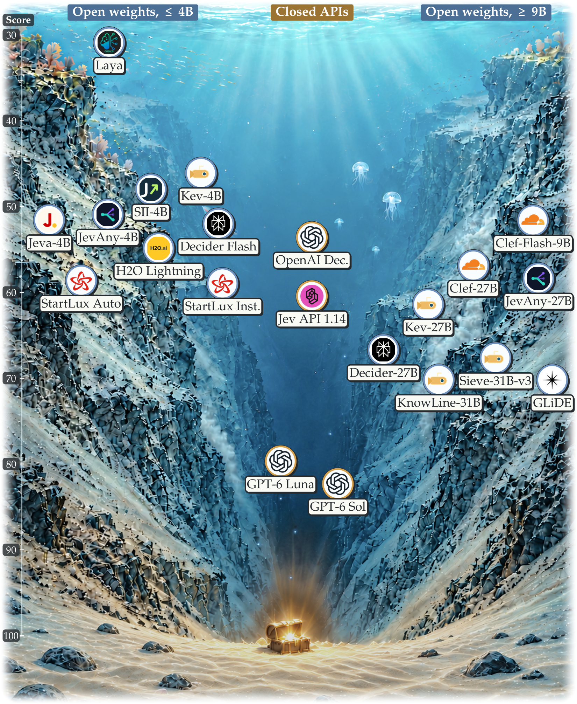

# SO-Arena：给"快决策小模型"出成绩单——分数最高 ≠ 最靠谱

## 🎯 30 秒版本

1. **这是什么**：SO-Arena 是专评"System One 决策模型"（一次前向计算直接输出选项概率、不写推理草稿的快模型）的基准——2,919 道题、11 个领域、评了 21 个模型，除"答得对不对"还单独测"决策稳不稳"。
2. **为什么重要**：第一个把"能力"和"可靠性"拆成两条轴来量 decision model 的基准——最能打的 System One 模型可靠性只排第七；这类模型正被大量用于生产环境的路由、分类、审核，"不稳"比"不准"更危险。
3. **对你有什么用**：如果你在用便宜小模型做请求路由/意图分类/内容打标，选型时要多测两个免费指标：打乱选项顺序答案变不变、正确答案不存在时认不认得出来。评测代码纯 Python 标准库，可以直接抄。

## 📚 读前须知

**① System One / System Two（快思考 vs 慢思考）**：出自卡尼曼《思考，快与慢》。System One 是"直觉反应"——看到 2+2 脱口而出 4；System Two 是"打草稿"——算 37×48 得列竖式。LLM 圈借此说法：System Two 模型（GPT-6 类）先生成一大段推理再答，准但贵且慢；System One 模型（TypeSafe 的 Jev、Perplexity 的 Decider 一族）不生成文字，题目和选项塞进去，一次计算直接返回"每个选项的概率"，像抢答按钮——快几十倍、便宜几十倍，但没人系统测过它抢答靠不靠谱。

**② 决策接口（decision interface）**：System One 的标准用法：给它状态 s（一段文本/网页快照/工具返回值）、问题 q（"这条消息路由到哪？"）、候选集 C（选项 A/B/C/D）；它还你概率分布，如 {A:0.02, B:0.91, C:0.05, D:0.02}，程序直接取最大项。全程没有"生成文字"——这是它快的原因，也是它没法打草稿的原因。

**③ 基准（benchmark）**：一批带标准答案的测试题，模型来考、按分排名。类比高考：答案质量、难度分层、评分维度都决定成绩单有没有参考价值。SO-Arena 就是重新设计这张成绩单。

## 📄 论文信息

- **标题**：SO-Arena: Benchmarking the Capability Spectrum and Reliability of System One Models
- **论文**：https://arxiv.org/abs/2611.15777 （arXiv v1，2026-11-11 提交，cs.CL）
- **代码+数据**：https://github.com/holdrain/SO-Arena （MIT 协议）· 数据集 https://huggingface.co/datasets/SO-Arena/SO-Arena · 项目页 https://lichenlillc.github.io/SO-Arena
- **Venue / 来源**：arXiv 预印本 · HuggingFace Daily Papers 2026-11-13 榜首（71 赞）
- **作者**：Lichen Li*、Ziping Dong*、Sicheng Feng、Qi Li、Xinchao Wang†（新加坡国立大学 NUS，王宸超组——该组也是被测模型之一 Jeva-4B 的作者，*共同一作，†通讯）

## 🎯 解决什么问题

System One 决策模型这一年爆发式增长（HN 上相关项目 "Ollaya" 618 赞），生产用法很具体：客服工单分优先级、给 Agent 选下一个工具、审核内容是否违规——这些高频、要求毫秒级响应的决策，用 GPT-6 打草稿太贵，用 4B 小模型抢答刚好。但现有评测有三个痛点：

**痛点 1：标准答案本身可能是错的。** 很多基准从公开数据集拼题，标签没人管。相当于高考参考答案印错，学霸按正确思路答反被判错——分数被噪声压扁，强弱分不出来。

**痛点 2：没有难度分层，送分题淹没区分度。** "这条评论是正面还是负面"（准确率 99%）和"多步网页操作选动作"（准确率 50%）平均成一个总分，等于高考只报总分不报单科——你不知道它数学是不是不及格。

**痛点 3：只测准确率，不测稳定性——生产环境最怕不稳。** 实例：用决策模型做请求路由，同一类请求 100 次里 99 次进"技术组"、1 次进"财务组"，只因为提示词里选项顺序变了——用户看到的就是"系统抽风"。更糟的是"硬编造"：正确答案根本不在选项里（问"用哪个 API 删文件"，选项里却没有删除接口），可靠的模型该说"都不对"，不可靠的会硬挑一个概率最高的喂给下游。这两个行为，准确率完全测不出来。

SO-Arena 的回答：把"能力"和"可靠性"做成两个独立分数，并从源头保证题目质量。

## 🔬 核心方法：逐步拆解

**第一步：抽题 + 人工验答案。** 题目来自 GoEmotions（情感）、MATH500（数学）、GPQA Diamond（科学）、Mind2Web（网页）、BFCL/ToolSandbox（工具调用）等 40 个公开数据集。原始标签只当"参考草稿"，人工 + LLM 双审，**对照模型实际可见的输入**验证——答案必须由模型看得到的信息支撑，撑不住整题扔掉（否则等于考"猜"）。每题记录来源、版本、ID 可追溯。

**第二步：11 领域 × 5 能力族 × 难度分层。** 能力族：语义理解、知识与推理、安全合规、证据评估、Agent 任务完成。九个领域分 Easy/Medium/Hard（数学加 30 道 Very Hard），难度领域内相对，不跨领域校准。

**第三步：统一三种决策格式。** choice（多选一）、noul（是/否）、score（有序打分，相邻档给部分分）。开放答案的数学题没选项，就用三种材料造干扰项：基础模型的错误答案、解题中间结果、规则生成的"差一点"数值——每个选项都像真答案，考辨别力不是排除法。

**第四步：静态题 + 环境题。** 2,300 道静态题一次输入定输赢；619 道环境题在沙盒迭代执行——282 个工具回合由模拟器真实执行动作并返回观察，337 个网页任务在经回放验证的参考路径上逐步决策。环境题里模型是"演员"（选动作推进目标）；验证题里是"裁判"（判断录制的执行合不合规，含"最终状态一样但中间步骤违规"的坑题）。

**第五步：算两个分数。** 能力分 C：11 领域等权、每领域只取最难档；可靠性分 R 见下图。

```mermaid
flowchart TD
    A[40个公开数据集抽题] --> B[人工+LLM审核答案<br/>撑不住就扔掉]
    B --> C[2919道题：11领域<br/>分Easy/Medium/Hard]
    C --> D[静态题2300道]
    C --> E[环境题619道<br/>工具沙盒+网页逐步决策]
    D --> F[能力分C：每领域只算最难档]
    E --> F
    C --> G[测试1：打乱选项顺序<br/>看答案变不变 → 稳定度S]
    C --> H[测试2：删掉正确选项<br/>看认不认得出 → 辨别力N]
    G --> I[可靠性分R = √(S×N)]
    H --> I
```

**怎么读这张图**：上半是"能力"流水线——抽题、验答案、分层、考试出一个分；下半是"可靠性"流水线——同一批题用两种"作弊式改造"（打乱顺序、抽走正确答案）反复考，测的不是对错而是行为一致性。两条流水线独立打分——这是论文的核心主张：一个模型可能能力分高、可靠性分低。

**可靠性组件 1：顺序稳定度 S。** 每道选择题以原始顺序 + 12 种打乱顺序各考一遍，按选项内容（非位置）识别答案，统计保持率 A，再校准掉瞎猜基线（K 个选项瞎猜也能蒙对 1/K）：S = (A − p_e)/(1 − p_e)。S=0 等于随机，S=1 雷打不动。类比：选项 ABCD 换成 DCBA 答案跟着变，说明你在凭"第一眼看着顺"答题。细节严谨：概率并列按平分权重算；请求失败/拒答算"答案变了"。

**可靠性组件 2：空值辨别力 N。** 每道客观题出两版：原版和"抽走版"（正确选项被删）。让模型估计 p_null（"选项里没有正确答案"的概率），用它区分哪版是抽走版，算 AUC（0.5 瞎猜、1.0 完美），N = 2×AUC − 1。类比：菜单四道菜全不合口味，好服务员该看出"这位客人没得选"主动推荐，差服务员硬说"您就点第二道"。

**综合可靠性 R = √(S×N)**，几何平均意味着任何一项接近 0 总分就接近 0——偏科不行。

### 代码对照（开源仓库实测）

仓库已 clone 验证（12MB，MIT 协议），值得抄的实现：

- **`reliability/score.py`（154 行，纯标准库）**：S、N、R 完整计算。`top()` 处理概率并列（并列 t 项各记 1/t）；`auc()` 用 Mann-Whitney 秩和法 20 行手写 ROC-AUC，不依赖 sklearn。
- **`reliability/build_variants.py`**：确定性生成打乱测试集。亮点：① 排除 13 道选项互相引用的题（"以上都对"——打乱会改变选项含义）；② 12 种排列保证正确选项在各位置均衡出现，防止位置偏好与答案系统相关。
- **`so_arena.py` + `data-lock.json`**：数据锁定到 HF 具体 commit hash，全文件 SHA-256 钉死；**参考答案放带密码的独立压缩包**，解压按行号插回——输入与答案物理隔离防泄漏。`models/adapters/` 统一 13 个模型为 `measure()`+`predict()` 两方法接口，适配器只见公开输入；`results/verify_paper_values.py` 可复算论文全部数字。

## 📊 关键数字

21 个被测模型：16 个开源权重 System One（0.4B–31B）、1 个自动切换快慢的 StartLux Auto、2 个闭源决策 API、2 个闭源 System Two 参照（GPT-6 Luna/Sol）。

**主榜成绩（能力分 C，满分 100）：**

| 模型 | 类型 | 能力分 | 平均延迟（每题） | 人话解读 |
|---|---|---|---|---|
| GPT-6 Sol | System Two 参照 | **82.3** | 秒级（网络端到端） | 天花板，靠打草稿 |
| GPT-6 Luna | System Two 参照 | 79.7 | 秒级 | 比最强抢答模型高约 10 分 |
| GLiDE (27B) | System One | **70.2** | 113ms | 抢答组并列第一 |
| KnowLine-31B | System One | **70.2** | 177ms | 抢答组并列第一 |

参照系：10 分差距 ≈ 100 道题多错 10 道；113ms vs 秒级 = 同一张 H100 上抢答比打草稿快**几十倍**——原来一天处理 10 万个决策的预算，现在能处理几百万个。所有开源 System One 单卡每题 <0.3 秒，最小的 Laya（0.4B）只要 6ms，但网页/工具 Hard 档得分 0–2，基本不能用。4B 组第一 StartLux Instant 得 59.0 分、35ms——小模型在静态判断上已经够用。

**可靠性成绩（18 个 System One 模型）——论文最扎心的发现**：可靠性冠军是 JevAny-27B，能力榜只排第 8/18；而能力最强的 GLiDE 可靠性仅排第 7。顺序稳定度 S：14 个模型 >0.8（0.83–0.94），最差的 Laya 只有 0.35——打乱顺序后约 2/3 概率改答案，0.3B 太小，只认"位置"不认"内容"。空值辨别力 N：差距最大，从接近瞎猜到约 0.8，有的模型几乎完全认不出"正确答案被抽走了"。

**分领域看 System One 追平 System Two 的三种情形**（对比 GPT-6 Luna、4B StartLux Instant、27B GLiDE）：

1. **直接语义判断**（情感、常识、检索排序）：System One ≈ Luna 甚至反超；换大骨干、加思考都没用——这类题不需要草稿。
2. **细粒度接地决策**（意图路由、安全、验证、工具/网页）：只有 27B 大骨干能逼近（GLiDE 距 Luna ≤4 分），4B 落后最多 29 分——加大模型有用，加思考用处不大。
3. **多步推导**（数学、科学、代码）：System One 全面落后；但"自动思考"模式在数学上把 StartLux Auto 从 50.8 拉到 **92.5** 接近 Luna——难的不行时退回 System Two 打草稿仍是解药，代价是延迟 35ms → 3 秒（100 倍）。

性能随难度递减在 Agent 题上最陡：网页 Hard 档 Luna 也只有 62–68 分，抢答模型普遍不及格。

## 🛠 对工程实践的启发

1. **选型快模型时把"可靠性"当硬指标测，几乎免费。** 不需要 SO-Arena 全套：拿自己业务 500 条真实决策样本，跑三个变体——原始顺序、打乱顺序、抽走正确项（加"以上都不是"选项），统计一致率和拒识率。`reliability/score.py` 纯标准库 154 行，改改就能用。生产事故里"路由抽风"多是 S 太低，"硬编造决策"多是 N 太低，两个指标直接对应。

2. **"正确答案可能不在选项里"的场景必须给模型逃生门**：意图分类永远保留"其他/无法判断"选项；工具选择允许返回 Null 交给上层兜底（升级大模型或人工）。论文证明模型大小决定不了这个能力——4B 有的比 27B 强，必须实测。

3. **建内部评测集时照抄它的防泄漏工程**：数据版本钉死 + SHA-256 校验 + 答案密码包物理隔离 + adapter 只见公开输入，四件套适合任何内部 benchmark。

## ⚠️ 局限与争议

**论文自己承认/可推出的：**
- System One 整体仍落后 System Two 约 10 分，多步推导领域差距巨大——抢答模型的适用边界是明确的。
- 难度分层是领域内相对的：数学的 Hard 和安全的 Hard 不代表同等难度；排行榜面板部分领域样本很少（任务完成验证最难档仅 20 题），附录承认换成 hard-only 后个别领域结论会翻（验证域思考增益从 +7.3 变 −15.0）。
- 兴趣冲突提示：作者组（NUS 王宸超团队）是被测模型 Jeva-4B 的作者。处理算透明（附录明确说明其 S=1 是构造使然、单独标注缓存冷热延迟），但读排行榜时应知道这层关系。

**社区争议（HN 搜索）**：论文太新（11-11 提交），HN 尚无专帖（Algolia 查询 0 命中）。但"决策模型"品类本身争议不小：热帖《Don't Call It a Decision Model》（48 赞）认为这就是零样本分类器换了营销名；《Ask HN: Why use Jev/decision models at all?》里支持方列举实时打标、意图路由等生产案例（有人用它替换 Qwen2-7B 做意图解析，并发下才扛得住），质疑方认为"只有通用 LLM 太贵或太慢时才有意义"。SO-Arena 的数据给双方都递了证据：语义判断领域小抢答模型确实够用（支持方赢），多步推导上完全不行（质疑方赢）。

## 🧠 关键概念表

| 术语 | 白话解释 | 为什么重要 |
|---|---|---|
| System One 模型 | 不写推理草稿、一次计算直接输出各选项概率的快决策模型 | 便宜快几十倍，本文主角 |
| System Two 模型 | 先生成一段推理文字再给答案的慢思考模型（GPT-6 类） | 能力天花板参照组 |
| 顺序稳定度 S | 打乱选项顺序 12 次，答案不变的程度（0=瞎选，1=雷打不动） | 测"凭内容答题"还是"凭位置蒙" |
| 空值辨别力 N | 正确选项被抽走时，模型识别"没有正确答案"的能力（0=瞎猜，1=完美） | 防"硬编造"，生产兜底的关键 |
| 可靠性 R | √(S×N)，几何平均，偏科即低分 | 与能力分独立的第二张成绩单 |



*图：论文 Figure 2(a) 的"深潜排行榜"——21 个模型按体量（0.4B→闭源 API）分组，柱子越深能力分越高。核心发现可视化：能力最强的 GLiDE/KnowLine 高柱旁边，可靠性冠军 JevAny-27B 的能力柱明显矮一截——两张成绩单排名对不上。（图源：arXiv 2611.15777 Figure 2）*

## 💡 所以呢

- **在用/打算用决策模型的工程师**：这周就可以加两个免费测试——选项打乱一致率、空选项拒识率。论文结论很直白：这两个指标和能力分基本脱钩，能力榜选出来的模型不保证稳。
- **做 Agent 系统的**：路由/分类用 4B System One（延迟 25–40ms）、数学/代码/多步环节自动升级 System Two，"快慢分流"在论文数据里成立。
- **值得跟进**：Jev 生态（Ollaya、Decision Index 上 70 个开源复现）迭代很快，SO-Arena 数据锁定可复现，大概率成为这个品类的标准成绩单。
