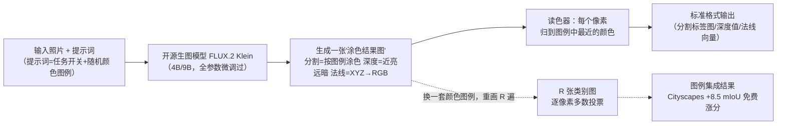
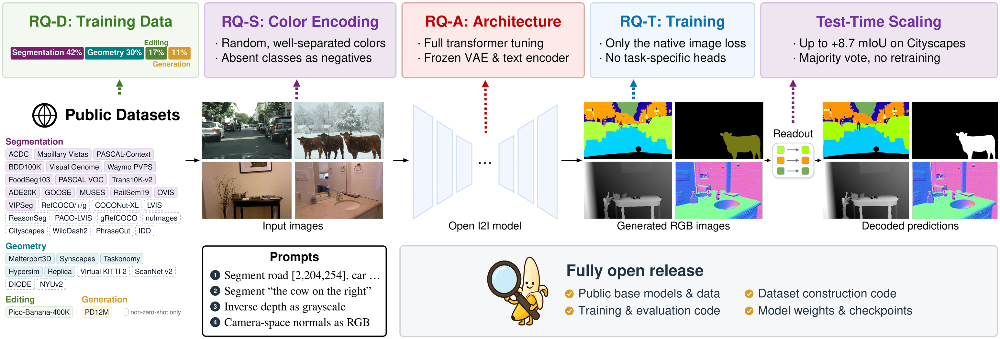
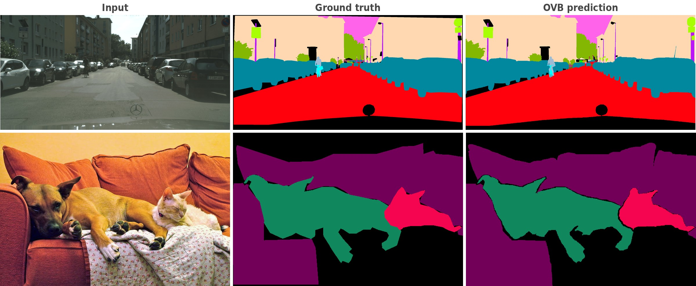
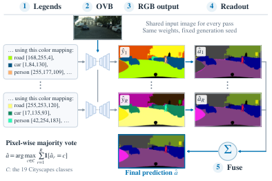

# Open Vision Banana：把"画图模型"改造成全能视觉感知模型的完全开源配方

## 🎯 30 秒版本

1. **这是什么**：一篇"复刻+拆解"论文——闭源的 Vision Banana 证明"让生图模型直接画出分割图/深度图"能打败一堆专用模型，但数据、代码、权重全保密；纽伦堡工大 FunAI Lab 用公开的 FLUX.2 Klein 4B/9B 和公开数据集重做了一遍（Open Vision Banana, OVB），163 个 checkpoint、数据管线、训练评测代码全部开源。
2. **为什么重要**：它第一次系统回答"生成模型当感知模型，哪些设计决定成败"——颜色、提示词、微调范围、任务配比，还发明了免费测试时增强"图例集成"：同图换几套颜色方案画 20 遍再投票，Cityscapes mIoU 65.4→73.9，不用重训。
3. **对你有什么用**：零样本 Cityscapes 73.9 超闭源 VB 的 69.9 和 SAM 3 的 65.2——想玩"生成即感知"，这是唯一能跑通、能改、能复现的开源入口。

## 📚 读前须知

**1. 图像生成模型怎么"画图"？** 开源生图模型（如 FLUX.2）大多基于流匹配（flow matching，扩散模型的近亲：把干净图和噪声按比例混合，让模型学"从噪声走回干净图"的方向）。关键洞察：能画出逼真照片的模型，脑子里必然装了"世界长什么样"的知识——车在路上、天在上。这条路线就是把这些知识"榨"出来干正事。

**2. 语义分割和 mIoU 是什么？** 语义分割（semantic segmentation）= 给图片每个像素贴类别标签，比如"这块是路、这块是车"。想象用荧光笔按类别给照片涂色。mIoU（平均交并比）打分：涂的区域和答案的重叠÷合并区域，越接近 100 越准。Cityscapes 是街景分割标准考卷（19 类：路、车、人……）。

**3. "把感知任务变成画图任务"是什么意思？** 传统分割模型输出数字标签矩阵；OVB 让生成模型直接**画一张彩色图**——提示词说"车涂 [255,249,23]、路涂 [8,4,249]，其他留黑"，再由确定性的"读色器"把每像素归到最近的指定颜色，还原成分割结果。深度、法线同理。六个任务共用一个模型、一套损失，提示词就是任务开关。

---

**论文**：Open Vision Banana: A Fully Open Recipe for Generative Visual Perception
**链接**：[arXiv 2611.15844](https://arxiv.org/abs/2611.15844) · [项目主页](https://openvisionbanana.github.io/) · [GitHub](https://github.com/OpenVisionBanana/OpenVisionBanana) · [HF 权重](https://huggingface.co/FunAILab/Open-Vision-Banana)
**Venue**：arXiv 预印本（2026-11-11），HF Daily Papers 11-14 上榜
**作者机构**：Arpit Jadon、Valentinos Pariza 等 7 人 —— 纽伦堡工业大学（UTN）FunAI Lab + DLR + AIST + 图宾根大学 + TUM + valeo.ai

## 🎯 解决什么问题

Vision Banana（基于闭源 Nano Banana Pro）证明了反直觉的事：**图像生成器微调一下就能当"全能视觉模型"**，分割、深度、法线接近专用模型最好水平，还不丢修图能力。但数据、权重、细节全不公开，带来两个痛点：

- **想复现？没门。** 基座（Nano Banana Pro）和训练数据都摸不到。
- **想搞懂原理？没门。** 报告没说颜色图例、提示词、微调范围、多任务配比。而这些"低层决定"恰是成败关键——模型可能区域找对了，却把该涂蓝的车涂成绿，得分直接崩。

OVB 用**全公开原料**重做这套配方：基座 FLUX.2 Klein 4B/9B，公开数据拼出 210 万（零样本）~380 万（非零样本）训练对，并把每个设计决定做成受控实验，讲清哪个旋钮重要、为什么。

## 🔬 核心方法

整体流水线：**输入图 + 任务提示词 → 生成模型画出 RGB 结果图 → 确定性解码器读回任务格式（分割标签/深度值/法线向量）**。逐步拆开：

**第 1 步：选基座、定微调范围。** 基座是 FLUX.2 Klein 4B/9B（Black Forest Labs 开源图生图模型）。VAE（图像压缩到潜空间的编解码器）和文本编码器冻结，**整个 transformer 主干全参数微调**。消融显示这很关键：只调最后 4 层时 Cityscapes mIoU 仅 4.5，全部 24 层 12.2，全 transformer 26.0——感知能力藏在整个网络，不是最后几层"贴个膜"就行。LoRA（低秩适配，只训插入的小矩阵）在深度/法线/编辑上能追平全量微调，语义分割却差约 12 mIoU。

**第 2 步：把标注"画"成 RGB 目标图。** 每个任务有确定性编码规则：
- **语义分割**：提示词列出类别-颜色对照表（图例），颜色**每样本随机重抽**（从 200 色调色板取分离度最高的 64 色，CIELAB 距离 ΔE≥25 保证颜色"长得不像"）。训练时 70% 样本只请求随机子集类别、15% 请求全部、15% 故意加入图里没有的"负类别"（教模型别幻觉）。
- **实例分割**：一个提示词只管一个类别，保留最大 32 个实例，按最左像素排序，第 i 个实例涂第 i 色——固定顺序让训练目标唯一。
- **指代分割**：一句描述（"穿蓝衣服的女人"）配一个随机色，模型把目标区域涂成该色。
- **深度**：编码为仿射不变逆深度（每图归一化成灰度，越近越亮）——只学相对远近，不学绝对米数。
- **法线**：相机系下法向量 x/y/z 分量直接映射到 R/G/B 三通道。

**第 3 步：混数据防"学新忘旧"。** 感知数据外混入 15% 文生图 + 25% 编辑/身份重建数据作"回放"（replay，防微调洗掉基座原有能力的常见手段）。消融显示去掉编辑数据 ImgEdit 得分 4.0→2.3（-43%），去掉生成数据则法线最好但深度变差——15%/25% 是九项指标综合最优折中。

**第 4 步：基座原生流匹配损失 + "有效像素掩码"训练。** 目标都是 RGB 图，损失就用基座原生去噪目标，唯一改动：几何标注约 8% 像素无效（天空、玻璃等，原数据用占位色填充），不剔除模型会学画占位色垃圾，掩码让这些位置不计损失。100K 步、batch 192、512² 分桶，4B 用 16 张 GH200 跑 73h，9B 用 32 张跑 79h，末期 checkpoint 权重平均。

**第 5 步：读色解码。** 生成图每像素归到图例中最近的颜色（或判背景黑）。实例分割另加颜色吸附、空洞填充、GrabCut 精修。

**第 6 步（新发明）：图例集成（测试时扩展）。** 模型经常"区域找对了、颜色涂错了"（诊断：把预测区域用真值重标类，oracle 85.9 IoU vs 标准读色 65.4——20 分差距全是颜色绑定错误）。解法：同图固定种子，换 R 套颜色图例生成 R 遍，各自解码后逐像素**多数投票**，把"颜色涂错"这个不稳定因素投票投掉，不重训一分。

怎么读这张图：实线是单次推理主链路——模型输出的不是数字标签而是**一张真的图片**，"读色器"只是查最近颜色的死板程序，零学习成分。虚线是图例集成：同图同种子，只换提示词里的颜色对照表，画 R 遍再投票，专治"区域对了颜色错了"。

*论文图 1：OVB 配方与分析框架总览（官方仓库 assets）*

## 📊 关键数字

六个任务、两种数据制度（ZS=零样本，评测集完全没训过；NZS=用了评测集的训练分割）：

| 任务（考卷·指标） | OVB 9B | Vision Banana（闭源） | 参照系 |
|---|---|---|---|
| 语义分割 Cityscapes·mIoU↑ | **73.9**（ZS，20 遍投票）/ 65.6 单遍 | 69.9（ZS） | 开源复刻**反超**闭源 4 分，也超 SAM 3 零样本的 65.2；NZS 4B 达 76.4，距专用模型天花板 84.2 还有一截 |
| 语义分割 COCO-Object·mIoU↑ | **53.0**（ZS，90 遍投票）/ 38.7 单遍 | — | 单遍 38.7 只算中游，投票后反超所有对手——类越多颜色绑错越多，投票红利越大 |
| 指代分割 RefCOCOg·cIoU↑ | 69.2（NZS） | 73.8 | 差 4.6 分：闭源基座语言理解更强，是"原料"差距不是配方差距 |
| 推理分割 ReasonSeg·gIoU↑ | 74.6（NZS 4B + Gemma4 改写） | 79.3+（Gemini 2.5 Pro） | 开源 31B 推理器改写问题就到 74.6；换更贵的 Gemini 3.1 Pro 分数不动——瓶颈在感知不在推理器 |
| 实例分割 SA-Co/Gold·cgF1↑ | 40.1（NZS，11 遍共识） | 47.5 | 差距最大（-7.4），但已是 Gemini 2.5 直接做（13.0）的 3 倍 |
| 深度 NYUv2·δ1↑ | **99.0**（NZS） | 94.8 | 超专用 SOTA Marigold V2 的 98.0——"画图模型"深度估计已第一梯队（注意 OVB 是相对深度口径） |
| 法线 NYUv2·平均角误差↓ | **13.21°**（NZS 4B） | 17.8° | 比专用 DSINE（16.4°）还低 3 度：表面朝向偏差从"时针歪 18 分钟"缩到"歪 13 分钟" |
| 编辑能力保留 ImgEdit·UGE↑ | 3.95（9B ZS）vs 基座 4.03 | — | 感知微调几乎不伤修图（-2%）；文生图 VQAScore 掉 0.03，是感知-生成的真实代价 |

图例集成性价比：Cityscapes 单遍 65.4 → 20 遍 73.9（+8.5），10-15 遍饱和；COCO-Object 38.7 → 90 遍 53.0（+14.3）。代价是推理费 ×R——GPU 时间换准确率，同 best-of-N 一个思路，只是投票对象从"答案文本"换成"颜色绑定"。

诊断实验值得记住：oracle 重标后 IoU 高达 85.9，说明**模型早就学会"圈对区域"，后期涨分几乎全是"按图例涂对色"**——生成式感知的瓶颈不在视觉理解，在指令遵循。

训练成本参照：9B 全量微调 = 32 张 GH200 × 79h ≈ 2500 GPU 时，每个消融变体 ≈370 GPU 时——大学实验室+国家超算撑得起的量级，也解释了此前为何没人做全开源版。

*论文图 2：零样本 9B 单遍预测（读色后）。自行车架、电线杆这类细结构没被"画糊"——这是生成式方法常被质疑的点，OVB 边界质量出乎意料地好*

*论文图 4：图例集成投票过程（arXiv HTML 版）*

## 🛠 对工程实践的启发

1. **"输出协议"比模型更值得设计。** 仓库里 `common/semseg/diversify.py` 被数据准备和评测**双方共同 import**，注释明说"训练时的 (prompt, mask) 随机化和评测时的解码永远不许漂移"：颜色统一拼写 `[52,28,2]`、黑色永远是背景、三种记色风格（颜色名/RGB/hex）随机切换防过拟合。凡是"让生成模型输出结构化结果"的工程都该抄这招——输出协议做成单一事实来源的共享模块，别训练侧推理侧各写一份。
2. **测试时扩展不只在 token 维度。** 图例集成实现在 `evaluation/semseg/inference_partial_flux2_klein_img2img.py` 的 `cumulative_majority_vote_trainids`（纯 numpy 计数投票，顺带输出"投票一致度"当免费置信度图）。它揭示一个通用模式：**找到输出中"不稳定的偶然因素"，随机化它、多采样、投票**。对感知是颜色绑定；对你的业务可能是 JSON 键序、格式约定——凡是"内容对但形式错"的失败都适用。
3. **负样本和回放数据是必需品。** 15% 的"加入图中不存在类别"负例教模型拒绝幻觉；25% 编辑回放数据保住基座能力。多任务微调时，"防遗忘配比"不是可选项，是要网格搜索的一等公民。

## ⚠️ 局限与争议

- **论文自己承认的**：开源基座（FLUX.2 Klein）感知底子弱于闭源 Nano Banana Pro——证据：ReasonSeg 原始问题上冻结的 NB Pro 不微调就有 70.2 gIoU，F2K4B 微调前只有 24.1。指代/实例分割仍落后 VB 4-7 分，"配方对了但原料差一截"。感知微调也确实伤文生图（VQAScore -0.03~-0.05），没有免费午餐。
- **口径要注意**：反超 VB 的 73.9 是 20 遍投票数，VB 的 69.9 是单次推理；深度是相对深度 vs VB 的度量深度，严格说不同赛道。论文脚注标了，但传播中容易被简化成"开源碾压闭源"。
- **HN 社区**：OVB 暂无讨论帖；前身 Vision Banana 的 HN 帖（47880164 等 5 个）热度也低（≤11 分），尚未形成大规模争论。可预期的质疑：推理成本（28 步采样 × 20 遍投票 vs 判别式一次前向）在实时场景是否成立——论文未报延迟数字，原文未展开。

## 🧠 关键概念表

| 术语 | 白话解释 | 为什么重要 |
|---|---|---|
| 生成式感知 | 让"会画画的模型"画出结果来完成分割/深度估计等任务 | 本文整条路线；统一六任务于一模型一损失 |
| FLUX.2 Klein | Black Forest Labs 开源图生图模型（4B/9B） | OVB 基座；开源是"复刻闭源 VB"的前提 |
| 流匹配（flow matching） | 扩散模型近亲：学"从噪声走回干净图"的速度场 | 目标都是 RGB 图，损失无需任务定制 |
| 图例（legend） | 提示词里的"类别→颜色"对照表 | 生成式分割的输出协议；随机化图例防死记硬背，也是投票增强的基础 |
| 图例集成（legend ensembling） | 同图换 R 套图例生成 R 遍，逐像素投票 | 论文发明的免训练测试时扩展；Cityscapes +8.5 mIoU |
| mIoU / cIoU / gIoU / cgF1 / δ1 | 各任务打分：分割看重叠率，δ1 看"预测/真值比 <1.25 的像素占比" | δ1=99.0 即 100 个像素里 99 个深度估得八九不离十 |
| 零样本（ZS）vs 非零样本（NZS） | ZS：评测集完全没训过；NZS：用过其训练分割 | 73.9 是 ZS 成绩更硬核；NZS 76.4 是"上过辅导班"的分数 |
| 仿射不变逆深度 | 每图归一化的"近亮远暗"灰度，只保证相对远近 | 不必学绝对尺度，跨数据集泛化更易 |
| 回放数据（replay） | 微调时混入基座原任务数据 | 防灾难性遗忘；25% 配比保住 ImgEdit 4.0→3.95 |
| 有效像素掩码 | 把标注无效像素（天空/玻璃）从损失剔除 | 几何标注约 8% 像素无效，不剔除模型会学画占位色垃圾 |
| 颜色绑定错误 | 区域圈对了但涂的不是图例指定颜色 | 生成式感知主要失败模式，oracle 实验证明它值 20 分 |
| CIELAB ΔE | 人眼意义的颜色距离（ΔE=25≈一眼能分辨） | 调色板取"最分离的 64 色"保证互不混淆 |

## 💡 所以呢

"生成即感知"从闭源演示变成能 clone 的开源配方。做机器人/自动驾驶/标注工具的：它推理太贵（28 步×R 遍）短期替代不了实时管线，但**图例集成的投票思想和"输出协议单一事实来源"的纪律现在就能抄**；关心开源生态的：这篇证明了公开原料也能逼近闭源 SOTA，163 个 checkpoint（含全部消融）是公共地基。值得盯：配方会否被搬到视频/3D，以及 VB 团队是否被迫开放更多细节。
