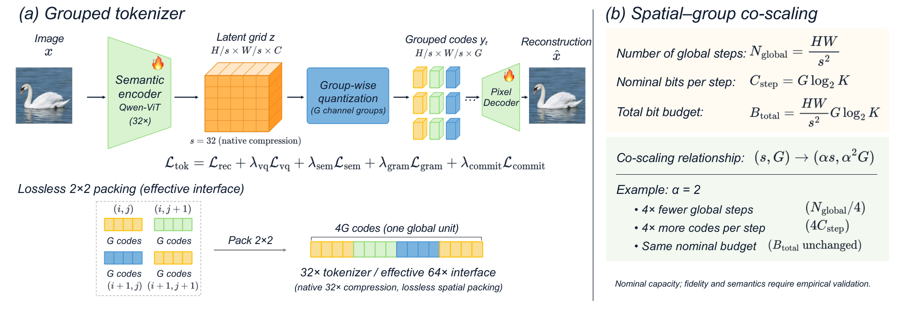
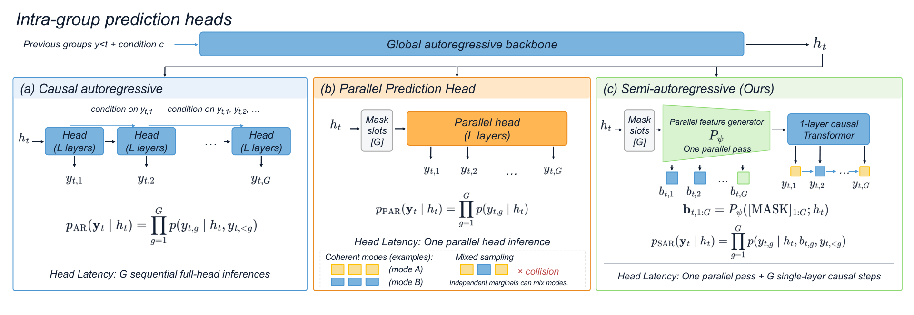

# G-STAR：把图像"压缩率"从 16 倍推到 64 倍，自回归画一张 1024² 图只要 2.5 秒

> **论文**：G-STAR: Group-Scaled Token Capacity for Deeply Compressed Autoregressive Generation（[arXiv:2611.13004](https://arxiv.org/abs/2611.13004)，2026-11-08）
> **代码**：[github.com/DAGroup-PKU/G-STAR](https://github.com/DAGroup-PKU/G-STAR)（MIT 协议，含推理+预训练+SFT 全套代码）
> **权重**：[huggingface.co/DAGroup-PKU/G-star](https://huggingface.co/DAGroup-PKU/G-star)（Pro-8B / Flash-1.7B 两个模型 + tokenizer + 超分精修器都已放出）
> **Venue**：arXiv 预印本 · HuggingFace Daily Papers 11-13 热榜（美团 LongCat 官方账号转发）
> **机构**：北京大学 DAGroup + 美团 LongCat + 上交/华科/港中文/清华/MBZUAI

---

## 🎯 30 秒版本

1. **这是什么**：一套让"自回归模型"（像 GPT 那样一个 token 一个 token 往外蹦的模型）画图的提速方案——把图像压成比常规短 4~16 倍的 token 序列，同时给每个 token 塞更多"码字"补回信息量。
2. **为什么重要**：自回归画图一直是"慢"的代名词（要一个个 token 串行生成），扩散模型（Diffusion，靠反复去噪画图的路线，如 FLUX）靠并行占了速度优势。G-STAR 在单张 H200 上 2.5 秒出一张 1024×1024，比之前的自回归模型快约 20 倍，让这条"统一理解+生成"的技术路线第一次在速度上能打。
3. **对你有什么用**：权重、代码全开源（MIT），单卡 H100/H200 可跑；论文里"压缩率翻倍、码组翻四倍"的 co-scaling 定律和"并行草稿+轻量因果修正"的解码头设计，是可以直接搬去别的 token 级生成任务的工程套路。

## 📚 读前须知

- **视觉 token 与空间压缩率**：图像不能直接喂给语言模型，得先切成小方块、每块编成一个离散"码字"（像把一幅画翻译成一本密码词典里的词）。压缩率 f=16 意思是每边压 16 倍：1024×1024 的图变成 64×64=4096 个 token。**类比**：把整本书缩写成 4096 个字的提纲——提纲越短读起来越快，但细节丢得越多。
- **自回归生成**：GPT 式逐个 token 生成，第 N 个 token 要等前 N-1 个都出来。4096 个 token 就要串行跑 4096 步网络前向——这就是自回归画图慢的根源。**类比**：多米诺骨牌，一块推一块，没法同时倒。
- **乘积量化（Product Quantization）/分组码**：一个位置不用一本大词典编码，而是拆成 G 个子向量、各查一本小词典，得到 G 个码字组成一"组"。G=8、每本词典 16384 个词，一个位置就能表达 16384⁸ ≈ 10³³ 种组合——比单本词典大得天文数字。**类比**：描述一个人不用一个编号，而是"发型编号+衣服编号+姿势编号"三个小编号拼起来，组合空间指数级扩大。

## 🎯 解决什么问题

自回归图像生成卡在一个死结上（论文引言原话是"fundamental trade-off"）：

- **序列要长**：token 多→每个 token 负责的画面区域小→重建保真、语义细节都在。但 1024² 图按常规 f16 压缩有 4096 个 token，串行生成慢到没法用。
- **压缩要狠**：把压缩率从 16 提到 32，序列缩到 1/4（1024 个 token），速度上去了；但每个 token 要背的画面信息翻 4 倍，单本词典根本装不下，重建质量崩、图里的文字和人脸先糊掉。

**举个实例**：之前同为 32× 压缩的 SANA-1.5（4.8B 扩散模型）在 LongText-Bench（考察"图里渲染长段文字"的能力，比如画一张写着菜单的海报）只得 0.050，Janus-Pro-7B（16× 压缩的自回归模型）更是 0.019——基本等于"写字必糊"。而 G-STAR 在 32×/64× 压缩下拿到 0.935/0.853，说明它的 tokenizer 真把文字这种高频细节保住了。

## 🔬 核心方法：逐步拆解

G-STAR = **一条 co-scaling 定律 + 一个无重训的打包技巧 + 一个半自回归解码头 + 一套系统级推理优化**。按数据流从头走一遍：

**第 1 步｜输入文字，Qwen3 骨干生成上下文。** 底座是 Qwen3 语言模型（Pro 版 8B、Flash 版 1.7B），文字 prompt 进去后，骨干在每个"全局位置"输出一个上下文向量 h_t，代表"画到这里，下一块该画什么"。为什么用 LLM 当骨干？因为目标就是"理解+生成一体"，文字理解和画图共享同一套权重。

**第 2 步｜Tokenizer 把图像压成"短序列+胖码组"。** 论文的核心洞察来自乘积量化：设每边压缩率为 s、每位置码组大小为 G、词典大小 K，则总信息预算 B = (HW/s²)·G·log₂K。s 翻 α 倍时序列缩短 α²，要守住 B 不变，**G 必须翻 α²倍**——这就是"空间-组 co-scaling 定律"（quadratic scaling）。所以压缩率每提一档，码组就按平方补：G-STAR 实际用 f32g16（32× 压缩、每位置 16 个码字）和 f64g32（配 K=16384 的词典）。直觉版：把书缩写得更狠，就得允许每句提纲写更多字，总信息量才守恒。

**第 3 步｜"无损打包"造出 f64 tokenizer（不重训！）。** 想要 64× 压缩不必从头训一个 tokenizer：把已训好的 f32 网格上相邻 2×2 个位置的码组直接捆成一个"超级位置"（G 从 8 变 32）。序列长度缩到 1/4，但每个码字都还在，重建质量分毫不变——论文管这叫 lossless spatial packing，代码里对应 `gstar/vendor/model/spatial_merger.py`（SpatialMerger 做 m×m→1 折叠，`spatial_merge_reorder` 保证打包顺序一致）。**类比**：四页 A4 纸不重新誊写，直接装订成一册——页数变少，内容一字不丢。

**第 4 步｜半自回归头：一次并行打草稿，一层因果做修正。** 每步要一口气出 G=16~32 个码字，且它们描述同一块画面、彼此相关。三种方案：
- 全因果头（RQ-Transformer 老路）：一个个串行生成，质量最好但 G 越大越慢，延迟被解码头吃掉；
- 全并心头：G 个码字独立采样，快是快，但会出现"多峰碰撞"（multimodal collision）——比如画一只猫，第 3 个码字选了"橘猫模式"的零件、第 7 个选了"黑猫模式"的零件，拼出个四不像；
- **G-STAR 的半自回归头**：并行主干（若干层全 Mask 输入的双向 Transformer）一次算出全部 G 个槽位的特征，再让**仅一层**的轻量因果 Transformer 逐码采样、每个码能看到前面已采的码。重活只干一遍，串行部分薄得几乎免费。代码在 `gstar/vendor/model/image_head.py` 的 `DSparkAttnHead`（配置名 `dspark`），注释里特意说明"全 Mask 是故意的：让真值码进双向主干会绕过因果层泄漏未来答案"。

**第 5 步｜输出 token 网格 → 解码成图。** 离散 token 网格经 ViT 解码器还原为 1024² 图像，再过一个 SR2x 精修器（从 Ideogram 4 初始化的 DiT 视觉解码器，只吃视觉 token、不吃文字）可选放大到 2048²。

```mermaid
flowchart LR
    A[文字提示词] --> B[Qwen3 语言模型骨干<br/>逐位置输出上下文向量]
    B --> C{半自回归解码头}
    C -->|并行主干跑一次| D[G 个槽位的草稿特征<br/>一次算完]
    D -->|单层因果 Transformer| E[逐码采样出<br/>一组的 16~32 个码字]
    E -->|下一位置| B
    E --> F[完整 token 网格<br/>32×32 或 16×16 大小]
    F --> G[ViT 解码器还原图像]
    G --> H[可选 SR2x 精修<br/>放大到 2048²]
    subgraph 图像怎么变成 token（训练时）
    I[原图 1024²] --> J[f32 tokenizer<br/>每边压 32 倍]
    J --> K[2×2 无损打包<br/>= 有效 f64]
    end
```

**怎么读这张图**：主线从左到右是生成流程——骨干和解码头乒乓配合，每打一个"位置"就吐出一整组码字，直到网格填满。左下的子图是训练时图像侧的对应物：压缩和打包都发生在 tokenizer 里，与生成时的循环解耦。注意半自回归头内部"先并行后串行"的两段结构，这是速度和质量兼得的关键。



*论文图 2：(a) 语义编码器把图像压成网格，每个位置用 G 个离散码字表示；(b) co-scaling 关系——2×2 打包把原生 f32 网格变成有效 f64 接口，全局步数除以 4，每步码数乘以 4。*



*论文图 3：三种解码头对比。半自回归头（c）= 并行特征生成器只跑一次 + 单层因果 Transformer 管住码间依赖。*

## 📊 关键数字

**主战场：五个文生图基准**（GenEval=组合对齐"画两个红苹果一个蓝杯子"；DPG=长提示词遵循；PRISM=综合感知质量 0-10；LongText=图内长文字渲染；Qwen-Image-Bench=综合提示遵循 0-100）：

| 模型 | 压缩率 | 参数 | GenEval↑ | DPG↑ | PRISM↑ | LongText↑ | Qwen-Image↑ | 人话解读 |
|---|---|---|---|---|---|---|---|---|
| GPT Image 1（闭源） | — | — | 0.84 | 85.15 | **8.07** | 0.956 | 54.07 | 当前商用标杆 |
| Qwen-Image（扩散 20B） | 16× | 20B | 0.87 | **88.32** | 7.41 | 0.943 | 49.23 | 开源扩散最强档 |
| Emu3.5（自回归 34B） | 16× | 34.1B | 0.86 | 88.26 | 7.52 | **0.976** | 49.89 | 上一代自回归王者，参数是 Pro 的 4 倍 |
| **G-STAR-Pro-8B** | **32×** | **8B** | 0.84 | 83.38 | 6.98 | 0.935 | **50.07** | 一半参数打平 Emu3.5，Qwen-Image-Bench 超所有开源模型 |
| **G-STAR-Flash-1.7B** | **64×*** | **1.7B** | 0.76 | 80.18 | 6.81 | 0.853 | 46.88 | 1.7B 小模型，压缩狠 4 倍仍有一战之力 |
| Janus-Pro-7B（自回归） | 16× | 7B | 0.80 | 84.19 | 6.21 | 0.019 | 23.53 | 对照组：老自回归写字必糊 |

*\* Flash 用的是 f32 tokenizer + 2×2 无损打包的"有效 64×"。* 参照系：Pro-8B 的 GenEval 0.84 与 GPT Image 1 完全持平——相当于闭源旗舰 100 分的卷子它拿 84，对手也是 84，但它是开源可自部署的。

**速度账本**（Flash-1.7B，1024²，单张 H200，每行在上一行基础上叠加）：

| 优化步骤 | 延迟 | 累计加速 | 人话解读 |
|---|---|---|---|
| 全因果头基线 | 22.23 s | 1.0× | 起点，跟老自回归一样慢 |
| 换半自回归头 | 14.93 s | 1.49× | 算法层面省掉 G 倍重复计算 |
| + CUDA Graph | 5.85 s | 2.55× | 把每步的几百个小 kernel 录制回放，省调度开销 |
| + Triton kernel 融合 | 3.37 s | 1.74× | 采样/归一化的小算子捏成复合 kernel，少读写显存 |
| + SGLang 服务化 | **2.50 s** | 1.35× | 骨干 LLM 交给专业推理引擎 |
| **合计** | 22.23→2.50 | **8.9×** | 再对比外部模型：约为 Janus-Pro-7B 的 21.6 倍、Emu3.5-34B 的 8.4 倍速 |

参照系：原来画一张等 22 秒（泡面都要等），现在 2.5 秒——交互式设计工具的可用门槛（<3 秒）首次被自回归模型跨过。

**其他关键数字**：
- **重建**：f32g16 tokenizer 在 ImageNet 512² 上 PSNR 25.12 dB，比 16× 压缩的 Open-MAGVIT2（23.98 dB）还高——压得更狠、还原更好；有效 f64g32 也有 23.90 dB，几乎不掉。
- **理解**：把 Qwen3-VL 的连续视觉特征换成 f32g16 离散 token，8 个理解基准平均分 64.7 vs 64.6——离散化+深压缩没有丢语义，"一套 token 同时服务理解和生成"成立。
- **编辑**：Pro-8B 在 GEdit-Bench（指令改图基准）总分 7.45，贴着 GPT-Image-1（7.53）和 Qwen-Image-Edit（7.56），超过 FLUX.1 Kontext（6.00）。
- **解码头消融**（Qwen3-1.7B 同条件，512²）：全因果 GenEval 0.8386/头延迟 6.44s，全并行 0.7800/1.77s，半自回归 0.8253/3.41s——用约一半的延迟保住 98% 的质量，纯并行则掉 7 个千分点还丢 PRISM 0.74 分。

## 🛠 对工程实践的启发

1. **"短序列+胖输出"是通用的解码加速方向。** 半自回归头（并行主干打草稿 + 单层因果修正）本质与投机解码同构，代码可直接抄：`image_head.py` 的 `DSparkAttnHead`（约 90 行核心逻辑）+ `_GroupedCausalTransformerLayer.forward_step`（带 KV cache 的单层因果采样）。任何"一步要出多个相关 token"的任务（多码本音频、分子生成、结构化输出）都能套。
2. **无损打包是白捡的序列压缩。** 不改 tokenizer、不重训，把相邻 2×2 位置的码捆成一步，全局步数除以 4。`spatial_merger.py` 里 `spatial_merge_reorder` 的 block-major 重排函数保证打包顺序可逆。做视频/3D token 序列时同样适用。
3. **系统优化的收益比算法更大。** 半自回归头只带来 1.49×，而 CUDA Graph + Triton 融合 + SGLang 合计再拿 6×——延迟优化里"工程三板斧"常常比改模型结构划算，值得先做。

## ⚠️ 局限与争议

- **论文自己承认的**：更大码组会让训练早期收敛变慢（生成器需要更长时间才能吃下更大的表示空间，VA-VAE 也报告过同现象）；DPG 分数（83.38）明显低于第一梯队（88+），提示遵循还有差距；PRISM 6.98 与 GPT Image 1 的 8.07 差着一档。
- **社区质疑（Reddit r/LocalLLaMA 讨论帖）**：有人指出"为什么 2026 年 11 月的模型在跟 2025 年的图像模型比？"——对比表里最新的对手也是 2026 年初的，有"挑软柿子"之嫌（实际上表里含 Z-Image 2026 新模型，此质疑部分不实，但"对比阵容偏旧"的观感存在）。另一条较中肯的批评：这是"架构+后训练方法"论文，demo 模型基于 Qwen3-8B（2025 年 4 月的底座）加蒸馏数据，摘要里"与领先模型竞争"的措辞应该更克制。还有用户晒图指出文字渲染出过错（prompt 里没有的手机和男人出现在图里）——生成模型的老毛病，别只看基准分。
- **未验证的**：2.5s 是单卡 H200 + batch=1 的中位数，消费级显卡（如 4090，显存带宽约为 H200 的 1/4~1/3）上的延迟论文未报告；HN 上暂无该论文的独立讨论帖（Algolia 搜索 0 命中），社区热度目前集中在 Reddit 和 HF。

## 🧠 关键概念表

| 术语 | 白话解释 | 为什么重要 |
|---|---|---|
| 自回归（AR）生成 | 像 GPT 一样逐个 token 串行生成，后一个依赖前一个 | 理解+生成可共用一套 LLM 架构，但天生慢 |
| 扩散模型（Diffusion） | 从噪点出发反复去噪"显影"出图像 | 当前文生图主流路线，是 AR 路线的对照组 |
| 视觉 tokenizer | 把图像切块并映射成离散码字的编解码器 | 决定 AR 画图的保真上限 |
| 空间压缩率 f16/f32/f64 | 每边缩小 16/32/64 倍；f32 的 1024² 图=32×32=1024 个 token | 压缩越狠序列越短、生成越快，但每 token 负担越重 |
| 乘积量化 / 码组 G | 一个位置拆成 G 个子向量各查一本词典，G 个码字合成一组 | G 是补回压缩损失的"信息容量旋钮" |
| co-scaling 定律 | 压缩率翻 α 倍，码组须翻 α² 倍，总信息预算才守恒 | 本文核心理论，把 f32/f64 从"不可行"变"可行" |
| 无损空间打包 | 2×2 相邻位置的码捆成一步生成，不重训 tokenizer | 白捡 4 倍序列缩短 |
| 多峰碰撞 | 组内码字独立采样时各选各的"模式"，拼出不一致的结果 | 全并心头质量差的原因 |
| 半自回归头 | 并行主干一次算全部草稿特征 + 单层因果 Transformer 逐码采样 | 质量≈全因果、延迟≈全并行 |
| CUDA Graph | 把一串 GPU kernel 录制成图整体回放，省逐个调度开销 | 贡献 2.55× 加速的系统级优化 |
| SGLang | 开源 LLM 推理服务引擎（调度、批处理、KV 缓存管理） | 骨干 LLM 服务化再拿 1.35× |
| PSNR | 重建图与原图的像素级误差指标，单位 dB，越高越好 | 衡量 tokenizer 保真度 |
| GenEval / DPG / PRISM / LongText / Qwen-Image-Bench | 分别考组合对齐、长提示遵循、感知质量、图内文字、综合遵循的五个基准 | 文生图的"五科联考" |

## 💡 所以呢

- **想用**：Flash-1.7B 单张 H100/H200 即可跑（MIT 协议，可商用），README 有完整命令；想要质量选 Pro-8B，想要交互式速度选 Flash。
- **想学**：这篇是"论文-代码严格对应"的好教材——co-scaling 定律在 tokenizer 配置、`DSparkAttnHead` 在 image_head.py、无损打包在 spatial_merger.py，三块拼图都能在代码里找到实体。
- **想跟进**：AR 路线统一理解+生成的叙事（Emu3.5、Janus、GLM-Image、BAGEL 到 G-STAR）在 2026 下半年明显提速，"离散 token 够不够保语义"这个老争论被 64.7 vs 64.6 这组数字基本终结——下一步看谁能把 PRISM 感知质量补到扩散模型水准。
