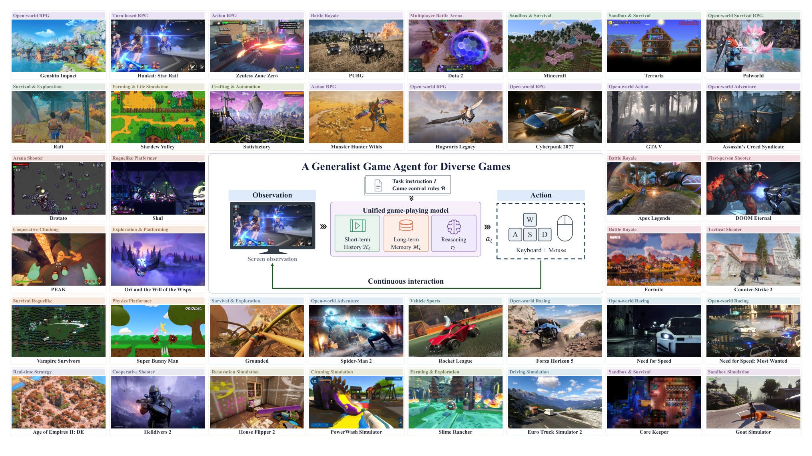
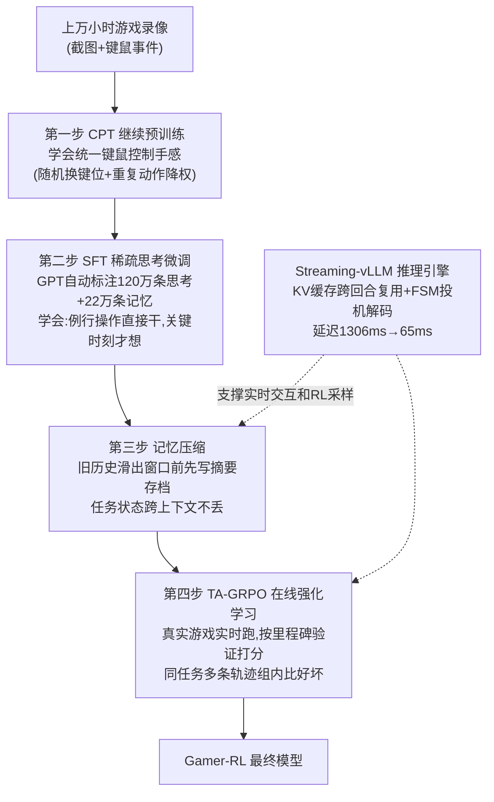

# Gamer：米哈游让 AI 像人一样"看屏幕、动键鼠"实时打通《崩坏：星穹铁道》

- **论文**：[Gamer: A Generalist Vision-Language-Action Foundation Model for Long-Horizon Real-Time Game Agent](https://arxiv.org/abs/2611.18397)（arXiv 2611.18397，2026-11-12）
- **项目页**：[mihoyo-gamer.github.io](https://mihoyo-gamer.github.io/) ｜ **代码**：[github.com/RainBowLuoCS/Gamer](https://github.com/RainBowLuoCS/Gamer)（引擎 Streaming-vLLM 标注 Coming soon，CPT 权重开源在 [THUSI-Lab HF 合集](https://huggingface.co/collections/THUSI-Lab/gamescaling-model)）
- **Venue**：arXiv 预印本（技术报告体），HuggingFace Daily Papers 当日第 3（67 赞）
- **作者机构**：米哈游崩坏 AI 研发团队主导，联合 NUS、清华、国科大、中科大、西交
- **来源**：HuggingFace Daily Papers 热榜

## 🎯 30 秒版本

米哈游发布"通用游戏 AI 基座模型" Gamer：不接游戏内部 API、不读存档，像人类玩家一样只看截图、只输出键鼠操作，就能实时玩《崩坏：星穹铁道》这类复杂 3D 商业游戏，主线挑战通过率超 95%。它证明了完整工业管线——上万小时录屏数据 + 三阶段训练 + 低延迟推理引擎——能把"AI 玩游戏"从演示玩具推进到接近熟练玩家的水平。直接价值：开源了系统提示词、动作格式规范和"实时 Agent 推理引擎"设计细节（延迟 1.3 秒→65 毫秒，快 20 倍），对做 GUI Agent、机器人控制的人都有参考价值。

## 📚 读前须知

三个概念先讲清：

1. **VLA 模型（Vision-Language-Action，视觉-语言-动作模型）**：能"看图→理解→输出物理动作"的 AI。类比：聊天 AI 是只出主意的"军师"，VLA 是"既当军师又亲手操作的老司机"。此前主要用于机器人，Gamer 把它搬到键鼠游戏。
2. **继续预训练（CPT，Continued Pre-Training）**：在训好的通用大模型（这里是 Qwen3-VL/Qwen3.5）之上用领域数据再训一轮。类比：招了个名校毕业生，再送去职业培训班学"打游戏"，而不是从婴儿重新养。
3. **KV Cache（推理时把算过的中间结果存起来复用的缓存）**：大模型逐字生成时，前文的"笔记"存在显存里避免重算。游戏 Agent 一秒看 5 张截图，若每次把几分钟历史重算一遍延迟会爆炸——Gamer 推理引擎的核心创新就是让这份"笔记"跨回合保留、只算新增部分。

## 🎯 解决什么问题

以前游戏 AI 有三条路，每条都卡死：

- **特权接口派**（AlphaStar 打星际、OpenAI Five 打 Dota）：直接读游戏内部数值、用专用动作空间。问题是现代商业游戏不开这种接口，且换个游戏就废——相当于考试看答案，出了考场不会做题。
- **通用大模型直接上**：论文实测旗舰模型惨不忍睹——GPT-5.6-Sol 在 MCU 基准实时模式只有 8.7 分（Gamer 47.7）。更致命的是**延迟**：想一步要一两秒，动作到达时画面早变。所有通用模型开实时后暴跌 20-70 分——像反应慢半拍的司机，每个操作都基于 2 秒前的路况。
- **暂停评估的虚假繁荣**：很多论文评估时把游戏暂停等模型想完，掩盖了延迟问题。Gamer 专门对比"暂停模式（TP）"和"实时模式（RT）"两套分数——推理慢不仅玩得差，连 RL 都"学得差"。

Gamer 要解决的：**不碰游戏内部状态、只用屏幕+键鼠，做到实时、长程（任务跨小时）、跨游戏的通用操作能力。**

## 🔬 核心方法

*图 1：Gamer 的运行循环：截图+任务指令+交互历史+长期记忆 →（可选）思考 → 键鼠动作 → 世界变化，5Hz 观察、30Hz 动作，全程不碰游戏内部数据。（图源：论文 Figure 1）*

整条管线按"输入→处理→输出"逐步拆：

**第一步：统一动作表示 + 继续预训练（CPT）——先学会"手"**

- 输入：每秒 5 帧截图 + 同步键鼠事件，来自上万小时多游戏录像（光《星穹铁道》就有 6.8 万会话、1.1 万小时）。
- 处理：每个 200ms 观察间隔切成 6 个约 33ms 的动作块，模型每步输出一行文本：鼠标位移 (X,Y,Z) + 6 组按键。两个关键设计：① **随机按键重映射**——训练时随机换键位（键位表同步改），逼模型学"W 的功能是前进"而非"W 这个字母"；② **重复感知损失衰减**——85% 以上动作步是重复上一步（按住 W 跑图），连续重复按 0.9 幂次降权，注意力落在"行为切换"（停下、转弯、交互）上。动作直接序列化为文本，不加输出头。
- 输出："手感"好的控制底座。配套研究 GameScaling 跑了 120 种配置（4 模型大小 × 6 数据量 × 5 游戏配比），结论：**数据"相关度"比"总量"重要**——堆再多 Minecraft 录像也教不会远处的新游戏（数据指数 b≈0），多游戏混合配比才带来持续泛化。

**第二步：稀疏思考指令微调（SFT）——再学会"脑子按需开机"**

- 输入：1 千小时精选录像的自动标注数据——GPT-5.6-Luna 打了约 **120 万条"关键决策思考"**、**22.3 万条记忆摘要**、6.3 万个任务分段，组装成三档难度指令（单步操作 / 子目标 / 任务段）。
- 处理：核心是**思考要稀疏**。跑图、平A等例行操作直接出动作；只在路线失败、目标切换等关键时刻才生成推理文本。模型自己学会"何时该想"，无需外挂分类器。
- 输出：会跟任务指令干活的策略模型 + 记忆机制（见下）。

**第三步：跨上下文记忆——解决"玩着玩着忘了前面"**

长任务动辄几十分钟，上下文窗口装不下全部历史。做法：旧交互滑出窗口前，模型先写一段**第一人称记忆摘要**（"已修好 2 台机械，还剩 1 台在货舱区"），旧历史连 KV Cache 一起丢弃，摘要拼进长期记忆——类比：办公桌放不下的文件，先写便利贴存档再扔。超预算按时间丢最老的摘要。整个过程仍是同一模型的普通输出步，无需额外记忆模型。

**第四步：TA-GRPO 在线强化学习——用真实游戏反馈继续打磨**

- 输入：策略在真实游戏里实时跑出的小时级长轨迹。
- 处理：**Temporal-Aware GRPO（时间感知组相对策略优化）**。GRPO 是 DeepSeek 带火的 RL 算法——不用价值网络，同一任务的 G 条轨迹放一组互相比名次（类比：不请裁判，选手互相比）。Gamer 两处改造：① **记忆链接分段**——长轨迹按记忆压缩点切段，不同 rollout 同阶段的段互相比，得分来自**环境可验证结果**（里程碑是否达成），不训奖励模型；② **时间信用分配**——段得分按 β 指数加权摊给各步（越靠近结果权重越大，均值归一），解决"一段 50 步一个分数，功劳记给谁"。
- 输出：导航、对话全面提升的最终策略 Gamer-RL。

**怎么读这张图**：主线是从上到下四步训练流水线，每步在前一步模型上继续加工；虚线的推理引擎不决定"学什么"，但决定"跑多快"——没有它，实时交互根本不成立。

**第五步（工程侧）：Streaming-vLLM 实时推理引擎**

全文最硬核的系统工程，四个叠加优化：① **有状态流式上下文**——每个游戏环境独占一份 KV Cache 跨回合复用，只对新截图增量计算；压缩后旧页释放，保留键的 RoPE（旋转位置编码，模型感知 token 位置的机制）增量刷新不重算。② **FSM 验证式投机解码**——输出里大量格式 token 可预测（`<|action_start|>`、分号等），用有限状态机（按规则走状态的小程序）秒速"打草稿"，大模型只做验证；鼠标坐标等需要智能的值仍由模型生成。③ **提前动作分发**——鼠标字段和前几个按键块一验证完就发给客户端执行，剩余边生成边补。④ **算子融合 + CUDA Graph + Megakernel** 等底层优化。

## 📊 关键数字

**表 1：推理延迟优化（NVIDIA H200 显卡 + Qwen3.5-35B-A3B MoE 模型，逐项累积）**

| 配置 | 请求延迟 | 人话解读 |
|---|---|---|
| 基线 (TP1) | 1306 ms | 想一步 1.3 秒，游戏里早被打死 |
| +流式引擎+融合+重叠+CUDA Graph | 537 ms | 常规优化只快一半 |
| +Megakernel 底层后端 | 88 ms | 最大杀器：大核函数清零调度开销 |
| +W8A8 量化+FSM 引导解码 | **65 ms** | **20.1 倍加速**：每秒想 15 步，动作块产出率 92Hz，追平人类节奏 |

**表 2：《星穹铁道》留出任务成功率（每任务跑 3 次取平均，%）**

| 评测 | 基座 Qwen3-VL-8B | Gamer-CPT | Gamer-SFT | Gamer-RL | 最强通用模型对照 |
|---|---|---|---|---|---|
| 支线《贼灵作祟(上)》(30 里程碑) | 0.0 | 34.4 | 72.2 | **80.0** | DeepSeek-V4-Flash-Vision 23.3 |
| 支线《兽性难驯》(55 里程碑,含解谜) | 13.9 | 47.9 | 69.1 | **83.6** | Gemini-3.8-Flash 45.5 |
| 7 类小游戏宏平均 (40 实例) | 3.2 | 15.0 | 39.2 | **49.7** | GPT-6.1-Sol 17.1 |

人话解读：基座模型做支线全军覆没（0%），四步管线拉到 80%——10 次挑战从 0 次通关变 8 次；最强通用旗舰停在 20% 档。CPT→SFT→RL 每步都在涨，三阶段分工（手感/听指令/自我改进）真实有效。最亮眼的是导航：被 RL 从 55.2% 拉到 80.2%，恰好补上 SFT 最难教的"空间寻路"。解谜仍最弱（11-22%），纯反应式控制解不了深度推演谜题。

**表 3：公开跨游戏基准（实时模式分数，括号内为实时相对暂停模式的差值）**

| 模型 | MCU | ViZDoom | OmniGameArena | GameWorld | 平均 |
|---|---|---|---|---|---|
| GPT-5.6-Sol | 8.7 (−73.3) | 2.7 | 14.5 | 44.3 | 17.6 (−34.5) |
| Claude-Opus-5.0 | 8.7 (−48.0) | 2.0 | 16.4 | 42.0 | 17.3 (−26.4) |
| Gamer-8B-CPT | 47.7 (−13.0) | 14.4 | 21.9 | 34.0 | 29.5 (−4.4) |
| Gamer-35B-A3B-CPT | **65.3 (+18.6)** | 11.9 | 18.7 | 30.2 | **31.5 (+3.4)** |

人话解读：通用旗舰一开实时模式平均掉 26-34 分（GPT-5.6-Sol 在 MCU 从 82 暴跌到 8.7——延迟直接摧毁表现）；Gamer MoE 版实时反而**比暂停还高 3.4 分**（推理快，操作跟上画面节奏）。这列正负号是全文最有说服力的证据：**低延迟不是锦上添花，是能力本身。**

论文 8.5 节还发现：用慢推理（0.6 FPS）收集 RL 数据会**奖励崩塌**——过时动作产生偏差轨迹污染训练，越练越差。推理速度直接决定 RL 训不训得稳。

## 🛠 对工程实践的启发

1. **"格式 token 交给状态机、语义 token 留给大模型"可直接复用**：任何输出带固定 schema 的 Agent（工具调用 JSON、GUI 动作），结构 token 占比不小，FSM 起草+大模型验证是便宜的一档加速（88→65ms）；配合"提前分发已验证前缀"，是交互式应用通用的延迟优化范式。
2. **KV Cache 跨回合持久化 + 压缩后增量 RoPE 刷新**：做长会话 GUI Agent 不要每轮重发全部历史。短期队列存最近回合、长期队列存摘要，压缩时释放旧 KV 页、保留键只更新位置相位不重算投影——`streaming-vllm` 目录虽还是空的（Coming soon），设计描述已够抄作业。
3. **仓库现成可抄的资产**：`readme.md` 开源了系统提示词模板（含"何时该思考"的触发条件）、74 个键位 token 词表、200ms/6 块动作序列化格式和解析注意事项（保留特殊 token、只解析最后一个 `</think>` 之后的动作、失败按 no-op）。CPT scaling 权重在 THUSI-Lab HF 合集，配套代码见 [GameScaling 仓库](https://github.com/THUSI-Lab/GameScaling)。

## ⚠️ 局限与争议

**论文自己承认的**：① 评测范围有限，对"远处的陌生游戏"堆 CPT 数据无效（GameScaling 自己证明：within-mixture R² 仅 0.079）；② 推理仍是瓶颈——"快"不解决深度推演问题（解谜 11-22% 印证），作者寄望未来"大模型 System 2 慢思考 + 小模型 System 1 快反应"分层架构；③ 目前只在 A800/H200 级显卡上实时，消费级硬件跑不动。

**社区视角的质疑**（HN 暂无讨论帖，以下为审慎评估）：① **商业自评嫌疑**——"主线挑战 95% 通过率"发生在自家游戏上，无第三方可复现基准，里程碑验证器也是自建的；支线任务虽从训练留出，但"熟悉游戏里的新任务"≠"陌生游戏零样本"——表 3 里最远迁移的 GameWorld 上 Gamer 反而低于通用模型（34.0 vs 44.3），**跨游戏泛化成色要打问号**；② **核心资产未开源**：仓库只有 README+提示词文档+演示视频，Streaming-vLLM 和 SFT/RL 权重均未放出（只开源 CPT scaling 权重）；③ 标注管线重度依赖 GPT-5.6-Luna（120 万思考+22 万记忆），未报告人工抽检的质量与偏差。

## 🧠 关键概念表

| 术语 | 白话解释 | 为什么重要 |
|---|---|---|
| VLA（视觉-语言-动作模型） | 看屏幕→理解→输出物理操作的多模态模型 | Gamer 的类别，机器人/游戏 Agent 共同底座 |
| TA-GRPO | GRPO+记忆分段比较+时间加权功劳分配 | 小时级长轨迹在线 RL |
| KV Cache | 缓存推理时已算过的前文中间结果 | 实时并发成本大头，持久复用是加速关键 |
| RoPE（旋转位置编码） | 旋转向量让模型感知 token 位置 | 压缩后位置变，增量刷新不重算 |
| FSM 投机解码 | 状态机起草可预测格式 token，大模型验证 | 结构 token 免费拿，算力留给决策 |
| Megakernel | 多个 GPU 算子合成单个大核函数执行 | 消除调度开销，537→88ms 的最大功臣 |
| 稀疏思考 | 例行步骤直接出动作，关键决策才生成 think | 实时性算法保障：多数帧零思考开销 |
| 记忆压缩 | 旧历史滑出上下文前生成摘要存档 | 有限窗口支撑小时级任务的核心 |
| RT/TP 评估 | 实时（游戏继续跑）vs 暂停（等模型想完） | 分差揭示延迟鲁棒性，通用模型开 RT 就崩 |
| 里程碑验证 | 环境侧可检查的任务节点判定成败 | RL 奖励来源，免训奖励模型 |
| MoE（混合专家） | 很多"专家"子网络，每次只激活一部分 | 35B-A3B=350亿参数激活30亿：小模型延迟、大模型知识 |

## 💡 所以呢

做 GUI Agent / 游戏 AI / 机器人控制的读者：这篇技术报告价值大于学术价值——数据管线怎么搭、动作空间怎么设计（200ms/6块/随机换键）、推理引擎怎么优化（四层叠加到 65ms）全链条摊开讲了，即使权重不开源，设计决策本身就是可抄的清单。值得跟踪 `streaming-vllm` 的实际开源——若放出，可能是目前唯一公开的"实时多环境 Agent 推理引擎"参考实现。

*精读：2026-11-17 ｜ 来源：arXiv 2611.18397 HTML 全文 + GitHub README（clone 验证 187MB）+ HF 论文页作者贴*
