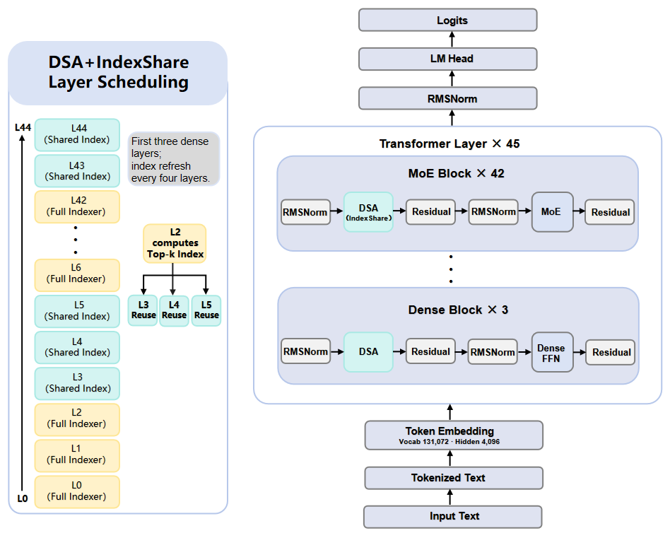
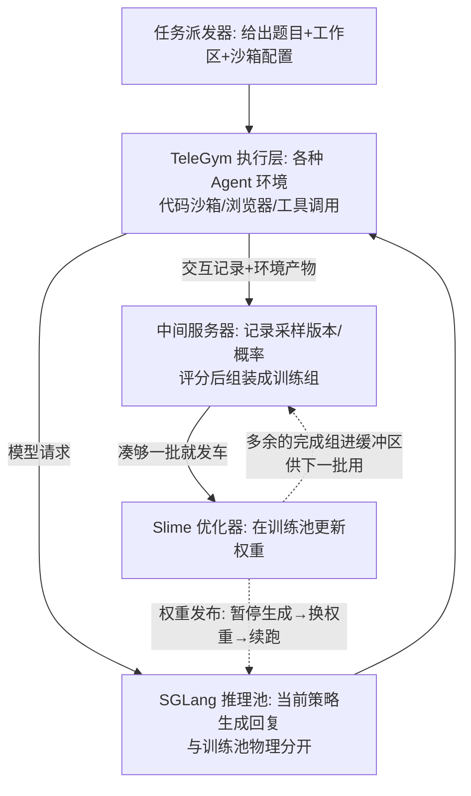

# 不用一块英伟达 GPU，训出前沿 Agent 模型：中国电信 Xing4 / TeleChat 技术报告精读

- **论文**：TeleChat to Xing4: Advancing Frontier Agentic Models on Domestic Chips and Frameworks
- **链接**：https://arxiv.org/abs/2611.22115 （HTML 全文：https://arxiv.org/html/2611.22115v1）
- **代码/权重**：https://github.com/XingChen-AGI/Xing4.0-29B-A4B （Apache 2.0，HF 上 1.86k 赞）
- **Venue**：arXiv 技术报告（2026-11-17 提交）· HuggingFace Daily Papers 11-18 榜首（148 赞）
- **作者机构**：中国电信 星辰 AGI Lab（Xingchen AGI Lab, China Telecom）

## 🎯 30 秒版本

1. **这是什么**：中国电信公开了 Xing4（星辰）系列大模型的完整"施工图"——架构选型、在 8,192 张华为昇腾 910C 上预训练 285B 参数 MoE 模型、用 RL 训 Agent 的 TeleGym 平台，全程不碰英伟达 GPU。
2. **为什么重要**：这是目前最详细的"非英伟达生态训前沿模型"工程报告，证明国产芯片+国产框架（MindSpore）训千亿级模型在系统工程上已跑通，还开源了单张 RTX 3090 就能跑的 29B Agent 模型。
3. **对你有什么用**：砍流水线并行、投机解码 3 倍提速、CPU 绑核省 5-10% 训练时间——这些是硬件无关的通用系统经验，做推理服务的直接能抄；开源 29B 模型 SWE-bench 75 分接近 Qwen3.6-35B，单张 RTX 3090 可跑。

## 📚 读前须知

**1. NPU 和 GPU 有什么区别？** GPU（英伟达显卡）是 AI 训练的默认硬件；NPU 是专为神经网络设计的加速芯片，这里指华为昇腾 910C。类比：GPU 像全能瑞士军刀，生态极成熟；NPU 像定制化工具，某些活干得又快又好（910C 的矩阵计算单元 "Cube" 很强），但配套软件（MindSpore，相当于昇腾世界的 PyTorch）差一截，很多坑要自己填——本文大部分篇幅就是讲怎么填。

**2. MoE（混合专家模型）是什么？** 稠密模型每个 token 动用全部参数；MoE 把前馈层拆成很多"专家"小网络，每个 token 只挑几个激活。类比：医院有 256 位专科医生，每个病人只挂 8 个号——知识容量是大医院的，开销是社区诊所的。285B 模型每 token 只算 17B。

**3. KV Cache 和长上下文的代价。** 模型生成时把前文的中间结果（Key/Value 向量）存显存里复用，即 KV Cache。上下文拉到 256K token（约一本 40 万字的书）时它吃掉巨量显存，且每生成一个字都要翻全部历史。本文核心优化之一就是"少翻、翻得准"。

## 🎯 解决什么问题

开源大模型（Llama、Qwen、DeepSeek…）几乎都在英伟达 GPU 上用 PyTorch 训练。想在国产芯片上复刻这套流程，会撞上三堵墙：

- **墙一：照搬 GPU 架构浪费算力。** 910C 的矩阵计算单元（Cube）很强，但向量计算和显存带宽（HBM，芯片的高速内存）吃紧。GPU 上流行的"深而窄"网络在昇腾上层间"碎活"（归一化、路由、调度）太多，最强的矩阵单元反而闲着。
- **墙二：通信拓扑不同。** 昇腾集群以 SuperPoD（超节点，内部超高带宽互联的机器组）为单位，内快外慢。GPU 世界成熟的"流水线并行"（模型按层切段流水作业）天然有"气泡"——启动排空时部分机器闲着，4 段流水线理论浪费约 27%。
- **墙三：Agent RL 训练里任务耗时极不均匀。** 训数学题一分钟搞定，训"修仓库 bug"的多轮 Agent 任务可能跑一小时。传统 RL 框架要求一批样本齐步走，一个慢任务卡住整批，NPU 大量空转。

## 🔬 核心方法

Xing4 拆成三大块：**架构为昇腾"量体裁衣"、预训练系统"拆墙"、Agent 后训练平台 TeleGym**。逐步看：

### 第一块：架构选型——每个组件都对着一种"开销"下手

以论文重点研究的 285B 成员为例（45 层，每 token 激活约 17B，支持 100 万 token 上下文）：

**步骤 1：MLA 压缩 KV Cache。** MLA（Multi-head Latent Attention，DeepSeek-V2 引入）不直接存每个注意力头的 K/V 向量，而存压缩后的低秩表示，用时再解压——不搬整套百科全书进书房，只存一份浓缩索引卡。这是长上下文的地基。

**步骤 2：DSA 稀疏注意力，"翻书前先查目录"。** 256K 上下文每生成一个字仍要访问全部历史 KV。DSA（DeepSeek Sparse Attention）给每层配一个轻量"闪电索引器"，先给全部历史快速打分，只挑最相关的 Top-K 条给主注意力精读——律师查卷宗不逐页通读，先用目录定位。代价是索引器本身也要算。

**步骤 3：IndexShare 跨层共享索引，"目录查一次全楼用"。** 相邻层挑出的"最相关历史"高度重合，IndexShare 让多层复用同一份索引——像写字楼各部门共用前台查好的访客名单。叠加后预填充吞吐冲到 MLA 基线的 4.68 倍。

**步骤 4：宽而浅的 MoE 拓扑，喂饱矩阵单元。** 受控对比：60 层窄专家 vs 45 层宽专家（总参数和激活参数拉平）。45 层版单层矩阵乘法更大、层间碎活更少，正好契合 910C "矩阵强、杂活弱"的体质：TTFT 降 17%，训练吞吐高约 10%。不是学术偏好，是硬件画像驱动的取舍。

**步骤 5：DSpark 投机解码，一次验证吐一串字。** 投机解码（speculative decoding）用便宜的小模型先"打草稿"，大模型一次性"批改"，批对了就等于一步走好几步。DSpark 的草稿模型一次并行起草 7 个位置的整块内容（block-wise），配轻量"马尔可夫头"修正相邻草稿词的依赖、"置信度头"预判哪些位置会被接受——实习生一次写好 7 段草稿并自评靠谱度，总编一口气批阅。

*图：285B 代表配置总览（论文 Figure 1）。前 3 层稠密 FFN 打底，其余层 MoE；注意力走 MLA+DSA+IndexShare 三件套；推理外挂 DSpark 草稿模型。*

### 第二块：预训练系统——拆掉"流水线"这堵墙

**步骤 6：用 HSDP 替代流水线并行，气泡归零。** Xing4 改用 HSDP（Hybrid Sharded Data Parallelism，混合分片数据并行）：参数在每个 SuperPoD **内部**切碎分摊（FSDP 式），SuperPoD **之间**只做粗粒度梯度聚合——高频细碎通信全关在节点内高速网络里，慢速跨节点链路只走"批发"流量。类比：门店内传菜用推车随时补，跨城市只跑每天一班大货车。分片解决了显存，PP 就能整个删掉，气泡消失。另有"零拷贝"细节：节点内带宽富裕，直接对每个参数张量做 AllGather/ReduceScatter，省掉 PyTorch FSDP 打包进扁平缓冲区的来回搬运。

**步骤 7：Muon 优化器"谁拥有谁计算"。** Muon 需要看到**完整**权重矩阵，而分片训练里每张卡只有矩阵的一小条。朴素实现下每张卡都拼出完整矩阵、各自跑一遍相同迭代、只留自己那条——8 张卡算 8 遍同一道题。Xing4 给每个矩阵指定"属主"卡：其他卡把碎片点对点发来，属主算一次再把结果切片发回。单步 31.8s → 28.9s（省 9.1%）。

**步骤 8：抠显存和抠 CPU，两个不起眼的 15%/10%。** 其一是"逐层索引器反向"：DSA 索引器的辅助计算图原来要等主干反向全部算完才能释放中间结果；改成每层反向完立即释放，单步再省 15.2%——三项优化里最大的一笔。其二是 CPU 绑核+核心隔离：训练线程按角色分池绑定 CPU，系统服务、日志、中断赶出训练池。听着是运维常识，8,192 卡集群实测提 5–10% 吞吐——任何一张卡的 host 线程被抢 CPU、迟到集合通信，**全部**卡都得等它：8,192 人的合唱团一人迟到全体重来，把闲杂人等请出排练厅，比给领唱换金话筒更划算。

### 第三块：TeleGym——Agent 强化学习的"异步工厂"

**步骤 9：生成与训练分池，异步流水。** TeleGym 统一托管各种 Agent 执行环境（代码沙箱、浏览器、工具 harness），中间服务器把"模型交互+环境结果"转成训练轨迹交给 RL 优化器（Slime）。生成侧与训练侧设备池物理分开：训练器更新当前批次时，生成侧已在生产下一批数据。

**步骤 10：有界过采样 + 部分 rollout，专治"慢任务"。** 调度器故意多派任务（过采样），谁先完成谁先凑批，积压设上限（有界）。跑到一半遇上权重更新？**部分 rollout（partial rollout）**：暂停、记录执行身份、换新权重后**原地续跑**，工具调用、文件修改、对话历史全保留——像马拉松途中换新跑鞋，比赛不重跑。

**步骤 11：轨迹跨了多个模型版本，怎么算账？** 每段生成记录采样时刻的策略版本和 log 概率，优化时用作重要性采样比（importance ratio，衡量"新模型觉得这个旧动作有多合理"的修正系数）；过期数据**整组**丢弃，因为组内相对奖励（GRPO 式算法要求同一 prompt 的多条轨迹互相比较打分）必须保持成员完整。

*怎么读这张图：实线是数据流（任务→执行→生成→打分→训练），虚线是控制流。关键在两条虚线：权重更新不打断在跑的任务（续跑），多产的数据不浪费（缓冲）——整个系统像异步工厂，生成和训练互不等待。*

## 📊 关键数字

**推理侧**（285B，32 张 910C，256K 上下文，华为"瞻鹿"仿真测算，P/D 分离部署），相对纯 MLA 基线归一化：

| 架构 | KV 显存访问 | TTFT（首字延迟） | TPOT（每字延迟） | 预填充吞吐 | 解码吞吐 | 人话解读 |
|---|---|---|---|---|---|---|
| MLA+DSA | 0.85× | 0.37× | 0.84× | 2.67× | 1.18× | 加"查目录"后首字等待只剩 1/3 强 |
| MLA+DSA+IndexShare | 0.80× | 0.21× | 0.79× | **4.68×** | 1.27× | 目录全楼共享，长文吞吐近 5 倍：1 小时的活 13 分钟干完 |

**投机解码**（285B，六个推理/代码基准实测 tokens/s）：

| 基准 | 原始 / MTP3 / DSpark | DSpark 加速比 | 人话解读 |
|---|---|---|---|
| GSM8K（数学） | 35.4 / 63.7 / 115.8 | 3.28× | 每秒吐字 35 个变 116 个 |
| HumanEval（代码） | 35.7 / 64.1 / 134.7 | **3.77×** | 代码重复模式多，草稿命中最狠 |
| LiveCodeBench | 35.6 / 64.5 / 95.2 | 2.67× | 最难的活也有 2.7 倍 |

**训练侧**（1,024 卡集群，285B，序列长 262,144，单步时间）：

| 配置 | 单步耗时 | 相对基线 | 人话解读 |
|---|---|---|---|
| PP-1F1B（4 段流水线） | 36.4s | 1.00× | 传统方案，含约 27% 气泡 |
| PP-Interleaved | 34.2s | 1.06× | 交错调度只能缓解气泡 |
| **HSDP（删掉流水线）** | **31.8s** | **1.14×** | 摘要的 16.1% 提升来自这里 |
| + 属主制 Muon | 28.9s | 再省 9.1% | 不再 8 卡重复算同一道题 |
| + 选择性重计算 | 26.9s | 再省 6.9% | 少量重算换显存 |
| + 逐层索引器反向 | 24.5s | 再省 15.2% | 三项里最大单笔 |

从 36.4s 到 24.5s 累计约 **1.49×**——同样的卡训练时间打七折。CPU 绑核+隔离在 8,192 卡生产集群再提 5–10%；README 称全套优化把开箱训练吞吐提升约 96%（项目方口径，论文未独立验证）。

**开源 29B 成员成绩单**（官方，对比同为小激活 MoE 的 Gemma4-26B-A4B / Qwen3.6-35B-A3B）：SWE-bench Verified 75.0（Qwen3.6 为 76.0，Gemma4 仅 53.0）、Terminal-Bench 2.1 57.5（超 Qwen3.6）、AIME2026 90.0。4-bit 量化约 15GB 显存，单张 RTX 3090/4090 可跑。

## 🛠 对工程实践的启发

1. **"宽而浅"值得琢磨**：层间碎活（归一化/路由/调度）的开销是真实的，同参数量下 45 层比 60 层训练吞吐高 10%、TTFT 低 17%。选开源模型二次训练时优先浅而宽的拓扑。
2. **投机解码选型：专职草稿模型 > MTP 头**。DSpark 式 block-wise 草稿在代码类负载上有 3.7 倍吞吐，对 Agent 工作流（大量代码+结构化输出）性价比极高。SGLang 主线已原生支持 Xing4.0（PR #39793）。
3. **大规模集群先查 host 侧再查卡侧**：CPU 绑核、核心隔离这些"运维动作"在 8K 卡规模值 5–10% 吞吐。做分布式训练/大批量推理的团队，值得对照论文 5.1 节的线程分池方案自查一遍。

## ⚠️ 局限与争议

- **推理效率数据大量来自仿真**。4.68× 那张表用华为"瞻鹿"仿真框架测算，论文自认"可能偏乐观"；真机数字只有投机解码一组。
- **没有能力对账单**。285B 模型的能力评测（与 DeepSeek-V4、Kimi K3 等对比）完全缺席；29B 的 benchmark 只在 README，论文未附训练数据规模等复现要素。技术报告体裁的常见短板。
- **HN 讨论几乎为零**（Algolia 检索仅 2 条低分转载帖）；中文社区质疑集中在"benchmark 是否挑着报"，也有知乎实测肯定其代码能力，但指出通用知识类任务逊于同级 Qwen。
- **强绑定昇腾生态**。HSDP 零拷贝、属主制 Muon 的前提是 SuperPoD "内快外慢"的带宽层级，换普通以太网集群或 PyTorch 栈收益会缩水。

## 🧠 关键概念表

| 术语 | 白话解释 | 为什么重要 |
|---|---|---|
| 昇腾 910C（NPU） | 华为的 AI 加速芯片，对标英伟达 GPU | 全部优化的硬件底座 |
| MindSpore | 华为的深度学习框架（对标 PyTorch） | "国产框架"的另一半 |
| MoE | 每 token 只激活部分"专家"网络的稀疏模型 | 285B 总量只算 17B 的关键 |
| MLA | 压缩存储 KV Cache 的注意力设计 | 长上下文的显存地基 |
| DSA | 先用轻量索引器挑 Top-K 相关历史再做注意力 | 把"通读"变"查目录" |
| IndexShare | 多层复用同一份稀疏索引 | 省掉重复的目录查询 |
| Muon | 对权重矩阵做正交化的新型优化器 | "属主制"省 9.1% 的对象 |
| 投机解码 / DSpark | 小模型打草稿、大模型批量批改 | 解码吞吐 2.7–3.8 倍 |
| 流水线气泡 | 按层切段流水作业时启动排空的空转 | 删掉 PP 省回约 27% |
| FSDP / HSDP | 参数切碎分摊到各卡 / 只在超节点内切碎 | 免流水线的显存方案 |
| TeleGym | 统一 Agent 执行/沙箱/轨迹平台 | 各类任务共用一套 RL 流水线 |
| 重要性采样比 | 用采样时的旧概率修正新旧策略差异 | 轨迹跨版本仍能正确学习 |

## 💡 所以呢

这份报告的最大价值不是"国产替代"叙事，而是把**硬件画像如何反过来塑造模型架构**的推理链完整摊开：Cube 强/向量弱，所以宽而浅；SuperPoD 内快外慢，所以 HSDP；万卡同步一损俱损，所以 CPU 绑核值 10%。做基础设施的可以抄思路，用模型的可以直接上手 29B——一张 3090 的事，SWE-bench 75 分在 4B 激活档位相当能打。值得盯的后续：万亿参数模型正在昇腾上训练，那是这条路线的终极压力测试。

---
*来源：HF Daily Papers 11-18 榜首（148 赞）。基于 arXiv HTML 全文精读；29B benchmark 来自官方 README/HF 模型卡（未经独立复现）。HN 无实质讨论帖（已检索确认）。*
