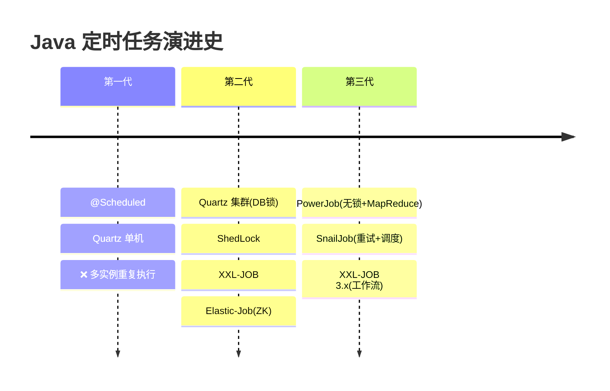
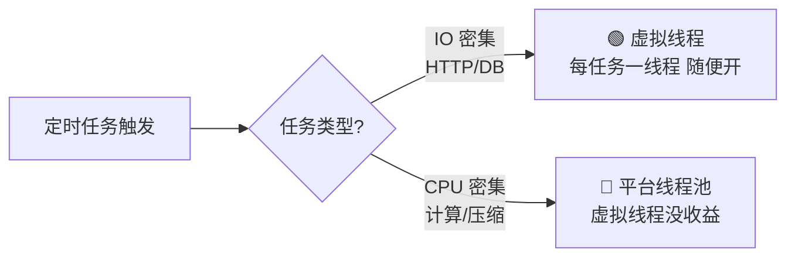
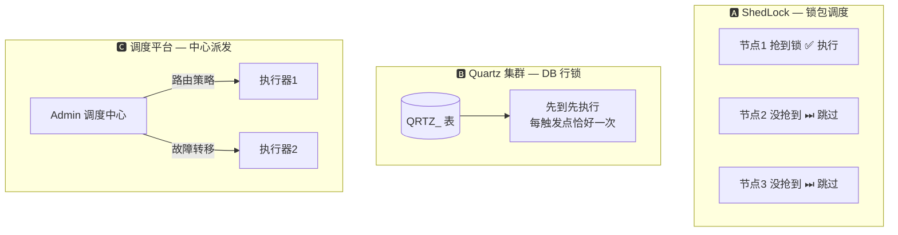
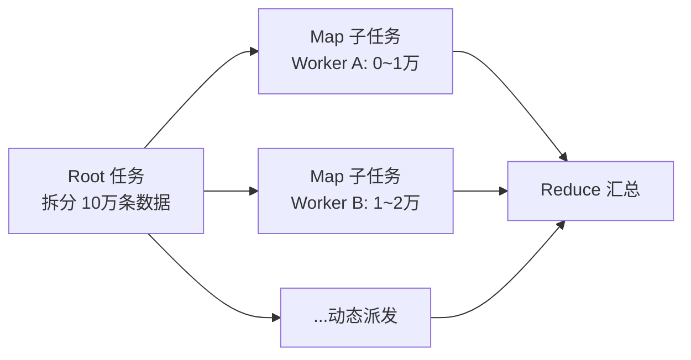
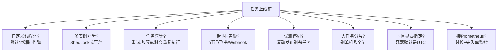

# ⏰ Spring Boot / Java 定时任务前沿调研

> 📅 2026-10-19 · 🤖 Hermes Agent 自动生成 · 阅读约 8 分钟

---

## 🗺️ 一图看懂：三代方案演进



**核心区别一句话**：第一代调度状态在 JVM 里（多开就重复跑）；第二代靠共享存储抢锁；第三代把调度做成独立平台，管编排、管计算、管重试。

---

## 🚀 TL;DR 选型速查表

| 你的场景 | 直接选 | 理由 |
|---|---|---|
| 🏠 单体小项目 | `@Scheduled` | 零依赖，记得自定义线程池 |
| 🔒 多实例防重复、不想改架构 | **ShedLock** | 一个注解搞定 |
| 📊 通用分布式调度 + 可视化 | **XXL-JOB** | 国内生态最大，只要 MySQL |
| 🧮 海量任务 / 分布式跑批 | **PowerJob** | MapReduce 模型，无锁架构 |
| 🔁 重试治理是刚需 | **SnailJob** | 死信队列 + 重试风暴防护 |
| 🐘 已重度使用 ZK | Elastic-Job | 去中心化分片 |
| ☁️ 不想自己运维 | 云托管 SchedulerX / MSE | 花钱省事 |

---

## 1️⃣ Spring Boot 原生调度

### ✅ 正确姿势

```java
@Configuration
@EnableScheduling
public class SchedulingConfig {
    @Bean
    TaskScheduler taskScheduler() {
        ThreadPoolTaskScheduler s = new ThreadPoolTaskScheduler();
        s.setPoolSize(4);                      // ⚠️ 默认只有 1 个线程！
        s.setThreadNamePrefix("sched-");
        s.setAwaitTerminationSeconds(60);      // 优雅停机
        return s;
    }
}

@Component
public class NightlyJobs {
    // 每天凌晨 0 点到 3 点，每小时整点执行
    @Scheduled(cron = "0 0 0-3 * * *", zone = "Asia/Shanghai")
    public void nightlyReport() { ... }
}
```

> 💣 **最大的坑**：默认调度线程池只有 **1 个线程**，一个任务卡住 = 所有任务停摆。

### ⭐ 前沿：虚拟线程（Java 21+）

```properties
spring.threads.virtual.enabled=true
```



注意两点：
- JDK 21 里 `synchronized` + 阻塞调用会 **pinning**（JDK 24 已修复）
- 重度依赖 `ThreadLocal` 缓存的旧代码不适合（线程不复用了）

---

## 2️⃣ 多实例互斥的三条路



### ShedLock 最小示例

```java
@EnableSchedulerLock(defaultLockAtMostFor = "10m")
public class SchedulerConfig {
    @Bean
    LockProvider lockProvider(RedisConnectionFactory cf) {
        return new RedisLockProvider(cf, "myapp");
    }
}

@Scheduled(cron = "0 0 3 * * *")
@SchedulerLock(name = "nightlyReport", lockAtMostFor = "15m", lockAtLeastFor = "5m")
public void nightlyReport() {
    LockAssert.assertLocked();  // 没锁直接抛异常，防误用
    ...
}
```

> ⚠️ **诚实的局限**：ShedLock 只"去重"不"分散"——3 个节点还是 1 个干活；持锁节点挂了**不会故障转移**，只能等下个周期。

---

## 3️⃣ 四大分布式平台横评（2026）

### 📊 能力矩阵

| | XXL-JOB 3.4 | PowerJob | SnailJob 2.x | Elastic-Job |
|---|:-:|:-:|:-:|:-:|
| 最新版本 | 3.4.2 (2026-06) | 5.x | 2.0 | 3.x |
| 外部依赖 | MySQL | MySQL/PG | DB | **ZooKeeper** |
| 秒级调度 | ❌ | ✅ | ✅ | ❌ |
| 工作流 DAG | ✅ (3.x 新增) | ✅ | ✅ 仿钉钉 UI | ❌ |
| 分布式计算 | 分片广播 | **MapReduce** | Map/MapReduce | 静态分片 |
| 分布式重试 | ❌ | ❌ | ✅ **核心卖点** | ❌ |
| 死信队列 | ❌ | ✅ | ✅ | ❌ |
| 多语言客户端 | ❌ | ❌ | **Java/Python/Go** | ❌ |
| K8s 感知 | ✅ (3.x) | ✅ | ✅ | ⚠️ |
| 协议 | ⚠️ GPL | Apache 2.0 | Apache 2.0 | Apache 2.0 |
| 社区热度 | 🔥🔥🔥🔥🔥 | 🔥🔥🔥🔥 | 🔥🔥🔥🔥 ↑ | 🔥🔥 |

### 🎯 各家一句话点评

- **XXL-JOB** — 国民级选择。3.x 补齐工作流编排（兼容 DolphinScheduler 语义）、SQL 任务、K8s 服务发现。⚠️ Admin 中心有单点风险，需集群部署；GPL 协议商用注意。
- **PowerJob** — 技术流。无锁架构 + Akka 通信，压测派发延迟比传统方案低 ~58%；独有 MapReduce 模型：大任务动态拆片、多 Worker 并行、结果归并。
- **SnailJob** — 新势力黑马 🐎。把"重试治理"做成一等公民：指数退避、异常黑白名单、重试风暴防护、幂等 ID、死信回滚。提供 XXL-JOB 一键迁移脚本，明显在抢存量。
- **Elastic-Job** — 老牌去中心化。无调度中心，靠 ZK 协调分片，实例上下线自动重分配。缺点是 ZK 运维成本 + 社区降温。

### PowerJob MapReduce 心智模型



---

## 4️⃣ 2025–2026 前沿趋势

1. 🧵 **虚拟线程成为默认选项** — Boot 3.2+ 一行配置，IO 型任务直接受益
2. 🕸️ **工作流编排下沉** — 调度平台 = 轻量编排引擎，DAG 成标配
3. 🔁 **重试治理独立化** — 重试滥用是雪崩常见根因（参考携程/字节实践），SnailJob 把它产品化
4. ☸️ **K8s 原生感知** — 服务发现注册执行器、Pod IP 漂移自愈
5. 🤖 **AI 工作流调度** — XXL-JOB 云版已支持调度 Dify 工作流
6. 🌐 **打破 Java 边界** — SnailJob 提供 Python/Go 客户端

---

## 5️⃣ ✅ 生产上线检查清单



---

## 📚 参考来源

- [Spring Boot 官方文档 — Task Execution and Scheduling](https://docs.spring.io/spring-boot/reference/features/task-execution-and-scheduling.html)
- [Redisson Blog — Quartz vs ShedLock vs Redisson](https://redisson.pro/blog/distributed-task-scheduling-in-java-quartz-shedlock-redisson.html)
- [Maven Central — xxl-job-core 版本记录](https://mvnrepository.com/artifact/com.xuxueli/xxl-job-core)
- [SnailJob 官网](https://snailjob.opensnail.com/) · [GitHub: aizuda/snail-job](https://github.com/aizuda/snail-job)
- [阿里云开发者社区 — 分布式任务调度框架深度对比](https://developer.aliyun.com/article/1663925)

---

<sub>🤖 本报告由 Hermes Agent 每日凌晨自动调研生成 · [HermesReports](https://github.com/knolonzhou/HermesReports)</sub>
