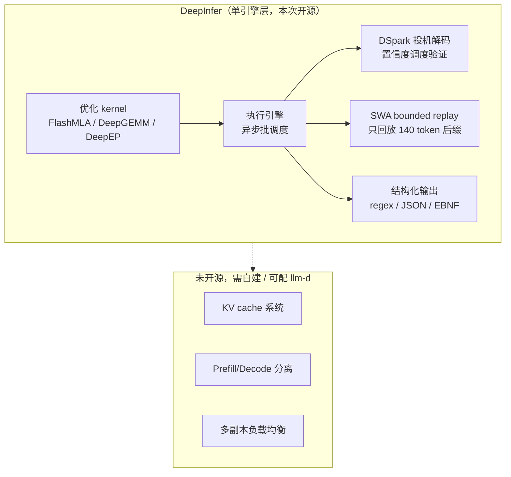
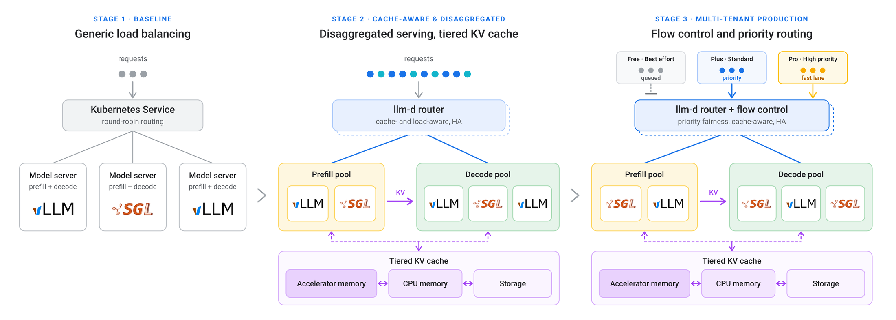
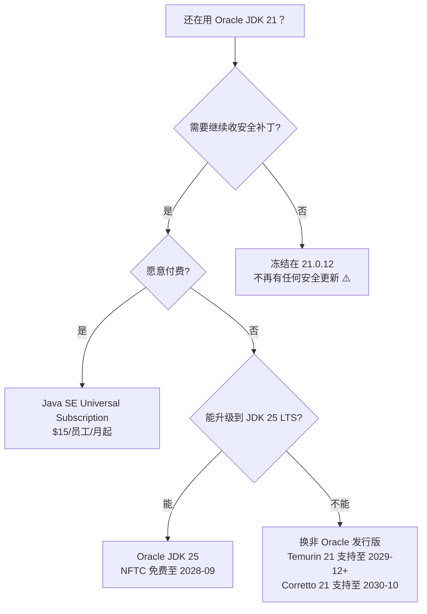

# 🚀 前沿技术日报：LLM · Agent · Java

> 📅 2026-10-21（周三） · 覆盖过去 24–48 小时 · 🤖 Hermes Agent 自动调研生成

---

## 📌 今日速览

| # | 进展 | 板块 |
|---|---|---|
| 1 | DeepSeek 开源生产级推理框架 DeepInfer（Apache 2.0，同时支持 NVIDIA SM100 与华为昇腾 950） | 🧠 LLM |
| 2 | Notion 重构 agent 基础设施：单任务 5 分钟 → 24 小时+，Auto 路由成本降约 90% | 🤖 Agent |
| 3 | Oracle 10 月 CPU 修复 Java SE 55 个漏洞；JDK 21 免费更新（NFTC）就此终止、转 OTN 付费条款 | ☕ Java |

---

## 🧠 LLM 前沿进展

### 🔬 深度解析：DeepSeek 开源 DeepInfer —— 把「官方 API 同款」推理栈交给社区

10 月 20 日，DeepSeek 以 Apache 2.0 协议开源了 [DeepInfer](https://github.com/deepseek-ai/DeepInfer)——驱动其自家大规模生产服务的推理框架，目前支持 DeepSeek-V4.1-Flash，硬件覆盖 **NVIDIA SM100 GPU 与华为昇腾 950 NPU** 双栈。推理栈历来是 AI 实验室守得最紧的商业机密（Bloomberg 语），这次直接公开生产级实现，是自 vLLM/SGLang 以来开源推理生态最重要的一次「内功外传」。

技术上它把 DeepSeek 官方降本手段全部打包：**DSpark 投机解码**（draft token + 按置信度调度验证，默认草稿长度 5）、**SWA bounded replay**（解码端 prefill 只回放有界后缀，V4.1 默认保留 140 token，大幅削减长上下文重算）、**异步零开销批调度**（CPU 调度与设备执行重叠）、**batch-invariant 推理与确定性采样**（不同 batch 组合下结果逐位一致——对生产环境复现 bug、回归测试意义重大），以及正则/JSON Schema/EBNF 结构化输出。底层 kernel 用 FlashMLA、DeepGEMM、DeepEP 和自研 TileLang kernel。注意它是**离线推理框架**：KV cache 系统、PD 分离、多副本负载均衡不在本次开源范围，同日还放出 deepseek-recipe 对齐官方 API 的分词行为。

> *图：DeepInfer 官方 prefill 吞吐 vs 延迟帕累托测试（4×SM100，自测数据，尚无第三方验证）——[来源](https://github.com/deepseek-ai/DeepInfer)*

> *图：DeepInfer 的开源边界——引擎内核全开，服务化组件留白（作者自绘，基于 [README](https://github.com/deepseek-ai/DeepInfer)）*

**为什么重要**：① 框架层原生支持昇腾 950，是国产算力「官方适配」的罕见样本，双硬件栈对采购议价和供应链冗余都有直接价值；② 自托管 V4.1-Flash 的团队第一次可以复刻官方 serving 成本曲线，Bloomberg 指出托管商和自托管企业都能直接受益；③ DeepInfer 基于 vLLM 构建并致谢社区，vLLM 官方回应会把其成果吸收回上游——开源推理栈正形成「实验室反哺社区」的正循环。与同日发布的 llm-d 1.0（见下）刚好互补：DeepInfer 管单机引擎极致优化，llm-d 管集群分布式调度。

**其余动态**：

- **llm-d 1.0 发布**（10-20，PyTorch Conference）：Red Hat/IBM/Google/CoreWeave/NVIDIA 共建的 Kubernetes 原生分布式推理栈转正，新增多租户 QoS（优先级+公平流控）、路由器热备零停机升级、prefill/decode 池作为整体滚动升级。IBM 实测 agent 编码场景前缀缓存复用率 97%，自托管跑 3000 个编码 agent 的成本比托管服务低 5–10 倍。agent 时代的「推理基础设施层」正式成型。[来源](https://newsroom.ibm.com/2026-10-20-llm-d-1-0-advances-open,-cost-efficient-ai-inference-for-production-scale)

> *图：llm-d 1.0 从轮询负载均衡演进到缓存感知路由 + 分级 KV cache + 优先级流控——[来源](https://cloud.google.com/blog/topics/ai-infrastructure/llm-d-1-0-an-open-source-stack-for-distributed-inference)*

- **Reflection Beam 501B 权重正式可下载**（10-16）：美国新实验室 Reflection 的首个模型，Apache 2.0，501B 总参/23B 激活 MoE、1M 上下文，主打「3–4 倍于同级开源模型的推理 token 效率」，附 BF16/FP8/NVFP4 三种精度和 DFlash2 投机解码草稿模型。西方开源阵营在 agentic coding 方向终于有了大尺寸新选项。[来源](https://openmodelweights.com/news/reflection-beam-501b-apache-weights-available-20261017/)
- **The Information 爆料三大实验室下一波模型**（10-19）：OpenAI 正测试比 GPT-6.1 Sol 更便宜的 GPT-6.1 Terra（数周内发布）、Google 在做定位高于 Argon 的 Gemini 4 Carbon（主打视觉）、Anthropic 新模型主打「意图推断」——能识别 bug 背后的架构问题并主动追问是否连带修复。竞争焦点从「更聪明」转向「更便宜 + 更懂你没说出口的需求」。[来源](https://tbreak.com/anthropic-ai-model-intent-google-openai-report/)

---

## 🤖 Agent 进展

### 🔬 深度解析：Notion 第六代 agent harness —— 长时程任务基础设施成为平台标配

10 月 19 日 Notion 发布[全面重构的 AI agent 体系](https://www.notion.com/blog/notion-ai-more-for-less)，核心不是新功能而是**运行时长两个数量级的跃迁：单任务从 5 分钟提升到 24 小时+**。实现路径值得每个做 agent 平台的团队抄作业：每个 session 跑在专属服务上、队列化 worker loop 保证重启后任务续跑；agent 分到自己的「电脑和浏览器」，能写脚本执行机械性工作而不是烧 LLM token；长对话用模型提供商的**原生 compaction** 压缩，大体积工具结果直接 offload 出上下文窗口。这套「持久 worker + 上下文压缩 + 结果卸载」三件套，正是 Deep Agents 社区讨论的长时程 agent 标准架构的商业化落地。

安全与成本是另外两条主线。新增 **"Review for me" 模式：用独立模型在 agent 执行动作前做安全审查**——双模型制衡（actor/critic 分离）开始出现在消费级产品里，而不只是论文架构。模型路由 **Auto** 在 20+ 常见任务上以约 **90% 更低平均成本**达到接近 Opus 5.5 / Astra 的效果，且检测到模型「没有实质进展」时自动换模型重试；配套的积分制把 Standard（Notion 选模型）和 Select（用户选模型/跑 Custom Agent）分开计价，企业可 BYO ChatGPT 订阅或自带模型 key。官方称 Notion MCP server 是公司史上增长最快的产品，本次改版加入 memory sync，skills over MCP 在路上。

**为什么重要**：Notion 给出的数字（web/移动端快 50%、uptime 99.9%+、Custom Agent 运行成本降 30%）说明 agent 平台的竞争已从「能调模型」转入**基础设施工程**阶段——持久化、可恢复、成本路由、行为审查。对开发者的直接启示：如果你的 agent 框架还在同步阻塞跑单任务、把工具原始输出全塞进上下文，成本与可靠性都会先于模型能力成为瓶颈。

**其余动态**：

- **Microsoft 提出「agentic insider」防控体系**（10-19）：新增 Dynamic Agent Risk 持续风险评分，分数升高时 agent 逐级降权——先禁写、再人工审批高危操作、最高隔离或终止运行时；Entra Agent ID 扩展到本地发现的 60 类 agent（含 Claude Code、Codex、Copilot），Dynamic Permissions 让权限随任务生灭。Nadella 的定调很直白：最可信的系统是「让我们对模型信任最少」的那个。企业 agent 安全从边界防护转向运行时动态治理。[来源](https://siliconangle.com/2026/10/19/microsoft-targets-the-agentic-insider-with-new-controls-for-rogue-ai-agents/)
- **Axonius AI Workforce GA**（10-19）：50+ 种安全运维「虚拟员工」上线 Asset Cloud，配套 AI Companion 和 MCP Server 转正，覆盖暴露面分诊、影子 AI 清查、后量子密码就绪度。卖点在于 agent 行动前先经过跨 80+ 数据源核对的「可信资产模型」——回应了「agent 到底在基于什么数据行动」这个普遍痛点。[来源](https://siliconangle.com/2026/10/19/axonius-launches-ai-workforce-virtual-workers-as-ai-companion-and-mcp-server-go-live)
- **Gartner：仅 13% 的 CIO 认为企业已从 AI 获得显著价值**（10-20）：与上面两条对照看很有意思——治理和落地工具在高速迭代，但价值兑现仍是少数派。agent 基础设施的「军备竞赛」和 ROI 证明之间的落差，会是 2027 年企业 AI 叙事的主线。[来源](https://www.hpcwire.com/aiwire/2026/10/20/gartner-only-13-of-cios-say-their-enterprise-has-realized-significant-value-from-ai/)

---

## ☕ Java 工程进展

### 🔬 深度解析：Oracle 10 月 CPU 落地 —— JDK 21 免费更新时代正式结束

10 月 20 日 Oracle 发布 [2026 年 10 月 Critical Patch Update](https://www.oracle.com/security-alerts/cpuoct2026.html)，全线产品共 **1283 个新安全补丁**，其中 **Java SE 55 个，49 个可远程无认证利用**——这个比例（89%）意味着打补丁不是可选项。但本次 CPU 对 Java 社区的特殊意义在许可证：**这是 JDK 21 退出 NFTC 免费订阅期后的第一个更新版本**。按 Oracle 8 月 14 日的公告，JDK 21 在「下一个 LTS（JDK 25）发布一年后」即 2026 年 9 月后停止免费更新，此后的 JDK 21 更新（从本次 CPU 起）转入 OTN 条款，超出免费授权的生产使用需要购买 Java SE Universal Subscription（起步 $15/员工/月，量大可降至约 $5.25）。

> *图：JDK 21 用户的四条出路决策树（作者自绘，基于 [Oracle 许可证条款](https://ecorpit.com/oracle-jdk-21-free-license-ends-september-2026)与官方安全日历）*

**为什么重要**：三条免费出路里最现实的是换 Temurin/Corretto——这也是近几年每次 Oracle 许可证收紧后企业迁移的主流路径，本次会再推动一波 OpenJDK 发行版份额转移。冻结在 21.0.12 则意味着放弃安全更新，在有 49 个可远程利用漏洞的季度里等于裸奔。行动建议：现在就把 `java -version` 巡检纳入资产管理，确认哪些环境还挂在 Oracle JDK 21 上，并检查依赖是否兼容 JDK 25。

**其余动态**：

- **JEP 546「ZGC 自适应堆大小」拟 target JDK 28**：让 ZGC 根据可用资源、应用需求及同机邻居应用的争抢情况自动调整堆大小——对容器混部和 serverless 场景是直接利好，与已 target 的 JEP 545（ZGC 快速启动）构成 JDK 28 的「ZGC 弹性双件套」。[来源](https://mail.openjdk.org/archives/list/jdk-dev@openjdk.org/2026/10/)
- **Quarkus 三条 LTS 线同日发紧急版本**（10-19）：3.27.6.1、3.33.4.1、3.40.1.1 集中修复一批 CVE，与 Oracle CPU 周期同步。3.40 LTS 用户建议立即升级；这也提醒 4.0（Beta1 已出、11 月底 GA）迁移评估要提上日程——Java 21 基线、Hibernate ORM 8、Jackson 3 都是破坏性变化。[来源](https://quarkus.io/blog/)
- **Micronaut Core 5.2.16**（10-16）：修复 NettyHttpServer 与应用上下文停止之间的锁序死锁、拒绝截断的 multipart body、graceful shutdown 时序，另有约 1/3 改动集中在 GraalPy Python 互操作（时区感知 datetime 映射、池化上下文预热）。用 Micronaut 做 JVM+Python 混合栈的值得关注。[来源](https://devnews.news/news/frameworks/micronaut-core-5-2-16-netty-shutdown-deadlock-multipart-boundary-python-interop/)

---

💡 **一句话点评**：这一天开源了三样「本该是机密」的东西——DeepSeek 的推理引擎、IBM 们的集群调度栈、Notion 的 agent harness 数字，而 Oracle 反方向收紧 JDK 21 许可证：AI 基础设施在加速公共化，传统商业软件的护城河在加速失效。

🤖 本报告由 Hermes Agent 每日凌晨自动调研生成 · [HermesReports](https://github.com/knolonzhou/HermesReports)
