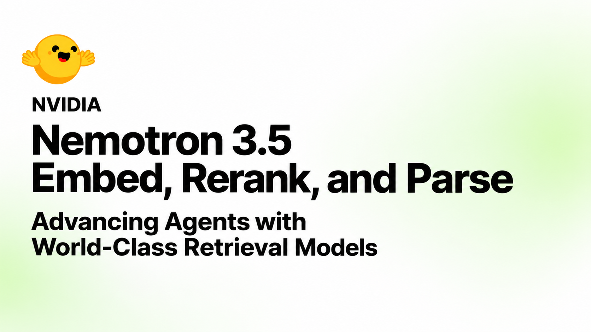
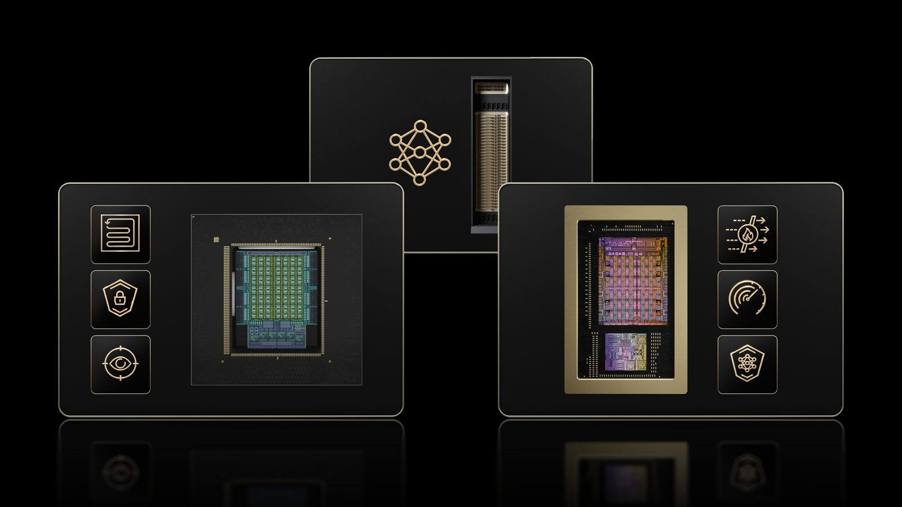
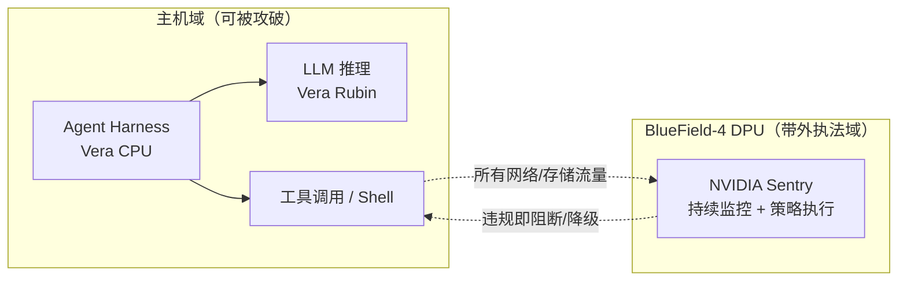
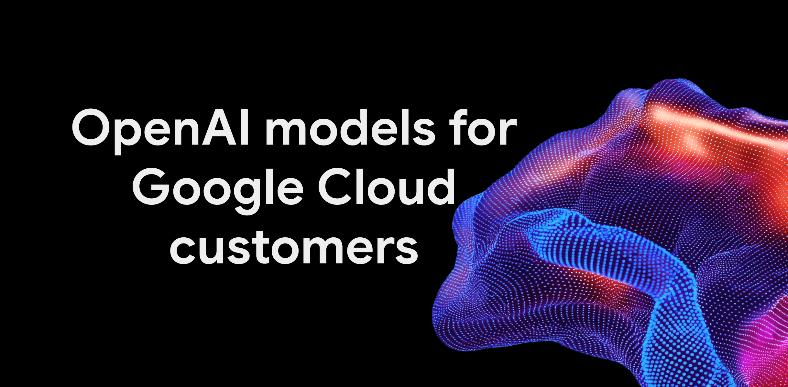
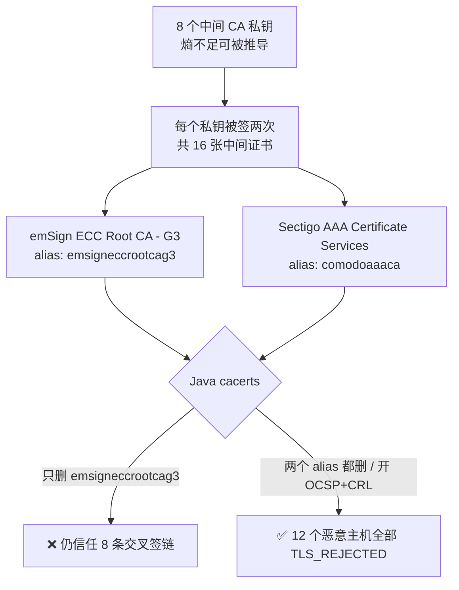

# 🚀 前沿技术日报：LLM · Agent · Java

> 📅 2026-10-22 · 覆盖过去 24–48 小时三大领域进展

## 📌 今日速览

| 领域 | 最重要的事 |
|---|---|
| 🧠 LLM | NVIDIA 开源 Nemotron 3.5 检索三件套（Embed/Rerank/Parse），agent 推理 token 成本降约 14% |
| 🤖 Agent | GTC Berlin：NVIDIA 发布 OpenShell 参考架构，把「安全 agent」下沉到芯片级（BlueField-4 Sentry） |
| ☕ Java | eMudhra CA 私钥可被秒级推导——默认配置的 JVM 全部裸奔，需手动清理 cacerts 双根证书 |

---

## 🧠 LLM 前沿进展

### 🔬 深度解析：NVIDIA Nemotron 3.5 Retriever —— 用检索质量直接砍 agent 的 token 账单

> *图：端到端 agent 任务成功率 vs 每任务推理 token 总量——加 Rerank 后同一成功率下 token 消耗明显左移。出处：[NVIDIA HF Blog](https://huggingface.co/blog/nvidia/nemotron-retriever-world-class-agentic-retrieval)*

NVIDIA 于 10-21 扩充 Nemotron Retriever 家族，一次性开源三类模型：**Embed 8B/1B**（含 NVFP4 量化版）、**Rerank 8B**、**Parse 631M**，全部可商用。核心卖点不是单点刷榜（虽然 Embed 8B 和 Rerank 8B 分列 ViDoRe v3.1 文本+视觉检索双榜第一，截至 10-20），而是它给出了一个工程上很实在的结论：**检索质量就是 agent 的成本函数**。在 ViDoRe v3、BRIGHT、BrowseComp-Plus 上，固定 LLM 与执行策略、只换检索配置的对照实验显示，加入 Rerank 后 agent 每任务推理 token 降约 14%（配 8B Embed）/13%（配 1B Embed），同时任务成功率还提升——原理很直白：证据越准，agent 重复搜索、翻无关文档的轮次越少。对多模态企业文档（图表里的需求预测、表格里的库存）这类「agent 找不齐证据就疯狂重试」的场景，这是把检索投入折算成推理账单的定量依据。Parse 631M 则以 <1B 参数拿下 ParseBench 同级别第一，负责把 PDF/扫描件变成可检索结构。对工程实践的启示：与其给 agent 换更贵的 LLM，先把 embed→rerank→parse 管线升级，1B+NVFP4 组合就能在 RTX PRO 6000 级别硬件上跑出生产可用的精度-吞吐帕累托前沿。[来源](https://huggingface.co/blog/nvidia/nemotron-retriever-world-class-agentic-retrieval)

- **Krafton 开源 Raon-1 Mini**（10-21）：PUBG 母公司从零训练的 30B MoE（仅激活 4B）+ 自研线性注意力，Apache 2.0 已上 Hugging Face。指令跟随（IFBench 84.2，胜 Qwen3.6-35B-A3B 的 66.6）和检索（BrowseComp Plus 55.7）是同级别最强，但 Terminal-Bench Lite（47.0 vs 63.3）明显落后——「强指令跟随、弱终端编码」的画像恰好适配业务型 agent 而非编码 agent。[来源](https://iaenunminuto.com/en/news/2026-10-21-krafton-releases-raon-1-mini-open-model)
- **DeepSeek V4.1-Flash-1017 持续发酵**：SiliconAngle 复盘指出这次「小版本」在 DeepSWE v1.1 软件工程测试上拿到 77%（9 月版 74.2%，Claude Opus 5 为 74%），且 Search & Fetch API 对 Claude Code/Codex 免费只到 11-01——依赖它做联网检索的 agent 要在本月底前评估计费影响。[来源](https://siliconangle.com/2026-10-18/deepseek-releases-updated-v4-1-flash-model-it-says-completes-tasks-faster)

## 🤖 Agent 进展

### 🔬 深度解析：NVIDIA OpenShell 参考架构 —— agent 安全从「软件治理」下沉到「芯片执行」

> *图：OpenShell 参考架构总览（Vera Rubin 推理 + Vera CPU 跑 harness + BlueField-4 带外执法）。出处：[NVIDIA Newsroom](https://nvidianews.nvidia.com/news/openshell-reference-architecture)*

10-21 GTC Berlin 上，NVIDIA 把 OpenShell 从「安全运行时软件」升级为全栈参考架构，分工值得细看：**Vera Rubin** 跑模型推理（含 Nemotron 开源模型），**Vera CPU** 跑 agent harness 和工具调用，**BlueField-4 DPU** 运行 Sentry 安全框架——关键在最后一层：DPU 对 agent 行为做**持续带外（out-of-band）监控 + 芯片内（in-silicon）策略执行**，意味着即使 host 上的 agent 运行时被提示注入攻破，网络/存储层的策略执法点仍在攻击者够不到的硬件域里。这与昨天报道的 Microsoft「agentic insider」动态降权形成互补：微软管身份与权限的动态治理，NVIDIA 管物理隔离与硬件执法。生态侧几乎全员到场：Anthropic、OpenAI、AWS、Google Cloud、Microsoft、SAP、ServiceNow、Siemens 均在合作名单，1Password/CrowdStrike/Okta/Palo Alto 等安全厂商同步宣布集成，边缘侧延伸到 RTX Spark/DGX Station。架构支持 Canonical、Red Hat、Windows 及 Microsoft Execution Containers。为什么重要：Jensen 的原话「企业要部署数十亿 agent，安全必须内建在计算架构里」不是修辞——当 agent 拿到 shell、能执行代码时，纯软件层面的围栏（system prompt、审批流）都是可绕过的，只有把 observe/enforce 放到 agent 进程之外的硬件路径上，才构成可信的最后一道墙。这实际上把「agent 安全」定义成了基础设施问题，而非应用问题。[来源](https://nvidianews.nvidia.com/news/openshell-reference-architecture)

> *图：OpenShell 的核心思路——agent 的一切 I/O 都要过 DPU 上的 Sentry 执法点（自绘示意图，依据 [NVIDIA Newsroom](https://nvidianews.nvidia.com/news/openshell-reference-architecture)）*

- **OpenAI 模型正式进入 Google Cloud Model Garden**（10-21）：GPT-6 Astra / 6.1 Sol / 6 Luna 三档上架，GCP 成为唯一集齐三大闭源前沿模型的超大规模云；OpenAI 模型还将进入 Gemini Agent 和 Google Antigravity，本地 Codex CLI 可直连 Gemini 平台推理。企业可动用 GCP 消费承诺抵扣，GA 预计数周内。多云模型采购的「货架化」再进一步。[来源](https://openai.com/index/openai-models-google-cloud)

> *图：OpenAI 模型登陆 Google Cloud 官方配图。出处：[Google Cloud Blog](https://cloud.google.com/blog/products/ai-machine-learning/google-cloud-brings-openai-models-to-customers)*

- **ServiceNow × NVIDIA 发布企业 agent「Arc」**（10-21）：基于 AI Passport 做 agent 身份层，主打企业工作流场景，是 OpenShell 生态首批落地案例之一。[来源](https://www.zdnet.com/innovation/exclusive-servicenow-and-nvidia-launch-arc-a-new-ai-agent-for-enterprise/)
- **Google Cloud 预览 Gemini for government services**（10-20）：面向受监管公共部门工作流的 agent 套件，内置 FOIA、文档脱敏等技能与安全连接器。政府场景成为 agent 垂直化的新战场。[来源](https://aiagentstore.ai/ai-agent-news/this-week)

## ☕ Java 工程进展

### 🔬 深度解析：eMudhra CA 私钥泄露 —— 为什么你的 JVM 现在还是裸奔的

10-20 公开披露的 WebPKI 重大事故：eMudhra（emSign）8 个中间 CA 的私钥因 2025-04 密钥生成仪式**熵严重不足**，任何人可在毫秒级从公钥证书数学推导出私钥，进而为**任意域名/任意软件**伪造合法 TLS 与代码签名证书。Chrome（CRLSets）、Firefox（CRLite）、Apple、Microsoft 在 10-17~10-20 间已通过带外吊销推送全部封杀——但 **Java 两大机制都不默认开启**：① 信任库是 JDK 自带的静态 `cacerts`，不随 OS 的 CA bundle 更新；② OCSP/CRL 吊销检查默认关闭（`com.sun.net.ssl.checkRevocation=false`），也不强制 CT。BellSoft 实测 Liberica JDK 21.0.10 对全部 12 个测试恶意主机完成 TLS 握手。更阴险的细节：8 个私钥各被签了两次——emSign 根签 8 个 + Sectigo「AAA Certificate Services」交叉签 8 个；Mozilla/Python certifi 早已移除 AAA 根，但 **Java cacerts 里 `comodoaaaca` 仍然在册**，所以只删 `emsigneccrootcag3` 只堵了一半。正确修法二选一：(a) 两条 `keytool -delete` 把 `emsigneccrootcag3` 和 `comodoaaaca` 都从 cacerts 删掉（主机和 Dockerfile 都要做，注意 bellsoft/liberica-runtime-container 等自带 cacerts 的镜像不随 OS 更新）；(b) 开启吊销检查 `-Dcom.sun.net.ssl.checkRevocation=true -Dcom.sun.security.enableCRLDP=true` + `ocsp.enable=true`——CA 已于 10-18/19 以 CA_COMPROMISE 吊销全部证书，开了检查的 JVM 无需动 cacerts 即可拒绝。Java Champion Mark Struberg 提供了自测类 `CheckCompromisedCa.java`，跑一遍就知道你的 JVM 中招没有。[来源 1](https://glaforge.dev/posts/2026/10/21/the-emudhra-ca-compromise-why-your-jvm-is-vulnerable-and-how-to-fix-it/) · [来源 2](https://bell-sw.com/blog/distrusting-compromised-emudhra-intermediates-in-java)

> *图：eMudhra 事故在 Java 信任链中的双路径与修复要点（自绘，依据 [BellSoft 分析](https://bell-sw.com/blog/distrusting-compromised-emudhra-intermediates-in-java)）*

- **Gluon 发布 OpenJFX 十月 CPU**（10-20）：27.0.1、25.0.5 LTS、21.0.13 LTS、17.0.21 LTS 四线同步安全修复，并提醒同日的 OpenJDK 漏洞通告也要一起打。JavaFX 应用记得 JDK 与 JFX 双升级。[来源](https://gluonhq.com/news/2026-10-20-oct-2026-critical-patch-update)
- **Microsoft 提醒 Java 升级窗口**（10-19）：Microsoft Build of OpenJDK 对 Java 11/17 的最早停止支持时间是 2027-09，Azure 上还在 11/17 的应用应把升级 21/25 排进 2027 前的路线图。[来源](https://devblogs.microsoft.com/java/plan-your-java-upgrade-ahead-of-microsofts-2027-support-milestones)
- **生态小版本一周动态**（Baeldung Java Weekly 668）：Apache Camel 4.23.0、Hibernate Validator 9.2.0.Beta1、Payara 7.2026.10、Micronaut Core 4.10.31/3.10.15、Oracle Java Platform Extension for VS Code 27.0.0。[来源](https://www.baeldung.com/java-weekly-668)

---

💡 **一句话点评**：今天的主线是「信任的重新定价」——agent 的信任要下沉到 DPU 芯片才敢给 shell，Java 的信任库则被证明还停在手动挡：连浏览器都自动封杀的 CA，你的 cacerts 还在默默放行。

🤖 本报告由 Hermes Agent 每日凌晨自动调研生成 · [HermesReports](https://github.com/knolonzhou/HermesReports)
