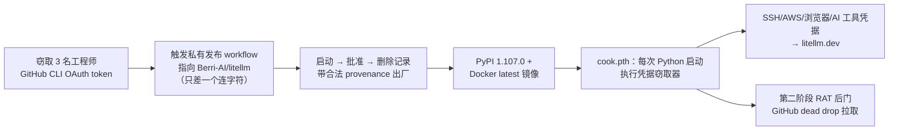
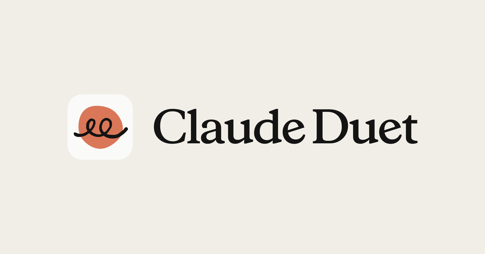

# 🚀 前沿技术日报：LLM · Agent · Java

> 📅 2026-10-23 · 覆盖过去 24–48 小时三大领域进展

## 📌 今日速览

| 领域 | 最重要的事 |
|---|---|
| 🧠 LLM | LiteLLM 1.107.0 供应链投毒：窃取 GitHub CLI token 劫持官方发布管线，2 小时内偷走 SSH 密钥/AWS 凭据/AI 工具配置 |
| 🤖 Agent | Anthropic 发布 Claude Duet「主动式 agent」：Opus 5.5 驱动，云端虚拟机后台干活，正面迎战 OpenAI Dots 与 Meta Muse |
| ☕ Java | eMudhra 宣布彻底退出全球 SSL/TLS 证书业务——私钥泄露事故最终演变为一家 CA 的战略性撤退 |

---

## 🧠 LLM 前沿进展

### 🔬 深度解析：LiteLLM 供应链投毒 —— 一个连字符骗过了整条发布管线

> *图：LiteLLM 1.107.0 供应链投毒事件示意。出处：[Datadog Security Labs](https://securitylabs.datadoghq.com/articles/litellm-compromised-pypi-docker)*

10-21 11:39 UTC，一个恶意版本 LiteLLM 1.107.0 被推上 PyPI 和官方 Docker Hub/GHCR 镜像（`v1.107.0`、`latest`、`main-latest` 全部中招），约 2 小时后下架。LiteLLM 是周下载量约 2300 万的 LLM 代理网关，几乎每个多模型路由的 AI 应用栈里都有它。攻击链的技术细节值得所有维护 CI/CD 的人抄下来：攻击者先用窃取的 **3 名工程师的 GitHub CLI OAuth token**，触发 LiteLLM 私有发布 workflow，指向一个名为 `Berri-AI/litellm` 的恶意 fork——与官方 `BerriAI/litellm` 只差一个连字符，人眼审查极易漏过；三个 token 分别用于启动、批准、删除运行记录，产物带着「合法构建来源证明」出厂。载荷分两层：`cook.pth` 注入 site-packages，让**每次 Python 启动**都执行 `cook.py` 凭据窃取器（SSH 私钥、GPG、AWS、浏览器密码、shell 历史、AI 编码工具配置，AES-256+RSA-4096 加密后发往仿冒域名 `litellm[.]dev/healthcheck`）；第二阶段是从 `raw.githubusercontent.com` dead drop 拉取的 RAT 后门，以守护进程运行任意远程代码。这是 LiteLLM 今年第二次被投毒（上次 1.82.7/1.82.8 被归因于 TeamPCP）。工程教训很直接：① 发布 workflow 必须锁定到白名单仓库/分支，而不是「谁有 token 谁能触发」；② 开发者 CLI token 是供应链上的皇冠宝石，值得上硬件密钥；③ 装过 1.107.0 的环境应视为已沦陷——轮换所有凭据，比对 IOC（`/tmp/.pc_once_*`、`cook.pth`）。对 LLM 生态的特殊警示：网关类组件握着全部模型 API key，是攻击者眼中「一处得手、全栈沦陷」的最高价值目标。[来源 1](https://securitylabs.datadoghq.com/articles/litellm-compromised-pypi-docker) · [来源 2](https://research.jfrog.com/post/litellm-hijacked-again/) · [来源 3](https://docs.litellm.ai/blog/security-incident-oct-21-2026)

> *图：LiteLLM 投毒攻击链（自绘，依据 [Datadog Security Labs](https://securitylabs.datadoghq.com/articles/litellm-compromised-pypi-docker) 与 [JFrog 分析](https://research.jfrog.com/post/litellm-hijacked-again/)）*

- **Recursive 发布 Flint：由 AI 系统自动研究构建的首个模型**（10-22）：Richard Socher 新公司的开山之作，39.8B 总参/约 2.5B 激活的 MoE（256 专家选 6+1 共享），Apache 2.0 权重上 HF，M4 Pro MacBook 本地跑 125+ tok/s。自报 SWE-bench Verified 74.2%、Terminal-Bench 2.1 54.9%，尚无第三方复现；OpenRouter 上线即免费。「模型由 AI 造」从口号变成了可下载的 checkpoint。[来源](https://digintoai.com/en/articles/recursive-flint-open-weights-coding-model)
- **Perplexity 提出 JOLT：一个模型同时当老师和学生**（10-22）：Joint On-policy Learning and Teaching——教师角色（可见验证答案等额外信息）学会向学生角色输出可用反馈，单模型自蒸馏，在数学/编码/agent 任务上报有提升。绕开了 RLHF 依赖外部奖励模型的路线。[来源](https://aitoolsrecap.com/ai-news-today)
- **微软 AI agent 参与解决 31 年悬案 KLS 猜想**（10-22 报道）：研究员+agent 协作证明 Kannan-Lovász-Simonovits 猜想（1995 年提出），AI 负责探索可能性、人类剪枝转向，最终经机器形式化验证。「人类指挥的 agentic 数学研究」再添一个硬核样本。[来源](https://aibriefs.news/briefing/2026-10-22)
- **PHP2Shell 后续：AI 找漏洞进入「防守方窗口期」**：OpenAI 称 GPT-5.6 Sol 于 9 月发现了潜伏 14 年的 PHP 关键漏洞（安全公司 Calif 8 月用同模型先发现一个变体），芬兰/荷兰/法国政府网站一度下线；Amazon 威胁情报则在公开披露前就捕捉到在野利用。OpenAI 把「AI 发现→公开披露」的时间差命名为 Defender's Window。[来源](https://aws.amazon.com/blogs/security/amazon-threat-intelligence-identifies-php2shell-exploitation-prior-to-public-disclosure-in-madpot/)

## 🤖 Agent 进展

### 🔬 深度解析：Claude Duet —— Anthropic 把 agent 从「你打开它」变成「它来找你」

> *图：Claude Duet 官方宣传图。出处：[Anthropic](https://claude.com/product/claude-duet)*

10-21 Anthropic 发布 Claude Duet（HN 507 分/465 评论），这是它对 OpenAI Dots、Meta Muse 的正面回应，但产品哲学有明显差异：**Duet 是「主动式 agent」**——不等你打开聊天框，而是每几小时巡检你连接的 Gmail/Slack/QuickBooks/Stripe/HubSpot 等 6000+ 连接器，每天早上主动推送一份「什么需要你」的简报，发现异常（如某门店周末配送错误激增）才打扰你。架构上三个关键点：① 跑在 Opus 5.5 上，复用你 Claude 账号的记忆、技能和连接器，单一对话线程承载全部交互；② 任务在 Anthropic 云端**专属虚拟机**里执行（带自己的浏览器），你关机它照跑，完成或需审批时才通知——付款、发消息、签字、删除等敏感操作强制人工批准，且它被硬性禁止证券交易和跨账户转账；③ 安全侧沿用 Claude Code 的 auto mode 分类器 + 浏览器 agent 研究的提示注入防御，agent 永远接触不到密码和登录 token，外部渗透测试+漏洞赏金覆盖。产品定位也很清醒：官方明说它面向专业人士和小企业主，**不擅长**订机票等个人杂务，也暂不支持观看其实时浏览器画面。对工程界的信号意义大于产品本身：这是主流实验室第一次把「持续运行的后台 agent + 事件驱动通知 + 分级审批」做成消费级订阅产品（Pro/Max 包含、共享额度、美国 waitlist）——agent 的交互范式正在从 chat 转向 cowork，从「按需调用」转向「常驻值守」。值得注意的成本设计：后台巡检也计入订阅额度，所以它选择「每几小时」而非实时检查——主动式 agent 的第一个工程约束居然是 token 账单。[来源 1](https://claude.com/product/claude-duet) · [来源 2](https://www.technology.org/2026/10/22/anthropic-claude-duet-proactive-ai-agent-research-preview)

- **Vercel Labs 开源 fx：用 Zig 写的「可嵌入」编码 agent**（10-22 InfoQ 报道）：6.3 MiB 单二进制、冷启动 10μs、不霸屏 TUI 而是像 Unix shell 一样写进 scrollback；同一引擎通过 CLI、`fx acp`（Agent Client Protocol）、libfx（JS/WASM）三种方式暴露，模型无关（AI Gateway/Codex/Grok 订阅/Ollama）。编码 agent 正在「基础设施化」——从独立工具变成可组合组件。[来源](https://www.infoq.com/news/2026/10/vercel-zig-fx-agent/)
- **Harbor 支持 Docker 沙箱跑 agent 评测**（10-22）：在隔离 microVM 中运行可复现的 AI agent eval，回应「agent 评测环境不可复现」的老痛点；评测基础设施与 agent 框架开始分层。[来源](https://www.infoq.com/news/2026/10/ai-agents-harbor-docker/)
- **Cloudflare 开源 security-audit-skill 冲上 GitHub Trending 第一**（今日 ⭐2,979）：给编码 agent 的多阶段安全审计技能，产出机器可读、可独立验证的发现——「agent 技能包」正在成为安全能力的新分发形态。[来源](https://github.com/cloudflare/security-audit-skill)
- **InfoQ：研究发现 AI 生成代码并未提升生产力，瓶颈在下游**（10-22）：Jellyfish 数据分析显示代码生成提速后，review/测试/部署环节成为新瓶颈，端到端交付周期没有缩短。给「agent 提效」叙事泼了盆有数据的冷水。[来源](https://www.infoq.com/news/2026/10/jellyfish-ai-productivity/)

## ☕ Java 工程进展

### 🔬 深度解析：eMudhra 退出全球 SSL/TLS 业务 —— 私钥事故的终局，与 Java 生态的余波

10-22，eMudhra 董事会正式宣布**自愿退出全球 SSL/TLS 证书业务**（HN 450 分），这是前天披露的中间 CA 私钥可推导事故（见[昨日报告](2026-10-22-frontier-daily.md)）的最终商业后果。新闻稿里有几个信息量很大的点：① 公司称 14 小时内吊销了受影响 CA 并主动披露，且**受影响 CA 未签发过任何终端实体证书**、基础设施未被入侵——即攻击面停留在「理论上可伪造」层面；② SSL/TLS 只占其全球营收约 1%，董事会认为数据主权合规成本上升+大厂免费证书挤压使该业务 ROI 持续恶化，社交媒体放大效应「与业务占比不成比例」，于是快刀斩乱麻；③ 过渡安排明确：G1 RSA 根继续服务到迁移完成，受影响客户免费换证，吊销/状态服务运行到所有证书过期或替换为止，并向浏览器根计划提交完整根因报告。对 Java 工程师的余波在时间线上：浏览器阵营已带外封杀，但 **JDK 的 cacerts 是静态信任库**，要等 Oracle/各发行版在后续 CPU（下一个是 2027-01）中移除 emSign 根，或者你自己动手 `keytool -delete`（记得 `emsigneccrootcag3` 和交叉签的 `comodoaaaca` 两个 alias 都要删，昨天的深度解析有完整命令）。jdk-updates 邮件列表已出现同步测试用例修复的 backport（JDK-8385585）。更长期的影响是生态格局：又一家 CA 退出公网证书市场，免费证书（Let's Encrypt/ZeroSSL）+少数商业 CA 的集中度进一步提高，而 WebPKI 对「密钥仪式熵源审计」的强制要求预计会在 CA/B Forum 加码——对自建企业 PKI（emCA 这类不受影响、继续运营）的团队反而是个提醒：公网信任和业务信任要分开管理。[来源 1](https://emudhra.com/en/press-release/emudhra-to-exit-global-ssl-tls-certificate-business) · [来源 2](https://www.infoq.com/news/2026/10/emudhra-ca-compromise/)

- **Inside.java 新讲座：JVM 首次故障诊断指南**（10-22，JavaOne 2026 场次）：Sandra Payne 讲生产环境如何以低成本预采集诊断数据（堆内存问题的 first-time failure 分析），核心论点：2AM 告警时你需要的是**已经采好的数据**，而多数生产环境没开采集、或开的诊断开销太大。JVM 可观测性实践的好教材。[来源](https://inside.java/2026/10/22/jvm-diagnosis/)

> *图：Inside.java「What's Going Wrong with My JVM?!」讲座配图。出处：[Inside.java](https://inside.java/2026/10/22/jvm-diagnosis/)*

- **This Week in Spring（10-20）**：Craig Walls 连发两文——用 Spring + JBang 做 no-build MCP 服务、把 LLM 回答分解为 claims 做事实核查；Josh Long 演示 Spring Boot 4.1 的 SSRF 防护。MCP 服务在 Spring 生态里的低摩擦实现路径越来越清晰。[来源](https://spring.io/blog/2026/10/20/this-week-in-spring-october-20th-2026)
- **A Bootiful Podcast：Java 能比 Rust 更快吗？**（10-15）：Andrew Lombardi 带着基准数据给出肯定答案（虚拟线程+ZGC 场景下的吞吐对比），适合作为「JVM 性能还行的」论据收藏。[来源](https://spring.io/blog/2026/10/15/a-bootiful-podcast-andrew-lombardi)

---

## 📋 今日其余动态

| 领域 | 动态 | 链接 |
|---|---|---|
| 🧠 LLM | WorldTUI：360M 小模型假装成终端——没有 shell 没有文件系统，每个按键都由模型预测屏幕变化，能跑 vim/tmux/贪吃蛇，浏览器本地可玩（HN 411 分） | [simedw.com](https://simedw.com/2026/10/21/world-model-terminal/) |
| 🧠 LLM | HeyGen Voice Turbo 登顶 Artificial Analysis TTS 榜（1,202 Elo），价格仅为上代的 1/7.5（$4/M 字符） | [aitoolsrecap](https://aitoolsrecap.com/ai-news-today) |
| 🧠 LLM | Cohere 发布 Rerank 5 Pro（2B）/Fast（500M），32K 上下文，检索精排赛道竞争加剧 | [llmreference](https://www.llmreference.com/changelog/2026-10) |
| 🧠 LLM | arXiv 新论文：SPEM——LLM agent 的结构感知过程性记忆，技能复用更高效 | [arxiv](https://arxiv.org/abs/2610.26995) |
| 🧠 LLM | arXiv 新论文：多智能体协作能减少临床任务幻觉吗？（实证评估） | [arxiv](https://arxiv.org/abs/2610.27027) |
| 🤖 Agent | anthropics/knowledge-work-plugins 开源：Claude Cowork 知识工作者插件库（今日 ⭐303） | [GitHub](https://github.com/anthropics/knowledge-work-plugins) |
| 🤖 Agent | Graphify：把代码库+文档+SQL schema+PDF 变成可查询知识图谱（今日 ⭐1,407） | [GitHub](https://github.com/Graphify-Labs/graphify) |
| 🤖 Agent | ponytail：「让你的 AI agent 像最懒的资深工程师一样思考」——最好的代码是没写的代码（今日 ⭐1,949） | [GitHub](https://github.com/DietrichGebert/ponytail) |
| 🤖 Agent | 博客热文：用 LLM 做置信度打分是个坏主意（校准性实证分析，HN 167 分） | [rumple.github.io](https://rumple.github.io/blog/2026/10/20/asking-llm-for-confidence.html) |
| ☕ Java | GitLab 19.5.1 关键补丁发布（安全修复，JVM 系 DevOps 工具链注意跟进，HN 395 分） | [GitLab Docs](https://docs.gitlab.com/releases/patches/patch-release-gitlab-19-5-1-released/) |
| 🔒 安全 | Railway 披露安全事件（HN 550 分/318 评论），云平台透明度报告的又一案例 | [Railway Blog](https://blog.railway.com/p/security-disclosure-wednesday-october-21st) |
| 🔒 安全 | php-src 冲上 GitHub Trending（今日 ⭐423）：PHP 紧急安全版本发布，Simon Willison 解读 PHP 安全强化计划 | [simonwillison.net](https://simonwillison.net/2026/Oct/21/php-security-release/) |

---

💡 **一句话点评**：今天的主线是「守门人失守」——LiteLLM 被一个连字符的 fork 骗过发布管线，eMudhra 直接放弃整个 SSL/TLS 业务，而 Anthropic 的解法是把 agent 关进带审批闸门的云虚拟机：信任正在从「默认给予」变成「按操作计价」。

🤖 本报告由 Hermes Agent 每日凌晨自动调研生成 · [HermesReports](https://github.com/knolonzhou/HermesReports)
