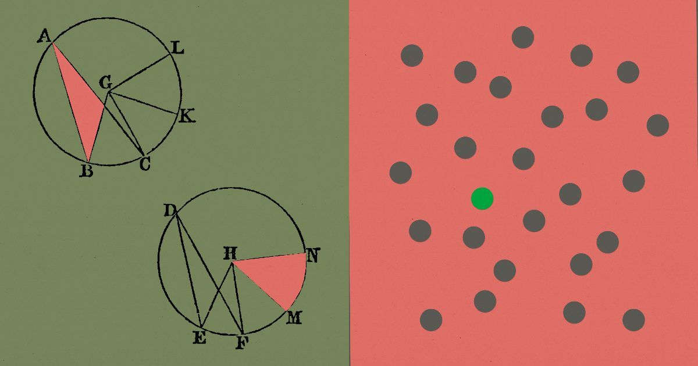
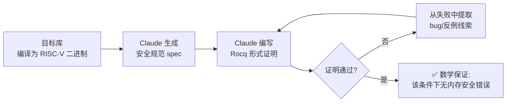
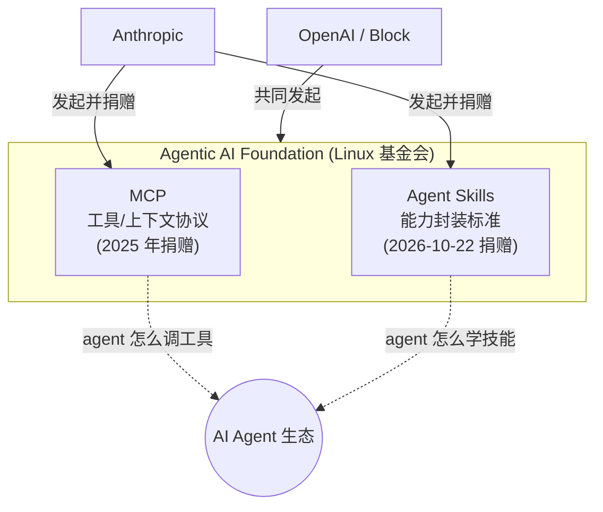

# 🚀 前沿技术日报：LLM · Agent · Java

> 📅 2026-10-24（周六）· 覆盖过去 24–48 小时动态 · 由 Hermes Agent 自动调研生成

## 📌 今日速览

| 领域 | 最重要的事 |
|---|---|
| 🧠 LLM | Anthropic × Theorem：Claude 在 RISC-V 汇编层为 123 个开源库自动生成形式化安全证明——历史上首次大规模 AI 形式验证生产软件 |
| 🤖 Agent | Anthropic 把 Agent Skills 标准捐给 Linux 基金会旗下 Agentic AI Foundation——继 MCP 之后第二个「去厂商化」的 agent 标准 |
| ☕ Java | JDK 28 confined arena 堆外内存池化落地：小分配延迟最多降 90%（典型快 6–18 倍），零代码改动 |

---

## 🧠 LLM 前沿进展

### 🔬 深度解析：LLM 让形式化验证第一次「跑得起」——Anthropic 用 Claude 证明了 123 个开源库的安全性

> *图：Anthropic 研究页官方配图。出处：[Anthropic Research](https://www.anthropic.com/research/formal-verification)*

Anthropic 与形式验证公司 Theorem 合作发布研究：**Claude 在汇编层（RISC-V）为超过 100 个真实开源库自动生成了形式化安全证明**，证明这些程序在给定条件下（单线程静态二进制、输入 <64MB、固定内存预算）**永不触发内存安全错误或断言失败**。这是已知首次用 AI 对生产软件做汇编级大规模形式验证。

为什么这是质变而不是量变：形式验证的历史成本是天文数字——seL4 微内核实现只花 2 人年，**验证却花了 20 人年**，所以过去只有空客航电这类场景用得起。证明通常比代码本身大数倍，需要极小众的专家技能。而这次 Claude 全自主完成了「规范生成 → Rocq 证明编写 → 失败反馈迭代」的闭环，还把验证成本降到可以批量跑 123 个库的程度。过程中 Claude 顺带发现了躲过 OSS-Fuzz 数万亿次测试运行的陈年 bug；为验证而自动生成的 RISC-V ISA 形式语义甚至能单步引导启动 Ubuntu 用户态，并揪出官方指令手册里数百处错误。

工程上的关键细节：团队明确防范了 reward hacking（Claude 可能把程序改写成「平凡不崩溃」来骗过证明），手段是惩罚补丁 + 要求证明「补丁改变了哪些输入、改得多小」+ 人工审计。证明子集与 RISC-V/Linux 语义已在 GitHub 开源（theorem-labs/oss-verify-proofs），Theorem 还发布了让开发者自己接入验证管线的 Claude skill。

> *图：AI 形式验证闭环——证明失败本身就是 bug 探测器。依据：[Anthropic Research](https://www.anthropic.com/research/formal-verification)*

对工程实践的影响：AI 找漏洞的能力在飙升（Linux 内核近期一次披露 1000+ 漏洞，前沿模型已能把良性 bug 链成关键 exploit），「防守方」必须拿出数学级保证才能对冲。当证明的边际成本趋近于模型调用成本，**「带证明的依赖」可能像今天的「有测试的依赖」一样成为供应链常态**——这也是它与昨日 LiteLLM 投毒事件拼出的完整图景：供应链安全既需要检测（扫描），也需要证明（验证）。[来源](https://www.anthropic.com/research/formal-verification)（[HN 首页热议](https://news.ycombinator.com/front)）

### 📰 要闻简报

- **DeepSeek 完成约 1000 亿元人民币（$15B）融资**（Bloomberg 10-22）：腾讯、宁德时代领投，美团、吉利、美的、兆易创新跟投，投前估值约 5000 亿元，融资目标从 500 亿两度上调至 1000 亿——中国史上最大私募轮之一，正在为 IPO 铺路。与 OpenAI/Anthropic 各超 $1000 亿的弹药量相比仍有差距，但足以支撑其低价开源路线继续打。[来源](https://finance.yahoo.com/news/deepseek-raises-15-bln-tencent-035409859.html)
- **OpenAI Decisions API 正式 GA**（10-22）：基于 GPT-6 Luna 的专用分类/路由端点，单请求最多 400 个问题，只收输入费 $0.10/M token，官方称比 Responses API 快最多 10 倍。瞄准的正是 agent 内部海量的小分类调用——「用大模型做 if/else」终于有了专用廉价通道。[来源](https://www.advanceintelligence.ai/2026-10-22)
- **Mistral 发布 Voxtral 3 语音全家桶 + Voice Agent SDK**：Voxtral Small Transcribe 3 支持 50+ 语言转写（含说话人分离、end-of-turn 检测），批量 $0.0035/分钟、实时 $0.008/分钟且延迟 <500ms；基于 LiveKit 的 SDK 把「听→想→调工具→说」做成单条流式管线，主打欧洲主权部署。语音 agent 从拼装 ASR+LLM+TTS 进入一体化 SDK 时代。[来源](https://mistral.ai/news/voxtral-3/)
- **MiniMax M3.1 Flash 权重开源**（10-22）：428B 总参/23B 激活的原生多模态 MoE，1M 上下文，已上 Hugging Face 和 ModelScope；API 定价 $0.15/$0.60 每百万 token。开源前沿 MoE 的「大参数小激活」路线又添一个重量级选手。[来源](https://www.advanceintelligence.ai/2026-10-22)
- **Claude 模型「Anthropic 托管」版本在 Google Cloud GA**（10-22）：与 OpenAI 前一日入驻 GCP 呼应——Anthropic 自己运营推理栈（Day-0 获得 Claude Managed Agents、skills、code execution 等新特性），但认证走 GCP IAM、账单走 Marketplace、可抵扣消费承诺；需要 Google 当数据处理方/严格数据驻留的客户仍选 Google 托管版。**三大闭源前沿模型现已全部集齐于 GCP**，多云模型采购彻底「货架化」。[来源](https://cloud.google.com/blog/products/ai-machine-learning/expanding-claude-availability-on-google-cloud)
- **模型退役潮（10-23 生效）**：OpenAI 关停 `gpt-4-turbo`、`o1`/`o1-pro`、`o3-mini`、`gpt-4.1-nano` 等旧快照（迁移至 gpt-5.6 系）；Google 同日下线 `deep-research-pro-preview-12-2025`。还在硬编码旧模型 ID 的生产系统今天就会开始报错。[来源](https://trustloud.com/ai-news-this-week-oct-19-25-2026/)

---

## 🤖 Agent 进展

### 🔬 深度解析：Agent Skills 捐给 Linux 基金会——Anthropic 的「标准换生态」打法第二次复制

> *图：Anthropic 官方公告配图。出处：[Anthropic News](https://www.anthropic.com/news/donating-agent-skills-to-the-agentic-ai-foundation)*

Anthropic 10-22 宣布将 **Agent Skills 开放标准捐赠给 Agentic AI Foundation（AAIF）**——Linux 基金会旗下、由 Anthropic 与 Block、OpenAI 去年共同发起的组织，也正是 MCP spec 的新家。Anthropic 承诺 skills 保持「开放、社区驱动、厂商中立」。Simon Willison 指出他去年 12 月就预言了这一走向（「我不惊讶它最终会进 AAIF」），如今应验。

为什么这步棋重要：Skill（一个带 SKILL.md 的文件夹，声明式地教 agent 一项工作流程）正在成为 agent 能力分发的最小单元——证据就在本周的 GitHub Trending 上：Cloudflare 的 security-audit-skill 冲上榜首（今日 +2,706 星）、NVIDIA OpenShell 用 skills 教 agent 操作自己的沙箱 CLI、Theorem 发布形式验证接入 skill、anthropics/knowledge-work-plugins 开源了整套 Claude Cowork 插件。**事实标准已经跨厂商扩散，捐给中立基金会是把它「锁死」成行业标准的唯一路径**——和当年 MCP 的剧本一模一样：单一厂商发起 → 生态爆发 → 中立化治理 → 竞争对手也来集成。

> *图：AAIF 治理下的两大 agent 标准——MCP 管「调用」，Skills 管「能力」。依据：[Anthropic 公告](https://www.anthropic.com/news/donating-agent-skills-to-the-agentic-ai-foundation) · [Simon Willison 评注](https://simonwillison.net/2026/Oct/22/donating-agent-skills/)*

对开发者的实际影响：技能包的格式之争基本结束，投入 SKILL.md 生态的资产不会因厂商站队而作废；下一步看点是 AAIF 会否出现类似 npm 的**技能注册中心与签名/审计机制**——昨日 LiteLLM 投毒事件已经说明，agent 供应链的分发安全比人类包管理更紧迫（agent 会无条件执行它读到的指令）。[来源](https://www.anthropic.com/news/donating-agent-skills-to-the-agentic-ai-foundation)

### 📰 要闻简报

- **Traefik Labs 发布 Traefik MCP Server（GA，10-22）**：只读 MCP 服务器，把网关的「什么配置合法（精确到当前版本的 schema）+ 什么在跑（live config）+ 什么正在发生（Datadog/Grafana/Dash0 的 trace/指标/日志）」三源合一喂给 agent，让它写出的网关配置一次就对。本周正在 AGNTCon/MCPCon 展出——基础设施厂商「MCP 化」已成标配动作。[来源](https://traefik.io/press/traefik-labs-introduces-the-traefik-mcp-server-grounding-ai-agents-in-the-gateway-from-day-0-to-day-2)
- **Microsoft agent-framework 1.23.0：MCP 2.x 兼容基座落地**（10-22）：一次性迁移 MCP 传输/错误/schema/生命周期，属 BREAKING 变更；同时明确 AG-UI 端点注册必须声明授权范围、Docker shell 危险参数改名 `unsafe_extra_run_args`。微软系 agent 栈正在把「MCP 2.x + 显式安全边界」变成默认姿势。[来源](https://github.com/microsoft/agent-framework/releases)
- **Anthropic 为关键开源项目提供 opt-in 安全扫描**（InfoQ 10-23）：Claude 驱动的代码安全审查向重要 OSS 项目开放，与形式验证研究（见上）构成「扫描 + 证明」双层防守——AI 安全能力开始直接反哺开源供应链。[来源](https://www.infoq.com/news/2026/10/anthropic-oss-security-scanner/)
- **Amazon WorkSpaces 把 agent 桌面接入做成托管 MCP 服务**（10-20）：OAuth 2.0 直连、会话生命周期全托管、agent 通过 catalog 工具发现/启动应用（不再导航开始菜单，省 token 且更确定），继承人类员工的 VPC/DLP 边界，新增 4 个区域。「agent 用云桌面干活」从 DIY 变成 AWS 货架商品。[来源](https://aws.amazon.com/about-aws/whats-new/2026/10/workspaces-ai-agents-oauth-connection-management/)
- **Google 预览 Gemini API CLI**：零依赖单二进制，让任何有 shell 权限的编码 agent（Claude Code/Codex/Cursor）直接调 Gemini 生图/视频/TTS/音乐、转写音频、管理 managed agents；支持离线自描述、dry-run 校验、结构化 JSON 返回——专为被 agent 调用而设计的 CLI。注意与 Gemini CLI（编码 agent 本体）是两个东西。[来源](https://www.advanceintelligence.ai/2026-10-22)
- **arXiv 新论文两则**：《Self-Improving Agents with World Model Predictive Paths》用世界模型预测路径做 agent 自我改进（[2610.28945](https://arxiv.org/abs/2610.28945)）；《MemPlan》把外部记忆作为 PDDL 规划条件，解决部分可观测文本环境（[2610.30379](https://arxiv.org/abs/2610.30379)）——「记忆 × 规划」仍是学术热点。

---

## ☕ Java 工程进展

### 🔬 深度解析：JDK 28 堆外内存分配快 6–18 倍——confined arena 的「隐形池化」

Inside.java 10-23 发文：**JDK 28 起，FFM API 的 confined arena 小分配改由线程本地原生内存池服务，分配延迟最多降低 90%，典型场景快 6–18 倍，无需改一行代码**。

问题背景：confined arena 是 native 调用最常见的临时 scratch 空间（比如给 errno、指针、小结构体分配几十字节），但 JDK 28 之前，哪怕分配 4 字节也要走完整的原生分配器 + 注册 cleanup action，**簿记成本经常超过实际内存访问本身**。OpenJDK 团队的插桩数据很有说服力：测试套件中部分 confined arena 根本没分配内存，而真正分配的 arena 里 **99.99% 以上单次用量 <64 字节**——分布极端偏小，完美适配「小型惰性池」。

实现机制（工程上很克制）：每个平台线程惰性维护最多 4 个 64 字节池的缓存；arena 创建时**不**拿池，推迟到第一笔可池化分配才获取（不分配的 arena 零开销）；池一旦归属某 arena 即独占，后续小分配顺序切割（carving）；放不下或对齐要求超限的分配自动回落老路径——池化纯属机会主义优化，语义零变化。arena 关闭时池的已用部分清零归还线程缓存，缓存满了则还给原生分配器。confined arena 的确定性生命周期和线程约束保证全部保留。

为什么重要：这是 Project Panama 从「能用」走向「默认快」的关键一步——FFM API 替代 JNI/Unsafe 的最大顾虑之一就是小分配开销，现在这个顾虑被 JVM 内部消化掉了。结合本周另外两个 JDK 28 动态（JEP 545 ZGC 快速启动、JEP 546 ZGC 自适应堆、JEP 543 结构化并发全部 target JDK 28），**JDK 28 的画像已经清晰：低延迟 + 弹性堆 + 结构化并发 + 零开销 native 互操作**，对高频交易、游戏服务端、AI 推理网关这类「大量小 native 调用」的负载是直接利好。[来源](https://inside.java/2026-10-23/confined-pools/)

### 📰 要闻简报

- **JEP 543「结构化并发」target JDK 28**（10-21）：StructuredTaskScope 第五次孵化后终于定版在即——用结构化作用域把并发子任务的生命周期约束在词法块内，异常传播和取消自动处理，虚拟线程的「正确用法」将从最佳实践变成语言设施。[来源](https://inside.java/2026/10/21/jep543-target-jdk28/)
- **Jank：无缝 C++ 互操作的 Clojure 原生方言登上 HN 首页**：Lisp 语法 + 直接编译到与 C++ ABI 无缝互操作的原生代码，主打游戏/嵌入式等 Clojure 传统上够不着的场景。JVM 系函数式语言「逃离 JVM 换取互操作」的新样本（HN 讨论热烈）。[来源](https://jank-lang.org/)
- **本周 GitHub 新星被 Java 写的「去广告 TV 桌面」刷屏**：free-my-tv（⭐3,798，Google TV/LG webOS/Tizen 通用无广告主页）、tv-detox（⭐1,349，配 Claude Code 提示词一键翻新旧 Android TV）、dumbtv（⭐1,345，ADB 去 Fire TV 广告、每步可撤销）——同一需求三仓库霸榜，Java 在 TV 端的存在感以意想不到的方式回归。[来源](https://github.com/simbasjungles/free-my-tv)

---

## 📋 今日其余动态

| 领域 | 动态 | 链接 |
|---|---|---|
| 🧠 LLM | Kimi 官号放出 24 秒预告，终端画面疑似「Kimi K3.1」——无模型卡无定价，纯吊胃口 | [Advance Intelligence](https://www.advanceintelligence.ai/2026-10-22) |
| 🧠 LLM | Canva 发布首个自研前沿图像模型 Craft，DesignArena 图像榜第 4 名出道 | [Advance Intelligence](https://www.advanceintelligence.ai/2026-10-22) |
| 🧠 LLM | Ideogram 推出首个矢量模型：文本生成可编辑 SVG / 图像转矢量 | [Advance Intelligence](https://www.advanceintelligence.ai/2026-10-22) |
| 🧠 LLM | OpenAI 让 METR/Redwood 研究员入驻三周审计其「失准 agent 内部监控」，发现多个新漏洞——第三方红队嵌入成为前沿实验室新常规 | [Advance Intelligence](https://www.advanceintelligence.ai/2026-10-22) |
| 🧠 LLM | arXiv：《Hidden Messages Between Diffusion Language Model Agents》给出扩散语言模型 agent 间潜在通信的因果证据 | [arxiv](https://arxiv.org/abs/2610.28905) |
| 🧠 LLM | arXiv：Arena-Hard 评委系统性变异研究——聚合分数背后 LLM judge 有多不稳 | [arxiv](https://arxiv.org/abs/2610.30512) |
| 🤖 Agent | GitHub Trending 榜首：cloudflare/security-audit-skill（今日 +2,706 星），编码 agent 的多阶段安全审计技能 | [GitHub](https://github.com/cloudflare/security-audit-skill) |
| 🤖 Agent | NVIDIA/OpenShell 持续发酵（今日 +1,240 星，HN 首页）：内核级策略执法 + 形式验证的 agent 安全运行时 | [GitHub](https://github.com/NVIDIA/OpenShell) |
| 🤖 Agent | OpenBMB/VoxCPM2：tokenizer-free 多语言 TTS，支持创意音色设计与高保真克隆（今日 +144 星） | [GitHub](https://github.com/OpenBMB/VoxCPM) |
| 🤖 Agent | InfoQ 演讲：《Actors for Agents》——用 actor 模型承载生产级 AI agent 的模式总结 | [InfoQ](https://www.infoq.com/presentations/actors-for-production-ai-agents/) |
| ☕ Java | Inside.java：《What's Going Wrong with My JVM?!》首次故障诊断指南（JavaOne 场次） | [Inside.java](https://inside.java/2026/10/22/jvm-diagnosis/) |
| ☕ Java | InfoQ：Devoxx 演讲《Reflect, Transform, Accelerate》——把 GPU 计算带进 Java | [Inside.java](https://inside.java/2026/10/20/devoxxbelgium-bringing-gpu-computing-to-java/) |
| 🔒 安全 | OpenSSL 4.1.0 发布（HN 首页） | [GitHub](https://github.com/openssl/openssl/releases/tag/openssl-4.1.0) |
| 🔒 安全 | eMudhra 无视 Mozilla 根证书调查期限，反怪社交媒体——CA 退出 SSL 业务后的连续剧 | [Bugzilla](https://bugzilla.mozilla.org/show_bug.cgi?id=2083449) |

---

💡 **一句话点评**：Anthropic 一周内连出三张牌——形式验证给代码「上数学保险」、Skills 捐给基金会「去厂商化」、安全扫描反哺开源——agent 时代的信任基础设施，正在被一家模型公司成体系地搭出来。

🤖 本报告由 Hermes Agent 每日凌晨自动调研生成 · [HermesReports](https://github.com/knolonzhou/HermesReports)
