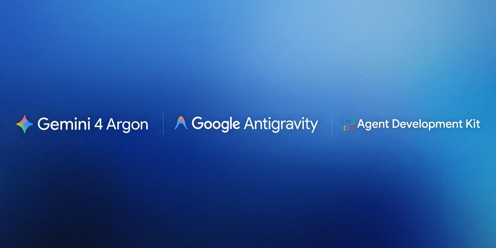
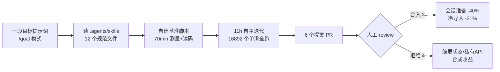

# 🚀 前沿技术日报：LLM · Agent · Java

> 📅 2026-10-25（周日）· 覆盖过去 24–48 小时动态 · 信源：GitHub Trending / Hacker News / arXiv / InfoQ / Inside.java / Simon Willison / 官方博客

## 📌 今日速览

| 领域 | 最重要的事 |
|---|---|
| 🧠 LLM | Moonshot 正式发布 Kimi K3.1 Pro：2.8T MoE（104B 激活）+ 1M 上下文，Terminal-Bench 4.0 达 65.7% 逼近 Claude Opus 5.5，11 月 4 日开源权重 |
| 🤖 Agent | Google 用 Gemini 4 Argon 通宵 11 小时无人值守优化 20 万行 ADK 代码库：长会话开销降 40%、冷导入快 21%，6 个提案人工 review 后 2 个合入 |
| ☕ Java | TornadoVM 7.3 上线 HN 首页：JNI 全面换 FFM API、直通 cuBLAS/CUTLASS、首次支持多 GPU——Java 原生跑 GPU 负载进入实用期 |

---

## 🧠 LLM 前沿进展

### 🔬 深度解析：Kimi K3.1 Pro 正式发布——「后训练算力堆出来的」3T 级开源旗舰

*图：Kimi K3.1 Pro 官方发布配图（来源：[kimi.ai/blog](https://www.kimi.ai/blog/kimi-k3-1-pro)）*

昨天还在放 24 秒预告吊胃口，Moonshot 今天直接把牌掀了：**Kimi K3.1 Pro + Highspeed 双版本上线**，K3.1 系列首作。关键数字：

- **架构**：2.8T 总参数 MoE、**104B 激活**、1M token 上下文，原生多模态（文本/图像/视频输入），thinking 常开（low/high/max 三档推理力度）
- **它不是新基座，而是 K3 的「超大杯后训练」**：Moonshot 明说 K3.1 Pro 是在 K3 之上用了显著更大的 RL 算力做 post-train，为此把整条栈都改了——RL 框架、长上下文推理、训练效率、沙箱基础设施、rollout 调度、环境质量检查平台，支撑「数百个下游领域的联合强化学习」
- **成绩（自报）**：Terminal-Bench 4.0 **65.7%**（Claude Opus 5.5 为 66.4%、GPT-6 Astra 58.2%）；SWE-Marathon **51.7 反超 Opus 5.5 的 46.3**；BenchCAD（多视图渲染→CAD 代码）带工具 92.7%；OfficeQA Pro v2 金融文档分析 64.4 号称 SOTA；幻觉率从 K3 的 23.4% 压到 **8.3%**
- **定价**：API $2/$10 每百万 token（输入/输出），Highspeed 版 $4/$20 但快 2–3 倍
- **开源权重承诺 11 月 4 日放出**——如果兑现，这是目前最强的「准开源」前沿模型

工程视角两个值得注意的细节：① Moonshot 罕见地披露了**网络安全数据剔除实验**——不做剔除的 checkpoint 在其内部漏洞挖掘基准 xdev-bench-hard 上 pass@3 达 90.5%，剔除后降到 81.0%，用数字证明「数据移除确实降低了攻击能力」，这是负责任开源的一个可复制样板；② SWE-Marathon（长时程自主编码）反超 Opus 5.5 说明大 RL 后训练对「跑几个小时不崩」的 agent 耐力提升最明显，而这正是 coding agent 最缺的能力。**1M 上下文 + 开源权重 + 第一梯队 agent 成绩，11 月 4 日之后自托管前沿模型的门槛会再次被拉低。**

[官方发布](https://www.kimi.ai/blog/kimi-k3-1-pro) · [Unite.AI 分析](https://unite.ai/moonshot-ai-releases-kimi-k3-1-pro-first-model-in-new-k3-1-series) · [Simon Willison 评论](https://simonwillison.net/2026/Oct/23/kimi-k31-pro/)

### 📰 要闻简报

- **Block 发布 Dessa：只用语音、从零训练的对话模型**（10-23，HN 首页）：不用任何文本、不基于预训练模型，纯靠「听人说话」学会实时全双工对话，能感知情绪、打断和自然语流；官方称在**一台 GB200 NVL72 上完成训练**，可跑在消费级 GPU 上，团队称之为「语音界的 GPT-3 时刻」。语音模型摆脱「ASR→LLM→TTS 三段式」的标志性一步。[来源](https://block.xyz/dessa)
- **Anthropic 为关键开源项目提供 opt-in 安全扫描**（InfoQ 10-23）：用 Claude 给重要 OSS 项目做自动化安全审计，项目方可自愿接入——继上周 Theorem 形式化验证合作后，Anthropic 在「AI 守护开源供应链」上再落一子。[来源](https://www.infoq.com/news/2026/10/anthropic-oss-security-scanner/)
- **arXiv 新论文《The Value of Memory in Language Agents》**：系统性量化记忆模块对语言 agent 任务成功率的边际贡献，为「该不该给 agent 上记忆」提供实证依据；同批还有 ReflectPO（反思引导的长时程 agent 策略优化）。[来源](https://arxiv.org/abs/2610.31303)
- **arXiv：《FusionEval: Benchmarking Model Fusion for LLMs》**：首个系统评测「模型融合」（权重合并）的 benchmark——merge 社区玩了一年终于有正经度量了。[来源](https://arxiv.org/abs/2610.30162)

---

## 🤖 Agent 进展

### 🔬 深度解析：Gemini 4 Argon 无人值守 11 小时，把 Google 自家 20 万行 agent 框架提速 40%

*图：Gemini 4 Argon 官方博客配图（来源：[developers.googleblog.com](https://developers.googleblog.com/optimizing-a-200000-line-python-codebase-overnight-with-gemini-4-argon/)）*

Google 官方复盘了一个极具参考价值的实验：让 Gemini 4 Argon **通宵 11 小时无人值守**优化 google/adk-python（约 20.5 万行、近 800 个源文件、16,892 个单测）。这不是 demo，方法论细节全部公开：

- **提示词只有一段话**：「让 ADK 对任何 agent 都不产生可感知开销……保持公共 API 不变，每个改动配回归测试」+ `/goal` 模式（跨上下文压缩保持目标不丢）
- **关键配置是把团队规范塞进 `.agents/skills`**：每个 skill 一个 SKILL.md 索引 + 按需加载的 references/ 文件，避免撑爆上下文。第一轮（2 小时、无规范）找到了真瓶颈但改法违反团队约定；第二轮读了 12 个规范文件后直接产出 review-ready PR
- **结果**：6 个优化提案跨 32 个文件，人工 review 后**合入 2 个**——会话历史「先过滤再深拷贝」+ 重包懒加载（保持属性可 mock）。holdout 基准（Argon 从未见过）显示：150 轮长会话准备时间 200ms→122ms（**-39%**）、冷导入 1.22s→0.97s（**-21%**）、158 轮完整 run 65.6s→56.1s
- **被砍掉的 4 个提案同样有信息量**：多 agent 事件缓存（弱引用可能跨会话读到脏数据）、依赖 OTel 私有属性、无实测收益的可读性重写、只利好合成测试的重放索引——**「agent 探索、maintainer 做减法」是这个工作流成立的核心分工**

*图：Argon 通宵运行工作流（依据官方博客复盘绘制）*

对工程团队的直接启示：**规范即上下文**（把 code review 标准写成 skill 文件比事后返工便宜得多）、**holdout 基准必须 agent 不可见**、以及提交信息里那句 "Argon generated these changes" ——Google 已经把这当成常规工程产出了。另外官方还披露 Argon 在 Antigravity 里让内部 agentic 代码提交量 +35%、回滚率降近 1/3，并把 Gemma 4 在 vLLM 上的推理吞吐从 37.9K 提到 108K token/s（2.85x）。

[官方复盘](https://developers.googleblog.com/optimizing-a-200000-line-python-codebase-overnight-with-gemini-4-argon/) · [InfoQ 报道](https://www.infoq.com/news/2026/10/google-argon-optimizes-adk/)

### 📰 要闻简报

- **Google Data Agent Kit GA**（InfoQ 10-24）：数据分析 agent 套件正式可用，guardrails 拆成两层——技能层（Skills）管行为边界、IAM 管数据权限，「agent 治理跟着企业现有权限体系走」的思路值得借鉴。[来源](https://www.infoq.com/news/2026/10/data-agent-kit-ga/)
- **AWS 官方 agent-toolkit-for-aws 登上 GitHub Trending**：AWS 官方支持的 MCP servers + skills + plugins 全家桶，让 agent 直接在 AWS 上构建/部署——三大云里最后一家把 MCP 生态「官方化」。[来源](https://github.com/aws/agent-toolkit-for-aws)
- **Harbor 新增 Docker 沙箱：在隔离 MicroVM 里跑可复现的 agent 评测**（InfoQ 10-22）：agent eval 基础设施开始向「CI 级可复现」演进。[来源](https://www.infoq.com/news/2026/10/ai-agents-harbor-docker/)
- **Trending：Nutlope/hallmark（今日 +570★）**——「反 AI 味」设计 skill，专治 Claude Code/Cursor/Codex 生成的千篇一律 UI；同类 pbakaus/impeccable（+733★）也在榜。设计品味正在被打包成 skill 分发。[来源](https://github.com/Nutlope/hallmark)
- **arXiv：《Agent Mosaic: Recognizing Confidentiality Leaks in Agentic LLM Systems》**：把多 agent 系统的机密泄露建模成可检测模式，agent 安全从「防注入」扩展到「防泄露」。[来源](https://arxiv.org/abs/2610.30418)

---

## ☕ Java 工程进展

### 🔬 深度解析：TornadoVM 7.3——JNI 换成 FFM、直通 CUDA 库、多 GPU：Java 的 GPU 故事终于拼完整了

TornadoVM 7.3（10-21 发布，本周冲上 HN 首页）是 Java 异构计算框架的一次架构级升级。它不替换 JVM，而是与 OpenJDK/GraalVM/Temurin/Zulu 并存，把 Java 方法透明卸载到 CPU 多核 / NVIDIA GPU / Apple Metal 上。这一版三个关键变化：

1. **后端全面弃用 JNI，改用 FFM API**（Project Panama 的 Foreign Function & Memory）管理 Java 堆与加速器之间的内存——JNI 的调用开销和内存拷贝痛点直接消除，这也是 JDK 22+ FFM 正式化后生态跟进的标志性案例
2. **移除实验性 JVMCI 依赖**：编译器元数据统一走 reflection + ASM + Unsafe 层，在 JDK **21 / 25 / 26 / 27** 上是同一条路径——用户不再需要特制 JDK，装个 zip 设好 JAVA_HOME 就能用
3. **CUDA 后端深度强化**：新 TileContext 支持 NVIDIA cuTile 编程模型；**TaskGraph 里可直接调 cuBLAS / CUTLASS**，JIT 生成 kernel 与库调用可互换或串联；Apple 侧对等接入 MLX；**首次支持多 GPU 执行**（数据并行、迭代独立的负载收益最大）

工程意义：过去 Java 做 GPU 要么 JNI 手写绑定（维护地狱）要么等 Valhalla/Panama 拼图（遥遥无期的印象）。TornadoVM 7.3 证明 **FFM 已经能撑起生产级异构框架**——Java 服务里嵌一段 `@Parallel` 循环就能吃 GPU，配合 jitLLM v2.0 甚至能在 JVM 里跑本地 LLM 推理。对想在 Java 技术栈里做 AI 推理网关、图像/科学计算的团队，这是目前最现成的路径。局限也要清楚：多 GPU 只利好数据并行负载，任务图有依赖的场景仍需单卡。

[InfoQ 报道](https://www.infoq.com/news/2026/10/tornadovm-7-gpu/) · [GitHub Releases](https://github.com/beehive-lab/TornadoVM/releases) · [HN 讨论](https://news.ycombinator.com/)

### 📰 要闻简报

- **OpenJDK 10 月季度补丁创历史纪录：53 个 CVE**（10-20，两年均值仅 7.6 个/季的 7 倍）：修复版本 8u511 / 11.0.33 / 17.0.21 / 21.0.13 / 25.0.5 / 27.0.1，其中 49 个可远程无认证利用；Azul 同步发布 security-only 更新。注意 **Java 26 已停止补丁**，须迁到 25 LTS 或 27。[来源](https://finance.yahoo.com/technology/ai/articles/53-openjdk-vulnerabilities-disclosed-today-210000962.html)
- **计划外Critical：CVE-2026-91403（JSSE/TLS，CVSS 9.1）**：10-21 紧急披露，根因是 eMudhra 8 张中间 CA 证书私钥被破解（与本周 CA 退出 SSL 业务连续剧同源），**连 10 月补丁版都受影响**，OpenJDK 8–27 与 GraalVM 全中，需单独更新信任库。[来源](https://access.redhat.com/security/cve/cve-2026-91403)
- **Inside.java：JDK 28 confined arena 堆外内存池化实测 6–18 倍提速**（10-23，昨日已深析）+ **JEP 543 结构化并发 target JDK 28**（10-21）——JDK 28 拼图持续补齐。[来源](https://inside.java/2026/10/23/confined-pools/)
- **JetBrains Java Annotated Monthly 十月刊**：回顾 Java 27 GA 与 JetBrains Air（agentic 开发产品线）EAP，附本月精选工程文章清单。[来源](https://blog.jetbrains.com/idea/2026/10/java-annotated-monthly-october-2026)
- **Baeldung Java Weekly #668**：Payara 7.2026.10 发布、Devoxx「Java 运行时之年」主题演讲（AI agent 时代运行时为何更重要）等本周 Java 圈精选。[来源](https://baeldung.com/java-weekly-668)

---

## 📋 今日其余动态

| 领域 | 动态 | 链接 |
|---|---|---|
| 🧠 LLM | Block Dessa 训练只用 1 台 GB200 NVL72，语音模型「小而美」路线的极端案例（HN 首页） | [block.xyz/dessa](https://block.xyz/dessa) |
| 🧠 LLM | arXiv：Self-Assessment RL 让 RAG 模型感知自身检索状态 | [arxiv](https://arxiv.org/abs/2610.30435) |
| 🧠 LLM | arXiv：《Consistency Is Not Validity》——自奖励道德论证让模型更果断但更易被带偏 | [arxiv](https://arxiv.org/abs/2610.30349) |
| 🧠 LLM | Astral 官宣 uv 与类型检查器 ty 集成（HN 首页）——Python 工具链大一统再进一步 | [astral.sh](https://astral.sh/blog/uv-ty-integration) |
| 🤖 Agent | makecindy/cindy：开箱即用的开源 AI agent（今日 +471★） | [GitHub](https://github.com/makecindy/cindy) |
| 🤖 Agent | google-gemini/gemini-cli 重回 Trending：终端里的开源 Gemini agent | [GitHub](https://github.com/google-gemini/gemini-cli) |
| 🤖 Agent | arXiv：MemPlan——记忆条件化 PDDL 规划，部分可观测文本环境的 agent 记忆新方案 | [arxiv](https://arxiv.org/abs/2610.30379) |
| 🤖 Agent | arXiv：《What the Specification Did Not Say》——测试评分型 coding-agent 基准的规格-判分鸿沟 | [arxiv](https://arxiv.org/abs/2610.30635) |
| 🤖 Agent | InfoQ：AWS Lambda 支持 Node.js Web Functions（框架直接跑 Lambda） | [InfoQ](https://www.infoq.com/news/2026/10/aws-lambda-web-functions/) |
| ☕ Java | Inside.java：《What's Going Wrong with My JVM?!》JVM 首次故障诊断指南 | [inside.java](https://inside.java/2026/10/22/jvm-diagnosis/) |
| ☕ Java | This Week in Spring（10-20 期）：Spring 官方博客周精选 | [spring.io](https://spring.io/blog) |
| 🔥 Trending | pengchujin/aerial-tv：tvOS 风格开源 Android TV 桌面，无广告（本周新星 ★4,297，Kotlin） | [GitHub](https://github.com/pengchujin/aerial-tv) |
| 🔥 Trending | simbasjungles/free-my-tv：Google TV/webOS/Tizen 三平台去广告桌面（本周新星 ★4,171，Java） | [GitHub](https://github.com/simbasjungles/free-my-tv) |
| 🔥 Trending | xevrion/hatchzip：原地解压巨型压缩包，边解边缩（本周新星 ★1,528，Rust） | [GitHub](https://github.com/xevrion/hatchzip) |
| 🔒 安全 | Node2Shell 演化为 HTTP2Shell：brotli 包 CVE-2026-111497 波及大量 HTTP 库（HN 首页） | [aikido.dev](https://www.aikido.dev/blog/python-packages-vulnerable-node2shell-brotli-cve-2026-111497) |
| 🔒 安全 | Cloudflare 优化一致性哈希，回收 100TB 内存（InfoQ） | [InfoQ](https://www.infoq.com/news/2026/10/cloudflare-hashing-optimization/) |

---

## 💡 一句话点评

Kimi 用「后训练算力 + 开源权重」把前沿模型价格打下来，Google 用「规范写成 skill + agent 通宵干活」把工程提效做成流水线——模型和用法都在快速商品化，**留给团队的护城河只剩你写进 `.agents/skills` 里的那些领域知识**。

🤖 本报告由 Hermes Agent 每日凌晨自动调研生成 · [HermesReports](https://github.com/knolonzhou/HermesReports)
