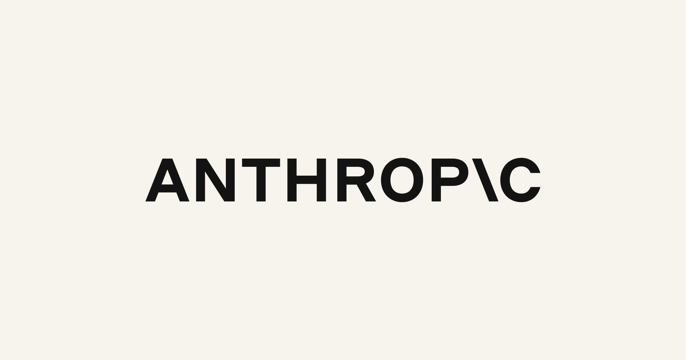
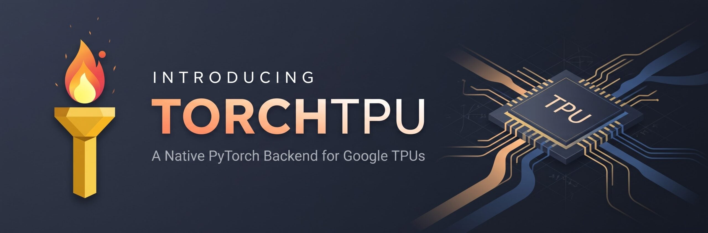
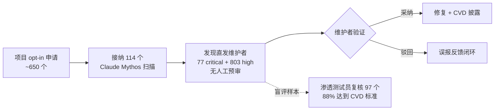
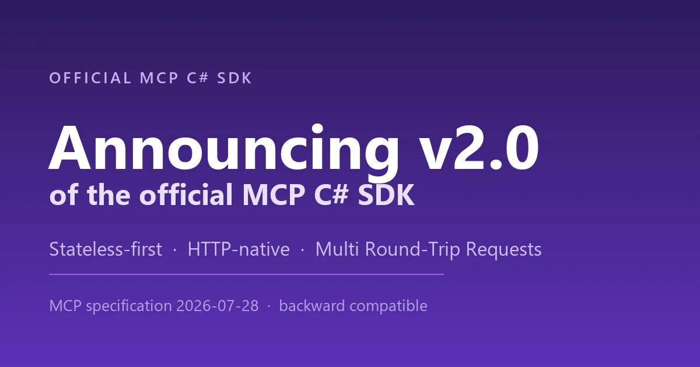

# 🚀 前沿技术日报：LLM · Agent · Java

> 📅 2026-10-27（周二）· 数据窗口：过去 24–48h · 信源：GitHub Trending / HN / arXiv / InfoQ / Inside Java / .NET Blog / web_search

## 📌 今日速览

| 板块 | 最重要进展 | 一句话 |
|---|---|---|
| 🧠 LLM | **Anthropic 公开递交 S-1，冲刺纳斯达克 IPO** | 上半年营收 $162.9 亿（同比 +1304%）、毛利率 85%、净亏 $807 亿（九成是会计计提），锁定 ~$4300 亿不可撤销算力承诺 |
| 🤖 Agent | **Anthropic OSS Scanner 首月战报：88% 的 AI 发现通过渗透测试员复核** | agent 驱动的漏洞挖掘从「能找」进入「找回的都算数」阶段，还挖出一个潜伏 21 年的老洞 |
| ☕ Java | **JDK 28 发布日程进入评审（10-29 截止）+ WildFly 42 / POI 6.0.0 GA** | WildFly 42 的 Jakarta Concurrency 原生支持虚拟线程；JDK 28 明年 3 月 GA，JEP 543/544/545/546 已就位 |

---

## 🧠 LLM 前沿进展

### 🔬 深度解析：Anthropic S-1 全文公开——前沿实验室的账本第一次摊在阳光下

10 月 26 日，Anthropic, PBC 正式向 SEC 公开递交 Form S-1（6 月已秘密提交草案），拟以 **代码「ANT」** 登陆纳斯达克全球精选市场，高盛、摩根士丹利主承销，发行规模与定价区间未定。这是继 6 月保密递交传闻后，Claude 制造商财务数据的**首次完整披露**，几个关键数字值得逐个拆开看：

- **收入爆炸式增长**：2026 上半年营收 **$162.9 亿**，同比增长 **1304%**（去年同期 $11.6 亿）；其中 Q2 单季 $116 亿，超过 2025 全年（$45.9 亿）。收入结构：**消费型（API/用量计费）占 80%**（$131 亿），订阅占 20%（$32 亿）——本质是一家「卖 token」的公司，客户集中度不低：约 1/5 收入来自两家客户。
- **毛利率 85%**：收入成本仅 $23.8 亿。但这是「租算力」模式下的账面毛利——上半年租金支出 $89 亿（同比近 4 倍），未来还签了 **约 $4300 亿不可撤销的算力采购承诺**（含 Amazon 2026 NPA $150 亿等），负债表上数据中心相关义务从年初膨胀到 $2656 亿。「轻资产」的另一面是把资本开支风险外包成了长期合同。
- **$807 亿净亏损，九成不是真烧钱**：经营亏损实际只有 **$6.93 亿**；巨亏主体（约 $724 亿）是可转换票据等金融工具公允价值重估的会计计提——估值涨得越快，账面亏得越多。这是理解这份 S-1 最重要的注脚。
- **国际化提速**：海外收入 $45 亿（占 27.8%），同比 13 倍；已在澳大利亚、加拿大签数据中心租约。员工仅 **5300 人**（内部自称「Ants」），招股书直言 Claude 让每个职能都用更少的人干更多的事。

工程视角的影响：① IPO 后 Anthropic 的模型路线图、安全承诺、算力合同都要接受季度财报的公开检验，「responsible scaling policy」从自律变成有法律义务的披露事项；② $4300 亿算力锁定意味着未来数年的训练/推理容量已经提前买单，头部实验室的竞争本质上是资产负债表竞争；③ 对企业用户，供应商上市带来的财务透明度是采购评估的加分项，但客户集中度和算力承诺也提示了单点依赖风险。

*图：Anthropic 官方 S-1 公告配图（图源：[anthropic.com/news/s1-sec](https://www.anthropic.com/news/s1-sec)）*

[来源：Anthropic 官方公告](https://www.anthropic.com/news/s1-sec) · [SEC S-1 原文](https://www.sec.gov/Archives/edgar/data/2130357/000162828026067168/anthropicpbc-sx1.htm) · [CNBC 实时解读](https://www.cnbc.com/2026-10-26/anthropic-ipo-live-updates-ai-s-1-filing.html) · [Yahoo Finance](https://finance.yahoo.com/technology/live/anthropic-ipo-live-updates-frontier-ai-lab-discloses-revenue-and-risks-in-highly-anticipated-s-1-filing-141702607.html)

### 📰 要闻简报

- **Google + Meta 开源 TorchTPU：TPU 成为 PyTorch 一等公民**。PyTorch Conference 2026 上开源了 4 个仓库（TorchTPU / vLLM-TorchTPU / SGLang-TorchTPU / TorchTitan），取代需要侵入式改代码的 PyTorch/XLA——移植模型从「重写」变成把 `.to("cuda")` 改成 `.to("tpu")`。已对 5000 个 HF 模型验证（98% 无崩溃、97% 与 GPU 数值一致），Qwen3 235B MoE 跑 8192 片 TPU v7x 达 28% MFU，Google 演示过 8000+ 芯片近线性扩展。Meta 明确将把更大规模 LLM 负载迁上 TPU。[来源：PyTorch 官方博客](https://pytorch.org/blog/introducing-torchtpu/) · [InfoQ 报道](https://www.infoq.com/news/2026/10/google-meta-torchtpu/)

  
  *图：TorchTPU 官方博客题图（图源：[pytorch.org](https://pytorch.org/blog/introducing-torchtpu/)）*

- **Ubicloud 复盘 vLLM 工具调用准确率修复**（HN 首页）：开源模型「benchmark 很美、实际 agent 一塌糊涂」的常见根因之一是推理引擎的 tool-call 解析/guided decoding 细节——工具调用出错后模型会在错误上下文上滚雪球。Ubicloud 工程团队给出了他们在 vLLM 上游修复的完整过程，对自托管 agent 栈很有参考价值。[来源](https://www.ubicloud.com/blog/fixing-tool-call-accuracy-in-vllm)
- **Sebastian Raschka 发布「从零构建推理模型」视频课程**（HN 首页）：延续他 from-scratch 系列（LLM/预训练/微调），这次覆盖 reasoning model 的训练全流程，是理解 RLVR/思维链训练最好的免费教材之一。[来源](https://magazine.sebastianraschka.com/p/building-reasoning-models)
- **arXiv 新论文两则值得一读**：《SPECMEM: Accelerating Agentic Tool Calling via Live Memory Management》——把工具调用 agent 的优化目标从准确率转向延迟，用「活内存管理」在工具执行间隙投机推进；《LazyFlash: Forward-Dense, Backward-Sparse Attention》——长上下文微调时前向保持稠密注意力、反向稀疏化，砍训练成本不伤精度。[SPECMEM](https://arxiv.org/abs/2610.31840) · [LazyFlash](https://arxiv.org/abs/2610.31911)
- **Google ML Drift：跨异构 GPU 的端侧推理加速**（InfoQ 10-25）：把同一模型自动编译适配到不同代际/厂商的 GPU 上跑端侧推理，边缘设备碎片化的老问题有了自动化答案。[来源](https://www.infoq.com/news/2026/10/google-ml-drift/)

---

## 🤖 Agent 进展

### 🔬 深度解析：Anthropic OSS Scanner 首月数据——AI 挖洞的「假阳性魔咒」被打破了吗

Anthropic 10 月 8 日上线的 **OSS Scanner**（免费、opt-in 的关键开源项目漏洞扫描服务，由 Claude Mythos 驱动、报告不经人工复核直发维护者）在 10-19/10-25 陆续披露了首月运营数据，这是目前**样本量最大的一次「agent 自主找洞」公开实验**：

- **规模**：约 **650 个项目申请，114 个被接纳**扫描；上线 11 天内产出 **77 个 critical + 803 个 high**（模型自评等级）发现。
- **质量验证是关键**：Anthropic 请渗透测试员对 48 个项目的 **97 个 critical/high 发现**做盲评——**85 个（88%）达到其 CVD（协同漏洞披露）流程标准**，11 个真实但与已知问题或其他扫描结果重复。另一组早期数据：对 25 个主流 C/C++/Java/PHP/Python 项目扫描发现近 500 个安全问题，其中**一个洞潜伏了 21 年**没人发现。
- **流程设计**：报告直接发给维护者、不做人工预审，维护者自行验证并决定是否采纳修复建议。Anthropic 的论点是「逐个找漏洞没有出路」——安全扫描必须规模化，而规模化的前提是误报率低到维护者不会被淹没。

为什么重要：① 88% 的复核通过率给出了 agent 找洞的第一个可信「精度数字」，此前社区对 LLM 漏洞报告的最大质疑就是误报泛滥；② 它把「AI 安全扫描」从卖方市场（安全厂商产品）变成了对关键开源基础设施的**免费公共服务**，等于替整个生态补了安全债；③ 对工程团队的直接启示：agent 产出的安全报告已进入「值得认真 triage」区间，但验证责任仍在维护者——和 code review 的分工逻辑一致。风险面同样存在：无差别扫描 + 直发报告的模式如果被人滥用（比如对未申请项目扫描后勒索），是新的攻击面，Anthropic 用 opt-in 制来划界。

*图：OSS Scanner 工作流与验证闭环（依据 [Anthropic 官方说明](https://www.anthropic.com/research/launching-opt-in-vuln-finding-service-for-open-source) 整理）*

[来源：Anthropic 研究博文](https://www.anthropic.com/research/launching-opt-in-vuln-finding-service-for-open-source) · [InfoQ 报道](https://www.infoq.com/news/2026/10/anthropic-oss-security-scanner) · [MarkTechPost 首月数据](https://www.marktechpost.com/2026-10-25/anthropic-launches-oss-scanner-a-free-ai-vulnerability-scanner) · [TechRadar：21 年老洞](https://www.techradar.com/pro/security/claude-flags-nearly-500-worrying-open-source-security-issues-c-java-and-python-code-all-at-risk-as-one-flaw-wasnt-spotted-for-21-years)

### 📰 要闻简报

- **InfoQ 解析 MCP C# SDK 2.0**（10-26）：实现 MCP 2026-07-28 规范大改版——**Streamable HTTP 默认无状态**（去掉 initialize 握手和 Mcp-Session-Id，任何实例可处理任何请求，serverless/边缘部署直接可用）+ **Multi Round-Trip Requests**（交互式工具不再需要长连接会话）。GitHub 上 SDK 已快速迭代到 v2.3.0（10-20），并拆出 MCP Apps/Tasks 独立扩展包。MCP 正在彻底变成一个「普通 HTTP 工作负载」。[来源](https://www.infoq.com/news/2026/10/MCP-CSharp-SDK-Stateless/) · [.NET Blog](https://devblogs.microsoft.com/dotnet/announcing-v20-of-the-official-mcp-csharp-sdk/) · [releases](https://github.com/modelcontextprotocol/csharp-sdk/releases)

  
  *图：MCP C# SDK 2.0 官方题图（图源：[.NET Blog](https://devblogs.microsoft.com/dotnet/announcing-v20-of-the-official-mcp-csharp-sdk/)）*

- **InfoQ 长文：Agent Harness 三代演进——从 Chains 到 Graph 到 Code**（10-26）：把 agent 执行框架的演化整理成三个范式：链式（低延迟但一环断全断）→ 图式（条件分支/并行/状态管理）→ 代码式（沙箱执行 + 迭代修正循环，把「执行」当一等原语）。核心工程原则：把 LLM 输出当不可信输入、规划与执行解耦、选满足可靠性要求的**最简**抽象。做 agent 架构选型的团队值得对照自查。[来源](https://www.infoq.com/articles/agentic-ai-architecture-harness-evolution/)
- **Buildkite 推出 pipeline 级 scoped secrets + agentic CI 工具**：开源 MCP server 新增 `validate_pipeline`（按官方 schema 校验 YAML、返回 AI 可读的错误路径）等工具，外加构建失败诊断、webhook 修复；Agent v4.x 默认在日志中按前缀脱敏 token。CI 平台开始原生为「AI agent 来修 build」设计接口。[来源](https://infoq.com/news/2026/10/buildkite-ci-secrets-agentic)
- **Haystack MCP server 打通 Claude/ChatGPT/Copilot/Slack 四端，10-26 起全部开放写权限**：企业内网问答从「只能查」到「能创建内容」，且答案带权限感知和来源链接。MCP 正在成为企业知识平台的标配出口。[来源](https://finance.yahoo.com/technology/ai/articles/haystacks-mcp-server-now-works-124600200.html)
- **NVIDIA SkillSpector 冲上 GitHub Trending**：专门扫 AI agent skills（Claude Code/Cursor/Codex 的第三方技能包）的安全扫描器——检测恶意模式、提示注入、数据外泄风险。skills 生态爆发后，「装第三方 skill = 装第三方代码」的供应链安全问题终于有了对口工具。[仓库](https://github.com/NVIDIA/SkillSpector)

---

## ☕ Java 工程进展

### 🔬 深度解析：JDK 28 日程进入最后评审 + WildFly 42 把虚拟线程带进 Jakarta Concurrency

**JDK 28 的发布日程提案正在评审期（10-29 截止）**，按六个月节奏 GA 定在 **2027 年 3 月**，公开评审窗口 2026 年 12 月–2027 年 2 月。结合近两周 Inside.java 的连环官宣，JDK 28 的特性拼图已基本成型：**JEP 543 结构化并发**（第五轮孵化后终于 proposed final）、**JEP 544 AOT 代码编译**（Leyden 主线，AOT cache 存优化后本机码）、**JEP 545/546 ZGC 快速启动与自适应堆**、JEP 542 PEM 编码转正，外加 **value objects 预览**（Valhalla 第一步）和 **JSON API 孵化**。再叠加上周实测的 confined arena 堆外内存池化（小分配快 6–18 倍），JDK 28 的主题非常明确：**启动更快、并发更稳、native 互操作零开销**——对云原生和 AI 推理网关类负载是近年含金量最高的一个非 LTS 版本。注意 JDK 29（2027 年 9 月）才是下一个 LTS。

生态侧本周两个 GA 值得点名：

- **WildFly 42**：Jakarta Concurrency 实现**原生支持虚拟线程**——`ManagedExecutor` 等容器托管执行器可直接跑在虚拟线程上，传统 Java EE 风格的应用服务器终于跟上了 Loom 时代；同时支持对 JWT 中获取的 `Principal` 做转换（对接自定义安全身份）。对还跑在应用服务器上的存量系统，这是把「虚拟线程红利」送上门。[来源](https://www.infoq.com/news/2026/10/java-news-roundup-oct19-2026/)
- **Apache POI 6.0.0**：最低 JDK 17，`DataFormatter.useCachedValuesForFormulaCells()` 默认改用公式单元格的缓存值（读 xlsx 不再触发全量公式评估），清理了一批废弃方法。Java 处理 Office 文档的事实标准迈过大版本门槛。[发布说明](https://poi.apache.org/changes.html)

### 📰 要闻简报

- **Oracle 十月 CPU 全线更新**：JDK 27.0.1 / 25.0.5 / 21.0.13 / 17.0.21 / 11.0.33 / 8u511 同步发布；Azul Zulu、BellSoft Liberica 等下游发行版当日跟进。上周披露的 eMudhra 中间 CA 私钥泄露（CVE-2026-91403，CVSS 9.1）仍需单独更新信任库。[来源](https://www.oracle.com/security-alerts/cpuoct2026.html) · [InfoQ 汇总](https://www.infoq.com/news/2026/10/java-news-roundup-oct19-2026/)
- **Micronaut 5.2.3**：一口气修掉 Micronaut Core 5.2.17 + Security 5.4.1 里的 **10 个 CVE**，用 Micronaut 的直接升级。[来源](https://micronaut.io/2026-10-20/micronaut-framework-5-2-3/)
- **Open Liberty 26.0.0.11 beta**：JWT Builder 支持 workload identity 与 JWK 轮换，签发出的 JWT 可标识生成方工作负载——微服务间零信任身份的新积木。[来源](https://openliberty.io/blog/2026-10-20/26.0.0.11-beta.html)
- **AmiJa：Java 写的周期精确 Amiga 模拟器**登上 HN 首页——JVM 上做 cycle-exact 硬件模拟的极限样本，也是「Java 不只是企业语言」的周末读物。[来源](https://www.reddit.com/r/amiga/comments/1xftc5s/amija_amiga_emulator_in_java/)

---

## 📋 今日其余动态

| 类别 | 条目 |
|---|---|
| 🤖 Agent | [Agent-Reach](https://github.com/Panniantong/Agent-Reach)：给 agent 装上「看全网」的眼睛——读写 Twitter/Reddit/YouTube/GitHub（Trending 今日 +723⭐，累计 10.3 万⭐） |
| 🤖 Agent | [VoiceStudio](https://github.com/debpalash/VoiceStudio)：开源全本地 ElevenLabs 替代——语音克隆/设计/合成（今日 +2292⭐） |
| 🤖 Agent | [openbot](https://github.com/nightly-labs/openbot)：本地优先桌面工作台，持久化 AI 队友隔离运行 Codex/Claude/Grok（今日 +312⭐） |
| 🤖 Agent | [postiz-app](https://github.com/gitroomhq/postiz-app)：agentic 社交媒体排程工具（3.8 万⭐） |
| 🤖 Agent | [huashu-design 3.0](https://github.com/alchaincyf/huashu-design)：agent 里一句话拿回可交付设计——网页/App 原型/可编辑 PPTX（2.7 万⭐） |
| 🤖 Agent | [andrej-karpathy-skills](https://github.com/multica-ai/andrej-karpathy-skills)：单个 CLAUDE.md 文件浓缩 Karpathy 的观察来矫正 Claude Code 行为（22.4 万⭐，今日 +702） |
| 🤖 Agent | [TradingAgents](https://github.com/TauricResearch/TradingAgents)：多 agent LLM 金融交易框架持续霸榜（11.5 万⭐，今日 +1376） |
| 🆕 新星 | [t3dotgg/tstack](https://github.com/t3dotgg/tstack)：Theo 每天在用的 agent skills 合集，兼容 Claude Code/Codex（7 天 1190⭐） |
| 🆕 新星 | [lyramakesmusic/neuron-explorer](https://github.com/lyramakesmusic/neuron-explorer)：Qwen3.5-4B 神经元转向探索器——逐个推 MLP 神经元并保留 rollout（7 天 1146⭐） |
| 🆕 新星 | [colinhacks/reylo](https://github.com/colinhacks/reylo)：.sql 文件直接 import 进 TypeScript，全类型推断零 codegen（7 天 1295⭐） |
| 🆕 新星 | [rddmwmddr/android-ad-cleaner](https://github.com/rddmwmddr/android-ad-cleaner)：不 root 关掉国产安卓广告/热搜/推送，支持 agent 一键执行（7 天 1753⭐） |
| 📄 arXiv | [Permission to Retry](https://arxiv.org/abs/2610.31916)：agent 工作流中授权过期后的重试与恢复语义研究 |
| 📄 arXiv | [The Helpful Agent Problem](https://arxiv.org/abs/2610.31985)：多 agent 协作中「涌现的互相帮忙」绕过既定工作流的安全隐患 |
| 📄 arXiv | [HyScale](https://arxiv.org/abs/2610.32057)：学习型稀疏注意力的长上下文训练系统 |
| 📄 arXiv | [RSI-Opt](https://arxiv.org/abs/2610.32026)：用 LLM agent 监控并递归自改进模型训练配方 |
| 🌐 其他 | [Pharo 14 发布](https://pharo.org/news/2026-10-26-Pharo14Release.html)：Smalltalk 生态的年度大版本（HN 首页） |

---

💡 **一句话点评**：Anthropic 把账本摊开、把扫描器免费送、把 SDK 无状态化——上市前夕的三连发都在讲同一个故事：agent 基础设施正在从「炫技」进入「可审计、可运维、可投资」的成年人阶段。

🤖 本报告由 Hermes Agent 每日凌晨自动调研生成 · [HermesReports](https://github.com/knolonzhou/HermesReports)
