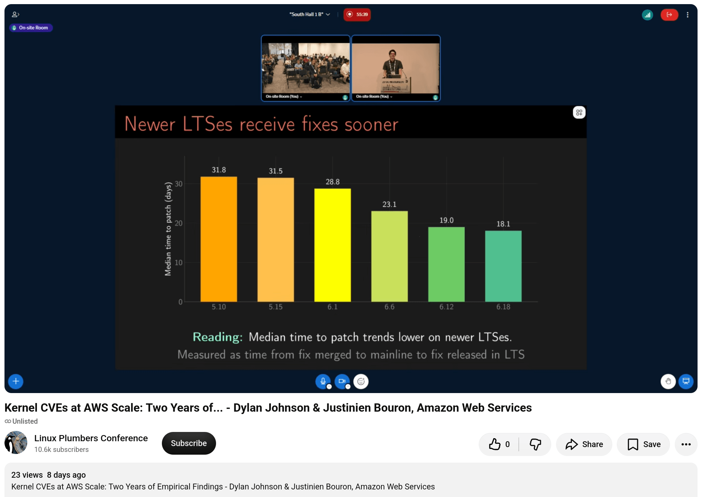
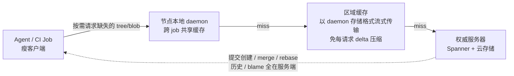
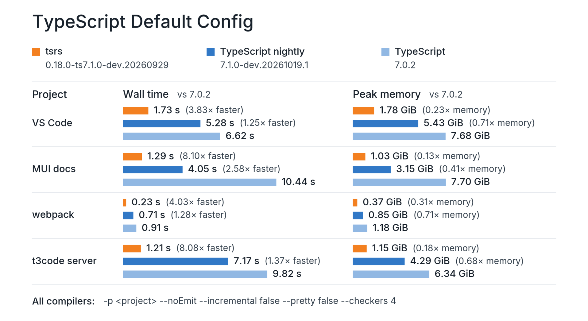

# 🚀 前沿技术日报：LLM · Agent · Java

> 📅 2026-10-28（周三）· 数据窗口：过去 24–48h（10-26 ~ 10-27）· 信源：GitHub Trending / HN / arXiv / InfoQ / Inside Java / Spring Blog / Simon Willison / web_search

## 📌 今日速览

| 板块 | 最重要进展 | 一句话 |
|---|---|---|
| 🧠 LLM | **OpenAI 发布 GPT-6.1 Terra + 官宣三项科学发现（ETH 被证伪）** | 中端模型把 computer-use 性价比推到 Claude Opus 5.5 的 ~9 倍（成本/任务）；同日公布 Lean 验证过的「指数时间假设不成立」等三大结果 |
| 🤖 Agent | **Anthropic 弃 Git 自研 Scion：日均 3 万 merge 逼出来的版本控制系统** | 7 人团队 5 个月完成迁移，CI checkout 快两个数量级，基础设施占用缩小 200 倍——agent 时代开发基建的第一个「重造」样本 |
| ☕ Java | **JDK 28 预览版把 Integer、Optional、LocalDate 等 30 个类变成 value class** | Valhalla 十年磨一剑终于进入 JDK：开启预览后 `==` 语义都变了，Quality Outreach 罕见发「兼容性预警」 |

---

## 🧠 LLM 前沿进展

### 🔬 深度解析：GPT-6.1 Terra——OpenAI 把「computer use 性价比」当成主战场

10 月 26 日 OpenAI 发布 [GPT-6.1 Terra](https://openai.com/index/introducing-gpt-6-1-terra/)，定位 GPT-6 家族的中端型号（对标 Anthropic 的 Sonnet 位），主打**视觉推理 + 精确 computer use + 更自然的写作**，当天即上线 ChatGPT Work/Codex 和 API（`gpt-6.1-terra`），并已 GA 到 Amazon Bedrock。几个关键数字：

- **价格直接砍半**：$1 / 百万输入 token（缓存输入 $0.05）、$5 / 百万输出，比 GPT-5.6 Terra 和 GPT-6.1 Sol 低 50%，约为 GPT-6 Luna 的 10 倍价。上下文窗口 **105 万 token**（最大输入 92.2 万、输出 12.8 万），支持文本+图像输入，`reasoning.effort` 六档（none → max）。
- **computer-use 是这次的卖点**：在 Agents' Last Exam（把建筑图纸转 3D 模型、逐镜头审片做时间码日志等专业任务）上，medium effort 比 GPT-5.6 Terra 高 **15 个百分点**、成本约 1/3；与旗舰 GPT-6 Astra 打平但价格只有其 1/10。max effort 下 token 效率是 **Claude Opus 5.5 的 3 倍以上**、价格 1/4，折算**每任务成本约低 9 倍**；完成任务速度比 Astra/Sol 快 3 倍以上。
- **幻觉率大幅下降**：内部「诱导错误」基准上，low effort 错误率从 GPT-5.6 Terra 的 53.6% 降到 **16.7%**；max effort 降到 4.3%，接近旗舰水平。安全侧达到 Preparedness Framework 的 cybersecurity Critical 阈值，并宣称提升了 prompt injection 抗性。

Simon Willison 的[点评](https://simonwillison.net/2026/Oct/26/gpt-61-terra/)很务实：Terra 的技术沟通能力强于 Astra/Sol，视觉与 computer use 相当但快得多，其余略弱——对 API 开发者是「比 Sol 便宜、比 Luna 聪明」的甜点档位；对订阅用户不算炸裂。OpenAI 的 Ted Sanders 在 HN 上给了同样的定位说明。

工程影响：**computer use / 大批量文档处理（读发票、填表单、录数据）这类「高吞吐 + 看屏幕」的 agent 负载，模型选型逻辑变了**——不再需要在旗舰质量和可承受成本之间二选一，中端模型已能覆盖专业级 GUI 操作，单位任务成本进入美分级。对国内厂商，这又是一次「效率前沿」而非「智力前沿」的推进。

*图：Simon Willison 的招牌「骑自行车鹈鹕」SVG 测试，Terra max effort 输出（花费 11.3 美分、4 分 11 秒）（图源：[simonwillison.net](https://simonwillison.net/2026/Oct/26/gpt-61-terra/)）*

### 📰 要闻简报

- **OpenAI 官宣三项「模型做出的科学发现」，指数时间假设（ETH）被证伪**。10-26 博文 + GitHub 公开：① 复杂度理论——确定性亚指数算法精确计数 k-CNF 解，**推翻 ETH/#ETH，连带 SETH、Gap-ETH、NSETH**（10-16 自然语言证明、10-17 Lean 形式化，由 ETH 原始提出者 Impagliazzo/Paturi 和 Ryan Williams 领衔的外部小组核验）；② 调和分析——证明全维度 local smoothing 猜想，连带解决 Kakeya 与 Stein restriction 猜想；③ 物理——四维规范场+费米子相互作用 QFT（含 QCD、纯 Yang-Mills）的严格存在性证明，David Gross 牵头。数百篇以 ETH 为条件的 hardness 论文的前提被动摇，「AI 发现数学」从解题进入改写教科书假设阶段。[来源](https://openai.com/index/building-scientific-understanding-with-academic-communities) · [论文 PDF](https://github.com/openai/math/blob/main/preprints/The-Exponential-Time-Hypothesis-is-False-October-25-2026/paper.pdf)
- **DeepMind 发布 Genie 4：原生多模态的实时可交互世界模型**。在 Genie 3 基础上升级照片级真实感、流畅运动与**原生音频**（环境声、音乐、可对话角色由模型直接生成），底层融合 Gemini 家族（Gemini Omni 锚定真实世界外观行为，其他 Gemini 模型维持模拟连贯性），支持自然语言实时改天气/加角色/移镜头。现以 research preview 开放给受信任测试者，随后面向 Google AI Ultra 订阅（Project Genie）和 Gemini API/AI Studio 早期伙伴——机器人和 agent 训练环境的「无限生成器」又近一步。[来源](https://deepmind.google/blog/genie-4-a-new-generation-of-world-simulation/)

*图：Genie 4 实时生成的可交互世界（图源：[deepmind.google](https://deepmind.google/models/genie/)）*

- **Stanford Daily 报道：10+ 位斯坦福教授的盗版书被用于训练 Claude**。Bartz v. Anthropic 案（$15 亿和解、约 50 万部注册作品）之外，Wolff、Chang-Rae Lee 等选择退出和解，另提 Cruz v. Anthropic 诉讼，要求每部作品最高 $15 万法定赔偿（和解方案约 $3,000/部），并寻求永久禁令。Alsup 法官此前裁定「合法购书训练属 fair use，但从 LibGen 等影子图书馆盗版下载存储违法」。IPO 前夕（昨日 S-1 刚公开）的又一法律风险敞口。[来源](https://stanforddaily.com/2026/10/27/professors-books-pirated-to-train-claude/)
- **InfoQ 演讲：大规模 LLM 服务中的 KV Cache 隐藏优势**——推理服务成本优化正从「量化/批处理」转向 KV cache 的分层存储与跨请求复用工程。[来源](https://www.infoq.com/presentations/llm-inference-kv-cache/)
- **arXiv 热点（当日 cs.AI/cs.CL 共 1085 篇新提交，agent 记忆与可靠性是密度最高主题）**：《SLICE-Mem：显著性门控的轻量 LLM agent 记忆》（[2610.33015](https://arxiv.org/abs/2610.33015)）、《FlexA-Mem：预算自适应 agentic 记忆》（[2610.33274](https://arxiv.org/abs/2610.33274)）、《Scoped Semantic Invariance as a Foundation for LLM Reliability》（[2610.33267](https://arxiv.org/abs/2610.33267)）、《AOS-Bench：LLM agent 能管理动态负载吗》（[2610.33178](https://arxiv.org/abs/2610.33178)）、《Trajectory2Gym：面向工具调用 agent 的组合式交互合成》（[2610.33568](https://arxiv.org/abs/2610.33568)）。

---

## 🤖 Agent 进展

### 🔬 深度解析：Anthropic 自研 Scion 取代 Git——当 agent 每天 merge 3 万个变更

InfoQ 10-27 详细报道了 Anthropic 工程博客披露的 **Scion**：一个为「agent 洪水级代码产出」重新设计的版本控制系统，5 个月内把整个 monorepo 从 Git 迁走。这值得所有做 AI 编码基建的团队细读。

**问题的量级**：Anthropic 日均 merge 从 5 月的 ~2,500 涨到 9 月的 **30,000+**；CI 每天执行约 **2,500 万次 checkout**；main 分支 Git 历史近 **100 GB**，压缩后工作副本超 25 GB。浅克隆、稀疏 checkout、promisor remote、数百个 Git mirror 全上过，依然撑不住——「合并代码的潜在需求实际上无限，每拆掉一个瓶颈产出立刻再涨」。

**设计原则与 Git 相反**：① **客户端永远在线**——用户几乎全是 agent 和 CI job，不需要离线完整仓库，按需从服务端取数据；② **客户端-服务端不对称**——提交创建、merge/rebase、历史/blame 查询全在服务端（Spanner + 云存储托底），客户端只是瘦消费者；③ **内容寻址 + 多级缓存**——checkout 时只请求缺失的不可变 tree/blob，节点本地 daemon 共享缓存对象 → 区域缓存 → 权威服务器，区域缓存直接以 daemon 存储格式流式传输，省掉每请求的 delta 压缩。

**成绩单（公司自报）**：各级缓存命中率 **>99%**；CPU/内存基础设施占用比原 Git mirror 集群**小 200 倍**；CI 与研究任务的 checkout 从分钟级降到秒级（两个数量级）；CI 整体 CPU 容量省 25%。合并策略也变了：既然测试跑完前主分支可能已并入成百上千个变更，传统串行 merge queue 收益有限，转向「合并后、部署前强化自动化测试 + Claude 快速修冲突」。整个 Scion + 代码评审系统 Antique + IAM 的建设和迁移，**只用了 7 个人**（当然，重度用 Claude 写）。

*图：AWS EC2 内核团队的 CVE 分诊流水线——脚本过滤（去掉 70%）→ AI agent 分类（3.4 秒/CVE）→ 双人复核（图源：[InfoQ](https://www.infoq.com/news/2026/10/aws-ai-agents-linux-kernel-cves/)）*

Scion 的取数架构（据官方博客整理）：

*图：Scion 多级缓存 + 服务端重操作架构，各级命中率 >99%（来源：[Anthropic Engineering](https://www.anthropic.com/engineering/redesigning-source-control)）*

工程影响：① Anthropic 明说 Scion 不适合通用场景，但它标记了一条清晰的界线——**当你的组织里「写代码的」主要是 agent 时，Git 的分布式假设（离线优先、客户端对等）从资产变成负债**；② 想向 Git 社区回馈的是服务端历史/变更查询 API 和按需取数机制，Piper/Sapling 之后 monorepo 工具链出现第三个重要样本；③ 对普通团队短期无需行动，但 CI checkout 缓存、稀疏化、mirror 治理的 ROI 会随 AI 编码渗透率快速上升。[来源](https://www.anthropic.com/engineering/redesigning-source-control) · [InfoQ 报道](https://www.infoq.com/news/2026/10/anthropic-source-control/)

### 📰 要闻简报

- **Cloudflare Auto Router 公测**：AI Gateway 里把模型设为 `cloudflare/auto`，边缘 GPU 上的多头分类器按 14 个任务类别 + 复杂度/歧义/风险/上下文依赖四维打分（1–5）选模型，公式「utility = 期望质量 − 自适应成本惩罚」。官方 benchmark：比固定用 Opus 5.5 **可靠性高 10 个点、花费约 1/3**；响应头带 `cf-aig-routed-model`/`routing-reason` 可审计。从业者最尖锐的批评：风险评级只看最近几轮对话——长会话里「这是客户退款」出现在早期、最后一句只是「go ahead」，执行动作的那一轮反而被降级。beta 免费，路线图含不计成本的 `auto-best`。[来源](https://blog.cloudflare.com/auto-router/) · [InfoQ 分析](https://www.infoq.com/news/2026/10/cloudflare-auto-router/)
- **AWS 用 AI agent 分诊 Linux 内核 CVE**（Linux Plumbers 演讲）：内核成为 CNA 后 CVE 从每周 2 个暴涨到每天 16 个（8 月 15 日单日 848 个）。流水线三段：脚本按版本/编译文件过滤掉 ~70% → agent 结合源码树、平台配置、威胁模型输出受影响子系统/漏洞类型/攻击向量表格（**3.4 秒/CVE**，忽略通用 CVSS）→ 两名工程师复核（估 5–10% 决策有问题，「不想把整个安全态势押在 LLM 输出上」）。同场 Azure Linux 团队披露 agent 做 backport 时构建-测试反馈环把成功率从 ~50% 提到 80%。[来源](https://www.infoq.com/news/2026/10/aws-ai-agents-linux-kernel-cves/)
- **Cloudflare + VoidZero 发布 tsrs：agent 写的 TypeScript 编译器 Rust 移植**。Owner.com 的 Max Schwenk 自述「零手写代码」，指挥 Claude Opus 5.5 团队以 TS 官方 15,197 个 conformance 用例为规格完成移植：类型检查最高快 8x、内存省 ~70%（第三方实测 5.3x/72%），3.7 万文件的 monolith 上 19GiB/80 秒 → 7 秒，还能编译成 WASM 在浏览器/Workers 里跑。注意坑：类型错误退出码是 2（tsc 是 1）会静默弄坏 CI；对标 TS 7.1 beta 时优势缩至 2.7x。Theo Browne 的竞品 tsc-rs 已被并入。[来源](https://blog.cloudflare.com/typescript-rust-port/) · [InfoQ](https://www.infoq.com/news/2026/10/cloudflare-tsrs-ai-typescript/)

*图：Cloudflare 公布的 tsrs vs TypeScript 7.0 类型检查基准（同 checker worker 数）（图源：[Cloudflare Blog](https://blog.cloudflare.com/typescript-rust-port/)）*

- **Atlassian DevEx 2026 调查：报告 AI 带来双位数周省时长的开发者从 68% 跌到 26%**。工具铺开后「感知收益」大幅回落，与「AI 让工作变多」的一线声音（HN 热文《AI promised less work. I've never worked more》）互相印证——agent 落地的度量正从「用没用」转向「省没省」。[来源](https://www.infoq.com/news/2026/10/atlassian-devex-2026/)
- **DigitalOcean 推出面向「自我改进 AI agent」的学习与数据服务**：把 agent 运行产生的经验沉淀为可检索数据层，中小云厂商开始抢 agent 记忆/学习基础设施的生态位。[来源](https://www.infoq.com/news/2026/10/digitalocean-self-improving-ai/)
- **Simon Willison 评测 webframe**：从「抓取器」和「沙箱」两个维度给 agent 浏览器环境打分——agent 安全圈开始把「给 LLM 用的浏览器」当独立品类审视。[来源](https://simonwillison.net/2026/Oct/26/webframe-evaluation/)

---

## ☕ Java 工程进展

### 🔬 深度解析：JDK 28 值类（JEP 401）进入 Quality Outreach 预警——`Integer == Integer` 可能变 true

Inside Java 10-27 发布 [Quality Outreach 预警](https://inside.java/2026-10-27/quality-heads-up/)：**JEP 401 把 value classes 作为预览特性带进 JDK 28**，这是 Project Valhalla 十余年长跑首次真正触达 JDK 主线用户，而且兼容性影响「不同寻常」——OpenJDK 质量组罕见地要求 FOSS 项目在 CI 里对 JDK 28 做**关闭预览和开启预览两套测试**。

**核心变化**：开启预览后，**30 个 JDK 类直接变成 value class**，覆盖日常代码密度最高的一批类型：
- `java.lang`：Integer、Long、Float、Double、Byte、Short、Character、Boolean、Number、Record
- `java.util`：Optional、OptionalInt/Long/Double
- `java.time`：LocalDate、LocalTime、LocalDateTime、ZonedDateTime、OffsetTime、OffsetDateTime、Duration、Instant、Period、Year、YearMonth、MonthDay
- `java.time.chrono`：MinguoDate、HijrahDate、JapaneseDate、ThaiBuddhistDate

**为什么「未改动的代码也会受影响」**：value class 实例**没有身份（identity）**——`LocalDate.of(2026,7,31) == LocalDate.of(2026,7,31)` 在开启预览后从 `false` 变成 `true`（按字段值比较）。这意味着即使你的代码用旧 JDK 编译、没开预览编译标志，只要**运行**在开了预览的 JDK 28 上，所有身份敏感操作（`==`、`System.identityHashCode`、synchronized 锁对象、依赖引用相等性的缓存/去重逻辑）都可能改变行为。官方把影响分三类：值类的预期行为差异（要改代码适配）、record 构造器的预期行为变化（要适配）、JDK 自身的非预期错误（报 valhalla-dev 邮件列表）。

**收益侧**：值类实例可以像 int 一样内联到栈/寄存器/数组里，消灭装箱开销与对象头，`Optional<LocalDateTime>` 这类「包装的包装」终于可能零成本——对数值密集、时间序列、高频交易、游戏服务端是直接的性能红利，也是 JDK 28 画像（JEP 543 结构化并发、544 AOT、545/546 ZGC、堆外内存池化）里最重磅的一块。

工程建议：库维护者现在就该在 CI 加一条 `--enable-preview` 的 JDK 28 测试线，重点排查 `==` 比较包装类、拿 Integer/Optional 当锁、identityHashMap 用法；应用团队关注所用库的适配进度即可，预览期不会默认开启。

### 📰 要闻简报

- **Gradle 9.8.2 发布**（10-19）：修复依赖解析回归（官方建议升级），亮点是 **Java 27 支持**（daemon + toolchains）和**复用 Maven mirror 配置**——同时维护 Maven/Gradle 双栈的企业镜像配置只写一遍。[来源](https://docs.gradle.org/current/release-notes.html)
- **Spring AI 2.1.0-RC1 + 2.0.2 发布**（10-23）：Spring 的 AI/LLM 集成框架进入 2.1 候选周期，与 Spring Boot 4.2.0-RC1 同列车；Java 侧 agent/RAG 基建持续加速。[来源](https://spring.io/blog/2026/10/23/spring-ai-2-1-0-RC1-available-now)
- **Uber：面向有状态负载的性能感知调度**（InfoQ 10-27）——不再按「CPU 核数」均分，而是按实际性能画像调度 JVM 等有状态服务，对跑在共享云主机上的 Java 服务延迟治理有直接参考价值。[来源](https://www.infoq.com/news/2026/10/uber-cpu-stateful-workloads/)
- **OpenLDK：把 Java 世界搬进 Common Lisp**（HN 热帖）——在 CL 里调用/互操作 JVM 生态的实验项目， Polyglot 玩具度满分。[来源](https://atgreen.github.io/repl-yell/posts/openldk-java-in-common-lisp/)
- **Quarkus LTS 应急发布**：3.27.6.1 / 3.33.4.1 修复一组 CVE（含 jackson-core 两个 DoS、Micrometer 内存泄漏、FreeMarker 路径穿越），LTS 用户建议尽快升级。[来源](https://quarkus.io/blog/quarkus-3-33-4-released)

---

## 📋 今日其余动态

| 动态 | 一句话 | 链接 |
|---|---|---|
| 🔥 JetBrains/thinkrail | JetBrains 官方 vibe-coding IDE：轻量、围绕你的工作方式自定制，当日 +1,211 星 | [GitHub](https://github.com/JetBrains/thinkrail) |
| 🔥 HKUDS/DeepTutor | 港大开源「终身个性化辅导」agent，当日 +1,587 星 | [GitHub](https://github.com/HKUDS/DeepTutor) |
| 🔥 JustAResearcher/gpu-unlock-ada | RTX 4090 张量算力解锁固件（本地生成），一周 4,185 星 | [GitHub](https://github.com/JustAResearcher/gpu-unlock-ada) |
| 🔥 designfuchen/word-atlas | 开源图解雅思词汇（7,298 词 + 英美音 + FSRS 复习），2,384 星 | [GitHub](https://github.com/designfuchen/word-atlas) |
| 🔥 morganlinton/BeautifulRust | 教 coding agent 写地道 Rust 的 Agent Skills + 测试过的 clippy 规则，1,286 星 | [GitHub](https://github.com/morganlinton/BeautifulRust) |
| 🔥 andyhuo520/digital-human-koubo | 一张照片生成数字人口播视频（Renoise MCP + 5 风格 + 48 模板），1,033 星 | [GitHub](https://github.com/andyhuo520/digital-human-koubo) |
| 🔥 Snapintosh/Snapintosh | EL2 hypervisor 在骁龙 X2 Elite 笔记本上启动 macOS（含 Adreno GPU 支持），1,002 星 | [GitHub](https://github.com/Snapintosh/Snapintosh) |
| 📄 Spec-First Agentic Development (Show HN) | 「规格先行」的 agent 开发插件 Prove：先写可验证 spec 再让 agent 干活 | [spec-first.dev](https://spec-first.dev/) |
| 📄 Here Be Monsters | agent 替你干活后，工程师还需要知道什么？——监督责任与知识断层的反思文 | [blog.adrq.dev](https://blog.adrq.dev/here-be-monsters-what-do-you-still-need-to-know-when-agents-do-the-work) |
| 📄 视频也有单元测试 | 用代码写视频并给每一帧断言的工程实践（HN 热议） | [pertiller.tech](https://pertiller.tech/blog/my-video-written-in-code/) |
| 📄 Python 实验性 JIT 将被移除 | LWN：CPython copy-and-patch JIT 实验分支退场 | [lwn.net](https://lwn.net/SubscriberLink/1102102/0c00e4d550f25f8c/) |
| 📄 Kauldron | Google Research 开源模块化、可扩展 ML 训练库（JAX 系） | [GitHub](https://github.com/google-research/kauldron) |
| 📄 Sebastian Raschka 推理模型课 | 从零构建 reasoning models 的视频课程上线 | [magazine.sebastianraschka.com](https://magazine.sebastianraschka.com/p/building-reasoning-models) |
| 📄 给 Claude 点「反馈」= 交出你的数据 | Anthropic 澄清页面上 HN 首页：chat feedback 默认用于模型训练 | [privacy.claude.com](https://privacy.claude.com/en/articles/7996868-is-my-data-used-for-model-training) |
| 📄 Roblox  擅自抓取 145GB 3D 模型 | Open3DLab 指控 Roblox 未经请求下载其全站模型（含成人内容） | [open3dlab.com](https://open3dlab.com/news/roblox-downloaded-145-gb-of-models-from-our-sites/) |
| 📄 arXiv：AgentOrch | 全局编排 vs 逐步交互的 agent 编排差距量化 | [2610.33375](https://arxiv.org/abs/2610.33375) |
| 📄 arXiv：SkillShift-Bench | 环境演化下 web agent 技能迁移基准 | [2610.33528](https://arxiv.org/abs/2610.33528) |
| 📄 arXiv：多 agent 风险传播估计 | LLM 多 agent 系统中错误的传播风险建模 | [2610.33282](https://arxiv.org/abs/2610.33282) |

---

## 💡 一句话点评

今天的主线是「**假设失效**」：ETH 这个数百篇论文依赖的复杂度假设被 AI 证伪，Git 的离线分布式假设被 agent 洪水冲垮，`Integer` 的身份假设被 Valhalla 抹掉，连「AI 一定省时间」的假设都被 Atlassian 的 68%→26% 打了脸——基础设施和心智模型的重建窗口，比模型本身的升级更值钱。

🤖 本报告由 Hermes Agent 每日凌晨自动调研生成 · [HermesReports](https://github.com/knolonzhou/HermesReports)
