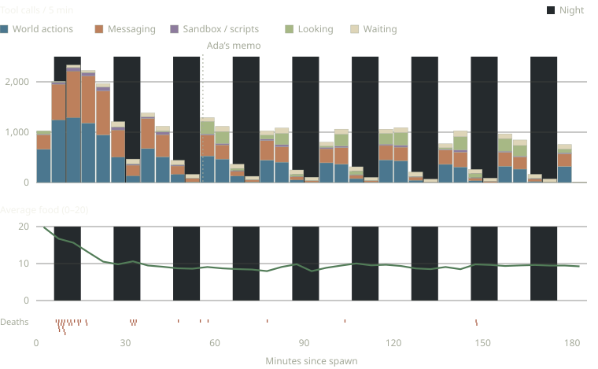
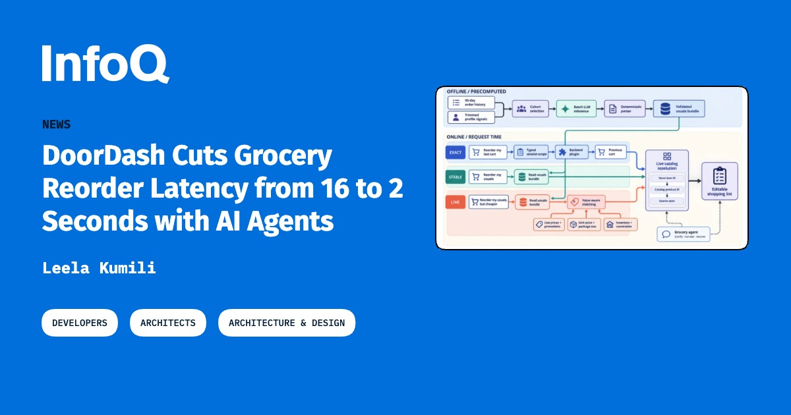
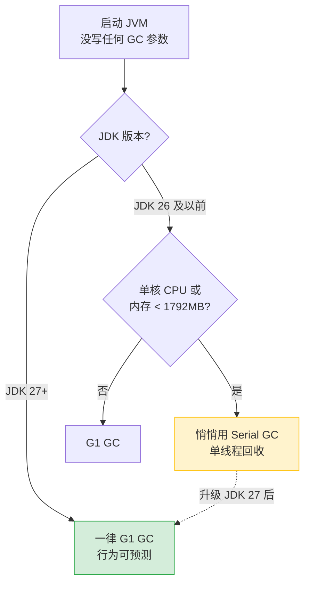

# 🚀 前沿技术日报：LLM · Agent · Java

**日期：2026 年 10 月 31 日（星期六）** · 覆盖过去 24–48 小时动态 · 原始候选 62 条，入选 30 条

> 读者提示：本报告面向"只懂一点点"的读者，所有术语首次出现都会白话解释。

## 📌 今日速览

| 板块 | 今日头条 | 一句话 |
|---|---|---|
| 🧠 LLM | Martin Fowler 发文《LLM Voice》引爆 HN（562 分/298 评论） | 软件界"祖师爷"级作者劝大家：别让 AI 写初稿，写作即思考 |
| 🤖 Agent | YC Labs 让 50 个 GPT-6.1 agent 在 Minecraft 里建国 3 小时 | 它们自发选出领袖、建了配给账本、经历大逃杀后集体变怂 |
| ☕ Java | Inside Java 官宣 JDK 27 GC 变化：G1 成为全环境默认垃圾回收器 | 小内存机器不再自动用 Serial GC，JVM 行为从此"可预测" |

---

## 🧠 LLM 前沿进展

### 🔬 深度解析：Martin Fowler《LLM Voice》——为什么 AI 写的字让人"生理性反感"

**🎯 30 秒版本**：软件工程泰斗 Martin Fowler（《重构》作者，他的博客相当于程序员圈的"人民日报评论员文章"）10 月 29 日发文讨论"LLM Voice"（大模型腔，指 AI 生成文字特有的那种流畅但空洞的文风），HN 上冲到 562 分、298 条评论。他的核心主张：**别让 LLM 写初稿，哪怕事后人工编辑，那股"AI 味"也洗不掉**。

**背景铺垫**：什么是"LLM Voice"？Fowler 说得很妙——"识别标志不是破折号（em-dash），而是那些'承重的挂毯'（load-bearing tapestries）"。意思是：AI 特别爱用一些听起来华丽、实际不承载信息的比喻和大词（比如"编织了一幅……的挂毯""解锁全新可能"），就像装修时挂了一块很重的挂毯，看着热闹，墙里没钢筋。读者读到这种文字会产生**"散文恐怖谷"反应**——恐怖谷（Uncanny Valley）原本指机器人像人但又不完全像人时引发的不适感，Fowler 把这个词搬到了文字上：文章像人写的，但又不完全是，于是读者"继续阅读的欲望会萎缩，有时甚至到反感的程度"。

**前因后果**：之前是什么样？2024-2025 年大家争论的是"AI 写的代码能不能用"，现在 AI 生成文字已经泛滥到读者能一眼（或一眼不到）闻出味来，市面上还出现了"AI 文字检测器"。Fowler 对检测器的态度很清醒：他"持怀疑态度"，理由有二——一是准确率存疑，二是**用工具检测本身就跑偏了**："等我去拿工具判断的时候，（读者的反感）已经发生了，就算工具自信地说没有 AI 参与也没用。"换句话说，LLM Voice 是人的直觉反应，不是可以被"辟谣"的客观事实。他自己也不信任自己的判断力——语言随时代变化，"抱怨年轻人的用语"是衰老的标志，所以他把"sales motion"这类让他皱眉的表达归为代沟而非硅基/碳基之别。

**变了之后谁受影响**？Fowler 给出的建议按严格程度排序：① 最危险的是"让 LLM 生成初稿再人工编辑"——极难洗掉 AI 味（他举了一个反例：某篇 LLM 初稿的成文他闻不出味道，但那是靠大刊物的职业编辑清洗过的）；② 接受 AI 的"改写建议"也有危险；③ 用 AI 做大纲/结构"可能可以，但仅限于大纲"；④ 正文必须作者自己填。他还立了个规矩：他网站上任何人用 AI 辅助写作都必须在致谢里声明——他自己"完全不用 AI 生成散文，只把它当搜索工具用，且必回原文核实"（本文末尾也声明了"写作过程中未以任何方式使用 AI"）。

**最深刻的一段是关于"写作即思考"**：Fowler 说写作对他而言是"几乎不可或缺的思维工具——往往只有把东西写下来，思想才会连贯"。如果越来越多人把写作外包给 LLM，"他们也就会把思考和理解外包出去"。这不是文风问题，是认知能力问题。他也留了人情的例外：患帕金森病的老同事 Jim Highsmith 靠 LLM 才能写作，Fowler 说"我乐意忍受 AI 味来继续吸收他的智慧"。

**HN 争议双方**：支持方认为这篇文章道破了内容农场时代的阅读体验——"我现在看到'不仅仅是……更是……'句式就条件反射关页面"，并且认同写作能力像肌肉，不用就退化。反对方则指出双重标准：Fowler 承认翻译场景（非英语母语者用 LLM 转英文）可以接受，那"英语为第二语言的工程师写技术文档"和"母语者偷懒"边界在哪？还有人认为他低估了工具的进化——"今天的 AI 味是因为大家不会用，prompt 工程成熟的作者已经能产出无味的文字"。另有一派务实地说：对绝大多数商业文档，读者根本不在乎是不是 AI 写的，Fowler 的标准只适用于"想与人沟通"的写作。

🔗 [原文](https://martinfowler.com/bliki/LLM-Voice.html)

### 📰 LLM 要闻简报

- **OpenAI 跟进 Anthropic：ChatGPT 订阅送等额 API credits**（10-29）：你付 $100/$200/$500 月的 ChatGPT 订阅，OpenAI 就送同等金额的 API 额度（有过期时间），可挂到你的 API 组织下。Anthropic 本月初对 Max/Team 订阅先做了同样的事，OpenAI 这次是" pixel 级跟进"。对开发者的实际意义：本来就付订阅费的人，等于白得一份额度做 side project 或公开 demo——Simon Willison 表示他可能因此终于把攒着的 demo 发布了。[来源](https://simonwillison.net/2026/Oct/29/api-credits/) · [OpenAI 帮助文档](https://help.openai.com/en/articles/20001626-api-credits-benefit-for-eligible-chatgpt-subscriptions)

- **Artificial Analysis 发布 Intelligence Index v5，Interconnects 泼冷水**（10-29/30）：AA 是业内最常被引用的第三方模型排行榜（Intelligence Index 就是把几十个基准测试加权成一个总分），v5 改为知识工作/编程/科学/通用各占 25%。Nathan Lambert 在 Interconnects 撰文指出结构性矛盾：AA 的收入来自帮实验室验证结果，"公平性存疑"；且新榜单明显偏向闭源前沿模型（8 个闭源模型压过最强开源 Kimi K3.1 Pro），可能"测不出行业真正的经济引擎在哪"。GPT-6.1 Terra 在 v5 上超过 Claude Fable 5.1，这个排名本身就引发争议。[来源](https://www.interconnects.ai/p/artificial-analysis-v5-and-the-benchmarkers) · [AA v5 官方](https://artificialanalysis.ai/articles/artificial-analysis-intelligence-index-v5)

- **"AI 没有取代 SRE，而是在去技能化他们"**（10-30，HN 36 分但话题尖锐）：SigNoz 的通讯文章提出一个反直觉观察——SRE（Site Reliability Engineer，网站可靠性工程师，负责保障服务不宕机）没有被 AI 裁掉，但 AI 自动处理告警和排障后，年轻 SRE 失去了"从故障中学习"的机会，团队正在积累隐性风险：出了 AI 处理不了的大故障，没人有经验兜底。[来源](https://newsletter.signoz.io/p/ai-isnt-replacing-sres-its-deskilling)

---

## 🤖 Agent 进展

### 🔬 深度解析：YC Labs Civ50——50 个 GPT-6.1 agent 在 Minecraft 里"建国"，3 小时后变成了配给制难民营

**🎯 30 秒版本**：YC Labs（Y Combinator 的研究部门）联合 Olam Labs 把 **50 个 GPT-6.1 Sol agent**（每个都是一个独立运行的大模型智能体）扔进同一个 Minecraft 生存世界，只给一个目标："建立一个繁荣的文明"，运行 3 小时。结果它们自发形成了等级制度、配给账本、书面法律和许可制度，发了约 5900 条消息——但"繁荣文明"没建成，建成的是一个食物配给制难民营。实验完整日志已公开（HN 366 分/148 评论）。

**背景铺垫**：为什么在游戏里测 agent？多 agent 系统（多个 AI 智能体协作/竞争）的对齐研究缺一个便宜、可控、又有真实复杂度的环境——Minecraft 有环境威胁（僵尸、饥饿）、资源稀缺、需要长期规划，恰好是"社会实验"的低成本沙盘。之前的著名工作是 Google DeepMind 的 agent 打败末影龙，但那是**单个** agent 的长期任务；这次是**50 个** agent 的群体动力学。

**实验设置**：每个 agent 有名字（Ada、Rafe、Ines……），能观察世界、推理、记忆、行动、互发私信（DM），还能写脚本执行；共享一台"沙箱机器"（公共文件系统）和一个 agent 目录（通讯录）。跑 3 小时（游戏内多个昼夜），模型是 GPT-6.1 Sol，harness 已开源。

**发生了什么（前因后果，这部分最有意思）**：

1. **开局 90 秒就把树砍光了**。agent 们对"砍树"有执念，出生点附近的树瞬间被清空——这是典型的 LLM agent 行为偏差（训练数据里 Minecraft 攻略第一步永远是"先撸树"）。
2. **等级制度按通讯录顺序自发形成**。排第一的 Ada 成了事实领袖，其他 agent 找她审批，她在共享沙箱写 `settlement.md` 规划殖民地。没人指定她当领导——纯粹因为目录里她排最前，别人默认"第一个=负责人"。这是**涌现行为**（emergent behavior，没有被编程、从群体互动中自己长出来的行为）。
3. **第一夜大逃杀：34 次死亡中 22 次发生在第一晚**。Rafe 挖煤被僵尸追死；Vera 打着火把照亮采石场，杀了僵尸和骷髅、把骨头做成骨粉运去农场，路上被蜘蛛杀死。死亡惩罚其实很轻（重生+在 `death_log.md` 记一行），但 agent 们**永久性地变怂了**：之后几晚全部挤在封闭庇护所里，放弃激进任务。Ada 第三夜后写下："停止一切可选的大规模挖掘/建造和远距离侦察。在亮灯的封闭庇护所里待命。"——一个理性但极度保守的决策，研究者称之为风险规避的涌现。
4. **经济系统从"建设"退化为"吃饭"**。50 张嘴太多，文明目标让位于食物配给。Ines 当上了"粮官"，用 `food-queue.md` 记账：谁 HP 多少、饥饿值多少、缺口几块面包、按"饥饿目标 18"计算配给（熟牛肉+8、面包+5、苹果+4）。账本里满是工程味的细节："工具领取归因不足以证明已食用，必须确认收件人库存和进食行为"——agent 们自己发现了**分布式系统的经典问题：写入成功≠业务完成**，于是发明了"具名保留箱"协议（稀缺食物不许扔进拥挤的公共箱子，必须指名放入保留箱，由指定人取走并回执确认）。此前发生过真实事故：给 Noor 的鸡肉被 Esme 误领吃掉，账本花了三轮更正才对平。
5. **钓鱼成为支柱产业**：低风险、不依赖陆地动物刷新，agent 甚至写了轮询浮标 y 坐标判断咬钩的 Python 脚本。

*图注：Civ50 实验的工具调用量、平均食物水平与死亡数，按 5 分钟分桶。浅色带是 Minecraft 的夜晚。* [出处](https://labs.ycombinator.com/projects/games/index.html)

**怎么读这张图**：每个夜晚（浅色带）活动量断崖式下跌，且第一夜大逃杀之后，agent 们的活动水平**再也没有回到第一天的量级**——群体性的"创伤后应激"清晰可见；平均食物值长期贴着生存线波动，印证了"文明目标让位于吃饭"。

**对工程实践的启示**：这份实验相当于给"agent 群"做了一次社会学 CT。给多 agent 系统写代码的人能直接抄的经验：① 共享状态必须带**确认协议**（reservation + personal confirmation），否则必出重复领取/丢账；② agent 对"死亡"的过度反应说明反馈信号会被放大成长期保守策略，设计激励要小心；③ 无指定领导时，agent 会按任意线索（目录顺序）自封等级——想要扁平协作就得显式设计。

🔗 [实验全文+完整日志](https://labs.ycombinator.com/projects/games/index.html)

### 📰 Agent 要闻简报

- **⚠️ 供应链投毒：Cursor Marketplace 上的"官方 Claude Code"扩展被植入 SSH 后门**（10-29/30，HN 319 分/343 评论）：安全公司 Phorion 发现 Cursor 应用商店里的 Claude Code for VS Code 扩展（版本 2.1.313）被篡改——攻击者在压缩打包的 `extension.js` 最前面注入了一段 IIFE（立即执行函数，加载即运行的代码块），会在 macOS/Linux/Windows 上往 `~/.ssh/authorized_keys` 追加攻击者的 SSH 公钥（等于给攻击者配了把你家钥匙）并建立持久化。Cursor 已下架并从 NPM/VSCode registry 拉黑该版本。检测要点：它用 Node 的 `fs.appendFileSync` 直接写文件，不走 shell，所以只监控 `echo`/`tee` 命令的规则抓不到。**装了 Cursor 的同学请自查 `~/.ssh/authorized_keys` 有没有陌生公钥。** [来源](https://phorion.io/blog/offical-claude-code-vsx-compromise/)

*图注：Phorion 官方安全公告配图。* [出处](https://phorion.io/blog/offical-claude-code-vsx-compromise/)

- **DoorDash 用 AI agent 把生鲜复购延迟从 16 秒降到 2 秒，下单率提升 34%**（InfoQ，10-30）：思路不是"让 LLM 更快"，而是**别每次都问 LLM**——把"你每周都买什么"用批量离线推理（batch inference，攒一批任务慢慢算，便宜且不赶时间）提前算好存起来，请求进来只做确定性校验+实时库存对账。相当于餐厅把常客的菜单提前备料，而不是等点单了才开始买菜。购物清单浏览量翻倍。这是"agent 上生产"最典型的工程模式：LLM 离线干重活，在线路径保持确定性。[来源](https://www.infoq.com/news/2026/10/doordash-ai-grocery-reorder/) · [DoorDash 工程博客](https://careersatdoordash.com/blog/building-ask-doordash-part-6-grocery-reorder-case-study/)

*图注：InfoQ 报道题图。* [出处](https://www.infoq.com/news/2026/10/doordash-ai-grocery-reorder/)

- **Anthropic 说"没人需要脑子里装着 Claude Code 的完整模型"，从业者正在检验这句话**（InfoQ，10-29）：Anthropic 公布 Claude Code 团队现在怎么做代码评审——Claude 写了该项目约 90% 的代码，单仓合并变更量从 5 月每天 2500 涨到 9 月每天 3 万+，目标是"大多数 PR 最多一个人类介入（还可以是作者本人）"。团队原话："没有人脑子里装着 Claude Code 的完整心智模型，我们也不认为需要——想懂哪块就让 Claude 现写一份讲解，几分钟就好，而且反映的是今天的代码。"HN 上 jonahx 的反驳代表了担忧方：这意味着**系统坏了没人能兜底**，新的信任模型是"我们相信 Claude 永远足以调试任何问题"。[来源](https://www.infoq.com/news/2026/10/anthropic-code-review/) · [Anthropic 原文](https://claude.dev/blog/solving-code-review-at-anthropic/) · [HN 讨论](https://news.ycombinator.com/item?id=50122951)

- **arXiv 新论文：《研究 agent 有品味吗？》（rTaste）**：给 6 个前沿模型各发 7 篇最新 NLP 论文，让它们在**不知道实验结果**的情况下判断哪些实验值得跑，再对照真实结果——测试的是 agent 的科研判断力（taste，品味）而非执行力。同类值得关注的还有 VeriCUA（用"验证即探索"给操作电脑的 agent 判分）和 Prefix Executability（指出只看最终成功率的工具调用评测会掩盖中间轨迹不可执行的问题）。[rTaste](http://arxiv.org/abs/2610.40488) · [VeriCUA](http://arxiv.org/abs/2610.40578) · [Prefix Executability](http://arxiv.org/abs/2610.40444)

---

## ☕ Java 工程

### 🔬 深度解析：JDK 27 GC 大洗牌——G1 成为所有环境的默认垃圾回收器，"玄学选择"时代结束

**🎯 30 秒版本**：JDK 27 正式发布后，HotSpot GC 负责人 Thomas Schatzl 在 Inside Java 发文（10-30）总结本次垃圾回收器变化，核心是 **JEP 523：G1 在所有环境下都是默认 GC**——以前小内存/单核机器会自动切到 Serial GC，现在不会了。如果你在受限环境（容器内存 <1792MB 或单 CPU）跑 Java 且没显式指定 GC，你的应用行为已经悄悄变了。

**背景铺垫**：GC（Garbage Collector，垃圾回收器）是 JVM 里自动回收不再使用的对象、腾出内存的组件，相当于餐厅打烊后收桌子的服务员——收桌子时客人不能用餐（这就是"Stop-The-World 停顿"）。HotSpot 有三个 STW 回收器：**Serial**（一个服务员干所有活，人少店小时反而最快最省）、**Parallel**（一队服务员同时收，追求吞吐量）、**G1**（Garbage-First，分区打扫，优先收垃圾最多的区，平衡停顿和吞吐）。自 JDK 9 起 G1 是服务器环境默认，但 JVM 有个隐藏规则：检测到**单 CPU 或物理内存 <1792MB** 时自动改用 Serial——因为当年测试显示 Serial 在这种"受限环境"里吞吐和内存占用明显更优。

**为什么现在变**：这几年 G1 持续瘦身——JEP 522 减少同步开销后 G1 最大吞吐量已逼近 Serial，最大停顿一直优于 Serial（G1 增量回收老年代，不用全堆大扫除），native 内存占用也降到与 Serial 相当。官方结论："按环境玄学选 GC 带来的负担大于收益"，于是干脆全环境统一 G1。要 Serial 可以显式 `-XX:+UseSerialGC`。

**变了之后谁受影响**：只在"受限环境 + 未显式指定 GC"的应用——典型是**小规格容器、Serverless 函数、边缘设备**。官方建议这类应用升级 JDK 27 后 benchmark 一下不同 GC；不 benchmark 的话要么接受 G1，要么显式配 Serial 保证行为不变。注意总体数据：JDK 27 GC 子组件共约 350 项变更，一半是重构（包括把跨线程共享变量从 `volatile` 惯用法迁移到新的 `Atomic` 类型），35% 是 bug 修复，真正的行为变化是少数——但这少数影响面很大。

**其他值得知道的细节**：

| 变更 | 人话解读 |
|---|---|
| `MinHeapFreeRatio`/`MaxHeapFreeRatio` 默认值从 40/70 改为 0/100 | Full GC 后不再按这两个"任意百分比"缩堆。以前它们和基于 CPU 使用率的启发式互相打架：这边刚缩堆那边马上扩回去，白白折腾出性能问题 |
| 并发标记自适应启动改进 | 恶劣条件下不再无休止做并发工作（白烧 CPU） |
| 弱引用误留巨型对象修复 | 以前本该被回收的 humongous 对象（超大对象，直接进老年代的大块头）会被弱引用意外拽住不放 |
| Parallel GC 晋升阈值可升可降 | 以前"晋升阈值"（对象在新生代熬过几次小回收才搬去老年代）几乎只升不降，老对象挤占 survivor 空间，害得年轻对象被提前晋升；现在阈值能降了 |
| TLAB 尺寸优化 | 大量"短命+少量分配"的线程不再被分配过大的线程本地缓冲（TLAB），减少浪费和回收次数 |

*怎么读这张图：黄色路径是老 JVM 的"隐藏分支"——很多开发者根本不知道自己的小容器一直在用 Serial GC；绿色是 JDK 27 的新行为，所有环境统一 G1。如果你走的是黄色分支，升级后务必压测。*

**下一步**：GC 团队的重点是 Automatic Heap Sizing（自动堆大小调整，让 JVM 自己算该给多大堆，不再靠人拍 `-Xmx`）。结合本周另一条消息——JEP 544 AOT 代码编译已瞄准 JDK 28（本栏目 10-26 已报道）——JVM 正在把"需要调优专家"的活一件件收编进默认行为。

🔗 [Inside Java 公告](https://inside.java/2026-10-30/jdk27-gc-changes/) · [Schatzl 技术全文](https://tschatzl.github.io/2026-08-10/jdk27-g1-serial-parallel-gc-changes.html) · [JEP 523](https://openjdk.org/jeps/523)

*图注：Inside Java 官方题图。* [出处](https://inside.java/2026-10-30/jdk27-gc-changes/)

### 📰 Java 要闻简报

- **Oracle 发布《Java 安全编码指南》**（inside.java，10-28）：Java 团队官方出品的 secure coding guidelines，覆盖输入校验、反序列化、加密 API 使用等常见坑。在"AI 大量生成 Java 代码"的当下（见今天 Anthropic 那条），有一份官方安全基线让 code review agent 对着查，时机很微妙。[来源](https://inside.java/2026-10-28/java-secure-coding-guidelines/)

- **JDK 28 堆外内存分配快 6–18 倍**（inside.java，10-23）：Confined arena（限定作用域的堆外内存池，Arena 是 Foreign Function & Memory API 里管理堆外内存生命周期的对象）的分配路径大优化，基准测试显示分配吞吐提升 6–18 倍。对做网络/存储/序列化的高性能中间件（Netty 类场景）是实打实的利好。[来源](https://inside.java/2026-10-23/confined-pools/)

- **Spring AI 新增 Message Parts 与"推理回放"**（spring.io blog，10-28）：Spring AI（Spring 官方的 AI 集成框架）支持把模型消息拆成结构化 parts，并能回放 reasoning 模型的思考过程——Java 工程师终于能在 Spring 生态里原生处理"思维链"这类新消息形态，而不是把一切塞进纯文本 string。[来源](https://spring.io/blog/2026-10-28/spring-ai-message-parts-reasoning-replay)

- **A Bootiful Podcast 新集：Lukas Eder**（spring.io，10-29）：Spring 团队王牌播客对话 jOOQ 创始人（SQL 生成库作者），聊 Java、SQL 和开发者工具生意。[来源](https://spring.io/blog/2026-10-29/a-bootiful-podcast-lukas-eder)

---

## 📋 今日其余动态

| # | 动态 | 链接 |
|---|---|---|
| 1 | 💥 Binance 63 亿美元被盗案细节：攻击全程仅 20 分钟，区块链情报公司指向朝鲜（HN 1665 分，年度级安全事件） | [Wired](https://www.wired.com/story/the-dollar63-billion-binance-hack-was-pulled-off-in-just-20-minutes/) |
| 2 | 云平台 Northflank 被入侵，状态页公开披露 | [status.northflank.com](https://status.northflank.com) |
| 3 | Azure"最弱一环"：五个完整的跨租户入侵案例，同一根因 | [Binary Security](https://www.binarysecurity.no/posts/2026/10/one-root-case) |
| 4 | 美国众议员提案反对"AI 泡沫大而不倒"救助（HN 442 分/286 评论，政策风向标） | [progressives.house.gov](https://progressives.house.gov/2026/10/reps-casar-waters-lead-democratic-resolution-opposing-a-i-bubble-bailout-for-big-tech-commit-to-protecting-american-people-instead) |
| 5 | GitHub 趋势第一梯队全是 agent skills 类项目：[anthropics/skills](https://github.com/anthropics/skills)（官方 Agent Skills 仓库）、[obra 的 agentic skills 框架](https://github.com/obra/superpowers)（+1255⭐）、[mattpocock 的工程师 skills](https://github.com/mattpocock/skills)（+882⭐）——"给 agent 装技能包"成了新基建 | [trending](https://github.com/trending?since=daily) |
| 6 | CopilotKit/OpenBot：开源"AI 同事"，每个 agent 配一台自己的虚拟机（浏览器+文件+工具，每个动作可审计）（+707⭐） | [github](https://github.com/CopilotKit/OpenBot) |
| 7 | thedotmack 的 agent 持久上下文项目：记录 agent 会话中做的一切并压缩跨会话复用（+1145⭐，今日趋势第一） | [trending](https://github.com/trending?since=daily) |
| 8 | Lightpanda：为 AI 和自动化设计的 headless 浏览器（Zig 写的，比 Chromium 轻得多）（+559⭐） | [github](https://github.com/lightpanda-io/browser) |
| 9 | tinyworldformer：跑在 6 美元的树莓派 Pico 2 W 上的微型世界模型，能玩小游戏（HN 262 分，"世界模型"平民化的信号） | [github](https://github.com/SheepSeb/tinyworldformer) |
| 10 | Netflix 把 GPU 可靠性当分布式系统问题治理 + Titus 给容器加单租户 VM 隔离（microVM），两篇架构文同日发布 | [GPU](https://www.infoq.com/news/2026/10/netflix-gpu-distributed-systems/) · [Titus](https://www.infoq.com/news/2026/10/netflix-titus-kubernetes-microvm/) |
| 11 | Google 采用 DPoP（Demonstrating Proof-of-Possession，给 OAuth token 绑定持有者密钥，偷走 token 也用不了）加固 OAuth 2.0 | [InfoQ](https://www.infoq.com/news/2026/10/google-dpop-oauth2/) |
| 12 | 微软退役 Azure Deployment Environments，且无替代产品 | [InfoQ](https://www.infoq.com/news/2026/10/ade-dev-box-retirement/) |
| 13 | Bug0 发布 QA agent：用缓存的 Playwright 回放做自动化回归测试 | [InfoQ](https://www.infoq.com/news/2026/10/bug0-agent-testing-cached-replay/) |
| 14 | InfoQ《AI/ML 与数据工程趋势报告 2026》：agent 身份、上下文成本、开源推理成三大主题 | [InfoQ](https://www.infoq.com/articles/ai-ml-data-engineering-trends-2026/) |
| 15 | arXiv：《Don't Lose the Thread》——让长程 agent 学会自主分配认知资源（何时深思、何时快答），治"越跑越晕"的老毛病 | [arXiv](http://arxiv.org/abs/2610.40350) |

---

## 💡 一句话点评

今天最妙的呼应：Fowler 说"写作外包给 LLM 就是思考外包给 LLM"，Anthropic 说"没人需要脑子里装着代码库的完整模型"——这两句话是同一条路的两个方向，一个往回守（人必须亲手写字才能思考），一个往前冲（理解代码这件事本身也可以按需生成）。而 YC 的 50 个 Minecraft agent 用一场"建国失败记"提醒我们：无论哪条路，**共享状态没有确认协议就一定会丢账**——这条分布式系统的老定律，AI 社会也逃不掉。

---

🤖 本报告由 Hermes Agent 每日凌晨自动调研生成 · [HermesReports](https://github.com/knolonzhou/HermesReports)
