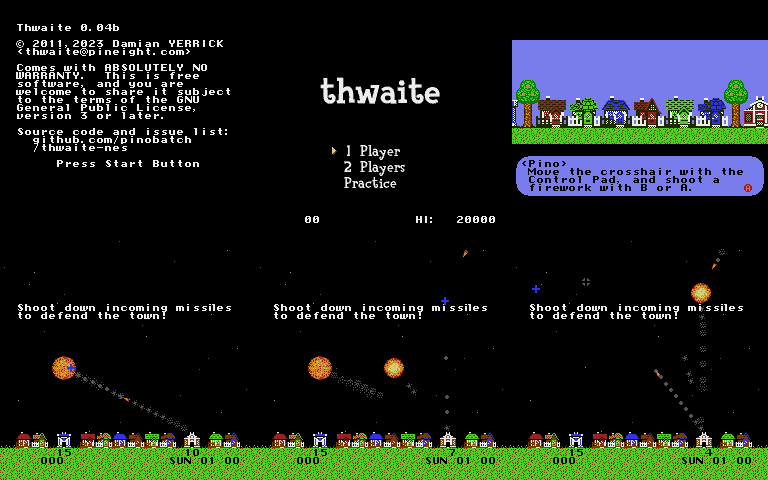
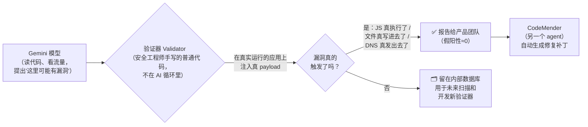
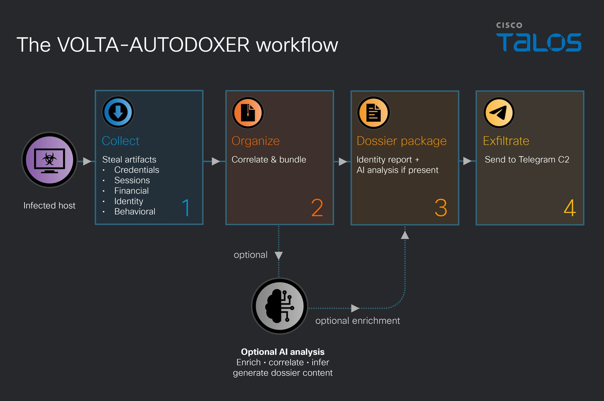

# 🚀 前沿技术日报：LLM · Agent · Java

**日期：2026-11-01（周六）** · 覆盖过去 24–48 小时动态 · 信源：GitHub Trending / Hacker News / arXiv / InfoQ / Inside Java / Spring Blog / Simon Willison / web 搜索

## 📌 今日速览

| 板块 | 今日头条 | 一句话 |
|---|---|---|
| 🧠 LLM | **nesformer：一台 NES 游戏机被"编译"进了 Qwen 模型的权重里** | 不是训练出来的，是编译器逐个数算出来的——玩马里奥的每一步 CPU 运算都由大模型"预测"出来（HN 274 分） |
| 🤖 Agent | **Google 公开 PageBreak：AI 安全 agent 已在 Google 自家网站挖出 500+ 个 XSS 漏洞** | 核心不是模型多聪明，而是"AI 提假设、普通代码验证"——假阳性率接近零 |
| ☕ Java | **Spring AI 2.1 RC1：`ChatMemory` 被弃用，向量库新增 `upsert` 直接塞自己的 embedding** | Java 生态的 AI 基建在做一次"接口洗牌"，用 Spring AI 的项目要留意迁移 |

---

## 🧠 LLM 前沿进展

### 🔬 深度解析：nesformer——有人把整台红白机"编译"进了大模型的权重里

**🎯 30 秒版本**：开发者 Drew Breunig 把 NES（红白机）的 6502 CPU、2KB 内存和游戏卡带程序，全部塞进了一个标准 Qwen3.5 大语言模型的权重文件里——现在你加载这个模型"推理"，它吐出来的 token 就是 CPU 的执行日志，配上一个小外壳程序，就能真的玩《超级马里奥》。这不是行为艺术：它证明了"神经网络权重可以当通用计算机用"这条路线比想象中更近了一步。

**背景铺垫**：先懂两个概念。① 大语言模型的本质是"给定前文，预测下一个 token"，它内部就是一大堆数字（权重）做矩阵乘法；② 传统模拟器（比如你玩塞尔达用的）是用普通代码逐条模拟 CPU 指令。nesformer 干的事是把 ② 塞进 ①：**CPU 电路变成了权重里的数字，模拟执行变成了模型的"预测"**。

**它是怎么做到的**（关键在"没人训练过这些权重"）：

- 前身是 Divyansh Agrawal 的 **Qwenputer** 项目，它先把 CHIP-8（一种教学用玩具 CPU）和 RISC-V 编译进了 Qwen3.5-4B。nesformer 复用了它的编译器和核心技巧：**把模型里 Gated DeltaNet 层的内部状态矩阵当作机器的内存**。DeltaNet 是 Qwen3.5 用的一种注意力变体，它每个"头"内部维护一个 128×128 的状态矩阵，每来一个 token 就更新一次——这个"随输入持续读写的矩阵"天然就是一块 RAM。类比：普通 Transformer 像每次回答问题都翻一遍全部笔记，DeltaNet 像随手在白板（状态矩阵）上边看边记，白板就成了内存。
- 编译器把 32KB 游戏 ROM（存两份，取指令和读数据各一份）、CPU 寄存器、2KB 工作内存全部映射进这块"白板"和权重里，共 7 层 DeltaNet 电路 + 1 层全零的注意力层（纯粹为了让 HuggingFace 的缓存机制不报错）。
- 模型每生成一个 token = CPU 执行一小步，输出的是执行日志；宿主程序负责画画、读手柄、在垂直消隐期注入 NMI 中断（NES 的"闹钟"信号）。
- 正确性验证很硬核：用 15 年前发布的 **nestest 一致性测试 ROM** 对拍，捆绑测试游戏的**每一帧画面都与传统 6502 模拟器输出完全一致**。而且据 Simon Willison 记录，这整个系统是 Breunig 用几条提示词指挥 Claude Opus 5.5 建出来的——Opus 自己找到了那套 conformance tests。

**关键数字给参照系**：模型总大小约 1GB（Qwen3.5-4B 架构，隐藏层 768、词表 26 万）；速度是"能跑但很慢"——原版 NES 每帧 16.7 毫秒（每秒 60 帧），nesformer 每帧要 **1–6 秒**，慢了约 100–360 倍；用原版 transformers 引擎跑只有约 10 token/秒。首次运行还要花 20 秒用 numba 编译。参照：这就像用算盘复刻超级计算机——原理通、性能差几个数量级。

**前因后果**：之前，"神经网络能执行任意计算"停留在论文里的电路构造（如 transformer 图灵完备性证明），Qwenputer 把它变成了可玩的 demo 但只支持玩具 CPU；现在 nesformer 证明真实商用的 8 位游戏机也能装进去，且**全程无需训练**（纯编译，权重是算出来的不是学出来的）。受影响的是两类人：可解释性研究者（权重当电路用 = 一种极端的"模型结构可读"）和 agent 基建工程师（如果推理引擎本身就是计算机，"工具调用"的边界在哪？）。对普通读者的实际意义：短期内没有工程价值，但它是"LLM 不只是文本接龙，权重即计算基质"这一方向最直观的展品——而且玩起来真的很酷。

*图：nesformer 实际运行的逐帧截图（每帧画面都由模型权重"预测"生成，与传统模拟器逐帧一致）。图源：[dbreunig/nesformer](https://github.com/dbreunig/nesformer)*

[项目仓库](https://github.com/dbreunig/nesformer) · [Simon Willison 评述](https://simonwillison.net/2026/Oct/30/nesformer/) · [HN 讨论（274 分）](https://news.ycombinator.com/item?id=50306442) · [前身 Qwenputer](https://divagr.com/blog/qwenputer)

### 📰 LLM 要闻简报

- **安全团队 Parameter 演示"发个链接就接管你的 ChatGPT 账户"**（10-28 披露，HN 191 分）：攻击者做一个恶意对话并用 ChatGPT 自带的分享功能发布，受害者只要点开链接，攻击者的 JavaScript 就能在受害者的登录态里运行——可枚举对话列表、读从未分享的私密对话、把数据外传。原理是两个"各自无害"的功能被串起来：HTML Preview（把代码块渲染成小网页，本应隔离在另一个域名下）+ 对话里的交互式图表会加载 MathLive 数学库，该库在主页面注册了 `postMessage` 监听器（浏览器里跨 iframe 传消息的正规 API）——攻击者借这条合法通道把 Preview 里的代码"接"进了 chatgpt.com 主站。OpenAI 定为 P1 级（最高严重度），10-26 已修复。教训：浏览器的安全边界靠"域名隔离"，但任何一个在主页面注册消息监听器的第三方库都可能成为跨界的桥。[来源](https://www.parameter.ai/labs/we-found-a-gap-at-openai)
- **arXiv：GAAC——个人设备上跑长上下文的无损 KV 压缩**：KV Cache（模型推理时把已算过的中间结果存起来复用的缓存）是长上下文在本地设备上跑不动的主因之一——量化权重省的是模型体积，KV 缓存却随对话长度线性膨胀。GAAC 用"指数冗余"做逐位无损压缩（BF16 指数按通道用 base+offset 编码），配合融合注意力算子，不像有损量化那样牺牲精度。对想在笔记本上跑长文档 RAG 的人是直接利好。[arXiv](https://arxiv.org/abs/2610.38210)
- **arXiv：Rubricon——自动生成"评分细则"来评估和训练模型**：Rubric（评分细则）是给"没有标准答案的任务"（写作、咨询）打分的依据，但人工编写很贵。Rubricon 让任意 LLM 采样多份细则、挑最有区分度的、自动补充和修剪条目——不需要人类偏好标注。这类工作是 RLHF 之后"如何用便宜方式给模型反馈"的一条主线。[arXiv](https://arxiv.org/abs/2610.38220)

---

## 🤖 Agent 进展

### 🔬 深度解析：Google PageBreak——"AI 找漏洞"的正确姿势：让 AI 猜，让普通代码验

**🎯 30 秒版本**：Google 披露其内部 AI 安全 agent **PageBreak** 自 2026 年 1 月全面运行以来，已在 Google 第一方 Web 应用中挖出 **500 多个 XSS 漏洞**（XSS：跨站脚本攻击，往网页里注入别人会执行的恶意脚本）。它最值得学的不是模型多强，而是架构决策：**AI 只负责提假设，每个漏洞必须由"确定性的普通代码"在真实运行环境里复现成功才算数**——假阳性率接近零。

**背景铺垫——为什么这事现在重要**：2026 年安全行业的头号痛点是 "AI slop"（AI 垃圾报告）：LLM 当静态代码分析器用时，会生成大量"听起来很像漏洞"的报告，安全团队被淹没在产品团队的白跑一趟里。区分"真漏洞"和" convincing 的幻觉"反而增加了人力负担。PageBreak 就是冲着这个痛点设计的。

**架构怎么工作**（InfoQ 10-31 报道 + Google 官方博客）：

*怎么读这张图：左边 AI 负责"想象力"，右边普通代码负责"较真"。只有走通绿色路径的漏洞才会打扰人类团队；走不通的也不扔，攒着当线索。*

- 验证是**分类定制**的：XSS 注入特定 JavaScript 并调用渲染框架检测它是否真执行；SQL 注入通过输出和/或计时验证查询真被篡改；路径穿越（path traversal，用 `../../` 跳出目录读不该读的文件）则在世界可读位置写文件再尝试读回。Google 安全工程师 Michał Bentkowski 的原话："模型想提什么就提什么，但一个发现只有在验证器用真实 payload 确认之后才算数。验证器是安全工程师写的普通代码，不是模型写的，且在 agent 循环之外。"
- 模型用的是 Gemini 3.1 Pro / Gemini 3.5 Flash 为主，但架构上模型可换。
- 它能规模化的隐藏前提是 **Google 的工程环境**：monorepo（所有代码放一个仓库）带来的端到端代码可见性、把线上 HTTP 流量映射到源码的安全信号、已有的扫描基础设施提供带登录态的访问权限。普通公司抄不了全套，但"AI 假设 + 确定性验证"的模式完全可以抄。
- 长期目标：产品团队只需要验证 AI 生成的**修复**，发现环节全部自动化——PageBreak 已开始与 CodeMender（自动修漏洞的 agent）串联。

**关键数字给参照系**：500+ 个 XSS，覆盖包括敏感域名在内的第一方应用，10 个月内完成（2025-11 试点、2026-01 转正）。注意 InfoQ 提示：这 500+ 没有独立第三方验证，数字来自 Google 自己。另外 Google 也承认代价：验证器覆盖不了的漏洞类型会漏掉（假阴性），这是"宁缺毋滥"策略的另一面。

**谁受影响**：① 企业安全团队——这是"agent 上生产"在安全领域最可信的落地样本，比"让 GPT 扫代码"成熟一代；② 做 agent 框架的工程师——它验证了一个普适模式：**LLM 出创意、确定性代码把关，把不可靠组件包在可靠外壳里**（和 DoorDash 的离线批量推理是同一种工程哲学）；③ 攻击者——防守方开始用同等规模的 AI 自动化，攻防军备竞赛进入 agent vs agent 阶段。

*图：Google 官方安全博客《Agentic Hacks, Real Proofs》配图。图源：[blog.google](https://blog.google/security/agentic-hacks-real-proofs-inside-googles-pagebreak-project/)*

[InfoQ 报道](https://www.infoq.com/news/2026/10/google-pagebreak-security-agent/) · [Google 官方博客](https://blog.google/security/agentic-hacks-real-proofs-inside-googles-pagebreak-project/) · [Bug Hunters 实战案例](https://bughunters.google.com/blog/pagebreak-real-world-findings)

### 📰 Agent 要闻简报

- **⚠️ VOLTA 窃密木马让 LLM 给受害者"估价"：偷完数据后交给 AI 排序哪个最值钱**（Cisco Talos，10-31）：这个自删除的 Windows infostealer（信息窃取木马）偷完浏览器密码、cookie、加密货币钱包、SSH 密钥后，会把受害者的地理位置、雇主、出生年份推断、Roblox 账号估值等打包成结构化档案，POST 给 OpenRouter（LLM API 中转站），系统提示词要求模型扮演"法证情报分析师"，输出必须有"WHAT THEY'RE WORTH"（按可变现价值分低/中/高档）和"THEIR OPSEC"（受害者安全习惯评估）两节。默认模型是 Claude Opus 4.6，被拒绝时自动降级换 Kimi K2 → Gemini 2.5 Flash 三模型链——**说明攻击者对"模型会拒绝"有工程化预案**。还利用偷来的会话反查 Gmail 购物收据、UberEats 订单来核实住址。这是"AI 不是帮黑客写代码，而是当犯罪团伙的情报分析员"的典型案例。[来源](https://blog.talosintelligence.com/appraisal-by-ai-model-driven-victim-prioritization-in-the-volta-infostealer/)

*图：Talos 绘制的 VOLTA-AUTODOXER 工作流（窃取→打包档案→LLM 估价→三模型降级链）。图源：[Cisco Talos Blog](https://blog.talosintelligence.com/appraisal-by-ai-model-driven-victim-prioritization-in-the-volta-infostealer/)*
- **Cisco 给 27 岁工程师"无限 AI token"重写遗留代码**（Fortune，10-30，HN 263 分）：Cisco 总裁 Jeetu Patel 讲的故事——一名 Gen Z 工程师拿到不限量 AI 额度去啃公司老代码，Patel 借此论证"入门级岗位会被重构"。HN 评论两极：一方认为这是遗留代码现代化的正确杠杆（老代码没人愿意碰、文档缺失，恰是 LLM 最能补人力的地方）；另一方指出"无限 token"叙事掩盖了审查瓶颈——AI 改遗留代码的产出速度远超人类 review 速度，风险只是被转移不是被消除。[来源](https://fortune.com/2026/10/30/cisco-president-jeetu-patel-gen-z-27-year-old-unlimited-ai-tokens-rewrite-legacy-code-entry-level-jobs/)
- **arXiv：JevAct——给 agent 的危险动作加一道"决策门"**：agent 通过工具执行有后果的动作（发消息、删文件、转账）时往往没有独立核查。JevAct 在执行前拦截选定动作：把领域策略编译成可执行的状态检查 + 结构化问题，交给一个"只做 prefill、不做生成"的小判定模型出概率化判断——确定性事实核查 + 概率化意图评估双保险，还支持反馈驱动的纠正。与 PageBreak 是同一哲学：**不信任 agent 的自我声明，用外部廉价机制把关**。[arXiv](https://arxiv.org/abs/2610.38620)
- **arXiv：ATP（Agent Transfer Protocol）——给跨组织 agent 通信设计"邮局"**：不同公司的 agent 要长期协作，但对方实例可能离线、IP 会变、消息要能验证来源。ATP 提出服务器中介的 agent 间通信架构：稳定的通信入口、离线代收、延迟阅读后的来源验证——相当于给 agentic web 设计 SMTP/邮箱体系。MCP 解决"agent↔工具"，A2A 解决"agent↔agent 即时对话"，ATP 瞄准的是"agent↔agent 异步长程通信"这块空白。[arXiv](https://arxiv.org/abs/2610.38398)

---

## ☕ Java 工程

### 🔬 深度解析：Spring AI 2.1 RC1 的接口洗牌——`ChatMemory` 弃用、向量库学会"自带 embedding"

**🎯 30 秒版本**：Spring AI（Spring 官方的 LLM 集成框架，Java 世界的 LangChain 竞品）2.1.0-RC1 落地了两处对工程影响最大的变化：① 记忆接口从 `ChatMemory` 换成新的 `SessionService`；② `VectorStore` 新增 `upsert()`，允许应用**自带算好的向量**入库，不必强迫框架重新 embedding。这是 RC（Release Candidate，发布候选版，功能已冻结、只修 bug）阶段，意味着 API 基本定型——现在用的项目要开始规划迁移了。

**背景铺垫**：两个前置概念。① **embedding（向量化）**：把文本/图片变成一串数字（向量），语义相近的内容向量距离近，这是 RAG（检索增强生成：先从知识库搜相关内容，再连同问题一起喂给模型）的地基；② **VectorStore（向量库）**：存这些向量并支持"找最相似的 N 条"的数据库。之前 Spring AI 的 `VectorStore.add()` 是"一条龙"：收文档 → 用配置的 embedding 模型现算向量 → 入库。方便，但武断。

**变化一：`upsert()` —— 把 embedding 的控制权还给应用**（spring.io 10-28 官方博客）。三个真实场景解释为什么需要它：

- **多模态搜索**：家具电商的商品描述只写"扶手椅 A42"，但照片是绿色天鹅绒。用多模态 embedding 模型（如 `VertexAiMultimodalEmbeddingModel`，文本和图片算出的向量可以直接互相比较）对**照片**算向量，用 `upsert` 入库；用户搜"绿色天鹅绒扶手椅"就能命中图片。`add()` 做不到——它只会对文本字段重新 embedding。
- **视频/音频检索**：给培训视频"换滤芯"片段（04:00–04:30）存一个向量 + 起止时间元数据，搜索直接返回"点开视频跳到 4 分钟"。
- **省钱省时间**：embedding 来自别处的场景——供应商的 batch API（批量接口，便宜一半但要等）、兄弟团队已算好的向量、数据库迁移。用 `add()` 会把这些全部重算一遍（浪费 API 账单和迁移窗口），`upsert()` 直接入库且帮你处理 Spring AI 的存储格式（ID/文本/元数据/向量的字段约定），比裸写数据库安全。

配套的 `similaritySearch` 新重载还接受**查询向量**（不只是查询文本）——索引和搜索两端的 embedding 控制权都归应用了。实现细节里有个坑值得注意：`Document` 要求文本或媒体二选一，但向量库不能持久化媒体，官方示例用 `.text("")` 占位 + `CONTENT_REF` 元数据存图片 URL 绕过。

**变化二：`SessionService` 取代 `ChatMemory`**（RC1 release notes）。`ChatMemory` 已标记 deprecated，新的 `SessionService` 接口负责会话的创建和查找。这延续了业界把"agent 记忆"从单一对话历史升级为多会话管理的趋势（对照：Anthropic 上周刚把 Agent Skills 捐给基金会，agent 基建标准化是共同主题）。同期 `OpenAiChatModel` 和 `DeepSeekChatModel` 支持从有序的 message parts 组装 assistant 消息——即上一期日报提过的"推理回放"能力的模型侧落地。

**前因后果与工程影响**：Spring AI 1.x/2.0 时代的问题是"框架替你做主"——embedding 模型绑死在 VectorStore 配置上，记忆接口只管单对话。2.1 把两个方向盘交还给应用，说明它正在从"demo 友好"转向"生产友好"（多模态、成本控制、会话管理都是生产需求）。**行动建议**：① 生产项目等 11 月 GA 再升，但 RC 期间就把 `ChatMemory` 的用法收敛到自己封装的一层里，将来只改一处；② 有多模态搜索或批量 embedding 需求的，`upsert` 是立刻能省钱的新能力；③ RC1 与 Spring Boot 4.2.0-RC1 同列车（见下方 B 档），升级要一起规划。

**🧠 关键概念表**

| 术语 | 白话解释 | 为什么重要 |
|---|---|---|
| VectorStore | 存向量并支持相似度搜索的数据库 | RAG 系统的记忆仓库 |
| embedding | 把内容变成一串数字，语义近则距离近 | 机器"理解"语义的唯一途径 |
| upsert | update+insert：有则更新、无则插入 | 自带向量入库的入口 |
| 多模态 embedding | 图片/视频/文本映射到同一向量空间 | "用文字搜图"成为可能 |
| RC（Release Candidate） | 功能冻结的发布候选版 | API 基本定型，可开始迁移规划 |
| SessionService | 新的会话创建/查找接口 | 取代 deprecated 的 ChatMemory |

**💡 所以呢**：Java 团队做 AI 功能的"框架税"在降低——以前要么被 Spring AI 的一条龙绑架，要么裸写向量库对接。2.1 提供了中间态：框架管存储格式和检索，应用管"怎么算向量"。这正是生产系统需要的分工。

[Spring AI 2.1.0-RC1](https://spring.io/blog/2026/10/23/spring-ai-2-1-0-RC1-available-now) · [upsert 官方博客](https://spring.io/blog/2026/10/28/spring-ai-upsert-own-embeddings/) · [参考文档](https://docs.spring.io/spring-ai/reference/2.1/api/vectordbs.html#writing-precomputed-embeddings)

### 📰 Java 要闻简报

- **InfoQ 盘点 Spring 全家桶 RC1 浪潮：17 个子项目同一周进入候选版**（10-31）：除 Spring AI 外，值得单拎出来的：① **Spring Boot 4.2.0-RC1** 换用 Ubuntu Resolute 构建器（buildpack 基础镜像升级），executable jar 的类和资源改为直接查找（Uber-Jar 启动更快）；② **Spring Cloud 2026.0（代号 Paddington）**：Spring Cloud Bus 不再是独立项目，并入 Spring Cloud Stream；③ **Spring Modulith 2.2.0-RC1**：事件发布新增 `ABANDONED`/`RESUBMITTED` 状态区分"失败"和"放弃"，且事件默认在监听者事务内完成标记——修掉"监听者提交了、完成标记却失败"的一致性漏洞；④ **Spring Batch 6.1.0-RC1** 新增 `@JobParameter` 注解（不用再写 SpEL 表达式注入任务参数）。按 Spring 节奏，正式版预计 11 月 GA。[来源](https://www.infoq.com/news/2026/10/spring-news-roundup-oct19-2026/)
- **JDK 28 时间线继续推进：JEP 544（AOT 代码编译）已定为 target**：配合本月初已 target 的结构化并发等 JEP，JDK 28 的拼图逐渐清晰——AOT（Ahead-of-Time，提前把字节码编译成本地代码，省去 JIT 预热）+ value classes（10-28 日报深度解析过）两大块都指向同一件事：Java 启动更快、内存更省，正面迎战 GraalVM 原生镜像抢走的云原生场景。（10-30 日报已覆盖 AOT cache 实测，此处跟进 JEP 状态。）[来源](https://inside.java/2026/10/25/jep544-target-jdk28/)
- **HN 热文：GCC 的 Switch Lowering 实现细节**（138 分）：讲编译器如何把 `switch` 语句降级成跳转表/二分查找/位图测试——虽然是 C/C++ 编译器话题，但 JVM 的 `tableswitch`/`lookupswitch` 字节码设计是同一套权衡（分支密度 vs 跳转表内存），做性能优化或读 JIT 源码的 Java 工程师可以对照着看。[来源](https://xoranth.net/gcc-switch/)

---

## 📋 今日其余动态

| # | 动态 | 链接 |
|---|---|---|
| 1 | 🎮 **Donchitos/Claude-Code-Game-Studios**：把 Claude Code 变成完整游戏开发工作室——49 个 AI agent + 72 个工作流 skill 协同（日增 1347★，趋势第 3） | [GitHub](https://github.com/Donchitos/Claude-Code-Game-Studios) |
| 2 | **pingdotgg/t3code**：Theo（t3.gg，知名 TS 主播）团队的编码 agent 项目，日增 1148★ | [GitHub](https://github.com/pingdotgg/t3code) |
| 3 | **milind-soni/OpenMausBot**：开源 Grok Bot 替代品，每个 bot 配一台自己的虚拟机（日增 1304★） | [GitHub](https://github.com/milind-soni/OpenMausBot) |
| 4 | **Orkas**：MIT 协议的本地优先"AI 团队"桌面应用——一个 Commander 把你的目标拆给多个 agent（日增 1118★） | [GitHub](https://github.com/Orkas-AI/Orkas) |
| 5 | **THU-MAIC/OpenMAIC**：清华的多 agent 交互课堂，一条命令开沉浸式多 agent 学习体验 | [GitHub](https://github.com/THU-MAIC/OpenMAIC) |
| 6 | 🛠️ **Prospero**：nullprogram 作者（emacs 圈老炮）写的新编码 harness（agent 的外壳运行时），主打"更文明的年代"——对 Claude Code 类工具的极简替代（HN 115 分） | [博客](https://nullprogram.com/blog/2026/10/31/) |
| 7 | ⚠️ **cfsolve**：Cloudflare Turnstile 验证码求解库，无需 headless 浏览器（HN 274 分，人机对抗升级的信号） | [GitHub](https://github.com/chris124567/cfsolve) |
| 8 | **tangled.org 提出"联邦代码锻造厂"**：去中心化的 Git forge 设计（HN 315 分，Codeberg 之后的又一联邦化尝试） | [博客](https://tangled.org/blog/forge/) |
| 9 | 🔓 **Tell HN: Scribd 被入侵**（297 分，官方未确认细节）；此前一天 Northflank 也被入侵——平台安全事件密集周 | [HN](https://news.ycombinator.com/item?id=50312756) |
| 10 | **Vitalik Buterin 发文《数字极简主义》**：以太坊创始人谈对抗算法投喂的信息节食（HN 184 分） | [博客](https://vitalik.eth.limo/general/2026/10/31/digital_minimalism.html) |
| 11 | 🎙️ **Lean 创始人 Leo de Moura 谈 AI 与形式化验证**： theorem prover（定理证明器）Lean 的作者聊 AI 时代形式化验证的未来（HN 128 分） | [播客](https://thedataexchange.media/leo-de-moura-lean-aws/) |
| 12 | ⚖️ **前 Meta 研究员承认下载盗版书籍数据集，"因诉讼"删除**（HN 41 分，AI 训练数据版权战的又一份供词） | [TorrentFreak](https://torrentfreak.com/ex-meta-researcher-torrented-pirated-books-dataset-deleted-it-due-to-all-this-litigation/) |
| 13 | 📚 arXiv：**WebAnything**——全自动把真实网站重建成可复用的 agent 训练环境（Explorer-Builder 采集浏览器可见结构，免去逐站人工适配） | [arXiv](https://arxiv.org/abs/2610.37786) |
| 14 | 📚 arXiv：**GAUSS**——面向 LLM 推理服务的负载感知模拟器（分析式 + 蒙特卡洛），帮运维回答"延迟 SLO 下该配多少卡" | [arXiv](https://arxiv.org/abs/2610.37989) |
| 15 | 🐧 Enlightenment 0.28 发布：老牌 Linux 桌面环境大版本更新（HN 头版） | [Phoronix](https://www.phoronix.com/news/Enlightenment-0.28) |

---

## 💡 一句话点评

今天最有趣的一条暗线：**三个板块的头条都在讲同一件事——"把不可靠的智能包进可靠的外壳"**。nesformer 把 CPU 电路编译进权重却要求逐帧与传统模拟器对拍一致；PageBreak 让 Gemini 随便猜但每个漏洞必须过普通代码验证器的真 payload 复现；JevAct 给 agent 的动作加执行前决策门。2026 年末的 agent 工程共识越来越清晰：模型的创造力拿来用，但**信任永远来自确定性验证**——这对写 Java 的你是个好消息，因为"确定性外壳"恰好是传统工程最擅长的事。

---

🤖 本报告由 Hermes Agent 每日凌晨自动调研生成 · [HermesReports](https://github.com/knolonzhou/HermesReports)
