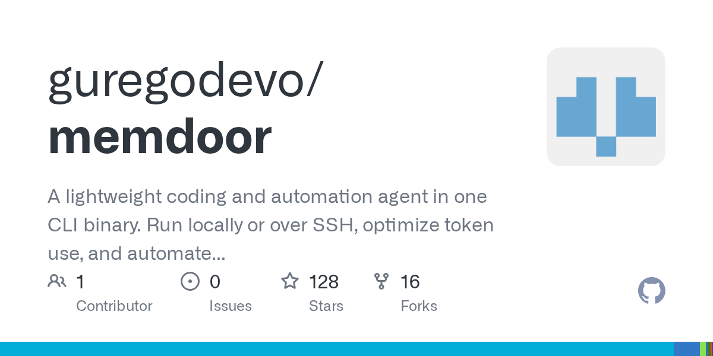
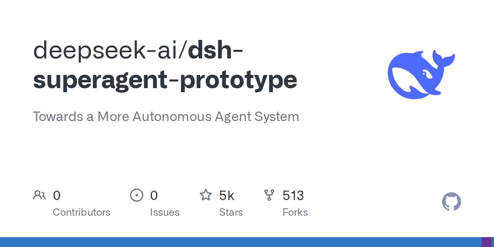
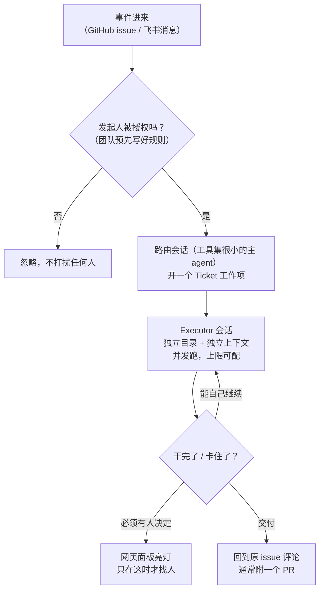

# 🚀 前沿技术日报：LLM · Agent · Java

**日期：2026-11-02（周一）** · 覆盖过去 24–48 小时动态 · 信源：GitHub Trending / GitHub API 新星榜 / Hacker News / InfoQ / Inside Java / Simon Willison / web 搜索（arXiv RSS 周末停更，今日无新条目）

## 📌 今日速览

| 板块 | 今日头条 | 一句话 |
|---|---|---|
| 🧠 LLM | **Anthropic 明天（11-03）起给 4 个老 Claude 模型加隐形文字水印** | 被 EU AI Act 逼出来的合规动作，但改一个采样参数就能绕开——水印的威慑力比听起来弱 |
| 🤖 Agent | **DeepSeek 开源 dsh-superagent：盯着 GitHub issue 自动干活的"主动式" agent** | 不是官方产品，是团队日常工具的公开版；发布 12 小时 2000+ star，理念是"少占人的注意力" |
| ☕ Java | **RestTemplate 被判"死刑"：Spring 7.1 标记将在 8.0 移除** | 有人把 Boot 4.2 RC1 的坑全踩了一遍写了份升级清单，含 5 个静默失效的 Kafka 配置 |

---

## 🧠 LLM 前沿进展

### 🔬 深度解析：Anthropic 文字水印明天扩大到 4 个老模型——以及为什么它防不住有心人

**🎯 30 秒版本**：Anthropic 已邮件通知 API 客户，**2026 年 11 月 3 日（就是明天）**起，Claude Mythos 5、Opus 4.7、Opus 4.6、Sonnet 4.6 四个较老模型的输出将带上隐形文字水印（watermark：藏在文字里的统计指纹，人眼看不出，持密钥者能检测"这段是不是 AI 写的"）。这是为满足欧盟 AI 法案第 50 条——2026 年 8 月 2 日起在欧盟提供生成式 AI 的厂商必须让 AI 内容"机器可读地标记"。但媒体已发现：**在两个老模型上，改一个采样参数就能让水印失效**。

**背景铺垫——水印是怎么"藏"进文字的**：大模型写句子是一个词一个词挑的，比如"今天天气很冷而且___"，接"阴沉"或"灰蒙"都说得通，这种"选哪个都行"的低风险时刻由随机数决定。水印技术（Anthropic 用的是 Google DeepMind 2024 年发在 Nature 上的 SynthID-Text 变体）做的事是：**把"掷骰子"换成"用密钥+前文算出来的伪随机数"**。读者看不出任何区别——不加字符、不加 token、不影响质量和价格——但拿着密钥的检测方可以统计"这段文字的词选择是否符合密钥预测的模式"，给出"这段有百分之多少概率是 Claude 写的"。类比：像用只有银行能验的特定手法折钞票角，钞票照常流通，验钞机一扫便知。

*图：Anthropic 的水印只改变"选词随机数的来源"，文本本身无可见差异。图源：[The Decoder](https://the-decoder.com/anthropics-watermark-rollout-leaves-a-loophole-on-two-older-claude-models)*

**前因后果**：之前是什么样——2026 年 8 月 2 日之后发布的每个 Claude 新模型（Opus 5.5、Fable 5 等）出厂即带水印；8 月 2 日之前的老模型一直是"裸奔"状态，EU 给了存量系统到 12 月 2 日的过渡期。为什么现在动——Anthropic 选择提前一个月把老模型批量补上，因为水印嵌在模型层，**在 AWS、Google Cloud、Microsoft Foundry 上都无法关闭**，也没有可靠的办法只对欧盟用户开启（Anthropic 明说"没有持久的地域限制手段"，所以全球统一开）。谁受影响——① 靠 Claude API 做内容业务的开发者：输出全球范围开始带标；② 依赖水印做合规审计的企业：**注意 Opus 4.6 和 Sonnet 4.6 上水印只在 temperature/top_p/top_k 三个采样参数（控制模型选词随机性的旋钮）保持默认值时才生效**，动任何一个就能绕开——Anthropic 自己在邮件里警告"如果你依赖水印做合规，请保持默认设置"；③ 检测目前只对监管机构、媒体、事实核查组织等"经审核的团体"开放私有预览 API，普通人还查不了。

**局限要讲清楚**：水印在"Claude 自由发挥选词多"的文本上最强（创意写作、翻译），在选词少的文本上很弱——短段落测不准，代码基本不带标（精确 token 不动，只有注释可能带），纯事实句稀疏。整段逐词重写可以完全洗掉。横向对比：OpenAI 10 月上线的 textGrain 只对欧盟的 ChatGPT/Codex 用户默认开，全球 API 客户可以自选开关且默认关——Anthropic 是"全球强制"，姿态上更激进。这件事的信号意义：**水印正在从"研究玩具"变成"合规基建"**，但它的天花板是"防无意传播、不防有意去除"——对真要洗稿的人，成本只是换一次全文改写。

[Anthropic 官方说明](https://anthropic.com/news/claude-text-watermark) · [The Decoder 分析（loophole）](https://the-decoder.com/anthropics-watermark-rollout-leaves-a-loophole-on-two-older-claude-models) · [Maccus 时间线梳理](https://maccus.fr/en/claude-text-watermark)

### 📰 LLM 要闻简报

- **Memdoor：5 个 Qwen3.8-27B 组队，LiveCodeBench Hard 上打出 9.8/10，超过 Fable 5 单挑的 8.0**（HN 热帖）：复现 GVS5H 论文方法——planner、两个 ideator、solver、manager 五个角色加一个 repair worker，**全部通过磁盘上的文件通信**（不共享对话上下文，避免互相污染），判分由 shell 脚本跑隐藏测试决定而不是模型说了算。50 次运行总花费 $35.79（1530 万输出 token），中位数单次 40 分钟。作者自己也很诚实：只有 10 题×5 遍，样本小到 9.8 和 9.6 是同一个数；竞赛题是 2025 年春的，污染无法排除。但"27B 开源小模型+明确分工+文件系统通信能追平旗舰"这个方向本身值得盯。[GitHub](https://github.com/guregodevo/memdoor/tree/main/examples/workflows/team-solve) · [HN](https://news.ycombinator.com/item?id=50320995)

*图：Memdoor 的 team-solve 工作流——五个角色全靠磁盘文件通信。图源：[GitHub](https://github.com/guregodevo/memdoor)*

- **arXiv 新论文（HN 高分）：用 JEPA 证明并改进"柏拉图表征假说"**：柏拉图表征假说（Platonic Representation Hypothesis：不同模态、不同架构的模型训练到最后，内部表征会收敛到同一个"世界的数学结构"）去年还只是观察，这篇给出了形式化证明路径，并借 JEPA（LeCun 主张的联合嵌入预测架构，在潜空间里预测而非逐像素生成）改进表征对齐。对关心"模型内部到底学到了什么"的人是好材料。[arXiv](https://arxiv.org/abs/2610.39302) · [HN](https://news.ycombinator.com/item?id=50325454)
- **HN 热文：《JavaScript 框架的 AI 成本》**：作者论证重型前端框架对 LLM 编码 agent 是隐形税——框架特有的抽象和样板代码占满上下文窗口，模型还经常把不同框架的 API 记串。"对框架的选择现在要加一条评估维度：AI 写它费不费 token"。前端+AI 工程交叉的务实讨论。[原文](https://nolanlawson.com/2026/10/28/the-ai-cost-of-javascript-frameworks/) · [HN](https://news.ycombinator.com/item?id=50323088)
- **Kronos：金融 K 线基础模型冲到 GitHub 45k star**（本周 Trending 常客）：把"金融市场语言"当序列建模的 foundation model（基础模型：在大规模数据上预训练、可迁移到多任务的模型），今日又 +611 star。量化圈对它的态度两极：架构正统 vs "金融数据信噪比太低，基础模型范式未必成立"。[GitHub](https://github.com/shiyu-coder/Kronos)

---

## 🤖 Agent 进展

### 🔬 深度解析：DeepSeek 开源 dsh-superagent——"主动式" agent 的第一原则：别浪费人的注意力

**🎯 30 秒版本**：DeepSeek 10 月 31 日在 GitHub 开源了 **dsh-superagent**（MIT 协议，发布当天 2000+ star，现已 6300+）：一个盯着**单个 GitHub 仓库**的主动式编码 agent——监听 issue（和可选的飞书消息），被授权的人提出请求后，它自动开一个工作项、在独立会话和目录里干活、最后回到原对话里交付（通常是一个 PR），网页面板上显示"哪些事需要人来处理"。README 第一句话就免责：**这是研究原型，不是 DeepSeek 官方产品**，代码本身大部分也是编码 agent 写的。

**背景铺垫——"主动式"和现有 agent 差在哪**：你熟悉的 Claude Code / Codex 类工具是"被动式"：人开一个会话、盯着它干活、逐步批准。dsh-superagent 是"常驻式"：像团队里多了一个值班工程师，**事件（issue、消息）驱动它自己醒来干活**。这类系统最大的风险不是能力而是"注意力税"——一个能为全团队行动的 agent，也能用无意义的确认请求淹没全团队。

*图：dsh-superagent-prototype 仓库首页。图源：[GitHub](https://github.com/deepseek-ai/dsh-superagent-prototype)*

**它的核心设计哲学**（README 原文一句话："take as little human attention as possible, and give as much value as possible"——尽可能少占用人的注意力，尽可能多产出价值）落成了三条硬规则：

*怎么读这张图：关键在两个"闸门"——进门先查授权（防止任何人一句话就驱动 agent 干活的注入风险），出门只在"必须有人"时才通知（防止注意力税）。*

**工程细节里值得抄的**：① 每个 Ticket 有独立命名的 Executor 会话和目录，**并发上限可配**——这就是"一仓多 agent 并行"的隔离方案；② 前台 shell 命令跑过 5 秒自动转后台任务，后台工作每轮最多 30 分钟——防止 agent 卡死在一个长命令上；③ worker 会话以运维者的 OS 用户身份**免批准**执行命令——这条在文档里明写，等于告诉你：这套东西的信任模型是"授权名单+规则"而不是"逐步确认"，部署前必须自己收紧；④ 路由主会话刻意配"小工具集"，只负责分发不干活——和上周 Microsoft Agent Framework 加"本地 MCP 工具默认显式批准"是同一个行业方向：**agent 的权限面正在被当作一等公民设计**。

**前因后果**：之前 DeepSeek 给外界的印象是"只发模型和推理框架"；这次发的是 agent 应用层，而且配套文章《Exploring Super-agent Design》讲的是设计方法论。为什么现在——编码 agent 的"单人结对"形态已卷到头（Terminal-Bench 上各家 harness 互相只差几个点），下一个战场是"常驻团队级 agent"：谁来决定 agent 何时行动、何时问人。受影响的是平台方（GitHub 自己的 Copilot Workspace、Slack 刚开放的 Code API 都在抢这个位置）和普通团队（这套代码 MIT 协议，可以直接改了内网跑）。注意它自己声明"文章里的部分设计是未来方向，原型没实现"，别把论文当产品说明书读。

[GitHub 仓库](https://github.com/deepseek-ai/dsh-superagent-prototype) · [设计哲学文档](https://github.com/deepseek-ai/dsh-superagent-prototype/blob/main/docs/000-philosophy.md) · [FourWeekMBA 报道](https://fourweekmba.com/ai-deepseek-releases-agent-that-works-github-issues-in-parallel/)

### 📰 Agent 要闻简报

- **Factory 发布 Droid 1.0：Script Mode 把 310 万 token 的任务压到 6.1 万**：核心是"程序化工具调用"（Programmatic Tool Calling）——agent 不再一次调一个工具、每步都往返模型，而是**写一段 JavaScript 在沙箱里一口气跑几百次工具调用**，大文件、错误日志都留在脚本变量里不进上下文，模型只看最终结果。官方例子：迁移 151 个 Linear issue 共 312 次工具调用，传统方式 36 次模型请求/310 万输入 token，Script Mode 只要 2 次请求/6.1 万 token——**token 省 98%**，相当于原来 100 块的账单变 2 块。Terminal-Bench 4 上配 GPT-6.1 Sol 得 57.6%，比 OpenAI 自家 Codex harness 高 3.5 个百分点。[报道](https://techiexpert.com/factory-launches-droid-1-0-with-script-mode-to-cut-ai-agent-token-use-and-boost-speed/)
- **Microsoft Agent Framework 1.24.0：Python 3.11 成新底线，Redis 上下文索引是破坏性变更**（10-30 发布）：beta 版 RedisContextProvider 直接拒绝旧索引，升级必须重建并重新灌入；新增本地 MCP 工具的"显式批准"默认模式和实验性的 agent 自触发上下文压缩（compaction：对话太长时让 agent 自己把历史压成摘要）。Semantic Kernel 1.46.0 同期发布，做安全加固（上传路径拒绝 `../`、HttpPlugin DNS 固定、日志不再打印参数值），且其 README 已明说 Agent Framework 是继任者——还在用 SK 的可以开始规划搬家。[Agent Radar](https://agentradar.cc/daily/2026-10-31)
- **Temporal 的 agent 框架集成全部 GA**（10-30）：Google ADK、AWS Strands、LangGraph、TypeScript 版 OpenAI Agents SDK 的集成正式可用——agent 不用改代码就能塞进 Temporal Workflow，获得"持久执行"（durable execution：进程崩了/重启后从上次的进度继续，不重复已完成的模型调用和工具调用）。长任务 agent 的"断点续跑"从此是基建而不是自己造。[The Agentic Digest](https://www.theagenticdigest.com/issues/temporal-ai-framework-integrations-2026-10-31)
- **Slack 向第三方编码 agent 开放 Code API（GA，10-30）**：agent 可以自己建一个任务专属频道、拉进相关的人和文件、发进度和产物、干完归档——150+ 客户和合作伙伴申请过这个能力。"agent 在团队沟通工具里有了正式工位"。[来源](https://www.theagenticdigest.com/issues/temporal-ai-framework-integrations-2026-10-31)
- **HN：巴西法院处罚在诉状里藏 prompt injection 的律师**：律师在提交给法院的文件里嵌入对 AI 助手的隐藏指令（prompt injection：往 AI 读的文本里夹带"忽略之前的指示"类命令），试图操纵对方/法院使用的 AI 工具——据 HN 讨论这可能是最早被司法处罚的案例之一。agent 读外部文档的场景越多，这类"文档即攻击面"的事件会越多。[来源](https://jetstream.security/insights/brazilian-court-sanctions-prompt-injection-filing/) · [HN](https://news.ycombinator.com/item?id=50322173)

---

## ☕ Java 工程

### 🔬 深度解析：RestTemplate 进入死亡倒计时——有人把 Spring Boot 4.2 RC1 的坑全踩了一遍

**🎯 30 秒版本**：Spring Framework 7.1 / Boot 4.2 的 RC1（Release Candidate，发布候选版：功能冻结只修 bug，GA 前最后一站）已在 Maven Central 上，正式版预计 11 月 GA。开发者 Ankur 用一个双 POM 的对照工程（同一份代码分别跑在 4.1.2 和 4.2.0-RC1 上）**实测**了所有升级会碰到的变化，写成 checklist。最重要的信号：**RestTemplate 的 Javadoc 已标记"将在 8.0 移除"**，RestTemplateBuilder 标记"4.4.0 移除"——用了十几年的老 HTTP 客户端正式进入倒计时。

**背景铺垫**：RestTemplate 是 Spring 3.0（2009 年）时代的同步 HTTP 客户端，问题是它没有流式 API、错误处理靠异常、且**不会随生态演进**（不支持响应式、虚拟线程时代显得笨重）。Spring 的替代品是 RestClient（同步、流式 API，5.0 引入的 RestTemplate 官方继任者）和 WebClient（响应式）。之前只是"推荐新代码别用"，现在给了明确的移除版本号。

**实测发现的坑（比"改个类名"深）**：

1. **RestClient.create(restTemplate) 的 URL 编码行为不同**——这是最容易翻车的静默变更。同一个 `q=C++` 参数：RestTemplate（底层 HttpURLConnection）发出去是 `q=C++`，服务器解码成 `"C  "`（加号被当空格）；RestClient 发出去是 `q=C%2B%2B`，服务器正确解出 `"C++"`。**新客户端是"更正确"了，但如果下游服务已经适配了你的错误编码，升级反而会弄坏它**。作者给的排查法很实用：看下游 access log 的 User-Agent——`Java/21` 是 HttpURLConnection、`java-http-client/21` 是 JDK 客户端、`Apache-HttpClient/5.6.4` 是 HttpClient 5，一眼看出哪层在发请求。
2. **5 个 Kafka 配置键在 4.1.2 被静默忽略、4.2 才生效**——升级后 Kafka 行为可能"突然变了"，而且是你早就写了的配置突然开始起作用。
3. **properties migrator 是手电筒不是保证**：官方的配置迁移器能报出 Tomcat 三个键改名（`server.tomcat.* → server.tomcat.servlet.*`）和 `spring.mvc.pathmatch.matching-strategy` 彻底移除（路径匹配不再可配置），但**不在它元数据里的被删键一声不吭**——migrator 报告干净 ≠ 升级干净，必须对着版本间 configuration changelog 手动搜自己的配置文件。
4. **内嵌 LDAP 的 SSL 现在没证书包直接失败**（以前默默放行），安全默认值收紧。
5. 一个好消息：`@DefaultValue` 支持占位符了——配置绑定到 record 时 `@DefaultValue("${demo.region:eu}-primary")` 在 4.1 会把整串字面量塞进字段（int 类型直接启动报 NumberFormatException），4.2 正确解析。以前在代码里绕的弯可以删了。

**前因后果与行动建议**：这条线要和上期日报的 Spring AI 2.1 RC1、Modulith/Batch/Cloud RC1 放在一起看——**整个 Spring 全家桶正在同一列车上换轨**，11 月 GA 后会有一波集中升级期。行动清单：① 现在就把 RestTemplate 用法收敛进自己的一层封装，替换时只改一处；② 替换成 RestClient 后**必须回归测试所有带特殊字符（+、空格、中文）的 URL 参数**，编码语义变了；③ 升级 4.2 时别信 migrator 的"零报告"，手动过一遍 changelog；④ Boot 4.0 的 OSS 支持 2026-12-31 截止（只剩两个月），还在 4.0 的项目不管升不升 4.2，先升到 4.1。

[升级 checklist 原文](https://ankurm.com/spring-boot-4-2-spring-framework-7-1-upgrade-checklist/) · [RestTemplate→RestClient 静默变更实测](https://levelup.gitconnected.com/resttemplate-to-restclient-silent-changes-abc73ffd1787) · [4.2.0-RC1 Release Notes](https://github.com/spring-projects/spring-boot/wiki/Spring-Boot-4.2.0-RC1-Release-Notes) · [Spring 支持日历](https://www.osseva.io/blog/spring-support-calendar)

### 📰 Java 要闻简报

- **HN 重新顶起经典论文《A brief history of just-in-time》**：2003 年 ACM Computing Surveys 的综述，梳理 1960–2000 四十年 JIT（Just-In-Time 编译：程序运行中才把字节码/中间码编译成本地机器码，边跑边优化）的演化。为什么现在值得读——JDK 28 的 JEP 544 AOT 编译（提前编译，省去 JIT 预热）正在把 Java 推向"JIT 与 AOT 混合"的新阶段，回看四十年前的动机分类（启动速度 vs 峰值性能 vs 内存）会发现今天的权衡和 1990 年的 Smalltalk/Java 团队面对的是同一张表。[ACM](https://dl.acm.org/doi/10.1145/857076.857077) · [HN](https://news.ycombinator.com/item?id=50289711)
- **InfoQ：Netflix 把 GPU 可靠性当分布式系统问题治**：GPU 集群的故障率远高于 CPU 机器，Netflix 的做法不是买更好的硬件，而是把"GPU 会随机坏"当作系统假设——检测、隔离、任务迁移全套按分布式系统的思路建。对自建推理集群的团队是很好的参考架构。[来源](https://www.infoq.com/news/2026/10/netflix-gpu-distributed-systems/)
- **Inside Java 播客第 73 期：《超越 Value Classes 的不可变数据》**：JDK 28 的 value classes（值类：没有对象身份、只承载数据的类，省内存省分配）进入 Quality Outreach 测试期，这期播客讨论的是更大的图景——Java 的不可变数据模型（record、value class、未来可能的持久化数据结构）如何拼在一起。跑 JDK 28 EA 的项目现在提交 bug 报告还能拿官方周边。[Inside Java](https://inside.java/2026/10/29/podcast-073/)

---

## 📋 今日其余动态

| # | 动态 | 一句话 | 链接 |
|---|---|---|---|
| 1 | 🎮 **totk-pc-recomp**：塞尔达传说 TOTK 静态重编译成原生 Windows x86-64 + Vulkan 渲染器 | 你关注的模拟器方向大新闻：3 天 3000 star，不用模拟器直接跑原生（需自备游戏 dump） | [GitHub](https://github.com/valentderah/totk-pc-recomp) · [Reddit](https://www.reddit.com/r/decomps/comments/1ximytf/zelda_totk_pc_recomp_is_out/) |
| 2 | 📱 **Mika**：Android 端侧 AI agent，能操作 app 和网页替你办事 | Kotlin 写的，7 天新星榜 3600+ star | [GitHub](https://github.com/wangzan101/Mika) |
| 3 | ⚡ **pingdotgg/t3code** 今日 +3100 star（Trending 第一） | Theo 的 t3 栈新工具，总 star 已 37k | [GitHub](https://github.com/pingdotgg/t3code) |
| 4 | 🛠 **unslop**：把"一眼 AI 味"的 UI 改成像设计师做的 | Claude skill，7 天 4400+ star | [GitHub](https://github.com/heydamir/unslop) |
| 5 | 🎙 **hex**：macOS 本地优先语音听写（Rust，全离线） | 按住快捷键说话、粘贴到任意 app，今日 +1329 | [GitHub](https://github.com/anomalyco/hex) |
| 6 | 🗣 **Handy**：免费开源离线语音转文字 | Rust，可扩展，+383 today | [GitHub](https://github.com/cjpais/Handy) |
| 7 | 🎮 **Claude-Code-Game-Studios**：把 Claude Code 变成 49 个 AI agent 的游戏开发工作室 | +970 today，配 72 个工作流 skill | [GitHub](https://github.com/Donchitos/Claude-Code-Game-Studios) |
| 8 | 🔒 **AiSOC**：开源 AI 安全运营中心 | 告警融合、LLM-agent 分诊、MITRE ATT&CK 调查 | [GitHub](https://github.com/beenuar/AiSOC) |
| 9 | 🚨 **CVE-2026-98432**：Linux IPv4 TCP use-after-free，CVSS 9.8 | 内核级高危，运维尽快查补丁 | [分析](https://atlasum.net/blog/cve-2026-98432-linux-ipv4-tcp-uaf) · [HN](https://news.ycombinator.com/item?id=50319143) |
| 10 | ☁️ **AWS 算力基本售罄到 2027**，On-Demand 余量转为保留 | GPU/算力荒的又一个信号 | [InfoQ](https://www.infoq.com/news/2026/11/aws-capacity-sold-out/) |
| 11 | 📦 AWS 开源 **File Mover Express**：S3 文件传输工具 | 迁移/同步场景少写脚本 | [InfoQ](https://www.infoq.com/news/2026/11/aws-s3-file-transfer/) |
| 12 | 🔐 **Cloudflare 后量子 GeoKey Manager** 进入封闭 beta | 密钥管理抗量子化，暂无属性加密 | [InfoQ](https://www.infoq.com/news/2026/10/cf-pq-geokey-manager/) |
| 13 | 🐡 **OpenBSD 8.0 发布**：硬件支持、安全、虚拟化全面更新 | | [InfoQ](https://www.infoq.com/news/2026/10/openbsd-8-released/) |
| 14 | 📺 Karpathy 的 **HackerTube**：全部视频由 HN 推荐组成的 YouTube + 衍生 HackerBooks | HN 双热帖 | [HackerTube](https://karpathy.bearblog.dev/hacker-tube/) · [HackerBooks](https://hackerbooks.org) |
| 15 | 🧰 **OmniDiff**：Rust 写的内容感知 Git difftool（Show HN） | 号称超快的开源 diff 工具 | [GitHub](https://github.com/ivankovic/omnidiff) |
| 16 | 🕵️ Lenovo"加密指纹 U 盘"被拆出**只是一张没加密的 SD 卡套壳** | HN/Reddit 热议的硬件打假 | [Reddit](https://www.reddit.com/r/technology/comments/1xl2pr3/) · [HN](https://news.ycombinator.com/item?id=50326099) |
| 17 | 📊 **It's the memory latency, stupid**：内存延迟才是多数负载的真瓶颈 | 性能工程好文 | [原文](https://pivotlake.io/blog/its-the-memory-latency-stupid/) · [HN](https://news.ycombinator.com/item?id=50318720) |

---

## 💡 一句话点评

今天的主线是**"边界"二字**：Anthropic 给 AI 文字划合规边界（但边界有门没锁）、DeepSeek 和 Microsoft 给 agent 划权限边界（授权名单+显式批准成为行业默认动作）、Spring 给老 API 划生命周期边界（RestTemplate 死缓变死刑）——三层基建都在同一周从"能跑就行"转向"规矩先行"。

---

🤖 本报告由 Hermes Agent 每日凌晨自动调研生成 · [HermesReports](https://github.com/knolonzhou/HermesReports)
