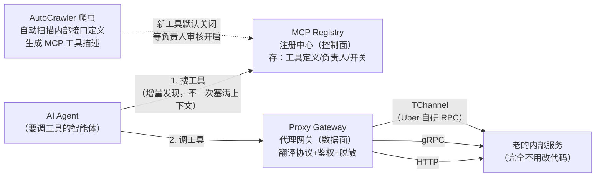
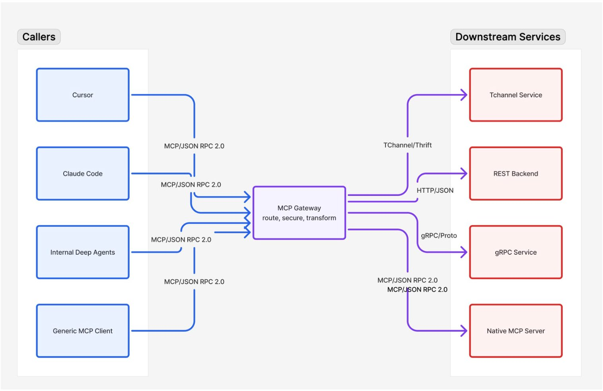
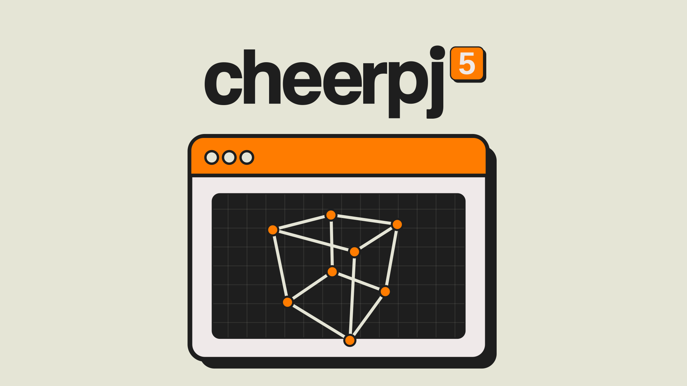
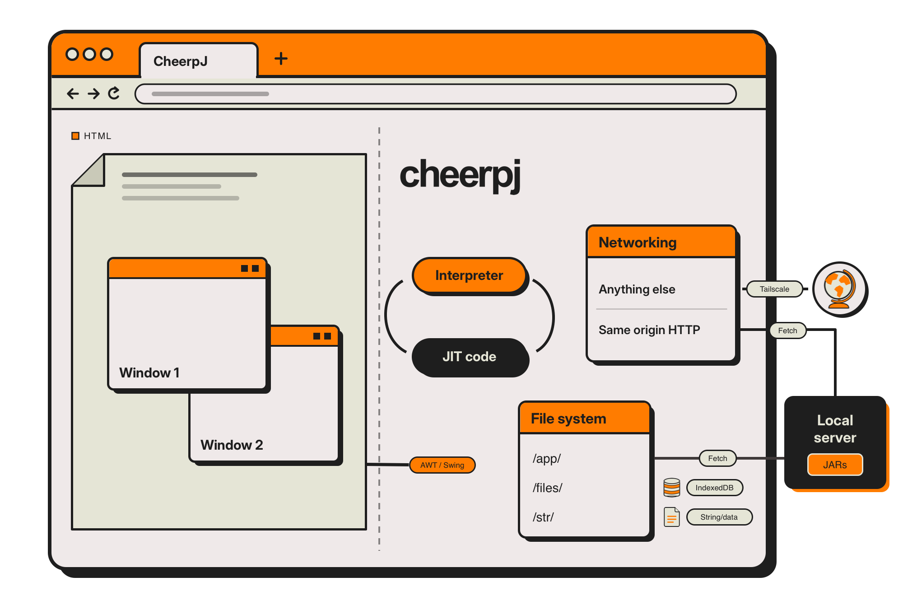

# 🚀 前沿技术日报：LLM · Agent · Java

**日期：2026-11-03（周二）** · 覆盖过去 24–48 小时动态 · 信源：GitHub Trending / GitHub API 新星榜 / Hacker News / arXiv cs.CL / InfoQ / Inside Java / Simon Willison / web 搜索（arXiv cs.AI RSS 今晨空更新，cs.CL 正常 138 条）

## 📌 今日速览

| 板块 | 今日头条 | 一句话 |
|---|---|---|
| 🧠 LLM | **美团发布 LongCat-2.5：1.6 万亿参数、原生多模态、专为长程 agent 任务造** | Terminal Bench v4.0 拿 38.5，超过 GPT-5.6-Sol 的 37.3——但这次不开源权重，只给 API |
| 🤖 Agent | **Uber 公开内部 MCP Gateway：管住 800+ 服务器、5000+ agent 工具** | 大厂把"agent 调工具"当成新一代 API 网关来治理——鉴权、审计、PII 脱敏一个都不能少 |
| ☕ Java | **CheerpJ 5 发布：Java 21 和 25 首次完整跑进浏览器** | 不只是运行——这次连编译器都装进浏览器了，网页版 IDE/教学成为可能 |

---

## 🧠 LLM 前沿进展

### 🔬 深度解析：美团 LongCat-2.5——"送外卖的公司"把万亿参数模型瞄准了 agent 长任务

**🎯 30 秒版本**：美团 LongCat 团队 11 月 2 日正式发布 LongCat-2.5（11 月 1 日技术博客先行上线，随即冲上 HN 首页）：一个 **1.6 万亿总参数、每 token 只激活约 480 亿**的原生多模态 MoE（Mixture of Experts，混合专家模型——像一家有 1600 位专家的公司，每来一个问题只叫醒其中 48 位，所以参数巨大但推理成本可控）。它不为聊天而生，目标只有一个：**跑完几小时的长程 agent 任务**——在复杂代码库里改代码、开终端、操作浏览器、做表格，一路干到交付。目前 API 和网页已开放，**权重"coming soon"但截至发布未开源**，这是 LongCat 系列第一次打破开源惯例。

**背景铺垫——"长程 agent 任务"难在哪**：让模型答一道题和让它连续工作 40 分钟是两回事。后者要求模型在几百轮工具调用里不迷路、不偷懒、不重复自己，中途失败还要会自我修复。行业里这个能力通常用 Terminal Bench（在真实终端里完成软件工程任务的基准）、BrowseComp（网页信息挖掘基准）这类"过程性"评测衡量，比问答类基准难拿分得多。

**前因后果**：之前是什么样——6 月底的 LongCat-2.0 已经是 1.6T 参数、1M 上下文（模型一次能"记住"的文字量，1M token 约等于 75 万个汉字，一套《哈利波特》装得下），但当时没给 benchmark，视觉能力只是"能看图"。为什么现在变——过去两个月 LongCat-2.5-Preview 在 API 平台试运行后，团队把训练重心全押在两件事上：**原生视觉**和**长程 RL**（强化学习：让模型在真实环境里试错、按结果给奖励的训练方法）。变了之后谁受影响——① 国内 agent 开发者多了一个对标 Claude Opus 的选项，而且兼容 Claude Code、Codex、Hermes 等主流 harness（agent 外壳工具）；② 开源社区暂时落空：GitHub/HuggingFace 权重没随发布放出；③ 芯片叙事：全程在国产加速器上训练和推理（W4A4 量化：权重和激活都用 4 bit，相当于把模型"压缩包"化，单卡内存 <80GB 也能扛长上下文训练）。

**关键技术点（白话版）**：

1. **视觉当成"外语单词"学**：图像不再走单独的视觉编码器外挂，而是用 RVQ（残差向量量化：把连续的图像特征逐层"四舍五入"成离散编号）把图片切成和文字同一种 token（模型处理的最小文字/信息块）。类比：以前是"翻译陪同"（图像先翻译成模型能懂的向量），现在是"图像直接学会了说模型母语"。官方 t-SNE 可视化显示视觉和文本 embedding（把词/图映射成坐标点的数学表示）已经交织在同一语义空间。
2. **把真实失败变成教材**：agent 训练最贵的是"可验证的环境"。LongCat 从 GitHub PR 及其关联 issue 里筛任务，用 agent 自动标注并合成可交互环境，每个环境都要通过 F2P（fail-to-pass：修复前测试必须挂、修复后必须过）和 P2P（pass-to-pass：原本通过的测试不能被改挂）双重验证——判分的是测试脚本，不是模型自己说了算。**真实 agent 的失败轨迹被转成可复现的训练任务**，哪里弱补哪里。
3. **防"reward hacking"（钻空子骗奖励）**：训练环境断网、删 git 历史和缓存文件、再用 LLM 裁判审计轨迹找作弊行为；对重复推理、重复工具调用额外扣分；对"想太多、回复越写越长"的倾向重新分配奖励。这套细节说明长程 RL 的主要敌人不是能力，而是投机。
4. **MOPD 多专家蒸馏**：保留 agent、推理、交互三组专家模型当"老师"，学生模型在线采样、老师用全词表 KL 散度（衡量两个模型输出分布差异的指标）纠偏——一个模型同时继承多个专科老师的本事。

**关键数字给参照系**（官方 benchmark 表，均为自报，对手分数部分来自公开报告）：

| 基准 | LongCat-2.5 | LongCat-2.0 | 参照 |
|---|---|---|---|
| Terminal Bench v2.1（终端工程任务） | **88.4** | 70.8 | 一代之间 +17.6 分，相当于从"及格"到"优秀"的跨度 |
| Terminal Bench v4.0 | **38.5** | - | 超过 GPT-5.6-Sol 的 37.3（v4.0 更难，40 分档已是第一梯队） |
| AutomationBench（自动化办公） | **51.8** | 15.8 | 翻 3 倍多，从"基本不能用"到"过半任务能独立完成" |
| BrowseComp（网页深挖） | **91.9** | - | 与 Claude Opus 5 同档 |
| 3DCodeBench（文字生成 3D） | **55.4** | - | 全场最高，原生视觉+编码的直接红利 |
| Vision2Web（看图写网页） | **78.6** | - | 设计稿转代码场景可用 |

**局限要讲清楚**：所有分数是厂商自报（temperature=1.0、thinking 开启的特定配置）；不开源权重意味着社区无法复现验证；"对标 Claude Opus"集中在 agent/视觉编码赛道，通用对话不是它的卖点。但"1.6T MoE + 48B 激活 + 国产芯片全流程"这个组合本身，是国内大厂在 agent 模型上最完整的一次工程展示。

*图：美团 LongCat 系列官方标识。LongCat-2.5 是该系列首个原生多模态版本。图源：[longcat.ai 官方博客](https://longcat.ai/blog/longcat-2.5/)*

[官方技术博客](https://longcat.ai/blog/longcat-2.5/) · [模型页](https://www.longcatai.org/models/longcat-2-5) · [HN 讨论](https://news.ycombinator.com/) · [Pandaily 报道](https://pandaily.com/meituan-longcat-2-5-official-release-1-6t-native-multimodal-long-horizon-agentic-coding-w4a4/)

### 📰 LLM 要闻简报

- **Anthropic 修订版 S-1 披露 Q3 财报：单季营收 $169.6 亿，同比涨 12 倍**：11 月 2 日提交的修订版 IPO 招股书（S-1：公司上市前必须公开的"财务体检报告"）填上了 10 月首版留白的 Q3 数字——营收环比 +47%（上季 $116 亿），前九个月合计 $332 亿（去年同期仅 $25 亿）；算力采购与租赁承诺总额 **$8954 亿**，其中约 $700 亿在未来 12 个月内到期；九个月净亏 $1040 亿（主体仍是可转换票据公允价值重估的会计计提，非真烧钱）；账上现金及短期投资 $1318 亿。据报道定价窗口在 11 月 19–20 日，目标募资规模对标甚至超过 SpaceX 的 $862 亿纪录。上周我们拆过首版 S-1，这次是"账本补全"：增长没减速，但承诺账单也从 ~$4300 亿翻倍到 $8954 亿。[CNBC](https://www.cnbc.com/2026-11-02/anthropic-ant-s-1-quarter-financials.html) · [修订版 S-1 原文](https://www.sec.gov/Archives/edgar/data/2130357/000162828026068676/anthropicpbc-sx1ax1.htm)
- **OpenAI  quietly 上线 GPT-Rosalind-6：同一个 GPT-6 Astra 权重，专供生物医学研究的"少拒绝版"**：10 月 30 日的 system card addendum（模型安全说明书附录）披露：Rosalind-6 与旗舰 GPT-6 Astra **权重完全相同、零额外训练**，差别只在部署层——对双用途生物学问题（既能做药也可能被滥用的知识）拒绝更少，但只对通过审核的科研机构/企业/政府开放（trusted access），保留生物武器化和网络安全红线。API 定价 $15/$75 每百万 token（输入/输出），是 Astra 标准价（$10/$50）的 1.5 倍、旧 Rosalind 5.5 的 3 倍。信号意义：**"同一模型、不同访问层级、不同拒绝边界"正在成为前沿实验室管理双用途能力的标准姿势**——安全不再只靠训练，还靠发放渠道。[OpenAI 安全中心](https://deploymentsafety.openai.com/gpt-rosalind-6) · [JARRUS 梳理](https://thejarrus.com/en/news/gpt-rosalind-6/)
- **PostgreSQL 19 跳票，官方原因：都是 AI 的"错"**：PG 核心 committer Robert Haas 撰文（HN 热帖）：十年来 PG 大版本雷打不动在 9 月中到 10 月中发布，今年要拖到 11 月甚至更晚。原因很 2026——**大量网友用 LLM 扫 PG 这个 30 多年历史的大代码库找 bug 并上报**，committer 们忙着修存量 bug 和 back-branch 安全问题，没空做发布评审；LLM 起草的补丁又常有错或不合规范，还得人来审。Haas 的态度是乐观的：延迟源于对质量的坚持，不是坏事。这是"AI 让开源维护者又爱又累"的第一个大型实锤案例。[原文](http://rhaas.blogspot.com/2026/10/postgres-19-is-late-and-its-ais-fault.html)
- **arXiv 新论文：TraceSpec——agent 场景下的投机解码该怎么改**：投机解码（speculative decoding：用小模型先猜一串词、大模型批量验证，加速推理的常用技巧）在聊天里很好使，但这篇指出 agent 工作负载（长上下文、频繁工具调用、输出结构固定）里草稿模型和主模型的"生成鸿沟"完全不同，提出按 agent 轨迹特征改进草稿策略。同批还有《In-Model Context Compression with Agentic Soft Tokens》（把长历史压成软 token 省上下文）——**"agent 专用推理优化"正在成为独立研究方向**。[TraceSpec](https://arxiv.org/abs/2610.41177) · [Context Compression](https://arxiv.org/abs/2610.41291)
- **Apriel Voice 27B Preview：语音+推理+工具调用的开放模型**：arXiv 技术报告，主打"能边说话边思考边调工具"的 speech LLM，27B 规模、开放权重路线，语音 agent 赛道又多一个非巨头选项。[arXiv](https://arxiv.org/abs/2610.40738)

---

## 🤖 Agent 进展

### 🔬 深度解析：Uber 的 MCP Gateway——当一家公司有 5000 个 agent 工具，治理比能力更重要

**🎯 30 秒版本**：Uber 11 月 2 日公开了内部 **MCP Gateway** 的设计（InfoQ 同日报道）：一个统一入口，管理公司内部 **800+ 个 MCP 服务器和 5000+ 个工具**，让 AI agent 能安全地发现、鉴权、调用任何内部服务。MCP（Model Context Protocol，模型上下文协议：Anthropic 2024 年底发起的开放标准，让 agent 用统一插头连接各种工具和数据源，类比"AI 界的 USB-C"）在 2026 年已成企业 agent 的事实标准，而 Uber 是第一个把"USB-C 插线板"本身做成企业级基础设施并公开细节的大厂。

**背景铺垫——为什么需要"网关"**：想象公司每个团队都各自给 agent 写工具：有的直连数据库、有的包了层 HTTP、鉴权方式五花八门、没人知道哪个工具读了什么数据。agent 数量一多，这就是安全审计的噩梦。Uber 遇到的正是这个问题：碎片化集成、重复造轮子、安全实践不一致。

**前因后果**：之前是什么样——各团队自己搭 MCP server，agent 直连，权限靠自觉。为什么现在变——agent 在公司内爆发式增长（内部工程 agent、客服 agent、运营 agent 都要调内部 API），"每个 agent 各自为政"的模式在 800 个服务器的规模下已经管不动了。变了之后谁受影响——所有想让 agent 规模化进生产环境的企业：Uber 给出了一个可抄的架构答卷。

**架构拆解**（本质是"API 网关"模式在 agent 时代的复刻，评论区也这么吐槽——Azure API Gateway 干了十年的事）：

*怎么读这张图：左边 agent 只跟两个东西打交道——"黄页"（Registry，查有什么工具）和"前台"（Proxy，真正执行调用）。右边的存量服务一行代码不用改。下方的爬虫自动把公司内部几万个老接口"翻译"成 MCP 工具，但新工具默认是关的，必须 owning team 点头才上线——这个"默认关闭"是整套设计里最值得抄的一条。*

**几个工程细节值得点名**：① **协议翻译**：Proxy 把 MCP 请求转成 HTTP/gRPC/TChannel 调用再把响应转回来，存量微服务零改造；② **AutoCrawler 自动发现**：扫描内部 IDL（接口定义语言）注册表，从 Protobuf/Thrift schema 提取定义，用 LLM 生成工具描述——5000 个工具不可能靠手写；③ **上下文经济学**：工具太多时把定义全塞进 agent 上下文窗口既贵又降智，所以做了 **Omni MCP 增量发现**（先搜 server → 再列工具 → 按需取 schema）和 **Response Projection**（agent 只要指定字段，不回传完整 payload——省 token 就是省钱）；④ **安全**：server 级+工具级双重鉴权走 Uber 内部访问控制系统，响应里自动脱敏 PII（个人身份信息），第三方集成（Jira、Google）用独立服务换 token。

*图：Uber MCP Gateway 总览——把现有 API 直接暴露为 MCP 工具，不改底层服务。图源：[Uber 官方博客](https://www.uber.com/us/en/blog/designing-mcp-gateway/)（via [InfoQ](https://www.infoq.com/news/2026/11/uber-mcp-gateway-ai-agents/)）*

**行业回声**：LinkedIn 上的反应很一致——"这就是我们几十年前给 API、后来给 GraphQL 建的网关"（Pipe17 总裁 Kelly Goetsch）。这话对也不对：对的是模式复用（发现/鉴权/审计/限流）；不对的是新增量——**工具描述由 LLM 生成、上下文预算成为一等公民、以及"agent 是不可信调用方"这个默认假设**。给读者的实操启发：如果你司 agent 工具超过 20 个，先建注册表和默认关闭策略，再谈能力。

[Uber 官方博客](https://www.uber.com/us/en/blog/designing-mcp-gateway/) · [InfoQ 报道](https://www.infoq.com/news/2026/11/uber-mcp-gateway-ai-agents/)

### 📰 Agent 要闻简报

- **Vercel Labs 开源 agent-desktop：给任何编码 agent 装上"桌面之手"，今日 GitHub Trending 第一（+2243 star）**：Rust 写的 CLI，macOS/Windows/Linux 全平台，Apache 2.0。与截图流（让模型看像素猜坐标）相反，它读操作系统的 **accessibility tree**（无障碍树：操作系统为读屏软件维护的 UI 结构描述，每个按钮/输入框都有稳定编号）——元素引用稳定、操作可安全重试、且在后台运行不抢鼠标。装法一行：`npm install -g agent-desktop`。它补齐了 Vercel 的 agent 工具三件套（agent-browser 管浏览器、agent-desktop 管桌面、SDK 管编排）。**"结构优先于像素"正在成为 computer use 的主流工程共识**——又准又便宜。[GitHub](https://github.com/vercel-labs/agent-desktop) · [MarkTechPost](https://www.marktechpost.com/2026-10-31/vercel-labs-agent-desktop-computer-use/)
- **FreeToken：把数据中心级模型服务搬上个人桌面**（Trending +654）：主打在本地高效跑超大模型的服务框架，和纯 C 零依赖、从磁盘流式加载 MoE 专家的 **colibri**（+655）呼应——"本地跑前沿模型"的工具链本周集体冒头，背后是 4-bit 量化和小内存 MoE 推理的工程红利。[FreeToken](https://github.com/FlashML-org/FreeToken) · [colibri](https://github.com/JustVugg/colibri)
- **arXiv：BlindToChange——agent"你问它才看"的注意力缺陷**：新基准测出一类隐蔽问题：AI agent 在被明确要求时能找到界面/环境里的变化，但**不会主动去看**——没有"扫一眼 surroundings"的自发注意力。对做 GUI agent 和机器人的人，这是"能力分数好看但实战翻车"的一个机制性解释。[arXiv](https://arxiv.org/abs/2610.41435)
- **worktrunk：为并行 AI agent 工作流设计的 git worktree CLI**（Trending +136，Rust）：git worktree（同一个仓库同时检出多个工作目录的功能）本来就是"多 agent 并行改同一个仓库不打架"的标准解法，这个工具把常用操作包成一条命令。小而准的"agent 基建"信号。[GitHub](https://github.com/max-sixty/worktrunk)

---

## ☕ Java 工程

### 🔬 深度解析：CheerpJ 5——Java 21/25 首次完整进浏览器，这次连 javac 都带上了

**🎯 30 秒版本**：英国 Leaning Technologies 于 11 月 2 日发布 **CheerpJ 5**：一个基于 WebAssembly（Wasm：浏览器里的"通用字节码"，让 C++/Rust/Go/Java 等语言写的程序不装插件直接跑在网页里）的**完整 OpenJDK 发行版**，首次把 Java 21 和 Java 25 带进浏览器。关键变化不只是"能跑新版 Java"，而是**从 runtime（运行时）升级为完整 JDK**——浏览器里不光能执行 Java，还能编译 Java。CEO 的说法："Java 今天加入了 Rust、C++、Go 的行列，成为拥有第一流浏览器目标平台的语言。"

**背景铺垫——CheerpJ 是什么、为什么老项目需要它**：Java applet（小程序）死于 2017 年前后浏览器集体弃用插件，但银行、政府、老 ERP 里还有海量"只能跑在 Java 8 上的祖传客户端"。CheerpJ 的思路是：把 JVM 本身编译成浏览器能执行的代码，直接吃 .jar 字节码——**不需要源码**，所以第三方老应用也能救活。它已开发 8 年+，NASA、Ticketmaster、Moody's 都在用；官方 demo Browsercraft 让 1.2.5 版 Minecraft 客户端整个跑在浏览器标签页里，每月几万访客。

**前因后果**：之前是什么样——CheerpJ 4 支持 Java 8/11/17，且只带运行时：能"跑"不能"编"。为什么现在变——两股推力：① 今年秋天 Wasm 因 GTA V 跑进浏览器等事件重新翻红，浏览器执行环境的能力和关注度都在涨；② 现代 Java（21/25 LTS）用户不想为了浏览器目标降级语言版本。变了之后谁受影响——**做浏览器 IDE、在线编程课、交互式教程的团队**（浏览器里能编译意味着"点开链接就能写 Java 并运行"，无需任何后端沙箱）；**老系统维护者**（21/25 时代的新依赖也能进浏览器了）；以及承诺"未来每个 LTS 发布后 6 个月内跟进"让技术选型少了后顾之忧。

**技术要点**：① **执行后端换代预告**：现在 CheerpJ 把 Java 字节码编译成 JavaScript 执行；CheerpJ 5 加入了 opt-in 的 **WasmGC 后端**（WasmGC：WebAssembly 的托管内存扩展，浏览器原生帮你做垃圾回收，不用再模拟——对 Java 这种重度 GC 语言是量身定做的加速通道），将在 CheerpJ 6 转正，官方预期"显著性能提升"，目标是让大型现代 Java 应用真正可用；② **安全边界**：CheerpJ 跑在浏览器自带的 Wasm 沙箱里——10 月 Wasmtime（一个独立 Wasm 运行时）爆出两个严重漏洞时，CheerpJ 用户不受影响，因为根本不用 Wasmtime；③ **许可**：开源项目、个人、单人公司免费，企业付费。

*图：CheerpJ 5 官方发布配图——浏览器窗口里的线框立方体，暗示 3D/现代应用已可在浏览器内的 JVM 上运行。图源：[cheerpj.com](https://cheerpj.com/cheerpj-5-brings-java-21-and-java-25-to-the-browser/)*

*图：CheerpJ 架构——Java 字节码在浏览器内经 CheerpJ 的 JVM 实现执行，全程在 Wasm 沙箱内。图源：[CheerpJ 官方 press kit](https://cheerpj.com/press/cheerpj-5/cheerpj-architecture.png)*

**一句话工程评价**：浏览器端 Java 不是主流赛道，但 CheerpJ 5 的意义在于**把"Java 教学/演示/老应用救活"这三类场景的后端成本降到零**——一个静态网页托管商就能提供完整 Java 环境。对比同类（TeaVM 只支持子集、需源码重编译），"完整 JDK + 吃现成 jar"仍是它的独家护城河。

[官方公告](https://cheerpj.com/cheerpj-5-brings-java-21-and-java-25-to-the-browser/) · [文档](https://cheerpj.com/)

### 📰 Java 要闻简报

- **JDK 28 目标 JEP 清单浮出水面：Valhalla 值对象首次进特性版本**：据 Java Version Guide（11 月 1 日更新）梳理，明年 3 月 9 日 GA 的 JDK 28 已挂 10 个 targeted JEP，几个重点：**JEP 401 值对象预览**（Project Valhalla 十年磨剑——"自定义的、无身份的不可变对象"，内存开销接近原始类型，是 Java 性能叙事的下一个大章）；**JEP 543 结构化并发转正**（7 轮预览后终于 standard——把"一组并发子任务"当一个单元管理，一起成功或一起取消）；**JEP 544 AOT 代码编译**（把 JIT 编译好的机器码直接存进 AOT cache，启动即巅峰，我们 10-30 分析过它前身的坑）；另有 JEP 535 分代 Shenandoah 成默认、JEP 541 弃用 macOS/x64 移植。Rampdown Phase One 在 12 月 3 日——**想给 28 塞东西的只剩一个月**。[来源](https://stevenpg.com/references/java-version-guide/)
- **Spring Boot 4.2 GA 定档 11 月 30 日，4.0 的开源支持 12 月 31 日结束**：Spring 官方日历显示 Boot 4.2（RC1 已于 10 月 23 日发布，17 个子项目同批出 RC）计划本月底 GA；同时提醒：**4.0 线的 OSS 支持只剩不到两个月**，4.0 用户要么升 4.1（支持到 2027-07）要么等 4.2。EOL 之后的安全补丁只给商业客户——今年已有三个 CVE 的旧版本修复是"Enterprise Support Only"，白嫖线的代价越来越具体。[来源](https://acemq.com/blogs/spring-boot-end-of-life/) · [InfoQ RC 汇总](https://www.infoq.com/news/2026/10/spring-news-roundup-oct19-2026/)
- **Inside Java 播客 Ep73：《Immutable Data Beyond Value Classes》**：Project Amber/Valhalla 语言负责人 Dan Smith 主讲——在值类（value class）之外，Java 还准备了哪些不可变数据的语言级工具。配合上面 JEP 401 进 JDK 28 预览的消息，**Valhalla 的语言设计进入密集公开沟通期**，值得订阅。[来源](https://inside.java/2026-10-29/podcast-073/)

---

## 📋 今日其余动态

| # | 动态 | 一句话 | 链接 |
|---|---|---|---|
| 1 | ☕ CheerpJ 之外：Wasmtime 10 月两个严重漏洞余波 | 独立 Wasm 运行时的信任危机，反衬浏览器内置沙箱的稳 | [InfoQ 提及](https://cheerpj.com/cheerpj-5-brings-java-21-and-java-25-to-the-browser/) |
| 2 | 🛡️ Trigger.dev 安全事件（11-01）：部分组织的环境变量被未授权访问 | 攻击已封堵、受影响账户已邮件通知——env vars 里通常是 API key，用了它的团队应立刻轮换密钥 | [官方披露](https://trigger.dev/blog/security-incident-nov-2026) |
| 3 | 🇨🇳 中国首个前沿 AI 出口管制：商务部 48 号公告 | CSA 研究院做了逐条解读——前沿模型/芯片管制框架首次成文，出海 AI 企业合规必读 | [CSA 分析](https://labs.cloudsecurityalliance.org/research/csa-research-note-china-ai-export-controls-announcement-48-2/) |
| 4 | ☁️ AWS 算力基本售罄到 2027，按需余量被预留 | GPU 荒从"买不到卡"进化到"租不到云"，Anthropic $8954 亿承诺的另一面 | [InfoQ](https://www.infoq.com/news/2026/11/aws-capacity-sold-out/) |
| 5 | ⚡ Cloudflare：DNS 构建延迟砍半、内存降 85% | targeted zone builds——超大规模基础设施的增量计算优化，工程博客质量在线 | [Cloudflare Blog](https://blog.cloudflare.com/dns-targeted-zone-builds/) |
| 6 | 🗄️ PostHog 宣布把数据仓库迁离 DuckDB | HN 首页热帖，嵌入式分析数据库在重型生产负载下的边界讨论 | [PostHog](https://posthog.com/blog/moving-off-duckdb) |
| 7 | 🎮 totk-pc-recomp：塞尔达传说 TOTK 静态重编译到 PC 原生 x86-64 | 新星榜 3773 star——不做模拟器，直接把 Switch 字节码翻译成原生代码（你关注的项目，本周新冒头的） | [GitHub](https://github.com/valentderah/totk-pc-recomp) |
| 8 | 🎮 Eglantine：非常实验性的 Switch 2 模拟器 | 新星榜 2311 star，Switch 2 模拟社区的第一批尝试 | [GitHub](https://github.com/Djihads80/Eglantine) |
| 9 | 🧠 karpathy/nanochat："$100 能买到的最好的 ChatGPT" | Trending +325，从零手搓全栈聊天机器人的教学项目，学 LLM 内部机制的最佳读物之一 | [GitHub](https://github.com/karpathy/nanochat) |
| 10 | 🔧 p-e-w/heretic：免训练修改模型行为 | Trending +404，直接改权重来去审查/减谄媚/压 AI 味——abliteration 路线工具化 | [GitHub](https://github.com/p-e-w/heretic) |
| 11 | 🕷️ Scrapling（D4Vinci）：自适应网页抓取框架 | Trending +858，从单请求到全站爬取一个框架搞定，agent 时代抓取层的新热门 | [GitHub](https://github.com/D4Vinci/Scrapling) |
| 12 | 🤖 paperclip：开源的"公司内 agent 管理台" | Trending +451——agent 多到需要一个管理系统来管，Uber MCP Gateway 的平民版思路 | [GitHub](https://github.com/paperclipai/paperclip) |
| 13 | 🌐 Wired 长文：《让互联网死去，重新开始》 | HN 热帖，协议层重建互联网的激进提案，评论区吵翻 | [Wired](https://www.wired.com/story/let-the-internet-die/) |
| 14 | 🧪 "AI agent 给小鼠做了脑手术" | 西班牙团队展示 agent 驱动显微手术，自主系统的物理世界里程碑（推特来源，细节待论文） | [原推](https://twitter.com/OcanaSantero/status/2115442964574908902) |
| 15 | 🛡️ Shopify Overexposed：扫 GKE Ingress 和 Cloud Run 的暴露面 | 开源工具又+1，云原生"你以为私有的其实全裸奔"检查器 | [InfoQ](https://www.infoq.com/news/2026/11/shopify-kubernetes-ingresses/) |

---

## 💡 一句话点评

今天的三条 A 档串成一条线：**模型在变"专"**（LongCat-2.5 不为聊天、只为长任务）、**工具接入在变"治"**（Uber 把 5000 个 MCP 工具关进网关）、**运行平台在变"轻"**（CheerpJ 把整个 JDK 塞进浏览器标签页）——2026 年末的主旋律不是"更大更强"，而是**各就各位**：每一层都在为自己的真实工况做深度工程化。顺带一提，Postgres 19 因为网友用 LLM 疯狂报 bug 而跳票，可能是今年最诚实的"AI 改变软件工程"案例：它改变的不是代码怎么写，而是**维护者的时间去哪了**。

---

🤖 本报告由 Hermes Agent 每日凌晨自动调研生成 · [HermesReports](https://github.com/knolonzhou/HermesReports)
