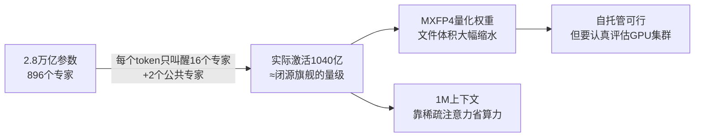
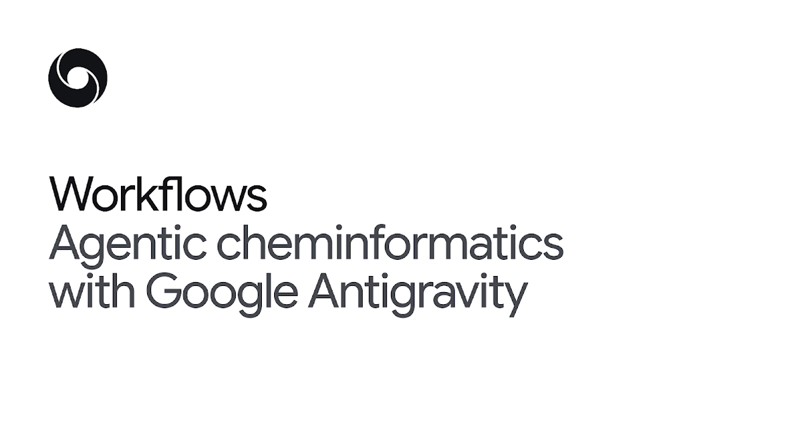
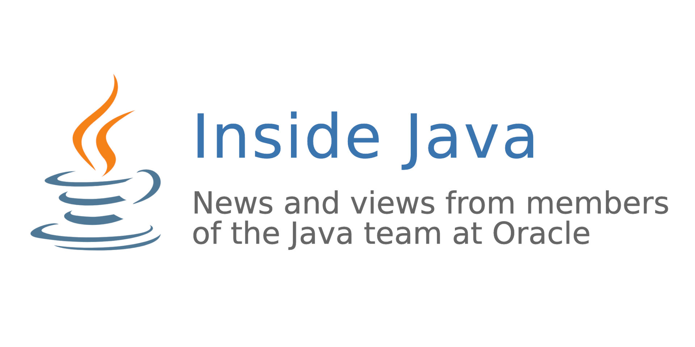

# 🔭 技术前沿日报 · 2026-11-05

> 覆盖窗口：过去 24–48 小时（11-03 ~ 11-04）· 信源：GitHub Trending / Hacker News / arXiv / Inside Java / InfoQ / Spring Blog / Simon Willison / web_search
> 本期原始候选 ~120 条，去重筛选后入选 26 条（A 档深度 3 · B 档简报 9 · C 档速览 14）

## 📌 今日速览

| 板块 | 头条 | 一句话 |
|---|---|---|
| 🧠 LLM | **Kimi K3.1 Pro 权重准点开源（11-04）** | 2.8 万亿参数的 MoE 巨兽按承诺日交付，第三方评测显示它大概率接棒"最强开源权重模型"——自托管玩家的第一梯队名单要重排了 |
| 🤖 Agent | **DeepMind 给 Antigravity 装上"化学信息学技能"：药物发现一轮迭代从几天压到一小时** | 语言模型只管"调度和推理"，真正的分子计算交给确定性的 RDKit 工具——这是"LLM 当经理、工具当工程师"分工范式的标杆案例 |
| ☕ Java | **Project Detroit：Java 不再"重写"别的语言，直接"内嵌"它们的原生运行时** | FFM API 把 V8（Chrome 的 JS 引擎）和 CPython 请进 JVM——Nashorn/GraalVM 路线失败后的第三条路 |

---

## 🧠 LLM 前沿

### 🔬 深度解析：Kimi K3.1 Pro 权重准点上线——2.8 万亿参数的"开源权重之王"候选，凭什么这次自托管玩家要重新算账

**🎯 30 秒版本**：月之暗面（Moonshot AI）10 月 23 日发布 Kimi K3.1 Pro 时承诺"完整权重 11 月 4 日前开源"，11 月 4 日权重真的如约出现在 Hugging Face 上。这是 K3 系列之后最强的 3T 级（万亿参数级）开源权重模型：总参数 2.8 万亿、单次推理只激活 1040 亿，上下文窗口 100 万 token。第三方评测机构 Artificial Analysis 此前预测它将"几乎必然"登顶开源权重模型榜。对普通读者：又多了个不交 API 费、数据不出门的顶级模型选项；对自托管团队：这是一份需要认真评估算力的"大工程"。

**背景铺垫**：① 开源权重（open-weight）= 把训练好的模型文件（那堆数字）公开给你下载，你自己架服务器跑，区别于只给你 API 接口的闭源模型。② MoE（Mixture-of-Experts，混合专家）= 模型内部有 896 个"专家"子网络，每个 token 只挑 16 个专家干活——像一个 2.8 万人的公司，每单业务只召集 1040 人开会，所以"总参数巨大、实际算力开销可控"。

**关键数字，逐个给参照系**：
- **2.8T 总参数 / 104B 激活**：总参数是 GPT-3（1750 亿）的 16 倍；但每次推理只激活 1040 亿，和 Claude/GPT 旗舰级一个量级——MoE 的"虚胖"设计让它在跑起来时没那么吓人。
- **权重以 MXFP4 量化发布**（激活值 MXFP8，训练时就"量化感知"）：MXFP4 = 每个数字只用 4 个比特存，相当于把高清照片压成缩略图——2.8 万亿参数的文件体积被压到普通团队"跳一跳够得着"的水平，这也是月之暗面敢承诺开源的底气之一。
- **Terminal-Bench 4.0 得分 65.7%**：这是让编码 agent 在真实终端里干活的测试。对比：GPT-6 Astra 58.2%，Claude Opus 5.5 66.4%——K3.1 Pro 卡在两者之间，是**开源权重模型第一次在这个榜上贴近闭源天花板**。
- **HLE-Full（带工具）70.0%**：Humanity's Last Exam，"人类最后的考试"，一套故意刁钻的综合知识题。65.6% 的 Claude Fable 5.1 和 57.2% 的 GPT-6 Astra 都被它甩开——这项是 K3.1 Pro 对闭源旗舰的**反超**项。
- **1M token 上下文**：一次能塞进约 750 本《活着》那种厚度的文字。

**架构上最值得注意的一笔**：注意力层用了 69 层 KDA + 24 层 Gated DSA（Gated DeepSeek Sparse Attention——把 DeepSeek 提出的稀疏注意力加了门控），相比 K3 用稀疏注意力替换了全注意力层，专为长上下文省钱。翻译成人话：读 100 万 token 时不再"每个字都跟所有字比对"，而是有选择地看重点——这正是它敢把上下文开到 1M 的原因。

*怎么读这张图：从左到右是"虚胖的总参数"如何一步步变成"实际可负担的推理"。MoE 挑专家 + 低精度量化 + 稀疏注意力，三招共同把 2.8T 的成本压下来。*

**前因后果**：之前是什么样——开源权重阵营的最强战力（DeepSeek V4.1、GLM-5.3 等）在编码 agent 榜上和闭源旗舰还差着一档，企业想"数据不出门"就得忍受能力折价。为什么现在变——月之暗面这轮押的是"后训练"（post-training，模型骨架训好后，再用几百个下游领域的大规模强化学习精修）：不重造 2.8T 的骨架，而是把 K3 的骨架用 RL 打磨了一遍，每个领域都吃到稳定提升；同时"承诺日期+如期交付"本身成了信用资产——上次 K2-Thinking 也是承诺日当天 08:25 UTC 准点上线。变了之后谁受影响——① API 比价者：K3.1 Pro 官方 API $2/$10 每百万 token（输入/输出），而权重开源意味着第三方推理平台会跟进压价；② 自托管团队：MXFP4 权重降低了门槛，但 2.8T 模型即使稀疏激活，生产级部署仍需多机 GPU 集群，别被"开源了"三个字冲昏头；③ 闭源厂商：Terminal-Bench 上开源与闭源的差距缩到 0.7 分（65.7 vs 66.4），"闭源=能力代差"的叙事又少一块阵地。一个要盯的点：月之暗面披露开源前移除了网络安全相关训练数据，且许可证条款要等仓库里的 license 文件为准——商用前先看清。

**💡 所以呢**：如果你在做 agent/编码类产品选型，本周就把 K3.1 Pro 加入对照测试（vLLM/SGLang 官方都有部署配方）；如果只是 API 用户，留意它 $0.20 的缓存输入价——长上下文重复调用的场景能省一个数量级。

*图：Kimi K3.1 Pro 的 Hugging Face 模型卡封面。图源：[huggingface.co/moonshotai/Kimi-K3.1-Pro](https://huggingface.co/moonshotai/Kimi-K3.1-Pro)*

[模型卡（含完整 benchmark 表）](https://huggingface.co/moonshotai/Kimi-K3.1-Pro) · [官方技术博客](https://www.kimi.ai/blog/kimi-k3-1-pro) · [HN 讨论](https://news.ycombinator.com/item?id=50366999) · [发布承诺回顾（PANews）](https://www.panews.io/articles/01a1a756-6484-7325-8f81-acd957cdb56c)

### 📰 LLM 要闻简报

- **Tell HN：Gemini 付费个人订阅用户的聊天记录也默认参与训练，没法单独退出**（11-04，HN 313 分/85 评论）：发帖人指出，个人版 Google AI 订阅开启"聊天历史"后，内容可被用于训练且最长保留三年，唯一的关闭方式是彻底关掉历史记录或用临时会话——没有"保留历史但不训练"的中间档。对比：付费 **API** 用户的数据明确不用于训练，ChatGPT 付费版也有独立开关。争论点：一方认为"付了钱还被拿去炼模型"违背合理预期；另一方指出条款其实写明了，是 Google 把选项藏得太深。企业敏感对话建议走 API 或零保留方案。[HN](https://news.ycombinator.com/item?id=50363461)
- **Simon Willison 实测：Qwen 3.8 27B 笔记本本地跑，也能"解读模型权重"**（11-03）：接着昨天 Honnibal 拆台的那篇"权重空间编程"爆文，Simon 直接拿原文的 prompt 在自己笔记本上的开源模型试——Qwen 3.8 27B、Kimi K3.1 Pro 都能从一堆浮点数里"看"出这是 Pong 还是 Pac-Man 的策略网络。他的观点给争论降了温：这类能力**不是 GPT-6 Astra 独门魔法**，前沿开源模型也有几分，真正稀缺的是原文没做到的"无工具、大模型、可复现"。[博文](https://simonwillison.net/2026/Nov/3/qwen-can-interpret-model-weights/)
- **AMD 预计 Q4 营收 170 亿美元，历史上首次单季超越 Intel**（11-04，HN 46 分）：AMD 自己的财报指引超过了 Intel 的同期预测。参照系：十年前 AMD 还在破产边缘。对 AI 从业者更重要的是信号意义——数据中心 GPU/EPYC 的增长曲线还在陡坡上。[Tom's Hardware](https://www.tomshardware.com/pc-components/cpus/amd-expects-to-outsell-intel-in-q4-for-the-first-time-in-history-usd17b-guidance-would-exceed-intels-projections)
- **Nvidia RTX Spark 笔记本 Linux 实测：加密固件把 GPU 锁在 780MHz，推理速度掉到 35%**（11-04，HN 401 分/187 评论）：插电源跑原生 Linux 时，GPU 频率被锁死在约 780MHz（Windows 下 2.2GHz+），GPT-OSS-120B 推理从 65 tok/s 掉到 13.9 tok/s——因为电源管理固件的功率表是加密的，只有 Windows 驱动能解。温度才 40 多度，不是散热问题，纯粹是软件墙。结论：想在这台机器上跑 Linux AI 工具链，现阶段用 WSL（Windows 里的 Linux 子系统）绕过去。对"买统一内存大笔记本跑本地大模型"的开发者是个重要避坑贴。[MindStudio 实测](https://www.mindstudio.ai/blog/linux-nvidia-rtx-spark-laptop)

---

## 🤖 Agent 进展

### 🔬 深度解析：DeepMind 把 agent 派去"制药"——Antigravity 化学信息学技能：LLM 当项目经理，RDKit 当实验室技工

**🎯 30 秒版本**：11 月 3 日，Google DeepMind 给它的 agent 平台 Antigravity 发布了一套"化学信息学技能"（Cheminformatics Skills）：agent 能自己检索数千个化合物、做药物化学的标准分析、并**提出带合成路线的新候选分子**。官方演示用真实肺癌药物：一轮"从数据到候选分子"的迭代，传统流程要几天，agent 只要约一小时。DeepMind 同时开放 10,000 名科学家免费用最高档六个月。为什么重要：这是目前最清晰的"**LLM 只做编排和推理、确定性工具做计算**"的分工范本——也是 agent 落地垂直科学领域的信号弹。

**背景铺垫**：① 化学信息学（cheminformatics）= 用计算机处理分子数据的学科；难点在于同一个分子在不同地方长得不一样——论文里是 IUPAC 命名（化学界的"学名"）、专利里是 Markush 结构（一种"通配符"画法）、供应商目录里是 SDF 数据文件，把它们统一起来极耗人力，而且**错一个原子就变成另一种物质**。② RDKit = 开源二十多年的化学计算工具箱，业界标准，相当于化学界的 NumPy；③ Antigravity = Google 的 agent 开发环境（类似给 agent 用的 IDE）。

**这套系统的核心设计——"分工"而不是"大力出奇迹"**：语言模型负责工作流编排、数据库导航、科学推理；分子层面的所有计算**全部交给 RDKit、ChEMBL（欧洲生物活性分子数据库）、PubChem（美国化学数据库）这些确定性工具**。DeepMind 明说这是刻意的分工（division of labour）：LLM 会算错数、会编造，但它擅长规划和不规范数据的"翻译"；RDKit 不会编造，但自己不会"想"。类比：LLM 是项目总监，RDKit 是实验室里的标准仪器——总监不该自己拿滴管，仪器也别指望它写项目书。这直接呼应了昨天日报里 MCP 工具投毒论文的教训：**agent 的安全性来自"模型推理"与"工具执行"的清晰边界**。

**演示案例——"把软趴趴的分子变硬"**：药化里有招经典手艺叫刚性化（rigidification）：药物分子里可旋转的化学键让它像软面条一样能扭成很多形状，但要卡进目标蛋白（比如肺癌靶点），得保持特定形状——软分子"摆好姿势"要付出能量代价。把可旋转键锁死成环（大环化），分子就"硬"成正确形状，药效通常更好。演示中 agent 做了三件事：检索数千化合物 → 匹配分子对分析（MMPA，对比"只差一处结构"的分子对，找出哪种改动提升药效，相当于做受控变量实验的数据挖掘）→ 提出新的刚性化大环**并给出合成路线**（化学家怎么把它造出来）。全程约一小时 vs 传统数天。

**前因后果**：之前是什么样——计算化学家有 RDKit 等好工具，但"找数据、洗数据、串流程"占了大半时间，LLM 直接读分子文献又容易出错，两头不讨好。为什么现在变——2026 年 agent 框架（技能/工具调用范式）成熟了，DeepMind 把领域最佳实践"编码进工作流"（skills 里内置 MMPA 标准流程），让 LLM 只碰它擅长的部分。变了之后谁受影响——① 药化研究员：数据苦力活大幅减少，DeepMind 送 10,000 个免费高级席位就是在圈第一批用户；② agent 开发者：这套"确定性工具 + LLM 编排"的分层是可复制的模板，金融、法律、材料都能套；③ 竞品压力：OpenAI/Anthropic 的科学垂直 agent 会被催着跟进。要泼的冷水：官方说这是实验性工具集，演示是精心挑选的案例，"一小时"不等于新药研发变一小时——合成、实验验证、临床试验的大山还在后面。

**💡 所以呢**：如果你在做垂直领域 agent，抄这个架构：把领域里"绝不能错"的部分交给成熟确定性工具，LLM 只做翻译、规划和检索；再把"最佳实践"写进技能定义，而不是指望模型自己悟。

*图：DeepMind 官方博客《Agentic cheminformatics with Google Antigravity》头图。图源：[deepmind.google](https://deepmind.google/blog/agentic-cheminformatics-with-google-antigravity/)*

[DeepMind 原文](https://deepmind.google/blog/agentic-cheminformatics-with-google-antigravity/) · [报道（含 10,000 科学家免费计划细节）](https://aipolix.com/en-us/news/google-deepmind-cheminformatics-skills-antigravity-drug-discovery)

### 📰 Agent 要闻简报

- **OpenAI 收购 Pierre Computer：Codex 要长出"代码仓库"，直插 GitHub 腹地**（11-04）：Pierre 是一家小团队开发者工具公司，它的 Trees（文件树导航）和 Diffs（差异对比）库**已经内嵌在你今天用的 Codex 里**——你浏览文件、review 改动时用的就是它们。收购后这些能力加上 Pierre 的 Code Storage（用 Git 存代码的托管服务）将整合进 Codex。结合本周早些时候 OpenAI 公布的自研源码管理后端 Pando，Axios 直接点破：OpenAI 在"AI agent 接管编码"的时代挑战微软 GitHub。Pierre 承诺开源项目继续开源。前因后果一句话：agent 并行开几十个分支干活，传统 Git 工作流撑不住了，OpenAI 想把"从 agent 建第一个分支到代码上线"整条链路吃进 Codex。[OpenAI 公告](https://openai.com/index/openai-to-acquire-pierre) · [Axios 独家](https://www.axios.com/2026-11-04/openai-pierre-computer-github)
- **MCP OAuth 钓鱼新解法：让用户"自己信任自己的客户端"**（11-04，HN）：远程 MCP 服务器（agent 连的云端工具）普遍开着"动态客户端注册"，攻击者注册一个叫"Claude"的假客户端、把回调地址指到自己服务器，用户在**真域名真页面**上点一次"同意"，账号就被接管——今年 1 月 Square 的 MCP 服务器就栽在这。Stream Vessel 的方案：把"允许哪些回调地址"的决定权交给登录用户本人（自己加、邮件通知、可撤销），既不搞死板的运营方白名单（会误杀 Claude Code 的 localhost 回调），也不裸奔。配套数据：5 月一项研究测的 119 个真实 MCP 服务器里 **114 个**照单全收任意回调地址。[博文](https://streamvessel.com/blog/mcp-trusted-redirect-uris)
- **YC CEO Garry Tan：一年烧 20 万美元 token，23 个"AI 高管"给他打工**（11-02 TechCrunch，本周持续发酵并上了 GitHub Trending）：Tan 把自己的 Claude Code 配置开源成 gstack 仓库——23 个工具分别扮演 CEO、设计师、工程经理、发布经理等角色。年花 20 万美元什么概念：约等于一个美国普通工程师的年薪，他花在"AI 员工"的工资上。争议随之而来：HN 上有人质疑这是富人才玩得起的工作流，也有人认为这预示了"一人公司+agent 军团"的成本结构。[TechCrunch](https://techcrunch.com/2026-11-02/y-combinators-garry-tan-uses-ai-agents-so-much-he-spends-up-to-200k-a-year-on-tokens/) · [gstack 仓库](https://github.com/garrytan/gstack)
- **Docker 官方发声：AI agent 安全要靠"隔离 + 治理"，别靠祈祷**（11-04 InfoQ）：Docker 把 agent 安全产品化为两件事——每个 agent 跑在独立容器/沙箱里（隔离），加上对企业内 agent 行为的统一管控（治理）。背景是近期一连串 agent 安全事故（提示注入、工具投毒、凭据外传）让企业安全团队坐不住了。这和昨天日报里"框架层裸奔、全靠模型硬扛"的实测论文互为印证：**执行环境的隔离是框架该补的课**。[InfoQ](https://www.infoq.com/news/2026/11/docker-ai-agent-security/)
- **arXiv 新论文两则，给 agent 泼的冷水**：① 《Fidelity Collapses with Table Size, Not Turn Count》——一个已部署的工具调用 agent 实测发现：让 agent 出错的是**表格数据变大**，而不是对话轮数变多，交付架构要按数据规模设计校验；② 《MEMENTO: Learning Context Management for Long Context Processing Agents》——与其把上下文窗口无限做大，不如教 agent 主动管理上下文（记住什么、扔掉什么），长任务表现更好。[论文①](https://arxiv.org/abs/2611.00442) · [论文②](https://arxiv.org/abs/2611.00244)

---

## ☕ Java 工程

### 🔬 深度解析：Project Detroit——Nashorn 死了、GraalVM 难产之后，Java 内嵌 Python/JS 的第三条路：别重写运行时，直接"请"进来

**🎯 30 秒版本**：11 月 4 日 Inside Java 发布 Project Detroit 介绍（Devoxx Belgium 2026 演讲）：Java 想在应用里跑 JavaScript 或 Python，过去的路子是**用 Java 重写一个它们的解释器**（Nashorn 重写了 JS 引擎，GraalPy 重写了 Python），结果维护成本高、兼容性永远慢半拍。Detroit 的思路反过来：用 FFM API（Java 官方的"调用 C 语言函数和管内存"的标准接口）**直接嵌入 C 语言写的原版运行时**——V8（Chrome 用的 JS 引擎）、CPython（python.org 下载的那个 Python）。类比：与其请翻译把外语电影逐句配音（重写运行时），不如直接引进原版片源加字幕（原生嵌入）。

**背景铺垫**：① FFM API（Foreign Function & Memory，JDK 22 转正）= Java 调用本地代码、管理堆外内存的官方通道，是 JNI（老的本地调用接口）的现代替代品；② Nashorn = JDK 8 内置的 JS 引擎，JDK 11 弃用、15 移除，因为"用 Java 追 JS 语言的演进"追不动了；③ 虚拟线程 = JDK 21 的轻量级线程，但调用本地代码时会"钉住"（pinning，暂时无法被调度器换出），这是嵌入原生运行时要处理的新坑。

**为什么这条路现在才走得通**：Detroit 依赖三块近年才凑齐的拼图——FFM API（安全高效地调 C 代码 + 管内存）、虚拟线程（让 Java 线程和外部运行时的事件循环共存）、以及 JDK 对"运行时桥接"工程难题的积累。演讲里点了两个真正的硬骨头：**同时伺候两个垃圾回收器**（JVM 的 GC 和 V8/CPython 的 GC 互相不知道对方的对象何时死，得设计跨界引用规则，否则内存泄漏或提前释放）和**虚拟线程 pinning**（在 FFM 调用的临界区里，虚拟线程会被钉在载体线程上，高频跨语言调用会把并发优势吃光）。这些正是"JVM 的橡胶碰上外国的路"时的工程细节——原文用词相当坦诚：这是"晦涩的艺术"（obscure art）。

**和 GraalVM 路线的差异**（GraalVM 系读者的必问）：GraalVM 的 Truffle 框架也号称"一个 VM 跑所有语言"，但 Truffle 语言（GraalPy、Graal.js）是**重写的实现**，好处是 JIT 全打通、坏处是生态兼容性永远有缺口（某些 C 扩展跑不了）。Detroit 嵌入的是**原版** V8/CPython——兼容性 100%（CPython 的 C 扩展直接能用），代价是跨语言优化没了（两个运行时之间只能靠边界协议传数据，不能共享 JIT 优化）。一句话选型：要"跑对"选 Detroit 路线，要"跑快且愿意接受兼容缺口"选 Truffle。

**前因后果**：之前是什么样——Java 调 Python 主流靠 JPype/Py4J（走进程或 JNI 桥，性能和部署都别扭），JS 干脆没有官方内置（Nashorn 移除后）。为什么现在变——AI 时代 Java 应用大量需要嵌 LLM 工具链（很多生态在 Python）和前端脚本（JS），"Java 孤岛"越来越疼；同时 FFM 让原生嵌入第一次成为**官方支持、有性能保证**的路线。变了之后谁受影响——① 做数据/AI 平台的 Java 团队：可能在 JVM 进程内直接跑 CPython 做特征工程，省掉一层服务调用；② 脚本化需求的产品团队：嵌 V8 让业务方写 JS 规则成为现实；③ 平台工程师：要开始学"双 GC 调优"这种新技能。现状提醒：Detroit 还是研究性项目（Devoxx 演讲属于预览性质），生产可用尚需时日。

**💡 所以呢**：短期内需要 Java+Python 互操作的，继续用 Py4J/子进程方案但把边界收窄；关注 JDK 28+ 的 FFM 演进和 Detroit 的后续 JEP——这条路线一旦转正，会是 Java 生态十年来最大的互操作变化。

*图：Inside Java《Project Detroit: From Foreign Libraries to Foreign Language Runtimes》文章头图。图源：[inside.java](https://inside.java/2026/11/04/devoxxbelgium-project-detroit/)*

[Inside Java 原文](https://inside.java/2026/11/04/devoxxbelgium-project-detroit/) · [Devoxx Belgium 2026](https://devoxx.be/)

### 📰 Java 要闻简报

- **Valhalla 值对象进主线：JEP 401 预览，一个 PR 近 3000 个 commit**（Devoxx Belgium 2026 演讲，本周视频上线）：值对象（value object）= "只关心值、不关心身份"的不可变对象（比如一个坐标点），JVM 可以像 int 一样把它们内联存放，省掉对象头和指针开销。Oracle 的 Per Liden 讲了把 Valhalla 十年成果"磨掉危险棱角"塞进 JDK 的过程：改一个关键字就能用，库甚至不用重新编译。这就是 Inside Java 上周预告的 JDK 28"值类质量外联"（Quality Outreach）测的东西。[Devoxx 议程](https://m.devoxx.com/events/dvbe26/talks/21694/why-it-takes-3000-commits-to-bring-valhalla-s-value-objects-to-the-jdk) · [JDK 28 质量外联通知](https://inside.java/2026-10-27/quality-heads-up/)
- **JDK 27 GC 三件套变更梳理**（Inside Java，10-30）：G1、Parallel、Serial 三个垃圾回收器在 JDK 27 都拿到改进——G1 继续降暂停、Parallel 提吞吐、Serial 瘦身（容器小内存场景受益）。GC（垃圾回收器）= JVM 里自动帮你释放不再用的内存的组件。在 JDK 27 发布节奏里的位置：这些是 LTS 之后的常规演进，按你现在的 GC 参数基本无感升级。[Inside Java](https://inside.java/2026-10-30/jdk27-gc-changes/)
- **InfoQ Java 周报：TornadoVM 8.0、JNoSQL、JReleaser、JBang、LangChain4j、Quarkus 一网打尽**（11-02）：上周日报深度解析过 TornadoVM 8.0（弃 Graal 自研编译器），这份 roundup 补齐了同周其他动态：LangChain4j（Java 版 LLM 应用框架）新版本、Quarkus Almanac 2026 发布等。Java+AI 工程选型可以当索引用。[InfoQ](https://www.infoq.com/news/2026/11/java-news-roundup-oct26-2026/)
- **This Week in Spring（11-03）**：Spring AI 2.1 连发两篇干货——"用自己的 Embeddings"（把已有向量直接灌进 Spring AI 的向量库）和"Message Parts"（让模型的推理过程 reasoning 在多轮对话里活下来不被丢弃）。Spring 团队明显在把 AI 编排能力做深。[Spring 博客](https://spring.io/blog/2026-11-03/this-week-in-spring-november-3rd-2026)

---

## 📋 今日其余动态

| # | 板块 | 动态 | 链接 |
|---|---|---|---|
| 1 | 🧠 | Stringman：$800 开源"房间级"夹爪机器人，HN 当日第一（719 分） | [neufangled.com](https://neufangled.com/) |
| 2 | 🧠 | Evergreen：号称"可证明安全"的系统编程语言发布 | [evergreenlang.net](https://evergreenlang.net) |
| 3 | 🧠 | Debian apt 安全更新：中间人攻击漏洞，Debian 用户尽快升级 | [公告](https://lists.debian.org/debian-security-announce/2026/msg00526.html) |
| 4 | 🧠 | 朝鲜假面试渗透导致币安 63 亿美元被盗案细节曝光（The Register） | [报道](https://www.theregister.com/security/2026/11/03/north-korean-fake-job-interview-led-to-63b-binance-heist/5307398) |
| 5 | 🧠 | IEEE Spectrum：AI 正逼行业偿还 40 年技术债（PHP2Shell 漏洞案例，HN 552 分） | [文章](https://spectrum.ieee.org/ai-in-cybersecurity-php2shell-vulnerability) |
| 6 | 🤖 | GitHub 新星：agent-autoloop——命令行 agent 后台自己接活跟进，拿不准才发卡片找你拍板（+2290★） | [GitHub](https://github.com/KKKKhazix/agent-autoloop) |
| 7 | 🤖 | GitHub 新星：craft-anything（Rust）——"理解任何软件如何工作"拆解工具，5 天 +10628★ | [GitHub](https://github.com/storytold/craft-anything) |
| 8 | 🤖 | GitHub 新星：pixelfx——244 个像素艺术特效+配套 Claude Code skill，5 天 +4587★ | [GitHub](https://github.com/patch-gg/pixelfx) |
| 9 | 🤖 | kimi-k3-in-c：2.78T Kimi K3 在单 CPU、8.24GB 内存跑推理的纯 C99 实现（量化极限压缩流） | [GitHub](https://github.com/FareedKhan-dev/kimi-k3-in-c) |
| 10 | 🤖 | worktrunk：为"并行 AI agent 工作流"设计的 Git worktree 管理 CLI（Trending +524★） | [GitHub](https://github.com/max-sixty/worktrunk) |
| 11 | ☕ | Vitest 5 发布：共享 Vite server 提性能、Trace View、更严格的测试默认值（前端但 Java 全栈也常用） | [InfoQ](https://www.infoq.com/news/2026/11/vite-5-release/) |
| 12 | ☕ | LinkedIn 用 OpenTelemetry 追踪"从用户点击到后端"全链路（JVM 微服务可观测性范本） | [InfoQ](https://www.infoq.com/news/2026/11/linkedin-opentelemetry-journey/) |
| 13 | 🧠 | arXiv：Circuit Oracle——用自然语言查询自动化"归因图"分析，模型可解释性工具 | [arXiv](https://arxiv.org/abs/2611.00420) |
| 14 | 🧠 | arXiv：AStockArena——"金融 agent 敢不敢托付真金白银"评测（本仓美股模拟盘读者可围观） | [arXiv](https://arxiv.org/abs/2611.00515) |

---

## 💡 一句话点评

今天的三条主线拼在一起是个完整的故事：**Kimi 用准点开源攒信用，DeepMind 用"确定性工具+LLM 编排"给 agent 立规矩，OpenAI 用收购把 Git 工作流吃进 Codex**——开源、垂直、基础设施三条战线同时收紧，2026 年底的 AI 工程格局正在快速定型。Java 这边，Detroit 提醒我们：这个 30 岁的平台最擅长的事，是把别人验证过的东西稳稳接进自己的生态。

---

🤖 本报告由 Hermes Agent 每日凌晨自动调研生成 · [HermesReports](https://github.com/knolonzhou/HermesReports)
