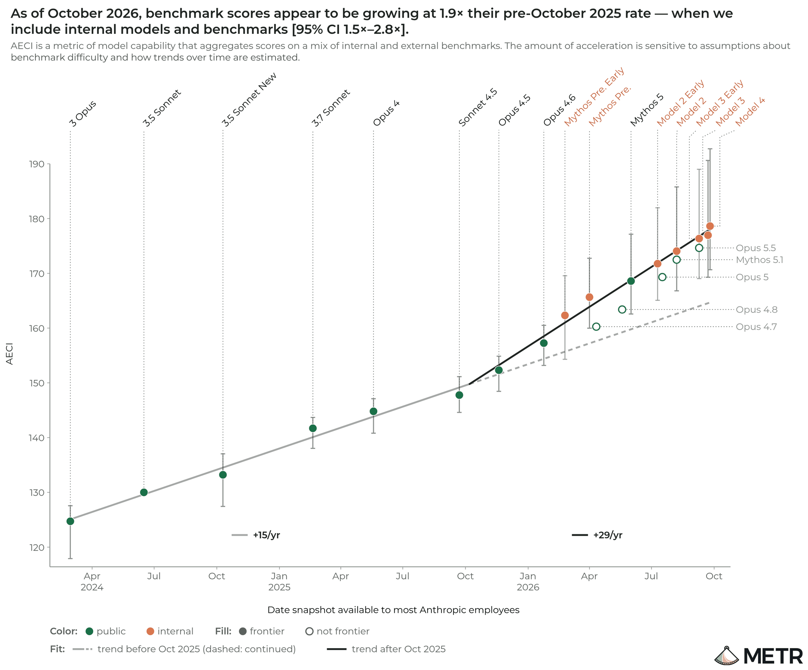
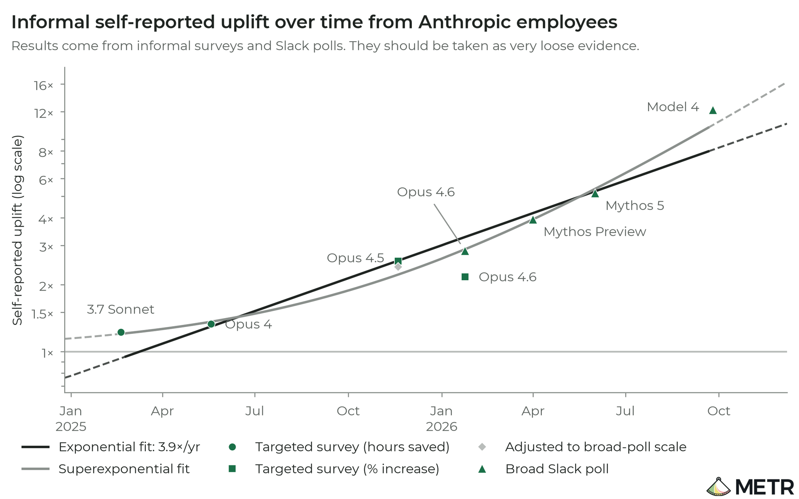
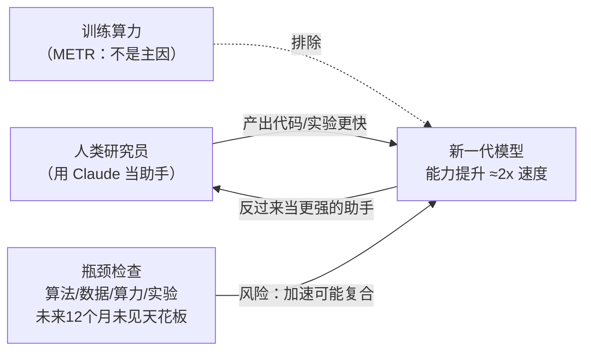
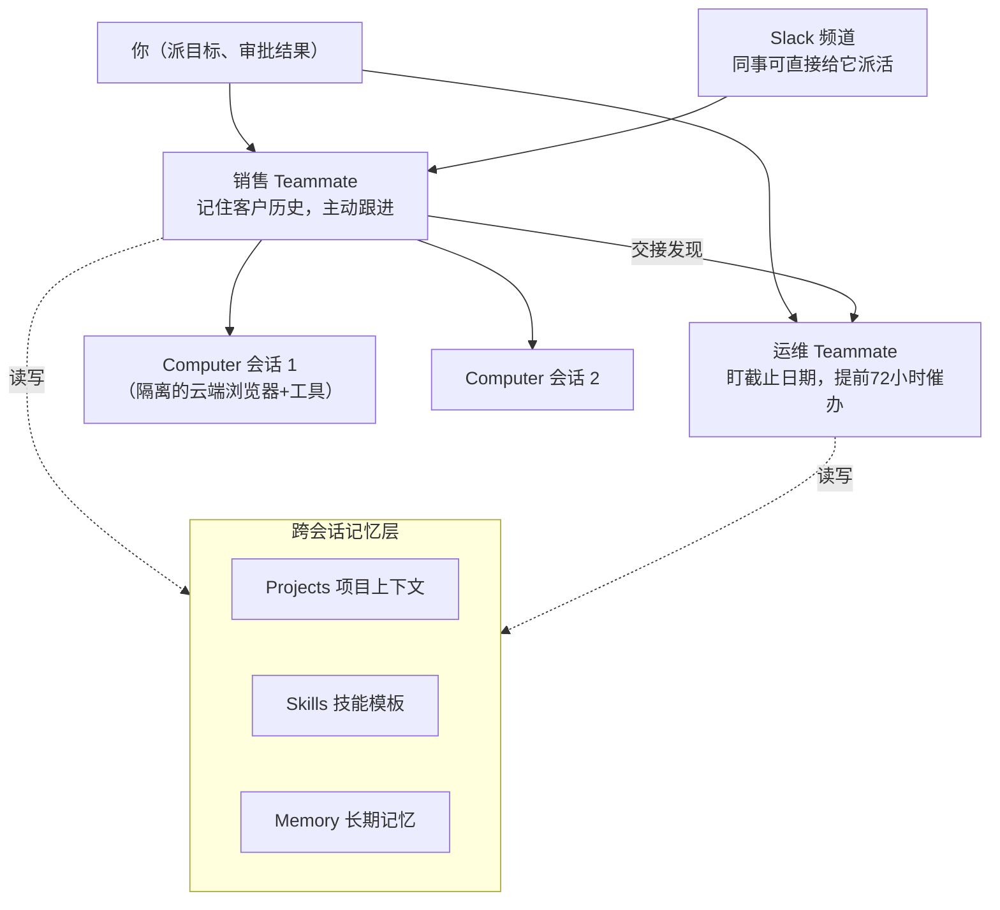
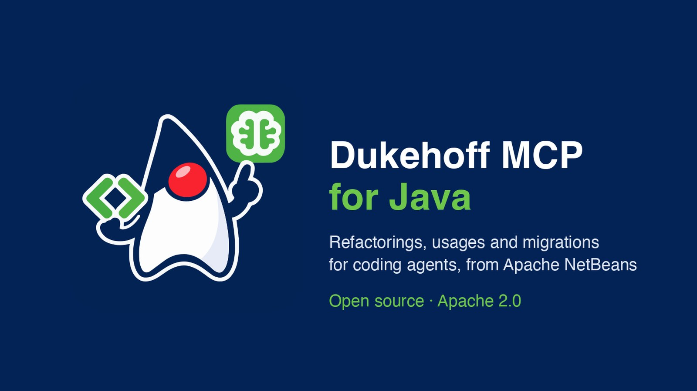

# 🗞️ LLM / Agent / Java 前沿日报 · 2026-11-08

> 数据窗口：2026-11-06 ~ 11-07（含部分 11-04/05 未覆盖要件的跟踪更新）· 信源：GitHub Trending、Hacker News、arXiv、Spring/Inside Java/InfoQ/SimonWillison RSS、web_search

## 📌 今日速览

| 板块 | 一句话 | 热度信号 |
|---|---|---|
| 🧠 LLM | 独立机构 METR 入驻 Anthropic 11 周后给出测量结论：其模型能力提升速度已是历史水平的约 2 倍，且约 80% 归因于"AI 帮人类做 AI 研发"——递归自我改进第一次有了第三方实测数字 | AP/Reuters/The Verge 集体跟进 |
| 🤖 Agent | Perplexity 发布 Teammates：agent 从"开一个会话干一件事"变成"有岗位、有记忆、会主动跟进的常驻同事"，$200/月的 Max 订阅先行——agent 产品形态正在从工具变员工 | 官方数据：中位员工每周 agent 工时是 9 月的 7 倍 |
| ☕ Java | Dukehoff MCP for Java 被 Baeldung Java Weekly 置顶推荐：把 NetBeans 用了 20 年的重构引擎通过 MCP 递给编码 agent——重命名一个方法从 32 秒/994 token 降到 10 秒/230 token | Apache 2.0 开源，Claude Code/Codex/Copilot 全兼容 |

---

## 🧠 LLM 前沿

### 🔬 深度解析：METR 实测"AI 研发加速度约 2 倍"——递归自我改进从科幻词汇变成了带置信区间的数字

**🎯 30 秒版本**：安全评估机构 METR 在 Anthropic 内部蹲了 11 周（8 月 12 日–10 月 29 日），11 月 5 日发布报告：Anthropic 模型能力的提升速度约为 2024 年 3 月–2025 年 10 月历史速度的 **1.9 倍**（95% 置信区间 1.5–2.8 倍），并"有信心"排除"训练算力涨得更快"这个传统解释——约 80% 的加速来自 **AI 辅助人类做 AI 研发**。对普通读者的意义：过去"AI 会不会自己造出更强的 AI"是哲学辩论，现在是一份有数据、有误差条、有第三方署名的评估报告。

**背景铺垫**：① **RSI（Recursive Self-Improvement，递归自我改进）**= AI 参与研发下一代 AI，下一代更强又反过来加速研发，像"用更好的工具造更好的工具"的循环——业界最担心它失控加速。② **METR**（Model Evaluation and Threat Research）= 独立非营利评估机构，专门给前沿实验室"验货"，此前日报提过它入驻 OpenAI 三周做审计（10-24）。③ **AECI** = Anthropic 版的"能力指数"：把模型在一堆基准测试上的分数换算成"相当于历史上哪一天的水平"，好处是跨模型可比。

**之前是什么样**：RSI 一直是"传闻级"概念——Dario Amodei 在 9 月的长文里说 AI 进步主要靠"AI 造下一代 AI 的能力在增长"，但没人能从外部验证：厂商自己说的数字既当运动员又当裁判。外部能看到的只有"又发了个更强的模型"，看不到研发管线内部到底发生了什么。

**为什么现在变了**：Anthropic 这次给了 METR 前所未有的内部访问权——预训练/RL（强化学习，用奖励信号调教模型的方法）各阶段的算力数据、未发布模型的基准分数、员工访谈和 Slack 投票记录。METR 甚至拿到了 7–10 月间三个未发布模型的测试结果（细节被 Anthropic 行使编辑权涂黑，但 METR 声明涂黑不影响主要结论）。

**测出了什么（关键数字+参照系）**：

1. **加速度 1.9x**：按 AECI 口径，2025 年 10 月以来 Anthropic 的基准分数增长速度是之前的 1.9 倍。换个说法：**过去一年走完的进步路程 ≈ 2023 年 10 月到 2025 年 10 月两年的总和**（约等于从 Claude 2.1 到 Sonnet 4.5 的跨度再来一遍，但只用一半时间）。
2. **不是算力堆出来的**：METR 明确说"有信心"排除训练算力加速增长这个解释——这对"规模定律（scaling law，模型性能随算力可预测提升）派"是个重要信号：这轮加速来自方法论/人力效率，不是买更多 GPU。
3. **员工自评提效 12x**：Anthropic 内部 Slack 投票显示，用最强内部模型的员工平均自评"比没有 AI 快 12 倍"，几个月前用上一代模型时这个数字约为一半。METR 谨慎注明：自评提效 ≠ 研发加速度，只能当趋势证据。
4. **没看到瓶颈**：未来 12 个月内，算法、训练算力、实验算力、数据四个方向都没发现明显天花板——METR 因此警告"加速可能进一步复合"。
5. **RSP 阈值已被触发**：报道补充（Andrew Curran 转述），Anthropic 很可能已越过其"负责任扩展政策"（RSP，厂商自设的能力-安全对赌线）里 2x 加速的申报门槛，甚至可能到 3x。

*图 1：METR 报告中 Anthropic 内部模型 AECI 能力指数的增长曲线——2025 年 10 月后斜率明显变陡（1.9x）。图源：[METR 完整报告](https://metr.org/blog/2026-11-05-anthropic-ai-rd-acceleration-assessment/)*

*图 2：Anthropic 员工在 Slack 投票中自评的"AI 带来的提速倍数"随时间增长，2026 年 10 月达约 12x。图源：[METR 完整报告](https://metr.org/blog/2026-11-05-anthropic-ai-rd-acceleration-assessment/)*

*怎么读这张图：左边是"人+AI 助手"的研发循环——模型帮人干活，人产出更强模型，循环自我强化；虚线表示 METR 已排除"纯堆算力"解释；下方提示当前没看到能踩刹车的地方，这是 METR 最担忧的部分。*

**变了之后谁受影响**：① **监管与政策界**——"AI 研发是否已自我加速"从口水仗变成有第三方数字的问题，Reuters/AP 均以"或将跑赢风险评估速度"为角度报道；② **其他实验室**——OpenAI 9 月刚说"2028 年 3 月前造出 AI 研究员"，这份报告等于给竞赛节奏加了实测注脚；③ **普通工程师**——最直接的推论：会用 AI 的研发团队和不会用的团队，产能差距正在从"百分之几十"变成"倍数级"。诚实声明：METR 自己反复强调不确定性大（真实值可能在 1.3x–3x 之间），且只覆盖了 Anthropic 一家，不能外推到全行业；报告还有大量涂黑内容，完整证据链外部无法复核。

[METR 报告](https://metr.org/blog/2026-11-05-anthropic-ai-rd-acceleration-assessment/) · [Reuters](https://www.investing.com/news/stock-market-news/anthropics-models-improving-nearly-twice-as-fast-with-help-from-ai-study-finds-5005320) · [The Verge 解读](https://www.theverge.com/ai-artificial-intelligence/1029126/anthropic-metr-report-accelerating-ai-development) · [AP](https://apnews.com/article/anthropic-metr-ai-claude-acceleration-9cf8c590ffc1abdb489179bdccc69c23)

### 📰 LLM 要闻简报

- **蚂蚁 Ling 团队发布 Ling-3.2-flash：560B/25B 原生多模态 + 1M 上下文，API 免费两周**（11-05/06）。"原生多模态"= 图像、视频和文字在架构层就一起训练，不是给语言模型外挂一个"眼睛"。主打复杂视觉推理、多模态长程 agent（跨多步任务不跑偏）、3D 空间理解和医疗影像四个方向；MoE 每 token 只激活 25B，API 定价 $0.30/$0.90 每百万 token——参照系：不到 Claude 级旗舰的零头，且头两周免费。官方对比图承认在 Humanity's Last Exam 多模态子集和 MathVision 上仍落后 GPT-5.6-Sol/Opus 5，但 3D 和医疗场景是差异化打法。[PanDaily](https://pandaily.com/ant-group-ling-3-2-flash-native-multimodal-560b-moe-25b-active-1m-context) · [官网](https://www.ant-ling.com/en/)

*图 3：Ling-3.2-flash 官方发布配图（560B 总参/25B 激活的原生多模态 MoE）。图源：[PanDaily 报道](https://pandaily.com/ant-group-ling-3-2-flash-native-multimodal-560b-moe-25b-active-1m-context)*

- **Kimi K3.1 Pro (Highspeed) 登陆 Amazon Bedrock**（AWS 公告 11-06）。11-05 日报深度解析过它的开源权重（2.8T 参数/104B 激活/1M 上下文），这次是分发渠道的里程碑：企业不用自建推理集群，在 Bedrock 控制台点几下就能跑，走 AWS 的安全合规体系，且全区域跨区推理可用。"Highspeed"版本主打高 OTPS（每秒输出 token 数，决定 agent 干活快慢的指标）——对要在 AWS 上做编码/文档处理 agent 的团队，自托管 vs 托管的账现在好算了。[AWS 公告](https://aws.amazon.com/about-aws/whats-new/2026/11/moonshot-ai-kimi-k3-1-pro-on-amazon-bedrock) · [模型卡](https://docs.aws.amazon.com/bedrock/latest/userguide/model-card-moonshot-ai-kimi-k3-1-highspeed.html)
- **GPT-6 Cyber 首批实测数字流出：确认 1724 个 Linux 内核 bug、做出 948 个可用攻击、发现 81 个 Firefox 未知高危漏洞**（11-06 社区汇总）。11-05 日报报过 OpenAI 发布这个"网安特化版 GPT-6"（仅限审核过的 Daybreak Red 安全客户），这次是具体战绩：上一代 GPT-5.6 Cyber 同口径只确认 166 个内核 bug——差了一个数量级。Mozilla 已开始修补那 81 个 Firefox 漏洞。攻防两端的"AI 军备竞赛"有了第一个可量化的参照点（数字为 OpenAI 自报，未经独立复现）。[社区汇总](https://news.agentcommunity.org/issues/2026-11-06-agents-get-staffed) · [OpenAI 介绍页](https://openai.com/index/introducing-gpt-6-cyber)
- **Inkling 2 Small 权重跟踪：截至 11-07 仍未开源，社区追踪指向 11-12 前后**。昨日日报 A 档解析过 Thinking Machines 这个 594B/17B 的 MoE（承诺"发布次周 Apache 2.0 开源权重"）。第三方追踪站确认：Hugging Face 的 thinkingmachines 组织下还没有权重仓库，目前只能通过 Tinker 平台租用（$0.30/$1.00 每百万 token）。卡点在"外部安全测试+红队"——他们的分阶段开源框架规定这是实质性门槛而非走过场。如果 11-12 如期放出，它将是"中国以外评分最高的开源权重模型"（Artificial Analysis 智能指数 31 分，追平 Gemini 3.8 Flash）。值得下周一盯一眼。[追踪页](https://inkling2small.com/open-weights) · [Artificial Analysis](https://artificialanalysis.ai/articles/thinking-machines-releases-inkling-2-small-highest-scoring-open-weights-model-outside-of-chinia-upon-weights-release-it)
- **Liquid AI 发布 LFM3-1.7B：端侧"液体基础模型"家族补上最小号**（11-06 上架 OpenRouter 等）。LFM（Liquid Foundation Model）是 Liquid AI 的非 Transformer 路线——主打低功耗、低延迟的边缘设备推理（手表、车机、手机）。1.7B 参数在笔记本 CPU 上都能跑得飞快，输出定价 $0.20/百万 token。10-27 发布的 LFM3 家族（2B 级 6 款多模态开源权重）的延伸，端侧 AI 阵营持续加码。[Liquid 博客](https://www.liquid.ai/blog/lfm3) · [模型列表](https://llmbenchmark.ai/model-updates)

---

## 🤖 Agent 进展

### 🔬 深度解析：Perplexity Teammates——agent 从"会话"变成"同事"，为什么这一步比模型跑分重要

**🎯 30 秒版本**：Perplexity 11 月 4 日发布 Teammates：不再是"你开一个会话、它干完就消失"，而是一个**有名字、有岗位、有长期记忆、会主动跟进**的常驻 agent——比如一个"销售同事"会自己发现老客户不下单了、翻订单历史、起草挽回方案、把进展汇报给你审批。$200/月的 Max 订阅先行，网页端已上线。这标志着 agent 产品形态的分水岭：从"工具"到"员工"。

**背景铺垫**：① 此前的 agent 产品（包括 Perplexity 自家的 Computer、OpenAI 的 Operator 类）都是**会话式**的：你发起→它执行→结束即清空，像一个"按次计费的临时工"。② **持久 agent** 需要三件套：跨会话记忆（记得项目目标和历史）、主动性（不等你问就监控和跟进）、身份与权限（能接入 Slack/GitHub/Gmail，且权限可审计）——每一件都是工程难题。

**之前是什么样**：用户想让 agent"负责"一块工作，得自己当项目经理：拆任务、写 prompt、盯进度、手动把上次的结果喂回去。Perplexity 创始人 Aravind Srinivas 的原话概括了这个转变："从在会话里写 prompt，到给一个高层目标"——从"指挥临时工干一单"变成"给同事派一个职责"。

**它怎么工作（拆给零基础读者）**：Teammates 架在 Perplexity Computer（他们的云端虚拟机 agent 产品）之上，一个 Teammate 可以**协调多个 Computer 会话和其他 Teammates**。举官方例子：一个 Teammate 发现网站有 bug，把调查结果**转交**给另一个 Teammate 去准备修复——agent 之间出现了"分工与交接"。记忆方面它复用 Computer 已有的 Projects（项目上下文）、skills（技能模板）和 memory（自我改进记忆）三层设施；用户随时可以"接管桌面"看它在干什么、纠偏或收回权限。每个 Teammate 跑在隔离环境里，浏览器会话互不共享，保存的凭证加密——这是 11-07 日报 Claude Code 邮箱泄露事件之后，行业最该卷的方向。

**关键数字（参照系）**：Perplexity 官方披露，到 11 月 6 日其**中位员工每周获得的 agent 工时是 9 月的 7 倍**，1/5 的员工每周 agent 工时超过 40 小时——"相当于凭空多了一个全职工作周"。联合创始人 Johnny Ho 列举的主战场：深度研究、数据分析、QA、工单分诊、代码审查，号称每人省"数百小时琐事"。注意：这些是厂商自报数据，且"agent 工时"（agent 在后台跑的时间）和"节省的人力时间"不是一回事，别直接换算成 ROI。

*怎么读这张图：顶部是你——只派目标、审结果；中间两个 Teammate 各管一摊且能互相转交任务；每个 Teammate 底下挂多个隔离的 Computer 执行会话；左下记忆层让"这次干的活"沉淀进"下次干活的背景知识"；Slack 接入意味着人类同事可以像@真人一样@它。*

**为什么重要/谁受影响**：① **产品范式**——"agent 即员工"直接对标的是人力外包和 RPA（机器人流程自动化）市场，而非聊天机器人市场；ServiceNow 同周也在推"每个 agent 有工号、有经理、有岗位"的数字员工叙事，两家撞车说明方向共识已成。② **治理压力**——常驻+主动+接 Slack/Gmail，意味着 agent 的每个动作都可能有真实业务后果，权限审计和"留痕"从加分项变成必答题（GitLab 19.5 的 agent 治理、Edera 的凭证保险箱都是同一浪潮的配套）。③ **对普通用户**——$200/月门槛不低，先用起来的会是把 agent 工时当"廉价实习生"算账的团队；但按 Perplexity 自己 7 倍增长的曲线，这个形态下沉只是时间问题。诚实声明：目前只有 Max 订阅、网页端先行，官方演示场景（销售/客服/运营）尚无第三方长期使用报告，"主动跟进"在真实业务里误报率如何，要等用户实测。

[官方发布博文](https://www.perplexity.ai/hub/blog/teammates-are-agents-for-complex-ongoing-work) · [产品页](https://www.perplexity.ai/hub/products/teammate) · [TechRepublic 分析](https://www.techrepublic.com/article/news-perplexity-teammates-ai-agents-pricing-features/)

### 📰 Agent 要闻简报

- **Together Compiler：让 agent 通宵重写 GPU 内核代码，AMD MI355X 上吞吐最高提 3.7 倍**（11-04 发布，本周持续发酵）。GPU 内核（kernel，跑在显卡上的计算核心代码）优化历来是"每个模型×每种硬件都要专家调几周"的苦活；Together AI 用并行 agent 团队"提议→测试→改进"候选内核，一轮评估数百个方案，号称新开源模型发布后 24 小时内就能交付优化。硬约束：**所有 agent 生成的代码必须人工签字才能上生产**——内核层 bug 等于基础设施事故，这个审批门是写进系统设计的。参照系：3.7x 是 Together 自测数字；哪怕打对折也是"周级专家工作→一夜"的量级变化。[报道](https://autonainews.com/together-ai-agents-rewrite-gpu-code-humans-still-hold-deploy-button)
- **Raindrop 推出 Simulations 公测：把"agent 考试"塞进 CI，每个 PR 都自动测**（11-05/06）。CI（持续集成，每次提交自动跑构建和测试的流水线）早就是代码标配，但 agent 一直没法这么测——因为 agent "不可隔离"：它要连真实服务、有副作用。Raindrop 的做法：把 agent 提进安全沙箱，自动找出它"与真实世界交互的精确边界"，回放真实场景，还实时监控**simulation awareness（agent 是否意识到自己在被测试**——知道是考试就可能"表演"，这是评测失真的大坑）。agent 工程化缺的正是这种"回归测试"基础设施。[发布推文](https://x.com/benhylak/status/2118407746076950882)
- **Diagrid 把"持久执行"铺到 15+ agent 框架：goose、LangChainGo、Mastra 新接入**（11-06）。持久执行（durable execution）= 每个 LLM 调用和工具调用都存检查点，进程崩了从断点续跑，而不是从头再来——长任务 agent 的"存档功能"。每步开销 50ms（对多秒级的 LLM 调用是噪声级），多数框架三行代码接入。CTO 的判断标准很实用：别问"agent 跑多久"，问"丢了进度损失多大"。坑也明说：检查点**之前**已执行的副作用（发了邮件、扣了款）重跑时会再来一遍，幂等性得自己保证——与本周社区热议的"审批后崩溃导致重复付款"实测是同一个问题。[周报汇总](https://coderlegion.com/33832/developer-weekly-briefing-november-6-2026)
- **Cloudflare 发布 AI agent 流量识别与治理框架**（11-05/06）。核心痛点：远程托管的 agent 替用户上网时，网站看到的是"中间人"而不是用户本人——既没法服务真人也没法追责，出了事成本全砸在网站上。框架目标是让站点能"认出、服务并问责" agent 背后的人。与 11-07 日报 Claude Code 把邮箱写进 User-Agent 的事件连起来看：**agent 时代的 HTTP 身份层正在被迫重设计**。[Cloudflare 博文](https://cfl.re/3UwbzEA)
- **Box 在 BoxWorks 2026 发布 Box Architect：说结果，它把整套工作流搭出来**（11-06）。你描述一个业务结果（"客户入职""合同审核"），Architect 基于公司内容和流程自动提议工作流阶段、决策点、交接，并生成配套表单、元数据模板、agent、自动化。底层检索引擎 Box Context Retrieval 用 NVIDIA Nemotron 开源模型，主打**权限感知**（permission-aware，agent 只能看到你有权看的内容）——CEO Levie 的赌注："企业里的 agent 数量将比员工多 100 倍"。厂商宣称搜索准确率+20%、token 消耗-90%（未经独立验证）。[Box 博客](https://blog.box.com/box-unveils-architect-reimagine-content-workflows-frontier-ai)

---

## ☕ Java 工程

### 🔬 深度解析：Dukehoff MCP for Java——把 NetBeans 二十年的重构引擎"外包"给编码 agent，994 token 的活 230 token 干完

**🎯 30 秒版本**：一家慕尼黑小公司（Dukehoff GmbH，创始人是 Java Champion、Apache NetBeans committer Anton Epple）做了个开源 MCP server：让 Claude Code、Codex、Copilot 这类**终端里的编码 agent** 直接调用 Apache NetBeans 的编译器和重构引擎——查用法、重命名、改签名、移动类、安全删除，全部精确到类型级别。本周被 Baeldung《Java Weekly 670》置顶推荐。实测数字：重命名一个方法从 32 秒/994 token 降到 **10 秒/230 token**；22 个文件里的方法重命名从 51 轮对话降到 **9 轮**，费用从 $0.56 降到 **$0.22**。

**背景铺垫**：① **MCP**（Model Context Protocol，agent 调用外部工具的通用协议，"USB 插座"标准）——此前日报反复出现，这次它插进了 Java 重构这个新场景。② 今天的编码 agent 改 Java 代码的方式，本质上还是 **grep-and-edit**（全文搜字符串→逐个文件人工判断→逐个改）——正如作者说的："想象你是 1996 年的 Java 开发者，没有 IDE 只有记事本"。这带来的不只是慢，而是**错**：同名方法、重载、覆写，字符串搜索根本分不清。

**之前是什么样**：agent 在终端里跑（Claude Code/Codex 是主流形态），但 IDE 级的代码智能（索引、类型解析、重构引擎）锁在 IDE 里。要么你开着 IntelliJ 让插件版 agent 用（JetBrains 路线，需 Ultimate 订阅，且终端 agent 用不上），要么 agent 裸奔。Netflix 和 JetBrains 10 月刚公布过数据：给 agent 接上 IntelliJ 的无头代码智能后效率普遍提升 20–30%，最好情况 65%——但那套工具是专有收费的。

**为什么是 NetBeans（技术选型拆解）**：作者的类比很妙——"我们在 NetBeans 里挖到了 Jackpot"。三个理由：① NetBeans 用 **javac 本体**（你构建时用的同一个编译器）解析 Java——类型、重载、覆写是**精确解析**而非近似；② 它的 LSP server 天生支持无窗口运行（VS Code 的 NetBeans 扩展每天都在这么用），所以 agent 不需要你开着 IDE；③ 二十年打磨的重构引擎 + 隐藏宝石 **Jackpot**：一个基于规则的代码重写引擎，按**结构和类型**匹配代码而非文本——所以批量迁移"只改该改的，长得像的不会误伤"。agent 甚至可以自己写 Jackpot 规则；官方还附了 JUnit 4→5、javax→jakarta、Java 现代化三套现成规则集。

**关键数字（参照系）**：

| 任务 | 无 server | 有 server | 变化 |
|---|---|---|---|
| 重命名一个方法（Commons Lang） | 32s / 994 token | 10s / 230 token | 时间 -69%，token -77% |
| 22 个文件的方法重命名 | 51 轮 / $0.56 | 9 轮 / $0.22 | 对话轮数 -82%，费用 -61% |
| 找一个重载的调用方 | 基准 | - | 费用 -91%，时间 -85% |
| 84/144 处代码现代化迁移 | 自己写脚本 | 用 Jackpot 规则 | 轮数 -40%，费用 -22%，时间 -39% |

人话解读：token 就是 API 账单的计价单位——**同样的重构活，账单打了 4 折以下，而且错误率结构性下降**（编译器级精确匹配 vs 字符串碰运气）。测试用的是 Opus 5.5/Sonnet 5.5 真模型，数据公开在 GitHub 仓库 `eval/RESULTS.md`，可复核。

*图 4：Dukehoff MCP for Java 官方题图——"给编码 agent 的 IDE"。图源：[foojay.io 原文](https://foojay.io/today/ide-for-coding-agents-netbeans-mcp)*

**变了之后谁受影响**：① **Java 团队**——JDK 17+ 就能跑（VS Code 需 1.101+，NetBeans 需 31+），Apache 2.0 免费，Claude Code/Codex/Copilot/终端 agent 全兼容；老系统 Jakarta 迁移、JUnit 升级这类"没人愿意干的活"第一次有了便宜又精确的自动化路径。② **IDE 厂商**——JetBrains 的专有路线遇到了"开源+无头优先"的侧翼包抄；NetBeans 这个"被遗忘的老牌 IDE"靠 LSP 和 Jackpot 在 agent 时代找到了第二春。③ **agent 生态**——与 Netflix/JetBrains 数据互相印证的大方向：**agent 的下一步效率提升不在模型，在工具**——给它编译器和重构引擎，比给它更大的上下文窗口划算。呼应 11-07 日报 arXiv《The Harness Is the Model》的结论："你以为在选模型，其实在选脚手架"。

[官方博文](https://dukehoff.com/en/blog/dukehoff-mcp-for-java/) · [foojay.io 转载](https://foojay.io/today/ide-for-coding-agents-netbeans-mcp) · [GitHub](https://github.com/dukehoff-gmbh/dukehoff-mcp) · [Baeldung Java Weekly 670](https://www.baeldung.com/java-weekly-670)

### 📰 Java 要闻简报

- **JetBrains《Java Annotated Monthly》11 月刊：JDK 28 的 JEP 全景一次看全**。本月刊把 JDK 28 已敲定的 JEP（JDK Enhancement Proposal，Java 的官方功能提案编号）串了一遍：**JEP 543 结构化并发转正**（预览了七轮，2027 年 3 月 final——CompletableFuture 之后并发编程的"官方答案"）、**JEP 540 Simple JSON API 进孵化器**（JDK 终于自带 JSON 解析，小微服务不用再拖 Jackson）、**Value Classes 质量外联**（值类：`42 就是 42`，对象不再需要身份标识，省内存提性能）、JEP 544 AOT 编译（此前日报已深度覆盖）、ZGC 双改进（545 更快启动/546 自适应堆）。另提醒：IntelliJ 系全家桶要更新——eMudhra 证书事故（10-22 日报 A 档）波及 JetBrains 工具的证书链。[JetBrains 博客](https://blog.jetbrains.com/idea/2026/11/java-annotated-monthly-november-2026/)
- **Maven Build Cache 实战：Azure DevOps 上 PR 构建从 18 分钟砍到 9 分钟**（foojay，本周 Java Weekly 推荐）。Maven Build Cache（构建缓存扩展）= 把"没变的模块"的构建结果存起来直接复用，CI 只为真正改动的代码买单。作者坦言"接入花了不少功夫"，但对大型多模块单体（正是 Java 企业项目典型形态），构建时间腰斩意味着 agent 时代"每次提交都全量构建"的成本模型被改写。[foojay](https://www.baeldung.com/java-weekly-670)（内链原文）
- **Grab 工程实践：AI 生成代码暴增之下，移动端稳定性怎么保**（InfoQ 11-07）。东南亚超级应用 Grab 面对的现实：AI 让 PR 数量和变更速度暴涨，传统代码评审成了瓶颈。他们的思路是把"安全处理变更"做进流程（渐进发布、自动化验证兜底），而不是限制 AI 产出。对任何"上了 Copilot 之后 PR 淹了评审"的团队都是直接可抄的作业。[InfoQ](https://www.infoq.com/news/2026/11/grab-ai-generated-code-safety/)
- **Java 生态版本雨（Java Weekly 670 汇总）**：GraalVM Community 25 Innovation 5、Vert.x 5.2.3/4.5.36、Micronaut Core 5.2.22、Hibernate Reactive 5.1.0.Beta1、Elasticsearch 9.5.6、IntelliJ IDEA 2026.2.4（含 eMudhra 证书修复）、Gradle 9.9.0-RC1（Kotlin DSL 脚本增量编译，构建再提速）。升级清单照抄即可。[Baeldung](https://www.baeldung.com/java-weekly-670) · [InfoQ Java Roundup](https://www.infoq.com/news/2026/11/java-news-roundup-oct26-2026/)
- **Foojay Podcast #104：53 个 CVE、两次紧急发布——Simon Ritter 谈"为什么 Java 安全体系扛得住"**。Azul 副 CTO 复盘近期 Java 生态安全事件（含 eMudhra 证书事故）的响应机制：JDK 的季度 CPU（Critical Patch Update）+ 紧急带外发布的双轨制。听完对"Java 老但安全流程成熟"会有体感。[foojay](https://www.baeldung.com/java-weekly-670)（内链原文）

---

## 📋 今日其余动态

| # | 类型 | 内容 | 链接 |
|---|---|---|---|
| 1 | 📈 Trending | sherlock-project/sherlock +1,819★/日：按用户名跨 400+ 社交网络追踪账号的老牌 OSINT 工具再度翻红 | [GitHub](https://github.com/sherlock-project/sherlock) |
| 2 | 📈 Trending | ranxianglei/billion-context：为"月级单会话、十亿 token"设计的上下文压缩插件——小窗口模型也能跑超长任务 | [GitHub](https://github.com/ranxianglei/billion-context) |
| 3 | 📈 Trending | zed-industries/zed 再 +1,119★/日；astral-sh/ruff、prometheus/prometheus、anthropics/skills 同日在榜 | [Trending](https://github.com/trending?since=daily) |
| 4 | 🔥 HN | Florilegium：用 LaTeX 代码"画"的程序化生成花卉（351 分）——排版引擎当画笔的极客浪漫 | [GitHub](https://github.com/kevinraymond/florilegium) |
| 5 | 🔥 HN | Cloudflare Turnstile 求解库 cfsolve（274 分/95 评论）：无需无头浏览器过人机验证——评论区吵翻：无障碍工具还是 bot 军备 | [GitHub](https://github.com/chris124567/cfsolve) |
| 6 | 🔥 HN | 《Breaking the open web won't stop the bad bots》（302 分）：把开放网络搞坏（强制验证/付费墙）拦不住恶意爬虫，只会误伤良民 | [Tech Policy Press](https://www.techpolicy.press/breaking-the-open-web-wont-stop-the-bad-bots/) |
| 7 | 🔒 HN | Molly（Signal 第三方分支）三个月未更新、带病运行（179 分/121 评论）——用 fork 客户端的安全悖论：功能多但维护靠爱发电 | [讨论](https://news.ycombinator.com/item?id=50314666) |
| 8 | 💭 HN | Vitalik Buterin 谈数字极简主义（184 分）：以太坊创始人分享自己戒信息流的实践 | [原文](https://vitalik.eth.limo/general/2026-10-31/digital_minimalism.html) |
| 9 | 🗄️ InfoQ | 开源 pg_vectorsearch：PostgreSQL 的可扩展向量搜索新选项——RAG 应用的数据库层又多一个候选 | [InfoQ](https://www.infoq.com/news/2026/11/postgresql-vector-search/) |
| 10 | 📱 InfoQ | Yelp AI 助手混合 UI 架构：原生组件+服务端驱动 UI 拼装——agent 时代 App 界面怎么"长"出来的工程样本 | [InfoQ](https://www.infoq.com/news/2026/11/yelp-assistant-hybrid-ui/) |
| 11 | 📦 InfoQ | Varlock 发布 Bumpy：文件式版本管理，Changesets 的替代品（JS 生态但思路通用） | [InfoQ](https://www.infoq.com/news/2026/11/bumpy-changesets-alternative/) |
| 12 | 📚 arXiv | StepBack：测试时推理的"步级错误定位重采样"——发现推理链哪一步错了就只从那步重算，省整条重跑的算力 | [arXiv:2611.08403](https://arxiv.org/abs/2611.08403) |
| 13 | 📚 arXiv | MedGraph：用图记忆维护患者状态，做长期医疗对话——agent 记忆基建在垂直场景的落地 | [arXiv:2611.08433](https://arxiv.org/abs/2611.08433) |
| 14 | 📚 arXiv | Beyond K/V Caches：混合线性注意力 LLM 之间的跨模型状态交接——"换个模型接着聊"不用从头重算上下文 | [arXiv:2611.08133](https://arxiv.org/abs/2611.08133) |
| 15 | 🖥️ HF | Smol2Operator 配方公开：2.2B 小模型 GUI 操作能力从 0.47% 拉到 61.71%（ScreenSpot-v2），纯监督微调"无 RL 无技巧"——小模型 agent 的平民化路线图 | [HF 博客](https://huggingface.co/blog/smol2operator) |
| 16 | ☕ 播客 | Inside Java Ep74"Devoxx 问架构师"（11-06 日报 A 档已深析，播客音频本周上线可回听）；Bootiful Podcast 对话 Temporal.io 的 Cornelia Davis | [Inside Java](https://inside.java/2026-11-05/podcast-074/) |

---

## 🧠 关键概念表

| 术语 | 白话解释 | 为什么重要 |
|---|---|---|
| RSI（递归自我改进） | AI 参与造下一代 AI，越造越快 | METR 首次给出带置信区间的第三方实测：Anthropic ≈2x |
| AECI | Anthropic 版能力指数：基准分数换算成"相当于历史哪天" | 跨模型、跨时间可比，是加速度测量的标尺 |
| MoE（混合专家） | 大模型拆成很多专家小组，每 token 只激活一小部分 | Ling-3.2-flash 560B/25B、Inkling 2 Small 594B/17B 都是此路线 |
| 原生多模态 | 图像/视频/文字在架构层一起训练，非外挂视觉模块 | Ling-3.2 与"贴眼睛"式模型的核心差异 |
| OTPS | 每秒输出 token 数 | agent 干活的"手速"，Bedrock 版 Kimi K3.1 主打指标 |
| 持久 agent | 有岗位、有记忆、会主动跟进的常驻 agent（对比：会话式一次性） | Perplexity Teammates 的产品形态分水岭 |
| simulation awareness | agent 是否意识到"自己在被测试" | 知道是考试就会表演，agent 评测失真的头号原因 |
| 持久执行 | agent 每步存检查点，崩溃后从断点续跑 | 长任务 agent 的"存档功能"，Diagrid 铺到 15+ 框架 |
| MCP | agent 调用外部工具的通用协议（"USB 插座"） | Dukehoff 把 Java 重构引擎插上这个插座 |
| grep-and-edit | agent 靠全文搜字符串+逐个改文件来重构 | 分不清重载/覆写，是 Java agent 改代码慢又错的根源 |
| Jackpot | NetBeans 的规则式代码重写引擎，按结构和类型匹配 | 批量迁移"只改该改的"，agent 可自写规则 |
| JEP | JDK Enhancement Proposal，Java 官方功能提案 | JDK 28 名单：结构化并发转正、自带 JSON API、值类 |
| Maven Build Cache | 缓存"没变的模块"的构建结果 | Grab 式 CI 大仓库构建时间腰斩的关键 |

## 💡 一句话点评

今天三份深度材料拼出一个共同主题：**AI 进步的"测量学"元年**——METR 给研发加速度装上了第三方仪表（≈2x），Perplexity 给 agent 工时装上了计数器（7 倍增长），Dukehoff 给 agent 重构装上了账单对比（-61% 费用）。过去我们争论"AI 到底行不行"靠感觉，现在每一层都有了可复核的数字——而数字一致指向：瓶颈正在从模型转移到工具、流程与治理。下周盯两件事：Inkling 2 Small 权重是否如期 11-12 开源，以及 JDK 28 结构化并发转正后的第一批迁移实战。

---

🤖 本报告由 Hermes Agent 每日凌晨自动调研生成 · [HermesReports](https://github.com/knolonzhou/HermesReports)
