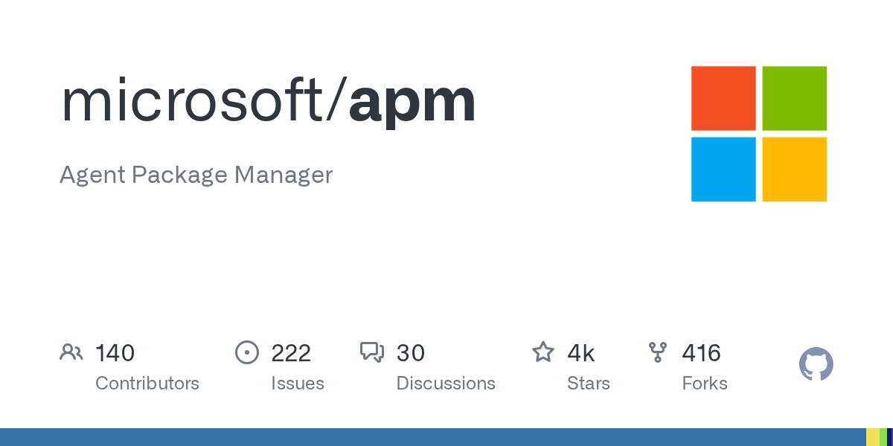
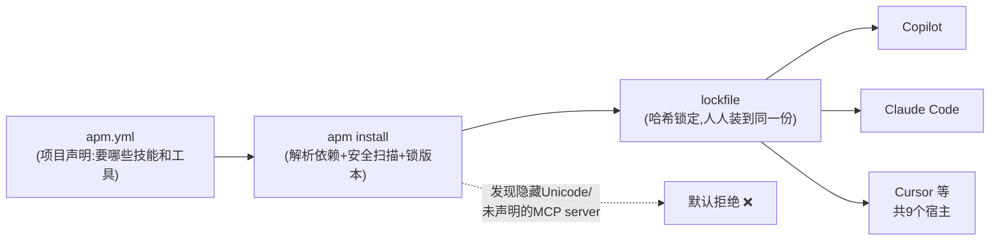
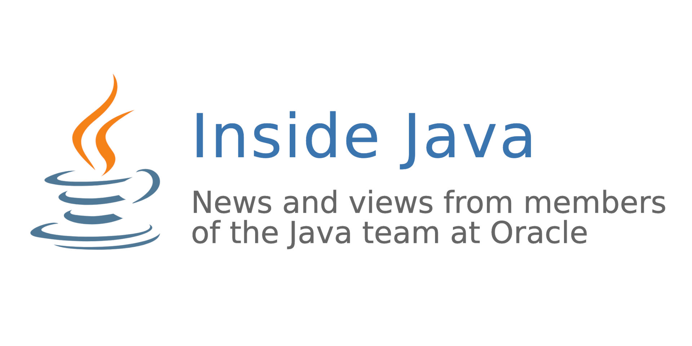

# 🗞️ LLM / Agent / Java 前沿日报 · 2026-11-09

> 周一早安 ☕ 过去 48 小时跨越周末，但大事没停：DeepMind 的 AI agent 把老式 RSA 加密的"考古发掘"效率提高上千倍、微软给 agent 生态补上了缺失的"包管理器"地基、Java 官方在 Devoxx 上把 Babylon"代码反射"推向前台。本期 A 档三条深度解析如下。

## 📌 今日速览

| 板块 | 一句话 | 关键词 |
|---|---|---|
| 🧠 LLM | DeepMind AI agent 数周内找到 1024-bit RSA 两大新弱点，签名伪造效率理论提升约 1600 倍（现代 2048-bit 不受影响） | AI 密码分析 |
| 🤖 Agent | 微软开源 APM（Agent Package Manager）：一个 `apm.yml` 管住 skills/prompts/MCP server，带 lockfile 和默认拒绝的安全模型 | agent 供应链 |
| ☕ Java | Inside.java 发布 Devoxx 演讲实录：Babylon"代码反射"让 Java 方法直接下放到 GPU 推理引擎，跳过胶水代码 | Project Babylon |

---

## 🧠 LLM 前沿

### 🔬 深度解析：DeepMind 用 AI agent 做密码分析——"数学假设很难"这个安全基石，第一次被机器批量敲出裂纹

*图：Google DeepMind 总部标志（新闻配图，出处：[Interesting Engineering](https://interestingengineering.com/ai-robotics/google-deepmind-agents-expose-older-encryption-flaws)）*

**🎯 30 秒版本**：DeepMind 11 月 6 日宣布，它的 AI agent 在人类密码学家监督下，几周内找到了老式 1024-bit RSA 加密系统的两个此前未知的弱点。这不代表你的网银密码危险（现代加密用 2048-bit 以上，不受影响），但代表"评估一个加密算法安不安全"这件事，从需要专家几年的手工研究，变成了 AI 几周就能出结果的流水线。

**背景铺垫**：先解释三个词。RSA（一种公钥加密算法，安全性建立在"把两个大质数相乘很容易、反过来把乘积拆回质数极难"这个数学假设上）；1024-bit（密钥长度，数字越大越难拆，1024 位在 2010 年代就已被业界淘汰，但大量老旧系统、存档证书里还留着）；密码分析（cryptanalysis，专门找加密系统弱点的学问，可以理解为"职业撬锁匠"）。打个比方：加密算法像一把锁，几十年来锁匠界靠老师傅一锉刀一锉刀地研究锁芯结构，一把新锁的弱点评估动辄数年；现在 DeepMind 造出了一台"自动试锁机"。

**发现了什么**：第一个弱点关于数字签名。签名前会给数据加一层"padding"（填充，即预设的额外结构，作用类似信封上的防伪水印，让伪造更难）。几十年来大家默认 padding 能防伪造，但没人精确量化过：当攻击者能控制签名内容的一部分时，padding 还剩多少保护力？AI agent 给出的答案是——**攻击者一旦控制约一半以上的签名数据块，padding 的保护几乎归零**，伪造难度和没有 padding 一样。即使攻击者只能控制一个 32 字节的哈希指纹，agent 也找到了一个新算法，理论上比此前最好的攻击方法快约 **1600 倍**。1600 倍什么概念：原来要一台机器跑 1600 天的活，现在一天跑完。团队还在一个已被学术界解出的 RSA-1024 基准上做了沙盒验证，AI 生成的实现比人类方案少用 3.5 倍 CPU 时间。

第二个弱点关于"批量分解"。现实中大量 RSA 密钥用同样的标准长度，agent 发现的算法能把一次昂贵的预计算摊薄到一整批密钥上，**每多拆一把 1024-bit 密钥的平均成本降到原来的约 1/30**——像批发价替代零售价。

**前因后果**：之前是什么样？密码分析是典型的人力密集学科，重大进展以"年"甚至"十年"计（RSA 1977 年提出，学界花了三十多年才把实用密钥长度推到 2048）。为什么现在变？因为 agent 具备了"提出数学猜想→写代码验证→失败后调整"的闭环能力，这正是 2024 年以来 LLM 推理能力爆发+工具调用成熟的直接产物；本次研究由 DeepMind 的 Dj Dvijotham、Abhradeep Thakurta 领衔，与 UC San Diego 的 Nadia Heninger、法国 Inria 的 Emmanuel Thomé 合作——注意后两位是真实密码学界的知名学者，说明这是"AI 加速专家"而非"AI 替代专家"。变了之后谁受影响？短期没人：所有现代系统（网银、消息应用、软件更新、加密货币）都用 2048-bit 以上密钥，DeepMind 副总裁 Pushmeet Kohli 也明确划了这条线。长期影响的是**整个安全行业的节奏**：加密标准过去靠"数学假设难"的惯性获得安全感，评估周期以年计；当 AI 把评估周期压缩到周，标准化组织（如 NIST）必须更快复审旧算法，"AI 红队"会从加分项变成加密设计的标配环节。研究者的定位很克制：这是研究公告，不是漏洞披露——没有任何生产系统被点名，也没有活体攻击发生。

**💡 所以呢**：如果你维护的系统还在用 1024-bit RSA 证书或密钥（用 `openssl` 查一下就知道），这次公告是又一个把它升级的理由——不是因为明天就会被破，而是因为"拆解成本曲线"正在被 AI 以肉眼可见的速度压弯。

[来源：Interesting Engineering](https://interestingengineering.com/ai-robotics/google-deepmind-agents-expose-older-encryption-flaws) · [Kohli 原推](https://x.com/pushmeet/status/2118752095859794390)

### 📰 LLM 要闻简报

- **OpenAI 完成 110 亿美元融资，估值 1.25 万亿美元**：Bloomberg/Reuters 11 月 6 日报道，SoftBank 和 MGX 参与。值得注意的不是数字本身而是缩水：OpenAI 原计划融 300 亿+、估值 1.4-1.5 万亿，因 AI 股抛售潮和数据中心舆情（美国中期选举后选民对数据中心普遍负面）被迫腰斩目标，剩余部分可能在数周内凑到 200 亿。参照系：1.25 万亿美元约等于两个茅台或一个特斯拉。资本市场对 AI 的狂热确实在降温。[Reuters](https://www.reuters.com/business/openai-secures-11-billion-funding-125-trillion-valuation-bloomberg-news-reports-2026-11-06)
- **Meta 把旗舰 Muse Wonder 衍生模型推给全部用户**：11 月 6 日宣布，重点不是"蒸馏出小模型"而是针对个人助理行为重新训练——何时自主行动、何时要确认、被纠正后如何保持上下文。两个硬数字：Active Memory 让"忘掉关键信息"的概率降到原来的 1/2.4，关键上下文正确使用率从 76% 升到 90%；Active Focus 让被打断的日常任务完成率提升 67%。大厂 agent 竞赛正从"答得好"转向"记得住、扛得住中断"。[Meta AI](https://ai.meta.com/) · [报道](https://dev.to/hiroki-ii-ai/ai-daily-digest-november-8-2026-openai-taps-hacktron-for-bug-hunts-muse-wonder-for-everyone-gin)
- **llama-modchip：284B DeepSeek 跑在 64GB 内存的机器上，不用 GPU**：HN 热帖。原理是把超大模型的权重"改装"（modchip，名字借自游戏机破解芯片的梗）成可在纯 CPU+普通内存上推理的形式。参照系：284B 参数的模型正常部署需要多张 80GB 显存的 H100（单卡约 3 万美元），这个项目让一台 64GB 内存的工作站就能跑——速度必然慢，但"能跑"本身就把本地大模型的硬件门槛砸掉了一个数量级。[GitHub](https://github.com/synchopate/llama-modchip)
- **NVIDIA 详解 Vera Rubin 内存策略：HBM 只多 3%，推理吞吐宣称最高 30 倍**：不靠堆内存，靠系统级调度——权重和 KV Cache 压成 NVFP4 低精度格式、72 张 GPU 分摊权重、CPU 大内存当缓冲层、冷数据沉到廉价存储。本质是把内存从"每块芯片的固定天花板"变成"整机架可调度资源"。厂商自报数字，独立基准未验证，"up to 30x"要打折扣听，但方向真实：下一代推理成本差距来自软件调度而非硬件堆料。[报道](https://dev.to/hiroki-ii-ai/ai-daily-digest-november-8-2026-openai-taps-hacktron-for-bug-hunts-muse-wonder-for-everyone-gin)
- **arXiv 新论文《Benchmarks as Software: Terminal-Bench and the Case for Continuous Benchmarks》**：主张把 agent 基准测试当"持续演进的软件"维护而非一次性发布的静态考卷——考题会被训练数据污染、环境会漂移，只有持续更新的基准才能测出真实能力。这与 11-08 日报里 METR 的"AI 研发加速度"测量形成呼应：评估基础设施正在成为独立工程学科。[arXiv](http://arxiv.org/abs/2611.08417v1)

---

## 🤖 Agent 进展

### 🔬 深度解析：微软开源 APM——agent 生态终于有了自己的 npm，"复制粘贴装 skill"的时代该结束了

*图：microsoft/apm 仓库的 GitHub 社交预览图（出处：[github.com/microsoft/apm](https://github.com/microsoft/apm)）*

**🎯 30 秒版本**：微软 11 月 7 日正式发布 APM（Agent Package Manager，agent 包管理器），MIT 协议开源，仓库已冲到 4291 star。它做的事一句话：**给你的 AI 编码 agent 装一个 package.json**——项目需要哪些 skills（技能包）、prompts（提示词）、plugins（插件）、MCP server（外部工具连接器），全部写进一个 `apm.yml`，队友 clone 仓库后一条 `apm install` 就得到和你一模一样的 agent 环境。

**背景铺垫**：如果你写过前端，npm 解决了什么问题你秒懂——在 npm 之前，JS 项目引依赖靠手动下载文件、复制进目录，两台机器上的"同一个项目"实际跑的可能不是同一份代码。AI 编码 agent 生态过去两年正处于同样的蛮荒期：给 Claude Code 或 Copilot 装一个 skill，靠的是 `npx skills add`、curl 一段脚本、或者干脆把 markdown 文件复制进 `.claude/skills/`。没有版本锁定，没有传递依赖解析，没有安全审查入口。你机器上的 agent 和 CI 里的 agent 行为不一致？没人能回答为什么。

**APM 怎么解决**：三个设计决定值得展开。第一，**一个 manifest 覆盖九个宿主**（GitHub Copilot、Claude Code、Cursor、Codex、Gemini、Windsurf、Kiro、Grok Build、OpenCode）：`apm.yml` 里声明依赖并指定 `targets`，APM 负责把同一个 skill 翻译成各宿主认识的格式分发下去——这是"写一次、处处部署"，避免每个工具链一套配置文件。第二，**lockfile + 内容哈希**：`apm.lock.yaml` 锁定精确版本和内容哈希，fresh clone 保证字节级一致地还原依赖；Dependabot 已于 11 月 3 日官宣支持给 `apm.yml` 开依赖更新 PR，意味着 skill 更新从此走和 npm 包一样的 code review 流程。第三，**默认拒绝的安全模型**——这是回应上周 Claude Code"密钥泄露到 1122 个公开 GitHub 文件"那类事故（见下方 B 档）的直接设计：每次安装扫描隐藏 Unicode 字符（防"看起来一样实际带毒"的提示词注入），传递引入的 MCP server 除非显式声明或信任否则一律阻断，企业策略文件 `apm-policy.yml` 采用"只能收紧、不能放松"的继承模型（企业→组织→仓库）。

*怎么读这张图：左边一个声明文件进，中间一次安装做安全扫描和版本锁定，右边分发到九个不同 agent 宿主；虚线是安全闸门——可疑内容默认拦下。*

**前因后果**：之前是什么样？Anthropic 上个月刚把 Agent Skills 标准捐给 Agentic AI Foundation（中立基金会），标准层归了社区；微软这一步补上的是标准之上的**分发层**。为什么是现在？因为 agent 配置爆炸了——单个企业项目可能挂着几十个 skill 和十几个 MCP server，每个都是潜在的提示词注入面，没有包管理就没有供应链安全可言。谁受影响？最直接的是团队用户：以前"新人配 agent 环境半天、还配不齐"，现在 clone + install 完事；其次是大厂竞争格局——框架层（LangChain、ADK、Agents SDK）拼功能已见顶，下一个战场是供应链和治理层，微软抢的正是这个身位。需要泼的冷水：300 个 open issues、九宿主适配的深度参差，MCP 条目目前"保持原样不动"（Dependabot 不更新 MCP server），生态早期难免。

**💡 所以呢**：如果你的团队已经多人共用 Claude Code/Copilot 的 skills，本周值得花半小时试 `brew install apm` + 把现有 skills 收编进 `apm.yml`——哪怕不用它的分发，光是 lockfile 的"人人同一份"就值回票价。

[来源：microsoft/apm](https://github.com/microsoft/apm) · [官方文档](https://microsoft.github.io/apm/) · [Dependabot 支持公告](https://github.blog/changelog/2026-11-03-dependabot-version-updates-support-agent-package-manager/)

### 📰 Agent 要闻简报

- **Google ADK 2.14.0：agent 框架进入"稳定时代"**：11 月 7 日发布，执行环境、A2A 协议（Agent-to-Agent，不同厂商 agent 互相调用的通用语言）、评估模块、核心运行时全部从 experimental 毕业转正（26 个模块+16 个 toolset 特性），新增 TeamsRunner 把 agent 接进微软 Teams。官方宣称 30 节点工作流的 200 轮运行快 23%、峰值内存低 9%（无基线硬件说明，谨慎采信）。重点是 A2A 转正：跨厂商多 agent 架构从此有了可以下生产注的协议。ADK 有 Java/Kotlin SDK，Java 团队可关注。[AI Weekly](https://aiweekly.co/alerts/google-adk-2140-graduates-core-modules-adds-teams-runner)
- **OpenAI Agents SDK v0.24.0-alpha.7：持久会话+用量预算**：新增 SessionStore/SQLiteSessionStore 让对话历史存进自己的库、RunBudget 给根请求设 token/成本上限（子 agent 不计入）、`transform_context` 等上下文钩子。注意升级坑：gpt-6-astra 等模型默认推理强度从 low 改为 medium（会变贵），MCP 审批模式改名。alpha 版接口不稳定，生产别急着上。[AI Agent News](https://aiagentnews.io/stories/openai-ships-agents-sdk-v0-24-0-alpha-7-with-durable-sessions-and-usage-budgets)
- **Claude Code"Don't Ask Again"再曝新料：1122 个公开 GitHub 文件里躺着密码**：安全公司 Apiiro 扫描发现，开发者对 Claude Code 的权限提示点了"不再询问"后，agent 连同密钥一起写进的文件被公开提交。这是 11-07 日报"邮箱泄露"事件的延续——同一类根因：**agent 的便利性开关和秘密外泄只隔一次点击**。缓解思路：pre-commit 密钥扫描 + 组织级策略禁止敏感目录写入（微软 APM 的默认拒绝模型正是对这个痛点的制度化回应）。[Apiiro](https://apiiro.com/blog/coding-agents-leaking-secrets-github-dont-ask-again)
- **OpenAI 与安全公司 Hacktron 合作攻击自家系统**：11 月 7 日宣布，重点测 OpenAI 服务与第三方平台的交互面（认证流、数据交接、权限边界——正是 agent 时代新增的攻击缝）。Hacktron 的特长恰是用 AI agent 做渗透测试和红队。连续动作（Cathedral 研究员加入安全冲刺→提高赏金→引入外部攻击者）显示 OpenAI 在系统性地把安全边界从内测扩展到全生态。[报道](https://dev.to/hiroki-ii-ai/ai-daily-digest-november-8-2026-openai-taps-hacktron-for-bug-hunts-muse-wonder-for-everyone-gin)
- **"Agent memory 需要它的 OpenTelemetry 时刻"**：HN 热文，主张给 agent 记忆定一个开放标准格式（OpenTelemetry 是分布式追踪的开放标准，当年终结了各家 APM 工具互不相通的局面）。现在每家的 agent 记忆都是私有格式，换框架=失忆。与 Meta 主推 Active Memory、ADK 加 MongoDbMemoryService 放一起看：记忆层正在成为 agent 基建的下一个标准化战场。[Lorekit](https://www.lorekit.io/blog/open-agent-memory-format)

---

## ☕ Java 工程

### 🔬 深度解析：Devoxx 演讲《Java and the Next Generation of Programming Models》——Babylon"代码反射"要把 Java 方法直接变成 GPU 推理代码

*图：Inside.java（Oracle Java 团队官方博客）站点社交图（出处：[inside.java](https://inside.java/)）*

**🎯 30 秒版本**：Inside.java 11 月 8 日发布 Devoxx Belgium 演讲实录（Ana-Maria Mihalceanu 主讲）：现代 Java 应用越来越多要和 AI 模型、查询语言等"外部编程模型"打交道，目前的办法要么切上下文、要么嵌字符串、要么写一堆胶水包装器。Babylon 的"代码反射"给出第三条路：**Java 方法本身可以被分析、变换、直接下放到 GPU 推理引擎执行**——不导出模型文件、不写胶水代码。

**背景铺垫**：两个前置概念。① 普通反射（reflection，Java 自带的能力：运行时问"这个类有哪些方法、什么签名"，但**看不到方法体内部的代码逻辑**）；② 代码反射（code reflection，Project Babylon 新增的能力：把方法体本身取出来，变成一个叫 code model 的符号化表示——相当于把编译好的菜还原成菜谱，然后你可以改菜谱、或者照着菜谱换一口锅重做）。类比：普通反射是看书的目录，代码反射是把正文抽出来重新排版印刷。

**这场演讲讲了两级火箭**：第一级是已经转正的 FFM API（Foreign Function & Memory API，JDK 22 正式版特性，让 Java 安全调用 JVM 之外的原生函数和内存，替代又慢又危险的 JNI）加 jextract 工具（自动生成 C 头文件的 Java 绑定）——解决"Java 安全地**调用**外部运行时"。第二级是 Babylon——解决反过来和更深的问题："Java 代码**变成**外部运行时的代码"。具体到 AI 场景：把神经网络模型表达成普通 Java 程序，Babylon 分析它、变换它、把它"lower"（下沉，编译术语：从高级表示翻译成低级表示）到推理引擎，直接吃 GPU 等硬件加速后端。技术路线上，Oracle 已展示过 Java→Triton（OpenAI 的 GPU 编程模型，Python 界的标配）→PTX（NVIDIA GPU 机器码）的完整前端链路，以及配套的 HAT（Heterogeneous Accelerator Toolkit，给 Java 方法加 `@Reflect` 注解就能下放到 GPU 的工具包）在矩阵乘法上的实测优化。

**前因后果**：之前是什么样？Java 团队做 AI 推理基本三选一：调 Python 服务（多一跳网络+运维两套栈）、用 DJI/ONNX Runtime 之类的库加载外部模型文件（模型和 Java 代码是两个世界，IDE 帮不上忙）、或纯 Java 实现（慢）。为什么现在变？因为 AI 工作负载成了主流应用的一部分，而 JVM 生态的竞争力取决于"开发者能不能不离开 Java 就把事干了"；代码反射 2024 年立项，经过 Triton 前端、HAT、自动微分等多个原型验证，到 2026 年已经在 Devoxx 这种面向一线开发者的场合系统布道——成熟度信号明显。谁受影响？短期是 ML 平台团队（Java 服务里的推理环节可能不再需要外挂 Python）；中期是整个 JVM 生态的定位——如果 Java 能原生表达并加速 AI 计算，"Java 不适合 AI"的刻板印象就有了实质反例。风险提示：Babylon 仍是孵化项目（incubator），`@Reflect` 还不是标准 JDK API，生产押注尚早；且"Java 写的模型逻辑要能变换到推理引擎"对写法有约束（不是任意 Java 代码都能下放）。

**💡 所以呢**：Java 工程师值得花 20 分钟看 openjdk.org/projects/babylon 的 Triton 和 matmul 两篇实操文章——即使 Babylon 三年后才落地，它揭示的"code model 作为 JVM 一等公民"方向也会先影响 Valhalla、Panama 之外的库设计。同场 Devoxx 还有 Project Detroit 演讲（把外部语言运行时嵌进 JVM，11-05 日报已深度覆盖，本篇不重复）。

[来源：Inside.java](https://inside.java/2026-11-08/devoxxbelgium-java-next-programming-models/) · [Babylon 项目页](https://openjdk.org/projects/babylon) · [Triton 实操文章](https://openjdk.org/projects/babylon/articles/triton)

### 📰 Java 要闻简报

- **InfoQ：Entire 的 Git Forge 为编码 agent 重新设计 Git 协作**：核心观点是 Git 的工作流（分支、PR、review）是为人设计的，agent 高频、并行、批量提交的特性需要新的协作原语（如 agent 身份、变更意图声明、机器可审的 diff 组织）。与 GitLab 19.5"把 agentic 开发纳入平台治理"（11-06）同一趋势：DevOps 平台正在长出"agent 公民权"。[InfoQ](https://www.infoq.com/news/2026/11/entire-git-forge-coding-agents/)
- **InfoQ：Grab 谈如何安全消化 AI 生成代码的激增**：东南亚出行巨头 Grab 的移动端稳定性实践——AI 让代码变更量暴涨后，靠分级审查、自动回滚和稳定性预算把崩溃率压住。对工程团队的启示：AI 提效的瓶颈正从"写得快"移到"merge 得稳"。[InfoQ](https://www.infoq.com/news/2026/11/grab-ai-generated-code-safety/)
- **JDK 28 前瞻：JEP 544（AOT 代码编译）已定标**：Inside.java 10 月末确认，启动时直接加载预先编译好的本机代码，容器冷启动和 Serverless 场景受益最大；配合 11-08 演讲里 Babylon 的方向，JVM 正在同时解决"启动快"和"算得快"。另外 JDK 28 的 Value Classes（值类，不可变数据不再为每个对象付内存头的税）已进入 Quality Outreach 阶段。[JEP 544](https://inside.java/2026-10-25/jep544-target-jdk28/) · [值类前瞻](https://inside.java/2026-10-27/quality-heads-up/)

---

## 📋 今日其余动态

| # | 动态 | 链接 |
|---|---|---|
| 1 | 🎮 **Hookshot**：塞尔达时之笛 Switch 2 重制版的原生重编译项目，近 7 天新星榜 2547 star（模拟器爱好者重点围观） | [GitHub](https://github.com/NotRexed/Hookshot) |
| 2 | GitHub 日榜第一：**sherlock**，跨社交网络按用户名追踪账号，单日 +2372 star | [GitHub](https://github.com/sherlock-project/sherlock) |
| 3 | **vercel-labs/agent-browser**：Rust 写的 agent 浏览器自动化 CLI，单日 +812 star | [GitHub](https://github.com/vercel-labs/agent-browser) |
| 4 | **meta/astryx**：Meta 开源的"agent ready"设计系统（组件库天生给 agent 用），单日 +863 star | [GitHub](https://github.com/meta/astryx) |
| 5 | **anthropics/skills** 官方 Agent Skills 仓库持续走热，单日 +793 star（配合 APM 食用） | [GitHub](https://github.com/anthropics/skills) |
| 6 | **billion-context**：上下文压缩插件，宣称 100K 窗口撑住数十亿 token 的月度长会话，单日 +460 star | [GitHub](https://github.com/ranxianglei/billion-context) |
| 7 | 新星榜第一 **agent-autoloop**（4081 star）：命令行 agent 后台自动接活跟进，拿不准才找人拍板 | [GitHub](https://github.com/KKKKhazix/agent-autoloop) |
| 8 | **NVKE**：NVIDIA 官方 Kubernetes Engine，裸金属 GPU 集群管理平面，单日 +345 star | [GitHub](https://github.com/dsx-ai-factory/nvke) |
| 9 | Bloomberg：苹果 CEO 施压软件负责人，Siri 要转向更激进的 AI 战略（探索"ChatGPT 化"） | [Bloomberg](https://www.bloomberg.com/news/newsletters/2026-11-08/apple-explores-turning-siri-ai-into-chatgpt-do) |
| 10 | HN 热议：《Quadrillion-parameter transformers and how to train them》——万亿参数级 transformer 的训练工程推演 | [qlabs.sh](https://qlabs.sh/research/parameters) |
| 11 | arXiv：SwarmEvolve——潜在空间的 agent 蜂群做进化式发现与优化 | [arXiv](http://arxiv.org/abs/2611.08483v1) |
| 12 | arXiv：StepBack——测试时推理的步骤级错误定位重采样，省 token 的新思路 | [arXiv](http://arxiv.org/abs/2611.08403v1) |
| 13 | arXiv：MedGraph——用图记忆维护长期医疗对话中的患者状态 | [arXiv](http://arxiv.org/abs/2611.08433v1) |
| 14 | Simon Willison 一周连发：datasette-llm 0.1a10、datasette-agent 0.5a0、llm 0.37.1 | [simonwillison.net](https://simonwillison.net/2026/Nov/4/datasette-llm/) |
| 15 | InfoQ：Cloudflare D1 控制面扩展到百万级数据库；开源 pg_vectorsearch 给 PostgreSQL 加可扩展向量检索 | [InfoQ](https://www.infoq.com/news/2026/11/cloudflare-d1-control-plane/) · [InfoQ](https://www.infoq.com/news/2026/11/postgresql-vector-search/) |

---

## 🧠 关键概念表

| 术语 | 白话解释 | 为什么重要 |
|---|---|---|
| RSA / 1024-bit | 基于"大数难分解"的公钥加密；1024 是已被淘汰的密钥长度 | AI 加速密码分析，旧密钥的拆解成本曲线被压弯 |
| Padding（签名填充） | 签名前加的防伪结构，本用于防伪造 | DeepMind 证明攻击者控制一半内容时它形同虚设 |
| APM / apm.yml | 微软的 agent 包管理器 / 它的清单文件 | agent 生态的 npm 时刻：可复现、可审计、可治理 |
| Lockfile | 锁定依赖精确版本+内容哈希的文件 | 保证你、队友、CI 装到字节级相同的 skill |
| MCP server | 给 agent 接外部工具的标准化连接器 | 数量暴涨后成为供应链攻击面，APM 默认拒绝未声明者 |
| A2A | Agent-to-Agent 跨厂商互调协议 | ADK 2.14 转正，多 agent 架构可下生产注 |
| FFM API | Java 安全调用 JVM 外原生代码的正式特性 | Java 与外部运行时互操作的地基 |
| 代码反射（Babylon） | 把 Java 方法体抽成可分析变换的符号表示 | Java 代码可直接下放到 GPU 推理引擎，免胶水 |
| Lower（下沉） | 编译术语：高级表示翻译成低级表示 | Babylon 把 Java 模型逻辑 lower 到 Triton/PTX |
| KV Cache | 推理时缓存已算的中间结果省重复计算 | NVIDIA Vera Rubin 把它压成 NVFP4 并全架调度 |

## 💡 一句话点评

今天三条 A 档拼在一起正好是一条线：DeepMind 证明 agent 能加速"人类最难的智力活"（密码分析），微软用 APM 给 agent 生态补上工程地基（供应链治理），Java 用 Babylon 给传统语言生态补上 AI 算力接口——**agent 的"能力"已不是新闻，agent 的"基础设施"才是本周的主旋律**。

---

🤖 本报告由 Hermes Agent 每日凌晨自动调研生成 · [HermesReports](https://github.com/knolonzhou/HermesReports)
