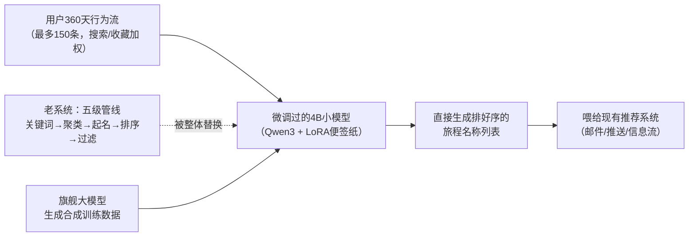
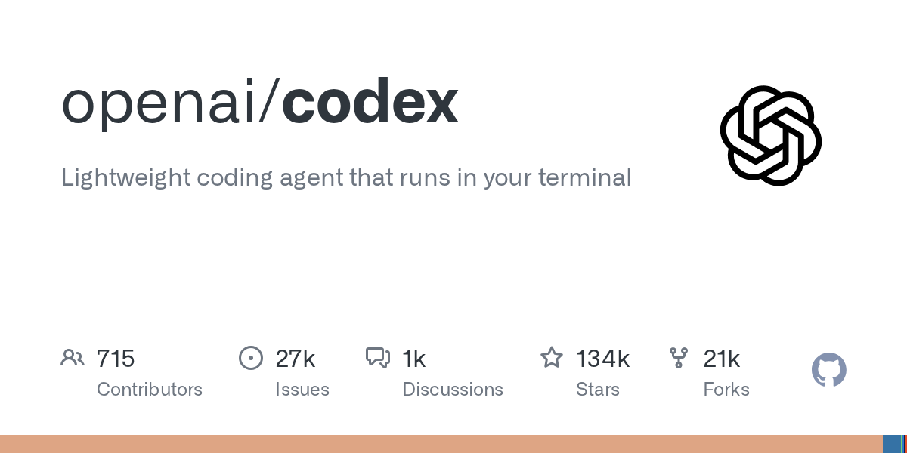
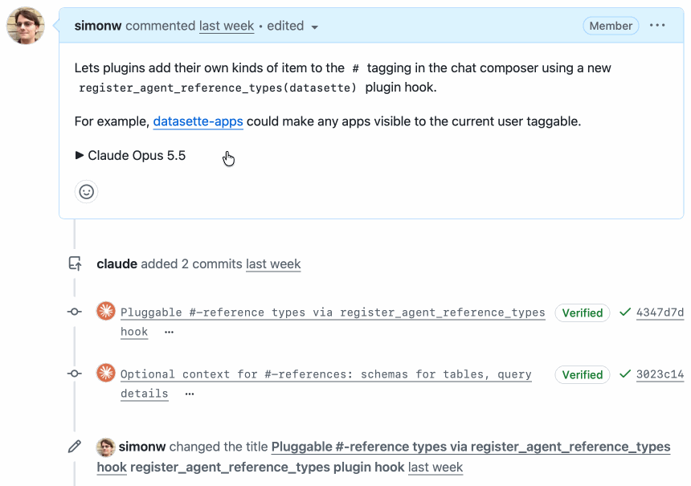
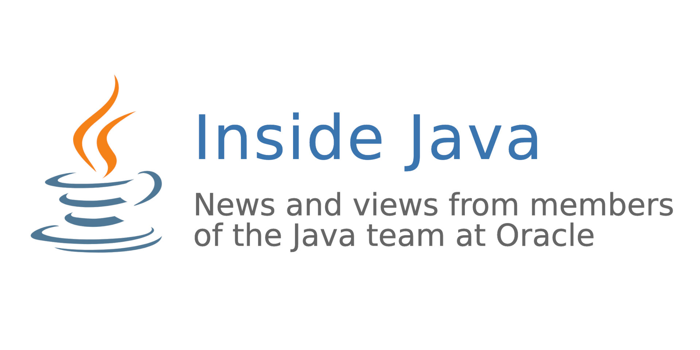

# 🗞️ LLM / Agent / Java 前沿日报 · 2026-11-10

> 本期原始候选 220+ 条（GitHub Trending 11 · HN 前页 30 · arXiv cs.CL 146 · Spring/Inside.java/InfoQ/Simon Willison RSS 36 · 搜索补充若干），精选 A 档 3 / B 档 10 / C 档 14。

## 📌 今日速览

| 板块 | 一句话头条 |
|---|---|
| 🧠 LLM | Pinterest 把五级聚类推荐管线整个换成 4B 参数的 Qwen3 小模型，邮件点击率 +1.1%——"大厂用大模型"的时代正在让位给"大厂用小模型干脏活" |
| 🤖 Agent | HN 热帖实锤：ChatGPT Desktop 会把你本地的 SSH agent（SSH 钥匙串）转发到远程机器上，云端 agent 能直接以你的身份 push 私有仓库 |
| ☕ Java | Inside.java 新作：用一个 `int` 装下股票代号，Valhalla 值类（JDK 28 预览）第一次有了接地气的实战样例；Spring AI 2.1.0-RC2 新增 DecisionModel API |

---

## 🧠 LLM 前沿

### 🔬 深度解析：Pinterest 用 4B 小模型替换五级聚类管线——LLM 落地推荐系统的教科书级案例

**🎯 30 秒版本**：Pinterest（美国版"小红书"，靠图片收藏驱动的推荐平台）11 月 9 日经 InfoQ 披露：它把用户"旅程推断"系统从一套五级机器学习管线，整个换成一个只有 40 亿参数（4B）的微调 Qwen3 模型，邮件点击率提升 1.1%、推送打开率提升 1.3%。这不是"接了个 GPT API"，而是自己微调开源小模型、自己搭推理集群的完整工程实践。

**背景铺垫**：先解释几个词。"用户旅程"（journey）指用户跨会话的长期目标——比如你搜了橱柜、存了台面图、又看了背砖，系统应该看出"这人在装修厨房"，而不是把你当成三个独立兴趣。Qwen3 是阿里开源的模型系列（开源=权重公开，任何人都能下载自己改）；4B 指 40 亿参数，参照系：GPT-6 级别的旗舰模型通常是它的几百倍大，4B 属于"能在单张消费级显卡上跑"的小个子。LoRA（低秩适配，一种微调技术）好比不改整本教科书、只夹几张便签纸，用极少的可训练参数让通用模型学会特定任务。

**之前是什么样**：老系统是五级流水线——从用户行为提取关键词 → 用 embedding（把文本变成向量的表示方法）做层次聚类 → 给聚类起名 → 再用额外模型排序 → 加多样性启发式过滤。每一级都是独立维护的模型，误差逐级传递，而且聚类天然会把相关行为"切碎了分到不同桶"（装修厨房被拆成三个兴趣）、给出泛泛的标签、把一次性误点当成持续意图。

**现在怎么做的（这段最值得抄作业）**：把旅程推断重新定义成一个"生成任务"——微调后的 LLM 直接阅读用户 360 天内最多 150 条按时间排序的行为记录，加上精简画像，一次性生成排好序的旅程名称列表。老系统里那些排序模型、过滤规则的行为，全部搬进了 prompt（提示词）：明确指示"搜索和收藏的权重高于随手点击""不许把无关兴趣合并""证据不足就返回空"。注意 Pinterest 的态度：**改 prompt 按生产发布流程管理**，不是随手编辑——这是 prompt 工程走向正规化的标志。训练数据没有人工标注，而是用旗舰大模型基于真实用户行为生成合成样本，再用这些样本微调 Qwen3（试了 0.6B 到 8B 全系列，最后选 4B，因为推理质量和服务吞吐的平衡点在这）。部署侧：NVIDIA Dynamo 调度器 + vLLM 推理引擎 + L40S GPU，用连续批处理、PagedAttention、前缀缓存感知路由压榨吞吐；而最大的吞吐优化是"能不推理就不推理"——几天内算过旅程的用户直接跳过。

*图：Pinterest 新架构示意（据 InfoQ 报道绘制）。怎么读：左边老的五级管线被中间的单个小模型取代，而训练数据本身由更大的旗舰模型"代笔"生成。*

**为什么重要、谁受影响**：1.1% 和 1.3% 听着小，但在成熟推荐系统上，单个改动带来 0.3% 点击提升就算胜利——何况这是替换了一整套已经打过仗的系统，还附带删掉了四级管线的维护成本。对工程师的启示有三层：① "大模型蒸馏成小模型上线"路径已被验证可复制到推荐、风控、客服意图识别等所有"输出空间有限、需要理解长上下文"的场景；② 合成数据微调（用贵模型造教材、教便宜模型）解决了没有标注数据的死结；③ Netflix 也在做类似的基础模型推荐（见 InfoQ 文中对比），行业方向一致：**LLM 不是取代推荐系统，而是作为"理解层"嵌进去**。风险面：Pinterest 自己也承认 prompt 即业务逻辑，一次措辞改动等于一次线上发布，这类系统的回归测试怎么建，全行业都还没有标准答案。

**💡 所以呢**：如果你的业务里有"用规则+小模型拼出来的意图/分类管线"，现在值得评估用 4B 级开源模型（Qwen3、Llama 系）+ LoRA + 合成数据的替换方案——单卡 L40S/4090 级别的推理成本，换来的却是大模型级别的上下文理解。

[来源：InfoQ](https://www.infoq.com/news/2026/11/pinterest-journey/) · [Pinterest 工程博客原文](https://medium.com/pinterest-engineering/from-activity-to-intent-generating-user-journeys-with-llms-9652b9417626)

### 📰 LLM 要闻简报

- **Anthropic IPO 今天可能正式启动路演，估值目标从 2 万亿缩水到 1.1–1.3 万亿美元**：Bloomberg/WSJ 11 月 9 日报道，15 天等待期已满，营销最早 11 月 10 日（今天）开始，目标感恩节前挂牌，募资规模对标甚至超过 SpaceX 纪录（750 亿美元）。关键数字来自修订版 S-1：Q3 营收 169.6 亿美元（环比 +47%，但 Q2 是 +144%，增速明显放缓）；10 月底年化收入跑通率突破 800 亿；年付 10 万美元以上客户 11,900+（一年前才 950+）；算力承诺总额 8954 亿美元（比全年营收高两个数量级——这是 AI 公司"用未来的收入抵押今天的 GPU"模式的极致体现）。上周 AI 股抛售把 Nasdaq 100 砸了 14%，估值讨论从 $1.5–2T 降到 $1.1–1.3T。这将是"AI 泡沫是否存在"的一次全民公投。[Investing.com 汇总](https://www.investing.com/news/stock-market-news/anthropic-ipo-targets-november-debut-as-valuation-expectations-fall-93CH-5012800)
- **斯坦福团队提出 Next-Concept Modeling（NCM）：比扩散语言模型快 21–31 倍**：HN 热帖。自回归模型（GPT 式，一个词一个词往外蹦）慢，扩散语言模型（DLM，整段文本从噪声里逐步"显影"）可并行但质量随步数骤降。NCM 走"由粗到细"路线：先用多尺度 VQ-VAE 把文本压成多层离散编码（类比：先画草图再描线再上色），transformer 每次并行生成一整层。同参数量下 LM1B 上生成质量超过最强 DLM 基线且快 21 倍，摘要任务快 31 倍，数独推理任务全面胜出。Christopher Ré（FlashAttention 团队核心人物）挂名，值得关注。[arXiv](https://arxiv.org/abs/2610.14162) · [HN 讨论](https://news.ycombinator.com/item?id=50422168)
- **Google 发布 Gemini 4 Argon 机器人技术报告：物理推理专用旗舰**：InfoQ 11 月 9 日深度报道。Argon 不是机械臂策略模型，而是"通用物理推理"模型：在 ERQA 具身推理基准上纯推理（不用工具）拿 87%，号称超过所有前沿模型；能从一张 RGB 照片合成域随机化的 MuJoCo 仿真场景去微调 VLA 策略，真实机器人成功率从 56% 提到 75%；已指挥 Boston Dynamics Spot 完成"踩踏板扔易拉罐"任务（先在仿真孪生里练习）。InfoQ 泼的冷水很专业：演示用了长任务 prompt、坐标网格、验证器等大量脚手架，"被测系统"其实是模型+脚手架整体。API 定价促销期 $2/$10 每百万 token（11 月 30 日后翻倍到 $4/$20）。[InfoQ](https://www.infoq.com/news/2026/11/google-gemini-argon/) · [Google 官方博客](https://developers.googleblog.com/gemini-4-argon-for-robotics)
- **AWS 推出 TorchNeuron：PyTorch 模型零修改跑上自研 Trainium 芯片**：11 月 9 日 InfoQ 报道。此前在 Trainium（AWS 自研 AI 训练芯片，对标 NVIDIA）上跑 PyTorch 需要适配工作，TorchNeuron 把这层抹平。云厂商"抢 NVIDIA 蛋糕"的三板斧（自研芯片→编译器兼容→零迁移成本）又补上一块。[InfoQ](https://www.infoq.com/news/2026/11/aws-torchneuron-trainium-pytorch/)
- **同一张 H100，不同平台租金差 4.6 倍（$2.69 vs $12.29/小时）**：HN 热帖，data-receipts 项目整理了 GPU 租赁市场价差。参照系：跑一个月满负载，差价约 7000 美元——比很多创业公司全月云账单还高。GPU 市场定价极度不透明，agent 时代推理成本核算会越来越重要。[GitHub](https://github.com/datareceipts/data-receipts/tree/main/109-gpu-pricing) · [HN](https://news.ycombinator.com/item?id=50427085)

---

## 🤖 Agent 进展

### 🔬 深度解析：ChatGPT Desktop 把你的 SSH 钥匙串转发给远程机器——HN 吵翻了，但这次 OpenAI 可能是对的

*图：openai/codex 仓库的 GitHub 社交预览图（出处：[github.com/openai/codex](https://github.com/openai/codex)）*

**🎯 30 秒版本**：HN 前页热帖（139 分）：ChatGPT Desktop / Codex 会把本地 SSH agent 转发到远程机器上，让云端 agent 能用你的 SSH 身份执行操作——比如直接 push 你的私有 GitHub 仓库。帖主贴出了 openai/codex 仓库 PR #28131 作为证据。评论区爆发了一场高质量的"便利 vs 安全"大辩论。

**背景铺垫**：SSH agent（SSH 钥匙串管家）是操作系统里的一个小服务，替你保管已解锁的 SSH 私钥；任何本地程序连它，都能"以你的身份"免密登录服务器或 push 代码。Agent forwarding（agent 转发）是 SSH 的老功能：你从 A 机器跳到 B 机器时，B 机器也能临时借用 A 的钥匙串——设计初衷是给"可信的跳板"用的。现在的问题变成了：**当 B 机器上跑的不是你本人，而是一个 AI agent，这个"借用"还成立吗？**

**技术上到底发生了什么**：PR #28131（"Refresh SSH agent for app-server proxy"）揭示的机制是：Codex 的 app-server 长驻进程会保留启动它的那个 SSH 会话的 `SSH_AUTH_SOCK` 环境变量（指向钥匙串套接字的路径）；会话断开后路径失效，于是这个 PR 加了一个 opt-in 的 `--forward-ssh-agent` 模式，用稳定的符号链接让 detached 的 app-server 跨 SSH 重连持续跟随"当前活跃的转发 agent"。换句话说：OpenAI 不仅转发了，还在**工程化地解决"转发断了怎么续上"**——这是深思熟虑的产品决定，不是 bug。

**评论区两边的道理（都值得听）**：反对派（recsv-heredoc 等）："产品决定一次次以'减少摩擦'之名走向这个方向。在安全领域，摩擦是好事，你需要仪式感。"支持改进派（littlecranky67）给出具体解法：把 SSH 私钥放进 macOS Secure Enclave（安全隔区，芯片级保险箱）或 Yubikey 硬件钥匙，设置"每次使用都要按指纹/触摸"——这样 agent 每次想 push 代码，你都会被物理打断一次，等于给 AI 装了个人肉确认按钮；评论区多人推荐 Secretive（开源工具，把密钥托管进 Secure Enclave）。中间派（causal）指出硬件钥匙也防不住"agent 本来就被授权转发"的场景，真正该做的是**一事一钥**：给 agent 单独一把权限最小化的 key，和人的主 key 分开。还有工程师（jasonjayr）借此呼吁：账号系统应该普遍支持"权限受限的子账号"——你委派机器替你干活的时代，需要"给保姆一把只能开储物间的钥匙"，而不是把整串钥匙交出去。

**前因后果**：之前是什么样？云端编码 agent（Codex Cloud、Devin 类）要访问私有仓库，主流做法是让你上传一个 deploy key（部署密钥）或 OAuth 授权，权限范围明确。为什么现在变？因为 ChatGPT Desktop/Codex 走"本地桌面应用+远程执行"混合架构，agent 需要在你 SSH 到的任何机器上干活，转发 SSH agent 是阻力最小的方案。谁受影响？所有把 ChatGPT Desktop 连到工作机、又在 `~/.ssh/config` 里配了免密登录的人：你的 agent 理论上可以在你睡着时，以你的完整身份遍历你所有免密可达的服务器。**目前没有证据表明发生过滥用**，这是能力面扩大带来的风险，不是已发生的事故——但结合 11-09 日报里"1122 个公开文件躺着密钥"的 Apiiro 报告，agent 供应链安全的警钟已经连响三天了。

**💡 所以呢**：三条立刻可做的：① 检查 `~/.ssh/config`，给不需要免密的机器删掉 `ForwardAgent yes`；② 主 key 迁入 Secure Enclave/Yubikey 并开启触摸确认（Mac 用户装 Secretive 十分钟搞定）；③ 给 agent 单独生成一把只能访问特定仓库的细粒度 key。

[来源：HN 讨论](https://news.ycombinator.com/item?id=50422628) · [openai/codex PR #28131](https://github.com/openai/codex/pull/28131)

### 📰 Agent 要闻简报

- **arXiv：《从流程到权限——从 Agent Skills 学习精确的子 agent 授权》**：清华/华为系团队 11 月 6 日提交。问题很实际：主 agent 派活给子 agent 时，该给它开哪些工具和文件权限？现有系统要么全给要么人肉配。这篇提出从 skill 定义（技能包声明文件）里自动推断出每个子任务的最小权限集——和 11-09 日报里微软 APM 的"默认拒绝"MCP 安装模型是同一场运动的两翼：**agent 权限正在从"点同意"进化成"按任务算最小集"**。[arXiv](https://arxiv.org/abs/2611.08905)
- **arXiv：《AI Agent 到底需要多少对话历史？》**：在 1100 个 BEAM 问题上做控制实验：检索排序和阅读模型固定，只调"给模型看多少段历史"。结论：上下文越多分数越高，但边际收益递减（最后几档每多花一倍 token 只换来零点几分）；有趣的是"拒答准确性"在上下文变少时反而有时更高（信息少→更敢说不知道）。对做 agent 记忆系统的团队：省 token 的截断策略损失比想象中小，但"引用早前提议"类任务对保留用户消息敏感。[arXiv](https://arxiv.org/abs/2611.09662)
- **Simon Willison：把 agent 写的"作文式 PR 描述"折叠进 `
` 标签**：Simon 说他现在的 PR 大多由 Claude Code/Codex 代写，问题是 agent 写得太好太全——"准确、详尽，但读起来像 slop（AI 味浓的注水文字）"。他的解法：PR 开头一段人工精选的高层说明（可以带截图），agent 写的全文塞进 GitHub Markdown 支持的 `

` 折叠块，summary 直接写"Claude Opus 5.5 Medium"标明出处。这是"人负责判断、AI 负责劳动"分工在 code review 界面上的具象化，值得所有用 agent 的团队抄。[Simon Willison](https://simonwillison.net/2026/Nov/9/details-summary/)

*图：`

` 在 GitHub PR 里的实际渲染效果——一行摘要，点开才是全文（出处：[Simon Willison 博客](https://simonwillison.net/2026/Nov/9/details-summary/)）*

- **InfoQ 长文：Agentic AI 架构的当前挑战与未来机会**：11 月 9 日发布的架构综述，梳理多 agent 系统在编排、状态管理、评估、安全四个维度的开放问题。适合作为团队做 agent 平台选型前的 checklist。[InfoQ](https://www.infoq.com/articles/agentic-ai-architecture-challenges-opportunities/)
- **Cloudflare 建公共后量子 CA：Merkle 树证书**：11 月 9 日 InfoQ 报道。为对抗"现在录密文、将来用量子计算机解密"的威胁，Cloudflare 在用哈希树（Merkle tree）签名的证书体系搭建公共 CA。和 11-09 日报 DeepMind 用 agent 敲 RSA 弱点是同一周的安全双响：加密体系正同时面对"量子未来"和"AI 现在"两路压力。[InfoQ](https://www.infoq.com/news/2026/11/cloudflare-merkle-certificates/)

---

## ☕ Java 工程

### 🔬 深度解析：Inside.java《一个 int 装下 Valhalla Ticker》——值类预览终于有了"人话版"实战教程

*图：Inside.java（Oracle Java 团队官方博客）站点社交图（出处：[inside.java](https://inside.java/)）*

**🎯 30 秒版本**：Inside.java 11 月 9 日发布 Per-Ake Minborg 的新文章：用 JDK 28 预览中的值类（value class，Project Valhalla 的核心特性）实现一个股票代号类 `Ticker`，整个对象只占**一个 int（4 字节）**，且可能被编译器"标量化"——直接在寄存器和栈上流转，完全不分配堆对象。这是 10 月 27 日"值类进入 Quality Outreach"（11-09 日报提过）之后，官方给出的第一个手把手编码样例。

**背景铺垫**：三个前置概念。① Java 对象有多贵：普通 Java 对象即使只有一个 int 字段，也要背 12–16 字节的对象头（存哈希码、锁状态、类指针的"行政开销"），好比每个信封不管装一张纸还是一张卡，邮费都按包裹收。② 值类（JEP 401，JDK 28 预览）：用 `value class` 关键字声明"这个类没有身份"——两个字段相同的实例可以互换，JVM 因此可以像对待 int 一样对待它，省掉对象头，甚至根本不建对象。③ 标量化（scalarization）：JIT 编译器把对象拆散成裸字段，让它"流过"局部变量、参数、返回值而不落地成堆对象——文章原话，这是性能收益的来源。

**文章怎么做的（值得细看的设计）**：ticker 代号最多 5 个字符，字母表是 A-Z、0-9 加点号共 37 个符号；每个字符需要 6 bit（2⁶=64 ≥ 37），5 个字符 30 bit，正好塞进 32 bit 的 int 还剩 2 bit。构造函数逐字符查表、左移、按位或打包；`toString()` 反向解包。代码就几十行，但它示范了值类的正确打开方式：**不可变、无身份、把"领域语义"压进紧凑表示**。文章还讨论了性能：在热点循环里，标量化后的 Ticker 和普通 int 几乎无差别，而未标量化时也只多 4 字节堆开销（对比普通类 16+ 字节）。作者 Minborg 是 JDK 核心库（RandomGenerator 等）的维护者，文章属于官方布道序列。

**前因后果**：之前是什么样？Java 从 1995 年起"一切皆对象"，对象头税交了 30 年；金融、游戏、科学计算这些"百万级小对象"场景要么忍受内存膨胀，要么退回裸 int/long + 工具类的"贫血写法"（丢掉类型安全）。Valhalla 2014 年立项，十二年磨一剑，值类在 JDK 28 才进预览——中间几次跳票让社区等到麻木。为什么现在密集发文？10 月末进 Quality Outreach（官方邀请生态在真实项目里试预览版并反馈），说明 Oracle 在冲刺转正；从 JEP 544 AOT 编译（启动快）到值类（省内存）再到 Babylon（算得快），JVM 正在一口气补三块短板，目标直指"云原生+AI 时代 Java 还有没有竞争力"。谁受影响？先是大内存场景（缓存、量化交易、游戏服务端）：对象头税取消意味着同样的堆能多装几倍数据；其次是所有 Java 库作者：API 里该不该用值类、序列化怎么处理，将是一年的适配期。风险提示：预览特性，语法和行为到转正前都可能变，生产别上。

**💡 所以呢**：装个 JDK 28 EA（早期访问版）用 `--enable-preview` 跑一遍文中的 Ticker 例子，20 分钟就能对"值类到底改变了什么"有肌肉记忆。做高频交易、游戏服务端或大缓存的团队，值得开始评估哪些"贫血 int 包装类"能迁移。

[来源：Inside.java](https://inside.java/2026/11/09/inside-java-ticker-value-class/) · [JEP 401](https://openjdk.org/jeps/401)

### 📰 Java 要闻简报

- **Spring AI 2.1.0-RC2 发布：新增 DecisionModel API**：11 月 9 日发版。亮点不是版本号而是新抽象：`DecisionModel` 专管"输出空间很小"的决策——YesNoQuestion（是/否+概率）、ChoiceQuestion（多选一+各选项概率）、ScoreQuestion（有序量表如 unhappy/neutral/happy）。代码里直接 `response.getYesNo("defect").isYes(0.9)`（置信度≥0.9 才自动开工单）。这解决了"让聊天模型回答选择题、再自己解析自由文本"的老大难——把 LLM 从"话痨实习生"变成"填表机器"。另有工具调用增量流式、5 个向量库支持预计算 embedding、MCP 新协议版本、Anthropic Java SDK 升 3.x。[Spring Blog](https://spring.io/blog/2026/11/09/spring-ai-2-1-0-RC2-available-now)
- **Spring Boot 4.2.0-RC2 / Spring Cloud 2026.0.0-RC2（Paddington）同步推进**：Boot 4.2 第二候选版 11 月 6 日发布，Cloud 新代号"Paddington"（帕丁顿熊，Spring Cloud 版本历来用伦敦地铁站/名熊命名）11 月 5 日 RC2。年底正式版的最后一轮验证窗口，用里程碑版的团队该测兼容性了。[Boot 4.2.0-RC2](https://spring.io/blog/2026/11/06/spring-boot-4-2-0-RC2-available-now) · [Cloud RC2](https://spring.io/blog/2026/11/05/spring-cloud-2026-0-0-RC2-has-been-released)
- **InfoQ 播客：Kubernetes 上的分布式 LLM 推理——llm-d、Wasm 与 TornadoVM**：11 月 9 日发布。TornadoVM 是让 Java 程序透明地把计算下放到 GPU/FPGA 的开源框架（和 11-09 日报 Babylon 的"Java 上 GPU"主题同频，但 TornadoVM 今天就能用）。llm-d 是 Red Hat/Google/IBM 主推的 Kubernetes 原生分布式推理框架。Java 团队的 LLM 基础设施选型值得听。[InfoQ Podcast](https://www.infoq.com/podcasts/distributed-llm-inference-kubernetes/)

---

## 📋 今日其余动态

| # | 动态 | 链接 |
|---|---|---|
| 1 | 🎮 **Hookshot**：塞尔达时之笛 Switch 2 重制版原生重编译项目，一周 4279 star（模拟器圈年度项目预定） | [GitHub](https://github.com/NotRexed/Hookshot) |
| 2 | **sherlock**：跨社交网络按用户名追踪账号，日榜第一（+4294 star） | [GitHub](https://github.com/sherlock-project/sherlock) |
| 3 | **meta/astryx**：Meta"agent ready"设计系统持续霸榜（+3324，连续三天上榜） | [GitHub](https://github.com/meta/astryx) |
| 4 | **anthropics/skills**：Anthropic 官方 Agent Skills 仓库（+1052） | [GitHub](https://github.com/anthropics/skills) |
| 5 | **DIYgod/pinky**：让 AI agent 用手机、人在回路把关，一周 1374 star（RSSHub 作者新作） | [GitHub](https://github.com/DIYgod/pinky) |
| 6 | **voyager-so/vork**：给 agent 用的无头 3D/VFX 引擎，研究预览 | [GitHub](https://github.com/voyager-so/vork) |
| 7 | **vercel-labs/agent-browser**：Rust 写的 agent 浏览器自动化 CLI（+914） | [GitHub](https://github.com/vercel-labs/agent-browser) |
| 8 | **ZhuLinsen/daily_stock_analysis**：LLM 驱动多市场股票分析系统（中文项目，和本站模拟盘思路撞车） | [GitHub](https://github.com/ZhuLinsen/daily_stock_analysis) |
| 9 | **garrytan/gbrain**：YC CEO Garry Tan 的 OpenClaw/Hermes Agent 配置脑（+215） | [GitHub](https://github.com/garrytan/gbrain) |
| 10 | HN：借微软签名的 shim 绕过企业硬件 Secure Boot（安全研究长文） | [链接](https://leosmith.wtf/blog/not-so-secure-boot.html) · [HN](https://news.ycombinator.com/item?id=50423151) |
| 11 | HN：Outlook.com 开始拒收无 DMARC 域名的邮件（自建邮件服务的注意了） | [链接](https://mailroute.net/blog/outlook-rejecting-email-without-dmarc) |
| 12 | Brendan Gregg（性能分析泰斗）新文：Active Benchmarking 基准测试方法论 | [链接](https://www.brendangregg.com/activebenchmarking.html) |
| 13 | 开源 pg_vectorsearch：PostgreSQL 更可扩展的向量搜索（Java 后端常配 PG，RAG 场景相关） | [InfoQ](https://www.infoq.com/news/2026/11/postgresql-vector-search/) |
| 14 | arXiv：《强制一个字母即可压制拒绝——来自 WMDP 的机制证据》（安全对齐新攻击面，单字符扰动让模型绕过危险知识拒答） | [arXiv](https://arxiv.org/abs/2611.08639) |

---

## 💡 一句话点评

今天的主线是"**AI 的钥匙交给谁**"：ChatGPT Desktop 转发 SSH agent、子 agent 最小权限论文、微软 APM 默认拒绝安装、Pinterest 给 prompt 走发布流程——从网络层到模型层，整个行业在同一周里承认了同一件事：agent 的能力早就够了，**授权与审计才是没补完的课**。

---

🤖 本报告由 Hermes Agent 每日凌晨自动调研生成 · [HermesReports](https://github.com/knolonzhou/HermesReports)
