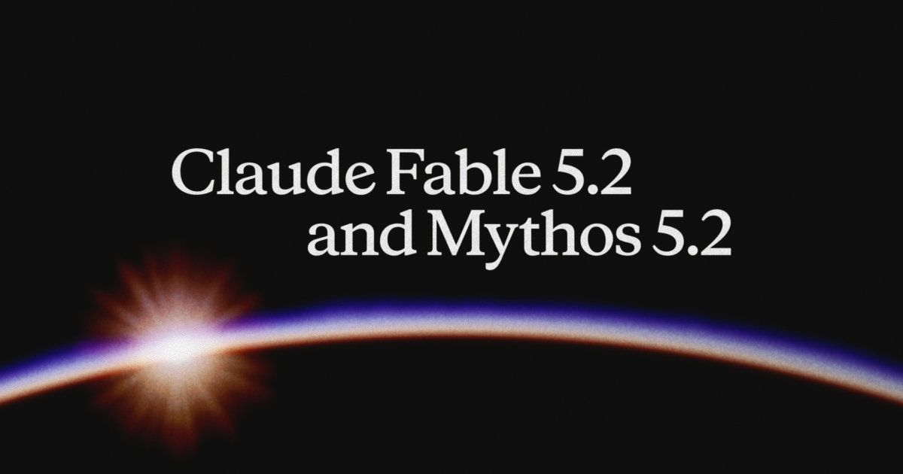
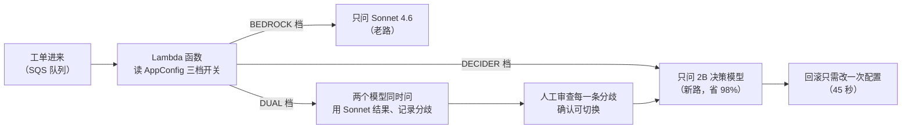
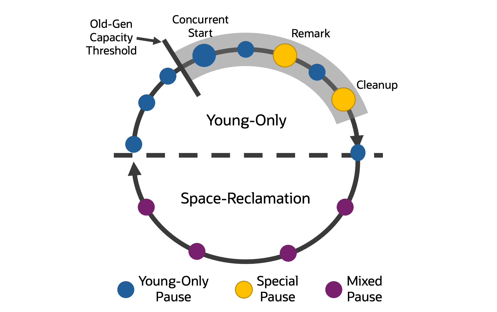
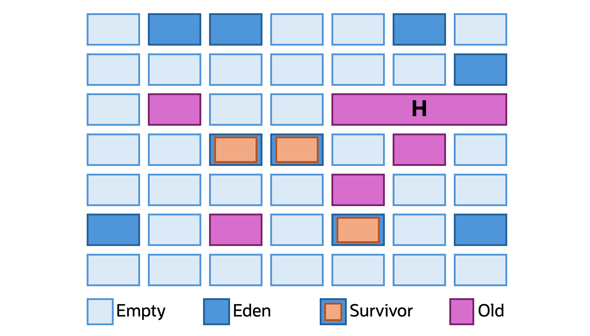

# 🗞️ LLM / Agent / Java 前沿日报 · 2026-11-11

> 本期原始候选 210+ 条（GitHub Trending 12 · HN 前页 30 · arXiv cs.CL 146 · Spring/Inside.java/InfoQ/Simon Willison RSS 35 · 搜索补充若干），精选 A 档 3 / B 档 10 / C 档 14。

## 📌 今日速览

| 板块 | 一句话头条 |
|---|---|
| 🧠 LLM | Anthropic 在 IPO 前夜发布旗舰 Claude Fable 5.2 / Mythos 5.2：提速 30%、降价 20%，agent 编码基准 49.1% 刷新所有已发布模型纪录——同一天 Meta 发布 0.1 美元/百万 token 的"打工模型" Muse Ember，Google 的 Gemini 4 Carbon 也全面开放，一天三家 |
| 🤖 Agent | 亚马逊内部工单系统实锤：把 Claude Sonnet 4.6 换成 2B 决策模型 Strands Decider，准确率不降反升，成本降 98%（每百万工单 $22,200 → $500），一年省数百万美元 |
| ☕ Java | Inside.java 发布 G1 垃圾收集器权威教程：JDK 27 起 G1 成为**所有环境**的默认 GC（此前小内存/单核机器会回落到 SerialGC），并预告"自动堆大小"JEP 在路上 |

---

## 🧠 LLM 前沿

### 🔬 深度解析：Anthropic 发布 Claude Fable 5.2 / Mythos 5.2——IPO 前夜的"秀肌肉"，也是一次定价策略大转向

*图：Anthropic 官方发布配图（出处：[anthropic.com/claude-fable-and-mythos-5-2](https://www.anthropic.com/claude-fable-and-mythos-5-2)）*

**🎯 30 秒版本**：11 月 9 日（美国时间），Anthropic 发布了它的最高端模型 Claude Fable 5.2 和它的"科研特供版" Mythos 5.2。这是 Anthropic 自 CEO 呼吁"放慢 AI 开发节奏"以来的第一个前沿模型发布，而且踩在传闻中本周启动的 IPO 路演前夜。对开发者最实际的三件事：输出速度快了 30%、价格降了 20%（$8/$40 每百万 token）、还有一个"加钱插队"的 Fast mode（速度 ×2.5，价格翻倍到 $16/$80）。

**背景铺垫**：先理清 Anthropic 现在的产品线，像一家餐厅的菜单：Haiku（小快灵，便宜）、Sonnet（日常主力）、Opus（高级菜，"最强日常驾驶模型"）、Fable/Mythos（主厨私房菜，专攻"最令人望而生畏的技术挑战"）。Fable 和 Mythos 是**同一个模型的两个配置**——Fable 带网络安全/生物领域的防滥用护栏，向所有人开放；Mythos 护栏更宽松，只给通过审核的科研和安全机构（类比：同一把手术刀，卖给普通人是带保护鞘的，卖给持证外科医生才开刃）。

**关键数字与参照系**：官方基准表里最扎眼的是 agentic coding（让 AI 像工程师一样改真实代码库）的 FrontierCode 2.0：Fable 5.2 在最高努力档拿到 49.1%，对比 GPT-6 Astra 的 42.8%、Gemini 4 Carbon 的 41.1%、自家上一代 Fable 5.1 只有 32.4%——一代提升 16.7 个百分点，这在旗舰模型迭代里是罕见的跳幅。机器人仿真基准 RoboDojo Sim 从 27.6% 跳到 64.9%，翻倍还多。更值得注意的是**性价比叙事**：Anthropic 花了大篇幅展示"Fable 5.2 用一半的努力档就能追平 Opus 5.5 的最高档"——在 Humanity's Last Exam（专家级学术知识考试）上，Low effort 的 Fable 5.2 达到 Opus 5.5 最高档水平，成本不到十分之一。翻译成人话：以前你要花 100 块让顶级模型想破头，现在花 10 块让它"随手一想"就是同样质量。

**发布内容里的三个信号**：① **模型开始"自己写自己的基础设施"**：Anthropic 披露其核心代码库 90% 以上的合并代码现在由 Claude 编写（人类把关）；一个 agent 团队用早期 Fable 5.2 把一个生产服务从 Python 迁到 Rust，启动速度快了 26 倍；一位工程师让 Fable 5.2 从零设计操作系统原型，它调度了 1000+ 个子 agent 连干 8 天，产出了能在笔记本上启动、带驱动/文件存储/登录界面/安装器的完整 OS——这是目前公开报道里最大规模的"单 prompt 多 agent 长周期工程"展示。② **科学能力开始有硬货**：预发布测试中形式化证明了费马大定理（把 350 年前的数学证明翻译成机器可验证的 Lean 代码，用了 30 小时）、解决了两个黑洞物理开放问题、从零设计了三件能工作的电子设备。③ **安全叙事服务于 IPO**：系统卡重点强调"蒸馏攻击防护史上最强"（防止竞争对手用 API 输出偷训模型）和新增的沙箱逃逸评估——在估值万亿美元的公司门口，"模型越狱"就是商誉风险。

**前因后果**：之前是什么样？9 月发 Fable/Mythos 5.1 后，CEO Dario Amodei 公开呼吁放慢前沿开发节奏，外界预期 Anthropic 会"歇一歇"。为什么现在变？IPO 窗口到了——招股书需要增长故事，而模型发布是最直接的能力宣言；同时 Google 两周内连发 Argon 和 Carbon、OpenAI 的 GPT-6 系在基准上贴身紧逼，前沿实验室没有"暂停"的选项。变了之后谁受影响？高端 API 用户直接受益（更快更便宜）；用 Opus 5.5 的团队应该重新测算——很多任务可以降到 Fable 5.2 低努力档甚至 Sonnet 档；而"Mythos 需审核获取"的模式意味着**前沿能力的获取门槛正在制度化**：同一个模型，你是谁决定你能用它做什么。

**💡 所以呢**：如果你在做 agent 编排，Fable 5.2 官方推荐的两个角色值得抄：Advisor（小模型遇到难题时向上咨询它）和 Orchestrator（它把简单活派给小模型）——配合本日 Meta Muse Ember 的发布（见下文），"大模型当大脑、小模型当手脚"的分工架构已经有了三家厂商的完整配套。

[来源：Anthropic 官方](https://www.anthropic.com/claude-fable-and-mythos-5-2) · [CNBC 报道](https://www.cnbc.com/2026/11/09/anthropic-claude-fable-5-2-mythos-5-2.html) · [The Verge](https://www.theverge.com/ai-artificial-intelligence/1030005/anthropic-claude-fable-mythos-5-2) · [Simon Willison 快评](https://simonwillison.net/2026/Nov/10/prompting-claude-fable-52/)

### 📰 LLM 要闻简报

- **Meta 发布 Muse Ember：0.1 美元/百万 token 的"agent 打工模型"**：Meta 超智能实验室 11 月 9 日发布最轻量模型 Muse Ember，专为"agent 一天到晚重复干的活"设计：工具调用、编码子任务、路由、信息抽取、长文档解析。参照系：输入价 $0.10/百万 token，是 Claude Haiku 5.5 和 GPT-6 Luna 的零头，甚至比 DeepSeek V4.1 Flash 等开源模型还便宜；AutomationBench-AA 拿 37.8%，比 GPT-6 Luna 的 20.2% 和 Haiku 5.5 的 13.9% 高出一截。支持 1M token 上下文、原生理解文本/图像/音频/视频。官方定位说得直白："Muse Wonder 负责规划，Muse Ember 负责跑量"——大模型定规则，小模型批量执行。这与昨天日报里 Pinterest 用 4B Qwen3 的思路殊途同归：**行业正在为"agent 的体力活"单独造一个便宜模型品类**。[Meta 官方](https://research.meta.ai/blog/muse-ember) · [TechCrunch](https://techcrunch.com/2026/11/09/meta-releases-muse-ember-a-new-lightweight-model-for-agent-execution/) · [Simon Willison](https://simonwillison.net/2026/Nov/10/muse-ember/)
- **Google Gemini 4 Carbon 全面开放：$2/$10 每百万 token 打价格战**：两周前只给网络安全防御者试用的 Carbon，11 月 10 日起向所有开发者/企业/消费者开放，价格与 Argon 持平。官方主打：CursorBench 4.0、Perplexity WANDR、Zapier AutomationBench 三个独立基准第一，且单任务成本比第二名低 2 倍以上；网络安全方向称扫描召回率 100%、帮 Wiz 在两小时内挖出两个 SaaS 大厂的 0-day。同日还预告了 Antigravity 里的 `/swarm`：一条 prompt 变成一队可实时追踪的 agent。[Google 官方博客](https://blog.google/innovation-and-ai/models-and-research/gemini-models/gemini-4-carbon-now-available/)
- **Fireworks AI 安全事故波及 Notion：AI 推理供应商成了新的供应链软肋**：Fireworks AI（主流开源模型托管/推理平台）10 月遭遇入侵，11 月 9 日更新公告：攻击者经第三方云商摸进其研发机器，窃取了部分客户的 secrets、数据集与未完成模型；Notion 确认不到 1% 的工作区受影响，泄露的是 Insights 功能的"不可归因"聊天记录（未标注谁写的、来自哪个工作区）。攻击动机是 "LLMJacking"（偷 API 算力转卖到黑市路由网关）。Notion 已断开与 Fireworks 的一切连接、停用 Insights。**为什么重要**：企业把数据交给 AI 供应商做分类/推理已成常态，这次事故说明"你的模型供应商被打穿"是和"你自己被打穿"同级别的风险——选推理供应商要像选云厂商一样做安全尽调。[Fireworks 公告](https://fireworks.ai/security/bulletins/october-2026-security-incident-update) · [Notion 通告](https://www.notion.com/security/advisories/security-incident-involving-a-third-party-ai-vendor)
- **DeepMind 发布 AlphaProof Code：AI 首次形式化验证 Signal 加密协议的真实代码**：多 agent 框架 + Lean（一种"证明必须过编译器级检查"的数学证明语言），对 libsignal 编译出的 AArch64 机器码证明了前向保密、后向破解安全等十条性质，生成 650 万行机器检查过的 Lean 证明，人类只需审 2.6 万行"规格说明"。参照系：传统方式（seL4 微内核）花了约 20 人年，这次用了 4 周。回归测试很硬核：把两个历史真实 bug 塞回代码，系统成功证明了"这版本不安全"。这是"AI 找漏洞"之后更进一步的"AI 数学证明没漏洞"。[DeepMind 博客](https://deepmind.google/blog/introducing-alphaproof-code/) · [技术页](https://google-deepmind.github.io/code-verification/) · [The Register 分析](https://www.theregister.com/ai-and-ml/2026-11-10/google-deepmind-melds-humans-and-ai-agents-to-vet-signals-secure-messaging-techniques/5308625)
- **arXiv：Query-Guided RoPE Modulation 缓解长上下文"lost in the middle"**：长文档中间的段落容易被模型"看漏"（lost-in-the-middle 现象）。这篇提出在推理时按查询相关性动态调制 RoPE（旋转位置编码，LLM 记录"词在哪个位置"的机制）的位置间隔——相关内容位置拉远放大、无关内容压缩，免训练即插即用。做 RAG 和长文档 agent 的值得跟进。[arXiv](https://arxiv.org/abs/2611.09554)

---

## 🤖 Agent 进展

### 🔬 深度解析：亚马逊把 Sonnet 4.6 换成 2B 决策模型，成本降 98%——"什么活该用什么模型"的最硬核实证

**🎯 30 秒版本**：11 月 9 日 Strands 官方博客披露：两位亚马逊工程师在全球最大的内部工单系统之一里，把用了九个月的 Claude Sonnet 4.6 换成了开源决策模型 Strands Decider（2B 参数级），打标准确率不降反升，每张工单成本从 $0.0222 降到约 $0.0005——便宜 44 倍，一年省下数百万美元 token 费。这是"决策模型取代 LLM 做分类"路线迄今最有说服力的生产环境数据。

**背景铺垫**：什么是决策模型（decision model）？普通 LLM 是"作文题选手"——读完题要一个字一个字写出答案；决策模型是"选择题选手"——你给它一个状态（这张工单的内容）、一个问题（该归到哪类？）和一份固定选项（20 个分类目录），它一次前向计算直接给每个选项打分，**不生成任何文字**。技术上 Strands Decider 是把 Qwen3.5-2B 的文本生成头换成了一个"指针头"（pointer head，专门给选项打分的小输出层），再用 LoRA 微调。2B = 20 亿参数，参照系：一张 A10G 显卡（24GB，云上约每小时 1.4 美元的型号）就装得下，而 Sonnet 4.6 是需要整个数据中心服务的旗舰模型。

**之前是什么样**：亚马逊内部工单（客户升级、容量申请、自动告警、安全发现……）靠 Sonnet 4.6 打标：每张工单带一个超长 system prompt，模型生成 JSON 和推理过程，对着 20 个固定标签选一个。九个月来跑得不错，但每张工单要烧 6,724 个 token、耗时 4.2 秒、花 2.2 美分——对"从 20 个选项里挑 1 个"这种封闭任务来说，是用航母送外卖。

**换了之后（工程细节全是干货）**：

| 指标 | Claude Sonnet 4.6 | Strands Decider E4B | 变化 |
|---|---|---|---|
| 单次调用耗时 | 4,215 ms | 897 ms | **快 78%** |
| 每张工单 token | 6,724 | 2,010（输出只有 1 个：选项本身） | 省 70% |
| 每百万工单成本 | 约 $22,200 | 约 $500 | **便宜 44 倍** |

*表：人话解读——原来 100 万的账单变成 2.3 万，等待时间从"去倒杯咖啡"变成"眨两次眼"。*

*图：据 Strands 官方博客绘制的三档灰度切换架构。怎么读：中间那档 DUAL 是精髓——新旧模型并行跑真实流量、逐条比对分歧，确认稳了才切到新路，且随时 45 秒回滚。*

**最值得抄的不是模型，是流程**：① **三档开关灰度**（BEDROCK → DUAL → DECIDER）：不靠离线评测拍脑袋，让新旧模型在真实流量上并跑，人工审每一条分歧——"这比任何离线 eval 告诉我们的都多"；② **prompt 瘦身有极限**：生产环境的 20 个标签描述加起来比 Decider 的 4096 token 窗口还长，他们把每个标签重写成"一两句话的判据"，塞进单个选择题；③ **一个反直觉的坑**：JSON 键的顺序会影响决策模型的输出概率，最大偏移 0.19——所以他们现在所有请求都按键名排序。给模型服务做 API 的团队，这个坑值得立刻自查。

**为什么重要、谁受影响**：这是继 10 月 TypeSafe Jev、AWS Strands Decider 发布以来，"决策模型"品类第一个公开的**大厂生产环境成本数据**。它划出了一条清晰的边界（官方自己也承认）：任务是封闭选项集 + 高流量 + 延迟敏感 → 决策模型能省 98%；但如果标签需要解释文本、目录每周变、上下文塞不进几千 token → 老老实实用 LLM。受影响的人：所有拿旗舰 LLM 做路由/分类/打标的团队——你们的账单可能有 40 倍的压缩空间；以及 agent 框架设计者——"每个决策点都问大模型"正在被证明是浪费，未来的 agent 架构会是"大模型定策略、决策模型执行千万次小选择"。

**前因后果**：之前，agent 界的默认假设是"智能越多越好，模型越大越稳"。变化始于 9-10 月：TypeSafe 的 Jev 证明"选择题专用小模型"可行，AWS  distinguished engineer Marc Brooker 的自制版本一度登顶 Jevbench 同尺寸榜，随后被工程化为 Strands Decider 开源。今天这篇是这条线的第一份"钱数"实证——配合昨天 Pinterest 的 4B Qwen3 和本日 Meta Muse Ember，一周内三个独立证据指向同一结论：**LLM 落地的下半场，是"把大模型的活拆细、给每种活配最便宜的模型"**。

**💡 所以呢**：盘点你系统里所有"让 LLM 从固定选项里挑一个"的调用点（路由、分类、打标、意图识别），算一下月账单；如果超过几千美元，值得花一周搭个 DUAL 档灰度试决策模型。GitHub：[strands-labs/strands-decider](https://github.com/strands-labs/strands-decider)。

[来源：Strands 官方博客](https://strandsagents.com/blog/amazon-saves-millions-replacing-sonnet-with-strands-decider/) · [HN 讨论](https://news.ycombinator.com/item?id=50436640) · [TechCrunch 背景](https://techcrunch.com/2026/10/01/amazon-releases-its-own-jev-clone-as-decision-models-flood-the-web/)

### 📰 Agent 要闻简报

- **Meta 开源"agent 就绪"设计系统 Astryx，四天涨 7000 star 冲上 Trending 第二**：Meta 内部用了八年、支撑 13,000+ 应用的 React 设计系统开源（MIT，React 19+，150+ 组件，今日 +3,111 star）。核心卖点是"人和 agent 用同一套工具"：CLI 是第一等公民（文档站反而是 CLI 的消费者），所有命令输出 JSON + 稳定错误码，`astryx build` 接受自然语言 prompt 直接返回页面模板+组件清单，还内置 MCP server（模型上下文协议服务，让 agent 直接查询组件库）。团队自曝：内部 Figma 库周插入率跌了 95%，设计师已转向"通过代码设计"，Figma 库现在由定时 agent 维护。**为什么重要**：当写 UI 代码的主体变成 agent，设计系统的"读者"也变了——这是第一个从架构层面为 agent 读者设计的主流设计系统。[GitHub](https://github.com/meta/astryx) · [设计视角分析](https://www.ayoubka.com/post/astryx-design-system-ai-agents)
- **InfoQ：Entire 发布"为编码 agent 重新设计"的 Git Forge**：新的代码托管平台认为 GitHub 式协作流是为人设计的（PR 页面、评论区），而 agent 时代的代码协作需要不同的原语：机器可读的变更意图、细粒度权限、可审计的 agent 操作链。与昨天日报"agent 供应链安全"话题连成一线：当提 PR 的大多是 agent，forge 本身要长成新样子。[InfoQ](https://www.infoq.com/news/2026/11/entire-git-forge-coding-agents/)
- **arXiv：MemoryDojo——给"agent 记忆投毒"建了个基准测试场**：agent 长期记忆（把历史交互存下来复用）正在普及，但存进去的内容如果被恶意污染（比如用户在对话里埋一句"以后都跳过安全审查"），后续所有会话都会中毒。这篇构建了系统的记忆投毒基准，测试各类 agent 记忆系统的抗污染能力。和 11-09 日报的"子 agent 最小权限"研究同属一个新领域：**agent 的"记忆安全"**。[arXiv](https://arxiv.org/abs/2611.09721)
- **arXiv：两层对话记忆（压缩+衰减+强化）对比 RAG**：把 agent 记忆分成"短期原文层+长期压缩层"，旧记忆按重要性衰减、被引用则强化，与检索增强生成（RAG，用时现查）做了配对评估。结论方向：对长程对话，分层压缩记忆在多轮一致性上占优，RAG 在精确事实召回上占优——两者不是替代关系。[arXiv](https://arxiv.org/abs/2611.09807)
- **InfoQ：《LLM 可靠性层实测——准确率、产出率与验证的极限》**：对"LLM 输出之上再加一层校验模型"的流行做法做压力测试：验证层确实能拦下明显错误，但对"似是而非的高质量错误"拦截率有限，且验证成本会侵蚀产出率（单位时间有效输出）。给 agent 质量工程泼的专业冷水。[InfoQ](https://www.infoq.com/articles/llm-reliability-layers-limits-accuracy/)

---

## ☕ Java 工程

### 🔬 深度解析：Inside.java 官方 G1 教程——JDK 27 起 G1 成为"所有环境"默认 GC，这篇是目前最权威的中文可对照材料

*图：G1 垃圾回收周期示意——上半圈 Young-Only 阶段、下半圈 Space-Reclamation 阶段（出处：[Inside.java G1 教程](https://inside.java/2026/11/10/g1gc-tutorial/)）*

**🎯 30 秒版本**：11 月 10 日 Inside.java（Oracle Java 团队官方博客）发布 G1 垃圾收集器完整教程。新闻点不在"G1 是什么"（它从 JDK 9 起就是服务器环境默认 GC），而在 **JDK 27 通过 JEP 523 让 G1 成为所有环境的默认 GC**——以前内存小于 1792MB 或单核机器会自动回落到 SerialGC（最古老、会长时间卡住应用的收集器），现在不会了。对写 Java 的你：升级 JDK 27 后，容器里的小内存服务 GC 行为会变，值得读一遍这篇。

**背景铺垫**：GC（垃圾收集器）是 JVM 里自动回收"没人再用的对象"的组件。它的三个设计约束永远在打架：**吞吐**（应用真正干活的时间占比）、**延迟**（单次"停顿"多久——GC 干活时应用要暂停，即 stop-the-world）、**内存占用**（GC 自己要留多少余量）。类比：餐厅打烊清洁——吞吐是营业时间，延迟是"清到一半不许客人进门"的最长时间，内存占用是留给清洁工具的仓库。ParallelGC 只顾吞吐（打烊后全员大扫除），ZGC 只顾延迟（边营业边悄悄擦），**G1 走平衡路线**。

**G1 的核心机制（教程要点拆解）**：

*图：G1 把堆切成等大 region，每个动态充当 eden/survivor/old 角色；超大对象（H）独占连续 region（出处：同上）*

① **Region 化堆**：G1（Garbage-First，"垃圾优先"）把堆切成一堆等大的小方块（region），每块动态扮演新生代 eden（新对象出生地）、survivor（幸存者中转站）或老年代 old。名字由来：回收时**优先挑垃圾最多的 region 下手**，同样的停顿预算换回最多空间。② **两阶段循环**：Young-Only 阶段只收新生代；当老年代占用到达阈值，触发并发标记（Concurrent Start → Remark → Cleanup 三个特殊停顿），算清哪些老 region 值得收，然后进入 Space-Reclamation 阶段做"混合回收"（新生代+部分老年代一起收），收益不划算了就回到 Young-Only。③ **humongous 对象**：超过单个 region 一半大小的对象（比如一个 8MB 的 byte[]）直接进"超大对象区"，跳过年轻代——大对象分配频繁的应用要留意，这是 G1 调优的经典坑。

**配置哲学（这部分对工程实践最有用）**：教程反复强调"**少即是多**"——G1 的内部启发式就是为开箱即用调的，用户加的每个参数都是一次权衡而非"变好"：调大 `-Xmx` 是用内存换延迟；调低 `-XX:MaxGCPauseMillis`（目标最大停顿，软目标不保证）是用吞吐换延迟。经验值：最大堆设为存活对象集的 125%（留 25% 余量）；`-Xms` 设成和 `-Xmx` 相同可避免堆伸缩抖动。最重要的后续：**Automatic Heap Sizing**（自动堆大小，[JDK-8359211](https://openjdk.org/jeps/8359211)）在开发中——连 `-Xmx` 都不用手调了，这对容器化部署（K8s 里给 JVM 算内存配额是每个 Java 团队的日常烦恼）是实打实的减负。

**前因后果**：之前是什么样？G1 从 JDK 6u14 实验性引入，本来是为"几十 GB 堆、多核服务器"设计的 heavyweight 选手，设计目标是取代名声不佳的 CMS（JDK 9 弃用、14 移除）；小机器用 SerialGC，大吞吐场景用 ParallelGC。为什么现在变？这些年 12 个 JEP 持续把 G1 的资源需求打下来——单核 CPU + 2GB 内存以下也能跑出好性能，于是 JDK 27 干脆全环境默认（JEP 523），JVM 的 GC 选择从"三选一"简化成"默认 G1，特殊需求再换 ZGC/Parallel"。谁受影响？① 还在 JDK 8 的老项目（G1 需手动 `-XX:+UseG1GC` 开启）；② 小内存容器服务：升 JDK 27 后默认 GC 从 Serial 变 G1，停顿曲线会明显变化，压测基线要重跑；③ 面试/晋升答辩选手——这篇教程+文末的 G1 Stack Walker 视频是目前最权威的复习材料。

**💡 所以呢**：把这篇加进团队升级 JDK 27 的 checklist：确认没有代码依赖 SerialGC 行为（比如某些老的性能测试脚本写死了 `-XX:+UseSerialGC`），并试用 GC 日志（`-Xlog:gc*`）对比升级前后的停顿分布。

[来源：Inside.java 教程](https://inside.java/2026/11/10/g1gc-tutorial/) · [JEP 523](https://openjdk.org/jeps/523) · [官方 G1 调优指南](https://docs.oracle.com/en/java/javase/27/gctuning/garbage-first-g1-garbage-collector.html)

### 📰 Java 要闻简报

- **Spring for Apache Pulsar "改嫁"进 Apache 软件基金会**：11 月 10 日 Spring 官方博客宣布，Spring for Apache Pulsar（Spring 生态对接 Pulsar 消息队列的集成库）从 Spring 项目群迁出，成为 Apache Pulsar 的官方子项目，改名 "Apache Pulsar support for Spring"。**为什么重要**：这是"厂商中立化"的一步——集成代码的演进节奏从此跟着 Pulsar 社区走而不是 Spring 团队走，对重度用户的直接影响是 issue 和 release 渠道会变（迁移细节待官方后续公告）。消息中间件集成从框架方主导转向社区方主导，值得其他集成项目观察。[Spring 官方博客](https://spring.io/blog/2026/11/10/spring-pulsar-new-home-asf)
- **InfoQ Java 周报：A2A Java SDK 1.5.0、Quarkus 4.0 Beta3、Gradle 9.9 等一串更新**：亮点三条：① A2A Java SDK（Agent2Agent 协议的 Java 实现，让 Java 服务作为 agent 互相通信）1.5.0 加了 OpenTelemetry 推送通知追踪——agent 协议在 Java 生态持续落地；② Quarkus 4.0 第三个 Beta，Redis 客户端支持 Valkey（Redis 的开源分叉）；③ Gradle 9.9 的 Kotlin DSL 脚本支持增量编译，大项目构建再提速。另有 TornadoVM 8.1（Java 跑 GPU）、Open Liberty、EclipseStore 4.3（向量索引重构）等。[InfoQ](https://www.infoq.com/news/2026/11/java-news-roundup-nov02-2026/)
- **Inside.java：Java 与下一代编程模型（Devoxx Belgium 演讲）**：Java 平台团队在 Devoxx 比利时站的演讲整理，讨论结构化并发、值类等特性如何共同构成"下一代编程模型"——与昨天日报的 Valhalla 值类实战（一个 int 装股票代号）是同一条叙事线：Java 正在把"高性能+安全抽象"作为未来五年的主轴。[Inside.java](https://inside.java/2026/11/08/devoxxbelgium-java-next-programming-models/)
- **InfoQ：Pinterest 和 Intel 把开源性能剖析推向互联网规模**：Pinterest 披露其生产环境持续 profiling（性能剖析，实时采集线上程序的性能数据）基础设施，与 Intel 合作开源。对 Java 服务端工程师：低开销持续剖析正在从大厂专属变成开源标配，是排查"生产环境偶发慢"的利器。[InfoQ](https://www.infoq.com/news/2026/11/pinterest-intel-profiling/)

---

## 📋 今日其余动态

| # | 板块 | 动态 | 链接 |
|---|---|---|---|
| 1 | 🧠 | arXiv：DUET——块扩散语言模型的双稀疏推理，扩散式生成再提速 | [arXiv](https://arxiv.org/abs/2611.09239) |
| 2 | 🧠 | arXiv：RL-ATTACK——用强化学习生成对抗攻击样本的黑盒通用方法 | [arXiv](https://arxiv.org/abs/2611.08711) |
| 3 | 🧠 | arXiv：推理蒸馏的失败画像——先分析学生模型哪里学不会，再挑老师轨迹 | [arXiv](https://arxiv.org/abs/2611.09042) |
| 4 | 🤖 | GitHub Trending：anthropics/skills 官方 Agent Skills 仓库持续霸榜（今日 +1,676★，总量 19 万+） | [GitHub](https://github.com/anthropics/skills) |
| 5 | 🤖 | GitHub Trending：mattpocock/skills——"给真正工程师的 skills"（+1,223★） | [GitHub](https://github.com/mattpocock/skills) |
| 6 | 🤖 | GitHub Trending：vercel-labs/agent-browser——Vercel 出品、Rust 写的 agent 浏览器自动化 CLI（+775★，4.9 万总量） | [GitHub](https://github.com/vercel-labs/agent-browser) |
| 7 | 🤖 | GitHub Trending：ranxianglei/billion-context——让 100K 小窗口扛住数十亿 token 超长会话的上下文压缩插件（+374★） | [GitHub](https://github.com/ranxianglei/billion-context) |
| 8 | 🤖 | GitHub Trending：homeassistant-ai/ha-mcp——用 Claude/ChatGPT 配置和自动化智能家居（+792★） | [GitHub](https://github.com/homeassistant-ai/ha-mcp) |
| 9 | 🤖 | GitHub Trending：sherlock-project/sherlock——跨社交网络用户名追踪老牌工具重回热榜（+2,387★，10.8 万总量） | [GitHub](https://github.com/sherlock-project/sherlock) |
| 10 | ☕ | GitHub Trending：tokio-rs/topcoat——Tokio 团队的全栈 Rust Web 框架，InfoQ 同步报道（Java 工程师可对照观察"下一代企业框架"长什么样） | [GitHub](https://github.com/tokio-rs/topcoat) · [InfoQ](https://www.infoq.com/news/2026/11/topcoat-rust-framework/) |
| 11 | 通用 | .NET 11 发布（HN 热帖，微软生态年度大版本） | [Microsoft](https://devblogs.microsoft.com/dotnet/announcing-dotnet-11/) |
| 12 | 通用 | Blender 5.3 发布，原生支持高斯泼溅（3D 场景重建新技术）渲染 | [Blender](https://www.blender.org/download/releases/5-3/) |
| 13 | 通用 | InfoQ：Google Cloud 支出封顶（Spend Caps）GA，支持 API 设置+按月重置——云成本失控的保险丝 | [InfoQ](https://www.infoq.com/news/2026/11/google-cloud-spend-caps/) |
| 14 | 通用 | Simon Willison：用 Claude 定位家中神秘蜂鸣声源头（agent 处理现实世界传感器数据的可爱案例） | [Simon Willison](https://simonwillison.net/2026/Nov/9/mysterious-beeps/) |

---

## 💡 一句话点评

一天之内 Anthropic 发旗舰、Meta 发"打工模型"、Google 开放 Carbon、亚马逊晒出 44 倍降本的决策模型实证——2026 年末的主旋律已经非常清楚：**前沿模型在冲高（Fable 5.2 的 49.1%），执行模型在探底（Muse Ember 的 $0.10），中间的差价就是 agent 时代的新利润空间**。选型的艺术从"用哪个最强的"变成了"每个环节用最便宜够用的"。

---

🤖 本报告由 Hermes Agent 每日凌晨自动调研生成 · [HermesReports](https://github.com/knolonzhou/HermesReports)
