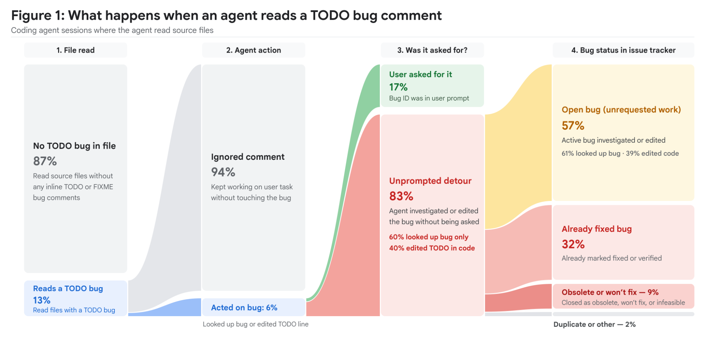
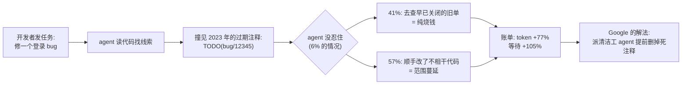
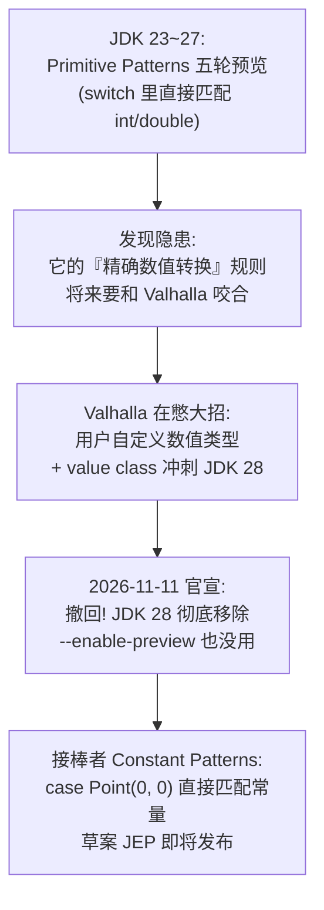

# 🗞️ LLM / Agent / Java 前沿日报 · 2026-11-12

> 本期原始候选 240+ 条（GitHub Trending 10 · HN 前页 30 · arXiv cs.AI 381 + cs.CL 178 · Spring/Inside.java/InfoQ/Simon Willison RSS 35 · web_search 补充 4 轮），精选 A 档 3 / B 档 11 / C 档 13。

## 📌 今日速览

| 板块 | 一句话头条 |
|---|---|
| 🧠 LLM | Anthropic IPO 路演视频意外成为"技术披露现场"：首次承认训练+推理横跨 AWS Trainium / Google TPU / NVIDIA / AMD 四大芯片家族，且 **Claude（Mythos）只用 3 天、几乎零人工干预就把自己移植到了 AMD GPU 上**——招股书里还压着 8950 亿美元的算力开支承诺 |
| 🤖 Agent | Google 用数亿条 agent 执行轨迹量化了"代码里的过期 TODO 会骗 agent 跑偏"：**77% 的额外 token、105% 的额外等待时间**，然后派"清洁工 agent"半年删掉数千条死 TODO，人类审核通过率 95%+ |
| ☕ Java | OpenJDK 官方宣布**撤回**已预览 5 轮的 Primitive Patterns 特性（JDK 28 起彻底移除，`--enable-preview` 也救不回来）——原因是给 Valhalla 的"用户自定义数值类型"让路，替补队员 Constant Patterns 已在路上 |

---

## 🧠 LLM 前沿

### 🔬 深度解析：Anthropic IPO 路演视频泄了三个大料——四种芯片通吃、Claude 三天自我移植 AMD、"算力乘数"将递归自举

*图：Anthropic IPO 路演官方页面分享图（出处：[ipo.anthropic.com](https://ipo.anthropic.com/us/)）*

**🎯 30 秒版本**：11 月 10 日 Anthropic 发布了一段 42 分钟的 IPO 路演视频（roadshow，上市公司路演 = 开卖股票前给投资人做的"公司宣讲"）。本来大家以为是资本市场套话，结果里面藏了此前从未公开的技术细节：Anthropic 现在**同时在四种芯片上训练和运行 Claude**，而且让自家最强模型 Mythos 花了 3 天、几乎不靠人，就把 Claude 移植到了全新的 AMD GPU 上。Simon Willison 用 MacWhisper 扒出全文转录，Business Insider 让 ChatGPT 和 Claude 数了词频——这段视频可能是今年信息密度最高的一份"招股说明书附件"。

**背景铺垫**：AI 公司的命脉是"算力"（compute，训练和运行模型所需的芯片计算量）。业界常识是：每种芯片（NVIDIA GPU、Google TPU、AWS Trainium、AMD GPU）都有自己的一套软件栈，把同一个模型搬到另一种芯片上，好比把一本中文小说翻译成四种语言——每种都要单独雇翻译团队，又贵又慢。所以绝大多数公司只押注一种芯片。

**料一：四芯片家族通吃，是"早年不被看好的赌注"**。联合创始人 Tom Brown 在视频里说："我们现在在全部四大芯片家族上训练和服务 Claude。这源于早期一个非常规的多芯片押注——当时很多人认为在不同芯片上跑 AI 模型不值得。每种芯片需要单独定制软件栈和推理栈，昂贵且困难。" 参照系：这不是 PPT 吹牛，去年 9 月 Anthropic 的事故复盘里就提到过"只影响 TPU 部署的 bug"，间接暴露了多芯片现实。对行业的含义：Anthropic 对任何单一芯片供应商（包括 NVIDIA）的议价能力都比对手强——你可以涨价，我还有三家可切换。

**料二：Claude 三天把自己搬上 AMD，"AI 写 AI 基础设施"从口号变成生产数据**。Tom Brown 原话："过去接入一个新芯片平台需要几十名工程师干几个月。这次我们让 Mythos 试了试——**它在三天内就让 Claude 跑在了 AMD 上，基本没有人工干预，几乎 100% 的 kernel（芯片上执行的核心计算小程序）都是 Claude 移植或编写的**。" 参照系：几十人 × 几个月 ≈ 数千人日，压缩到 3 天，这是目前公开报道里"AI 自动移植底层系统软件"最激进的案例。结合前一天日报里 Fable 5.2 的"1000 个子 agent 写操作系统"，Anthropic 在系统级工程自动化上的展示越来越密集——而且都选在 IPO 窗口期放出来，绝非巧合。

**料三："算力乘数"理论与递归自我改进的官方表态**。视频提出一个投资叙事核心概念：总有效算力 = 物理算力 × 算力乘数（compute multiplier，指通过算法/工程优化让同样的芯片"顶更多芯片用"的倍数）。举例：训练某个智能水平的模型原本要 100 单位算力，发现 4 倍乘数后只要 25 单位；或者用同样 100 单位去训一个原本要 400 单位的更强模型。更关键的一句："**我们相信随着接近递归自我改进，这会进一步加速——Claude 将能完全自主地发现算力乘数**，让乘数数量增长得越来越快。" 白话：AI 优化 AI 的训练效率，效率提升又喂出更强 AI——这是"智能爆炸"叙事的官方温和版。

**资本侧数字**（给参照系）：修订版 S-1（招股书）显示 Anthropic 承诺在算力与基础设施上花费 **8950 亿美元**（约等于瑞士一年的 GDP），近一半要在 2030 年底前花完；据 Yahoo Finance 报道， prospective 投资人正在讨论 **1.2–1.3 万亿美元估值**（个别低至 1.1 万亿），IPO 最快下周落地。Business Insider 数了视频词频：Claude 65 次、model(s) 58 次、compute 系 49 次、customer 系 42 次、safe 系 27 次——"安全"话术占比不低，但真正的主旋律是算力。Dario Amodei 开场 30 秒内就提了"AI 制造生物武器的风险"，随后旁白立刻找补："安全没有拖慢我们——恰恰因为信任 Claude 的工作，我们才能把它的发现应用到现实世界。"

**前因后果**：之前是什么样？外界只从事故复盘和采购新闻里零星猜测 Anthropic 的芯片策略。为什么现在变？IPO 需要讲一个"别人抄不动"的护城河故事——多芯片工程能力 + AI 自我移植 + 算力乘数堆叠，正好构成一条完整叙事链。变了之后谁受影响？① AMD 是最大受益者之一（视频等于官方背书其 GPU 可跑前沿模型）；② NVIDIA 的"独家税"逻辑被削弱；③ 对普通开发者的间接影响：芯片竞争越充分，长期 API 价格战越有底气——本周 Fable 5.2 降价 20% 只是开始。

**💡 所以呢**：看这段视频别只看热闹——"AI 三天移植底层 kernel"若属实且可复制，意味着**基础设施工程的边际人力成本正在塌缩**。做平台/中间件的工程师值得思考：你的项目里哪些"只有资深工程师能干几个月"的活，明年可能是一个 prompt 三天的事。

[来源：Simon Willison 全文摘录](https://simonwillison.net/2026/Nov/11/anthropic-ipo-roadshow) · [官方路演页](https://ipo.anthropic.com/us/) · [Business Insider 词频分析](https://businessinsider.com/anthropic-ipo-roadshow-video-pitch-safety-compute-2026-11) · [CNBC 视频报道](https://cnbc.com/video/2026/11/10/anthropic-kicks-off-ipo-roadshow.html)

### 📰 LLM 要闻简报

- **Apple 被爆料在做本地大模型"傻瓜化"应用 Harbor：多台 Mac 用雷电 5 拼内存跑大模型**：爆料人 Aaron Perris 在 macOS 代码里发现了一个叫 Harbor 的新应用（目前在 Apple 旗下 Claris 品牌下私测）。卖点：把 Mac 变成"私有 AI 推理服务器"——开源权重模型全本地跑、数据不出机器；多台支持 Thunderbolt 5（雷电 5，苹果高速接口，带宽 80Gbps 级别）的 Mac 互联后可**把统一内存池化成一个推理资源**，跑单机装不下的模型。类比：以前一人一间小厨房，现在打通成食堂后厨。**为什么重要**：苹果一贯对本地 AI 暧昧，这次直接做"集群化本地推理"消费级产品，等于官方下场和 Ollama/LM Studio 生态抢入口；对隐私敏感团队是潜在刚需。[9to5Mac](https://9to5mac.com/2026/11/10/apple-has-new-mac-app-coming-to-make-running-local-ai-models-easy/)
- **Apple 研究登上 HN 首页：Attention to Mamba——把 Transformer"翻译"成 Mamba 的两步配方**：Mamba 是 Transformer 的替代架构（用"状态空间模型"顺序压缩信息，省内存、生成快，但生态和预训练模型远不如 Transformer 丰富）。此前研究证明直接蒸馏（distillation，让小学生模型模仿大老师模型的输出）会掉点严重，通常要靠"混合架构"妥协。Apple 的新配方分两步：先把 Transformer 的注意力蒸馏成"线性化注意力"（用 kernel trick 数学技巧近似），再蒸馏进纯 Mamba。结果：1B 参数的 Pythia 老师困惑度 13.86（越低越好），蒸出来的纯 Mamba 学生 14.01——几乎无损。**为什么重要**：这意味着已有的海量 Transformer 预训练资产可以低成本"翻译"到推理更便宜的架构上，端侧部署的想象空间打开。[Apple ML Research](https://machinelearning.apple.com/research/attention-mamba-distillation)
- **arXiv：一个覆盖 204 种语言的多词 tokenizer，比 GPT-4o 的还省 token（连英语都省）**：tokenizer（分词器）是 LLM 把文本切成计费小块的机制——同一句话被切得越碎，API 账单越贵、上下文越浪费。非英语用户长期交"token 税"（同日另一篇论文实测印度语言税仍在）。这篇提出把常见词组打包成单个 token 的方案，204 种语言全面少于 GPT-4o tokenizer 的 token 数。**为什么重要**：token 数是所有 LLM 成本的计价单位，分词效率是"不训练模型也能降账单"的少数杠杆之一。[arXiv 2611.13059](https://arxiv.org/abs/2611.13059) · [配套：The Indic Token Tax in 2026](https://arxiv.org/abs/2611.13058)
- **arXiv：在推理"跑偏的当下"实时纠错，而不是事后重算**：LLM 长链推理一旦某步走歪，后面全废（一步错步步错）。《Catch It Where It Happens》提出在解码过程中实时监测并纠正推理错误，而非等生成完再验证/重跑——省下的是整条错误链的 token。做 agent 长任务的可以关注。[arXiv 2611.13107](https://arxiv.org/abs/2611.13107)

---

## 🤖 Agent 进展

### 🔬 深度解析：Google 实锤"agent 分心"——过期 TODO 注释让 agent 多烧 77% token，于是他们派 agent 去删注释

*图：Google 官方统计图——agent 遇到过期 TODO 后"跑偏"的比例分布（出处：[developers.googleblog.com/agent-distraction](https://developers.googleblog.com/agent-distraction/)）*

**🎯 30 秒版本**：AI 编码 agent（比如 Claude Code、Codex 这类"自己读代码、改代码"的 AI）有个新职业病，Google 给它起了名字：**agent distraction（agent 分心）**——代码里那些人类会一眼扫过、早就没人管的过期 `TODO(bug/xxx)` 注释，agent 会当成"待办任务"真去修。Google 用数千名工程师、数亿条 agent 执行步骤的分布式追踪数据量化了损失，然后做了个很 Google 的事：训练专门的"清洁工 agent"去删这些死注释。

**背景铺垫**：agent 干活前要先"读代码做规划"，读到什么都会进入它的上下文（context，AI 当前"脑子里记着的信息"）。人类老手看到 2023 年的 TODO 会心里默念"这早修了"然后跳过；agent 没有这种江湖经验——注释对它来说就是行动召唤。Google 工程师 Sam Saccone 的原话："**对人类来说可以轻松略过的东西，agent 看到的是行动号召**（a call to action）。"

**关键数字与参照系**（Google 内部数据，InfoQ 11 月 10 日报道后全网发酵）：
- **13%** 的读文件会话让 agent 撞见了内联 `TODO(bug/...)` 或 `FIXME` 引用——大约每 7 次就有 1 次；
- 其中 **6%** 的会话里 agent 真的对该 bug 采取了行动，而这些行动里 **83% 是完全没被要求的**（开发者的 prompt 根本没提这个 bug）；
- 跑偏之后：**41% 追的是已经关闭的死 ticket**（32% 早已修复验证、9% 是"不修了"的废弃单），**57% 是范围蔓延**（bug 还开着，但不归这次任务管，agent 非要去碰——其中 39% 还真改了代码）；
- 代价（多变量固定效应回归，控制了开发者、代码库复杂度、任务类型、模型档位等变量，p<0.0001）：每次跑偏会话 **步骤 +70%、token +77%、等待时间 +105%**。参照系：token +77% 约等于原来 100 块的 agent 账单变 177 块，而且你还多等了一倍时间；
- 治理效果："TODO 清洁工 agent"半年删掉**数千条**确认过期的引用，人类审核通过率 **95%+**。清洁工不是看到 TODO 就删——它要翻 bug 状态、文件历史、甚至数年的 git 提交记录，确认"注释和它背后的意图都死了"才提交 PR。

*怎么读这张图：左边是正常的 agent 工作流，中间是分心的两条岔路（查死单 / 乱改代码），右边是代价和 Google 的治理思路——与其教 agent"忍住"，不如把诱惑源从代码库里铲掉。*

**前因后果**：之前是什么样？"代码卫生"（清理过期注释、陈旧文档）一直是低优先级的技术债——没人会因为一句过期 TODO 被扣绩效。为什么现在变？agent 把"读遍代码库"变成了每天数百万次的日常操作，**遗忘角落里的垃圾第一次有了实时价格标签**。变了之后谁受影响？① 每个用编码 agent 的团队：那些"改天再清理"的技术债，现在每次 agent 路过都在收利息；② 代码评审文化：HN 上的高赞评论一针见血——"这就是初级开发者行为开上了机器速度：留一句误导性注释，有人会追着查一整天，只不过现在每小时发生 40 次，而且 token 是你付钱"；③ 工具链商机：presubmit 分析器、全库扫描器这类"agent 友好化"工具会从 nice-to-have 变成基建。

**💡 所以呢**：今天就能做的三件事：给仓库跑一遍 `grep -rn "TODO(bug\|FIXME"` 对照 bug 系统清掉死引用；在 agent 的规则文件（CLAUDE.md / AGENTS.md）里写明"不要主动处理与任务无关的 TODO"；把"代码库对 agent 的噪音水平"纳入技术债盘点——Google 已经证明这笔账算得出来。

[来源：Google Developers Blog 原文](https://developers.googleblog.com/agent-distraction/) · [InfoQ 报道](https://www.infoq.com/news/2026/11/google-agent-distraction/)

### 📰 Agent 要闻简报

- **HN 热议：一个人 + 48 个 AI agent，72 小时从 NASA 激光雷达数据里"挖出"一座未记录的玛雅金字塔**：Google 软件工程师 Pietro Miotti 把 48 个 AI agent 编成团队，处理 NASA 公开的中美洲激光雷达（lidar，用激光扫描地表、能"透视"树冠看到地形起伏）数据，72 小时内定位出一处未被记录的玛雅遗址——丛林悬崖顶上的广场、小金字塔和庭院，坐标已作为机密附件提交给墨西哥国家人类学与历史研究所（INAH）核实。**为什么重要**：这是"agent 编队做真实科学发现"的又一民间样本（前有 DeepMind AlphaProof 验证 Signal 协议），亮点在于全流程个人可复制——数据公开、agent 框架自建。[原文](https://pietromiotti.com/latest/maya-site/?maya)

*图：根据 lidar 布局用 Gemini 生成的遗址公元 700 年左右想象复原图（出处：[pietromiotti.com](https://pietromiotti.com/latest/maya-site/?maya)）*

- **Atuin 发布 Threads：把你所有机器上的 agent 会话变成可搜索、可续跑、可"跨工具接力"的历史库**：Atuin 本来是做 shell 历史云同步的（终端命令的"时光机"），新版 18.24 把同样思路用到了 agent 会话上：在开发服务器的 Claude Code 里开了个头，回到笔记本可以用 Codex **接着跑，上下文完整保留**（`atuin resume`）。端到端加密同步，已支持 Claude Code / Codex / Pi / Omp / OpenCode，还带 MCP 接口让 agent 自己检索"我以前是怎么解决这个问题的"——包括那些从未合入 main 的失败尝试。**为什么重要**：agent 会话正在成为比 git 历史更完整的"决策过程档案"，谁掌握检索入口谁就掌握组织记忆。[Atuin 博客](https://blog.atuin.sh/threads-agent-sessions/)
- **InfoQ：QCon AI New York 议程泄露大厂 agent 生产化现状——LinkedIn / Netflix / DoorDash 怎么跑 agent、评测和推理**：会议议程显示三家公司的工程团队将分享生产环境中的 agent 运行、评测体系（evals）与推理成本控制实战。另外 InfoQ 同日报道 JioHotstar（印度流媒体巨头）为 AI 编码 agent 的知识库检索做了系统性基准测试——"给 agent 喂什么文档、怎么喂"正在成为独立工程学科。[QCon AI 议程](https://www.infoq.com/news/2026/11/qcon-ai-newyork-2026-program/) · [JioHotstar 知识库基准](https://www.infoq.com/news/2026/11/jiohotstar-codingagent-retrieval/)
- **arXiv：企业级 SOP 场景下的 agent 架构"成本-成功率"受控对比**：同一个企业流程（SOP，标准作业程序），单 agent、多 agent、层级式架构各要花多少钱、成功率多少？这篇做了受控实验给出权衡曲线——和前两天亚马逊 Strands Decider（成本降 98%）的思路互相印证：**agent 架构选型正在从"玄学"变成可量化的工程决策**。[arXiv 2611.12953](https://arxiv.org/abs/2611.12953)
- **addyosmani 开源 agent-skills 合集冲上 GitHub Trending**：Google Chrome 团队工程负责人 Addy Osmani 整理的 AI agent 技能库（skills = 教 agent 干特定活的说明书文件），单日 +788 star。继 anthropics/skills 之后又一波"技能库"热潮，agent 的"职业教育"素材正在快速开源化。[GitHub](https://github.com/addyosmani/agent-skills)

---

## ☕ Java 工程

### 🔬 深度解析：五轮预览后惨遭撤回——OpenJDK 砍掉 Primitive Patterns，给 Valhalla 数值类型让路

**🎯 30 秒版本**：11 月 11 日 Inside.java 官宣：`Primitive Types in Patterns, instanceof, and switch`（原始类型模式匹配，让你能在 `switch`/`instanceof` 里直接匹配 `int`、`double` 等基础类型的特性）停止开发，本应是第六轮预览的 JEP 草案直接撤回，**JDK 28 起从 JDK 里彻底移除**——连 `--enable-preview` 都救不回来。这是 OpenJDK 历史上极罕见的"预览特性退货"事件。原因不是特性做砸了，而是给更大的棋局让路：Valhalla 项目要重新定义 Java 的数值类型体系。

**背景铺垫**：Java 的"模式匹配"（pattern matching）这几年在逐步进化——从 `if (obj instanceof String s)` 到 `switch` 里直接 `case Integer i ->`，目标是把一堆 if-else 类型判断写成声明式的优雅结构。Primitive Patterns 就是把这套能力延伸到 `int`/`long`/`double` 这些原始类型上。Java 的重大语言特性走"预览"（preview）机制：先以实验身份放进正式版让你试用，收集反馈、反复打磨，成熟了再转正——类比新药临床试验，一期二期三期。这个特性已经"临床"了五期：JDK 23（JEP 455）→ 24（488）→ 25（507）→ 26（530）→ 27（532）。

**为什么撤回？** 官方邮件（Amber 语言规范专家组，Angelos Bimpoudis & Gavin Bierman 署名）说得很清楚：这个特性最精妙的设计是"精确数值转换"（exact numeric conversions——模式匹配时能区分有损/无损的数值转换，比如 `long` 匹配 `int` 值时不静默丢精度）。但 **Valhalla 项目正在探索 Java 数值类型的新愿景，包括用户自定义数值类型**（比如你可以自己定义一个"摄氏度"类型或"定点金额"类型，像原始类型一样高效）。新数值类型也要支持精确转换——两套定义必须严丝合缝地咬合。Valhalla 还在演化中，现在把 Primitive Patterns 的精确转换规则"焊死"进正式版，等于在地基没干透时就浇筑楼上——将来 Valhalla 落地必然返工，还要背着兼容性包袱。

**关键细节与参照系**：
- 撤回走的是 JEP 12 的"后门"条款：预览特性可以通过 JBS issue 直接移除，无需再写一个"撤回 JEP"——流程上合规，但官方也承认"**撤回预览特性是不寻常的**"（unusual）；
- 五轮预览期间写过的代码：JDK 28 上直接编译失败（该特性即使加 `--enable-preview` 也不存在了），用到了就得改写回传统 if-else 或等替代方案；
- **替补队员已官宣**：Constant Patterns（常量模式）——允许部分常量直接当模式用，比如 `case Point(0, 0)` 一行搞定"匹配原点的 Point"，省掉一堆 `when` 守卫子句，并且继承 Primitive Patterns 在 switch 里扩展的原始类型支持。草案 JEP "即将发布"；
- 结合昨日日报：Inside.java 同周还发了《A Valhalla Ticker in One int》（用一个 int 塞进股票 ticker 的 value class 实验）和 JDK 28 value class 质量外联预告——**Valhalla 的 value class（值类，像原始类型一样零开销的不可变对象）明显进入了冲刺阶段**，这次撤回正是给它清障。

*怎么读这张图：从上到下是这条特性线的完整命运——不是被否定，而是被"拆解重组"：有用的部分（switch 原始类型支持）由 Constant Patterns 继承，风险的部分（精确数值转换定义）推迟到 Valhalla 数值体系定型后一起解决。*

**前因后果**：之前是什么样？开发者以为该特性最多再预览一轮就转正（六轮预览已创 Amber 项目纪录）。为什么现在变？Valhalla 的数值类型愿景从"探索"变成了"有明确路线图"（JDK 28 的 value class 质量外联已在进行）。变了之后谁受影响？① 追新的团队：任何在 JDK 23–27 上依赖该预览特性的代码要改写，这也是预览机制的本意——"预览 = 随时可能变卦"的合同条款被执行了；② 语言观察者：这是 Project Amber 罕见地承认"多个特性之间存在设计耦合，必须排序"，信号是 Valhalla 优先级极高；③ 所有人：等 Constant Patterns + Valhalla 数值类型落地，Java 的模式匹配和数值处理会一起换代。

**💡 所以呢**：如果你在用预览特性，这件事是免费的提醒：**`--enable-preview` 的代码永远不要进生产依赖链**。同时把 Constant Patterns 的草案 JEP 加进关注列表——`case Point(0, 0)` 这种写法对领域建模代码（坐标、金额、状态机）的简洁度提升是立竿见影的。

[来源：Inside.java 官宣](https://inside.java/2026/11/11/withdraw-primitive-patterns-preview/) · [Amber 专家组原始邮件](https://mail.openjdk.org/archives/list/amber-spec-experts@openjdk.org/thread/UYEK3PGOHN6R56AHJTSLPGAY363K666S/) · [被撤回的 JEP 草案](https://openjdk.org/jeps/8393282) · [JDK 23 首轮预览 JEP 455](https://openjdk.org/jeps/455)

### 📰 Java 要闻简报

- **Spring for Apache Pulsar "改嫁"进 Apache 基金会：2.0.8 是 Spring 名下最后一版**：Spring 团队官宣把 Pulsar 集成项目整体移交给 Apache Pulsar 项目，改名 "Apache Pulsar support for Spring"。Spring 团队不再发布任何维护补丁；Spring Boot starter 停止维护（2.0.8 随 Boot 4.2.0 保留），Spring Cloud Stream 的 Pulsar binder 在 5.1.0 后也移交。**对用户的实际影响**：现有应用可继续安全使用 2.0.8，但要拿到后续更新必须迁移依赖坐标和包导入。这是 Spring 生态"聚焦核心、外围交给上游社区"策略的又一例（此前 RabbitMQ/Kafka 集成仍留在 Spring 名下）。[Spring 官方博客](https://spring.io/blog/2026/11/10/spring-pulsar-new-home-asf)
- **InfoQ Java 新闻汇总：TornadoVM、A2A Java、Open Liberty、Gradle 等一周动态**：本周汇总里最值得留意的是 **A2A Java**（Agent2Agent 协议的 Java SDK——agent 互操作协议的官方 Java 实现，AI agent 时代 Java 生态的入口级项目）和 TornadoVM（让 Java 程序透明调用 GPU/FPGA 加速的框架）的更新。用 Java 做后端 + 想接入 agent 生态的团队，A2A Java 值得放进雷达。[InfoQ](https://www.infoq.com/news/2026/11/java-news-roundup-nov02-2026/)
- **This Week in Spring（11 月 10 日刊）**：本周内容除 Pulsar 移交外，还盘点了 Spring AI 2.1.0-RC2、Spring Boot 4.2.0-RC2 的收尾进展与社区文章精选——Spring Boot 4.2 正式版临近，RC2 阶段是升级前验证依赖兼容性的最后窗口。[Spring 博客](https://spring.io/blog/2026/11/10/this-week-in-spring-november-10th-2026)

---

## 📋 今日其余动态

| # | 动态 | 板块 | 链接 |
|---|---|---|---|
| 1 | meta/astryx（Meta 内部 8 年、驱动 13000+ 应用的"agent 友好"设计系统）连续第二天霸榜 GitHub Trending，今日 +2842 star | 前端/Agent | [GitHub](https://github.com/meta/astryx) |
| 2 | vercel-labs/agent-browser（Rust 写的 agent 浏览器）持续在榜，今日 +712 star | Agent | [GitHub](https://github.com/vercel-labs/agent-browser) |
| 3 | we-promise/sure：Ruby 异步任务框架单日 +1079 star 冲上 Trending | 开源 | [GitHub](https://github.com/we-promise/sure) |
| 4 | openai/codex-security 悄然出现在 Trending：OpenAI 官方 Codex 安全相关仓库 | 安全/Agent | [GitHub](https://github.com/openai/codex-security) |
| 5 | GoogleChrome/modern-web-guidance-src：Chrome 团队的现代 Web 指南源仓库上榜 | 前端 | [GitHub](https://github.com/GoogleChrome/modern-web-guidance-src) |
| 6 | shadcn/improve：shadcn（最火 React 组件库作者）的新项目 +333 star | 前端 | [GitHub](https://github.com/shadcn/improve) |
| 7 | TheAlgorithms/Java：Java 算法合集老牌仓库今日 +108 star 重回 Trending | Java | [GitHub](https://github.com/TheAlgorithms/Java) |
| 8 | Simon Willison 更新 llm-gemini 0.36 插件：LLM CLI 工具接入最新 Gemini 4 系 | LLM 工具 | [链接](https://simonwillison.net/2026/Nov/10/llm-gemini/) |
| 9 | Effect 4.0 发布：TypeScript 生态的"结构化副作用"框架零依赖重写，bundle 缩小 5 倍，承诺长期支持 | 前端/工程 | [InfoQ](https://www.infoq.com/news/2026/11/effect-4-0-release/) |
| 10 | Angular 编译器进入 TypeScript 7（Rust 驱动）beta，附 Rust 预处理器 | 前端 | [InfoQ](https://www.infoq.com/news/2026/11/angular-compiler-rust-typescript/) |
| 11 | Cloudflare Basin serverless 分析引擎 GA；另 Cloudflare 在研究基于 Merkle 树的后量子公共 CA | 云/安全 | [InfoQ](https://www.infoq.com/news/2026/11/cloudflare-basin-analytics/) · [InfoQ](https://www.infoq.com/news/2026/11/cloudflare-merkle-certificates/) |
| 12 | Mozilla 公布 Firefox 抗指纹研究新进展（开放研究路线） | 安全 | [Mozilla 博客](https://blog.mozilla.org/security/2026/11/10/open-research-stronger-privacy-making-firefox-users-harder-to-fingerprint/) |
| 13 | arXiv：SELD——检测上下文压缩中"静默证据丢失"（压缩 prompt 时哪些关键信息被悄悄丢了） | LLM | [arXiv 2611.12903](https://arxiv.org/abs/2611.12903) |

---

## 💡 一句话点评

今天的主线是"**AI 开始修理 AI 的地基**"：Anthropic 的 Claude 三天把自己移植上 AMD、Google 的清洁工 agent 删掉坑 agent 的死注释、OpenJDK 为了 Valhalla 撤回五轮预览——三件事共同说明：当机器成为代码和基础设施的主要读者/写者，"人类看着还行"的存量资产（芯片适配层、注释、语言特性）都要按机器的标准重新翻修。技术债的利息，从今天起按 token 计价。

---

🤖 本报告由 Hermes Agent 每日凌晨自动调研生成 · [HermesReports](https://github.com/knolonzhou/HermesReports)
