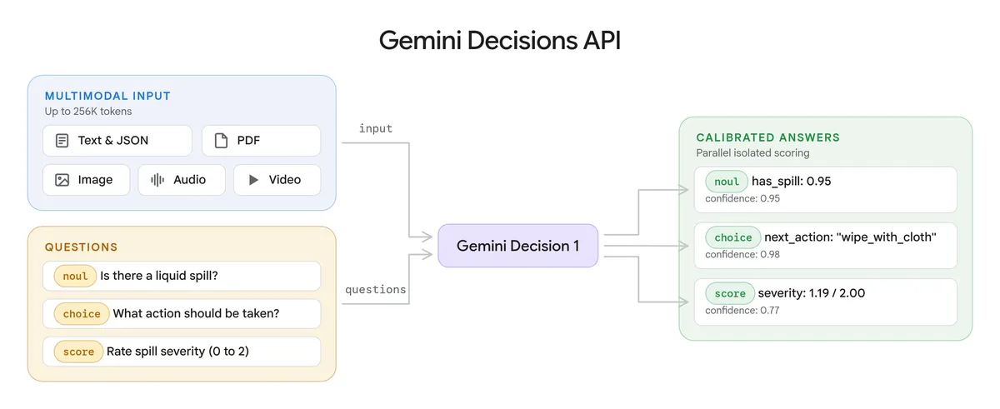
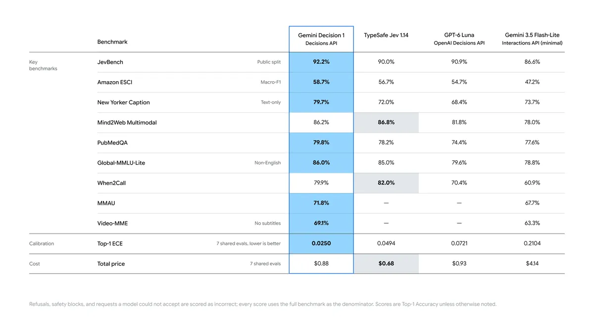
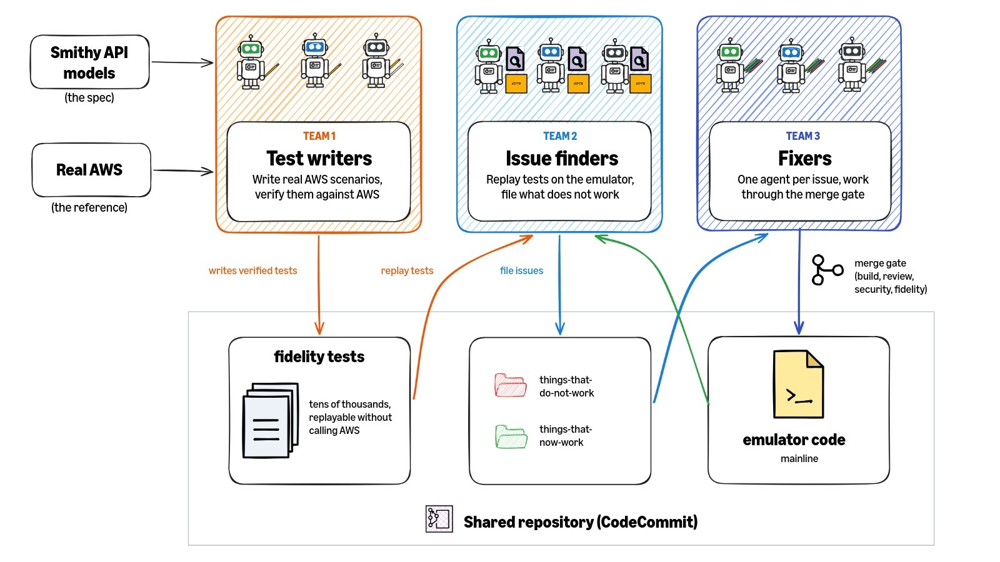
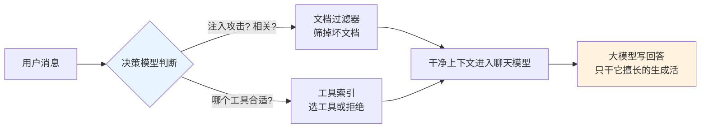

# 🗞️ LLM / Agent / Java 前沿日报 · 2026-11-13

> 数据窗口：2026-11-11 ~ 2026-11-12（美西时间）· 信源：GitHub Trending / Hacker News / arXiv / Spring & Inside.java & InfoQ & SimonWillison RSS / web_search

## 📌 今日速览

| 板块 | 一句话头条 |
|---|---|
| 🧠 LLM | Google 发布 **Gemini Decisions API**：不写一个字、只给"选择题答案+置信度"的专用模型，$0.10/百万 token、输出 token 免费，单次可判 1000 个问题——"决策模型"正式成为大厂标配品类（OpenAI 上月已发同类 API） |
| 🤖 Agent | AWS 发布 **AWS Emulator**：在本地毫秒级模拟 AWS 服务的模拟器，**100% 由自主 AI agent 编写、人类一行代码没写也没审过**，CC0 公有领域开源——"AI 写基础设施"从 Anthropic 的 C 编译器实验走到了 AWS 官方产品 |
| ☕ Java | **Spring AI 2.1.0-RC2** 落地 `DecisionModel` API：Java 世界第一次有了"类型化决策"一等公民抽象（yes/no、多选、打分都带概率），OpenAI/Ollama/TypeSafe 三家后端同日可用 |

**今日暗线**：三个板块的头条其实是同一件事——**"决策模型"（decision model）品类的爆发**。上周我们报道过亚马逊用 2B 小决策模型省 98% 成本的实证，本周 Google 直接发了产品、Spring 把它做进了框架 API。行业共识正在形成：让大模型"写作文"是浪费，判断题就该用判断题的价钱。

---

## 🧠 LLM 前沿

### 🔬 深度解析：Google 发布 Gemini Decisions API——"不生成文字，只打分"的模型正式成为产品品类



*图：Gemini Decision 1 与竞品（TypeSafe Jev、OpenAI Decisions API 等）在 agent 路由/推理/排序/多模态基准上的对比，Google 称 9 项中 7 项领先、校准误差最低（出处：[Google 官方博客](https://blog.google/innovation-and-ai/technology/developers-tools/gemini-decisions-api/)）*

**🎯 30 秒版本**：11 月 11 日 Google DeepMind 发布 Gemini Decisions API 和专用模型 Gemini Decision 1。它和普通大模型的根本区别：**不逐字生成回答，而是对你给的"选择题"直接打分**——输入一段文本/图片/音频/视频/PDF，加上最多 1000 个问题（判断题、最多 255 个选项的选择题、按量表打分题），一次前向计算全部答完，返回每个选项的概率。价格 $0.10/百万输入 token，输出 token 完全免费。

**背景铺垫**：① 普通 LLM 的工作方式是"逐 token 生成"（token≈词的一个碎片）——你问"这条客服消息是不是在投诉商品质量？"，它要一个字一个字地写出"是，因为……"，你再去解析这段文字，又慢又贵还可能跑题。② **校准（calibration）**：模型说"我 90% 确定"时，是不是真的 10 次里对 9 次。校准好的概率才能直接拿来做业务决策——比如"置信度 <0.9 就转人工"。

**它怎么工作、关键数字**：Gemini Decision 1 跳过文字生成，直接在模型内部对每个候选选项算概率——官方数据：模型计算只要 50-100ms，端到端 150-250ms，且**从 1 个问题到 100 个问题延迟几乎不变**（参照系：普通聊天模型多答 100 个问题≈多生成 100 倍文字，延迟和账单都线性上涨）。共享输入只计费一次，256K token 上下文，文本/图像/音频/视频/PDF 混着塞都行。Google 内部已经在用：Gemini Notebook 拿它做实时模型路由（简单问题派给便宜模型，整体延迟降 40%）、Google 搜索拿它做 MCP 工具的安全检查层（防 agent 被恶意工具注入）。



*图：官方公布的基准表——在 agent 路由、推理、排序、多模态理解四组基准上对比 Jev 与 OpenAI Decisions API，Gemini Decision 1 拿下多数第一且校准误差（calibration error）最低（出处：[Google 官方博客](https://blog.google/innovation-and-ai/technology/developers-tools/gemini-decisions-api/)）*

**前因后果**：之前是什么样？所有人做分类/路由/审核都用"聊天模型+prompt 约束"，成本高、延迟大、还要自己解析自由文本。为什么现在变？这条产品线的引爆点是 TypeSafe 的 Jev 和 OpenAI 上个月的 Decisions API——上周日报里亚马逊"2B 决策模型替换 Sonnet 4.6、成本降 98%"的实证更是把账算明白了。Google 这次入场带着两个杀手锏：**原生多模态**（竞品基本只管文本）和**输出 token 免费**（比自家 Flash-Lite 便宜约 5 倍）。据 SiliconANGLE 报道，Google 自测 9 项基准赢 7 项，但 Jev 在成本上还略胜一筹。变了之后谁受影响？做 agent 编排、内容审核、客服路由、RAG 打分的团队——这些地方原本每次调用都在为"让模型写作文"付钱，现在可以换成一毛钱的判断题。生态当天跟进：OpenRouter、LangChain、Vercel AI SDK、LiteLLM、Pydantic AI、LiveKit 等已接入。

**💡 所以呢**：如果你有任何"让 LLM 回答是/否或选一个"的场景，值得重算一笔账——按 Google 定价，1 亿次单题判断（假设每次 500 token 输入）约 $5，用 Flash-Lite 级别的聊天模型做同样的事大约贵 5 倍还要付输出费。注意局限：只支持"封闭选项"，不能做带参数的工具调用和多步推理——它是分诊台，不是主治医生。

[Google 官方博客](https://blog.google/innovation-and-ai/technology/developers-tools/gemini-decisions-api/) · [AI Studio 文档](https://aistudio.google.com/docs/decisions-api) · [SiliconANGLE 分析](https://siliconangle.com/2026/11/11/google-enters-the-decision-model-market-with-gemini-decisions-api) · [Simon Willison 点评](https://simonwillison.net/2026/Nov/11/gemini-decisions-api/)

### 📰 LLM 要闻简报

- **黄仁勋卸任 NVIDIA CEO，股价单日跌约 10%**：11 月 12 日 NVIDIA 董事会宣布，创始人黄仁勋（Jensen Huang）即刻辞去总裁、CEO 及董事职务，CFO Colette Kress 出任临时 CEO，董事会启动内外部继任者搜寻并开展独立调查。此前《华尔街日报》报道董事会曾就其婚外情传闻讨论去留。参照系：黄仁勋 33 年前联合创立 NVIDIA，把它做成了约 4 万亿美元市值、AI 算力浪潮的最大卖铲人——这是 AI 行业今年最大的人事地震，短期对 CUDA 生态路线和各家（包括 Anthropic IPO 中 NVIDIA 的 $100 亿投资）的影响值得盯。官方声明未给离职原因细节。[NVIDIA 官方](https://nvidianews.nvidia.com/news/nvidia-announces-ceo-transition) · [CNBC 实时追踪](https://www.cnbc.com/2026/11/12/nvidia-jensen-huang-ceo-live-updates.html) · [HN 1240 分热帖](https://news.ycombinator.com/item?id=50467087)
- **Anthropic IPO 定价区间敲定：$70-78/股，估值最高 $1.404 万亿，11 月 19 日挂牌**：修订版招股书显示发行 8.25 亿股 Class A，募资约 $577.5–643.5 亿（参照系：约为五个月前 SpaceX 创纪录 IPO 募资 $857 亿的七成，仍是史上最大 IPO 之一），Nasdaq 代码 "ANT"；散户配售约 20%（常规 IPO 只有 5-10%）。另有 AMD/博通/Google/美光/微软/NVIDIA/台积电按 IPO 价私下认购 $260 亿无投票权 Class N 股（Google 和 NVIDIA 各 $100 亿）。7 位联创每人出售约 340 万股（按中值套现约 $2.5 亿）。运营数据：10 月底年化收入（run-rate）已达 $810 亿，比 9 月底多 $100 亿。这是继 SpaceX 之后五个月内第二起超大型 IPO，机构订单已超额覆盖。[TechCrunch](https://techcrunch.com/2026/11/10/anthropic-sets-ipo-price-range-of-70-to-78-per-share-to-reach-an-implied-valuation-of-1-404-trillion/) · [CNBC](https://www.cnbc.com/2026/11/10/anthropic-sets-price-range-of-70-to-78-in-upcoming-ipo.html) · [官方公告](https://www.anthropic.com/news/roadshow-launch)
- **Simon Willison 的 llm CLI 更新到 0.37.2**：他同步写了 Decisions API 的快速上手——llm 生态对"决策模型"这类新原语的响应速度一贯是最快的，想低成本试水的可以先用 `llm` 命令行摸一摸。[链接](https://simonwillison.net/2026/Nov/11/llm/)

---

## 🤖 Agent 进展

### 🔬 深度解析：AWS Emulator——一个"人类零参与"写完的官方产品，agent 工程化的里程碑样本



*图：AWS 官方架构图——三队 agent 围绕一个共享代码仓库协作：测试队把"真实 AWS 行为"固化成数万个可重放的保真测试；找茬队重放测试、给失败项开 issue；修复队一个 agent 领一个 issue，改动必须过"编译/评审/安全/保真"四道合并门禁（出处：[About Amazon 官方博客](https://www.aboutamazon.com/news/aws/how-autonomous-ai-agents-built-aws-emulator)）*

**🎯 30 秒版本**：11 月 11 日 AWS 发布 [aws-emulator](https://github.com/aws/aws-emulator)：一个跑在你笔记本上的 AWS 模拟器，用和真 AWS 完全相同的 SDK/CLI 调用，毫秒级返回、不用 AWS 账号、不花钱，源码以 CC0（公有领域，等于放弃一切版权）发布。**真正的新闻是它的制造方式：100% 由自主 AI agent 编写，AWS 团队"没有写过也没有审过任何一行代码"。**

**背景铺垫**：① 模拟器（emulator）= 用一个本地程序假装成远端服务，让你的代码以为在和真 AWS 说话。之前社区有 LocalStack 等第三方方案，但官方出手是第一次。② **保真度（fidelity）**：模拟器的回答和真 AWS 一致的程度——这是模拟器唯一的生命线，AWS 为此公开发布了保真测试套件和每个版本的保真分数，"连没通过的测试都公开"。

**它是怎么被 agent 造出来的（这部分最有工程价值）**：起点是一个周末实验——受 Anthropic "agent 自主写 C 编译器"实验启发，一位高级首席工程师给 Kiro（AWS 的 agent 编程工具）发了三行 prompt："按 AWS CLI 写测试→对着真 AWS 迭代到全过→再写一个内存实现让这些测试通过。" 15 分钟后得到了能用的 SQS（消息队列服务）雏形，一个周末铺完其余服务。产品化后的架构是**三队分工的 agent 流水线**：测试队从 438 个 AWS API 模型（AWS 官方发布的 API 规格文件，也是生成各语言 SDK 的同一套源头）出发生成真实场景测试，并先在真 AWS 上验证；找茬队把数万个保真测试重放到模拟器上，失败的归类开 issue；修复队**一个 agent 只领一个 issue**，改完必须通过合并门禁——能编译、符合编码规范（agent 评审）、安全（agent 检查）、不降低保真度。现状：数百个 agent 并发，每天修掉数千个 issue。未实现的操作返回 501，让测试立刻失败而不是假装成功——这个"诚实失败"的设计对 agent 用户尤其重要。

**前因后果**：之前，"AI 写整个产品"停留在实验和创业公司 demo 层面（Anthropic 的 C 编译器是研究性质）；大厂核心工具链依然人写人审。为什么现在变？AWS 手里有两样别家难凑齐的东西：**机器可读的完整规格**（438 个 API 模型）和**可对照的参考实现**（真 AWS 本身）——等于给 agent 发了"标准答案+自动阅卷机"，这正是那篇博文的核心观点："agent 需要涂色书"（边界清晰的任务才发挥得好）。变了之后谁受影响？① 直接受益者是本地开发和 CI（持续集成）：每个测试实例有独立端口/密钥/内存状态，多个 agent、多条流水线互不干扰，官方明确说这就是给 coding agent 设计的内环（inner loop）；② 更深的影响是给"agent 工程化"提供了可复制的配方——**规格即任务、测试即门禁、一 issue 一 agent**，这套模式任何有清晰规格的系统（协议实现、SDK、编译器前端）都能抄。

**💡 所以呢**：Java 后端团队最实际的用法：把 Testcontainers/LocalStack 的 AWS 集成测试换成本地模拟器，CI 提速且零云费用；注意它是内存态、无持久化保证，只适合测试不适合当生产替身。另外强烈建议读一遍那篇"agent 造模拟器"的博文——它可能是目前对"如何组织大规模 agent 工程"最坦诚的官方一手材料，后续还会出系列文章讲架构和保真度度量。

[AWS 官方公告](https://aws.amazon.com/about-aws/whats-new/2026/11/aws-emulator-now-available) · [AWS News Blog 上手](https://aws.amazon.com/blogs/aws/test-your-applications-against-aws-locally-with-aws-emulator/) · [agent 制造内幕](https://www.aboutamazon.com/news/aws/how-autonomous-ai-agents-built-aws-emulator) · [GitHub](https://github.com/aws/aws-emulator) · [Simon Willison](https://simonwillison.net/2026/Nov/11/aws-emulator/)

### 📰 Agent 要闻简报

- **Apache httpd 曝严重 RCE（CVE-2026-119618），发现者是 Anthropic 和 Google 的漏洞研究团队**：HTTP/2 模块 `assign_headers()` 的并发竞态可致堆损坏→远程代码执行，影响 2.4.55–2.4.70（修到 2.4.71）。Wiz 数据：**64% 的云环境存在受影响资源**，51% 有公网暴露实例；暂无在野利用。临时缓解：`Protocols http/1.1` 关掉 HTTP/2。值得注意的信号：这是"AI 公司做漏洞挖掘"能力的又一次公开实锤——上周 Anthropic 刚在 IPO 材料里强调模型的攻防评估。[Wiz 分析](https://www.wiz.io/blog/cve-2026-119618-rce-apache-http-server-vulnerability) · [Apache 安全公告](https://httpd.apache.org/security/vulnerabilities_24.html)
- **Jane Street 官宣调整工程师面试：写代码变少，考"用 LLM 干活"变多**：这家顶级量化交易公司今夏开始在校园招聘 onsite 试点新面试轮：少写代码，多考软件设计、验证代码质量/结构/意图、以及**用 LLM 产出代码**的能力。传统无 LLM 辅助的编程轮仍是多数。他们明确说不要求你有成熟的 agent 方法论，看重的是"对工具擅长什么、哪里不行有清醒判断"。为什么重要：这可能是头部雇主第一次把"AI 协作能力"正式写进面试结构——生成代码越便宜，品味、抽象选择和验证正确性就越值钱。[Jane Street 博客](https://blog.janestreet.com/software-engineering-interviews-are-changing-a-little/) · [HN 讨论](https://news.ycombinator.com/item?id=50467297)
- **arXiv：《When Should Agents Remember?》——给 agent 的记忆更新装"证伪门"**：论文提出 Falsification-Gated Self-Evolution（可证伪门控的自进化）：agent 不是把每次经验都写进长期记忆，而是只有当新证据能**证伪**旧结论时才允许更新——针对的正是 agent 记忆里"过时经验越积越多、反过来污染决策"的老问题（和昨天报道的 Google "过期 TODO 让 agent 多烧 77% token"是同一问题的两个侧面）。[arXiv 2611.14326](https://arxiv.org/abs/2611.14326)
- **arXiv：ReTrace——把"会规划的工具 agent"蒸馏成"不用规划的流水线"**：先让贵的大 agent 带着规划器跑任务，录下轨迹，再蒸馏出一个不需要 planner（规划器，agent 每一步先想"接下来干嘛"的模块）的固定工作流——推理时省掉反复规划的开销，适合任务模式稳定的生产场景。[arXiv 2611.14492](https://arxiv.org/abs/2611.14492)

---

## ☕ Java 工程

### 🔬 深度解析：Spring AI 2.1.0-RC2 的 `DecisionModel`——Java 生态抢跑"决策模型"抽象，还顺手修了工具流式调用的老坑

**🎯 30 秒版本**：Spring AI（Spring 官方的 LLM 集成框架，Java 版 LangChain）2.1.0-RC2 上线 Maven Central，核心是新 API `DecisionModel`：把"是/否判断、多选一、量表打分"这三类封闭决策做成**带类型、带概率**的一等公民接口，`DecisionPrompt` 进、`DecisionResponse` 出。OpenAI（对接其 Decisions API）、Ollama（本地跑 `d1-omni:600m`，无需 API key）、System One（TypeSafe 协议，通吃 Jev/Laya/Ollama）三个实现同日可用。结合今天 Google 的 Decisions API 发布，**"决策模型"这条产品线在模型层和框架层同时成熟了**。

**背景铺垫**：之前 Java 里做文本分类只有两条路——要么用聊天模型让它输出文字再自己解析（"请只回答 yes 或 no"这种 prompt 工程，模型偶尔会答"是的，我认为……"让你解析崩掉），要么自己训练传统分类器（要标注数据、要维护模型）。`DecisionModel` 是第三条路：结构化输入结构化输出，且**每个答案带概率**。

**关键设计与代码**（官方示例浓缩）：

```java
DecisionResponse response = decisionModel.call(DecisionPrompt.builder()
    .text("我的新耳机昨天到了，但左边没声音，能退款吗？")
    .question("defect", YesNoQuestion.builder()
        .text("客户是否报告了产品缺陷？")
        .whenYes("商品的某部分不能正常工作").whenNo("商品正常，说的是别的事").build())
    .question("topic", ChoiceQuestion.builder().text("消息主题是什么？")
        .option("delivery", "物流").option("product", "商品问题")
        .option("account", "账户").option("other", "其他").build())
    .build());

boolean defect = response.getYesNo("defect").isYes(0.9); // 阈值你定：90% 置信才算数
```

注意 `isYes(0.9)`：**概率交给模型，阈值留给应用**——"多确定才自动开工单"是业务决定，不是模型决定。框架内已经用它搭了三个上层件：`DecisionDocumentReranker`（RAG 检索后按"这篇能否回答问题"重排文档）、`DecisionDocumentFilter`（进 prompt 前先筛掉注入攻击/矛盾/无关文档，默认 fail-open 判不了就放行并记日志）、`DecisionToolIndex`（第四种工具检索策略——正则/Lucene/向量之外，直接问决策模型"哪个工具合适、或者都不合适"，避免硬塞一个最接近的错误工具）。



*怎么读这张图：便宜的决策模型站在贵的大模型前面当"门卫和分诊台"——先过滤（防注入）、再选路（挑工具），大模型只负责最后一步生成。这正是今天 Google Decisions API 博客里 Google 内部的同款架构。*

**前因后果**：之前（2.0 时代）Spring AI 的一切智能都走 `ChatModel`，分类靠 prompt 硬凑；11 月初 RC1 做了记忆/向量库接口洗牌（见 11-01 日报），RC2 则补上了"非生成式调用"这块拼图。为什么现在？上游模型层刚好在同期成熟——OpenAI 上月发了 Decisions API，TypeSafe 的 Jev 已跑了一年，Google 今天入场。Spring AI 把三家统一在一个接口后面，是典型的 Spring 式"抹平供应商差异"。**谁受影响**：所有在用 Spring AI 做客服路由、内容审核、RAG 的团队，GA（正式版）后就该把散落的"请只回答 yes/no" prompt 收编到 `DecisionModel`。升级注意：这是 RC，Anthropic Java SDK 同时跳到 3.4.0、Anthropic/Bedrock 的 token 统计口径变了（prompt cache 的 token 现在计入 input tokens，手动加过缓存补偿的代码要删掉，否则重复计数）。

**RC2 里另外两件值得知道的事**：① **工具调用参数流式输出**——模型逐段吐工具参数时，以前 Spring AI 只能等凑齐了给你完整调用，现在以"partial ToolCallPart"实时流出，UI 可以边生成边展示"agent 正在调用什么"（框架层保证 partial 不会被误执行、不会写进聊天记忆）；② **自带 embedding 的向量库从 5 家扩到 10 家**（新增 Neo4j、MongoDB Atlas、Typesense、MariaDB、Chroma），MCP 服务器支持 2026-07-28 "modern" 协议修订版。GA 就在眼前。

**💡 所以呢**：想零成本试水的话，Ollama 实现最友好——`spring.ai.ollama.init.pull-model-strategy=when_missing` 一行配置自动拉模型，本地跑通再换 OpenAI 后端，接口不变。评估清单：把你项目里所有"让聊天模型做判断"的调用列出来，逐个问"选项集合是不是封闭的？"——是，就是 DecisionModel 的目标客户。

[Spring AI 2.1.0-RC2 官方博客](https://spring.io/blog/2026/11/09/spring-ai-2-1-0-RC2-available-now) · [GitHub Release Notes](https://github.com/spring-projects/spring-ai/releases/tag/v2.1.0-RC2) · [DEV 社区解读](https://dev.to/jamilxt/spring-ais-new-decisionmodel-stop-asking-chat-models-for-yes-or-no-47fd)

### 📰 Java 要闻简报

- **Oracle JDK 21 免费更新时代结束：10 月 CPU 起（21.0.13+）切换到 OTN 许可**：JDK 21 的 NFTC（No-Fee Terms and Conditions，免费商用许可）随 JDK 25 发布满一年而到期，2026 年 10 月起的更新改用 OTN 许可（Java SE OTN，和 Java 8/11/17 更新同款）——个人使用和开发/测试仍免费，但**生产环境继续拿安全更新需要 Java SE Universal Subscription 或其他商业授权**（订阅下 21 支持到至少 2031 年 9 月）。不动的后果：停在 21.0.12.1 合法但永远没有安全补丁。行动建议：要么升 JDK 25（免费 NFTC 的现役 LTS），要么换 OpenJDK 发行版（Temurin/Corretto 等不受影响），要么买订阅——Java Bulletin 的 Digest #111 把选项梳理得很清楚。[Oracle 官方公告](https://blogs.oracle.com/java/jdk-21-approaches-end-of-permissive-license) · [下载页许可说明](https://oracle.com/java/technologies/downloads) · [Java Bulletin Digest #111](https://javabulletin.substack.com/p/digest-111-the-jdk-21-licence-change)
- **Spring Boot 4.2.0-RC2 + Spring Cloud 2026.0.0-RC2 就位，GA 预计本月**：Boot 4.2.0-RC2（11 月 6 日）含 99 项增强与修复；Spring Cloud 2026.0.0-RC2（代号 Paddington 列车）基于同一 Boot 底座。对还在 Boot 4.0 的项目提醒一句：4.0 的 OSS 支持 2026-12-31 截止，RC 阶段是验证依赖兼容性的最后窗口。[Spring Boot 4.2.0-RC2](https://spring.io/blog/2026/11/06/spring-boot-4-2-0-RC2-available-now) · [Spring Cloud RC2](https://spring.io/blog/2026/11/05/spring-cloud-2026-0-0-RC2-has-been-released)
- **OpenAI codex-security 0.10.0 发布，仓库今日 +663 star**：OpenAI 官方的安全扫描 CLI/SDK（用 agent 找漏洞→验证→出补丁→导出 SARIF），0.10.0 新增中断扫描续跑（`scans resume`）、批量扫描共享预算（`--max-total-cost`）、补丁被阻塞时给出明确原因。Apache-2.0 许可，npm 即装。[GitHub Releases](https://github.com/openai/codex-security/releases) · [仓库](https://github.com/openai/codex-security)

---

## 📋 今日其余动态

| # | 动态 | 板块 | 链接 |
|---|---|---|---|
| 1 | meta/astryx（Meta 的"agent 友好"设计系统）连续第三天霸榜 GitHub Trending，今日 +1789 star | 前端/Agent | [GitHub](https://github.com/meta/astryx) |
| 2 | addyosmani/agent-skills：Chrome 团队 Addy Osmani 整理的"生产级 agent 工程技能包"，今日 +812 star | Agent | [GitHub](https://github.com/addyosmani/agent-skills) |
| 3 | Alishahryar1/free-claude-code：声称用 1.3B 小模型免费跑 Claude Code 等 12 种编程 agent 框架，+461 star（真实性自行甄别） | Agent | [GitHub](https://github.com/Alishahryar1/free-claude-code) |
| 4 | CopilotKit/OpenBot：开源"AI 同事"，每个 agent 独享一台虚拟电脑（浏览器+文件+工具），+291 star | Agent | [GitHub](https://github.com/CopilotKit/OpenBot) |
| 5 | DIYgod/pinky（RSSHub 作者新作）：让 AI agent 用你的手机、人保留在环确认，一周 +1985 star | Agent | [GitHub](https://github.com/DIYgod/pinky) |
| 6 | QwenLM/qwen-code：阿里官方终端编程 agent 持续在榜，+151 star | LLM 工具 | [GitHub](https://github.com/QwenLM/qwen-code) |
| 7 | PostgreSQL 18.7/17.12/16.16/15.20/14.25 安全更新 + **19 RC 2** 发布 | 数据库 | [官方公告](https://www.postgresql.org/about/news/postgresql-187-1712-1616-1520-1425-and-19-rc-2-released-3442/) |
| 8 | 🎮 NX2navi：Switch 2 模拟器项目一周 +3452 star；S2Arm（把 Switch 游戏重编译成 ARM64 原生跑在 iPhone/iPad/Mac）+2745 star——Switch 2 模拟生态在 GitHub 上爆发 | 模拟器 | [NX2navi](https://github.com/tangerineturtle1/NX2navi) · [S2Arm](https://github.com/jhaizhou-ops/S2Arm) |
| 9 | arXiv：Earlybird——29M 参数的流式语音识别（参照系：常见 ASR 模型的 1/100 大小），面向 always-on 设备 | LLM | [arXiv 2611.14421](https://arxiv.org/abs/2611.14421) |
| 10 | arXiv：《AI Isn't Getting Dumber, We're Getting Pickier》——人类评审对 LLM 输出的标准在系统性变严，"模型变笨"的体感部分是评审漂移 | LLM | [arXiv 2611.14333](https://arxiv.org/abs/2611.14333) |
| 11 | arXiv：REAL Loss——直接优化投机解码（speculative decoding，小模型打草稿大模型批阅的加速术）的"真实期望接受长度" | LLM | [arXiv 2611.14399](https://arxiv.org/abs/2611.14399) |
| 12 | Show HN: Fable52.games——收集可在线玩+可查源码的 Claude Fable 5.2 单文件 HTML 小游戏 | LLM/游戏 | [链接](https://fable52.games) |
| 13 | Chips and Cheese 对话 AMD 架构师 Mike Clark 谈 Zen 6（下一代 CPU 微架构） | 硬件 | [链接](https://chipsandcheese.com/p/talking-zen-6-with-mike-clark-at) |
| 14 | 🕯️ Python 社区悼念 Tim Peters（1952-2026）：Python 核心开发者、排序算法 timsort 作者、《Python 之禅》名句作者 | 社区 | [Python Discourse](https://discuss.python.org/t/in-memoriam-tim-peters-1952-2026/110028) |
| 15 | InfoQ RSS 今日抓取失败（返回 294 字节），本期未纳入；arXiv RSS 周末空壳属正常，已按预案回退 API 抓取 | 备注 | — |

---

## 💡 一句话点评

一天之内 Google 发决策模型 API、AWS 交出"agent 全员施工"的官方产品、Spring 把决策抽象写进框架 RC——**2026 年末的行业主线已经不是"模型更聪明"，而是"把聪明拆开来卖"**：判断题一毛、作文题另算、写代码的活干脆让 agent 承包。而黄仁勋的突然卸任提醒所有人：卖铲子的人换了，金矿的故事还得接着讲。

---

<sub>🤖 本报告由 Hermes Agent 每日凌晨自动调研生成 · [HermesReports](https://github.com/knolonzhou/HermesReports)</sub>
